上一课，我们让模型帮忙排查运费问题。它需要看到代码，可能还会提出读取文件的请求，拿到结果后再继续分析。

你在界面上看到的是一段连续的对话。程序在背后做的，却是一次次具体的调用：准备材料，发送请求，接收回复，再决定怎样继续。

这一课，我们把其中的一次调用放慢来看。先从一个最简单的问题开始：

代码是 `subtotal > 100`。`subtotal` 恰好为 100 时，条件成立吗？

这个问题不难。正好可以让我们把注意力放在另一件事上：这句话怎样到达模型，模型生成的内容又怎样回到 MyBuddy。

## 本课导览

本课沿一次调用讲五件事：请求里装了什么；后一次调用怎样接上前文；上下文容量、输出上限和累计用量有什么区别；流式回复怎样拼成完整消息；没拿到回复时，沿调用路线查哪里。

我们会沿同一个运费问题逐步展开。源码解析再把这些过程对应到具体模块；下一课接着看工具调用怎样真正执行。

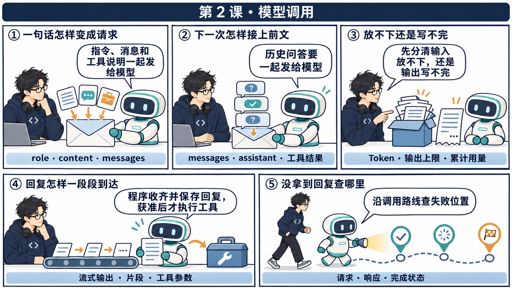

## 一、你输入的一句话，怎样变成模型请求？

**一次调用，就是发出一份请求、收回一份响应；请求里除了问题，还有指令、工具说明和设置。**

### 先看最简单的一次往返

**最简单的调用只有三步：把问题装进请求，发给模型服务，从响应里取出文字。**

你把问题输入 MyBuddy，MyBuddy 把它交给模型服务。双方要约定数据怎么发、结果怎么收。这种程序之间约定好的收发方式，叫 **API**（应用程序接口）。

程序发出去的数据叫**请求（Request）**，服务返回的数据叫**响应（Response）**。响应里由模型生成的部分，才是平时说的模型回复。

先看最简版。下面是 Python 风格的**教学伪代码**，字段名沿用后面会讲的 Claude Messages 接口：

```python
def ask_once(question):
    request = {"model": "模型ID", "max_tokens": 512,
               "messages": [{"role": "user", "content": question}]}
    response = http_post(API_URL, json=request, headers={"x-api-key": API_KEY})
    return response["content"][0]["text"]       # 取出模型写的文字
```

它能回答一个简单问题。但用来排查运费，很快就会遇到问题。本课后面几节一次补一个：

1. **你追问“那如果改成** `>=` **呢？”，模型接不上前文 → 每次都把历史一起发过去。** 见第二节。
2. **模型要看文件，可它碰不到你的电脑 → 在请求里附上工具说明，让模型提出读取建议。** 见第二节。
3. **材料太多放不下，或回答写到一半停了 → 分清输入超限和输出上限，看结束原因。** 见第三节。
4. **长回答要等很久 → 用流式输出边收边显示，但收齐、检查、保存之后才能用。** 见第四节。
5. **网络断了、响应不合格 → 不当成回复使用，沿调用路线找停在哪一步。** 见第五节。

先暂时忽略字段，看看这次往返的内容：

```latex
输入：
  请解释：subtotal > 100。
  subtotal 恰好为 100 时，条件成立吗？

模型可能回答：
  不成立。> 表示大于，100 并不大于 100。
```

模型能解释这个条件，因为条件和数值已经给它了。但如果你只写“看看 `src/shipping.py` 为什么算错”，模型服务不会自动打开你电脑上的文件。路径只告诉它去哪里找，内容要靠本地程序取得。

先记住一个区别：**知道文件的名字，和拿到文件的内容，是两件事。** 下一课的读取工具，负责把这一步接起来。

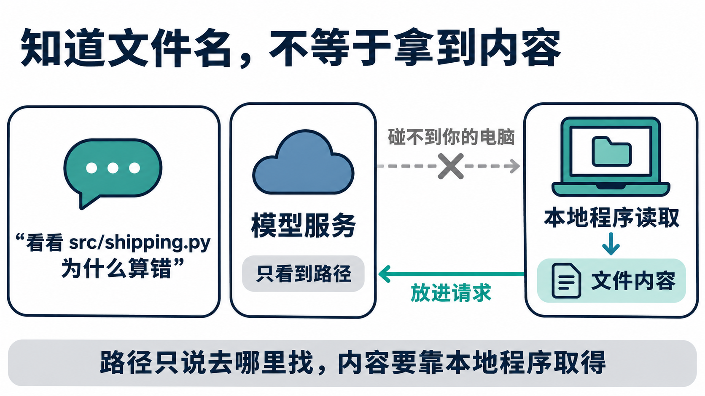

看完这张图，你要能：分清路径和文件内容：模型服务碰不到你的电脑，内容要靠本地程序读取后放进请求。

### 除了问题，请求里还要装什么？

**一次请求由四部分组成：指令、消息、工具说明、调用设置。**

以运费问题为例，四部分各放这些内容（每份请求怎样挑选内容，第 8 课细讲）：

| 部分 | 这次放什么 | 作用 |
| --- | --- | --- |
| 指令 | 根据材料解释原因，暂不修改 | 说明处理任务的要求 |
| 消息 | 你的问题、此前问答、已经取得的代码 | 提供当前任务和历史材料 |
| 工具说明 | `ReadFile` 的用途与参数 | 说明模型可以提出哪些动作 |
| 调用设置 | 模型名称、输出上限等 | 选择模型并限制本次生成 |

工具说明中的 **Schema**（参数格式说明）规定参数有哪些、各用什么类型，例如文件路径用字符串，起始行用整数。连接模型服务用的地址和 API Key 只管连接和身份验证，不放进提示词正文。

把一次调用想成一来一回两封信：去信里装四样东西，回信里除了文字，还贴着两张存档条：结束原因和用量。

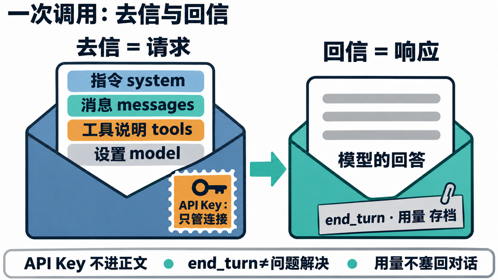

看完这张图，你要能：用“寄信和回信”记住一次调用装了什么：请求里有指令、消息、工具说明、设置四样；API Key 只用来连接；回信里的结束原因和用量只存档，不放进下一次对话。

### 打开请求，看看 messages 数组

`messages` **是一个有顺序的列表；每条消息用** `role` **说明身份，用** `content` **放内容。**

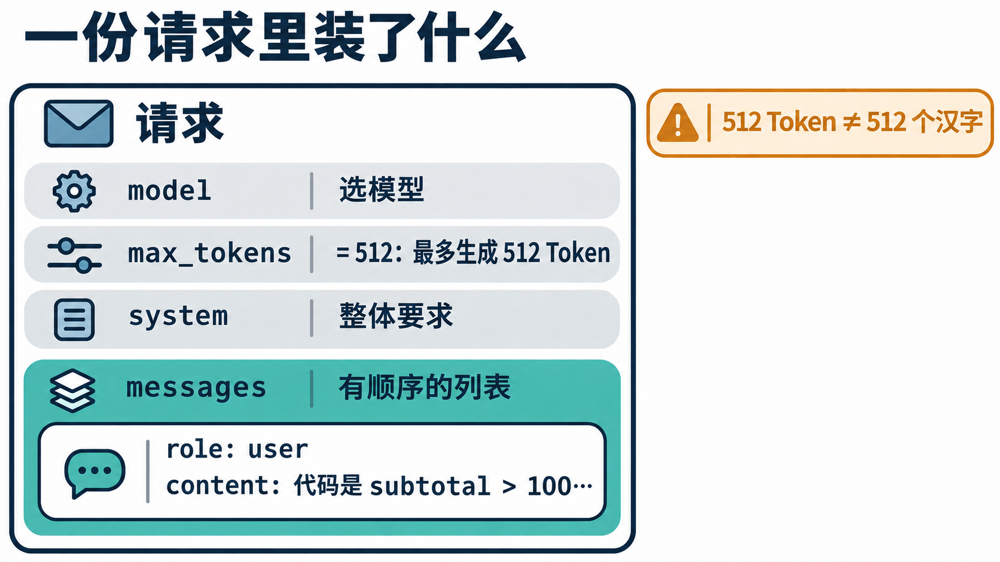

看完这张图，你要能：认出请求 JSON 里的 model、max_tokens、system 和 messages，以及 messages 里一条消息的 role 与 content。

请求常用 **JSON** 组织数据，再通过 HTTP/HTTPS 发送。JSON 可以保存文字、数字、对象和列表。不熟悉也没关系，先跟着字段读一遍。

下面用 Claude Messages API 的字段形式，暂时不提供工具。`模型ID` 是占位文字，实际要换成接入支持的模型名称。

```json
{
  "model": "模型ID",
  "max_tokens": 512,
  "system": "你是一位编程老师，请用简短中文解释给定代码。",
  "messages": [
    {
      "role": "user",
      "content": "代码是 subtotal > 100。subtotal 恰好为 100 时，条件成立吗？"
    }
  ]
}
```

从你熟悉的问题往外看。那句话保存在 `content` 里。旁边的 `role: user` 说明它是用户一方提供的。包住它们的 `{}` 是一条消息对象。

再往外一层，`messages` 后面的 `[]` 是数组，也就是**有顺序的列表**。现在只有一个问题，列表只有一条消息。后面有了历史，就继续往里放。

剩下三个字段：`system` 放整体要求，`model` 选模型，`max_tokens` 限制本次生成量。例子里写的 `"max_tokens": 512`，意思是这次回复最多生成 512 个 Token。512 个 Token 不等于 512 个汉字，Token 稍后再讲。

### 谁提问，谁回答，谁提供整体要求？

`user` **提问，**`assistant` **回答，**`system` **给整体要求；不同接口把它们放在不同位置，MyBuddy 里有一个转换格式的模块 Codec（编解码器）负责对接。**

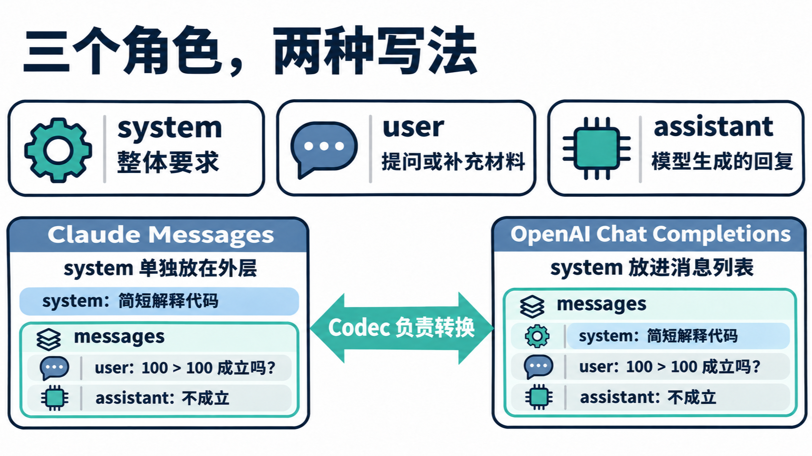

看完这张图，你要能：分清 system、user、assistant 三个角色，并知道两种接口放 system 的位置不同，由 Codec 转换。

前面的请求只有 `user`。模型回答以后，还会见到 `assistant`。

| 名称 | 对话中的职责 | 本例 |
| --- | --- | --- |
| `system` | 应用提供整体要求 | 用简短中文解释代码 |
| `user` | 用户一方提出问题或补充材料 | 恰好为 100 时成立吗？ |
| `assistant` | 模型生成回复 | 不成立，因为 `>` 不包含相等 |

普通问答的顺序通常是 `user → assistant → user → assistant`。你提问，模型回答，你再追问。`system` 给出处理要求，不参与轮流问答。

不过，协议不一定把它们放在同一位置。常见的有两种写法，下面把同一段对话分别写一遍。

第一种是 Claude Messages 的写法：`system` 是和 `messages` 并列的单独字段，`messages` 里只有 `user` 和 `assistant`。

```json
{
  "system": "你是一位编程老师，请用简短中文解释给定代码。",
  "messages": [
    {"role": "user", "content": "代码是 subtotal > 100。subtotal 恰好为 100 时，条件成立吗？"},
    {"role": "assistant", "content": "不成立，因为 > 不包含相等。"},
    {"role": "user", "content": "那改成 >= 呢？"}
  ]
}
```

第二种是 OpenAI Chat Completions 的写法：没有单独的 `system` 字段，整体要求作为一条 `role` 为 `system` 的消息，放在 `messages` 的最前面。

```json
{
  "messages": [
    {"role": "system", "content": "你是一位编程老师，请用简短中文解释给定代码。"},
    {"role": "user", "content": "代码是 subtotal > 100。subtotal 恰好为 100 时，条件成立吗？"},
    {"role": "assistant", "content": "不成立，因为 > 不包含相等。"},
    {"role": "user", "content": "那改成 >= 呢？"}
  ]
}
```

两种写法表达的是同样的内容，区别只在 `system` 放在哪里。所以 MyBuddy 需要一个转换格式的模块，就是图里的**编解码器（Codec）**。发出前，它把 MyBuddy 自己的消息格式转成接口要求的字段；收到后，再把响应解析回 MyBuddy 自己的数据。连接服务、发送和接收，则由**适配器（Adapter）**负责。源码解析会分别找到这两部分代码。

角色交替不是所有接口的硬规则。例如 Claude Messages 接口可以把连续同角色的消息视作一组。MyBuddy 转换工具结果时，也会把连续的工具结果放进一条 `user` 消息。

容易误会的地方：

- 整理历史时，每条内容原来是 `user` 还是 `assistant`，就保持原样。不能为了凑成交替顺序，把用户的话改标成模型回答。

## 二、回复回来以后，下一次调用怎样继续？

**模型不记得上一次调用；要接上前文，下一次请求就得把历史一起发过去。**

### 响应里为什么不只有一句话？

**响应里除了文字，还有结束原因和用量；文字放在** `content` **的内容块里。**

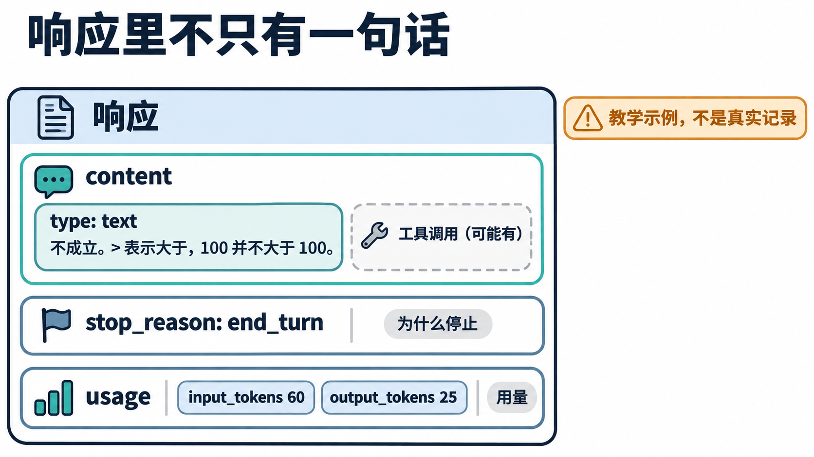

看完这张图，你要能：在响应里找到 content 的文本块、stop_reason 和 usage，知道一条消息可以有多个内容块。

问题发出去后，模型可能生成“不成立”。但程序收到的响应还带着其他字段。下面只保留本课需要的部分。ID、回复和用量都是教学示例，不是真实记录。

```json
{
  "id": "msg_example",
  "type": "message",
  "role": "assistant",
  "content": [
    {"type": "text", "text": "不成立。> 表示大于，100 并不大于 100。"}
  ],
  "stop_reason": "end_turn",
  "usage": {"input_tokens": 60, "output_tokens": 25}
}
```

先找我们等的那句话。它在 `content` 数组的一个文本块里。这个块的 `type` 是 `text`，文字在 `text` 字段中。

为什么多一层数组？因为一条消息可以包含不同类型的内容。除了文字，还可能有工具调用等内容块。纯文本输入可以简写成字符串。要表达更丰富的数据，就用带类型的内容块。

这里要分清两层列表：

```latex
messages：有哪些消息，按什么顺序排列
  └─ 一条消息的 content：这条消息里有哪些内容块
```

一条回复可以同时包含说明文字和工具调用建议，它仍是一条模型消息。

再看响应末尾。`stop_reason` 告诉程序生成为什么停止，`usage` 记录输入和输出用量。这里的 `end_turn` 表示模型结束了这次回复。

### 下一次追问，模型怎样接上前文？

**模型能接上前文，是因为本地程序把原问题、上次回答和新问题一起发了过去。**

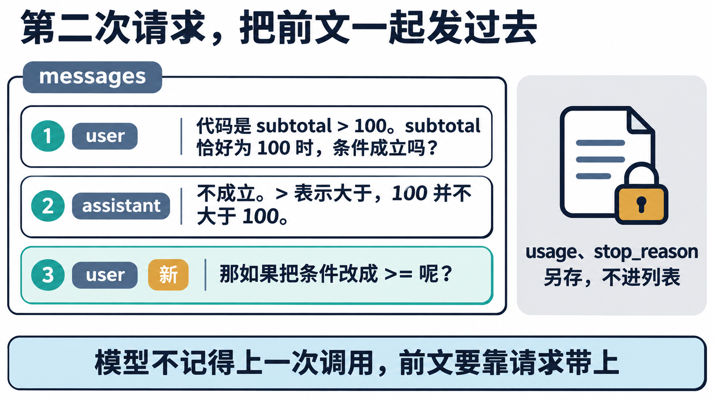

看完这张图，你要能：看清第二次请求的 messages 顺序：原问题、上次回答、新问题；usage 与 stop_reason 另存，不进列表。

模型解释了 `>`，你接着问：

那如果把条件改成 `>=` 呢？

这句话很短，你却不觉得缺东西。前面的代码、数值和回答都还在聊天窗口里，你知道“那如果”接的是哪句。

换到模型服务这边想：如果它这次只收到这句追问，能确定你还在讨论 100 元这个边界吗？

不能。它可以解释 `>=` 是“大于或等于”，却不知道之前的代码和数值。要接着回答，就得拿到前文。

先看由本地程序提交历史的做法。沿用前面的接口形式，第二次请求的 `messages` 可以是：

```json
[
  {
    "role": "user",
    "content": "代码是 subtotal > 100。subtotal 恰好为 100 时，条件成立吗？"
  },
  {
    "role": "assistant",
    "content": [
      {"type": "text", "text": "不成立。> 表示大于，100 并不大于 100。"}
    ]
  },
  {
    "role": "user",
    "content": "那如果把条件改成 >= 呢？"
  }
]
```

顺序是：**你的原问题 → 模型刚才的回答 → 你的新问题**。这样，“那如果”就有了前文，模型可以据此判断 100 是否满足新条件。

注意第二条。整份列表是本地程序发的，那段回答仍标为 `assistant`。角色说明的是这条内容在对话中的身份，不是此刻谁发起网络请求。

这份列表由 Harness 整理。它保留已检查并保存的回复，追加追问，再准备下一次调用。下面是省略了校验细节的教学伪代码：

```latex
已有历史 = [原问题, 已检查并保存的模型回答]
新历史 = 已有历史 + [追问]
请求消息 = 按接口格式转换(新历史)
新回复 = 调用模型(请求消息, 整体指令, 调用设置)
```

请求仍要带上模型和生成设置。上一份响应的 `usage`、`stop_reason` 作为用量和结束状态保存，不当作聊天正文塞进列表。

**判断模型有没有拿到某段前文，要看本次请求提供了什么。** 有些接口允许用续接标识引用服务端保存的历史。那就要核对这个标识实际接上了哪些内容。

### 如果缺的是文件，回复可以先提出读取请求

**模型缺材料时，可以先回一个读取建议；本地读完，结果放进下一次请求。**

到这里，我们一直直接提供代码。现在回到更真实的情况：你只问“普通地区恰好 100 元为什么仍收运费”，相关文件还没读出来。

如果本次请求带了读取工具的说明，模型可以先返回一份工具调用建议。下面用简化结构表示它的意思，不是某个接口的完整报文：

```json
{
  "call_id": "call-1",
  "tool_name": "ReadFile",
  "arguments": {
    "file_path": "src/shipping.py",
    "offset": 1,
    "limit": 80
  }
}
```

它提出的是：调用 `ReadFile`，按这些参数读取文件。`call_id` 用来把后面的结果和这次调用对上。此时文件还没被读。是否允许、能否找到、内容是什么，要等本地工具执行才知道。

你只提了一次排查任务，程序却调用了模型两次：读取建议执行后，结果随第二次调用交回模型。这就是第 1 课讲的一个 Turn 里的两个 Step。

工具结果在不同接口里也有不同写法：

| 数据 | OpenAI Chat Completions 格式 | Claude Messages 格式 |
| --- | --- | --- |
| 模型提出调用 | `assistant` 消息中的工具调用 | `assistant` 消息中的 `tool_use` 块 |
| 本地返回结果 | `tool` 消息 | `user` 消息中的 `tool_result` 块 |
| 关联方式 | 结果携带对应调用标识 | 结果块携带对应调用标识 |

Codec 要保留这些关系，再转成接口字段。怎样执行和配对工具，下一课展开。这一课先看清：**模型输出的读取建议，经本地执行得到结果，结果又成为下一次模型调用的输入。**

这种工具调用建议，也常叫函数调用（Function Calling）。它容易和结构化输出混在一起：

| 做法 | 模型交回什么 | 程序接下来做什么 |
| --- | --- | --- |
| 结构化输出 | 按约定格式写好的**回答本身**，例如带“原因”“依据文件”字段的 JSON | 检查格式，再展示或保存 |
| 函数调用 | 一个**外部操作的请求**，例如“调用 `ReadFile` 读这个文件” | 检查、执行，把结果送回模型，模型再继续 |

前者到此就是答案，后者只是下一步的开始。MyBuddy 的业务请求只要普通文本回复（请求参数里的 `response_format` 必须是 `text`），需要外部材料时走工具调用。两种格式对了都不代表内容可靠：结构化回答的字段要核对，工具参数也要检查。

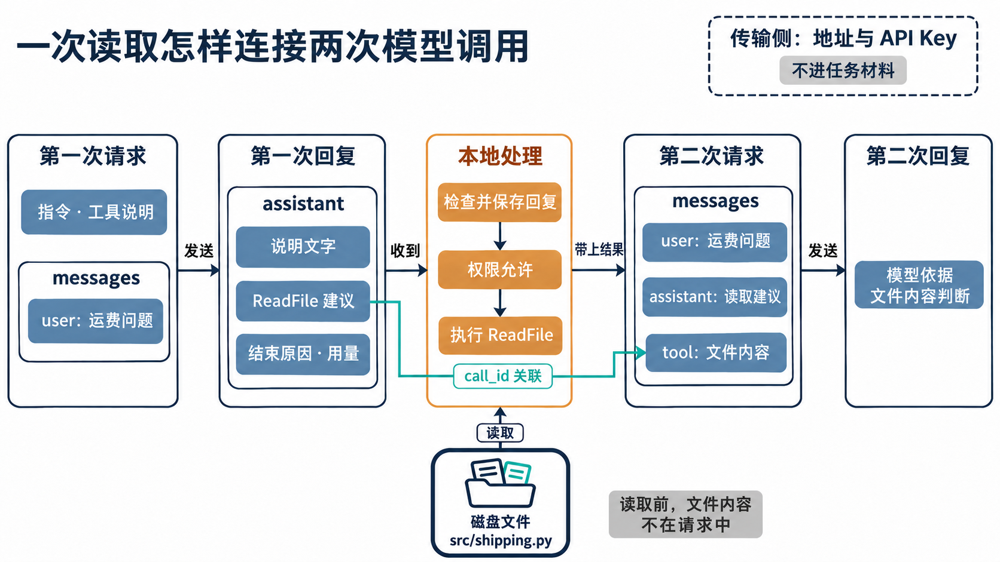

看完这张图，你要能：分清请求消息、模型工具建议、本地结果及下一次输入。

容易误会的地方：

- 回复里同时有文字和工具调用建议，也只是一条模型消息，不是你又发起了一次任务。
- `end_turn` 只说明模型写完了这次回复，不说明运费问题已经解决。任务是否完成，要在后续流程中另行判断。
- 聊天窗口里还能看到一段文字，不说明模型这次也收到了它。
- 工具结果放在 `user` 消息里，不表示是你手写的。文件里的文字只是待分析材料，即使写着“忽略前面的要求”，也不会变成运行指令。

## 三、代码放不下、回答写不完，分别怎么办？

**先分清是输入放不下，还是输出写不完，再决定减材料还是调上限。**

前面只让模型解释一行代码，输入和回答都很短。现在你想让它检查整个计价模块，把代码、业务规则和此前讨论一起交给它。

材料多了，可能出现两种情况。一种是请求太大，模型还没开始回答，就提示超出限制。另一种是请求被接受了，模型也开始回答，却写到一半停了。

### 先认识计量单位：Token

**模型的输入和输出都用 Token 计量，Token 不等于汉字。**

模型处理文字时，会把文字拆成叫 **Token** 的单位。一个 Token 可能是一个字、一个词，也可能是词的一部分或某个符号。怎样拆，由模型的分词器决定。

所以，“最多生成 512 Token”不是“最多写 512 个汉字”。你暂时不用自己数 Token，只要知道输入和输出都有用它表示的限制。

### 输入已经很多，还要给回答留出空间

**输入和输出共用一次调用的容量；输入越多，留给回答的越少。**

每次调用能容纳的内容有限，这个容量叫**上下文窗口**。组织请求时，既要算发给模型的材料，也要算它接下来要生成的内容。

用一组简化数字看。假设一个接口允许输入与输出合计最多 10,000 Token：

```latex
这次输入：8,000 Token
最多还可用于生成：2,000 Token
```

如果你还希望模型写一份 3,000 Token 的回答，就要减少输入，或换容量够大的模型。实际接口还可能分别限制输入和输出，这里的数字只是说明为什么要一起算。

回到运费任务。代码放不下时，可以先让 Agent 找到计价入口，再读相关函数与规则，需要时再补读。第 8 课详细讲怎样选材料。

### 输出上限到了，模型也会停下来

**容量还有余量，输出上限到了，模型也会停；要看结束原因来判断。**

即使上下文还有余量，这次调用也可能设了更小的**输出上限**。

例如，按刚才的假设还剩 2,000 Token，但请求只允许生成 500 Token。模型最多写到 500 Token 就要停，也可能更早答完。前面请求里的 `max_tokens`，就是表达这类限制的字段。

只解释 `>`，短回答可能就够了。要逐个检查计价分支，同样的上限就可能让说明停在中途。

怎么判断是不是这个原因？看响应的**结束原因**。例如 OpenAI Chat Completions 的 `finish_reason: length`，表示生成触及长度限制。不要只看最后一句像不像结束语。

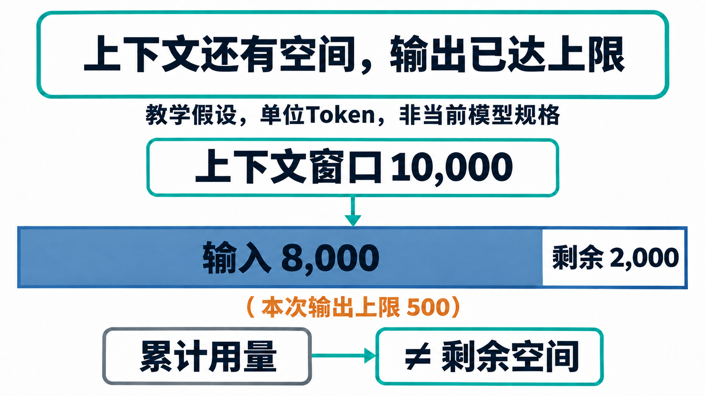

看完这张图，你要能：看懂“总空间还有余量，但这次的输出额度已经用完”是什么意思。

### 为什么回答没几句话，也可能达到输出上限？

**推理和工具参数也算生成量，所以看得见的回答短，不代表生成得少。**

有些推理模型在给出最终回答前，会先花 Token 推理。这些内容不一定显示在界面上。在推理和回答共同计入输出上限的接口里，可以这样理解：

```latex
本次允许生成：8,000 Token
其中推理已用：6,500 Token
留给回答或工具参数：1,500 Token
```

这时，你看到的回答可能很短，但允许的生成量已经快用完了。工具调用参数也是模型生成的，同样要占生成空间。

所以，遇到“等了很久却没拿到完整回答”，先看结束原因和服务返回的用量。服务没提供某项计量时，那部分消耗暂时无法确定。


看完这张图，你要能：理解可见回答很短时，生成量仍可能较大。

### 知道停在哪里，再决定怎么调整

**先查清停在哪里，再按原因调整：减输入、提上限、缩问题，或者查连接。**

假设你让 Agent 一次检查免邮门槛、地区例外和优惠叠加，回答没写完。可以按原因处理：

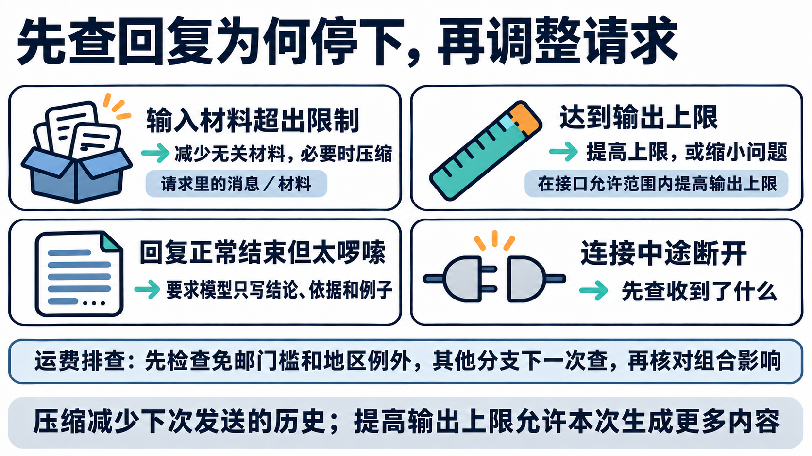

看完这张图，你要能：按停下的原因选调整方式：减输入、提上限或缩问题、精简表达、先查收到了什么。

| 已确认的情况 | 可以怎样调整 |
| --- | --- |
| 输入材料超出限制 | 先读取与当前问题有关的代码，减少无关历史；必要时整理或压缩上下文 |
| 达到输出上限 | 在接口允许的范围内提高上限，或缩小这次要回答的问题 |
| 回答正常结束，但内容太啰嗦 | 明确要求结论、依据和必要例子，减少重复表达 |
| 连接中途断开 | 先检查收到了什么、是否有完整结果，再判断是否重新请求 |

缩小问题可以这样说：“先检查免邮门槛和地区例外，优惠叠加下一步再看。”两部分都查过后，再核对它们一起作用时的金额。每次范围明确，也不会因为拆开就漏掉相互影响。

压缩减少的是下一次请求携带的历史。提高输出上限改变的是本次允许生成的量。

有些接口还能调思考强度或推理预算。只有接入支持时，这些选项才有意义。调整后也要检查回答质量，不能只看快不快。

### 最后再看一个数字：累计用量

**累计用量用来回顾花了多少；下一次能不能装下，要看下一次请求本身。**

界面还可能显示从会话开始的累计用量，它把多次调用的消耗加在一起：同一段代码在两次请求里各发一次，就算两次输入用量。MyBuddy 用本地估算判断要不要压缩，收到响应后记录服务返回的 `usage`。第 8 课会细讲本次占用和累计用量的区别。

容易误会的地方：

- 单凭等待时间或界面字数，分不清是推理消耗多、输出上限不够，还是连接断了。
- 回答已经被截断时，压缩不会把缺的部分补回来，还要重新完成。
- 说一句“回答简短些”，主要约束最终表达，推理消耗不一定跟着减少。
- 本地算的是估算值，服务端按自己的方法计数。所以本地估算超限不会阻止发送；本地没超限，服务端也可能返回“请求过长”的错误。

## 四、流式输出：回复怎样一段段到达？

**流式输出把一次回复拆成很多小片段陆续送来，本地程序负责把它们拼成完整回复。**

前面我们把响应当成一份完整数据来读。但用 Agent 时，你也会看到另一种情况：回答还没结束，文字已经出现在屏幕上。这就是流式输出。MyBuddy 的 OpenAI Chat Completions 协议支持流式回复，Anthropic Messages 路径目前使用完整回复。

### 一次返回与流式返回有什么区别？

**流式和非流式是同一次调用的两种交付方式；收到很多片段，也只调用了一次模型。**

还是开头那个问题：`subtotal` 为 100 时，`subtotal > 100` 成立吗？假设模型最终生成同一句回答：

不成立。> 表示大于，100 并不大于 100。

这句话可以用两种方式交给本地程序：

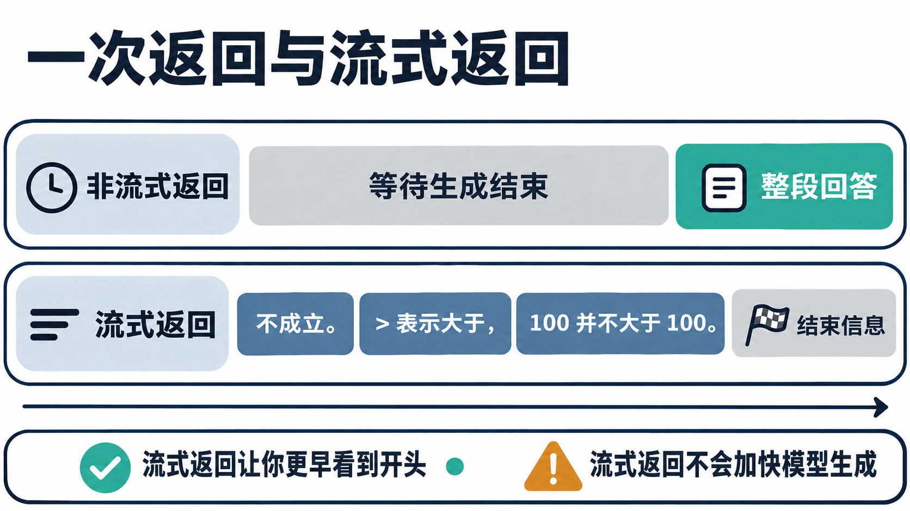

看完这张图，你要能：对比非流式与流式：同一句回答，流式先到开头，但不会更快写完。

| 方式 | 本地程序怎样收到回答 | 你在界面上看到什么 |
| --- | --- | --- |
| 非流式返回 | 等这次生成结束，再收到完整响应 | 等待一段时间后，出现整段回答 |
| 流式返回 | 生成过程中，陆续收到新增内容 | 先看到开头，再看到后续文字 |

把流式过程放慢看，可能是这样：

```latex
先收到：不成立。
再收到：> 表示大于，
再收到：100 并不大于 100。
最后收到：这条回复的结束信息
```

这里的分段只是示意，实际不一定按句子或标点划分。这些片段都属于同一次模型调用。

### 为什么要流式输出？

**流式让你更早看到开头，但不会让整份回答更快写完。**

这么短的回答，两种方式差别不大。但模型要解释多个计价分支时，整份回答要写更久。流式输出让你不用等到最后，先读已经生成的部分。

它改善的是等待过程：更早看到内容，也更早发现回答有没有跑偏。方向不对时，你可以取消。

流式改变的只是内容何时交给你。模型开始返回可见文字之前，你仍可能要等一会儿。

### 程序怎样接收这些片段？

**服务发来的是一条条带类型的事件；本地程序把新增片段接在已收内容后面。**

接口支持流式调用时，请求里通常有开关，例如 `stream: true`。开启后，本地程序要持续接收服务发来的内容，不能再把返回值当成一份完整 JSON 直接读。

服务除了发新增文字，还要告诉程序回复何时开始、何时结束。这些带类型和数据的通知叫**事件**。其中表示“本次新增了什么”的部分，常叫**增量（delta）**。

接着看刚才那句回答。假设服务分三次发文字，最后再发一条结束通知。本地程序收到新文字，就接在已收到的文字后面：

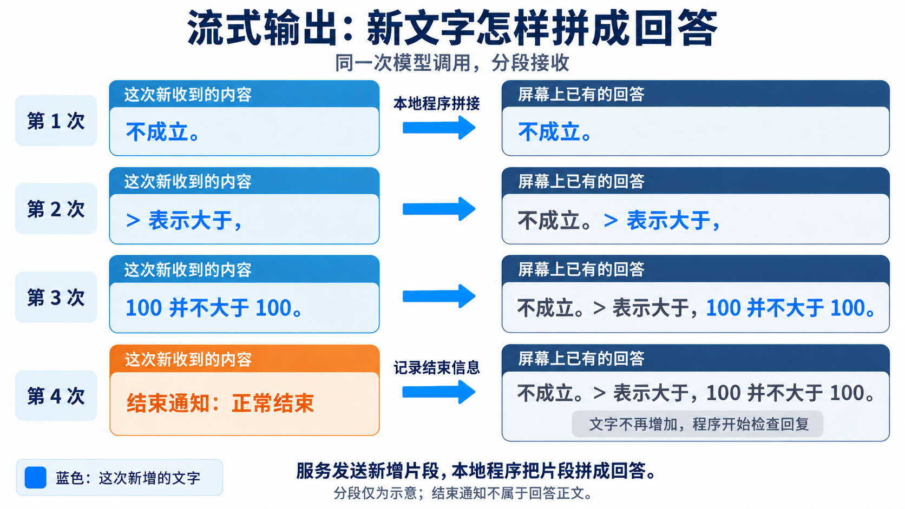

注意第 2 次：服务只发来新增的“> 表示大于，”，没有把“不成立。”再发一遍。**把片段拼成整段回答，是本地程序做的事。**

第 4 次发来的不是回答文字，而是给程序看的结束信息。它不会显示在回答里。程序靠它判断这次是正常答完，还是到了输出上限。

再想一种情况：第 2 次收到文字后，连接突然断了。屏幕上能看到“不成立。> 表示大于，”。但程序没收到后面的内容和结束通知，就不能把这半句当成完整回复。

源码里用 `async for` 逐次等待这些事件：来一条，处理一条，再等下一条。具体写法留到源码解析。

事件经网络传来时，还可能被拆开。程序一次可能只读到半条事件，要等后半条到了才能拼完整；也可能一次读到好几条。所以要先认出完整事件，再把新增文字拼进消息，最后更新界面。

### 如果分段返回的是工具参数呢？

**工具参数拼完整了，文件也还没读；要等回复收齐、保存、获准之后才执行。**

刚才拼接的是一句解释。如果模型提出读取文件，返回的工具参数也可能分段到达：

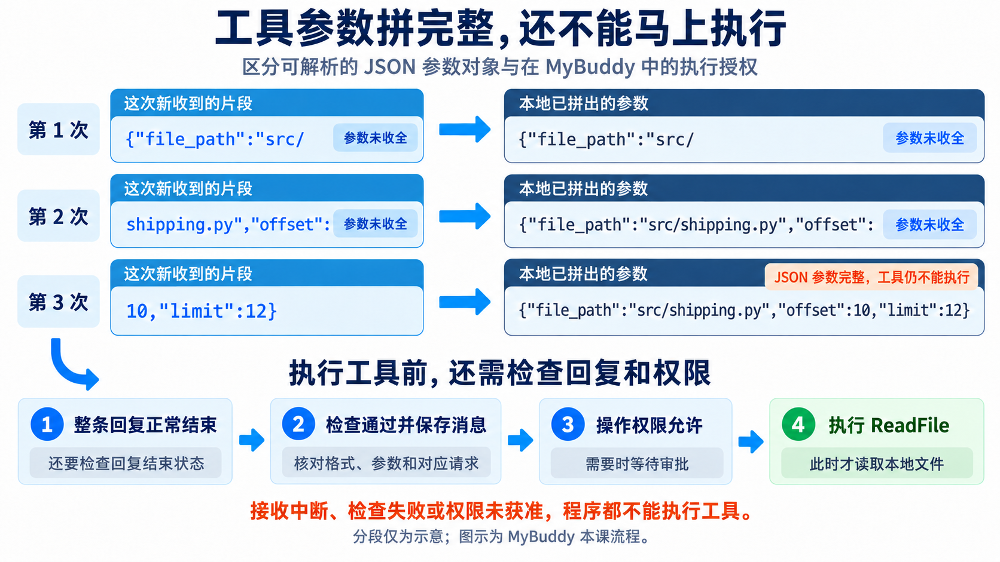

顺着图的上半部分看。第一次只拿到路径的开头。第二次路径完整了，起始行还没到。第三次才拼出完整 JSON：读哪个文件、从哪行开始、读多少行，都有了具体值。

这时只是“参数拼完整了”。再看下半部分：程序还要等整条回复正常结束，检查并保存消息，再确认权限允许，才会执行 `ReadFile`。当前权限模式要求审批的话，就在这里等你决定。

所以，图里用橙色标出“JSON 已完整，仍不能执行”。直到真正读取文件，才用绿色。下一小节展开这些检查。

### 什么时候算收到完整回复？

**收到结束信息、通过检查、保存成功，才算完整回复；之后才轮到工具。**

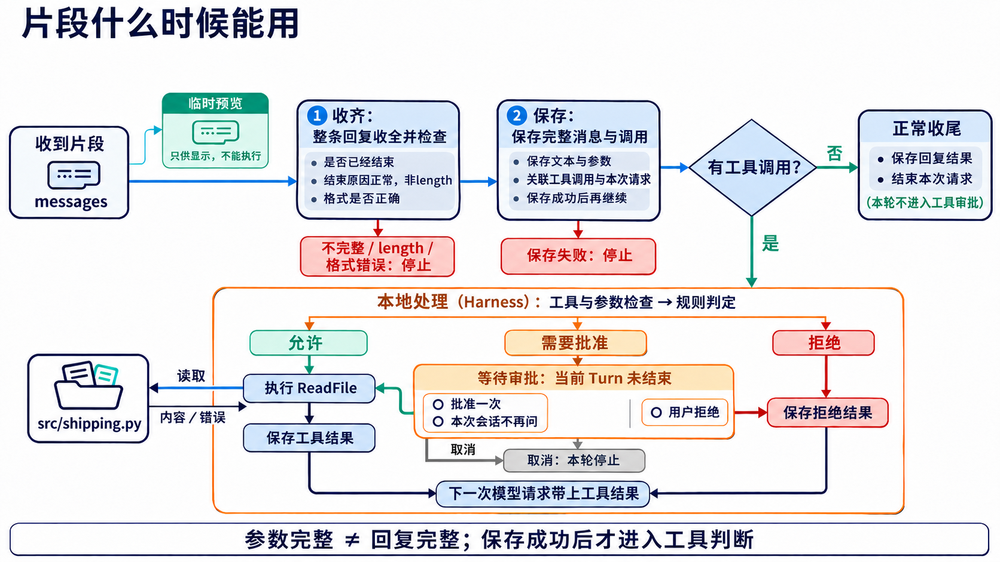

看完这张图，你要能：分清三个时刻：片段只能预览，收全并通过检查才保存，保存成功且获准才执行工具；中途失败就停下。

HTTP 返回成功、工具参数也能解析，程序仍要检查结束信息。OpenAI Chat Completions 回复的结束原因是 `length` 时，MyBuddy 不把它当完整回复使用。流式路径还要求收到结束标记和用量。

Codec 从回复中读出文本、工具调用和用量，并解析工具参数。模型网关（MyBuddy 里把请求交给模型服务、再收回回复的那一层）检查工具名与调用标识，把回复和本次请求关联起来。循环保存消息，供后续流程使用。有工具调用时，还要检查操作权限，才能执行。

把前面的过程放到一起。下面用自定义事件名说明顺序，不对应某家接口的原始字段：

| 到达的事件 | 程序积累了什么 | 接下来可以做什么 |
| --- | --- | --- |
| `message_begin` | 一条临时消息 | 准备接收 |
| `text_delta` | 一段新增文字 | 显示生成中的内容 |
| `tool_begin`、`arguments_delta` | 工具名和参数片段 | 按调用标识或索引归并 |
| 工具片段接收完 | 一个工具调用的名称和参数 | 等完整回复收齐后再解析参数 |
| `message_end` | 整条回复及结束状态 | 完整校验后，交运行时保存 |
| 错误或连接中断 | 未完成内容及诊断 | 明确失败，不能执行未收完整的调用 |

同时有多个工具调用时，程序要分别积累各自的参数，不能拼到一起。用教学伪代码概括：

```latex
逐个接收模型事件：
    将事件交给消息组装器
    更新界面中的临时预览

完整消息 = 组装器完成并校验()
保存完整消息()
若包含工具调用：
    进入工具治理与执行流程()
```

把三个时刻连起来：**收到片段，可以预览；整条消息收全并通过检查，才能保存；保存成功且调用获准，才能执行工具。** 中途失败，就停在相应环节。

### 补充：界面显示得慢，收到的内容会不会越积越多？

**界面跟不上时，要限制排队的内容，但不能丢掉关键事件。**

界面跟不上时，可以给暂存队列设上限，满了就放慢接收，这叫**背压**；也可以合并还没显示的文字更新。界面刷新可以少几次，服务发来的事件却一条都不能丢。用户取消时，还要停止接收、清理连接，第 12 课展开。

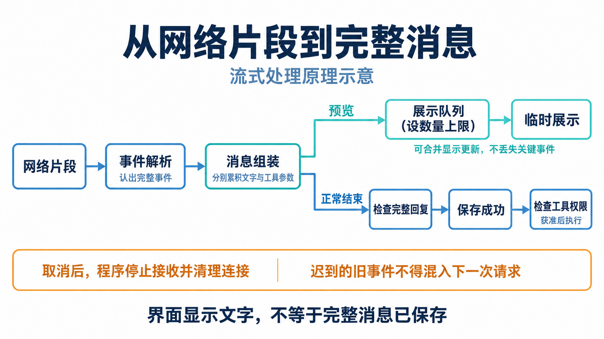

看完这张图，你要能：区分事件解析、消息组装、临时展示与最终提交。

容易误会的地方：

- 屏幕上出现了文字，不说明程序收到了完整回答。已经显示的文字，也不能代替缺失的检查和保存。
- 不是每次读取都要问你。要不要审批，看当前权限模式。
- 一次网络读取、一条事件、一个 Token，三者不是一一对应的。

## 五、没有拿到可用回复，先找它停在哪里

**没拿到可用回复时，沿“准备、发送、接收、检查、保存”这条路线，找它停在哪一步。**

### 沿刚才的路线往回查

**不同的现象停在不同位置；先定位，再决定下一步。**

“调用失败”可能发生在很多位置。刚才把过程拆开了，现在可以逐段定位。

| 你看到的现象 | 先查什么 | 暂时还不能确定什么 |
| --- | --- | --- |
| 服务端提示请求过长 | 服务端返回的错误、这次输入里哪部分最大 | 压缩以后是否就放得下 |
| 连接失败或超时 | 连接、响应和已取得结果 | 换个模型能否解决 |
| HTTP 成功，回复校验失败 | 角色、参数、结束原因 | 工具是否能够执行 |
| 文字显示一半后中断 | 整条消息是否收全、是否保存 | 预览文字是否已经进入有效历史 |
| 普通文本完整返回 | 消息是否保存、任务是否已经结束 | 业务目标是否通过验收 |

例如，“请求没发出去”和“发出后只收到半份响应”，都会让你看不到完整回答。前者要查本地条件，后者要查接收与完成状态。都叫成“模型不行”，下一次尝试就没有针对性。

展示错误时，要保留能定位阶段的信息，同时过滤 API Key 等凭据、敏感路径等细节。MyBuddy 不会在请求发出后自动重发。要不要重新请求，看失败位置和执行状态，第 12 课展开。

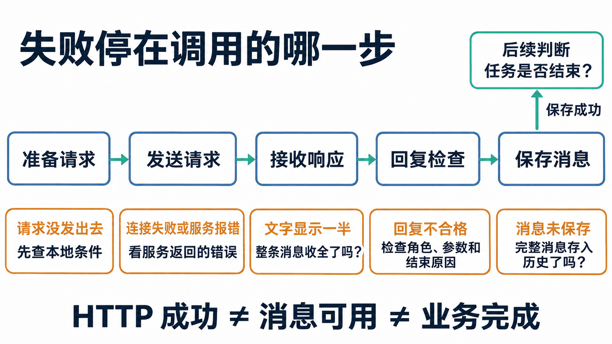

看完这张图，你要能：根据失败位置选择下一项检查。

### 练习：这五种回复，下一步分别能做什么？

**按三个问题判断：收全了吗？格式符合接口约定吗？保存成功了吗？**

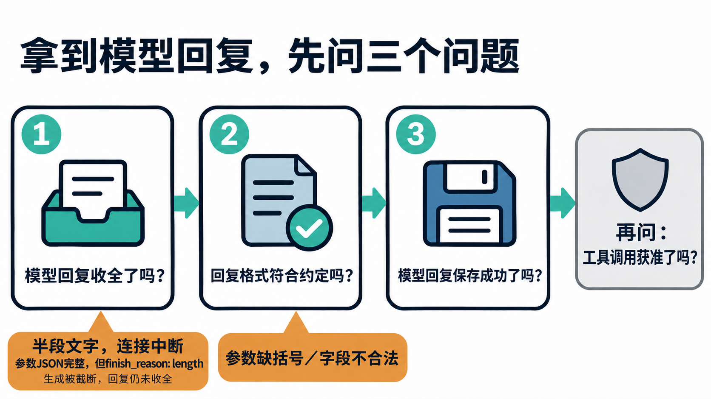

看完这张图，你要能：用三个问题判断一份结果能不能用，再看工具调用是否获准。

把自己放到 Harness 的位置。你刚拿到下面这些结果，准备怎样处理？先遮住右栏，判断哪些能保存、哪些还不能用，再对照答案。

| 收到的结果 | 当前可以作出的判断 |
| --- | --- |
| 完整文本，结束正常，协议检查通过 | 可以交运行时保存；保存成功后，后续流程才能使用 |
| 完整工具调用，结束正常，参数合法 | 可以交运行时保存；之后还要检查操作权限，不能直接执行 |
| 工具参数少一个闭合括号 | 参数不完整，不能执行 |
| 已显示半段文字，连接中断 | 可以保留未完成诊断，不能当成完整回复使用 |
| 工具调用的参数是完整 JSON，但结束原因是 `length`（写到输出上限，被截断） | 不能保存，也不能执行。两种协议的完整响应路径都会拒绝这条回复；理由是生成被截断，不是 JSON 语法错误 |

拿不准时，就问那三个问题。之后再问工具是否获准执行。

这项练习练的是：从响应数据和运行记录判断下一步，而不是只看屏幕上有没有字。

## 使用小妙招

### 比较模型时，固定题目和判断标准

比较两个模型时，固定运费问题、代码起点和验收条件，看是否找对边界、工具参数是否有效、检查是否完成，再比较耗时与用量。Claude Code、Codex 和 MyBuddy 都可以用 `/model` 查看和切换模型；每换一次，都从相同的代码状态、开一个新会话开始。

**为什么这样做：** 模型每次回复都要重新生成，同一个模型问两次，结果也可能不一样。题目、代码起点或会话里的前文一变，就分不清差别来自模型还是来自这些条件。只看“回答像不像对的”也不够：工具参数格式不对、写到输出上限被截断，都会让任务进行不下去（见第三、五节）。

### 没有完整报告时，给出能帮助排查的信息

不要只说“又失败了”。说明要求检查哪些文件、界面最后显示了什么、提示的是长度限制还是连接中断，再请 Agent 根据当前记录判断，不要猜测缺失的结果。

**为什么这样做：** 没拿到可用回复，原因有好几种：写到输出上限、连接中断、工具参数不完整……下一步怎么办各不相同（见“沿刚才的路线往回查”）。界面上的提示只有你看得到；你不说，Agent 只能猜。

### 回复中途断开后，让 Agent 分开说明已确认与未知

你可以这样提出后续要求：

先核对这次调用和工具记录。说明哪些结果已经确认，哪些步骤仍然未知，再判断怎样继续。

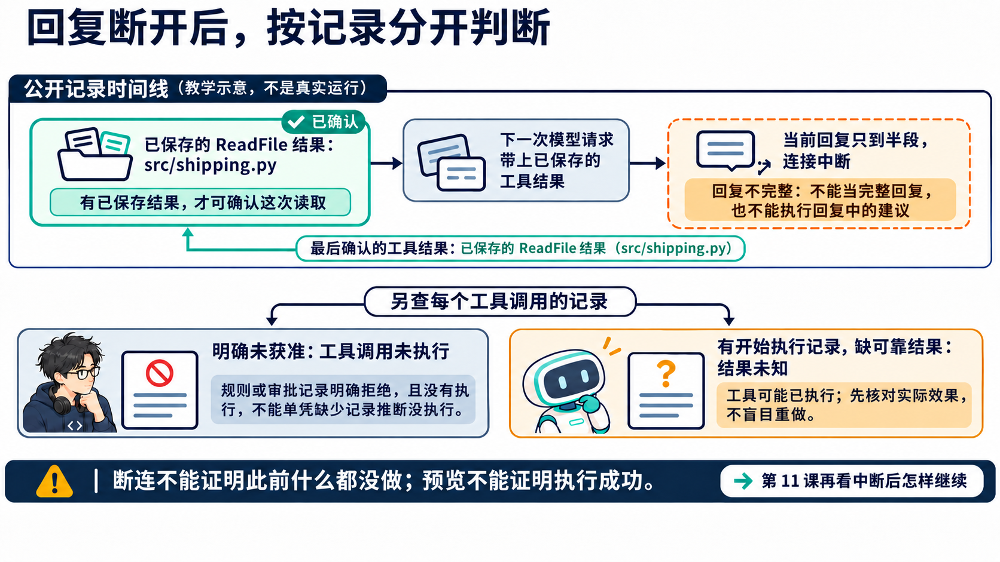

看完这张图，你要能：回复中途断开后，把已确认的结果和仍未知的步骤分开说，不把预览当执行证明。

**为什么这样做：** 模型回复还没传完，连接就断了，这就是“回复中途断开”。同一个 Turn 中，断开前可能已经有更早的工具执行结果，也可能当前这份调用建议还没获准执行。要逐项看记录：不能把“最后一次模型回复没完成”扩大成“此前什么都没做”，也不能把界面上看到的预览当成已执行的证明（见“什么时候算收到完整回复？”）。

## 自测：这一课的概念分清了吗

**先自己作答，再看后面的答案。** 每题都能在本课正文里找到依据。

**1.** 模型解释了 `>`，你追问“那改成 `>=` 呢？”。整理下一次请求时，上一次的模型回答应标成什么角色？

- A. `user`，因为这次是本地程序把它发出去的
- B. `assistant`，因为它仍是模型先前的回答
- C. `system`，因为它已经成为后续回答的背景

**2.** 你把整个计价模块放进请求，服务在模型开始回答前就提示输入材料超出限制。哪种调整针对这个原因？

- A. 只提高输出上限，让模型有更多空间写回答
- B. 保留全部材料，只要求模型回答简短些
- C. 减少输入，只保留与当前问题有关的代码和历史

**3.** 你把同一段代码先后放进两次模型请求。下面哪句话正确？

- A. 这段代码会计入两次输入用量，但累计用量不等于下一次请求的占用
- B. 代码内容没变，第二次就不计入输入用量
- C. 两次调用的累计用量，就是下一次请求已经占用的上下文容量

**4.** 判断：流式返回时，每收到一个新增文字片段，就表示又调用了一次模型。（对 / 错）

### 答案与依据

**1. 选 B。** 角色说明内容在对话中的身份。把历史重新发出去，不会把模型先前的回答变成用户提问，A 混淆了发送请求的一方和消息角色。  
依据：本课“下一次追问，模型怎样接上前文？”。

**2. 选 C。** 输入材料超限，要减少这次发出的材料。提高输出上限只改变允许生成的量，不能减少已经过多的输入。  
依据：本课“知道停在哪里，再决定怎么调整”。

**3. 选 A。** 同一段代码发两次，就算两次输入用量。累计用量记录多次调用的消耗，下一次占多少容量，要看下一次请求实际带了什么。  
依据：本课“最后再看一个数字：累计用量”。

**4. 错。** 多个片段可以来自同一次调用。流式和非流式是交付回复的两种方式，片段数量不是调用次数。  
依据：本课“一次返回与流式返回有什么区别？”。

## Q&A：常见追问

### Q1：我看见工具名和完整参数了，为什么还要等？

因为参数完整，不等于整条回复完整。参数是一段完整的 JSON，只说明这一个工具调用写完了；整条回复还要看结束原因。如果结束原因是 `length`（写到输出上限被截断），后面可能还有没写出来的调用或说明，这条回复就不能用。所以程序要等整条回复收完，确认结束原因正常、其他内容也完整，并把回复保存下来，之后才执行工具。

### Q2：HTTP 成功，为什么应用仍然报错？

服务返回成功状态后，应用仍要检查响应内容。网络交付、协议合格、消息保存和业务完成，是不同的判断。具体卡在哪一步，要看相应错误与记录。

### Q3：所有消息都是程序发出去的，为什么还分 user 和 assistant？

角色说明它们在对话中的身份。程序回传上一份模型回答时，仍应保留 `assistant`。这样模型才能读懂前后问答，而不是把此前回答误当成新的用户要求。

### Q4：模型已经看过代码，下一次就一定还知道吗？

不一定，要看下一次请求里有没有。模型本身不记得上一次调用，MyBuddy 每次请求都会把需要的历史重新组装进去：之前读到的代码内容、或者压缩后的摘要。历史被压缩后，原文可能只剩摘要，需要细节时要重新读取。有些接口支持在服务端保存对话、下次只发新消息，那是另一种做法，MyBuddy 现在没有用。判断模型“知不知道”，只看这一次请求里实际带了什么。

### Q5：把输出上限调大，是不是就不会失败了？

它只能缓解允许生成量不足的问题。输入超限、连接中断、参数非法或保存失败，都需要另行处理。即使能生成更长的回答，也仍要核对内容是否正确。

### Q6：推理模型返回的数据，为什么不能只留下回答文字？

因为有些接口要求原样回传。开启推理（思考）的模型，回复里除了回答文字，还会有推理内容块，有的还带签名。下一次请求（尤其是带工具调用的多轮）要把这些块原样交回去，接口才能接着推理；只留回答文字，接口可能直接报错，或者推理接不上。

这是通用的道理。MyBuddy 现在**不支持**这类推理内容块：Anthropic 接口的回复里出现文字和工具调用以外的块，解码会直接报错；OpenAI 兼容接口也没有保存和回传推理内容。所以使用 MyBuddy 时要关掉模型的推理输出，例如在百炼 Token Plan 的 OpenAI 兼容接口上，用 Provider 配置的 `extra_body` 设置 `enable_thinking = false`。其他服务商怎样关闭，以它们的说明为准。

### Q7：为什么上下文要把 user 和 assistant 一条条交替放，而不是把所有 user 内容合成一条、所有 assistant 内容合成一条？

因为对话的意思同时取决于“谁说的”和“按什么顺序说的”，合并会把这两样都丢掉。

- **顺序表达了因果。** “先问能不能免邮，模型说不能，用户再说‘那改成 >= 呢’”，这句追问只有接在那条回答后面才看得懂。把用户的话都并到一起，模型就不知道“那”指的是什么。
- **后说的可以改掉先说的。** 用户先说“改成九折”，后来又说“算了，还是九五折”。按顺序放，模型知道以最后一次为准；合成一段，两条要求同时出现，模型可能照第一条做。
- **工具调用要和结果配对。** 模型在某条 `assistant` 消息里发出工具调用，结果必须紧跟在后面回传，并用调用编号对上。接口会检查这种配对，合并后配对关系就断了，请求会被拒绝。
- **模型就是按这种格式训练的。** 它习惯从一问一答里理解对话；把多轮塞进一条消息，等于换了一种它不熟悉的格式，效果会变差。

另外，按顺序追加还有一个工程上的好处：下一次请求只是在末尾多了几条，前面的部分完全不变，服务端的提示词缓存可以复用这段前缀，省时间也省费用。把内容重新合并，前缀每次都变，缓存就用不上了。

要注意，“交替”不是死规定。连续两条 `user`（比如一条是工具结果，一条是用户补充）是允许的，有的接口会把它们当作一组。真正不能做的，是改变每条内容的角色和先后顺序。

## 本课小结：把一次调用接到下一步

一次调用的过程可以这样概括：

```latex
问题与材料
    ↓ 按接口格式编码
模型请求
    ↓ 发送、接收，必要时逐段组装
收到的完整回复
    ↓ 校验并保存
可供后续流程使用的模型消息
```

**模型生成内容，Harness 负责接收、检查和保存，再安排下一步。** 源码解析会沿 `ModelInput`、Codec、Adapter 和返回对象走读，可以带着一个问题去看：哪里只是在转换数据，哪里才真正发出请求？

## 本课术语速查

| 本课说法 | 源码或命令中的名字 | 含义 |
| --- | --- | --- |
| 请求 / 响应 | Request / Response | 程序发给模型服务的数据，和服务返回的数据 |
| 消息角色 | `system` / `user` / `assistant` | 分别是系统指令、用户输入和模型回复 |
| Token | Token | 模型切分和计算文字的单位 |
| 上下文窗口 | — | 一次调用能容纳的内容容量，实际输入和输出限制取决于接口 |
| 输出上限 | `max_tokens` | 这次回复最多能生成多少 Token |
| 用量 | `usage` | 服务返回的本次实际输入、输出数量 |
| 结束原因 | `stop_reason` | 模型为什么停下：说完了、到上限了，还是要调用工具 |
| 流式响应 | — | 回复分成多个片段陆续送达，本地再拼成完整回答 |
| 增量 | delta | 流式响应中的一个片段 |
| 编解码器 | Codec | 把本地数据和服务要求的格式互相转换 |
| 适配器 | Adapter | 负责实际发送请求、接收数据的部分 |
| 背压 | — | 下游处理不过来时，让上游放慢速度 |
