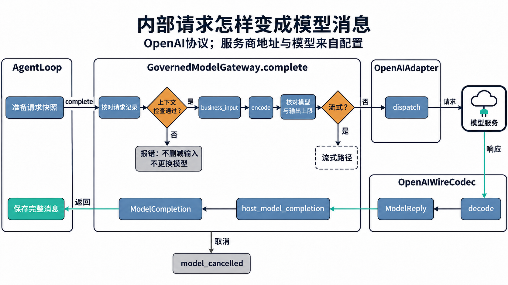
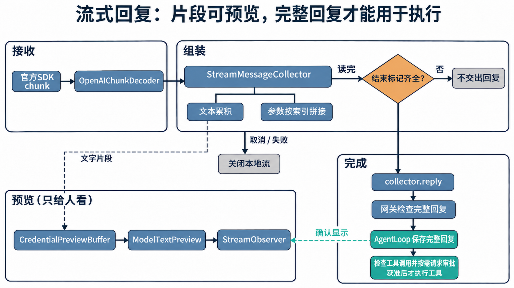

与第 2 课课程正文配套阅读。

正文先写了一个四行的 `ask_once`：装请求、发出去、取文字。这一篇读 MyBuddy 的真实调用。骨架一样，多出来的代码在回答：格式怎么转、回复合不合格、流式片段怎么拼。

**怎么读：** 每一节先贴一段代码，再用几句话解释。代码从当前源码原样复制，上方标了文件和行号。`# ...` 表示省略了与本节无关的行。

本篇沿 OpenAI Chat Completions 协议读。MyBuddy 也支持 Anthropic Messages；配置选择协议，供应商地址和模型 ID 来自配置。

## 先看配置怎样选到协议

服务商地址和模型名称来自 TOML。配置里的 `protocol` 决定使用哪种协议；同一种协议可以连接不同服务商。

### Provider 配置怎样读入

`src/mybuddy/platform/models/model_catalog.py:186-196,207-223`

```python
def _parse_providers(provider_values: Mapping[str, object]) -> dict[str, ProviderSpec]:
    if not provider_values:
        raise ModelCatalogError("model_catalog_field_missing", "$.providers")
    providers: dict[str, ProviderSpec] = {}
    for key, value in sorted(provider_values.items()):
        field = f"$.providers.{_identifier(key, '$.providers')}"
        item = _object(value, field)
        _keys(item, frozenset(("protocol", "base_url", "api_key", "api_key_env", "extra_body", "timeout_seconds")), field)
        protocol = _text(_required(item, "protocol", field), f"{field}.protocol")
        if protocol not in ("openai", "anthropic"):
            raise ModelCatalogError("model_catalog_value_invalid", f"{field}.protocol")
# ...
        extra_body = _object(item.get("extra_body", {}), f"{field}.extra_body")
        # 连接配置只能补充选项，不能覆盖程序组装的消息、工具和输出上限。
        if set(extra_body) & {"model", "messages", "system", "max_tokens", "stream", "stream_options", "tools"}:
            raise ModelCatalogError("model_catalog_value_invalid", f"{field}.extra_body")
        try:
            canonical(extra_body)
        except (TypeError, ValueError, UnicodeError):
            raise ModelCatalogError("model_catalog_value_invalid", f"{field}.extra_body") from None
        timeout = item.get("timeout_seconds", 180)
        if type(timeout) is not int:
            raise ModelCatalogError("model_catalog_type_invalid", f"{field}.timeout_seconds")
        if not 10 <= timeout <= 1800:
            raise ModelCatalogError("model_catalog_value_invalid", f"{field}.timeout_seconds")
        providers[key] = ProviderSpec(key, protocol,
            _base_url(_required(item, "base_url", field), f"{field}.base_url"),
            api_key, env, freeze_json(extra_body), timeout)
    return providers
```

这里允许的字段是 `protocol`、`base_url`、密钥来源、`extra_body` 和 `timeout_seconds`。协议目前只能填 `openai` 或 `anthropic`。`extra_body` 可以补充服务商选项，但不能替换程序组装的消息、工具或输出上限。`timeout_seconds` 是等待一次模型回复的最长秒数，不填就是 180 秒，可以填 10 到 1800。

### 协议表连接编解码器和发送实现

`src/mybuddy/platform/models/model_adapters.py:84-87`

```python
_PROTOCOLS = MappingProxyType({
    "openai": (OpenAIWireCodec, _create_openai),
    "anthropic": (AnthropicWireCodec, _create_anthropic),
})
```

配置写服务商和模型，不写 Python 类名。协议表把协议对应到 Codec 与发送实现。增加一个服务商时，只要它兼容现有协议，就能用同一套实现；增加新协议则要改代码。

### 密钥在调用时读取

`src/mybuddy/platform/models/model_credentials.py:28-34,46-50`

```python
    def resolve(self, provider: ProviderSpec, environment: Mapping[str, str]) -> str:
        if provider.api_key is not None:
            value = provider.api_key
        elif provider.api_key_env is not None and provider.api_key_env in environment:
            # 变量存在但内容无效时直接失败，不能悄悄改用另一个账户的密钥。
            value = environment[provider.api_key_env]
        elif self.use_bailian_config and provider.base_url in _TOKEN_PLAN_BASE_URLS:
# ...
        else:
            raise AgentLoopError("runtime.model_credential_unavailable")
        if not _valid_key(value):
            raise AgentLoopError("runtime.model_credential_unavailable")
        return value
```

读取顺序是配置中的密钥、指定的环境变量，最后才是明确启用且地址匹配的百炼本机凭据。密钥只在实际调用时读取，不进入会话记录。

先看调用链。第 1 课已经从 `ask` 走到了 `AgentLoop` 调用 `self._model.complete`。这一篇从那里往下：

```latex
AgentLoop._request_model                 agent_loop.py        交出已保存的请求
└─ GovernedModelGateway.complete         model_gateway.py     检查请求，选路线
   ├─ OpenAIWireCodec.business_input    openai_wire_codec.py  快照 → ModelInput
   ├─ OpenAIWireCodec.encode            openai_wire_codec.py  ModelInput → 请求正文
   ├─ OpenAIAdapter.dispatch            openai_model.py     核对正文，经 SDK 发送
   │  └─ OpenAIWireCodec.decode         openai_wire_codec.py  SDK 响应 → ModelReply
   ├─ _complete_stream（流式时）          model_gateway.py     收片段、预览、收齐
   │  └─ StreamMessageCollector          model_stream.py      拼文字和工具参数
   └─ host_model_completion              model_gateway.py     ModelReply → ModelCompletion
```

和正文的 `ask_once` 对一下：

| `ask_once` 里的一行 | MyBuddy 里谁负责 |
| --- | --- |
| `request = {...}` | `business_input` 取材料，`encode` 组装正文 |
| `http_post(...)` | `OpenAIAdapter.dispatch`，经官方 SDK 发送 |
| `response["content"][0]["text"]` | `decode` 读出文字、工具调用和用量 |
| （没有） | `host_model_completion` 检查调用编号、标出没提供的工具 |

## 主流程图：内部请求怎样变成模型消息

**请求出去要经过三次交接：循环交出请求，网关检查，适配器发送。**

图中的“编码”是把内部对象转成供应商请求，“解码”是把供应商响应转回内部对象。负责这两种转换的是 Codec。



看完这张图，你要能：看懂程序怎样把内部的任务材料，转成模型服务商能接受的请求格式。

## 请求编码：内部消息怎样变成 API 输入？

**Codec 只转换格式；真正发出网络请求的是 Adapter。**

### 片段 1：网关的主线——取材料、编码、核对、发送

`src/mybuddy/platform/models/model_gateway.py:140-148`

```python
        # 根据已保存的请求重新确定适配器并生成正文，确保它使用的是当前网关的配置。
        expected_route = self._budget.expected_route if self._budget is not None else None
        try:
            descriptor = resolve_model_adapter(snapshot["model_route"],
                inline_value(snapshot["request_parameters"]["provider_options"]))
            if descriptor != self._descriptor:
                raise AgentLoopError("request_snapshot_mismatch")
            model_input = descriptor.codec.business_input(snapshot, expected_route)
            encoded = descriptor.codec.encode(model_input)
```

这是 `GovernedModelGateway.complete` 的后半段。前半段检查请求记录和上下文，这里看主线：

1. `business_input` 从已保存的请求快照里取出本次材料，得到 `ModelInput`。
2. `encode` 把它转成供应商接受的正文。
3. `check_request` 核对模型和输出上限，仍是会话选定的那一套。
4. 请求开了 `stream`，就走 `_complete_stream`。否则交给 `dispatch`。两条路都用服务商配置的超时秒数。
5. `host_model_completion` 把回复整理成 `ModelCompletion`，交回循环。

检查失败时直接报错。它不会截短请求，也不会换一个模型重试。

### 片段 2：ModelInput 装着什么

`src/mybuddy/spi/model_adapter.py:36-53`

```python
@dataclass(frozen=True, slots=True)
class ModelInput:
    """保存一次模型调用的内容和参数。
    消息、工具定义和选项会被复制成只读数据，避免请求组装后被外部修改。"""
    # business 用于处理用户请求；summary 用于需要模型生成概要等内容的辅助调用。
    purpose: Literal["business", "summary"]
    model: str
    system: str
    messages: tuple[Mapping[str, Any], ...]
    # 空元组表示这次请求没有向模型提供工具定义，不代表模型绝不会提出工具调用。
    tools: tuple[Mapping[str, Any], ...]
    # 模型本次最多生成多少个输出 token，必须大于 0。
    # 设大能容纳更长的回复，也需要预留更多上下文空间；设小可能让回复不完整。
    max_output_tokens: int
    # 这些是交给具体模型服务处理的选项，允许的内容由相应适配器决定。
    options: Mapping[str, Any]
    # None 表示没有额外文字；有内容时不放在 messages 里，具体放在哪里由适配器决定。
    post_history_text: str | None = None
```

`ModelInput` 就是正文表格里的“四部分”：

- `system` 是整体指令。
- `messages` 是带角色和内容块的历史。
- `tools` 是本次提供的工具定义。注释提醒：空元组表示没提供工具，不代表模型一定不提工具调用。
- `model`、`max_output_tokens`、`options` 是调用设置。

哪些历史值得保留、何时压缩，是上下文管理的事（第 8 课）。Codec 只管“这些材料按什么格式发”。

### 片段 3：wire_messages 转换角色和文字

`src/mybuddy/platform/models/openai_wire_codec.py:28-45`

```python
def wire_messages(messages: list[dict[str, Any]], system: str) -> list[dict[str, Any]]:
    result: list[dict[str, Any]] = [{"role": "system", "content": system}]
    for message in messages:
        role = message["role"]
        blocks = message["blocks"]
        # 每个工具结果都带上对应的调用 ID，模型才能区分它是哪次工具调用的结果。
        if role == "tool":
            for block in blocks:
                if block["kind"] != "tool_result":
                    raise AgentLoopError("model_protocol_error")
                result.append({"role": "tool", "tool_call_id": block["tool_call_id"],
                               "content": tool_result_wire(inline_value(block["model_content"]))})
            continue
        wire: dict[str, Any] = {
            "role": role,
            "content": "".join(block["text"] for block in blocks
                               if block["kind"] == "text"),
        }
```

`wire_messages` 先放一条 `system` 消息，再逐条处理历史。

- `tool` 消息里的每个 `tool_result` 块，变成一条 `role: tool` 的消息，带上 `tool_call_id`。这样模型知道它是哪次调用的结果。
- 其他消息保留 `role`，把所有文字块按顺序拼成 `content`。拼接时不加换行，需要的分隔应该已经在文字里。

例如内部的 `{"role": "user", "blocks": [{"kind": "text", "text": "subtotal > 100，恰好为 100 时成立吗？"}]}`，会变成 `{"role": "user", "content": "subtotal > 100，恰好为 100 时成立吗？"}`。

### 片段 4：模型上次提出的工具调用

`src/mybuddy/platform/models/openai_wire_codec.py:46-59`

```python
        # OpenAI 请求里的工具参数是 JSON 字符串，工具名称要换成发给供应商的名称。
        # 遇到不认识的消息块就报错，避免悄悄丢掉内容。
        calls = []
        for block in blocks:
            if block["kind"] == "tool_call":
                calls.append({"id": block["tool_call_id"], "type": "function", "function": {
                    "name": provider_tool_name(block["tool_id"], block.get("tool_version", "1.0.0")),
                    "arguments": canonical(inline_value(block["arguments"])).decode()}})
            elif block["kind"] != "text":
                raise AgentLoopError("model_protocol_error")
        if calls:
            wire["tool_calls"] = calls
        result.append(wire)
    return result
```

`assistant` 消息里的 `tool_call` 块，编码成 `tool_calls` 数组中的一项。它带着调用编号、发给供应商的工具名、JSON 字符串形式的参数。

遇到不认识的块，直接报协议错误。它不会把未知结构随便转成字符串继续发。

注意两种数据的区别：请求外层的 `tools` 说明“可以怎样调用”，历史里的 `tool_calls` 记录“模型上次提出了什么”。

### 片段 5：encode 组装请求正文

`src/mybuddy/platform/models/openai_wire_codec.py:83-92`

```python
    def encode(self, value: ModelInput) -> EncodedModelRequest:
        # 默认非流式；如果调用方选择流式，传入的选项会覆盖这个默认值。
        body = {"model": value.model, "messages": wire_messages(plain(value.messages), value.system),
                "stream": False, "max_tokens": value.max_output_tokens, **plain(value.options)}
        # 工具定义先去掉程序内部使用的字段，再裁剪发给模型的格式提示；原定义不被修改。
        if value.tools:
            body["tools"] = model_tool_schemas(provider_tool_schemas(plain(value.tools)))
        if value.post_history_text is not None:
            body["messages"].append({"role": "system", "content": value.post_history_text})
        return EncodedModelRequest(body, canonical(body))
```

这段把材料合成一个 `body`：模型名、消息、`stream`、`max_tokens`，再加上供应商选项。

- `stream` 默认是 `False`。调用方的选项排在后面，可以覆盖它。
- 有工具时，才加 `tools` 字段。
- `post_history_text` 是程序在历史后面补的指令，所以有些请求末尾会多一条 `system` 消息。

`EncodedModelRequest` 同时保存 `body` 和 `canonical(body)`。后者是按固定规则把 `body` 转成的 JSON 字节。

### 片段 6：Adapter 核对正文，再发送

`src/mybuddy/platform/models/openai_model.py:53-64`

```python
    def _body(self, value: ModelInput, payload: bytes) -> dict[str, Any]:
        encoded = self.descriptor.codec.encode(value)
        if encoded.payload != payload:
            raise AgentLoopError('request_snapshot_mismatch')
        body: dict[str, Any] = plain(encoded.body)
        return body

    def _sdk_body(self, checked_body: Mapping[str, Any]) -> dict[str, Any]:
        body: dict[str, Any] = plain(checked_body)
        # 扩展字段已参与正文核对和预算，发送时交给 SDK 合并。
        body['extra_body'] = {key: body.pop(key) for key in self.descriptor.extra_body}
        return body
```

`dispatch` 先调 `_body`：用同一个 Codec 再编码一次，和网关交来的字节比对。对不上就报 `request_snapshot_mismatch`。这保证发出去的就是已保存的那份请求。

然后 `dispatch_body` 取出凭据，通过官方 SDK 的 `chat.completions.create` 发送。拿到响应，立刻交给 `decode`。

到这里，请求才真正离开本机。前面的 `encode` 只是在转换数据。

## 响应解码：把 API 输出还原成内部回复

**网络收到响应，不等于回复合格；**`decode` **和网关还要各检查一遍。**

### 片段 7：decode 检查结束原因和内容

`src/mybuddy/platform/models/openai_wire_codec.py:99-111,113-122`

```python
            choice = response.choices[0]
            finish = getattr(choice, "finish_reason", None)
            if finish in ("length", "max_tokens"):
                raise AgentLoopError("runtime.model_output_limit")
            message = choice.message
            text = message.content
            calls = message.tool_calls
            if calls is None:
                calls = []
            if not isinstance(calls, list):
                raise ValueError("tool_calls")
            if not text and not calls:
                raise ModelProtocolFailure("completion", "incomplete")
            # ...
            tools = []
            for call in calls:
                arguments = call.function.arguments
                proposal = ModelToolProposal(call.id, call.function.name, json.loads(arguments))
                tools.append(proposal)
            usage = response.usage
            if type(usage.prompt_tokens) is not int or type(usage.completion_tokens) is not int:
                raise ValueError("usage")
            return ModelReply(text, tuple(tools), "tool_use" if tools else "end_turn",
                              usage.prompt_tokens, usage.completion_tokens)
```

`decode` 按顺序检查：

1. 结束原因是 `length` 或 `max_tokens`，直接报 `runtime.model_output_limit`。HTTP 成功了，回复也不能用。
2. 没有文字、也没有工具调用，报“不完整”。
3. 每个工具调用变成 `ModelToolProposal`。`json.loads` 解析不了参数，也会报错。
4. 用量必须是整数。

通过后，返回供应商无关的 `ModelReply`。有工具就标 `tool_use`，否则标 `end_turn`。

### 片段 8：网关检查调用编号，标出没提供的工具

`src/mybuddy/platform/models/model_gateway.py:52-71`

```python
        # 调用编号重复会使之后的工具结果无法区分，这是真正的协议错误，整轮失败。
        seen: set[str] = set()
        unoffered: set[str] = set()
        for index, proposal in enumerate(reply.tools):
            if proposal.provider_call_id in seen:
                # 这里只报告工具身份不匹配，不把模型给出的工具名和调用内容写进错误信息。
                raise ModelProtocolFailure('completion', 'identity')
            seen.add(proposal.provider_call_id)
            value = JsonValues().inline_json(plain(proposal.arguments))
            tool_id, version = bindings.get(proposal.name, (proposal.name, "1.0.0"))
            call = RegisteredToolCall(ids.next("call"), {
                "provider_tool_call_id": proposal.provider_call_id, "call_index": index,
                "tool_id": tool_id, "tool_version": version,
                "arguments": value})
            calls.append(call)
            # 模型点名了本次没提供的工具（比如研究预设里没有 WriteFile）时，不让整轮失败：
            # 调用照常登记，工具运行器给它回一条错误结果，模型下一步就能改用别的办法。
            # 工具名不符合记录格式时，下面的格式检查仍会按协议错误拒绝。
            if proposal.name not in names:
                unoffered.add(call.tool_call_id)
```

这段在 `host_model_completion` 里。它给每个工具调用分配本地编号，变成 `RegisteredToolCall`。

- 两个调用用了同一个编号，后面的工具结果就分不清了。这是协议错误，整轮失败。
- 模型点名了本次没提供的工具，回复不算失败。调用照常登记，但记进 `unoffered`。工具运行器会回一条错误结果（第 4 课）。

`ModelCompletion` 返回循环后，循环还要先保存消息，才进入工具执行（第 1 课片段 8）。

## 流式路径：展示与执行在终点汇合

**流式片段可以先给人看，但要收齐、检查通过之后，才交给循环保存。**



看完这张图，你要能：区分流式内容展示与完整响应校验后允许执行的时刻。

### 片段 9：StreamMessageCollector 拼接片段

`src/mybuddy/platform/models/model_stream.py:40-53,55-65`

```python
            if event.kind in ('text', 'tool'):
                if event.kind == 'text':
                    text: str = value['text']
                    self._texts.append(text)
                    return text
                # 同一个 index 的片段会拼成一次工具调用。
                index = value['index']
                tool = self._tools.setdefault(index, {'id': None, 'name': '', 'arguments': ''})
                if value.get("id") is not None:
                    tool["id"] = value["id"]
                # 工具名称和参数可能分多次到达，先按顺序拼接；等回复完整后再解析参数。
                for key in ('name', 'arguments'):
                    if key in value:
                        tool[key] += value[key]
            # ...
            elif event.kind == 'finish':
                if value['reason'] in ('length', 'max_tokens'):
                    raise AgentLoopError('runtime.model_output_limit')
                self._reason = value['reason']
            # 收到 done 时检查用量是否齐全。
            elif event.kind == 'usage':
                self._usage = (value['prompt_tokens'], value['completion_tokens'])
            elif event.kind == 'done':
                if self._reason is None or self._usage is None:
                    raise ModelProtocolFailure('aggregation', 'incomplete')
                self._done = True
```

`accept` 每次处理一个事件：

- `text`：追加到 `_texts`，并把这段文字返回，供界面预览。
- `tool`：按 `index` 归到对应的调用上，名称和参数各自拼接。多个工具调用不会混在一起。
- `finish`：记下结束原因。是 `length` 就直接报输出超限。
- `usage`：记下用量。
- `done`：结束原因和用量都到了，才标记完成。

这就是正文“程序怎样接收这些片段”的代码版。

### 片段 10：收齐后才解析工具参数

`src/mybuddy/platform/models/model_stream.py:72-88`

```python
    def reply(self) -> ModelReply:
        """检查流是否完整结束并解析工具参数，然后返回回复，供模型网关继续检查。"""
        try:
            if not self._done or self._usage is None:
                raise ModelProtocolFailure('completion', 'incomplete')
            # 模型在这里给出的只是工具调用的提议；拼好参数并返回回复，
            # 不等于工具已经运行，后面还要由本地程序检查并执行。
            try:
                tools = tuple(ModelToolProposal(tool['id'], tool['name'], json.loads(tool['arguments']))
                    for _, tool in sorted(self._tools.items()))
            except (TypeError, ValueError, UnicodeError, RecursionError):
                raise ModelProtocolFailure('aggregation', 'shape') from None
            text = ''.join(self._texts)
            if not (text or tools):
                raise ValueError('content')
            return ModelReply(text or None, tools,
                'tool_use' if tools else 'end_turn', *self._usage)
```

`reply` 会检查是否收到了 `done`。在当前 OpenAI 调用链中，连接异常会先由适配器报网络错误；如果读取正常结束，但缺少结束原因或用量，OpenAIChunkDecoder.finish 会先报回复不完整。这两种情况都不会走到 collector.reply。

工具参数在这里才用 `json.loads` 解析。拼接过程中参数是半截字符串，不解析。注释写得很清楚：拼好参数，不等于工具已经运行。

### 片段 11：网关边收边预览，最后整体检查

`src/mybuddy/platform/models/model_gateway.py:193-211`

```python
        async with aclosing(cast(AsyncGenerator[ModelStreamDelta, None], iterator)):
            async for event in iterator:
                if signal.cancelled:
                    raise AgentLoopError('model_cancelled')
                text = collector.accept(event)
                if text is not None and self._preview is not None:
                    # 显示前先检查已知凭据。缓冲区会保留片段末尾，避免凭据被拆在两段中而漏检。
                    if preview_buffer is None:
                        preview_buffer = CredentialPreviewBuffer(self._credentials())
                    await show(preview_buffer.feed(text))
        # 读完后再检查一次取消，避免把已经取消的读取当成完整回复。
        if signal.cancelled:
            raise AgentLoopError('model_cancelled')
        completion = host_model_completion(collector.reply(), request, self._ids,
                                           known_credentials=self._credentials())
        # 完整回复通过检查后才显示缓冲区里剩下的文字；显示完成不代表消息已写入会话历史。
        if preview_buffer is not None:
            await show(preview_buffer.feed('', final=True))
        return completion
```

这是 `_complete_stream` 的主循环。`async for` 每来一个事件，就交给 `collector.accept`。是文字的话，先经过 `CredentialPreviewBuffer` 检查已知凭据，再送去预览。

循环结束后，`collector.reply()` 交出完整回复，再经 `host_model_completion` 检查。和非流式路径一样，最后返回一个 `ModelCompletion`。

`aclosing` 保证读取失败或取消时，本地流也会关闭。

终端侧的 `StreamObserver`（`src/mybuddy/platform/cli/cli_stream.py`）接收预览。它用已保存的完整消息确认最终显示，没保存的尝试会标成“未保存”。显示层不提交消息，也不执行工具。

**显示跟不上时会怎样（正文“背压”一节的细节）。** 收文字和刷新界面可能由不同部分负责。有的实现用队列暂存待显示的内容；服务不断发、界面处理慢，队列就越积越多，一直占内存。读这部分源码时，要把请求的 `stream` 选项、SDK 返回的片段和最终的消息组装放在一起看。

## 对照对象，追踪一份读取建议

**网络收到、协议合格、消息保存，是相邻但不同的三步。**

下表以百炼完整响应路径为例，是代码关系的教学对照，不是一份真实运行记录。

| 位置 | 进入时有什么 | 交出什么、给谁 | 还不能证明什么 |
| --- | --- | --- | --- |
| `complete` | 已准备的模型请求及身份 | 核对并编码后交给 Adapter | 服务已产生回复 |
| `dispatch` 与官方 SDK | 本次请求正文 | SDK 响应对象交给 Codec | 工具建议可以执行 |
| `decode` | 供应商响应 | 合格的 `ModelReply` 返回适配器调用链 | 消息已经保存 |
| 网关返回 | 解码结果及当前请求绑定 | `ModelCompletion` 返回 AgentLoop | 文件读取工具已经执行 |
| Loop 提交模型消息 | 完整消息与工具建议 | 提交确认后才进入工具治理 | 文件内容已经取得 |

下面是这一来一回的主要交接，省略了异常和流式分支：

```mermaid
sequenceDiagram    participant L as AgentLoop    participant G as ModelGateway    participant C as OpenAIWireCodec    participant A as Adapter    participant M as 模型服务    L->>G: complete：已准备的请求    G->>G: 检查请求记录，按需检查历史    G->>C: business_input：从快照构造 ModelInput    C-->>G: ModelInput    G->>C: encode：转换消息、工具与设置    C-->>G: EncodedModelRequest    G->>G: 核对模型和输出上限    G->>A: dispatch：模型输入与规范字节    A->>C: 重新编码并核对规范字节    C-->>A: 已核对正文    A->>M: 官方 SDK 发送正文    M-->>A: 完整响应（SDK 对象）    A->>C: decode：校验并解析    C-->>A: ModelReply    A-->>G: ModelReply    G-->>L: 补齐关联后的 ModelCompletion
```



## 失败与实现取舍

**失败按位置分开报：网络问题在发送链，格式问题在协议边界。**

`openai_model.py` 的 `_client` 把状态码、超时和网络异常转成错误码。供应商的错误正文不会作为错误信息传出。SDK 的自动重试关掉了（`max_retries=0`），因为网络异常不能证明供应商没收到请求。流式回复中断，也不会续接半条回复。

其他实现细节：

- 同一个工具参数里有同名键时，后一个值覆盖前一个。
- 普通模型回复不按字节数拒绝长回复或长参数，也不限制单次工具调用的数量；输出 token 上限仍然有效。
- 概要、Memory 和 Goal 的无工具调用走文本请求路径，另有回复字节数限制。
- Provider 可通过 `extra_body` 设置思考选项；选项由所选协议和服务端共同决定。

容易误会的地方：

- 本地流关闭了，不说明远端已经停止计算。
- 流式显示过的文字只是预览，不能代替已保存的完整消息。

## 读码练习

1. 对照正文的 `ask_once`，在本篇片段里找出“装请求”“发出去”“取文字”分别对应哪几行。
2. 在片段 3、4 中分别找到文本、工具调用和工具结果的分支，说明各自生成了什么字段。
3. 服务返回 HTTP 200，但 `finish_reason` 是 `length`。在非流式和流式路径上，分别是哪一行拒绝了它？
4. 模型调用了一个本次没提供的工具，整轮会失败吗？两个调用用了同一个编号呢？
5. 流式回复收到一半，连接断了。屏幕上已经显示了半句话，这半句会进入会话历史吗？为什么？

参考答案

**第 1 题** - 装请求：片段 1 的 `business_input` 和 `encode`，具体组装在片段 5。 - 发出去：片段 6 下方讲解提到的 `dispatch_body` 会调用 `client.chat.completions.create(...)`。这行在 `src/mybuddy/platform/models/openai_model.py:85`，本篇片段没有贴出。 - 取文字：片段 7 的 `text = message.content`，最后放进 `ModelReply`。 **第 2 题** - 文本：保留 `role`，文字块拼成 `content`（片段 3）。 - 工具调用：`assistant` 消息加上 `tool_calls`，每项有 `id`、`type`、`function.name`、`function.arguments`（片段 4）。 - 工具结果：单独一条 `role: tool` 消息，带 `tool_call_id` 和 `content`（片段 3）。 **第 3 题** - 非流式：片段 7 的 `if finish in ("length", "max_tokens"): raise AgentLoopError("runtime.model_output_limit")`。 - 流式：`openai_stream.py` 的 `OpenAIChunkDecoder.chunk` 先检查 `finish_reason`，发现 `length` 或 `max_tokens` 就报输出超限。片段 9 也有相同检查，但当前适配器会更早拒绝这类回复。 HTTP 200 只说明网络交付成功。回复被截断了，内容不完整，不能用。 **第 4 题** 没提供的工具：如果调用格式合法，单次点名未提供的工具不会立即让本轮失败。片段 8 会登记调用，工具运行器返回错误结果，模型可以换一种做法。工具名格式不合法时仍会失败；连续三步只调用未提供的工具时，本轮也会失败。 编号重复：会失败。片段 8 报 `ModelProtocolFailure('completion', 'identity')`，因为后面的结果无法和调用对上。 **第 5 题** 不会。半句话只是临时预览。连接异常时，适配器会报网络错误；如果读取正常结束却缺少结束原因或用量，OpenAIChunkDecoder.finish 会报回复不完整。网关没有返回 ModelCompletion，循环就不会保存这条模型消息。
