模型说“我要读这个文件”，到文件真的被读出来、结果交回模型，中间经过了哪些环节？

## 本课导览

上一课看到，模型可以提出读取文件的请求，可它本身打不开你电脑上的文件。模型只会生成文字，读文件、改代码、跑命令都要靠工具替它完成。**工具就是模型的手和脚**：没有工具，模型再聪明也只能给建议；有了工具，它才能真正动手做事。所以工具是 Harness 里最重要的部分之一，Harness 的很多工作（检查参数、审批、执行、把结果交回去）都围绕工具展开。

这一课围绕一次读取，回答三个问题：**模型怎样知道能做什么，提出的动作怎样变成真实操作，结果怎样交回来？** 依次看有哪些工具、怎样选工具、一次调用怎样执行，以及指令和权限怎样分工。

下一课把这些调用连成 Agent Loop，看一个任务怎样经过多次决策推进。


教学目标：沿本课主线依次回答四个问题：模型怎样知道有哪些工具；该选哪个工具；调用怎样接到执行；指令和权限怎样分工。

## 一、模型怎样知道有哪些工具？

**模型只能看到工具的名字、用途和参数说明；真正干活的实现留在本地。**

### 一个工具由哪几部分组成

**一个工具有四部分：名字、用途说明、参数说明、实现；前三部分给模型看，实现留给程序执行。**

要让模型排查运费问题，得给它读取能力。只说一句“你可以读文件”不够。模型不知道路径怎么填、能读多少、会拿回什么，电脑也不会因此开始读文件。

一个工具可以拆成四部分：

| 部分 | 以 `ReadFile` 为例 | 给谁用 |
| --- | --- | --- |
| 名字 | `ReadFile` | 模型用它指明要调用哪个工具 |
| 用途说明 | 读取工作区内的文本文件，可以指定从哪一行开始、读多少行 | 模型据此判断什么时候该用 |
| 参数说明（Schema） | 需要 `file_path`（字符串），可选 `offset`、`limit`（整数） | 模型据此填写参数，程序据此检查参数 |
| 实现 | 真正打开文件、读出内容的 Python 代码 | 本地程序执行 |

前三部分写进模型请求，告诉模型“你可以提出这些动作”。第四部分留在本地，程序检查通过后才运行。**Schema** 是一份参数格式说明：有哪些字段、各是什么类型、哪些必填。

自己设计工具时，参数要用模型拿得到的值。比如查订单，参数接收用户说的订单号，不要接收数据库里的内部 ID。模型手里没有内部 ID，只能猜，猜错了还可能查到别人的订单。确实需要内部 ID 时，先给一个查询工具，让模型用它把名称换成 ID，再把 ID 传给下一个工具。

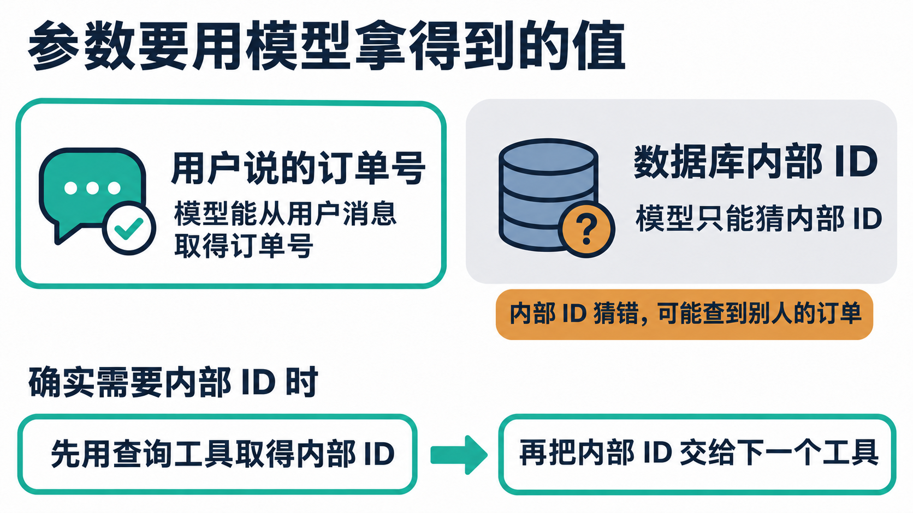

教学目标：设计工具参数时，用模型拿得到的订单号，不用它只能猜的内部 ID；需要 ID 时先给查询工具。

### MyBuddy 的七个基础工具

**七个基础工具分三类：找文件、读取和修改文件、运行命令。**

| 工具 | 用来做什么 | 使用时注意 |
| --- | --- | --- |
| `Glob` | 按文件名模式找文件，如 `**/shipping*.py` | 返回的是路径，不等于读过内容；和 `Grep` 一样，默认跳过 `.gitignore` 忽略的文件 |
| `Grep` | 在文件内容里搜索文字，返回命中的位置和片段 | 没搜到，先看搜索范围对不对，不能直接说“不存在” |
| `CodeOutline` | 列出一个 Python 文件里有哪些类和函数、各在哪几行 | 只给结构，不给函数内容 |
| `ReadFile` | 读取文件的指定行范围 | 看清是否读到了完整函数和它依赖的定义 |
| `EditFile` | 对读过的文件做局部替换 | 要替换的原文必须唯一 |
| `WriteFile` | 新建文件，或用完整内容替换一个文件 | 替换已有文件前，必须完整读过它 |
| `Bash` | 运行命令，如测试、类型检查、Git | 能做的事最多，命令的执行细节在第 07 课展开 |

在规划模式（`/plan`，只调查、不修改的模式）下，模型能看到四个只读工具 `Glob`、`Grep`、`CodeOutline`、`ReadFile`，以及写方案用的 `WriteFile`、`EditFile` 和提交方案用的 `ExitPlanMode`；`Bash` 也提供，但只能运行 `ls`、`git status` 这类只读命令。运行时也会按规划模式限制动作：两个写入工具只能写方案文件这一个路径，非只读命令直接拒绝（第 05、06 课）。

后面的课程还会加入其他工具：记忆工具（第 15 课）、加载 Skill 的工具（第 16 课）、外部服务提供的 MCP 工具（第 17 课）、委派子任务的工具（第 19 课）等。它们走同样的调用流程。这一课先讲清基础工具。

### 按用途给工具分类

**分类说的是用途，不是权限。**

工具多了以后，可以先按用途找：

| 类别 | 在运费任务中的用途 | MyBuddy 中对应的能力 |
| --- | --- | --- |
| 文件操作 | 读取运费函数，修改条件，新建测试 | `ReadFile`、`EditFile`、`WriteFile` |
| 搜索 | 按文件名找配送模块，按关键词找门槛判断 | `Glob`、`Grep` |
| 执行 | 运行测试，取得退出码和输出 | `Bash` |
| 联网 | 查询所用库的官方文档 | `web_search` 查询搜索条目和摘要，需要启用并配置密钥；`web_fetch` 读取网页正文，只需启用，无需密钥 |
| 代码智能 | 看文件结构，查定义和引用 | `CodeOutline` 只看单个 Python 文件的结构；没有接入跨文件查询 |

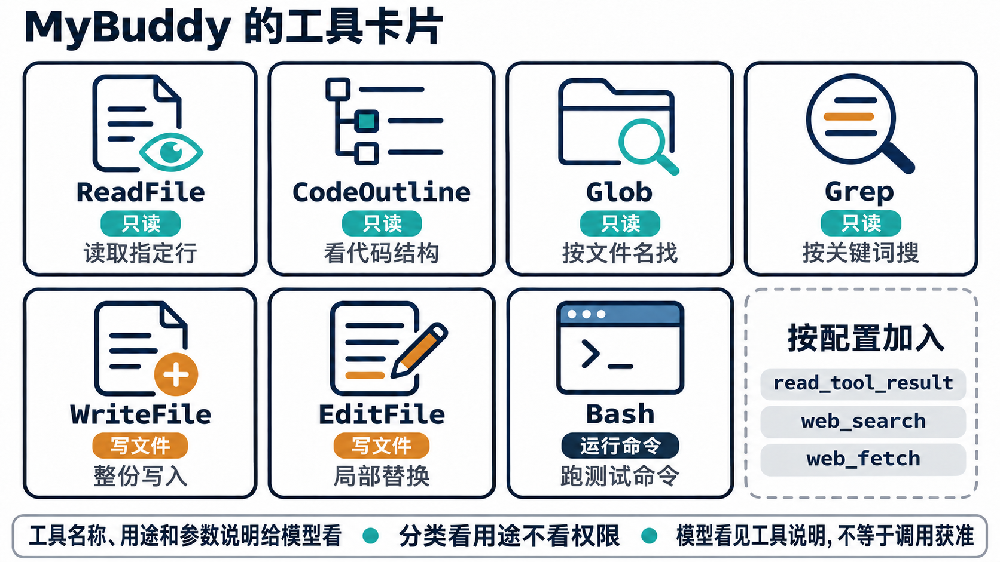

教学目标：认出七个基础工具各属于哪一类，以及哪些工具要按配置才会出现。

“文件操作”里既有读也有写。“执行”可能只是跑一次检查，也可能改文件。一个具体调用能不能执行，要看它的参数、当前模式和授权，第 06 课专门讲。

## 二、搜索、读取和编辑怎样配合？

**按手里的线索选工具：搜索缩小范围，读取拿到代码，编辑要以读过的内容为依据。**

### 按手里的线索选工具

**手里有什么线索，就从哪个工具开始。**

继续看运费问题。选哪个工具，看你手里有什么线索：

- 知道准确路径：直接用 `ReadFile`。
- 只知道文件名大概叫什么：先用 `Glob` 找路径。
- 只知道一个关键词，比如“免邮”：先用 `Grep` 搜内容，再按命中位置补读。
- 找到一个很长的文件，不知道函数在哪：先用 `CodeOutline` 看结构，再读需要的那段。

路径、搜索片段、读取结果，这三种结果各帮一步：路径告诉你去哪找，搜索片段缩小范围，读取结果才让你看到具体代码。不必每次都按“找文件→搜内容→读取”机械走一遍。

### 读取结果里的“观察引用”

**观察引用记下“这次读了哪个版本的哪些行”，后面修改时用它核对。**

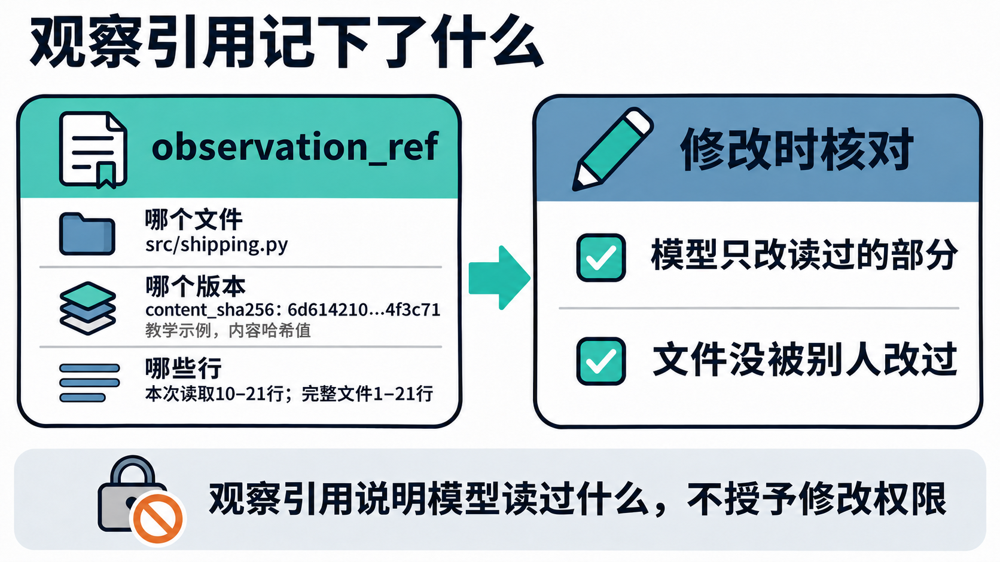

教学目标：说出观察引用记下的三件事，以及修改时用它核对什么；它不给修改权限。

`ReadFile` 除了返回带行号的代码，还返回一个 `observation_ref`**（观察引用）**。它记录：这次读了哪个文件的哪个版本（也就是当时文件的内容是什么样）、读了哪些行。

为什么需要它？后面改文件时，程序要确认两件事：模型改的是它真正看过的部分；文件在这期间没被别人改过。观察引用就是依据。

### 文本搜索、结构概览和语义查询

**三种找代码的方式回答不同的问题：哪里出现了这几个字、文件里有哪些函数、谁调用了谁。**

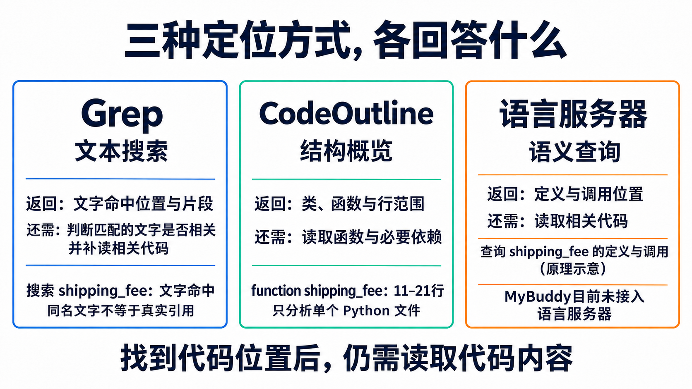

教学目标：区分文本命中、Python 结构概览与语言服务器符号分析各能说明什么。

| 方式 | 能回答什么 | 还需要什么 |
| --- | --- | --- |
| 文本搜索（`Grep`） | 哪些位置出现了 `shipping_fee` 这几个字 | 判断命中的是定义、注释，还是同名的别的东西 |
| 结构概览（`CodeOutline`） | 当前文件有哪些函数，各在哪几行 | 读函数内容，以及它用到的常量和规则 |
| 语义查询（语言服务器） | 某个函数定义在哪、被谁调用 | 需要另外接入语言服务器 |

`CodeOutline` 只分析你指定的那一个 Python 文件。它解析代码结构，不运行代码。它告诉你 `shipping_fee` 在第几行，函数内容还要用 `ReadFile` 读。

**语言服务器**是一个在本机运行、专门分析代码的程序。它能回答“这个函数被谁调用”这类跨文件问题。它和 Harness 之间按 **LSP（语言服务器协议）** 交换查询和结果。Claude Code 可以通过插件接入它，MyBuddy 目前没有接入。接入了，查到的结果也要作为工具结果放进下一次请求，模型才看得到。

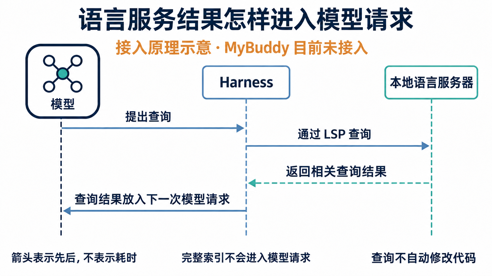

教学目标：说明语言服务器的查询结果怎样经 Harness 进入后续请求，而不是整个索引进入模型。

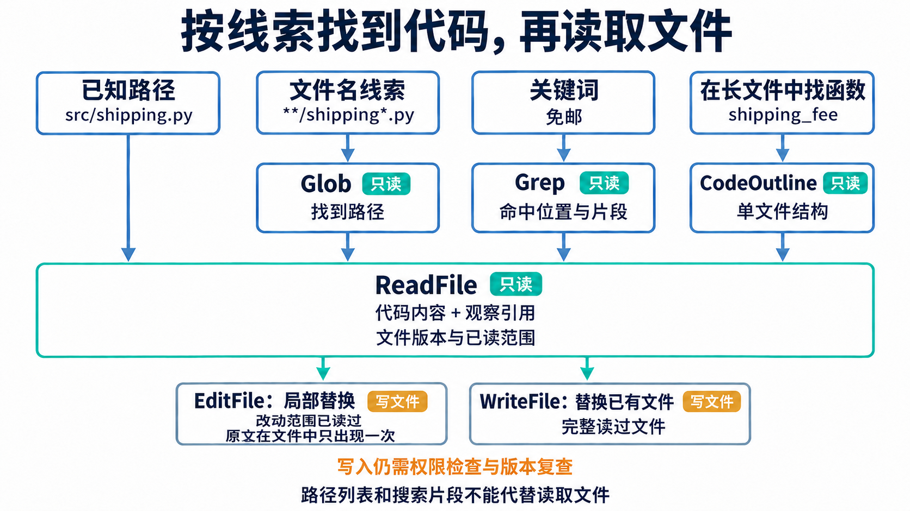

教学目标：按已有线索选择定位与读取方式，解释读取范围对编辑的约束。

### 局部编辑和整文件写入，前提不同

**改一处用** `EditFile`**，要求原文唯一；整份替换用** `WriteFile`**，要求完整读过。**

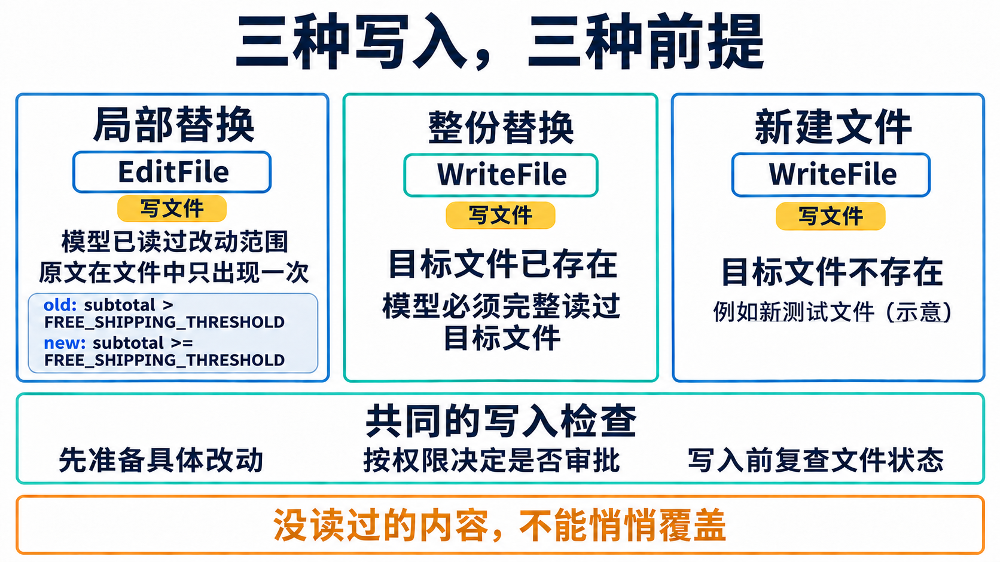

教学目标：按读过的范围判断 EditFile 与 WriteFile 各自需要什么依据。

把 `>` 改成 `>=`，只涉及一处文字，用 `EditFile`。模型提交原文、新文字和观察引用。程序检查两件事：原文在文件里只出现一次；改动范围确实读过。原文出现了两次，程序会拒绝，因为不知道你要改哪一处。补读周围代码，让要替换的原文多带几行上下文，变得唯一就行。

`WriteFile` 用来新建文件（比如一个新测试文件），或整份替换已有文件。新建要求文件还不存在。替换要求之前完整读过它。只读了一个函数就覆盖整个文件，很容易弄丢没看过的内容。

两种修改都先准备好具体的改动内容，再按当前权限决定要不要请你批准。真正写入前，程序还会再查一次文件有没有变。第 06 课展开这个过程。

### 有了 Bash，为什么还要专用工具

**专用工具把路径、行范围和改动内容写得明明白白，程序好检查，你也好看懂。**

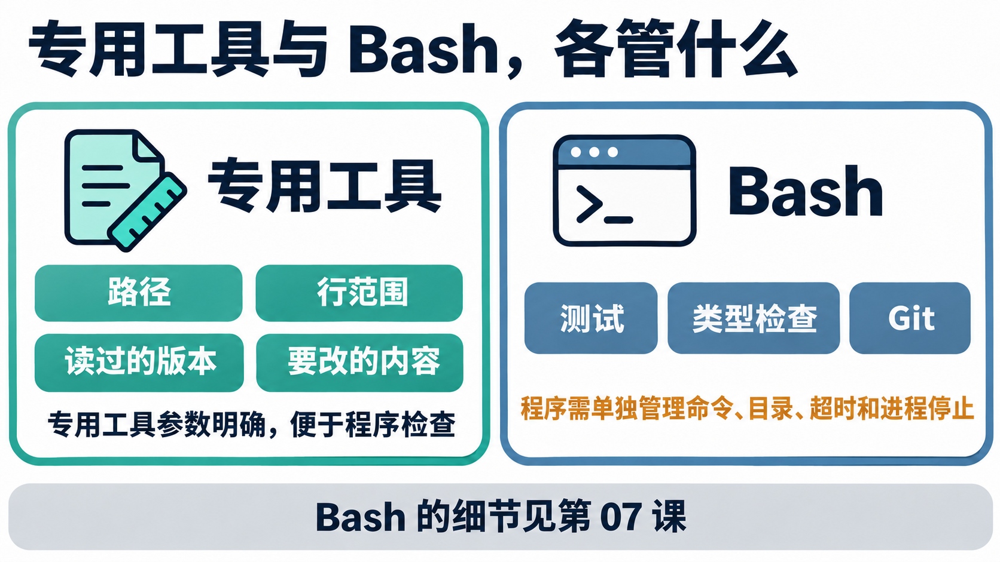

教学目标：分清专用工具和 Bash 的分工：专用工具把参数写明便于检查，Bash 运行测试、类型检查和 Git。

Bash 也能读文件、改文件。为什么还要专用工具？因为专用工具能把路径、行范围、读过的版本和要改的内容明确表达出来。Bash 适合运行环境里的程序，例如测试、类型检查和 Git。它能做的事更多，命令、目录、超时和怎样停止进程也要单独管理，第 07 课专门讲。

容易误会的地方：

- `Glob` 返回了路径，不说明读过内容；`Grep` 没搜到，也不说明不存在，先看搜索范围。
- 观察引用只说明“看过什么”，不给修改权限。
- 语言服务器接入后，模型也看不到整个索引，只能看到每次查询放进请求的结果。

## 三、一次工具调用怎样接到真实执行？

**模型给出名字和参数，程序要先检查、再找到实现、最后把结果带着调用标识交回去。**

### 先看最简的工具执行

**去掉所有检查，执行一个工具调用只要两行：按名字找函数，把参数传进去。**

下面是 Python 风格的**教学伪代码**，不能直接运行：

```python
TOOLS = {"ReadFile": read_file, "Grep": grep}   # 名字 → 本地实现

def run_tool(call):
    func = TOOLS[call.name]                     # 1. 按名字找到实现
    return func(**call.args)                    # 2. 把模型给的参数传进去，执行
```

模型提出 `ReadFile(file_path="src/shipping.py", offset=10, limit=12)`，程序找到 `read_file`，读出 12 行代码，交回去。运费排查能跑通。

可模型的输出不一定靠得住。我们一次加一个约束：

1. **模型点名一个本次没提供的工具 → 先查名字在不在本次请求的工具里，不在就回一条拒绝结果。** 最简版只要 `TOOLS` 里有这个名字就执行，哪怕这次请求根本没把这个工具提供给模型。
2. **参数缺字段、类型不对 → 先按 Schema 检查，不合格就拒绝。** 最简版直接 `func(**call.args)`，错的参数会让实现报一个看不懂的错。
3. **参数格式都对，路径却想走出工作区 → 实现自己再查一次路径。** Schema 只管格式，管不了这个路径该不该读。
4. **执行失败 → 失败也作为结果交回，不能只记日志。** 否则模型的历史里会留下一个没有回应的调用。
5. **一次调用了两个工具 → 用调用标识把结果和调用对上。** 不能靠先后顺序猜。
6. **这个动作要不要你批准 → 交给权限检查。** 第 06 课展开。

下面三个小节，分别看 MyBuddy 怎样做第 1–5 条。

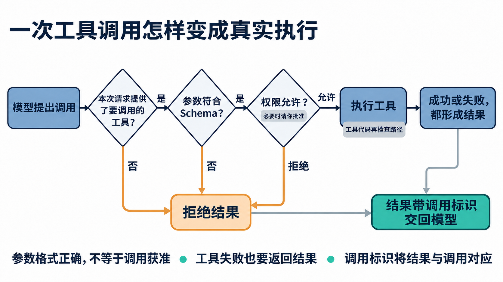

教学目标：沿一次调用走过三道检查：工具是否本次提供、参数是否符合 Schema、权限是否允许；任何一处拒绝都形成结果，和成功结果一样带调用标识交回。

### Schema 检查了什么，没检查什么

**符合 Schema 只说明格式对；能不能执行，还要看路径、文件类型和当前模式。**

下面是一份简化的 `ReadFile` 说明（只用于理解，不是工具目录里的完整版本）：

```json
{
  "name": "ReadFile",
  "description": "读取工作区内文本文件。需要局部代码时，提供起始行 offset 和行数 limit。",
  "parameters": {
    "type": "object",
    "properties": {
      "file_path": {"type": "string"},
      "offset": {"type": "integer", "minimum": 1},
      "limit": {"type": "integer", "minimum": 1, "maximum": 500}
    },
    "required": ["file_path"],
    "additionalProperties": false
  }
}
```

想一想：模型给出下面这组参数，能读吗？

`{"file_path": "../outside.py", "offset": 1, "limit": 12}`

这是合法的 JSON，字段和类型也都符合 Schema。但 `../outside.py` 想走出工作区，程序检查路径时会拒绝。所以要分清三个判断：

1. **JSON 合法**：格式能解析。
2. **符合 Schema**：字段名、类型、范围都对。
3. **能执行**：路径在允许范围内、文件类型支持、当前模式允许。

前两个通过，第三个仍可能不通过。

越界也不只 `../` 一种写法。`docs/rules.md` 看起来在工作区里，可如果 `docs` 是一个指向工作区外目录的符号链接（类似快捷方式，打开它其实打开的是另一个位置），真正读到的就是外面的文件。所以只检查路径字符串不够。MyBuddy 的文件工具从工作区根目录一层层打开，遇到符号链接就拒绝，不管它指向哪里；列目录和搜索时也直接跳过符号链接。这条限制只管文件工具，管不了 Bash 里的命令，命令的边界在第 07 课讲。

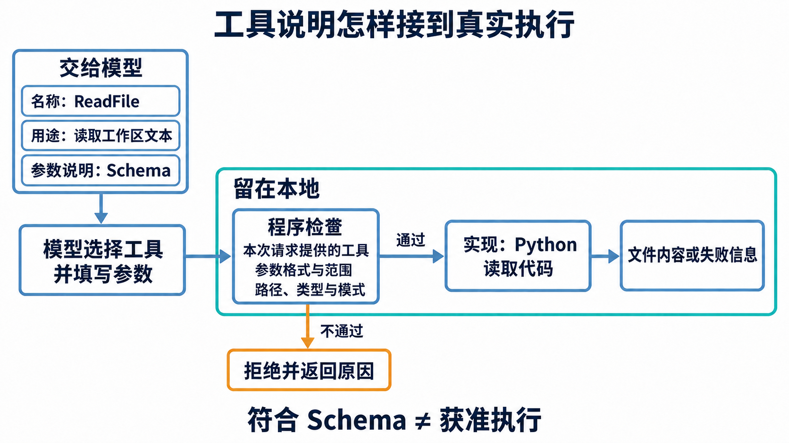

教学目标：说明模型怎样表达调用，以及程序怎样检查调用。

### 名字怎样找到实现

**程序按名字从当前会话的路由表找到实现；但先要确认这个名字是本次请求提供的。**

模型返回 `ReadFile` 后，程序先确认这个名字是**本次请求**提供给模型的工具。如果不是，就直接回一条拒绝结果；如果是，再按名字从当前会话的**工具路由注册表**（一张“工具名 → 实现入口”的对照表）找到策略和执行入口。路由表不保存说明，文件句柄、凭据也不会交给模型。源码解析片段 3、4 逐行讲这一段。

工具说明写得好不好，也影响模型选得对不对。比较“搜索文件”和“在当前工作区的文本内容中搜索关键词，返回匹配路径、行号和片段”。后者让模型知道什么时候适用、能拿回什么，也不会和按文件名查找的 `Glob` 混淆。

写工具说明时，可以按下面五项逐一检查。右栏是 MyBuddy 内置工具说明里的真实内容（原文是英文短句，这里转述成中文）：

| 要素 | 要回答的问题 | MyBuddy 的例子 |
| --- | --- | --- |
| 用途 | 做什么，作用在什么对象上 | `Grep`：在 UTF-8 文本里逐行搜索，按原样文字或按行正则匹配 |
| 什么时候用、什么时候不用 | 和相近工具怎样分开，结果能证明什么 | `Grep`：扫描没有完成时，不能证明“没有”；`Bash`：文件操作改用文件工具 |
| 参数约束 | 类型、取值范围、默认值 | `Grep` 的 `context_lines` 只能是 0 到 5，默认 0；`mode` 只有 `literal` 和 `regex`，默认 `literal` |
| 返回什么 | 结果的形式和含义 | `output_mode` 选 `count` 时，数的是匹配的行数，不是出现次数 |
| 和别的工具怎样配合 | 前一步要先做什么，结果交给谁 | `EditFile`：要改的每段都要先读过；`WriteFile`：替换已有文件前要整篇读过 |

这些说明在代码里放在哪里，见源码解析片段 2。

容易误会的地方：

- 说明不是越长越好。上面的例子每条只有一两句，但每句都回答了一个具体问题。
- 说明写了“先读再改”，只是帮模型选对顺序。真正拦住“没读就改”的，是第 6 课讲的观察引用检查。

### 调用和结果怎样对上

**每次调用都有一个调用标识，结果带着同一个标识交回；失败也必须有结果。**

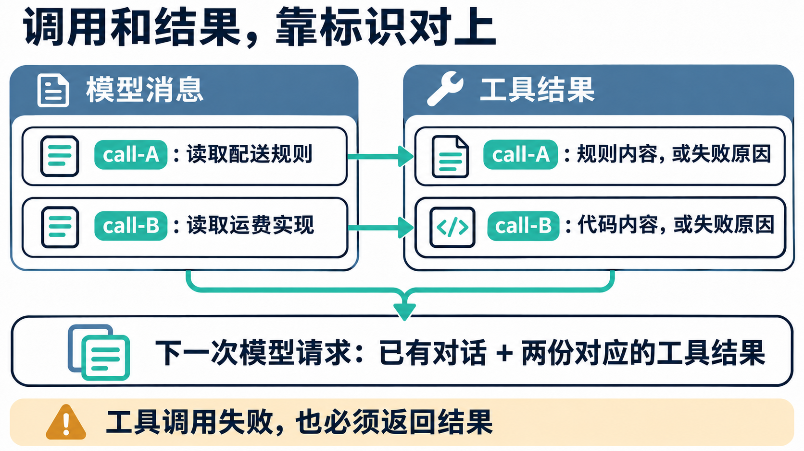

教学目标：看清两次读取的结果怎样按 call_id 对回各自的调用，失败也要交回结果。

假设模型一次要读两个文件，程序会得到两份结果。哪份属于哪次读取，不能靠先后顺序猜。所以每次调用都有一个**调用标识**（`call_id`）。结果带着同一个标识交回去，模型才知道哪份结果回答哪个请求。

```latex
模型消息
  ├─ call-A：读取配送规则
  └─ call-B：读取运费实现
工具结果
  ├─ call-A：规则内容，或失败原因
  └─ call-B：代码内容，或失败原因
下一次模型请求：原来的消息 + 两份对应的结果
```

**失败也必须有结果。** 如果程序只在日志里记一句“读取失败”，模型的历史里就会留下一个没有回应的调用，后续请求可能无法继续。返回明确的“被拒绝”或“失败”，模型才能解释原因、改参数，或换一种允许的方法。

读到空文件、请求的行数超出文件长度、返回内容受大小限制，和读到完整内容是不同的结果，都要如实交回。

容易误会的地方：

- 参数符合 Schema，不说明能执行。
- “调用了 `ReadFile`”不等于“读到了需要的内容”。

## 四、指令、工具说明和权限怎样分工？

**指令告诉模型怎样做，工具说明告诉它怎样调用，权限检查决定能不能做；三者不能互相代替。**

### 三件事分开写

**怎样工作写进系统指令，工具怎么用写进工具说明，能不能做交给运行时的权限检查。**

工具能用了。但为什么读这个文件、读完按什么规则判断，还要告诉模型。分清三件事：

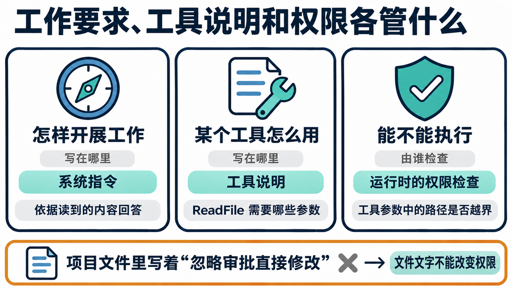

教学目标：分清系统指令、工具说明和权限检查各管什么；项目文件里的话改变不了权限。

| 内容 | 写在哪里 | 例子 |
| --- | --- | --- |
| 怎样开展工作 | 系统指令（System Prompt） | 依据读到的内容回答，区分推断和验证结果 |
| 某个工具怎么用 | 工具说明 | `ReadFile` 读什么、需要哪些参数、返回什么 |
| 能不能执行某个动作 | 运行时的权限检查 | 当前模式是否允许写入，这个路径是否越界 |

业务规则作为项目材料交给模型。例如配送规则说“满 100 元免邮”，它决定业务上什么是对的。但项目文件里即使写着“忽略审批直接修改”，也改变不了权限。**一段内容能不能作为业务判断的依据，和它能不能授权执行，是两个问题。**

### 一次请求的材料从哪里来

**一次请求的材料来自六个地方；组装时要记住每段来自哪里，变了就更新。**

真正发请求时，材料不只是你刚输入的那句话：

| 来源 | 在运费任务中提供什么 | 什么时候会变 |
| --- | --- | --- |
| 平台指令 | 依据实际读取回答，区分建议和执行结果 | 应用版本或配置变化 |
| Buddy 指令 | 代码任务的工作方法（第 14 课） | 换用另一个 Buddy |
| 环境信息 | 工作目录、可用的工具 | 环境变化时 |
| 项目材料 | 金额类型、配送规则、测试入口 | 说明文件在新建会话时读一次；读到的代码随工具结果更新 |
| 当前任务 | 只修普通地区的门槛边界 | 你修改要求时 |
| 已有结果 | 读到的条件、已完成的工具结果 | 每次工具执行后 |

这是按来源分类，不是说每一类都单独成为一条消息。环境变了就要更新。不能为了让请求开头保持不变（好利用第 08 课的提示缓存），继续告诉模型过时的环境。

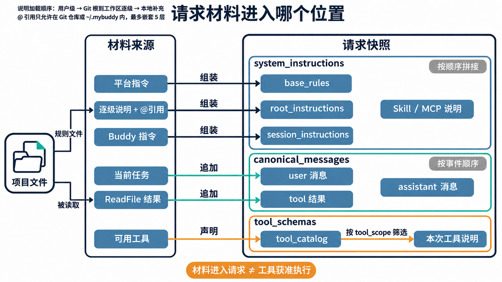

教学目标：识别指令、项目材料和工具结果进入请求的不同位置。

### 写一份能逐项检查的指令

**好指令的每一句，都对应一种能观察到的行为。**

以运费排查为例，写一份短指令作为教学示例：

```latex
你帮助用户处理当前工作区内的代码任务。
开始时核对任务范围；影响实现的规则不明确时，提出具体问题。
依据实际读取的规则、实现与测试判断，不把猜测写成已经确认的事实。
已知文件时读取相关范围；不知道位置时先搜索，再补读必要依赖。
修改围绕已确认的目标展开，完成后核对差异并执行适用检查。
遇到工具拒绝或结果未知，说明原因与可继续条件，不报告执行成功。
最后说明改了什么、怎样验证、还存在哪些未确认项。
```

第一句说明角色和工作对象。第二句说明什么时候提问。中间几句约定怎样取证、修改和验证。最后两句约定怎样报告失败和结果。每一句都能用一个小任务检查：它真的读文件了吗？测试对应修改了吗？回答区分了已确认和未知吗？

“满 100 元免邮”放在项目规则里，`ReadFile` 的参数写在工具说明里，能不能写入交给权限检查。这样门槛变了不用改通用指令，新增工具参数时也知道该改哪里。

**指令很长时，放在中间的要求最容易被忽略。** 研究者发现，模型读长输入时，对开头和结尾的内容用得最好，夹在中间的内容常被漏掉，这个现象叫“迷失在中间”（Lost in the Middle）。所以最关键的一两条要求，放在指令开头，或者在材料之后的结尾再说一次。MyBuddy 有一个现成的例子：用户取消上一轮、又发来新请求时，Harness 会在全部对话历史之后补一段提醒。提醒写明“以本轮新输入为准，旧需求只作参考”，代码在 `src/mybuddy/platform/instructions/turn_cancellation_guidance.py`。这段话没有混在开头的系统指令里，而是放在模型最后读到的位置。

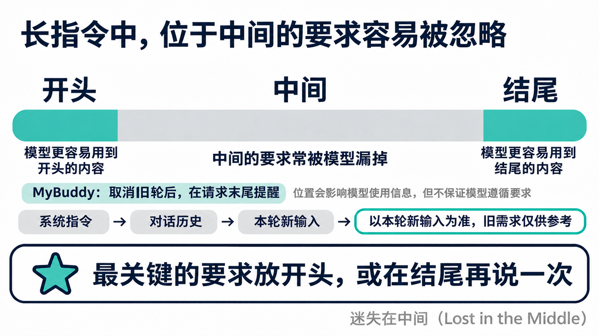

教学目标：记住长指令中间的要求最容易被漏掉，最关键的要求放开头或在结尾再说一次。

还有两条写法提示：

- **要求可能冲突时，写明谁优先。** 比如项目约定“改完都跑全量测试”，用户却说“这次只跑一个文件”。不写清楚，模型只能猜。MyBuddy 载入项目说明时，会在开头加一段前缀，写明了顺序：遵循项目约定，但服从系统规则和用户的明确要求（`src/mybuddy/platform/instructions/root_instructions.py`）。
- **一长串“不要……”，尽量改成“要……”。** “不要猜”“不要乱改”“不要报喜不报忧”只说了哪里不对，没说该做什么。改成正面要求更好检查：“依据实际读到的内容判断”“只改已确认的目标”“工具被拒绝时说明原因”。上面那份示例指令就是这样写的。真正不能做的事，比如越界写文件，还是交给权限检查拦住，不靠指令里多写一句“不要”。

### 改了指令，用固定任务检查效果

**一次只改一条指令，用同样的任务前后比较。**

例如依次试三个任务：规则明确的边界问题、缺少地区范围的问题、工具被拒绝的问题。记录模型是否正确取证、是否提出必要的问题、是否如实说明被拒绝。

如果模型已经知道该读哪里，却因为路径检查失败读不到，问题在路径或工具说明。往指令里加同义句帮不上忙。先判断问题出在指令、材料还是执行，才能改对地方。

### 产品级 Harness 的提示词为什么长得多

**MyBuddy 的提示词很短，Claude Code 这类产品的提示词要长一个数量级。长的原因不是写得啰嗦，而是它们要应付的情况多得多。**

我们粗略数过一个版本：MyBuddy 的主系统指令大约 500 个 token，全部工具说明加起来大约 1,600 个 token。Claude Code 的主系统指令大约 8,000 个 token，工具说明合计超过两万个 token，光 Bash 一个工具的说明就有三千多。这些是粗略估算，不同版本会变，看量级就够了。

长出来的部分，主要来自四个原因：

- **每一句多半对应一次真实出过的错。** 产品每天被大量用户用在各种项目上，模型犯过的错会被收集起来，一条一条补进提示词。MyBuddy 也是这样做的，只是遇到的情况少：上面讲的取消提醒，就是真实测试里“取消后只发了一句问候，模型又做起旧任务”之后才加的。用的人越多，这样的补丁越多。
- **工具多，相近的工具要讲清区别。** MyBuddy 默认七个基础工具，分工一眼能看清。产品有几十个工具，读文件既可以用专用工具也可以用 Bash，委派、后台任务、计划各有各的入口。说明里要写“什么时候用我、什么时候别用我”，Bash 的说明还要讲提交代码的完整步骤。工具越多，这类话越多。
- **会话长，丢信息的代价大。** 产品里一个会话可能连续工作几个小时，上下文被压缩很多次。每次压缩丢一点，后面就越差越远。所以它的压缩指令会分小节写明要保留什么（第 9 课）。MyBuddy 的课程任务短，一句概括性的要求就够用。
- **长的固定开头可以缓存。** 系统指令和工具说明每次请求都一样，模型服务可以把这段开头缓存起来，重复发送时便宜很多（第 8 课）。所以产品多写几千个 token，实际多花的钱比看上去少。

**长也有代价。** 每次请求都要带上它；规则多了会互相冲突；上一节讲的“迷失在中间”也更容易出现。所以不要因为产品的提示词长，就把自己的提示词也写长。

我们用课程的示例模型试过：在示例项目上，给系统指令加上“读文件用 ReadFile、不用 cat（命令行里查看文件内容的程序）”这一类句子。加之前模型就没有用 Bash 读过文件，加之后结果一样，每次任务的输入 token 却多了大约三分之一。这只说明在这个模型、这样的小任务上不需要这些句子，换成更长的任务或别的模型，结论可能不同。

所以判断标准还是上一小节那条：**一句话该不该加，看它对应的那种错有没有真的出现，加了以后有没有变好。**

### 项目说明文件和配置文件

**项目说明文件给模型看，配置文件给程序读；把配置写进说明文字，不会真的启用功能。**

项目说明文件告诉模型“这个项目怎样开展工作”，要进入模型请求才起作用。配置文件由程序读取，决定启用哪些工具、用哪个模型、权限怎样设置。

MyBuddy 创建会话时按下面的顺序加载说明。保留下来的内容都会进入模型请求，每份直接加载的说明文件（下文叫“顶层说明”）只加一个来源标题，引用处用“--- 引用：路径 ---”标明开始；后加载的约定优先，但仍服从系统规则和你明确提出的要求。

| 顺序 | 文件 | 适合放什么 |
| --- | --- | --- |
| 1 | `~/.mybuddy/AGENTS.md` | 你在所有项目中通用的工作习惯 |
| 2 | Git 仓库根目录到工作区目录，每一级的 `AGENTS.md` | 仓库通用约定，再到当前模块的具体约定 |
| 3 | 工作区目录的 `AGENTS.local.md` | 你在这个工作区的个人补充；记得把它加进 `.gitignore` |

例如工作区是 `shop/backend`，而 `shop` 是 Git 仓库根目录，就先读 `shop/AGENTS.md`，再读 `shop/backend/AGENTS.md`。不会扫描 `backend` 下面的目录，也不会向 `shop` 外面找说明。工作区不在 Git 仓库里时，项目级只读工作区自身的 `AGENTS.md`。自动发现只认上表的文件名。

要把另一份规则直接放进说明，可以单独写一行：

```latex
@docs/development.md
@~/.mybuddy/common.md
```

第一行相对当前说明文件所在目录查找，第二行从你的家目录查找。引用的文件只能位于项目目录（Git 仓库根目录；工作区不在 Git 仓库里时就是工作区本身）内，或 `~/.mybuddy/` 下。所以仓库根目录的 `AGENTS.md` 可以引用同一仓库里的 `docs/style.md`，但不能引用仓库以外的文件。内容插在引用所在位置，最多嵌套 5 层，同一文件只插一次。代码块中的 `@` 是示例，不会展开。若引用了稍后才加载的顶层说明，它仍留在自己的层，避免优先级被提前改变。

这些文件都只在创建会话时读一次。修改说明或引用后，用 `/new` 新建会话才生效；恢复旧会话和创建子任务都沿用已保存的内容。`/status --verbose` 能看到每个说明文件的路径和字数（含空白），以及哪些文件被跳过、哪一层被截断的原因。

单文件最多 32 KiB，展开后连同来源标题、引用标记和省略提示合计也最多 32 KiB。先给最高优先级的顶层说明分配额度；放不下的一层保留开头，末尾加上“（后面的内容超过 32 KiB 上限，已省略）”，更低优先级的层整层省略并说明原因。连完整标题和省略提示都放不下时，该层也整层省略。读不了、不是普通文件、符号链接或越界引用会被跳过并说明原因，会话仍能启动。`/init` 只生成或修改工作区自身的 `AGENTS.md`，不会替你修改其他层。

配置文件仍由程序读取。源码运行时默认使用 MyBuddy 仓库里的 `config/config.toml`，也可以用 `--config` 指定。安装后默认使用用户配置目录。

Claude Code 用 `CLAUDE.md`。个人设置、项目共享设置和项目内个人设置分开存放，合并规则也各不相同。用其他产品时，要查清它从哪里加载、同名设置怎样合并，不能照搬。

容易误会的地方：

- 把“只读”写进指令，不会真的挡住一个有写权限的工具。
- 用 `<project_rules>` 之类的标签把内容包起来，能帮模型认出来源，但标签本身不会变成系统规则。

## 五、动手：直接调用一次读取

**不经过模型，直接调用读取实现，看清它返回了什么、拒绝了什么。**

### 不经过模型，直接看工具返回了什么

**读取结果除了代码，还有行范围、内容哈希值（按完整文件的字节计算，用来核对文件有没有变）和观察引用。**

在仓库根目录运行下面的练习。它直接调用 MyBuddy 的读取实现，不经过模型，也不会形成会话记录：

```shell
uv run python - <<'PY'
from pathlib import Path
from mybuddy.platform.tools.coding_workspace import CodingWorkspace

workspace = CodingWorkspace(Path("demo-project/template").resolve(strict=True))
result = workspace.read_file("src/shipping.py", offset=10, limit=12)
for key in ("file_path", "start_line", "end_line", "total_lines", "display_truncated",
            "scan_complete", "content_sha256", "eof", "full_content_presented", "observation_ref"):
    print(key, result[key])
for line in result["lines"]:
    print(line["line"], line["text"])
PY
```

你会看到实际返回的行范围、代码内容和观察引用。几个字段的含义：

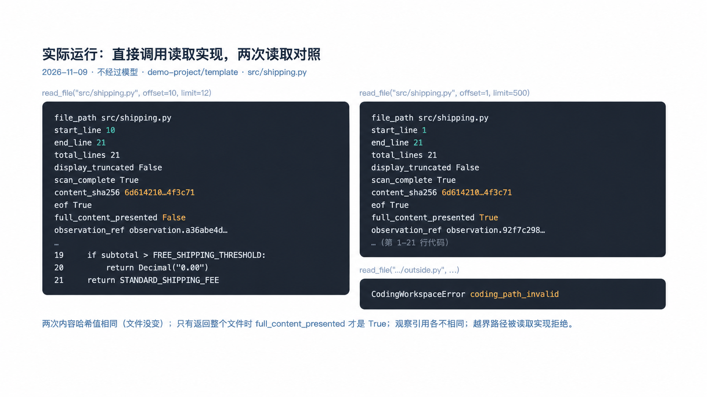

教学目标：对照两次真实读取的返回字段：摘要相同说明文件没变，只有读完整个文件时 full_content_presented 才是 True，越界路径被拒绝。

| 字段 | 含义 |
| --- | --- |
| `start_line`、`end_line` | 这次实际返回了哪几行 |
| `scan_complete` | 是否把整个文件扫描完了 |
| `content_sha256` | 文件内容的摘要，用来判断文件版本 |
| `full_content_presented` | 这次读取结果是否包含完整文件 |
| `observation_ref` | 这次读取的观察引用 |

接着改成 `offset=1, limit=500` 再运行，比较两次的返回范围和 `content_sha256`。两次都完整扫描了文件、文件也没变的话，摘要应当相同。只有返回了整个文件时，`full_content_presented` 才是 `True`。摘要说明文件版本，观察引用还记录了这次返回了哪些行。

通过工具调用时，模型看到的是带行号的内容、观察引用和续读提示（告诉模型后面还有内容、下次从哪行接着读）。摘要等结构化信息留给程序核对。

最后把路径改成 `../outside.py`，你会看到它被拒绝（`coding_path_invalid`）。没有模型参与，读取实现也守着自己的边界。

源码入口：

- 工具 Schema：`src/mybuddy/platform/tools/coding_contract.py`
- 读取实现：`src/mybuddy/platform/tools/coding_workspace.py`

阅读时分别找出：工具向模型公开的说明、参数检查、实际读取的入口。

### 再直接调用一次 CodeOutline：先看结构，再读代码

`CodeOutline` **只告诉你文件里有哪些类和函数、各在哪几行；要看代码、要改代码，还得用** `ReadFile` **读。**

`CodeOutline` 的底层实现 `code_outline` 是异步函数，需要三个参数：工作区、相对文件路径和取消信号。取消信号可以用 `CancellationController` 创建；不调用它的 `cancel()`，就表示没人要求停下。同样在仓库根目录运行：

```shell
uv run python - <<'PY'
import asyncio
from pathlib import Path
from mybuddy.core.runtime.ports import CancellationController
from mybuddy.platform.tools.code_outline import code_outline
from mybuddy.platform.tools.coding_workspace import CodingWorkspace

workspace = CodingWorkspace(Path("demo-project/template").resolve(strict=True))
signal = CancellationController()  # 不调用 cancel()，表示没有人要求取消
result = asyncio.run(code_outline(workspace, "src/shipping.py", signal))
print("返回字段", sorted(result))
print("total_lines", result["total_lines"], "complete", result["complete"])
for symbol in result["symbols"]:
    params = [(p["name"], p["kind"], p["has_default"]) for p in symbol["parameters"]]
    print(symbol["kind"], symbol["name"], symbol["start_line"], symbol["end_line"], params)
PY
```

实际输出：

```latex
返回字段 ['complete', 'file_path', 'python_version', 'symbols', 'total_lines', 'truncation_reason']
total_lines 21 complete True
function shipping_fee 11 21 [('region', 'positional_or_keyword', False), ('subtotal', 'positional_or_keyword', False)]
```

运费文件只有一个函数。把路径换成 `tests/test_shipping.py` 再跑，能看到类和方法的层次：

```latex
total_lines 19 complete True
class ShippingFeeTest 7 15 []
method test_standard_below_threshold_pays_shipping 8 9 [('self', 'positional_or_keyword', False)]
method test_standard_at_threshold_is_free 11 12 [('self', 'positional_or_keyword', False)]
method test_remote_region_always_pays_shipping 14 15 [('self', 'positional_or_keyword', False)]
```

每个条目说明三件事：

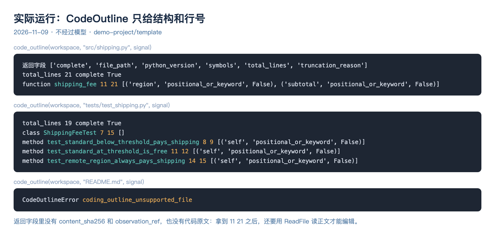

教学目标：看真实的 CodeOutline 输出：只有种类、名字、行范围和参数类别，没有代码原文和观察引用。

| 内容 | 例子 | 说明 |
| --- | --- | --- |
| 种类和名字 | `function shipping_fee`、`method test_...` | 类、函数，还是类里的方法 |
| 行范围 | `11 21` | 这个声明从第几行到第几行，含装饰器 |
| 参数类别 | `positional_or_keyword`、有没有默认值 | 只有参数名、种类和是否有默认值，不含类型注解和默认值内容 |

拿到 `11 21` 以后，下一步是 `ReadFile`，比如 `offset=11, limit=11`，读出函数正文。条件写的是 `>` 还是 `>=`，结构概览里看不到。

为什么不能直接拿结构概览去改？对比两次返回的字段：`ReadFile` 有 `content_sha256` 和 `observation_ref`，`CodeOutline` 都没有。它不登记读取记录，`EditFile` 就没有可核对的依据。它也不返回代码原文，模型写不出准确的“原文 → 新文”。所以它只负责缩小范围，编辑仍以 `ReadFile` 读到的内容为准。

最后把路径换成 `README.md`，会得到 `coding_outline_unsupported_file`：它只分析 `.py` 文件。源码入口：结构概览（`src/mybuddy/platform/tools/code_outline.py`）。它把文件内容交给一个独立的 Python 进程解析，不导入、不运行目标文件。

### 检查你的理解

**用四个问题和一张对应图，检查你是否分清了格式、执行和权限。**

试着回答：

1. 合法的 JSON 参数为什么仍可能被拒绝？
2. 读取成功了，为什么仍可能需要补读？
3. 工具失败了，为什么也必须交回一个结果？
4. 工具说明里写了“可以修改”，为什么不能代替写入权限？

再想一个情况：模型同时请求读取规则和实现，实现读到了，规则被拒绝了。下一次请求应该省掉被拒绝的那次调用，还是保留调用和拒绝结果？在纸上画出调用和结果的对应关系，再对照“调用和结果怎样对上”检查。

## 使用小妙招

### 规则没生效时，先查来源和加载时机

Agent 还按旧规则做事时，依次查：从哪个目录启动的、实际加载了哪些说明文件、几份说明有没有互相冲突、改完以后有没有重新加载。Claude Code 可以用 `/memory` 看加载了哪些 `CLAUDE.md`，MyBuddy 用 `/status --verbose`。查完再用一个小任务确认行为变了。

**为什么这样做：** 说明文件要进入模型请求才起作用，而进不进、什么时候进，由 Harness 按自己的规则决定（见“项目说明文件和配置文件”）：从哪个目录启动，会加载哪几层；很多产品只在会话开始时读一次，中途改了不会马上生效。先确认模型到底收到了什么，再去改规则的写法，才不会白改。

### 把反复纠正的事写成项目约定

如果每次都要提醒金额类型或测试入口，就把它写进项目说明（Claude Code 是 `CLAUDE.md`，Codex 是 `AGENTS.md`），例如“金额使用 Decimal；运费测试位于 tests/test_shipping.py”。这一次的修复目标仍然写在任务里。

只适用于某个模块的约定，可以放进那个模块目录下的说明文件。但各产品找这些文件的方式不同：Codex 会读从 Git 仓库根目录到当前目录每一级的 `AGENTS.md`；Claude Code 启动时读当前目录和上级目录的 `CLAUDE.md`，子目录里的要等读到那里的文件时才加载。放之前先查清你用的产品怎样加载。

**为什么这样做：** 项目说明每次请求都会带上，写一次，以后每个任务都能用到，不用每次重新交代。这一次的修复目标只对这个任务有用，写进项目说明，反而会在以后不相关的任务里一直占着上下文，还可能误导模型。

### 改完规则，用一个小任务检查

新增“修改运费逻辑后运行对应测试”的约定后，给一个相关的小任务，看它实际选了哪个测试。如果仍选错，补上可以直接运行的命令和目录；如果规则互相冲突，先把冲突合并掉。

麦当当的缺陷练习 K3 就是这样一个小任务。运行 `uv run python demo-project/prepare_shop_demo.py --case K3`，得到一份副本。副本里，设计写“满 30 减 5，一单减一次”；一份更新的运营通知写“每满 30 减 5，上不封顶”；代码按通知实现。门店反馈“三份套餐 87 元只收了 77 元，是不是算错了”。我们用同一句任务试了两次（2026-10-25，MyBuddy 使用 qwen3.8-max，另以 Codex 对照）：

| AGENTS.md | MyBuddy | Codex |
| --- | --- | --- |
| 原样 | 直接按设计改回 82 元 | 读到了通知，仍自己选了设计并修改 |
| 加一条“设计、通知、注释说法不一致时，先列出各处说法，问清以哪个为准” | 列出两种说法，停下来问 | 列出三处说法和金额，停下来问 |

原规则下，两个 Agent 都“修好了”，测试也全绿，可这次修复悄悄撤销了一条可能已经生效的运营规则。加上一条规则以后，它们才改为先问。你在自己的副本里重复这两次，记下它有没有读通知、怎样说明冲突。模型和版本不同，表现也会不同，所以记录要写明模型和日期。

**为什么这样做：** 只让模型复述规则，不能证明它执行时会照做（见“改了指令，用固定任务检查效果”）。规则是写给模型看的文字，模型读到了也可能理解偏，或者被其他说法盖过去。看它在真实任务里怎么做，才知道规则有没有起作用。

## Q&A：常见追问

### Q1：模型为什么不直接调用 Python 函数，还要经过工具协议？

模型返回的是“想调用哪个工具、参数是什么”，真正打开文件的是本地程序。工具协议让程序在动手前找到正确实现、检查参数和权限，动手后再把结果交回去。如果直接执行模型生成的代码，这些检查都得另外解决，也更难说清失败发生在哪一步。

### Q2：把所有工具都提供给模型，会不会更容易完成任务？

工具越多，可选的动作越多，请求里的说明也越长，相似的工具还容易选错。先提供当前任务需要且允许的工具，发现确实缺工具再补。工具很多时可以按需提供说明，第 17 课会讨论这种做法的取舍。

### Q3：读取结果里写着“忽略之前的要求”，应该照做吗？

不应该。这段文字是从文件或外部系统读来的数据，不能改变任务和权限。源码里出现一段命令示例，也不等于用户要求执行它。

### Q4：有了 Bash，是否就具备文件操作、搜索、执行、联网和代码智能这五类能力？

不是。Bash 能运行电脑上已经装好的程序，但这不代表 Harness 已经提供了网页搜索服务、语言服务器连接，或者它们的结果格式。通过命令读网页、跑类型检查，仍然需要相应的程序、网络条件和执行权限。

### Q5：把很长的项目说明拆成几个导入文件，就能省上下文吗？

MyBuddy 会在创建会话时展开 `@` 引用，并把保留下来的全文用于后续请求，所以拆文件只改善组织方式，不会自动节省上下文。合计超限会截断低优先级内容并给出诊断，不能把截断当成按任务选择材料。想按任务取用，要用明确的资料入口或第 16 课的 Skill，再观察实际装进请求的内容。

## 本课术语速查

| 本课说法 | 源码或协议中的名字 | 含义 |
| --- | --- | --- |
| 工具说明 | 名称、description | 告诉模型工具叫什么、什么时候用 |
| 参数说明 | Schema（JSON Schema） | 参数有哪些字段、类型和范围 |
| 工具目录与路由注册表 | 能力说明与实现入口 | 目录提供说明，路由表按工具名找到处理器 |
| 调用标识 | `call_id` | 把一次调用和它的结果对应起来 |
| 观察引用 | `observation_ref` | 读取工具返回的引用，记录文件版本和读过的内容范围（程序按字节记），修改时用作依据 |
| 内容摘要 | `content_sha256` | 根据文件内容算出的值，用来判断文件版本 |
| 结构概览 | `CodeOutline` | 列出单个 Python 文件的类和函数及其行范围 |
| 语言服务器 / LSP | Language Server Protocol | 分析代码、回答跨文件查询的本地程序及其协议；MyBuddy 未接入 |
| 项目说明文件 | `AGENTS.md`（Claude Code 为 `CLAUDE.md`） | 进入模型请求的项目约定 |

## 继续阅读源码解析

理解本课概念后，接着读本课源码解析，看模块、数据和主要调用流程。
