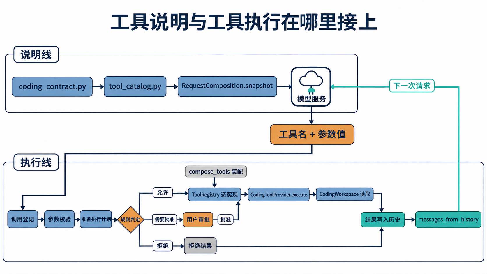
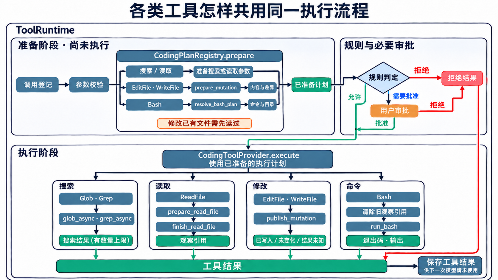

与第 3 课课程正文配套阅读。

正文写了一个两行的最简执行：按名字找函数，把参数传进去。然后加了五条约束：没提供的工具要拒绝，参数要按 Schema 检查，路径要再查一次，失败也要交回结果，结果要带调用标识。这一篇在 MyBuddy 源码里找到每一条的位置。

**怎么读：** 每一节先贴一段代码，再用几句话解释。代码从当前源码原样复制，上方标了文件和行号。`# ...` 表示省略了与本节无关的行。

下面沿用一次读取：模型提出 `ReadFile(file_path="src/shipping.py", offset=10, limit=12)`。先看整条链。缩进表示“谁调用谁”：

```latex
RequestComposition._base_tools      request.py        把本次可用的工具说明放进请求
   （模型返回工具名和参数，AgentLoop 保存后交给 ToolRuntime）
ToolRuntime.execute_batch           tool_runtime.py   逐个处理工具调用
├─ 没提供的工具 → 直接拒绝            tool_runtime.py
├─ ToolRegistry.evaluate            tool_registry.py  按名字找到策略
│  └─ CodingPlanRegistry.prepare    coding_tools.py   校验参数，准备计划
└─ ToolRegistry.execute             tool_registry.py  按名字找到实现
   └─ CodingToolProvider.execute    coding_tools.py   基础工具的共同入口
      └─ CodingWorkspace.prepare_read_file / finish_read_file   coding_workspace.py
结果保存后，messages_from_history   request.py        把结果放进下一次请求
```

和正文的最简执行对一下：

| 最简版 / 约束 | MyBuddy 里在哪 |
| --- | --- |
| `TOOLS[call.name]` | `ToolRegistry.resolve`（片段 4） |
| `func(**call.args)` | `CodingToolProvider.execute`（片段 6） |
| 约束 1：没提供的工具 | `ToolRuntime` 的 `unoffered` 分支（片段 3） |
| 约束 2：Schema 检查 | `validate_arguments`（片段 2、5） |
| 约束 3：路径再查一次 | `_parts`（片段 8） |
| 约束 4：失败也交回 | `read` 里的异常分支（片段 7） |
| 约束 5：调用标识 | `messages_from_history` 里的 `tool_call_id`（片段 10） |

## 主流程图：工具说明与工具执行在哪里接上

**工具系统有两条线：说明线把能力告诉模型，执行线把模型的调用交给实现；两条线靠工具名和参数契约接上。**



看完这张图，你要能：把三样东西连起来：公开给模型的工具说明（Schema）、程序里注册的实现、实际执行时经过的检查。

## 说明线：模型怎样知道有哪些工具

**本次请求带哪些工具说明，由会话的模式和配置决定。**

### 片段 1：请求里放哪些工具

`src/mybuddy/platform/context/request.py:148-158`

```python
    def _base_tools(self) -> list[dict[str, Any]]:
        child_scope = parse_child_scope_baseline(self.baseline)
        return tool_schemas(
            coding_readonly=self.planning, tool_search=self.mcp_deferred,
            result_reader=self.long_tool_results,
            skills=bool(self.skills and self.skills.tools_available),
            mcp_tools=self.mcp.model_tools() if self.mcp is not None else (),
            web_search=self.web_search, web_fetch=self.web_fetch,
            subagents=delegation_enabled(self.configuration),
            team=child_scope is not None and 'team' in child_scope.tool_names,
            worktrees=worktrees_enabled(self.configuration))
```

`_base_tools` 调用 `tool_catalog.py` 的 `tool_schemas`，决定本次请求带哪些工具说明。

- `coding_readonly=self.planning`：规划模式下，带四个只读基础工具、写方案文件用的 `WriteFile` 和 `EditFile`，再加提交方案的 `ExitPlanMode` 和只能运行白名单只读命令的 `Bash`。
- 其他参数对应可选能力：长结果读取、Skill、MCP、联网搜索、网页读取、子任务、工作树。没启用的能力，不放说明。

这些说明最后写进请求快照的 `tool_schemas`。模型只看得到这里列出的工具。

### 片段 2：ReadFile 的说明，和对参数的检查

`src/mybuddy/platform/tools/coding_contract.py:83-87,129-140`

```python
        ("ReadFile", 'Read numbered UTF-8 lines; only fully returned ranges authorize edits.',
         _object({"file_path": path, "offset": {"type": "integer", "minimum": 1, "maximum": 1000000,
                  "description": '1-based start; default 1.'},
                  "limit": {"type": "integer", "minimum": 1, "maximum": 500,
                  "description": 'Default 200 lines; byte/long-line caps also apply.'}}, ["file_path"])),
# ...
def validate_arguments(name: str, arguments: object) -> dict[str, Any]:
    """按工具的参数规则检查输入，并拒绝执行接口不接受的数值类型。"""
    schema = execution_schema(name)["function"]["parameters"]
    value = plain(arguments)
    if not isinstance(value, dict) or not Draft202012Validator(schema).is_valid(value):
        raise ValueError("coding_arguments_invalid")
    # JSON Schema 会把 1.0 这样的浮点数当成整数，但执行接口只接受 Python 的 int。
    # 单独检查这些字段，避免参数通过规则检查后又无法按预期运行。
    for key in ("offset", "limit", "context_lines", "timeout_ms"):
        if key in value and type(value[key]) is not int:
            raise ValueError("coding_arguments_invalid")
    return value
```

上半段是 `ReadFile` 的定义：一个名字、一句英文用途说明、一份参数 Schema。`file_path` 必填。`offset` 从 1 开始，`limit` 最多 500 行。

下半段是 `validate_arguments`。模型按 Schema 填参数，程序还要再用同一份 Schema 查一遍。注释点出一个细节：JSON Schema 把 `1.0` 当整数，执行接口只要真正的 `int`，所以要单独再查。

不合格就报 `coding_arguments_invalid`。不能因为参数是模型按 Schema 生成的，就跳过这一步。

**说明写在哪里。** 各工具的用途、参数和配合方式都写在 `coding_contract.py` 的 `coding_schemas()` 里。几个工具共用的规则没有在每个工具里重复：路径一律相对工作区、先用 `Glob`/`Grep` 定位再用 `ReadFile` 读，这些写在同一文件的系统指令 `CODING_SYSTEM` 里，只说一次，省得每个参数都多占上下文。

### 再看提示词：文件工具的说明写的是限制

片段 2 贴了 `ReadFile` 的说明。其他文件工具也一样：一个名字，一句英文用途说明，参数上各带一小句 `description`。为什么说明用英文、系统指令用中文，见正文第四节“提示词用中文还是英文”。这些文字和 Schema 一起发给模型，模型靠它们决定怎么填参数。说明里写的限制，代码在执行前都会再查一遍；说明本身拦不住任何调用。

`src/mybuddy/platform/tools/coding_contract.py:88-107`

```python
            ("Glob", 'Find paths by glob; results are not an atomic snapshot.',
         _object({"pattern": {**_text(256, 1), "description": '* and ? within a path segment; ** across directories.'},
                  "path": {**search_path, "description": "Directory; default '.'."}, **filters}, ["pattern"])),
        ("Grep", 'Search UTF-8 lines using literal text or per-line Python regex. Incomplete scans cannot prove absence.',
         _object({"pattern": _text(256, 1),
                  "path": search_path, "mode": {"enum": ["literal", "regex"], "description": 'Default literal.'},
                  "glob": {**_text(256, 1), "description": 'File-path glob filter.'},
                  "case_sensitive": {"type": "boolean", "description": 'Default true.'},
                  "context_lines": {"type": "integer", "minimum": 0, "maximum": 5, "description": 'Lines on each side; default 0.'},
                  "output_mode": {"enum": ["content", "files", "count"], "description": 'Default content; files: paths; count: matching lines, not occurrences.'}, **filters}, ["pattern"])),
        ("WriteFile", 'Create or replace a UTF-8 file, including parent directories. Read the whole existing file before replacement; no multi-file transaction.',
         _object({"file_path": path, "content": {**_text(MAX_TEXT_BYTES), "description": 'Whole text; UTF-8 limit 128 KiB.'}, "expected_state": state},
                 ["file_path", "content", "expected_state"])),
        ("EditFile", 'Apply unique, non-overlapping literal replacements to one original UTF-8 version. Read every edited range first.',
         _object({"file_path": path, "expected_state": state,
                  "edits": {"type": "array", "minItems": 1, "maxItems": 32,
                            "items": _object({"old_text": {**_text(32768, 1), "description": 'Exact text including whitespace; one occurrence.'},
                                              "new_text": {**_text(32768), "description": 'Empty string deletes old_text.'}},
                                             ["old_text", "new_text"])}},
                 ["file_path", "edits", "expected_state"])),
```

逐句看它为什么这样写（`ReadFile` 那句见片段 2）：

- **"only fully returned ranges authorize edits"**（`ReadFile`）。片段 9 登记观察时，记下的是实际展示的字节范围 `presented_byte_ranges`，不是请求的范围。片段 11 的 `verify_observation` 按这份记录核对。说明里先讲清楚，模型就知道：请求了 500 行，因为字节上限只返回了 200 行，后面那 300 行还不能改。
- **"results are not an atomic snapshot"**（`Glob`）。这句话让模型知道，列出的路径是扫描过程中逐个看到的，不是某一刻的定格。拿到路径后，内容仍要用 `ReadFile` 读。
- **"Incomplete scans cannot prove absence"**（`Grep`）。搜索结果里有 `incomplete_reasons` 字段，达到结果上限时里面会有 `result_limit`，返回给模型的文字里还会注明"扫描不完整"（`coding_search.py`）。说明先告诉模型怎么看这个字段：扫描没完成时，"没搜到"不等于"不存在"。
- **"count: matching lines, not occurrences"**（`Grep` 的 `output_mode`）。一行出现三次也只算一次。这句话让模型不把计数当成出现次数来报告。
- **"Read the whole existing file before replacement; no multi-file transaction."**（`WriteFile`）。替换已有文件时，代码要求观察引用覆盖完整文件（片段 11 后的说明）。后半句告诉模型：一次只写一个文件，前一个写成功、后一个失败时，前一个不会自动撤回。
- **"Apply unique, non-overlapping literal replacements to one original UTF-8 version. Read every edited range first."**（`EditFile`）。这一句几乎就是片段 11 的检查清单：每段 `old_text` 在原文件里恰好出现一次，多处替换不重叠，都在读过的范围内。"one original version" 对应代码的做法：每段 `old_text` 都在修改前的原文 `before` 里查找，不在改了一半的内容里找。`maxItems: 32` 和上方注释"一次最多做 32 处替换"一致。
- **"Exact text including whitespace; one occurrence."**（`old_text`）。代码用 `before.find(old)` 逐字节匹配，空格和缩进差一个就找不到，报 `coding_edit_not_unique`。
- **"absent: create; observed: exact ReadFile observation_ref."**（`expected_state`）。新建文件写 `absent`，改已有文件要带上 `ReadFile` 给的引用。这个参数外层还单独写明了 `type: object` 和字段，旁边注释说明了原因：有些模型供应商会把单独的 `oneOf` 错当成字符串。真实运行里出现过这种情况：模型把 `expected_state` 写成了 JSON 字符串，被 `validate_arguments` 以 `coding_arguments_invalid` 拒绝。修正办法是改 Schema 的写法，校验没有放松。

这些说明只告诉模型规则是什么。真正把关的是代码：参数由 `validate_arguments` 按同一份 Schema 重查，唯一性和读过的范围由 `prepare_mutation` 和 `verify_observation` 查，文件有没有变由观察引用里的文件版本查。说明写得再清楚，模型填错了，调用照样被拒绝，拒绝结果交回模型（片段 10）。

### 再看提示词：基础指令只说一次的共同规则

片段 2 末尾说的"几个工具共用的规则"，原文在这里。它是 `request_system_blocks` 放进系统指令的第一段（`base_rules`），每次请求都带。这段话没有一条是代码在判断：模型读了它，决定先搜还是先读、什么时候引用行号、失败了怎么说。代码那边另有一套检查，管的是"这样做能不能执行"。

`src/mybuddy/platform/tools/coding_contract.py:273-287`

```python
CODING_SYSTEM = (
    "你是 MyBuddy Coding Agent。用简体中文解释结果。"
    "文件工具路径与 Bash cwd 均相对工作区，不接受绝对路径或 ..。用户给出路径时以该路径为目标，不凭印象换成其他文件。"
    "先用 Glob/Grep 定位；需要 Python 声明概览时用 CodeOutline，已知行范围时直接 ReadFile。"
    "CodeOutline 只说明声明名称、参数类别和行范围，代码内容与行为以 ReadFile 返回的行为准。"
    "编辑前用 ReadFile 取得 observation_ref。expected_state 必须是 JSON 对象，edits 必须是 JSON 数组，不要编码成字符串。"
    "WriteFile/EditFile 或 Bash 被拒绝后，不改参数绕过审批。"
    "读取窗口不代表读完整文件；注意扫描是否截断、总量是否未知。"
    # 编辑可能改变行号。工具报告写入成功，并不代表模型已经读过修改后的代码。
    "编辑会改变行号：引用修改后的行号须来自修改后的 ReadFile，否则省略行号，只说明做了什么编辑。"
    "只为核实确需引用的位置再窄范围读取，不必每次编辑后重读或运行检查。"
    "同时涉及规则文档和代码时分别引用；描述调用链要引用关键转换与调用位置，不能凭上游片段推出下游结论。"
    "失败和 unknown 如实报告，依据实际 status、error_code 和 details，不虚构或改写错误码，不自动重试有副作用的操作。"
    "相同输入的只读失败没有新信息时不重复。停止前核对是否覆盖了用户要求；查错了目标不等于查过用户的目标。"
)
```

逐句看它为什么这样写：

- **"文件工具路径与 Bash cwd 均相对工作区，不接受绝对路径或 .."**。这和代码的检查一致：文件工具的路径由片段 8 的 `_parts` 查，以 `/` 开头、含 `..` 的报 `coding_path_invalid`；`Bash` 的 `cwd` 由 `coding_bash.py` 的 `_cwd` 查，同样拒绝绝对路径和 `..`，报 `coding_bash_invalid_cwd`。`coding_schemas` 里的注释说明了为什么放在这里：路径的共同规则写一次，不在每个参数的说明里重复，少占发给模型的内容。
- **"用户给出路径时以该路径为目标，不凭印象换成其他文件"**。这句话让模型按用户给的路径去查，不去读一个它以为相关的文件。
- **"先用 Glob/Grep 定位；需要 Python 声明概览时用 CodeOutline，已知行范围时直接 ReadFile"**。这句话改过一次。原来写的是"已知位置直接 ReadFile"。用户明确要求"只看声明概览"时，这个写法有歧义：用户给了文件，算不算"已知位置"？改之前的一次实际运行里，模型先调用了两个无关路径，又多做了一次 `Glob`；改成现在的写法后，几次运行都直接对用户指定的文件调用 `CodeOutline`。
- **"CodeOutline 只说明声明名称、参数类别和行范围，代码内容与行为以 ReadFile 返回的行为准"**。`CodeOutline` 不签发观察引用，它的结果不能作为编辑依据。它给的行范围只是导航，实际读到的内容要以 `ReadFile` 为准。这句话防的是模型只看了概览就下结论，说某个函数"做了什么"。
- **"编辑前用 ReadFile 取得 observation_ref。expected_state 必须是 JSON 对象，edits 必须是 JSON 数组，不要编码成字符串。"** 前半句对应片段 9 和片段 11：没有观察引用就改不了。后半句针对的就是上一节说的问题：模型把对象写成 JSON 字符串，被参数检查拒绝。Schema 的写法改了，这里再用一句话提醒。
- **"WriteFile/EditFile 或 Bash 被拒绝后，不改参数绕过审批"**。每次调用都要重新检查权限。选择“仅本次允许”只批准当前计划；选择“本次会话都允许”后，同一写工具操作同一路径不再重复询问，Bash 则必须匹配完整命令和工作目录。明确要求询问的规则仍会生效。这句提示词要求模型尊重拒绝结果，不靠改参数反复尝试。
- **"读取窗口不代表读完整文件；注意扫描是否截断、总量是否未知"**。`ReadFile` 默认只读 200 行，结果里有 `display_truncated`；`Glob`、`Grep` 的结果里有 `incomplete_reasons`。这句话让模型看这些字段，不把读到的一段当成整个文件。
- **"编辑会改变行号：引用修改后的行号须来自修改后的 ReadFile"**。原文上方的注释说明了原因：编辑可能改变行号；工具报告写入成功，不代表模型读过修改后的代码。没读过就报行号，那是推算出来的。
- **"只为核实确需引用的位置再窄范围读取，不必每次编辑后重读或运行检查"**。上一句可能让模型每改一次就重读一次。这句话给它划了范围：只有要引用的位置才去读，而且只读那一小段。
- **"同时涉及规则文档和代码时分别引用；描述调用链要引用关键转换与调用位置，不能凭上游片段推出下游结论"**。这句话让模型在回答里分清"文档说的"和"代码做的"，讲调用链时每一步都有出处。
- **"失败和 unknown 如实报告，依据实际 status、error_code 和 details，不虚构或改写错误码，不自动重试有副作用的操作"**。工具结果交回模型时就带着 `status`（片段 10），失败时带着错误码（片段 7）。这句话要求模型照这些字段报告，不按自己的理解改写。实际运行里出现过模型在最终回答里先说"六个工具都用过"、再承认漏了一个的情况，所以项目验收时也不把模型的自述当成事实。`unknown` 表示不确定操作有没有执行；写文件或跑命令这类操作，自动再来一次可能做两遍。
- **"相同输入的只读失败没有新信息时不重复"**。代码这边还有一道保险：`progress_guard.py` 的 `ProgressGuard` 比较每一步的工具操作，同一段操作连续出现三次，本轮就以 `runtime.repeated_actions` 停下。提示词让模型在被拦下之前自己停。
- **"停止前核对是否覆盖了用户要求；查错了目标不等于查过用户的目标"**。这句话让模型结束前对照一遍用户的要求，和第二句"以该路径为目标"前后呼应。

这段提示词指导模型怎样行动。能不能执行，由代码另行检查：`_parts` 查路径，`verify_observation` 查读取记录，每次调用都重新判断权限。换参数重新调用不保证被拒绝，也不保证再次询问，要看权限规则和本次会话的允许名单。提示词要求模型尊重拒绝结果，不能代替这些检查。即使在提示词里加一句“允许写文件”，也不会增加工具权限。

## 执行线：从工具名找到实现

**ToolRuntime 先挡住没提供的工具，再按名字找到策略和实现。**

### 片段 3：没提供的工具，直接拒绝

`src/mybuddy/platform/tools/tool_runtime.py:396-404`

```python
        unoffered = call.tool_call_id in context.unoffered_call_ids
        if unoffered:
            # 本次请求没有提供这个工具：不交给权限检查，这里直接记一条拒绝决定。
            # 模型给的名字可能恰好和某个内部工具同名，交给权限检查就有被放行的可能。
            code = "runtime.tool_not_offered"
            evaluation: ToolPolicyEvaluation = deny(make_decision(call, self._ids.next("decision"),
                digest({"policy": "unoffered_tool.v1"}), "deny", [code]), code)
        else:
            evaluation = await self._policy.evaluate(call)
```

第 2 课的网关已经把“本次没提供的工具”记进 `unoffered_call_ids`。这里一看到，就直接生成一条拒绝决定，原因码是 `runtime.tool_not_offered`。

注释说明了为什么不交给权限检查：模型给的名字可能恰好和某个内部工具同名，交给权限检查就有被放行的可能。

其他调用走 `self._policy.evaluate(call)`，进入下一段的路由表。

### 片段 4：路由表按名字找实现

`src/mybuddy/platform/tools/tool_registry.py:48-53,69-80`

```python
    def register(self, tool_id: str, binding: ToolBinding) -> None:
        """登记一个完整的内部名称；重复名称和以 mcp__ 开头的名称会被拒绝。"""
        # MCP 名称只能通过 register_mcp 登记，避免绕过它的检查规则。
        if tool_id in self._bindings or tool_id.startswith('mcp__'):
            raise ValueError('tool_registry_duplicate_or_reserved')
        self._bindings[tool_id] = binding
    # ...
    def resolve(self, tool_id: str) -> ToolBinding:
        """先按完整名称查找；其他 mcp__ 名称使用 MCP 入口，其余名称使用内置检查。"""
        return self._bindings.get(tool_id) or (
            self._mcp if tool_id.startswith('mcp__') and self._mcp is not None else self._unknown)

    async def evaluate(self, call: RegisteredToolCall) -> ToolPolicyEvaluation:
        binding = self.resolve(str(call.call.get('tool_id')))
        return await binding.normal(call)

    async def execute(self, request: ToolProviderRequest, signal: CancellationSignal) -> ToolDispatchOutcome:
        binding = self.resolve(request.tool_id)
        return await binding.execute(request, signal)
```

每个会话有自己的 `ToolRegistry`。`register` 登记一个工具名和它的 `ToolBinding`（普通检查、只读检查、执行函数）。重复的名字和 `mcp__` 开头的名字会被拒绝。MCP 工具只能通过 `register_mcp` 登记。

`resolve` 按名字查找。查不到的普通名字，交给内置的“未知工具”检查。

`evaluate` 和 `execute` 都先 `resolve`，再调用对应的函数。这就是最简版 `TOOLS[call.name]` 的真实版本。路由表只保存函数，不保存工具说明；说明在 `tool_catalog.py`。

### 片段 5：准备计划时校验参数

`src/mybuddy/platform/tools/coding_tools.py:133-141`

```python
    def prepare(self, call: RegisteredToolCall, fingerprint: Mapping[str, Any]) -> ResolvedCodingPlan:
        """解析调用并准备计划，供后续权限判断和审批使用；这里还不会修改文件。"""
        binding = self.permission_binding()
        if binding is None:
            raise ValueError("coding_permission_binding_invalid")
        name = str(call.call["tool_id"])
        if call.call.get("tool_version") != "1.0.0":
            raise ValueError("coding_tool_version_invalid")
        arguments = validate_arguments(name, call.call.get("arguments", {}).get("value"))
```

基础工具的检查会走到 `CodingPlanRegistry.prepare`。它先确认权限绑定和工具版本，再调用片段 2 的 `validate_arguments`。

文档字符串说得很清楚：这里只准备计划，供后面的权限判断和审批使用，还不会修改文件。权限判断得出“允许、询问或拒绝”，第 6 课展开。

## 执行与返回：读出文件，交回结果

**读取成功才登记观察引用；失败也变成一个结果，带着原调用交回模型。**

### 片段 6：基础工具的共同执行入口

`src/mybuddy/platform/tools/coding_tools.py:383-393`

```python
    async def execute(self, request: ToolProviderRequest, signal: CancellationSignal) -> ToolDispatchOutcome:
        """取出通过检查的计划，运行对应工具并把结果交回运行时。"""
        if signal.cancelled:
            return ToolDispatchOutcome(request.execution_id, "cancelled")
        try:
            if request.tool_id in ("ReadFile", "Glob", "Grep"):
                # finish_read 登记准备返回的文件范围，供之后检查能否编辑。
                read = self.prepare_read(request)
                return self.finish_read(request, await read(signal))
            entry = self._plans.consume(request)
            args = dict(request.arguments)
```

`CodingToolProvider.execute` 是七个基础工具共用的入口，对应最简版的 `func(**call.args)`。

`ReadFile`、`Glob`、`Grep` 走读取分支。`prepare_read` 取出这次调用的计划，返回一个读取函数；这份计划取出后就不能再次使用。读完后交给 `finish_read`。其他工具用 `self._plans.consume(request)` 取出计划，再分到 `CodeOutline`、文件修改或 `Bash`。

### 片段 7：读取在线程里进行，失败也有结果

`src/mybuddy/platform/tools/coding_tools.py:340-350,361-367`

```python
        async def read(signal: CancellationSignal) -> ToolDispatchOutcome:
            if signal.cancelled:
                return ToolDispatchOutcome(request.execution_id, "cancelled")
            from .coding_search import _CancelBridge, _drain_on_cancel, glob_async, grep_async
            try:
                value: ReadFileCandidate | dict[str, object]
                if request.tool_id == "ReadFile":
                    # 文件在线程中读取。即使等待期间收到取消，也要处理线程最终返回的结果，
                    # 避免留下无人处理的读取任务。
                    task = asyncio.create_task(asyncio.to_thread(workspace.prepare_read_file, **args))
                    value = await _drain_on_cancel(task, _CancelBridge(signal))
# ...
            # 异常可能包含本机路径或文件内容，除了取消信号，只返回允许公开的错误代码。
            except (ValueError, OSError, UnicodeError) as error:
                if str(error) == "coding_search_cancelled":
                    return ToolDispatchOutcome(request.execution_id, "cancelled")
                return ToolDispatchOutcome(request.execution_id, "failed", error=
                    _error(_failure_code(error, "runtime.coding_tool_failed")))
        return read
```

`ReadFile` 在线程里调用 `workspace.prepare_read_file`。等待期间收到取消，也要等线程返回，避免留下没人管的任务。

最后几行是约束 4。读取出错时，不是抛个异常就不管了。它返回一个 `failed` 状态的 `ToolDispatchOutcome`，带上可以公开的错误码。异常里可能有本机路径或文件内容，所以只返回错误码。

### 片段 8：读取实现自己检查路径

`src/mybuddy/platform/tools/coding_workspace.py:90-107`

```python
def _parts(path: str, *, directory: bool = False, check_hard: bool = True) -> tuple[str, ...]:
    # 只接受相对工作区的路径，避免直接用绝对路径访问其他位置。目录操作还允许用 . 表示工作区根目录。
    if type(path) is not str or not path or "\x00" in path or "\\" in path or path.startswith("/"):
        raise CodingWorkspaceError("coding_path_invalid")
    if path == "." and directory:
        return ()
    parts = tuple(path.split("/"))
    # 文件系统的名称长度限制按字节计算；一个中文字符的 UTF-8 编码通常不止一个字节。
    try:
        encoded_parts = tuple(part.encode("utf-8") for part in parts)
        path_size = len(path.encode("utf-8"))
    except UnicodeEncodeError as error:
        raise CodingWorkspaceError("coding_path_invalid") from error
    if (any(part in ("", ".", "..") or not all(char.isprintable() for char in part)
            or len(encoded) > 255 for part, encoded in zip(parts, encoded_parts))):
        raise CodingWorkspaceError("coding_path_invalid")
    if path_size > 1024:
        raise CodingWorkspaceError("coding_path_invalid")
```

`_parts` 是约束 3。它只接受相对工作区的路径：

- 空路径、带 `\x00` 或 `\`、以 `/` 开头的绝对路径，都拒绝。
- 拆开后的每一段，不能是空串、`.` 或 `..`，不能有不可打印字符。
- 每段不超过 255 字节，整条路径不超过 1024 字节。

所以 `../outside.py` 在这里报 `coding_path_invalid`。正文第五节的动手练习，就是在这里被拒绝的。

`_parts` 只看字符串，看不出某一段是不是符号链接。这一点留给真正打开文件的时候处理：

`src/mybuddy/platform/tools/coding_workspace.py:36-39,246-253`

```python
# 打开目录和文件时不跟随符号链接，防止通过链接走到工作区外。
# 文件使用非阻塞方式打开，随后才检查它是不是普通文件，避免打开特殊文件时一直等待。
_DIR_FLAGS = os.O_RDONLY | os.O_DIRECTORY | os.O_NOFOLLOW | os.O_CLOEXEC
_FILE_FLAGS = os.O_RDONLY | os.O_NOFOLLOW | os.O_NONBLOCK | os.O_CLOEXEC
# ...
            # 从已经打开的目录出发逐层打开下一层，并拒绝符号链接，避免沿链接走到工作区外。
            for part in parts[:-1]:
                next_fd = os.open(part, _DIR_FLAGS, dir_fd=fd)
                os.close(fd)
                fd = next_fd
            yield fd, parts[-1]
        except OSError as error:
            raise CodingWorkspaceError("coding_path_unavailable") from error
```

`open_parent` 不把路径拼成字符串再打开，而是从根目录的文件描述符（操作系统给已打开目录的编号，代码里的 `fd`）出发，每次只打开下一段。`O_NOFOLLOW` 让系统遇到符号链接时直接报错。中间某一级目录是链接，报 `coding_path_unavailable`；最后的文件本身是链接，在 `_read` 打开文件时失败，报 `coding_file_unavailable`。链接指向工作区内也一样被拒绝，这样不用判断它“实际指到哪里”。

### 片段 9：读取成功，登记观察引用

`src/mybuddy/platform/tools/coding_workspace.py:489-503,507`

```python
    def finish_read_file(self, candidate: ReadFileCandidate) -> dict[str, object]:
        """检查读取结果的大小，登记读取引用，再返回这份记录。"""
        if candidate.workspace_identity != self.root_identity:
            raise CodingWorkspaceError("coding_observation_mismatch")
        # 读取引用也会出现在返回内容中，因此检查大小时必须算上它。
        result = deepcopy(candidate.result)
        reference = "observation." + secrets.token_hex(16)
        result["observation_ref"] = reference
        if (len(read_file_text(result).encode("utf-8")) > READ_RESULT_BYTES
                or json_result_size(result) > READ_RECORD_BYTES):
            raise CodingWorkspaceError("coding_read_result_limit")
        # 先检查实际返回的大小，再保存引用；否则超出上限的结果也会留下一个可用于编辑的引用。
        self._observations[reference] = FileObservation(reference, candidate.workspace_identity,
            candidate.path, candidate.file_identity, candidate.presented_byte_ranges,
            bool(result["full_content_presented"]))
        # ...
        return result
```

`finish_read_file` 生成一个随机的 `observation_ref`，放进结果。然后检查结果大小，不超限才登记这份观察。

登记的 `FileObservation` 记下：哪个文件、文件版本、实际展示的字节范围、是否展示了完整文件。后面 `EditFile` 和 `WriteFile` 用它核对“改的是不是看过的版本”。

注释点出顺序：先查大小，再登记。否则一份超限、没交给模型的结果，也会留下一个能用来编辑的引用。

### 片段 10：工具结果进入下一次请求

`src/mybuddy/platform/context/request.py:94-106`

```python
        elif event["event_type"] == "tool.result_committed":
            # 系统发起的文件恢复结果只能通过 system_collection_messages 进入消息；没有生成消息的结果跳过，
            # 不能把它伪装成普通工具的回复。
            if event.get("event_version") == 4:
                continue
            # 长工具结果可以缩短后交给模型，但消息仍记录原来的工具调用和事件编号。
            payload = dict(payload)
            if results is not None:
                payload["model_content"] = results.project(payload["model_content"])
            messages.append({"message_id": "message." + str(event["event_id"]), "role": "tool",
                "provenance": {"source_kind": "tool", "source_id": payload["tool_call_id"], "source_event_ids": [event["event_id"]]},
                "blocks": [{"kind": "tool_result", **{key: plain(payload[key]) for key in (
                    "tool_call_id", "status", "model_content")}}]})
```

结果保存为 `tool.result_committed` 事件。下一次组织请求时，`messages_from_history` 把它转成一条 `role: tool` 的消息。

`tool_result` 块带三样东西：`tool_call_id`、`status`、`model_content`。`tool_call_id` 就是约束 5 的调用标识，让模型知道这份结果回答哪个调用。被拒绝和失败的结果也走这条路，状态不同而已。

到这里，模型才第一次看到文件内容。



看完这张图，你要能：找到不同工具实现与公共治理链的连接位置。

## 修改与命令：观察引用怎样起作用

**编辑要求原文唯一、在读过的范围内；运行 Bash 前，旧的观察引用全部作废。**

### 片段 11：EditFile 的原文必须唯一

`src/mybuddy/platform/tools/coding_mutations.py:223-230`

```python
        replacements: list[tuple[int, int, bytes]] = []
        for edit in arguments["edits"]:
            old = edit["old_text"].encode("utf-8")
            # 每段旧文本必须在原文件中恰好出现一次；找不到或出现多次都不猜要改哪一处。
            start = before.find(old)
            if start < 0 or before.find(old, start + 1) >= 0:
                raise ValueError("coding_edit_not_unique")
            replacements.append((start, start + len(old), edit["new_text"].encode("utf-8")))
```

这段在 `prepare_mutation` 里。每段 `old_text` 必须在原文件中恰好出现一次：找不到，或出现第二次，都报 `coding_edit_not_unique`。程序不猜你要改哪一处。

紧接着还会检查多处替换不重叠，并调用 `verify_observation` 确认每段原文都在读过的范围内。`WriteFile` 替换已有文件时，则要求观察引用覆盖完整文件。

再看命令路径。`CodingToolProvider.execute` 运行 `Bash` 前，会调用 `invalidate_observations()`（`src/mybuddy/platform/tools/coding_tools.py:452`）。它清空所有观察引用。命令可能已经改了文件，即使退出码非零。之后要编辑，得重新读取。

## 其他工具从哪里接入

**其他工具也走“登记 → 策略 → 执行 → 结果提交”这条骨架，各自补充自己的规则。**

```mermaid
flowchart LR    A[工具契约与已启用配置] --> B[RequestComposition.snapshot]    B --> C[本次公开的工具 Schema]    C --> D[模型返回名称与参数]    D --> E[完整消息提交与调用登记]    F[compose_tools 装配外层策略与路由表] --> G[ToolRuntime]    E --> G    G --> H[外层约束与注册表选中的领域策略]    H --> M[策略与必要审批确认]    M --> I[开始记录确认后按表派发 Provider]    I --> J[提交带调用标识的结果]    J --> K[messages_from_history]    K --> L[后续模型请求]
```

按工具名回查下面的入口。对可选工具，先看请求装配条件，再看参数、策略和返回结果。

| 工具或工具组 | 契约与主要执行入口 | 重点看什么 |
| --- | --- | --- |
| 七项基础工具 | `src/mybuddy/platform/tools/coding_contract.py`、`src/mybuddy/platform/tools/coding_tools.py` | 同一计划与执行入口，分别委派给搜索、读取、变更与命令实现 |
| `web_search` | `src/mybuddy/platform/tools/web_search.py`、`src/mybuddy/platform/tools/web_search_policy.py` | 默认先批准再查询，返回搜索条目和摘要；读取正文用 `web_fetch` |
| `web_fetch` | `src/mybuddy/platform/tools/web_fetch.py`、`src/mybuddy/platform/tools/web_fetch_policy.py` | 读取网页正文；默认每次先批准完整 URL，再检查所有解析地址和每次跳转，拒绝内网；bypass 直接执行 |
| `read_tool_result` | `src/mybuddy/platform/tools/tool_catalog.py`、`src/mybuddy/platform/tools/provider.py`、`src/mybuddy/platform/tools/result_artifacts.py` | 结果标识的授权与分页；偏移按 Unicode 字符计，不按源码行计 |
| `search_tools` | `src/mybuddy/platform/mcp_stdio/tool_search.py` | 已找到的 MCP 工具与后续请求的关系；展开 Schema 不绕过执行策略 |
| `read_memory_file`、`grep_memory`、`search_memory` | `src/mybuddy/platform/memory/files/tools.py`、`src/mybuddy/platform/memory/shared_memory_catalog.py` | 从 Session 已采用视图查询，而不是临时扫描任意 Memory 路径 |
| `write_memory_file`、`edit_memory_file`、`delete_memory_entry`、`delete_memory_file` | `src/mybuddy/platform/memory/files/write_tools_contract.py`、`src/mybuddy/platform/memory/shared_memory_write_tools.py` | 模型名称与内部身份绑定，写入携带读取到的修订版本 |
| `load_skill`、`read_skill_resource` | `src/mybuddy/platform/skills/tools.py` | 技能选择、正文与声明资源读取；加载方法和执行动作分开 |
| MCP 外部工具 | `src/mybuddy/platform/mcp_stdio/projection.py`、`src/mybuddy/platform/mcp_stdio/tools.py` | 本地公开名如何映射到服务和远端工具；连接与授权分开 |
| `delegate_tasks` | `src/mybuddy/platform/subagents/tool.py`、`src/mybuddy/platform/subagents/session_delegation.py` | 冻结任务计划、子会话执行与结果交接 |
| `inspect_worktree` | `src/mybuddy/platform/worktrees/tool.py` | 根据受管标识冻结检查计划；有界差异与后续集成的区别 |

几个补充：

- `CodeOutline` 的实现在 `src/mybuddy/platform/tools/code_outline.py`。它用 Python 标准库 `ast` 在独立解释器里解析指定的 `.py` 文件，不运行项目代码。它不签发观察引用，所以不能作为编辑依据。
- 指令从哪里来：`RequestComposition.snapshot` 把基础规则、用户级、项目逐级、本地级及引用展开后的说明和会话指令放进系统指令。这些文字不会绕过工具权限判断。
- `/init` 命令在 `src/mybuddy/platform/application/session_commands.py`。交给模型的分析要求在 `src/mybuddy/platform/instructions/init_request.py`。模型用 `WriteFile` 或 `EditFile` 写 `AGENTS.md`，照样经过普通权限判断。
- Goal（`goal.py`）和事件 Hook（`hooks/`）都不是模型可调用的工具。

容易误会的地方：

- 能执行的实现已经装配好，不说明本次请求向模型公开了它。
- 严格的参数检查会拒绝一些“看起来能猜到意思”的请求，比如 `offset=0`。这是有意的：不让执行器替模型猜出另一种动作。

### 项目说明从哪里读起

新主会话在 `ConfigurationResolver.resolve` 中调用 `load_instructions`。先看它怎样排列来源：

`src/mybuddy/platform/instructions/loader.py:33-47`

```python
def load_instructions(workspace: Path) -> RootInstructions:
    workspace = workspace.resolve(strict=True)
    home = Path.home().resolve(strict=True)
    directories = _project_instruction_dirs(workspace)
    loader = _Loader(workspace, home, directories[0])
    paths = [home / '.mybuddy' / 'AGENTS.md',
             *(directory / 'AGENTS.md' for directory in directories),
             workspace / 'AGENTS.local.md']
    # 顶层文件留到自己的位置加载，避免被较早的 @ 引用挪到低优先级层。
    loader.top_level = set(paths)
    for path in paths:
        expanded = loader.expand(path, depth=0)
        if expanded is not None:
            loader.layers.append(expanded)
    return loader.finish()
```

`_project_instruction_dirs` 从工作区向上找到最近的 `.git` 文件或目录，再倒过来排列到工作区；没找到就只返回工作区。这里只找各级 `AGENTS.md`，不扫描子目录。

接着读 `_Loader.expand`。它只串起几步：检查是否可以读取、读文件、逐行识别引用、核对目标路径，再递归展开。每一步的细节放在名字对应的小函数里：

`src/mybuddy/platform/instructions/loader.py:69-91`

```python
    def expand(self, path: Path, *, depth: int) -> _ExpandedFile | None:
        if not self._should_read(path, depth):
            return None
        content = self._read_file(path, referenced=depth > 0)
        if content is None:
            return None
        index = len(self.sources)
        self.sources.append(InstructionSource(
            self.label(path), hashlib.sha256(content.encode('utf-8')).hexdigest(), len(content),
        ))
        pieces: list[str] = []
        for line, reference in _reference_lines(content):
            if reference is None:
                pieces.append(line)
                continue
            target = self._reference_target(path, reference)
            if target is None:
                continue
            included = self.expand(target, depth=depth + 1)
            if included is not None:
                # 引用文件可能没有末尾换行，补一行以免与原文件下一行粘在一起。
                pieces.append(f'\n--- 引用：{self.label(target)} ---\n{included.text}\n')
        return _ExpandedFile(index, ''.join(pieces))
```

`_should_read` 会跳过重复、循环、超过 5 层的引用，并把其他顶层说明留到自己的位置加载。这些跳过项不计入 256 个引用目标的额度；通过这些检查的目标在读取前计数，即使文件读不到也占一次。`_read_file` 用 `RootAgentsFile.read` 安全读取并记录诊断。`_reference_lines` 保留围栏和缩进代码中的 `@`；`_reference_target` 只接受项目根目录或 `~/.mybuddy/` 内的路径，不提前解析符号链接。

展开后，每个顶层说明是一整段文字，只加一次 `--- 来源：路径 ---`。引用在原位置插入，以 `--- 引用：路径 ---` 开始，所以同一个文件的来源标题只出现一次。

最后读 `finish`，看各层怎样分配额度：

`src/mybuddy/platform/instructions/loader.py:144-157`

```python
    def finish(self) -> RootInstructions:
        remaining = MAX_ROOT_INSTRUCTIONS_BYTES
        kept: list[str] = []
        # 从最后一层向前分配空间，较具体的约定先获得额度；输出仍按原加载顺序排列。
        for layer in reversed(self.layers):
            block, truncated = self._retain_layer(layer, remaining)
            kept.append(block)
            remaining -= len(block.encode('utf-8'))
            if truncated:
                # 截断一次就停止分配，不能拿剩下的零头再塞进更低优先级的层。
                remaining = 0
        sources = tuple(self.sources)
        return RootInstructions(''.join(reversed(kept)) if sources else None,
                                sources, tuple(self.diagnostics))
```

它从最高优先级的顶层说明开始分配字节额度，输出仍按原来的加载顺序排列。`_retain_layer` 能放下就整层保留，放不下就保留这一层的开头，末尾加上“（后面的内容超过 32 KiB 上限，已省略）”。后续更低优先级的层整层省略，并逐层记诊断。标题、引用标记和省略提示都占额度，总量不超过 32 KiB；不会切坏 UTF-8 字符。如果连完整标题和省略提示都放不下，也整层省略。

`sources` 记下每个读到的文件（含被引用的文件）的路径、原文哈希值和原文字数，说明“读到了什么”；哪一层被截断或省略，写在诊断里。即使某个引用全部被截掉，它仍留在 `sources`。`label` 把路径里的控制字符转成可见文字，避免它们混进提示词和 `/status` 显示。

主线先读 **3 个函数**：`load_instructions → expand → finish`。要核对全部加载细则，再读 `_project_instruction_dirs`、`_should_read`、`_read_file`、`_reference_lines`、`_reference_target`、`_retain_layer` 和 `label`，一共 **10 个函数**；`__init__` 只是准备这些步骤共用的列表和计数。

`build_initial_payload` 把正文、来源和诊断存进 `session.root_instructions_baseline`。恢复会话时走 `_root`，直接用创建会话时存下的这份记录（下文叫“基线”），不重新读说明文件。子任务通过 `frozen_instructions` 接收父会话的同一份说明；父会话创建后修改磁盘，也不会使子任务换规则。`CLIViews.describe_status` 从基线读出来源清单，用于 `/status --verbose`。

### 再看提示词：/init 交给模型的项目导航要求

`/init` 没有专门的生成代码。`initialize_project` 只有一行：`return await self.ask(PROJECT_GUIDE_INSTRUCTIONS)`，把下面这段文字当成一条普通的用户请求提交（`application_session.py`）。读哪些文件、写什么内容，全由模型按这段要求决定；能不能写入，照样走普通的工具审批。

`src/mybuddy/platform/instructions/init_request.py:4-17`

```python
# 这段文字作为普通用户请求提交；实际读写文件仍要通过工具并遵守当前权限。
PROJECT_GUIDE_INSTRUCTIONS = (
    "分析当前项目并生成或更新工作区目录的 AGENTS.md（不是上级 Git 仓库目录或用户目录）。生成简短的项目导航，供后续开发长期使用，按项目需要组织，不机械填充章节。"
    "先读已有 AGENTS.md、README、项目配置及相关文档，核实项目目标、关键入口和检查命令。"
    "说明处理哪类工作应读哪些资料；仅引用实际发现并核对的相对路径，不罗列全部文件。"
    "详细业务规则和架构说明指向已有维护位置，不复制成长篇手册。"
    "保留项目特有的长期约定与必要验证入口，避免通用口号、教程和重复信息。"
    "不把当前任务、临时待办或本轮修复目标写成项目指令；已有计划不代表当前执行授权。"
    "已有文件保留有效约定，只提出有依据的必要修改。资料缺失则说明待确认，不编造目标、路径或命令。"
    "仅使用普通 WriteFile/EditFile 工具写入或修改根 AGENTS.md，遵守当前模式和普通工具审批。"
    "根 AGENTS.md 的指令变更仅在新会话生效；当前会话及其恢复继续使用创建时保存的内容。"
    "不创建配套文档、任务计划或检查脚本。"
    "最终回答简短说明实际修改；未写入时明确说明并展示候选，不展开代码审查；测试源码只说明检查意图，不能证明实际运行通过。"
)
```

逐句看它为什么这样写：

- **"生成简短的项目导航……按项目需要组织，不机械填充章节"**。`AGENTS.md` 每次新建会话都会进入系统指令，要长期使用。所以它定位成导航：说明项目做什么、遇到哪类工作该去读哪里，不是一份固定章节的模板。"简短"也不是指某个固定字数，项目大小不同，写法也不同。
- **"先读已有 AGENTS.md、README、项目配置及相关文档，核实项目目标、关键入口和检查命令"**。这些文件是模型了解项目的入口。先读已有的 `AGENTS.md`，是为了保留里面的约定，不借初始化把用户写的东西重写一遍。
- **"仅引用实际发现并核对的相对路径，不罗列全部文件"**。导航里的路径要真的存在。列全部文件没有用，目录一变就过期，还挤占每次请求的上下文。
- **"详细业务规则和架构说明指向已有维护位置，不复制成长篇手册"**。复制一份，就有了两份要同时维护的内容，迟早对不上。指向原来的位置，只有一份。
- **"不把当前任务、临时待办或本轮修复目标写成项目指令；已有计划不代表当前执行授权"**。`AGENTS.md` 面向以后的每一次开发，不是这一轮的任务单。把"修好运费门槛"写进去，以后每个新会话都会把它当成项目要求。后半句防的是模型看到仓库里有计划文档，就当成用户已经让它去执行。
- **"资料缺失则说明待确认，不编造目标、路径或命令"**。找不到测试命令，就写"待确认"，不写一个看起来合理的命令。
- **"仅使用普通 WriteFile/EditFile 工具写入或修改根 AGENTS.md，遵守当前模式和普通工具审批"**。没有给 `/init` 专门做一个写入工具。代码里的注释也是这么说的：这段文字作为普通用户请求提交，实际读写文件仍要通过工具并遵守当前权限。规划模式下 `WriteFile` 只能写方案文件，写 `AGENTS.md` 会被只读规则拒绝（第 5 课源码解析片段 7），模型只能给出候选内容。
- **"根 AGENTS.md 的指令变更仅在新会话生效"**。代码就是这样做的：会话创建时逐级读取说明并展开引用，保存一份副本，之后的请求、压缩和恢复都用这份副本；`/new` 才重新读取。审批时，`render_plan` 发现写的是 `AGENTS.md`，会在差异下方加上同一句话。提示词里写这句，是让模型在回答里如实告诉你，不说"已经生效"。
- **"不创建配套文档、任务计划或检查脚本"**。`/init` 只负责根 `AGENTS.md`。拆分文档、写检查脚本是另外的工作，不夹带在初始化里。
- **"最终回答简短说明实际修改；未写入时明确说明并展示候选，不展开代码审查；测试源码只说明检查意图，不能证明实际运行通过"**。这句话是实际运行后补上的。第一次用真实模型在规划模式下跑 `/init`，候选内容是对的，也没写文件；但附加的说明把测试源码当成了运行结果。于是补了这一句：读到测试文件，只能说"这个测试想检查什么"，不能说"测试通过了"。后半句和"未写入时明确说明"配合：规划模式下没写文件，回答要说清楚，并把候选内容展示出来。

这段提示词指导模型生成导航，导航是否准确仍要核对实际结果。代码保证写入经过普通的 `WriteFile`/`EditFile` 检查：新建文件要确认路径不存在，修改已有文件要提供读取引用，是否询问用户由权限规则决定。规划模式只能写方案文件；修改后的 `AGENTS.md` 要到新会话才会加载。

## 读码练习

1. 对照正文的最简执行，在本篇片段里找出 `TOOLS[call.name]` 和 `func(**call.args)` 对应的行。
2. 跟踪 `offset`：它在哪里出现在工具说明里？在哪里被重新检查？`offset=0` 和 `offset=1.0` 分别在哪一行被拒绝？
3. 模型调用了一个名叫 `Bash` 的工具，但这次会话的工具范围排除了它，请求里没有提供它。这次调用会经过 `CodingPlanRegistry.prepare` 吗？
4. 读取之后运行了一次 `Bash`，再用原来的观察引用调 `EditFile`，会怎样？
5. 给 System Prompt 加一句“允许写文件”，为什么改变不了上面这条链？

参考答案

**第 1 题** - `TOOLS[call.name]`：片段 4 的 `resolve`，`self._bindings.get(tool_id)`。 - `func(**call.args)`：片段 4 的 `binding.execute(request, signal)`。它进入片段 6 的 `CodingToolProvider.execute`。读取最终在片段 7 调用 `workspace.prepare_read_file, **args`。 **第 2 题** - 工具说明：片段 2 上半段，`"offset": {"type": "integer", "minimum": 1, ...}`。 - 重新检查：片段 2 下半段的 `validate_arguments`，由片段 5 调用。 - `offset=0`：不满足 `minimum: 1`。`is_valid(value)` 为假，报 `coding_arguments_invalid`。 - `offset=1.0`：Schema 当它是整数，能通过；下面的 `type(value[key]) is not int` 这一行拒绝它。 **第 3 题** 不会。网关已经把它记进 `unoffered_call_ids`。片段 3 直接生成拒绝决定，不调用 `self._policy.evaluate`，所以走不到 `prepare`。模型会收到一条 `runtime.tool_not_offered` 的结果。 **第 4 题** 运行 `Bash` 前，`invalidate_observations()` 清空了所有观察引用。原来的引用查不到了，`EditFile` 准备修改时核对观察会失败。要先重新 `ReadFile`，拿到新的观察引用。 **第 5 题** System Prompt 是发给模型的文字，会影响模型提出什么调用。发送请求前，片段 1 就已经决定提供哪些工具。模型返回调用后，片段 3 先拒绝未提供的工具，片段 4、5 再找到策略并准备计划，随后判断权限。加一句“允许写文件”不会改变这些代码中的规则。
