理解决策与观察如何推进任务、何时终止，以及怎样通过 Trace 定位问题。

学完这一课，你应能画出一次请求的推进过程：模型判断，工具执行，模型再判断。你还能解释它为什么继续、等待或停止。拿到一份运行记录，你能说清任务做到了哪一步，还缺什么。

## 本课导览

前两课分别讲了模型调用和工具调用。这一课把它们接成任务运行的主线：一次请求怎样包含多个 Step，工具结果怎样保存并进入下一次请求，什么时候继续、等待或停止，以及怎样用 Trace 判断任务停在哪里。

最后动手回看一次排查过程。源码解析沿同一条调用链读真实代码。后面要讲的人机交互、工具治理和上下文管理，都在这条主线上展开。

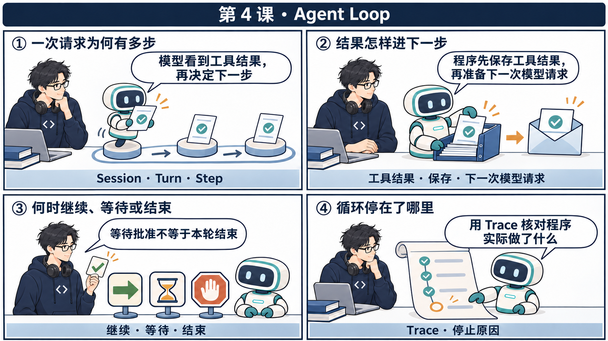

## 一、同一次用户请求怎样产生多个 Step？

**一次请求会有多步，是因为每看到一个新结果，模型都要再决定一次下一步。**

第 2 课讲了一次模型调用，第 3 课把工具接了进来。现在，你向 MyBuddy 提出一个请求：

普通地区的订单恰好满 100 元，为什么还收运费？请先找出原因，暂时不要修改。

模型先提出读取配送规则。工具返回了规则：“普通地区满 100 元免运费。”只读到这句话，还不知道代码哪里错了。谁来安排它继续读代码、核对条件，直到能解释原因？

### 读完规则以后，谁决定继续读代码

**答案是程序里的一个循环：它把工具结果交回模型，再问一次。**

工具读完文件，不会自己决定下一步读什么。上一次模型调用已经结束，模型也看不到刚返回的内容。程序要把读取结果放进下一次请求，再调用模型。

这一次，模型看到了规则，就可以提出“继续读取运费实现”。工具执行后，程序再把代码交回去。这样重复几次，模型才能对照规则与实现。它会判断：是不是把 `>= 100` 写成了 `> 100`？

**Agent Loop 就是把“模型判断 → 工具执行 → 结果交回模型”接起来的运行循环。** 你只提一次请求，它可以在这次请求里安排多次模型调用。

这里不用预先写死“读规则、读实现、读测试”的脚本。模型根据已经看到的材料，自己选下一步。程序负责保存结果，把结果放进下一次请求，并检查权限和运行限制。

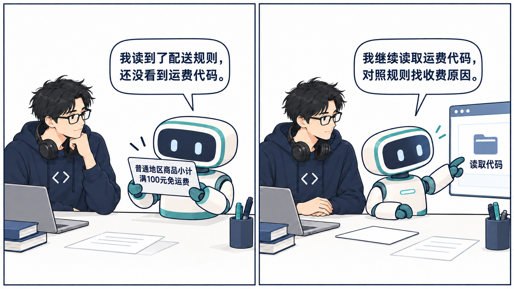

看完这张图，你要能：理解循环为什么会依据工具反馈继续取证或改变行动。

### 先看最简循环

**去掉所有工程细节，Agent Loop 的核心只有十来行。**

先把循环想成一条环形跑道：每跑一圈就是一个 Step，结果放回罐子（图里的罐子装着这次请求要带的全部内容），再问模型下一步。

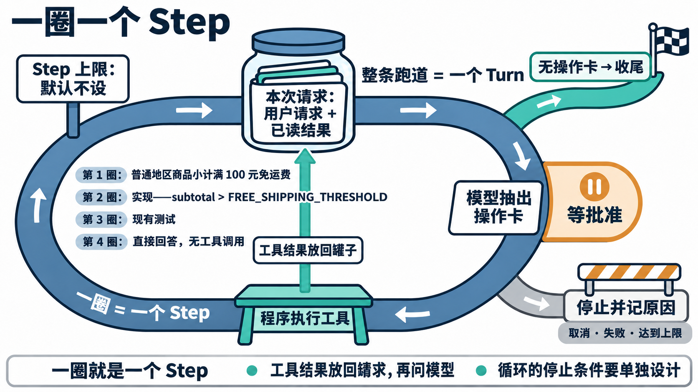

看完这张图，你要能：用“环形跑道”记住 Turn 与 Step：每跑一圈从本次请求出发，模型抽出操作卡，程序执行后把结果放回罐子；没有操作卡就收尾，等批准时不离开跑道，其他方式停下要记下原因。

下面是一段 Python 风格的**教学伪代码**，不能直接运行：

```python
def run_turn(messages, tools):
    while True:
        reply = call_model(messages, tools)   # 1. 带着全部历史问模型
        messages.append(reply)
        if not reply.tool_calls:              # 2. 没有工具调用：模型答完了
            return reply.text
        for call in reply.tool_calls:         # 3. 有工具调用：逐个执行
            result = run_tool(call)
            messages.append(tool_result(call, result))
        # 4. 回到开头，带着新结果再问一次
```

用运费案例走一遍：

1. 第一次问模型，它要求读规则。程序执行读取，把规则追加到 `messages`。
2. 回到开头再问。模型看到了规则，要求读实现。
3. 再回到开头。模型看到了规则和代码，直接给出解释，没有工具调用。循环结束。

循环里没有“先读规则再读代码”的固定顺序。下一步读什么，由模型看了 `messages` 之后决定。程序只做三件事：问模型、执行工具、把结果放回去。

这个最简版能跑通运费排查，但它很脆弱。第二节会一次加一个约束，看 MyBuddy 为什么要补上这些东西。

### 用 Session、Turn 和 Step 标出这段过程

`while` **每转一圈是一个 Step；整个循环跑完，是一个 Turn。**

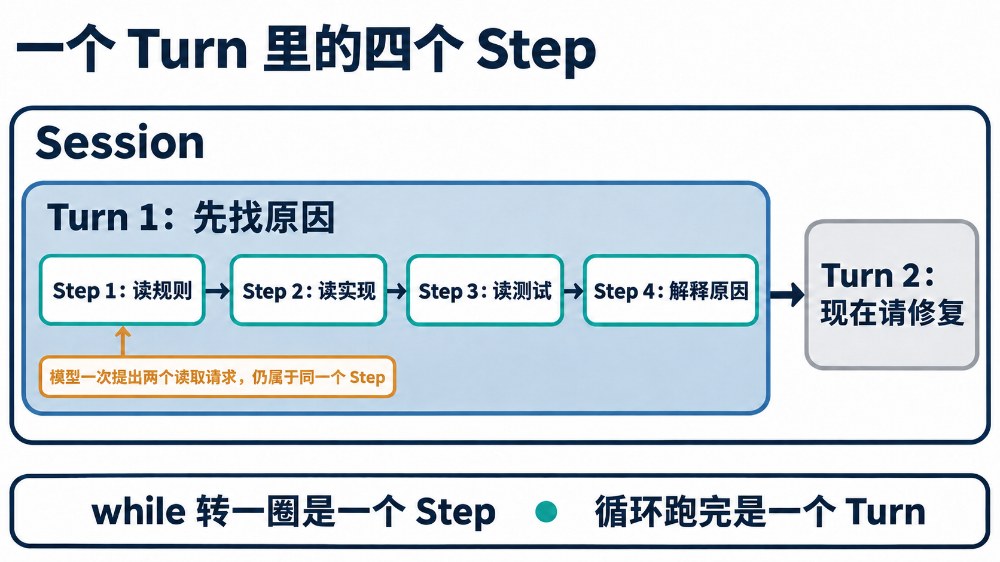

看完这张图，你要能：在运费案例里分清 Session、Turn 和 Step：四次决策属于同一个 Turn，新请求开始 Turn 2。

第 1 课介绍过这三个层级：Session 保存你和 MyBuddy 的多次交互；Turn 是你的一次请求，以及为处理它做的全部工作；Step 是其中一次模型决策和它触发的工具处理。放回运费案例：读规则、读实现、读测试、解释原因，可以是同一个 Turn 里的四个 Step；如果模型在一次回复里同时要求读规则和读实现，这两个调用属于同一个 Step，不是各占一个。你再说“现在请修复，并检查相关边界”，就开始 Turn 2。

### 收集、行动、验证，怎样分布在这些 Step 中

**三个阶段说的是每一步的用途；它们会交错、反复，数量也和 Step 无关。**

从任务过程看，Agent Loop 可以分为三个阶段：**收集上下文（gather context）→ 执行动作（take action）→ 验证结果（verify results）**。工具贯穿其中。

到了 Turn 2，任务从“解释原因”扩展为“修复并检查”。前一轮读到的有效材料可以接着用，缺什么再补什么。在有修改和测试权限的练习环境中，一条可能的路径如下：

| 阶段 | 此时要回答的问题 | 可能使用的工具与观察 |
| --- | --- | --- |
| 收集上下文 | 规则到底怎么写，当前实现在哪里，现有检查覆盖了什么？ | 搜索配送模块，读取规则、函数和测试；必要时先运行测试取得现状 |
| 执行动作 | 根据已有事实，这次最小修改是什么？ | 提出并执行获准的文件修改，补充与本次目标相关的边界用例 |
| 验证结果 | 当前修改是否符合规则，是否影响原有场景？ | 运行相关测试，检查代码差异，对照低于、等于门槛及偏远地区的预期 |

实际执行时，每个阶段不一定只出现一次。比如检查发现偏远地区也被免邮了。这时 Agent 应重新读取地区分支和规则，调整修改，再检查一次。验证的输出，又成了下一次收集上下文的线索。

阶段怎么选，由任务和已有观察决定。可以在改动前先跑已有测试，确认问题能复现。如果任务只是解释运费函数，读取和核对就够了，不必硬造一次修改。

运行测试也是一次实际的工具调用：模型提出测试请求，工具返回结果，下一次模型调用再分析结果。

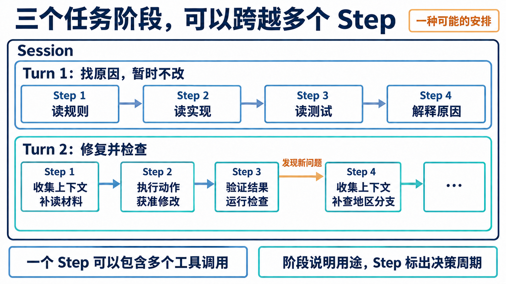

看完这张图，你要能：区分Session、Turn、Step与三个交错的任务阶段。

容易误会的地方：

- 三个阶段不是三个 Step。为了收集材料，模型可能用好几个 Step；一个 Step 也可能同时提出不同用途的调用。
- 流程图画到“验证”这一格，程序不会自动知道修得对不对。要有一次真实的检查结果。

## 二、模型输出怎样成为下一次决策的输入？

**工具结果要先保存，再放进下一次模型请求；模型要到下一个 Step 才能看到它。**

现在我们知道，一次请求为什么会走好几个 Step。接下来从最简循环出发，看 MyBuddy 在上面加了什么。然后放大两个相邻的 Step，看结果怎样交接。

### 从最简循环到 MyBuddy：一次加一个约束

**最简循环假设一切顺利；MyBuddy 多出来的代码，都在回答“出问题时怎么办”。**

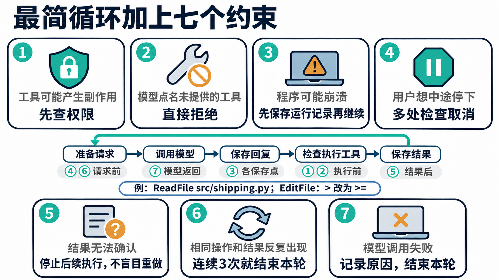

看完这张图，你要能：说出七个“出问题时怎么办”：每张卡片是一个问题和 MyBuddy 的对策。

真实运行时，下面这些问题都会发生。我们一次只看一个：

1. **工具可能有副作用 → 执行前先检查权限，必要时等你批准。** 拒绝结果也交回模型（第 6 课）。
2. **模型可能点名一个本次没提供的工具 → 直接拒绝，并告诉模型。** 连续几步都只点名没提供的工具，本轮就结束。
3. **程序可能中途崩溃 → 先保存，再往下走。** 模型回复、工具调用和工具结果都先存进会话记录（第 11 课）。
4. **你可能想中途停下 → 多处检查取消。** 新 Step 开始前、工具执行后、本轮收尾前都会看一次（第 12 课）。
5. **工具结果可能无法确认 → 不盲目继续，也不重做。** 比如写入可能已发生却没有可靠记录，就等查清实际效果。
6. **循环可能停不下来 → 原地打转就停，也可以设调用次数上限。** 同样的一步或几步连续出现 3 次，本轮就停下并记下原因（本课第三节）。
7. **模型调用可能失败 → 记录原因，结束本轮。** 回复不完整、既没有工具调用也没有文字，都按错误处理（第 2 课）。

把这些约束加回最简循环，就得到下面的**教学伪代码**。这里用中文写每一步做什么。每回到开头一次，就是准备一个新的 Step：

```latex
当 当前 Turn 仍允许继续:                     # 约束 4、6
    用已保存的历史准备并记录本次请求           # 约束 3
    回复 = 调用模型，接收并检查完整响应         # 约束 7
    保存回复及其中的工具调用                   # 约束 3
    如果 回复包含工具调用:
        检查参数和权限，必要时等待审批           # 约束 1、2
        执行获准的工具调用，保存结果             # 约束 3
        如果 可以继续: 带着这些结果进入下一 Step   # 约束 4、5、6
        否则: 停止推进并记录原因，退出循环
    否则:
        保存本轮结束状态，退出循环
```

和最简版对比一下：骨架没变，还是“问模型 → 执行工具 → 带结果再问”。多出来的每一行，都对应上面的一个约束。具体停止条件放到第三节一起看。

### 先看结果怎样交回模型

**模型提出调用的那个 Step 里，它还没看到调用的结果。**

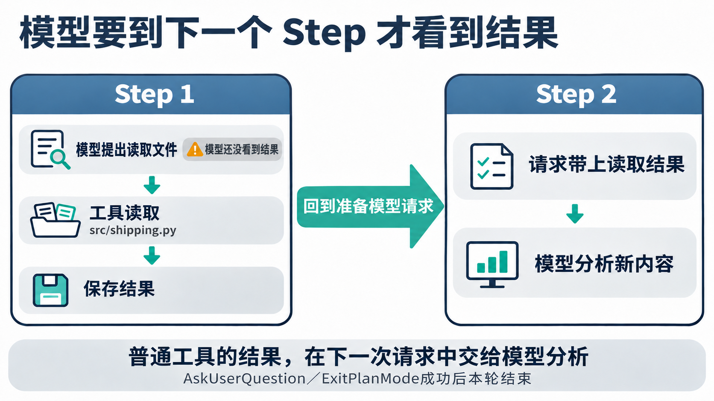

看完这张图，你要能：说出工具结果在哪个 Step 被模型看到：提出调用的 Step 只执行并保存，下一个 Step 才分析。

先根据上面的伪代码判断：读取成功后，模型是否已在同一个 Step 里分析了刚读到的内容？

还没有。这个 Step 的模型回复只是提出调用，随后 Harness 才执行读取。模型要分析新内容，得等下一次请求带上读取结果。所以每拿到新结果，都要回到“准备模型请求”这一步。最简循环也是这样：结果追加到 `messages` 后，要回到 `while` 开头再问一次。

### 为什么要先保存，再往下走

**保存失败时不能往下走，否则运行记录会缺一环。**

假设工具读到了代码，但保存结果时失败了。如果程序直接继续，模型可能已经根据这段代码做了决定，记录里却找不到它。你再回看“它依据什么改的”，就会少一环。

所以，MyBuddy 遵守两个顺序：**先完整保存模型回复，再执行其中的工具调用；先保存工具结果，再准备下一次模型请求。** 保存失败，或某个工具的结果还无法确认时，就不能假装这一环已经完成。

下面把正常路径连起来。各处保存失败的分支暂时省略：

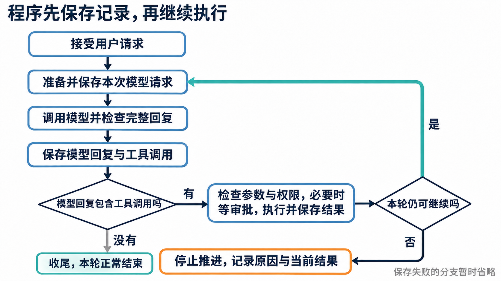

看完这张图，你要能：说出正常路径上每次保存发生在哪里：回复先保存再执行工具，结果先保存再准备下一次请求。

图中的“停止推进”还包括记录原因、处理正在执行的工作。再补充三点：

- 模型没有提出工具调用时，循环进入本轮收尾。如果收尾过程中收到取消，本轮结果仍记为“已取消”。
- 如果设置了活动目标（Goal），一轮正常结束后，程序还会判断目标是否完成、要不要自动开始下一轮。细节见第 10 课。模型说“完成了”，不能代替实际检查（第 13 课）。
- 读源码时会看到 **Attempt（请求尝试）**，指向模型服务发出的一次请求。目前每个 Step 只发一次，失败不自动重试。它和“进入下一 Step”是两回事，源码解析会讲。

### 边观察边行动，与先写计划有什么关系

**计划给出顺序；循环负责用新结果检验计划，必要时修改它。**

知道循环怎样运行后，你可能会问：先让模型列好计划，再照着做，行不行？

任务变大时，先有计划，有助于记下范围和依赖。比如“确认规则 → 定位条件 → 修改 → 运行检查”给出了顺序。但每一步仍要看实际结果。读取后发现业务规则互相冲突，应暂停相关修改，先澄清。测试暴露了新缺陷，要判断它属不属于原范围。不能机械地勾完计划里的四项。

你会在资料里见到 **ReAct**。它强调推理和行动交替，用外部观察调整下一步。理解这个思路，看公开的调用和结果就够了，不需要看模型的私有思考。

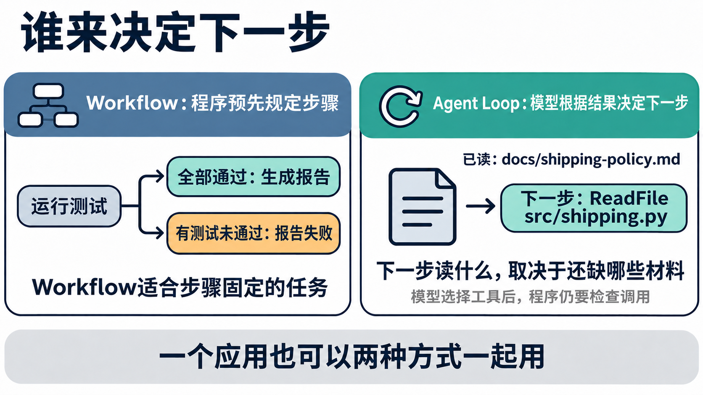

看完这张图，你要能：分清 Workflow 与 Agent Loop：步骤固定时由程序规定，下一步取决于新材料时交给模型。

另一种常见方式是 **Workflow（工作流）**：程序预先规定步骤和分支。例如“运行测试 → 全部通过就生成报告，否则报告失败”，适合用固定流程。运费排查里“下一步读哪个文件”，取决于还没看到的材料，更适合交给模型决定。一个应用也可以两种方式一起用。

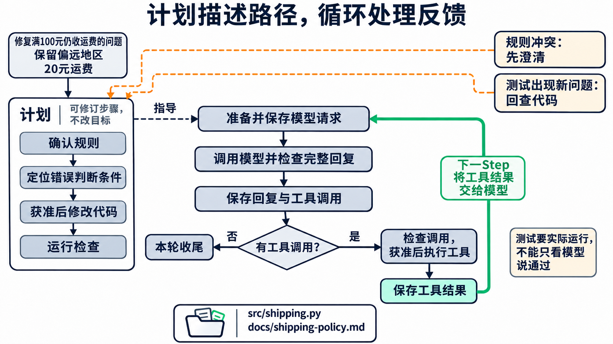

看完这张图，你要能：说明计划为何仍需随着观察更新且不能替代执行循环。

容易误会的地方：

- 模型可以调整步骤，但不能改任务要求。测试失败时，它不能悄悄删掉“修复后通过相关检查”，再宣布完成。权限和运行限制也照样有效。

## 三、当前 Turn 何时继续、等待或结束？

**循环既要知道何时停，也要在停下时留下原因和已有结果；等审批只是暂停。**

前面一直顺着回箭头往下走。但循环不能只会继续：工具执行前可能要等你批准；执行后要判断能否进入下一步；也可能已经收到取消。这些情况发生在不同位置，我们放在一起比较。

### 终止条件必须单独设计

**写一个** `while True` **很容易；难的是每种停法都留下原因和已有结果。**

| 情况 | Loop 如何处理 | 你应怎样理解 |
| --- | --- | --- |
| 返回完整有效回复，没有工具调用 | 进入收尾，保存本轮结束状态 | 正常结束的回复，也可能是在说明阻碍或追问信息 |
| 用完了显式设置的调用上限 | 记录已有结果和限制原因，不再开始下一步 | 停下是因为额度用完，不说明工作做完了 |
| 能完整比较的一段工具操作及结果连续出现 3 次，例如重复读取同一内容 | 在下一步开始前结束本轮，保留已有结果 | 补充信息后可以直接发新消息。已经运行的 Bash、文件实际变化或结果不完整时，会清空比较记录，不能保证三次就停。 |
| 模型服务发现请求过长 | 按服务返回的错误结束本轮 | 本地估算超限不会阻止发送 |
| 用户取消 | 不再安排新工作，处理已开始的工作 | 取消发出后，工具不一定马上停稳 |
| 模型调用失败或回复格式不完整 | 记录失败，结束本轮 | 半条响应不能当成完整结果去执行 |
| 程序崩溃或保存记录失败 | 可能来不及写下完整结束状态 | 缺少记录时，不能补猜成成功；未闭合的历史不能续接 |

有些情况不会结束整个 Turn。工具路径错误、业务失败和审批拒绝，都可以作为结果交回模型。模型再解释原因，或换一种允许的做法。

你还没回答时，待批准的动作不能执行。沉默也不能当作同意。

“等审批”和“提问后结束本轮”不同。审批是在当前 Turn 内等待一个具体动作的批准；AskUserQuestion 调用成功并保存结果后，程序会结束本轮，等待你回答，再用答案开始新 Turn。普通模式下，模型也可能直接用最终文字追问；规划模式要求使用提问工具。第 5 课会展开这些路径。

第 2 课的流式响应也是同一个道理：连接关闭，只说明数据不再传来，不说明回复完整、任务成功。

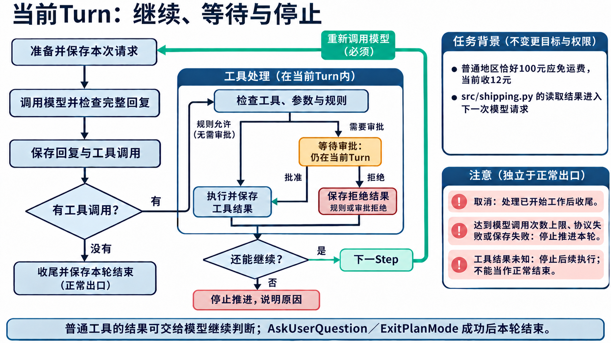

看完这张图，你要能：根据协议、权限、结果和运行限制判断当前Turn继续、等待或停止。

### MyBuddy 默认会走多少步？

**默认不限定步数，靠自然的停止条件结束；只有显式设置上限，才会因额度用完而停。**

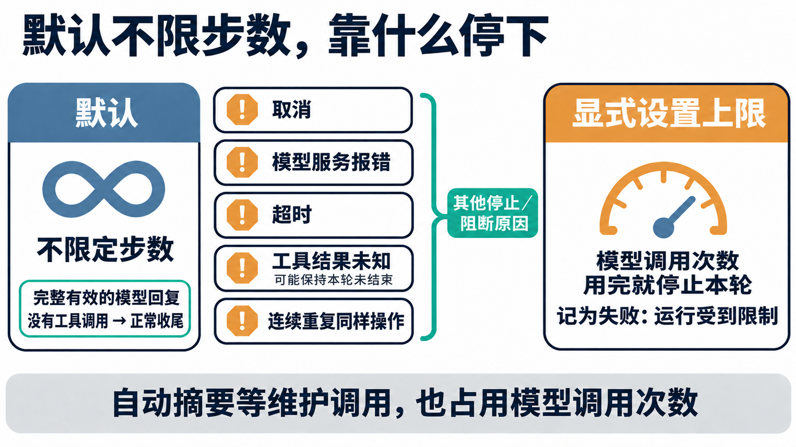

看完这张图，你要能：知道默认不限步数；没有工具调用时正常收尾，取消、报错、超时、结果未知或重复操作会停止或阻断继续。显式设置调用上限时，用完额度记为失败。

没有固定步数，循环也会停。取消、模型服务报错、超时、工具结果未知，都会阻止下一步；模型连续重复同样的操作，也会让本轮停下。

上限不只算业务模型调用，也算为了维持会话而发生的调用，例如已保存的自动摘要。前面伪代码里的“当前 Turn 仍允许继续”，就包含这些检查。

如果 `/trace` 显示“达到 Step 上限”，说明本轮显式设置的调用额度用完了。这条路径记为失败，意思是运行受到限制。对应的原因码和判断代码，见源码解析。

回看 Trace 时，先找具体停止原因：是正常答完，还是缺了继续的条件？再对照实际产出，判断原请求中哪些工作已经完成。

### 同样停下来，运费任务可能做到哪一步？

**判断进展要问三件事：为什么停，已有什么结果，原请求要什么。**

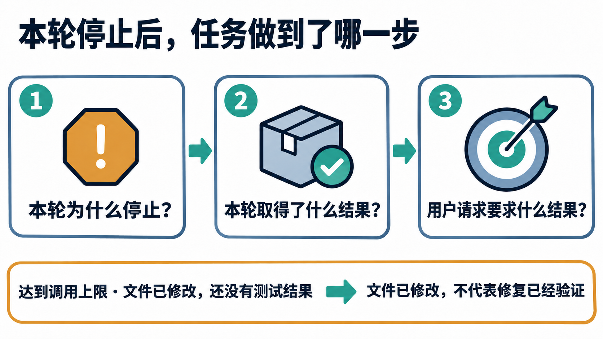

看完这张图，你要能：用三个问题判断进展，并用“达到调用上限”一例练习：只完成了修改，不能说修复已验证。

仍以“修复满 100 元收运费的问题，并检查相关边界”为例。下面四种情况，循环都停止推进了，但任务进展不同：

| 停止时的情况 | 已有结果 | 对这次修复任务的判断 |
| --- | --- | --- |
| 模型整理修复说明，本轮正常结束 | 改动已保存，相关金额与地区用例通过 | 证据支持所检查范围内的修复，仍需说明检查范围 |
| 模型询问偏远地区是否适用新规则，本轮结束等你回答 | 已定位代码，但缺少一项会影响修改的业务规则 | 调查有进展，修复还没完成 |
| 达到调用上限，本轮按限制原因结束 | 文件已修改，还没有修改后版本的测试结果 | 只完成了修改，不能说修复已验证 |
| 执行结果无法确认，运行时阻止继续 | 写入可能发生，但没有足够记录确认结果 | 先查清实际效果，不能直接宣布成功或重复写入 |

先问“为什么停”，再问“已经取得了什么结果”，最后对照你最初要它做什么。如果原请求只是“找出原因，暂时不要改”，有依据地解释原因，就可能已经完成。同样的结果放在“修复并检查”下，只完成了一部分。

容易误会的地方：

- 等审批不是结束。用户没回答前，本轮还在等待。
- 达到调用上限，不说明模型证明了任务做不到，也不说明工作做完了。
- 结果未知时，不能宣称操作成功，也不能盲目重做。工具是否已经停止、本轮是否已经结束，要分别核对对应记录。
- 流式连接关闭，不能代替完整性检查，更不说明任务做完了。

## 四、怎样通过 Trace 判断循环停在哪里？

**Trace 把零散记录串成一条线，帮你定位停在哪一步；改得对不对，还要看文件和检查结果。**

刚才的表给出了停止原因和实际结果。真正使用时，这些材料从哪里找？这就要用到 **Trace（执行轨迹）**：把一次任务的运行记录串起来，回看每一步发生了什么。

### Trace 到底帮你看什么

**Trace 回答“发生了什么”：哪次调用、有没有执行、结果有没有交回模型。**

假设你只看到一行“工具失败”，很难知道该查哪里。是哪一次调用？真的执行了吗？失败结果交给模型了吗？Trace 把这些记录关联到同一个任务里。你可以顺着步骤回看，不用在零散日志之间猜。

MyBuddy 提供运行中的活动显示和结束后的查询入口：

| 入口 | 主要用途 | 当前限制 |
| --- | --- | --- |
| 终端活动行 | 追加显示工具开始与结束，及时提示等待确认或停止 | 不移动光标回写活动面板，也不是模型思维链 |
| `/trace` | 回看最近 Turn 的 Step、工具及其结果是否已有记录 | 只展示这一范围的摘要，不展示完整参数与正文 |

沿一次停止的任务往回看：先找停止原因，再找最后相关的 Step，就知道该查哪个动作。审批内容说明打算改什么。实际的文件 diff 说明改了什么。对应版本的测试结果，帮你判断修得对不对。

`/trace` 只从已保存的记录生成视图，不会重新执行工具。多查几次，也不会产生新的模型请求或写入。

任务变慢时，`/trace` 能列出这一轮几次模型调用、哪些工具要审批、审批结果如何，以及每次执行有没有记下最终结果；没走完的一轮，还能看出停在哪种状态，例如工具那行是 `审批=等待确认`。但它不显示每段耗时，比较耗时要另外记录（第 13 课）。

### 用 Trace 区分“没做”与“做了但没达到目的”

**相似的最终回答，背后可能是完全不同的过程。**

假设最终回答都写着“建议检查运费条件”，背后的轨迹可能完全不同：

```latex
轨迹 A：模型返回文本 → 本轮结束
轨迹 B：请求读规则 → 读取成功 → 请求读代码 → 读取失败 → 返回说明
轨迹 C：读取成功 → 提出修改 → 用户拒绝 → 记录并回传拒绝结果 → 返回说明
```

A 要检查：这个任务该不该先取证，工具是否可见。B 要定位读取失败，而不是先改回答用的提示词。C 要确认拒绝后没有写入，模型也如实说明了。

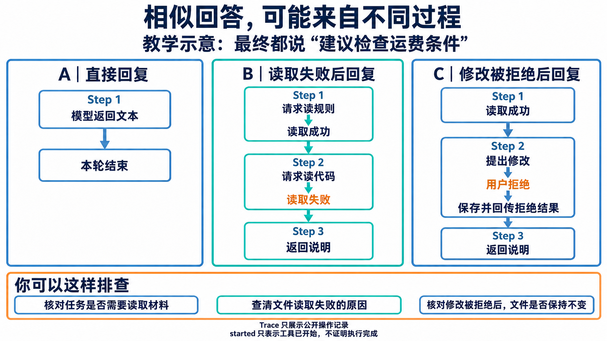

看完这张图，你要能：依据公开轨迹区分直接回复、读取失败与修改被拒绝的处理过程。

以后用到更完整的追踪平台，还会见到 span（一次操作从开始到结束的记录，带耗时和结果）和 metrics（许多次操作的统计，如平均耗时、失败比例）。MyBuddy 的 `/trace` 只覆盖最近的 Turn，是一份范围有限的运行摘要。

容易误会的地方：

- 工具摘要里的“执行=已开始”，只说明开始阶段有记录。外部动作不一定已经完成；无法确认时，会记为结果未知。
- Trace 能说明经过了哪些已记录的步骤，但不能单独回答“改得对不对”。业务正确性要结合源文件、版本和验证结果。第 13 课会讲怎样选择和核对检查。

### 一次修复的完整过程：模型怎样找到要改的地方

**模型找改动点靠的是手里的线索：项目说明给了路径，它就直接读；没给路径，它先查文件再读；项目大了，它还要先看结构，再读其中一段。**

下面是三次真实运行的记录，不是示意：模型是 `qwen3.8-max`，前两次在运费练习副本上，第三次在麦当当收银台练习副本上。权限模式设为 `bypass`，所以修改和命令没有停下来等批准；默认模式下，`EditFile` 和非白名单 Bash 命令需要批准；只读白名单命令自动放行。工具名和状态来自 `/trace`，参数来自同一会话的事件记录。换一次运行或换一个模型，路径可能不同。

**第一次和第二次：同一个运费问题，只差有没有导航。** 请求都是“订单刚好 100 元还被收运费，找出原因、修好、跑测试”，第二次换了更口语的说法。第一次，`AGENTS.md` 的“阅读导航”写明了规则和实现的路径。模型依次读了 `AGENTS.md`、`docs/shipping-policy.md` 和 `src/shipping.py`，没用 `Grep`、`Glob`、`CodeOutline`。知道准确路径，就直接读（第 3 课“按手里的线索选工具”）。第二次运行删掉了导航，模型先用 `Glob` 按 `**/*.py` 列出仅有的两个 Python 文件，再读实现和测试。两次都把第 19 行的 `>` 改成 `>=`，再用 `python3 -m unittest discover -s tests -v` 跑通 3 项测试。文件少、名字已说明用途，所以不必 `Grep`；文件只有 21 行，整份读完比先看结构省事。项目一大，这两步才有用处；下面的第三次运行就是这样。

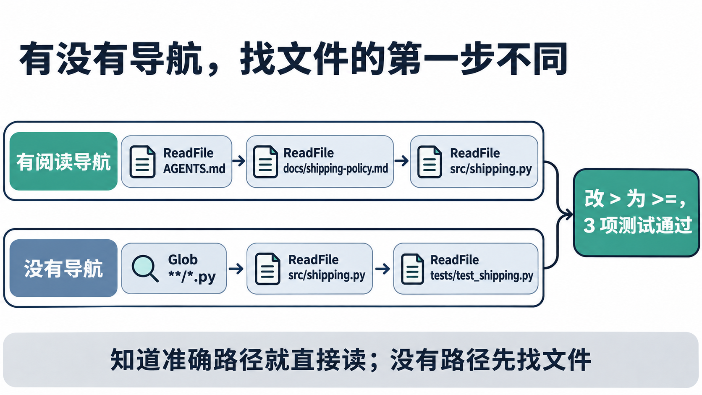

看完这张图，你要能：比较前两次运行：有导航就直接读，没导航就先用 Glob 找文件，最后的改动和测试结果一样。

对照本课第一节的三个阶段：读文件是收集上下文，改条件是执行动作，跑测试是验证结果。这两次都很顺，没有出现“验证失败、回头再查”的回路。

**第三次：换到更大的麦当当项目。** 麦当当收银台的 `src/` 有五个模块，最长的 `src/console.py` 有 301 行。为这次演示，我们在练习副本里手工注入了一处缺陷（它不是麦当当自带的缺陷练习题）：购物篮的“改数量”和“加餐”走了同一行累加代码；能发现它的那步测试也去掉了，所以副本自带的检查全绿。请求只写店员看到的现象：

店员反映：在购物篮里把两个鸡腿堡改成一个，购物篮反而显示三个，结账也按三个收了钱。请找出原因修好，然后跑项目检查确认。

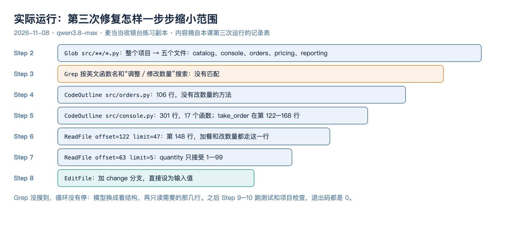

看完这张图，你要能：看懂第三次运行的 Step 2–8 怎样把范围从整个项目缩到一行代码，以及 Grep 没搜到时循环为什么没停。

| Step | 工具与参数 | 看到了什么 | 因此决定做什么 |
| --- | --- | --- | --- |
| 1 | `ReadFile`，`AGENTS.md` | 业务代码在 `src/` 的五个模块；console 只做输入输出；检查命令有两条 | 列出源码文件 |
| 2 | `Glob`，`src/**/*.py` | 五个文件：`catalog`、`console`、`orders`、`pricing`、`reporting` | 搜索改数量的代码 |
| 3 | `Grep`，在 `src` 里按正则搜 `update_quantity\|change_quantity\|set_quantity\|modify.*quantity\|调整.*数量\|修改.*数量` | 没有匹配 | 换个办法：看订单模块有哪些函数 |
| 4 | `CodeOutline`，`src/orders.py` | 106 行；`Shop` 有 `place`、`pay`、`cancel` 等方法，没有改数量的方法 | 判断问题在界面层处理购物篮的代码 |
| 5 | `CodeOutline`，`src/console.py` | 301 行，17 个函数；`take_order` 在第 122–168 行，`quantity` 在第 63–67 行 | 先读 `take_order` |
| 6 | `ReadFile`，`src/console.py`，`offset=122`、`limit=47` | 第 148 行 `updated[sku] = updated.get(sku, 0) + quantity(read)`，加餐和改数量都走这一行 | 找到原因：2 + 1 = 3；再确认数量的输入范围 |
| 7 | `ReadFile`，`src/console.py`，`offset=63`、`limit=5` | `quantity` 只接受 1—99 | 改数量就是“设为输入值”，动手修改 |
| 8 | `EditFile`，`src/console.py`，在 `delete` 分支后加一个 `elif action == "change":` 分支，直接写 `updated[sku] = quantity(read)`，并加一行中文注释 | 修改成功 | 跑业务测试 |
| 9 | `Bash`，`python3 --version && python3 -m unittest discover -s tests -v` | Python 3.12.11；测试通过，退出码 0 | 再跑项目检查 |
| 10 | `Bash`，`python3 scripts/check_project.py` | 退出码 0，固定场景 `PASS` | 整理结论 |
| 11 | 无工具调用 | — | 报告原因、修改和检查结果，本轮结束 |

这次靠 Step 2–6 一步步缩小范围：

- Step 2 从整个项目缩到五个文件。Step 3 想直接搜到代码，但它猜的是英文函数名和“调整／修改数量”。界面上的字是“改数量”，所以一个也没搜到。
- 搜不到，就看结构。Step 4 先看订单模块，没有相关方法，排除了一个文件。Step 5 再看界面模块，从 17 个函数里挑出 `take_order`，拿到它的行范围。
- Step 6 只读第 122–168 行，正好是 `take_order` 整个函数，不必读完 301 行。Step 7 又只读了 5 行，确认一个细节。

这正是第 8 课“不知道函数名时，先看文件结构”里那条链：Glob／Grep 找到文件 → CodeOutline 看结构 → ReadFile 读代码 → EditFile 修改，四段都走到了。

还要注意 Step 3 的空结果：`Grep` 没匹配，循环并没有停，模型换了工具继续找。这就是上一小节说的“做了但没达到目的”，看 Trace 时要区分它和“没做”。

容易误会的地方：

- 测试通过，不等于模型核对过业务规则。第二次运行没有读 `docs/shipping-policy.md`，它把你说的“满 100 元包邮”和现有测试当成了规则。这次恰好一致；如果测试本身写错了，这条路就会漏掉问题。要它对照规则，就在请求里说出来，例如加一句“请查看配送规则，再对照源码和测试”。
- 测试通过，也不等于测试覆盖了这次的问题。第三次运行里，模型说现有测试“正好覆盖了”改数量。其实能发现它的那一步已被去掉，测试修复前后都是绿的。`AGENTS.md` 要求改行为时同步测试，模型这次也没有补。要证明修好了，就请它先写一个修复前会失败的测试。

## 五、动手回看一次排查过程

**用一次真实的只读排查，练习三件事：找停止原因、核对结果、写停止说明。**

沿用课前准备的运费练习副本，提出本课开头的只读排查要求。这里只找原因，先不要求修改。

### 第一步：找出模型怎样用到了工具结果

本轮处理结束后，在 MyBuddy 输入框中输入：

```latex
/trace
```

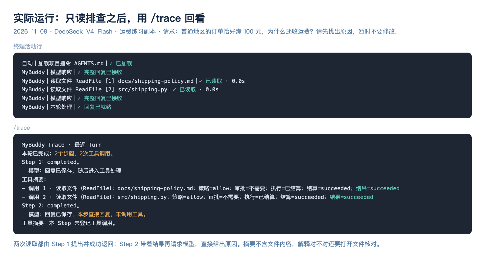

看完这张图，你要能：在真实的 /trace 里找到读取由哪个 Step 提出、是否成功返回，以及下一个 Step 带着结果直接回复。

从记录中选一次读取，填下这张小表。模型的实际调用顺序可能与本课示意不同，按你的记录填写即可：

| 要找的内容 | 在哪里核对 |
| --- | --- |
| 读取由哪个 Step 提出？ | 该 Step 下的工具调用记录 |
| 工具是否成功返回？ | 对应调用的结果记录 |
| 后续是否准备了新的模型请求、保存了回复？ | 后续 Step 的模型状态摘要 |
| 最终解释是否与文件内容相符？ | 实际规则、实现与最终回答 |

Trace 摘要不显示完整文件内容。需要时，打开对应文件核对。不要只凭“读取成功”，就断定后面的解释正确。

### 第二步：给这次停止写一句说明

用“停止原因 + 已有结果 + 尚缺什么”描述本轮。下面是一种可能的写法。只有实际记录支持时，才能这样填：

本轮正常结束。已读到规则与实现，并解释了满 100 元时的条件差异。这符合“只找原因”的要求；还没有修改，也没有验证修改后的行为。

再把原请求换成“修复并检查”，看看同一句结果为什么不够了。不用再跑一遍，你就能发现：它缺少改动，也缺少修改后的检查结果。

### 第三步：比较一次拒绝和一次空结果

在练习副本中提出修改请求，并使用会要求修改审批的权限模式。在审批界面拒绝一次修改，再查看轨迹：有没有记录拒绝？拒绝后是否仍发生了这次写入？模型有没有如实说明未修改？

接着做一个纸面推演：搜索工具正常返回，但没有找到匹配内容。模型是否必须停止？

- 如果只搜过一个函数名，而项目可能用了别的命名，可以换关键词或查看相关目录，继续缩小范围。
- 如果指定范围已经核对完，仍缺少定位所需的材料，可以说明查过哪些范围，并请你提供路径或复现信息。

空结果也有信息量，关键是下一步有没有新的问题要查。反复执行完全相同的搜索，调查不会因此更充分。

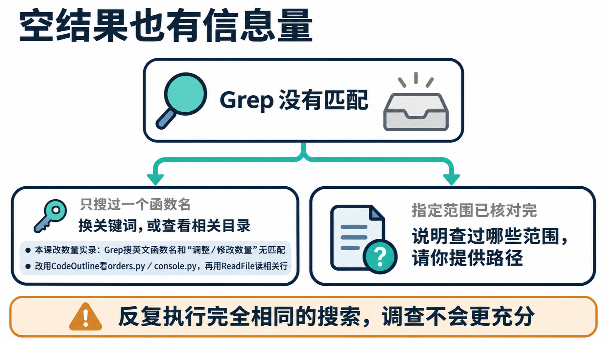

看完这张图，你要能：在搜索没有匹配时选对做法：换关键词继续缩小，或者说明查过哪些范围、请你提供路径；不重复同一个搜索。

本课只用只读排查和审批拒绝观察真实循环。步数耗尽、保存失败等情况，可以对照第三节的表格做纸面推演，并写明假设条件。

### 把这一课接到下一课

需要你参与时，程序该追问、澄清，还是请求审批？下一课接着讲。实现细节见本课源码解析：

- AgentLoop：`src/mybuddy/core/runtime/agent_loop.py`
- Trace：`src/mybuddy/platform/cli/cli_trace.py`

## 使用小妙招

### 给出目标、取证入口和检查方式，让循环有依据

运费任务可以这样提出：

排查普通地区订单恰好满 100 元时仍收运费的问题。先从项目中的配送规则、实现和测试确认原因，遵守当前修改审批要求；修复后核对普通地区低于、等于门槛和偏远地区场景，说明实际检查结果与尚未验证的部分。

不用预先指定先读哪个函数、调用几次工具。

**为什么这样做：** Agent 在一轮里会反复“收集材料、行动、检查结果”（见“收集、行动、验证，怎样分布在这些 Step 中”）。这段要求正好给这三个阶段各留了依据：从哪里找材料、允许做到哪一步、用什么标准检查。具体先读哪个文件，留给模型看到结果后再决定；遇到新证据时，它才有空间调整调查路径。

### 把“完成”与“卡住时怎么办”一起写清楚

多步任务可以加上这样的约定：

完成条件是目标边界修复且相关检查通过。如果连续遇到同一失败、没有新证据，请说明当前阻碍和下一步需要的材料，不要重复同一操作。

**为什么这样做：** 循环什么时候停，要单独设计（见“终止条件必须单独设计”）。不写完成条件，模型可能改了一半就说“完成了”；不写卡住时怎么办，它可能一遍遍重试同一个操作。不过这只是任务里的要求，模型不一定每次都照做；硬性的步数、时间和费用限制要靠产品本身的设置。

### 盯住最近一次变化，而非工具调用总数

觉得 Agent “一直在忙”时，回看最近几步有没有新进展：读到新文件、失败原因变了、测试转为通过。Claude Code 可以按 Ctrl+O 展开详细记录，MyBuddy 用 `/trace`。

读到新规则就让它继续；同一失败反复出现，先让它说明下一次准备验证什么；只有你能决定的业务分歧，就补充规则；需要中断时，用产品的中断入口（Claude Code 按 Esc），并核对任务已经停下。

**为什么这样做：** 调用多、回复长，只说明它在动，不说明它在往前走（见“用 Trace 区分‘没做’与‘做了但没达到目的’”）。每一步的结果会交回模型，决定下一步（见“先看结果怎样交回模型”）；如果最近几步的结果都一样，下一步大概率也不会变，这时就该你介入。

### 听到“会继续工作”后，核对是谁在继续

如果 Agent 回复“会继续工作”，之后却没有新改动，先核对执行状态。可以依次查：本轮是否已经结束？是否留下了可查询的后台任务？是否正在等输入或审批？最近一次工具调用有没有结果？对照下面两句话，体会证据的差别：

- “稍后我会完成修复。”——这只是回复内容。
- “任务仍在运行，最近一次检查失败，等待下一步处理。”——仍须由任务状态和检查记录支持。

如果当前轮次已经结束，也没有后台任务，就要先确认已有操作的结果，再发一条消息让它继续。

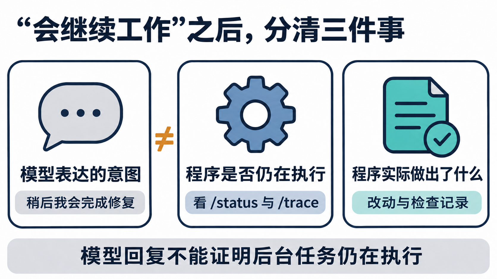

看完这张图，你要能：分清模型说的意图、运行时是否还在执行、实际做出了什么；没有记录的后台执行不能靠回复推断。

**为什么这样做：** 普通请求结束后，如果没有活动 Goal、后台任务或新的输入，就不会仅凭“会继续工作”这句话继续执行。启用了 Goal 时，程序可能评估目标并自动开始下一轮。要分别核对模型表达的意图、实际运行状态和已经取得的结果。

## 自测：这一课的概念分清了吗

**先自己作答，再看后面的答案。** 每题都能在本课正文里找到依据；带“动手验证”的题，可以照着做一遍，亲眼看到结果。

**1.** 修复运费问题前，你运行测试，确认当前哪里出错；修改后，你再运行同一个测试，核对改动是否有效。这两次测试分别属于什么阶段？

- A. 都属于验证结果，因为运行的是同一个测试
- B. 前一次是收集上下文，后一次是验证结果
- C. 前一次是执行动作，后一次是收集上下文

**2.** 你把流程写成“运行测试，全部通过就生成报告，否则报告失败”，每一步和分支都由程序预先规定。这更符合本课哪个概念？

- A. Agent Loop，因为只要调用了工具，就是由模型决定下一步
- B. ReAct，因为有测试结果，就说明模型在根据观察调整行动
- C. Workflow，因为步骤和分支已由程序规定

**3.** 判断：你要求“修复运费问题，并检查相关边界”，目前只有一份有依据的原因解释。既然原因已经找到，就可以把这项任务记为完成。（对 / 错）

**4.** 在 MyBuddy 输入框中连续输入两次 `/trace`，第二次查询本身会做什么？

- A. 从已保存的记录生成最近 Turn 的摘要
- B. 重新执行最近 Turn 的工具，确认结果有没有变化
- C. 发起新的模型请求，请模型重新解释最近 Turn

### 答案与依据

**1. 选 B。** 修改前的测试用来了解现状，修改后的测试用来核对改动。同一个工具的用途会随任务阶段改变，不能只看工具名称。  
依据：本课“收集、行动、验证，怎样分布在这些 Step 中”。

**2. 选 C。** 这个流程的步骤和分支由程序预先规定。调用工具本身不能说明下一步由模型选择；Agent Loop 会把结果交回模型，再决定下一步。  
依据：本课“边观察边行动，与先写计划有什么关系”。

**3. 错。** 原请求要求修复并检查，原因解释只能证明调查有了结果，还缺改动和修改后的检查。若请求只是“找出原因，暂时不要改”，同样的解释才可能已经满足要求。  
依据：本课“同样停下来，运费任务可能做到哪一步？”。

**4. 选 A。** `/trace` 只查询已保存的记录，不会重新执行工具，也不会为查询发起模型请求。多查一次不会多推进一个 Step。  
依据：本课“Trace 到底帮你看什么”。  
动手验证：在仓库根目录运行 `uv run python demo-project/prepare_shop_demo.py`，再运行新副本里的 `start-mybuddy.command`。不发送任务，连续输入两次 `/trace`；在终端中会看到两次“暂无 Turn。”，不会开始新的 Step 或工具执行。

## Q&A：常见追问

### Q1：模型说“完成了”，Agent Loop 就应该停止吗？

不应该只凭这句话停止。程序要先确认回复完整、工具调用处理完毕，再按停止规则结束本轮。普通工具执行后通常还要把结果交回模型；MyBuddy 的 AskUserQuestion 和 ExitPlanMode 则有明确的特殊规则，调用成功后本轮立即结束，等待用户回答或审阅方案。循环正常结束也不等于任务验证通过：运费代码改完但没检查，只能说做了修改。

### Q2：还有没完成的工作，为什么不能一直循环下去？

没有新证据的重复调用会消耗预算，还可能重复产生副作用。达到限制、等待用户、结果未知、出现无法继续的故障时，停止或等待都要明确记录，已完成的内容也要保留。比如同一读取反复失败，加步数未必有用。真正要看的是：预算够不够，输入和权限齐不齐，下一步能不能取得新证据。

### Q3：实际顺序与计划不同，是不是执行出错了？

先看变化有没有依据。比如计划是先改再测，但读取后发现缺少复现用例，先补一个用例就有助于确认问题。要警惕的是：没有理由地扩大修改范围、绕过审批，或删掉原来要求的检查。步骤可以随观察调整，任务要求和权限边界仍然有效。

### Q4：Trace 能告诉我模型为什么这样想吗？

不能。Trace 展示可观察的请求、工具、交互、结果和停止原因，不展示模型的私有思考。它能帮助定位“是否读过规则”“编辑在哪一步被拒绝”，但某条推断是否正确，仍要回到输入和实际结果核对。MyBuddy 的 `/trace` 只显示最近一轮的摘要；更早的过程要查会话历史。工具成功也不等于业务目标已经达成。

### Q5：Agent 收集上下文、执行动作和验证结果，必须按顺序各做一次吗？

不必。修复前运行测试，是在收集上下文；修改后运行同一个测试，是在验证结果。验证发现新线索，还会回到读取和修改。只读的解释任务，也可能根本不需要修改阶段。三个阶段帮你判断一次调用有什么用；循环几次、怎样停，仍由任务、观察和运行时限制决定。

## 本课术语速查

| 本课说法 | 源码或命令中的名字 | 含义 |
| --- | --- | --- |
| Agent Loop | `AgentLoop` | 反复“请求模型 → 执行工具 → 带着结果再请求”的循环 |
| 最简循环 | — | 只有“问模型、执行工具、放回结果”三件事的十来行循环，用来理解骨架 |
| 会话 / 轮次 / 决策周期 | Session / Turn / Step | 第 1 课介绍的三个层级 |
| 请求尝试 | Attempt | 一个 Step 中向模型服务发出的一次请求；目前每步一次，不自动重试 |
| 执行轨迹 | Trace、`/trace` | 回看最近 Turn 的步骤、工具状态和停止原因 |
| 调用额度 | `max_steps` | 默认不设；在配置文件里写 `[turn] max_steps = 100` 可以设置。设置后，业务调用和已保存的维护调用共用额度，用完会以 `runtime.max_steps_exhausted` 结束 |
| 结果未知 | `outcome_unknown` | 操作可能已经发生，但没有足够证据确认（第 11 课） |
| ReAct | — | 推理和行动交替进行、用观察结果调整下一步的思路 |
| 工作流 | Workflow | 由程序预先规定步骤和分支的做法 |

## 继续阅读源码解析

理解本课概念后，接着读源码解析，沿同一条调用链看真实代码。
