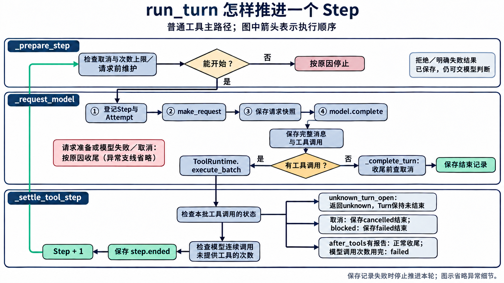
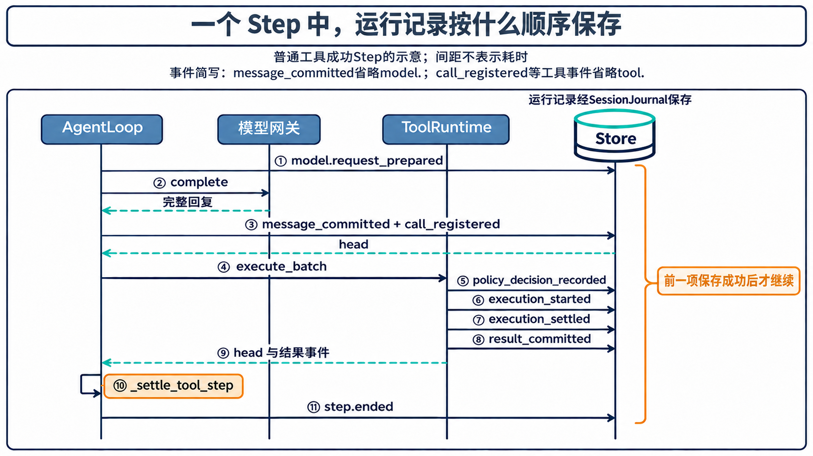
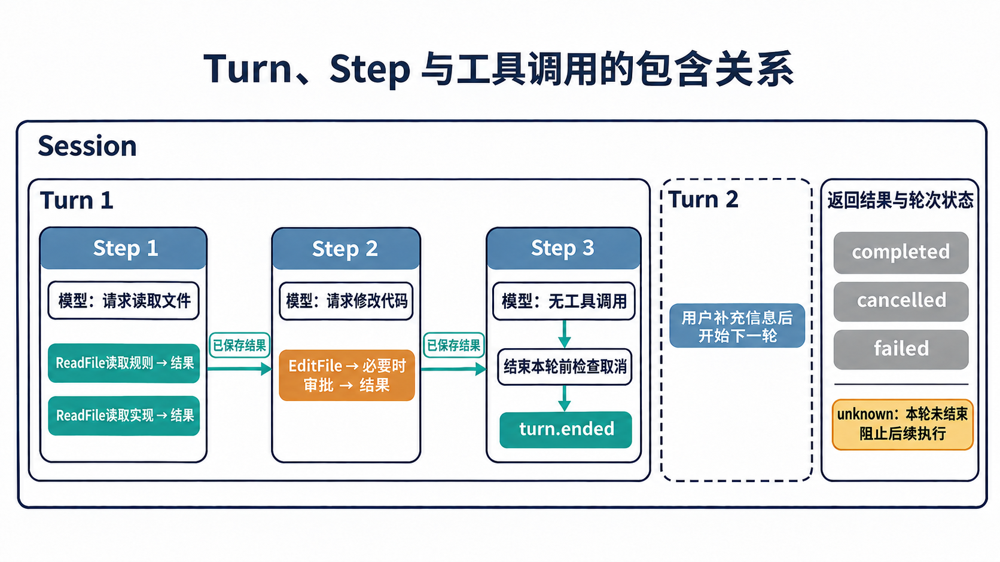

与第 4 课课程正文配套阅读。

正文先给了一个十来行的最简循环。这一篇读 MyBuddy 的真实循环。你会发现骨架和最简版一样：问模型、执行工具、带着结果再问。多出来的代码，都在处理“出问题时怎么办”。

**怎么读：** 每一节先贴一段代码，再用几句话解释。代码从当前源码原样复制，上方标了文件和行号。`# ...` 表示省略了与本节无关的行。

一次用户请求轮次叫 Turn，其中一次模型决策及其工具处理叫 Step。下面沿用运费排查：模型提出读取规则，工具返回内容，模型再决定查什么。

先看整条调用链。缩进表示“谁调用谁”：

```latex
MyBuddySession.ask                  application_session.py  占住入口
└─ run_goal_turns                   goal.py                 一轮结束后，按需评估目标
   └─ _ask_turn → TurnCoordinator.run  turn.py              保存输入，准备上下文
      └─ AgentLoop.run_turn         agent_loop.py           本课主角：Step 循环
         └─ execute_batch           tool_runtime.py         权限、审批、执行、保存结果
```

## 从会话入口走到循环

### 片段 1：会话入口 `ask`

`src/mybuddy/platform/application/application_session.py:402-413`

```python
    async def ask(self, text: str, *,
                  _team_message_source: Mapping[str, Any] | None = None) -> ApplicationTurnResult:
        """处理用户请求；根据目标检查的结果，决定是否继续下一轮。"""
        if self._goal_loop_task is not None:
            raise ValueError('mvp_turn_busy')
        # 目标需要连续运行多轮时，始终占住入口，避免其他请求插到两轮之间。
        self._goal_loop_task = asyncio.current_task()
        try:
            return await goal.run_goal_turns(text, _team_message_source, run_one_turn=self._ask_turn,
                                             evaluate=self._evaluate_goal, record_result=self._record_goal_result)
        finally:
            self._goal_loop_task = None
```

`ask` 先占住入口。处理期间再来一个请求，会直接报 `mvp_turn_busy`。这样，其他请求插不进同一次目标续跑。

真正的工作交给 `run_goal_turns`。它把 `_ask_turn` 当作“跑一轮”的函数传进去。`run_goal_turns` 每跑完一轮，就调用 `evaluate` 看活动目标。没有继续条件时，它直接返回这一轮的结果。所以普通请求只跑一轮。

`_ask_turn` 先检查输入和会话是否允许开始，再调用 `TurnCoordinator.run`。执行中出了异常，通常会阻止新工作。例外是 Memory（长期记忆，第 15 课）在保存输入前就拒绝了输入，这时不阻止下一次请求。

### 片段 2：`TurnCoordinator.run`——先存输入，再进循环

`src/mybuddy/platform/application/turn.py:142-165`

```python
    async def run(self, text: str) -> tuple[ApplicationTurnResult, RecoveryInput]:
        self.input_rejected_by_memory = False
        # 保存上一轮的编号。记忆读取报错时，如果编号还没变，就说明还没开始保存这次输入；
        # 编号已经变了则不能据此判断保存是否成功，需要阻止后续请求。
        prior_turn = self._host._last_owned_turn_id
        await self._prepare_to_accept()
        try:
            accepted = await self._accept_input(text)
        except MemoryFileStoreError:
            self.input_rejected_by_memory = self._host._last_owned_turn_id == prior_turn
            raise
        outcome_name = None
        stop_unknown = False
        try:
            signal = CancellationController()
            if await self._host._run_hook("turn_start", turn_id=accepted.turn_id):
                # turn_start Hook 运行期间收到了取消。用户消息已经保存，所以不直接返回，
                # 而是打开取消信号，让运行循环按正常流程记下本轮取消，不再请求模型。
                signal.cancel()
            prepared = await self._prepare(accepted)
            outcome = detach_turn_result(await self._host.loop.run_turn(
                prepared.context, self._host.journal.commits(self._host.scope, "turn"), signal))
            outcome_name = outcome["outcome"]
            return await self._finish(prepared, accepted, outcome)
```

顺序很清楚：

1. `_prepare_to_accept`：准备接纳输入。
2. `_accept_input`：把用户输入存进会话记录。
3. `turn_start` Hook 先运行（第 18 课）；然后 `_prepare` 根据历史和配置，准备循环要用的上下文 `prepared.context`。
4. `run_turn`：进入 Agent Loop。
5. `_finish`：整理结果。自动 Memory 提取等轮末工作也在这里按条件处理，它们不属于某个 Step。

注意第 4 步传进去的第二个参数 `commits`。循环里所有“先保存”的动作，都通过它写入会话记录。

## 进入 `run_turn`：先准备，再请求模型

下图对照循环骨架。每次回到顶部，是准备下一次模型决策，不是重新接收用户请求。



看完这张图，你要能：在 run_turn 里找到三个位置：调用模型、把工具结果放回、决定是否进入下一个 Step。

### 片段 3：循环骨架

`src/mybuddy/core/runtime/agent_loop.py:277-292`

```python
        active_signal = signal or _NeverCancelled()
        progress = _TurnProgress(head=context.initial_head_seq)
        while True:
            # 开始新的一步前，先检查会话状态；回调也可能进行上下文压缩。
            stopped = await self._prepare_step(context, commits, progress, active_signal)
            if stopped is not None:
                return stopped

            step_id = self._ids.next("step")
            attempt_id = self._ids.next("attempt")
            model_completion = await self._request_model(
                context, commits, progress, step_id, attempt_id, active_signal,
            )
            if isinstance(model_completion, dict):
                # 字典表示请求准备或模型调用失败、取消，结束事件已经写入。
                return model_completion
```

这就是最简循环里的 `while True`。对照来看：

- `_prepare_step`：每个 Step 开始前，检查能不能继续。它会检查取消和调用次数上限，还可能先做上下文压缩等维护。返回非空，说明本轮已经结束。
- `_request_model`：对应最简版的 `call_model`。返回字典，说明请求准备或模型调用失败、被取消，结束记录已经写好。
- `progress.head`：已经确认保存的历史末尾序号。它不是模型维护的计数，也不是 Token 余量。后面每次保存成功，它都会更新。

`RunTurnContext` 带入本轮身份、步数上限 `max_steps`，以及构造请求的方法 `make_request`。`make_request` 由 `TurnCoordinator._prepare_business_request` 提供：它读取历史，核对截止位置，再组织消息和请求快照。

调用次数上限在 `_prepare_step` 里检查（`agent_loop.py:422-427`）。`max_steps` 为 `None` 表示没有上限，这是默认情况。要设上限，在配置文件里写 `[turn] max_steps = 100`（1–1000）。设置了上限时，维护调用次数 `maintenance_calls` 也算在内。用完时，本轮记为 `failed`，原因码是 `runtime.max_steps_exhausted`。`/trace` 把 `runtime.max_steps_exhausted` 显示成“达到 Step 上限”（当前位于 `src/mybuddy/platform/cli/cli_trace.py:47`）。上限的配置和判断，还可以沿 `src/mybuddy/platform/context/turn_step_policy.py` 继续看。

### 片段 4：先保存请求，再调用模型

`src/mybuddy/core/runtime/agent_loop.py:481-492,500-505`

```python
        # 先把请求写入数据库并确认成功，再交给模型网关。
        # 这样这次模型调用有一份已保存的请求可供关联。
        event = context.session_event(progress.head + 1, "model.request_prepared", 10,
            self._ids.next("event"), context.now(), thaw_json(request), producer="turn", **identities)
        prepared = await commits.save(self._ids.next("batch"), [event])
        progress.head = prepared

        # 模型网关会检查回复格式、检查回复里有没有泄露已知密钥，并按顺序给工具调用编号。
        try:
            model_completion = await self._model.complete(
                PreparedModelRequest(event["event_id"], request, prepared, event["activation_id"], event["lease_generation"]), signal,
            )
# ...
        except Exception as error:
            # 取消和模型服务失败分别使用不同的结束原因。
            if signal.cancelled or (isinstance(error, AgentLoopError) and error.code == "model_cancelled"):
                reason_code, category, outcome = "runtime.turn_cancelled", "cancelled", "cancelled"
            else:
                reason_code, category, outcome = _model_failure_reason(error), "provider", "failed"
```

先看前半段。请求快照 `model.request_prepared` 先保存，拿到确认后，才调用 `self._model.complete`。这样每次模型调用，都有一份已保存的请求可以对照。

模型网关（`src/mybuddy/platform/models/model_gateway.py`）会检查回复，并按顺序给工具调用编号。重复的调用标识会让回复按协议错误失败。如果模型点名了本次没提供的工具，网关不拒绝整条回复，而是把这些调用记进 `ModelCompletion.unoffered_call_ids`。Loop 不再重复检查调用顺序和请求身份。

再看后半段。模型调用失败时，先区分是取消还是服务出错，再分别记原因。写进历史的只有固定的错误分类（见同文件的 `MODEL_FAILURE_REASONS`），不会写入异常原文。调用失败，不能当成模型给了可执行的建议。

**Attempt 是什么？** 同一函数开头（`agent_loop.py:455-461`）会先保存 `step.started` 和 `model.attempt_started` 两条记录。当前每个 Step 只创建一个初始 Attempt（`"attempt_index": 1, "retry_kind": "initial"`）。所以看到 Attempt 字段，不表示已经有自动重试。

## 保存回复，再处理工具

### 片段 5：先保存模型消息和工具调用

`src/mybuddy/core/runtime/agent_loop.py:294-307`

```python
            # 注意：先保存模型回复和其中的工具调用，保存成功后才运行工具。
            # 否则工具可能已经改了文件或执行外部操作，历史里却找不到对应的调用。
            identities = {"turn_id": context.turn_id, "step_id": step_id, "attempt_id": attempt_id}
            occurred_at = context.now()
            events = [context.session_event(progress.head + 1, "model.message_committed", 1,
                self._ids.next("event"), occurred_at, thaw_json(model_completion.model_message),
                producer="turn", **identities)]
            for call in model_completion.tool_calls:
                events.append(context.session_event(progress.head + len(events) + 1,
                    "tool.call_registered", 1, self._ids.next("event"), occurred_at, thaw_json(call.call),
                    producer="turn", **identities, tool_call_id=call.tool_call_id))
            message = await commits.save(self._ids.next("batch"), events)
            progress.head = message
            message_event_id = events[0]["event_id"]
```

这里一次保存两类记录：一条 `model.message_committed`，以及每个工具调用各一条 `tool.call_registered`。`commits.save` 成功才返回新的末尾序号，程序用它更新 `head`。保存失败时，`save` 不会返回序号，后面执行工具的代码也就走不到。

这正是正文约束 3“先保存，再往下走”的代码。工具调用建议有了可追溯的来源，才可能被执行。

### 片段 6：没有工具调用就收尾

`src/mybuddy/core/runtime/agent_loop.py:309-318`

```python
            # 没有工具调用时，必须有文本作为本轮回复，否则无法给用户结果。
            if not model_completion.tool_calls:
                final_text = _text_from_message(model_completion.model_message)
                if final_text is None:
                    raise AgentLoopError("model_protocol_error")
                boundary = CompletionBoundaryContext(context.turn_id, step_id,
                    "completed", progress.head, (message_event_id,), ())
                return await self._complete_turn(
                    context, commits, boundary, active_signal, progress.step_index, final_text,
                )
```

对应最简版的 `if not reply.tool_calls: return reply.text`。区别有两点：

- 没有工具调用、也没有文字，就抛出 `model_protocol_error`。程序没有东西可以交给用户。
- 收尾交给 `_complete_turn`。它先检查取消，再用 `boundary` 里的历史序号保存结束记录（`agent_loop.py:582-588`）。如果这期间历史变了，写入会被拒绝。

正常结束只说明循环完成了这一轮，不说明运费问题的业务结论已经验证。

### 片段 7：把工具调用交给 ToolRuntime

`src/mybuddy/core/runtime/agent_loop.py:320-332`

```python
            # 模型给出的工具调用只是请求，并不会让模型自己运行本地程序。
            # 这里把请求交给 ToolRuntime，由它检查规则、处理审批、运行工具并保存结果。
            tool_outcome = await self._tools.execute_batch(
                model_completion.tool_calls,
                ToolBatchContext(context.turn_id, step_id, progress.head, model_completion.unoffered_call_ids),
                active_signal,
            )
            progress.head = tool_outcome.head_seq
            stopped = await self._settle_tool_step(
                context, commits, progress, step_id, message_event_id, tool_outcome, active_signal,
            )
            if stopped is not None:
                return stopped
```

对应最简版的 `for call in reply.tool_calls: run_tool(call)`。但 Loop 自己不运行工具，而是整批交给 `execute_batch`。

`ToolBatchContext` 带上 Turn、Step、当前历史位置，以及没提供的调用编号。返回值 `ToolBatchOutcome`（`src/mybuddy/core/runtime/ports.py`）里，除了结果引用和新的历史位置，还有取消、阻断继续和结果未知等状态。`_settle_tool_step` 再根据这些状态决定下一步。

### 片段 8：ToolRuntime 逐个检查、审批、执行

`src/mybuddy/platform/tools/tool_runtime.py:306-323`

```python
        for call in calls:
            pending: _PendingResult
            if stopping():
                pending = self._unstarted(head, unknown=continuation_blocked)
            else:
                arguments = _inline_arguments(call)
                allowed = (_PendingResult(head, "invalid_input", _error_info(
                    "runtime.tool_arguments_invalid", "protocol")) if arguments is None else
                    await self._check_policy_and_approval(call, arguments, context, head, signal))
                head = allowed.head_seq
                if isinstance(allowed, _PendingResult):
                    pending = allowed
                    business_cancelled = business_cancelled or allowed.business_cancelled
                elif stopping():
                    # 等待批准时可能收到取消，即使检查通过，也要再判断是否还能运行。
                    pending = self._unstarted(head, unknown=continuation_blocked)
                else:
                    started = await self._start_execution(allowed, context, head, signal)
```

这是正文约束 1 的代码。每个调用按顺序处理：

1. 已经要停（取消、阻断）时，不运行，只记一条“没有运行”的结果。
2. 参数不合法，直接得到 `invalid_input` 结果。
3. `_check_policy_and_approval` 检查策略，必要时等待你的批准。没有获准，就得到一条待保存的结果（比如拒绝）。
4. 等批准期间可能收到取消，所以获准后还要再判断一次 `stopping()`。
5. 都通过了，才 `_start_execution` 开始执行。

模型提出调用，不等于工具已经运行。中间每一关都可能把它拦下。

### 片段 9：没提供的工具，直接拒绝

`src/mybuddy/platform/tools/tool_runtime.py:396-404`

```python
        unoffered = call.tool_call_id in context.unoffered_call_ids
        if unoffered:
            # 本次请求没有提供这个工具：不交给权限检查，这里直接记一条拒绝决定。
            # 模型给的名字可能恰好和某个内部工具同名，交给权限检查就有被放行的可能。
            code = "runtime.tool_not_offered"
            evaluation: ToolPolicyEvaluation = deny(make_decision(call, self._ids.next("decision"),
                digest({"policy": "unoffered_tool.v1"}), "deny", [code]), code)
        else:
            evaluation = await self._policy.evaluate(call)
```

这是正文约束 2 的代码。本次请求没有提供的工具，不交给权限检查。模型给的名字可能恰好和某个内部工具同名，交给权限检查就有被放行的可能。

这里直接记一条 `deny` 决定，原因是 `runtime.tool_not_offered`。随后保存一条 `denied` 结果，告诉模型“本会话没有提供这个工具”。工具不会被执行。

### 再看提示词：点名了没提供的工具，模型收到什么

模型点名了清单外的工具，代码只能拒绝；下一步改用什么工具，或者干脆不用工具，要模型自己选。帮它选的，是写进这条 `denied` 结果的一句话。它在保存结果的 `_commit_closed_result` 里：

`src/mybuddy/platform/tools/tool_runtime.py:828-831,840-844`

```python
        # 失败时告诉模型状态和可用的错误信息，不把失败内容当成成功结果。
        failure_content: dict[str, Any] = {"status": status}
        if status != "succeeded" and isinstance(error, Mapping) and isinstance(error.get("code"), str):
            failure_content["error_code"] = error["code"]
# ...
            if error["code"] == "runtime.tool_not_offered":
                # 工具名是模型自己提出的，已经记在它的调用里；这里不重复参数内容。
                explanation = f"本会话没有提供工具 {_tool_id(call)}，未执行。请只用已提供的工具；做不到就直接告诉用户。"
            if explanation is not None and not settlement_event_ids:
                failure_content["explanation"] = explanation
```

模型收到的结果里有三项：`status` 为 `denied`，`error_code` 为 `runtime.tool_not_offered`，再加这句 `explanation`。逐句看它为什么这样写：

- **“本会话没有提供工具 X，未执行”**。先说两个事实：这个工具不在本次清单里；这次调用没有运行（片段 9 直接拒绝，不交给权限检查）。只带工具名，不带参数：注释说明工具名是模型自己提的，已经记在它的调用里，这里不重复参数内容。
- **“请只用已提供的工具”**。告诉模型该怎么改：从发给它的工具清单里选。
- **“做不到就直接告诉用户”**。给模型留一个出口。片段 11 里，连续 3 步全是没提供的工具，本轮就以 `runtime.tool_not_offered_repeated` 结束。这句话让模型在计数到 3 之前，改成用文字回答你。

这句话只管模型的下一步。拦住调用的是片段 9 的直接拒绝，结束空转的是片段 11 的计数；模型不照做，这两道检查也照样生效。模型输出不合规的其他几种情况，没有回给模型的文字：没有工具调用也没有文字（片段 6）、调用编号重复、内容里有疑似凭证，都直接让本轮失败，只记错误码。片段 13 的重复操作检查也一样，触发后只记 `runtime.repeated_actions`，不给模型写提示。

## 看工具结果怎样影响下一步

### 片段 10：`_settle_tool_step`——按工具结果分流

`src/mybuddy/core/runtime/agent_loop.py:529-550,570-572`

```python
        next_action = _tool_batch_next_action(tool_outcome, signal_cancelled=signal.cancelled)
        if next_action == "unknown_open":
            if tool_outcome.task_cancelled:
                # 向调用者传播取消，但不把不知道工具是否运行完的本轮记为已取消。
                # 工具可能已经产生外部改动，不能因为取消就再次执行。
                raise asyncio.CancelledError
            # 保留未结束的本轮，让会话阻止后续执行，避免不知道工具是否运行完时重复执行。
            return {
                "outcome": "unknown",
                "reason_code": "runtime.tool_outcome_unknown",
                "head_seq": progress.head,
                "step_count": progress.step_index,
            }
        # 可以结束本轮时，先保存取消记录，再向任务调用者传播取消。
        if next_action == "task_cancelled":
            await finish_cleanup(end_turn("cancelled", "runtime.turn_cancelled"))
            raise asyncio.CancelledError
        if next_action == "cancelled":
            return await end_turn("cancelled", "runtime.turn_cancelled")
        if next_action == "blocked":
            # 某个工具结果未知，后面的调用都没运行；不能让模型带着这个未知结果继续，本轮按失败结束。
            return await end_turn("failed", "runtime.tool_outcome_unknown")
# ...
        if context.max_steps is not None and progress.step_index + progress.maintenance_calls >= context.max_steps:
            return await end_turn("failed", "runtime.max_steps_exhausted")
        return None
```

`_tool_batch_next_action`（`agent_loop.py:230-248`）先把工具结果归成五类，这里按类分流：

| 分类 | 处理 | 对应正文 |
| --- | --- | --- |
| `unknown_open` | 不写结束记录，返回 `unknown`，本轮保持开放，会话阻止后续执行 | 约束 5 |
| `task_cancelled` | 先保存取消记录，再向上传播取消 | 约束 4 |
| `cancelled` | 保存取消记录，结束本轮 | 约束 4 |
| `blocked` | 以 `failed` 和 `runtime.tool_outcome_unknown` 结束本轮 | 约束 5 |
| `continue` | 检查调用次数；还有额度就返回 `None`，进入下一步 | 约束 6 |

注意 `unknown_open` 排在最前面。即使同时收到取消，也不能把“结果未知”说成安全结束。工具可能已经改了文件，再执行一次可能重复操作。

明确的工具失败或拒绝，属于 `continue`。它们的结果已经保存，下一步会交给模型，模型可以据此调整做法。

省略的中间部分是 `after_tools` 回调。配置了它，并且它生成了结束报告时，本轮可以直接收尾，省去一次模型调用。

### 片段 11：没提供的工具连续出现，就结束本轮

`src/mybuddy/core/runtime/agent_loop.py:333-342`

```python
            # 本步只要有一个调用点名了提供过的工具，就重新计数。
            all_unoffered = all(call.tool_call_id in model_completion.unoffered_call_ids
                                for call in model_completion.tool_calls)
            progress.unoffered_steps = progress.unoffered_steps + 1 if all_unoffered else 0
            if progress.unoffered_steps >= MAX_UNOFFERED_STEPS:
                return await self._end_incomplete_turn(
                    context, commits, step_id, progress.head, progress.step_index,
                    "failed", "runtime.tool_not_offered_repeated",
                    (message_event_id,), tool_outcome.result_event_ids,
                )
```

`MAX_UNOFFERED_STEPS` 在同一文件里定义为 3。如果连续 3 步，模型提出的调用全都是没提供的工具，说明它没有从拒绝结果里改过来。这时以 `runtime.tool_not_offered_repeated` 结束本轮，避免空转。中间只要有一步调用了提供过的工具，计数就归零。

### 片段 12：保存 Step 结束记录，进入下一步

`src/mybuddy/core/runtime/agent_loop.py:344-355`

```python
            # 先确认本步的结束事件已写入，再开始下一步，让下一次模型调用读取已保存的工具结果。
            event = context.session_event(progress.head + 1, "step.ended", 1, self._ids.next("event"),
                context.now(), {"outcome": "completed", "reason_codes": [],
                "message_event_ids": [message_event_id], "tool_result_event_ids": list(tool_outcome.result_event_ids)},
                producer="turn", turn_id=context.turn_id, step_id=step_id)
            closed = await commits.save(self._ids.next("batch"), [event])
            progress.head = closed
            if context.before_step is not None or context.step_admission is not None:
                # 下一步的检查要用这条事件编号，确认检查的是刚刚结束的步骤。
                progress.last_closed_step_event_id = event["event_id"]
            progress.step_reason = "tool_results_available"
            progress.step_index += 1
```

允许继续时，先保存 `step.ended`，拿到确认后才递增 `step_index`，回到循环顶部。`step_reason` 改为 `tool_results_available`，下一条 `step.started` 会记下这个原因。

下一次 `make_request` 读的是已保存的历史，所以工具结果这时才进入模型输入。对应最简版的“回到开头，带着新结果再问一次”。例如读取规则成功后，模型可以据此提出读取运费实现。读取明确失败，它也可以根据失败结果换个查法。

下图是一个 Step 里的保存顺序：



看完这张图，你要能：说出一个 Step 里四件事的先后：收到完整消息、登记调用、执行并结算、保存结果。

### 片段 13：同样的操作连续出现，在下一步开始前停下

`src/mybuddy/platform/application/turn.py:379-390`

```python
        head = await self._accept_pending_supplements(request)
        head = await self._notice_changed_files(replace(request, source_head_seq=head))
        history = await self._host.inspect_history()
        stalled = progress.observe(history.events, request.turn_id)
        # 补充消息和文件变化提醒改变了上下文，所以从这里重新开始检查重复操作。
        if head != request.source_head_seq:
            progress.reset()
        elif stalled:
            # 这里只返回失败原因，由运行循环在上一步已关闭的位置记录本轮结束；不会重跑任何工具。
            # 主会话之后可以直接继续对话；子会话的原因交给父会话处理，此处不提前释放它的运行权。
            return BeforeStepResult(head, count_turn_model_calls(history.events, request.turn_id)[1], "failed",
                                    NO_PROGRESS if self._host._child_scope is not None else REPEATED_ACTIONS)
```

这段在 `before_step` 回调里，也就是上一步的 `step.ended` 已保存、下一次模型请求还没发出的时候。主会话和子任务共用 `ProgressGuard` 这个类，只是停止原因不同：主会话记 `runtime.repeated_actions`，子任务仍记 `runtime.subagent_no_progress`。

回调返回 `"failed"` 后，`run_turn` 走 `_stop_at_step_boundary`，在最后一个已关闭的 Step 后面写下 `turn.ended`。已保存的工具结果都留着，不会重跑工具。`runtime.repeated_actions` 在 `application_state.py` 的 `CONTINUABLE_FAILURE_REASONS` 里，所以会话不会被锁住，用户直接发下一条消息就能继续；`/trace` 显示“连续重复同样的操作，已停止”。

判断本身在 `ProgressGuard.observe` 里：

`src/mybuddy/platform/context/progress_guard.py:175-179`

```python
            # 连续出现三次才报告，只检查长度为 1 到 16 个 Step 的循环。
            # 即使操作相同，也不一定代表任务没有进展。
            self._stalled = any(len(window) >= period * 3
                and window[-period:] == window[-2 * period:-period] == window[-3 * period:-2 * period]
                for period in range(1, 17))
```

能够比较的已结束 Step 会算成一个哈希值，包含工具名、整理后的参数、结果状态、错误码和结果内容。程序检查长度 1 到 16 的一段操作是否连续出现三次。同一个编辑连续失败三次是一段长度为 1 的重复，“读取→失败编辑”反复三次是一段长度为 2 的重复。结果变化会产生不同的哈希值；文件实际改变或步骤无法比较时，才会清空记录。这个检查只识别重复，不判断任务是否真的没有进展。

它和片段 11 的计数互不替代：片段 11 统计连续只调用未提供工具的步骤，参数变化也算；这里比较能够检查的操作及其结果。读取、部分编辑结果，以及被拒绝或参数无效的其他工具可以参与比较；已经运行的 Bash 会清空比较记录。

## 对照运费任务回看层级



看完这张图，你要能：解释一个Turn含多个Step、一个Step可含多个工具调用的关系。

一次回复可以提出多个工具调用。读取规则、读取实现、修改条件和运行检查，也可以分布在多个 Step。模型如果需要你补充地区规则，可以先结束本轮。你回答后，同一个 Session 里再开始下一个 Turn。

轮次返回后，`run_goal_turns` 会调用 `evaluate`，具体评估在 `goal.py` 的 `evaluate_after_turn`。有活动目标且满足评估条件时，它用 low 档模型判断目标状态。评估保存为 `not_met` 后，才可能按条件安排下一轮。普通请求经过这个函数，不一定触发目标评估或自动续轮。

最后可以打开 `src/mybuddy/platform/cli/cli_trace.py` 的 `history_trace`，看 `/trace` 怎样从已保存的事件生成最近 Turn 的摘要。它帮你找 Step、工具状态和停止原因。运费解释对不对，仍要回到实际规则和实现核对。

## 读码练习

1. 对照正文的最简循环，在 `run_turn` 里找出与 `call_model`、`run_tool`、`messages.append`、`return reply.text` 对应的行。
2. 从 `ask` 出发，依次找到接纳输入、构造模型请求、保存模型消息、执行工具和保存 Turn 结束记录的位置。
3. 假设模型消息保存失败，上面的工具调用还会执行吗？
4. 比较读取明确失败与结果未知：前者在什么条件下能交给模型继续判断？后者为什么要阻断？
5. 用 `/trace` 对照一次实际排查，写下已取得的结果和尚未验证的部分。

参考答案

**第 1 题** - `call_model`：片段 3 里的 `self._request_model(...)`，真正的调用在片段 4 的 `self._model.complete(...)`。 - `run_tool`：片段 7 的 `self._tools.execute_batch(...)`。 - `messages.append`：模型回复在片段 5 通过 `commits.save` 保存，工具结果由 ToolRuntime 保存。下一次 `make_request` 从已保存的历史重新组装内存中的消息列表，历史不会只存在于这个临时列表里。 - `return reply.text`：片段 6 的 `return await self._complete_turn(...)`。 **第 2 题** - 保存用户输入：`TurnCoordinator.run` 中的 `await self._accept_input(text)`，当前位于 `src/mybuddy/platform/application/turn.py:149`。 - 构造模型请求：`agent_loop.py:466` 的 `context.make_request(...)`，实现是 `TurnCoordinator._prepare_business_request`。 - 保存模型消息：`agent_loop.py:305` 的 `commits.save(...)`。 - 执行工具：`agent_loop.py:322` 的 `self._tools.execute_batch(...)`。 - 保存 Turn 结束记录：正常结束在 `_complete_turn`（`agent_loop.py:586`）；其他结束走 `_end_incomplete_turn` 或 `_stop_at_step_boundary`。 **第 3 题** 不会。`commits.save` 成功才返回新序号；失败时不会返回，`execute_batch` 那几行根本走不到。这就是“先保存，再执行”。 **第 4 题** 读取明确失败且没有其他停止状态时，`_tool_batch_next_action` 返回 `continue`。循环会检查调用次数并保存 `step.ended`，再回到顶部检查会话状态和重复操作。只有这些检查也通过，下一次模型调用才会读到这条失败结果。 结果未知时，工具可能已经改了文件或产生外部操作。`unknown_turn_open` 会让本轮保持开放、阻止后续执行；`continuation_blocked` 会以 `runtime.tool_outcome_unknown` 结束本轮。如果盲目继续或重试，同一个操作可能做两次。 **第 5 题** 没有唯一答案。可以按正文第五节的格式写：“停止原因 + 已有结果 + 尚缺什么”。例如：本轮正常结束；已读到规则和实现；还没有修改，也没有修改后的测试结果。
