理解何时澄清、怎样追问，以及方案确认与具体操作审批的区别。

## 本课导览

上一课讲到，Agent Loop 有时会停下来等你回答。可如果 Agent 一遇到不确定就问你，任务又变成你在一步步指挥。这一课用运费和报表任务来判断：什么该先查文件，什么必须由你决定，你的回答又怎样让任务继续。

学完后，你应能判断该补读、该澄清，还是该请求批准。下一课追踪一次获准操作怎样落到执行。


## 一、哪些缺失信息需要向用户追问？

**能从项目里读到的先读；只有会改变目标或范围、又读不出来的，才问你。**

想象你对 MyBuddy 说：“调整一下免邮规则。”它该先读代码，还是马上问你要把免邮门槛改成多少？两件事都可能有用。关键是先弄清：已有材料能回答什么，还缺哪个决定。

### “调整一下免邮规则”还缺什么

**这句话够它开始查项目，但没说要把免邮门槛改成多少钱。**

如果规则写明满 100 元免邮，代码却在边界上出错，它可以直接定位差异。如果你想把门槛改成别的金额，仓库里又没写，就需要澄清。

Agent 问你一个问题，叫**追问**。通过回答把含糊的要求说清楚，叫**澄清**。追问可能在开头，也可能在读完代码后。比如原以为所有地区共用一条规则，读到一半才发现偏远地区单独收费。这时就要问：这次修改包不包括它？

好的 Agent 会先用已有信息。文件里写着的测试入口、你刚确认的金额，都不用再问。该问你的，是材料定不下来、又会影响正确性或操作范围的选择。

### 一个可以执行的追问判断

**每个缺口都有合适的去处：搜索、读取、问你，或者进入审批。**

| 发现的缺口 | 合适的处理 |
| --- | --- |
| 不知道函数在哪个文件 | 先搜索项目 |
| 不知道现有门槛 | 读取规则与配置 |
| 用户想改变门槛，却没给新值 | 询问目标金额 |
| 规则与工单对偏远地区的要求冲突 | 展示冲突并确认适用范围 |
| 回答格式没有指定 | 采用简洁默认格式，必要时说明 |
| 操作需要未满足的授权 | 准备具体操作，进入审批 |

看完这张表，再分清两句话。“门槛改成 120 元”回答的是业务要求。“批准这次写入”回答的是能不能执行。两者不能互相代替。


看完这张图，你要能：区分确定业务要求与批准一项具体操作的不同作用。

相关的选择最好一起问。例如：“新门槛是多少？偏远地区还固定收 20 元吗？”这比零零散散地问更好答。给选项时，要说明每个选项影响什么。也不能把默认选项当成你已经做出的选择。

Agent 可以先做完不依赖答案、已获授权的阅读，再把缺的决定一起问。问题发出后，依赖答案的修改先停下。等你回答了再继续。

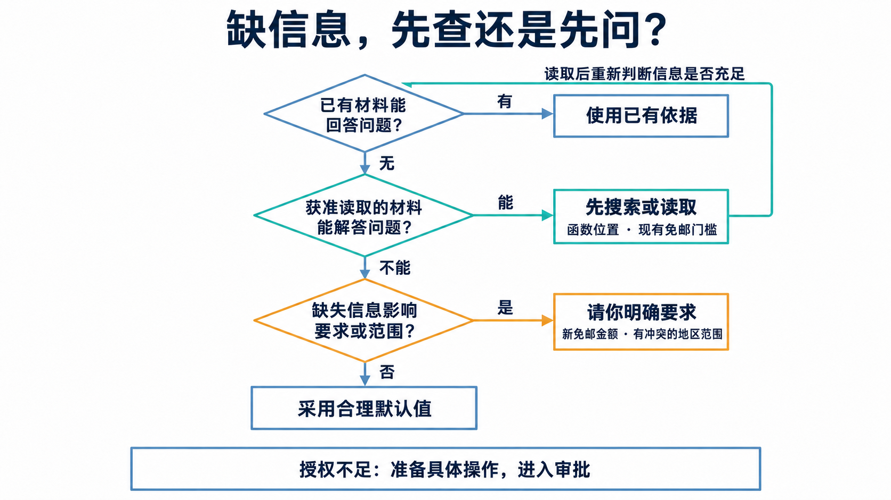

看完这张图，你要能：判断信息缺口能否读取解决，以及何时需要用户决定。

可以把这张表压成一段**教学伪代码**。它帮你分析缺口，不是说 MyBuddy 靠几条固定判断就能理解所有需求：

```latex
缺口 = 找出会影响下一步的信息
如果 已有材料足以回答(缺口):
    使用已有依据
否则如果 通过允许的读取可以查清(缺口):
    先补读，再判断是否还缺信息
否则如果 缺口会改变业务要求或操作范围:
    提出具体问题
    等待回答；相关修改暂不开始
否则:
    采用合理默认值，必要时说明
```

“函数在哪”通常可以查。“新门槛多少”往往要你决定。这段判断只管需求清不清楚。需求清楚后，具体动作要不要审批，由下一课讲的工具治理（权限和审批规则）决定。

### 怎样把一次追问问清楚

**先说查到了什么，再问缺什么；问题随已有答案缩小。**

前面已经找出要你决定的两件事：金额和地区范围。现在把它组织成一句有依据的追问：

现有规则是普通地区满 100 元免邮，偏远地区固定 20 元。这次准备改成什么？偏远地区受不受影响？

先交代事实，你才知道自己要补哪个决定。如果你已经说过不改偏远地区，就只问普通地区的新门槛。不要每次都把所有问题重问一遍。

模型要问你时，会调用 `AskUserQuestion` 这个工具：一次问 1 到 3 个问题，选择明确时带上选项。调用成功后这一轮立即结束，界面把问题显示成简短表单。CLI 会直接逐题问你（输入 `q` 退出后可以自由打字），Web 可以点选项，也可以直接打字回复。表单提交后，答案连同原问题变成一条普通用户消息。没回答和跳过会分别标明。

收到回答后，要核对它的意思。比如收到“改成 80”：如果问题问的是金额，就记为新门槛 80 元。如果你回的是“所有地区都一样”，那就多了一个范围变化。偏远地区规则和验收条件都要重新看。

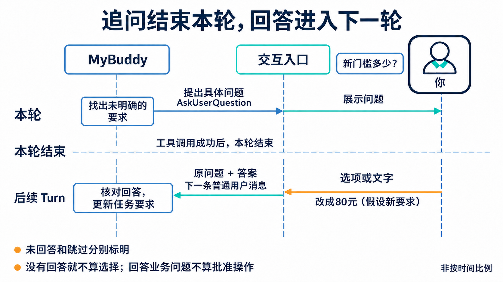

看完这张图，你要能：说出一次追问的四步：发现缺口、提出问题、等待回答、检查回答。

### 把四种交互放回同一个任务

**澄清、方案确认、操作审批、补充要求，是四种不同的回应。**

下面是一段教学示意：

你：调整一下普通地区的免邮规则。

MyBuddy：当前规则是满 100 元免邮，但实现使用了严格大于。你希望只修复这个边界，还是更改免邮金额？

你：只修边界，其他地区不变。

MyBuddy：方案是读取并核对三项规则，仅修改普通地区的比较条件，再运行既有测试。

你：按这个方案进行。

前半段澄清目标，后半段是口头确认方案，不会切换权限模式。默认模式下，读取和白名单只读命令自动放行；其他普通编辑或命令尚未命中本次会话放行名单时，才需要询问。界面上选择“同意并自动批准”则会切到 bypass。标明“一定要问”的操作，任何模式下都要批准。

两种“等你回答”也不一样：模型的问题随本轮回复结束，你的回答开始下一个 Turn；工具审批时，当前 Turn 停在原地，等一个专门的审批回答。

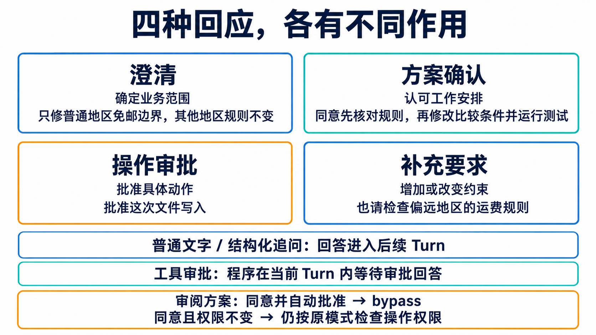

看完这张图，你要能：区分业务范围、工作方案、具体操作许可和新增要求的作用。

| 回应 | 作用 | 例子 |
| --- | --- | --- |
| 澄清 | 确定业务范围 | “只修边界，其他地区不变” |
| 方案确认 | 认可工作安排 | “按这个方案进行” |
| 操作审批 | 批准一次具体动作 | 批准这次文件写入 |
| 补充要求 | 增加或改变约束 | “也请检查偏远地区” |

容易误会的地方：

- 知道了新门槛，具体修改仍要按工具策略处理。批准了一个动作，也不能替你决定没说清的业务规则。
- 问题表单只是方便填写。Agent Loop 并没有停在原地等你填表，本轮已经结束了。

## 二、怎样把澄清结果变成可执行的方案？

**把已确认的目标、范围和检查方法写成方案；你确认后，具体操作仍逐次按权限处理。**

新门槛和地区范围都明确后，就可以写进方案：准备改哪里，哪些保持原样，改完怎样检查。

### `/plan` 怎样把“先看方案”变成约束

`/plan` **不只是一句提示：程序会在工具执行前真的拦下修改。**

在独立练习会话中输入：

```latex
/plan 请排查普通地区满 100 元仍收运费的问题，先给出修改与验证方案。
```

规划入口先收紧能力，再把需求交给普通的 Agent Loop。模型把方案写进一个方案文件：工作区下的 `.plans/<会话编号>.md`。方案应写明目标、修改范围、行动、重要问题和验证方法，详略随任务调整。写成文件，长方案不受一条回复的长度限制，可以分几次修改，你也能在编辑器里直接打开看。

只在 Prompt 里写“先不要修改”是不够的。模型仍可能提出写入调用。规划模式下，每个工具调用执行前，都要先过一道只读检查。白名单内的 `ls`、`git status` 可以直接运行；模型提出改业务文件或跑测试，会被拦下（你自己在配置里写的 Hook 命令不受这条限制，写方案文件成功后照样触发，见第 18 课）；唯一能写的是方案文件，写它不需要你批准：这只是把方案落到约定的那一个文件里，不碰业务文件。你在本轮明确要求记住的事项，可以按 Memory 规则保存，这不算执行方案。

方案写好后，模型调用 `ExitPlanMode` 这个工具把它提交给你。程序会自己核对方案文件确实存在，才算提交成功；模型只在回复里说“方案写好了”不算数。提交成功后这一轮立即结束，不再请求模型。CLI 显示方案内容，给你三个选择：同意并让后续操作自动批准，同意但权限模式不变，或提意见继续规划。Web 页面在输入框上方显示方案，给出两个同意按钮；对方案有意见，就直接在输入框里写出来发送，模型会修改方案后重新提交。这时的方案叫“候选”：已经提交，你还没接受。按 Shift+Tab 会离开规划，方案文件保留，但不算批准。取消或无效选择，也不算确认。

“自动批准”会把权限模式切到 `bypass`（第 6 课）。另一个同意保持原权限模式：`default` 会放行读取、白名单只读命令和本次会话已允许的匹配操作，其余普通编辑与命令才询问；`accept_edits` 还自动接受文本编辑。方案太长、一条输入放不下时，执行请求不附全文，改为要求模型先读方案文件。两种同意都不表示验收条件已经通过。

确认执行时，放得下的方案全文会随“开始执行”请求发给模型；太长时，请求会要求模型先读方案文件。后续对话被压缩后，方案原文不保证一直可见，需要时还要核对并补读。MyBuddy 用 `ExitPlanMode` 提交方案，是否执行仍由你决定。

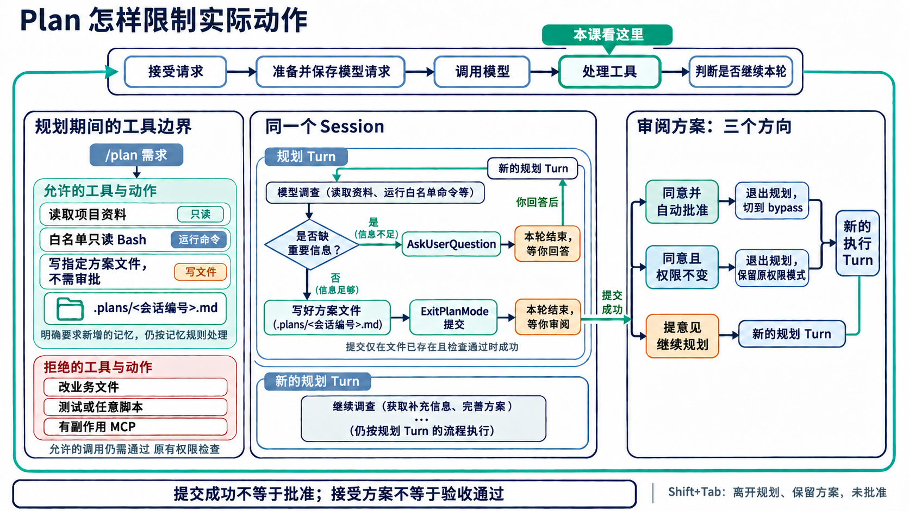

看完这张图，你要能：说明只读规划允许准备哪些材料，又阻止哪些副作用。

### 需求较大时，先完成一轮有范围的访谈

**需求越模糊，越值得先讨论一轮；已经很明确的小改动，直接说要求就行。**

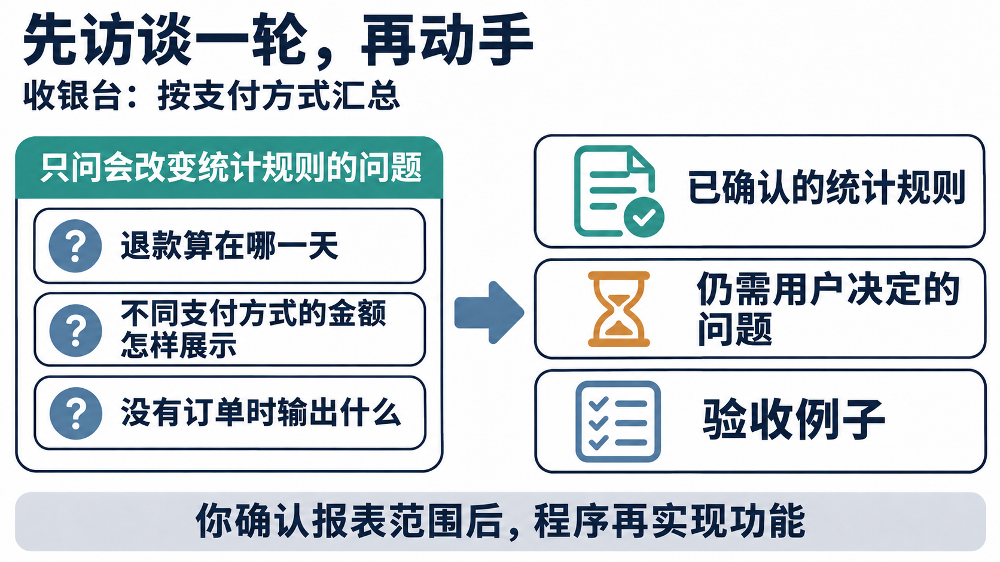

看完这张图，你要能：用收银台“按支付方式汇总”的例子做一次访谈：只问会改变统计口径的问题，整理出已确认的口径、待决定的事项和验收例子，确认范围后再动手。

做一个新报表时，开头通常没有修一行代码那么清楚。这时可以先讨论一轮，把需求整理成单独看也能懂的说明。例如收银台要新增“按支付方式汇总”，可以这样提：

先核对现有订单、支付和退款规则。只追问会改变报表口径（哪笔钱算进哪一栏、按哪天算）的问题，例如退款算在哪一天、跨支付方式怎样展示、没有订单时输出什么。已能从文件确认的内容请直接列出依据。最后整理已确认口径、仍待决定项和验收例子，待我确认范围后再实现。

回答写成可检查的约定后，追问就有了终点：影响实现的歧义都解决了，或者剩下的未知被明确列出，相关工作先不做。不要为了填满问题清单，反复问已经答过的事。

需求说明还要分清：哪些是你的决定，哪些是模型的建议。换到新会话时，重新核对当前代码即可，不用带上全部访谈过程。这轮访谈确认的是业务意图。具体修改、命令或外部调用的授权，仍按执行策略处理。

### 把开篇的目标问题变成可核对约定

**一份有用的约定写四项：任务目标、操作范围、待回答的问题、验收条件。**

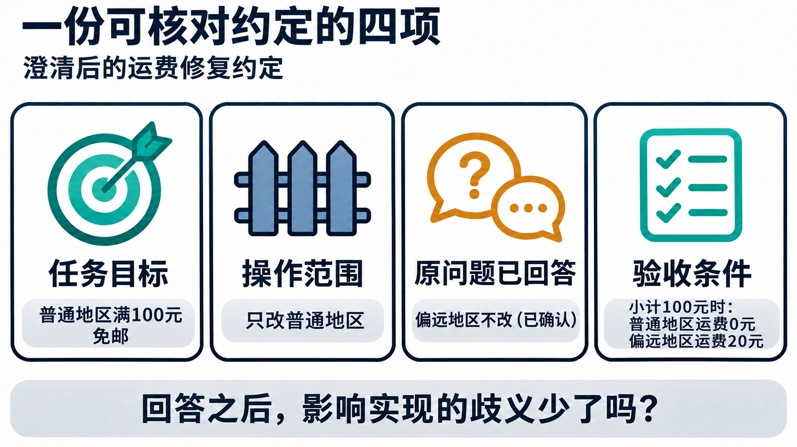

看完这张图，你要能：用边界修复的例子，把约定拆成任务目标、操作范围、待回答的问题、验收条件四项，再用“歧义变少了吗”检查澄清有没有用。

第 1 课“从七个问题看 Harness 的工作”小节问过“究竟要做什么”。现在可以把它落到这四项上。对于边界修复，约定应写明：普通地区达到门槛就免邮，偏远地区规则保持不变。

用这四项检查澄清有没有用：你回答后，影响实现的歧义真的少了吗？目标变了，验收条件也跟着变了吗？这份约定是帮你使用各种 Harness 的方法，不是 MyBuddy 的固定格式。

### 可读计划怎样与运行状态对应

**计划文档帮你记住方向；做没做完，要看运行记录。**

比如你把门槛从 100 元改成 120 元，旧方案和旧的代码差异（diff）都要重新检查。文档里勾了“已完成”，也要能在运行记录里找到对应结果。

实际运行时，你对问题的回答是新的用户输入。你对方案的选择由规划交互处理。计划内容可以进入模型输入，但具体动作仍要过权限检查。课末“让计划能够被下一次任务接续”小节，讲的是使用者怎样整理这份计划。

容易误会的地方：

- 方案写得全，不说明方案正确，更不说明修改和检查已经做了。
- 确认方案，不等于批准后面每一次写入或命令。
- 切换模式要保存并核对状态，不能只改界面上的文字。

## 三、命令、补充要求和审批回答怎样回到正确流程？

**同一个输入框里的文字，要先看它出现在哪、用来做什么，再交给对应流程。**

你可能在输入框里打一个新任务，也可能打 `/status`，还可能是在回答一次审批。如果分不清，一个“可以”就可能用错地方。

先看最简单的输入分流，只有一个判断：

```latex
文字 = 读取输入
如果 文字以 "/" 开头:
    当作命令在本地处理
否则:
    交给模型
```

真实使用时，这个版本会出好几种问题。我们一次加一个约束：

1. **方案的补充要求也可能以** `/` **开头 → 按入口判断用途。** 你在“补充要求”里写了一段引用的命令，它仍是方案反馈。MyBuddy 直接把它当正文交给模型，不再解析成命令。
2. **审批回答不能当普通文字 → 审批单独读取。** 审批提示出现时，普通输入先暂停。你的 `yes` 只回答这一次操作，不会进入对话。
3. **问题表单的回答要带上原问题 → 整理成一条普通消息。** 发送前你先看一遍整理结果，确认后才发。这次确认只是“发送消息”，不是工具审批。
4. **任务运行中你又补了一句 → 先排队，到安全的时机再接收。** 下面“运行中补充一句话”小节细讲。
5. **命令打错或参数不对 → 直接报错。** 不会悄悄把整句话当成任务发给模型。

把输入框想成分拣台的投递口：分拣时先看单据从哪个入口进来，再看上面写了什么。

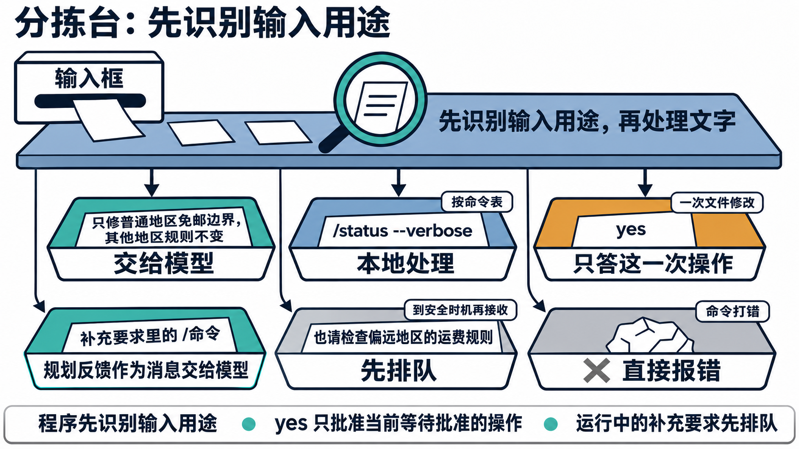

看完这张图，你要能：用“分拣台”说出每种输入去哪：普通文字交给模型，斜杠命令在本地按命令表处理，审批回答只管这一次操作，规划反馈当正文交给模型，运行中的补充先排队，打错的命令直接报错。

### 斜杠命令由谁处理

**斜杠命令不直接发给模型，先由命令表识别，再由应用入口分别执行；有的只在本地完成，有的还会带出一个模型任务。**

`/status` 查询状态。`/rename` 给当前会话改名，并保存这条名称记录。`/plan 需求` 既切换模式，又带来一个模型任务。`/goal <条件>` 设置活动目标并开始一轮；`/goal` 查看目标；`/goal clear` 清除。

MyBuddy 用一张命令表集中描述：名称、参数、可用状态、帮助和补全。解析后，由应用入口分发；需要模型处理的内容，才进入运行流程。所以 `/trace` 会在本地查询，打错的命令也不会变成一次收费的模型请求。

#### 三种命令，三条处理路径

**不能只按“调不调用模型”分两类：历史压缩、规划和本地查询各有自己的流程。**

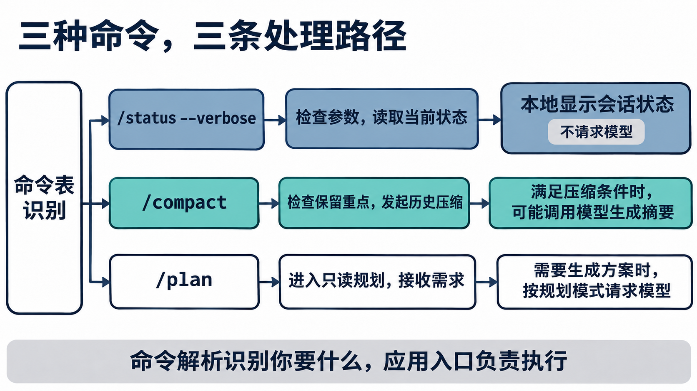

看完这张图，你要能：说出 /status --verbose、/compact、/plan 被识别后各走哪条路：本地诊断、整理上下文、受规划限制的模型调用。

| 输入 | 入口处理 | 后续去向 |
| --- | --- | --- |
| `/status --verbose` | 检查参数，读取当前状态 | 本地呈现诊断，不请求模型回答 |
| `/compact 保留地区例外与未完成测试` | 检查保留重点，发起一次整理操作 | 整理条件满足时可能请求摘要模型；不是让业务 Agent 随意执行“压缩” |
| `/plan 调查满100元仍收费的原因` | 确认只读规划状态，接收需求 | 需要生成方案时进入受规划限制的模型路径 |

压缩有自己的准备和结果检查。规划有模式和方案状态。本地查询只读已有事实。命令解析负责识别你要什么，应用入口负责执行。

表里的 `/plan` 和 `/compact` 也有不调用模型的时候：

- `/plan` 后面不带需求：只切到规划模式，并显示已有的方案；还没有方案，就提示你输入需求。
- `/compact` 时对话还很短：提示“当前对话较短，没有可整理的旧历史”，然后结束。

### 运行中补充一句话，何时才算被接收

**补充的话先在内存里排队；到了安全的时机，才保存成用户消息。**

运行中你输入“也请检查偏远地区”。这句话先进入会话的内存队列，条数和长度都有上限。这时它还只是草稿。会话走到可以安全接收输入的位置，才把它保存为用户消息，供之后的模型请求使用。

插队输入不一样：它先请求停止当前工作。停稳之后，再优先处理它。

几点规则：

- 草稿、已接收的消息、审批回答，是三种东西，要分开。
- 斜杠命令仍走命令解析，不会因为进了队列就变成普通任务。
- 输入超限或暂时收不了时，草稿会保留，并告诉你原因。
- 插队消息也不能强行关掉一次结果未知的旧执行。
- 快捷键能否正确传入，还受终端和输入法影响。

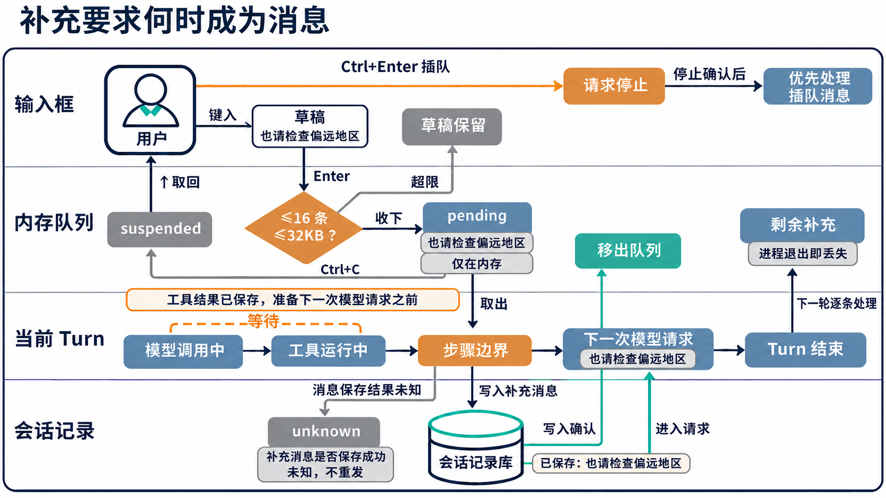

看完这张图，你要能：区分键入、排队、接受与进入后续请求的事实。

### 追问之后，旧结论还有效吗

**目标变了，旧方案、旧 diff 和旧测试结果都要重新检查；历史记录保留。**

假设你把目标从“修复 100 元边界”改成“门槛改为 120 元”。原方案、旧 diff、针对 100 元的测试通过记录，都不能直接支持新目标。系统保留历史事实，再按新条件重新准备和验证。

审批也是这样。迟到的审批回答必须对应原来那次请求。不能因为它也是一个“yes”，就拿去批准另一项操作。取消、拒绝和无法回答，都要有明确状态，不能一律当作“没消息”。

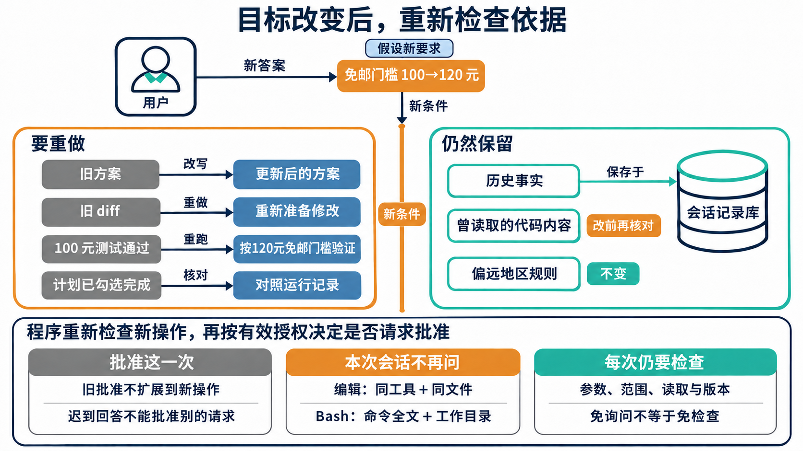

看完这张图，你要能：判断新金额或地区范围如何影响原计划、证据与后续操作。

容易误会的地方：

- 文字进了队列，不说明它已经存进会话记录，更不说明其中的要求已经执行。
- 选择“仅本次允许”只批准当前操作；选择“本次会话都允许”后，同一写工具操作同一路径时不再重复询问，Bash 则要匹配完整命令和工作目录。每次调用仍要重新检查参数、路径和文件是否变化。

## 四、用运费与报表任务核对交互是否有效

**检查三件事：已知的是否先读了，该问的是否问清了，拒绝后文件是否保持原样。**

### 本课实践与实现对应

**每种回答都有自己的入口：留意它进了哪个入口，就知道它影响的是需求、方案还是执行权限。**

这组练习用到三个入口：普通对话或回答模型的提问来补充业务信息，`/plan` 讨论方案，工具审批确认具体动作。需要跨轮保留目标时，再用 `/goal <条件>`。

### 练习与判断依据

**用对照实验观察：同一类请求，缺信息和不缺信息时，Agent 的反应有什么不同。**

1. 开两个新会话，分别提交“解释现有规则”和“把门槛调高一点”。前者材料可查，后者缺新金额。看模型是否在合适的位置提问，有没有重复问已知事实。
2. 用 `/plan` 提交边界修复任务。选择继续规划，补充“不要改变偏远地区规则”。检查方案是否保留了这个条件。然后拒绝执行或离开规划，业务文件应保持原样，工作区里只多出 `.plans/` 下的方案文件。
3. 依次输入普通问题、已知斜杠命令、未知命令、参数错误的命令。看哪些进了模型，哪些由入口直接反馈。再分别记下规划模式和执行模式下，写入是否被拦下。

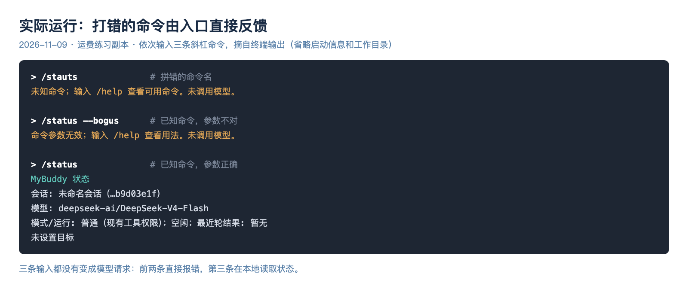

看完这张图，你要能：读懂练习第 3 步的真实结果：未知命令和参数错误的命令直接报错，没有调用模型；/status 在本地读取状态。

想看代码怎样分发输入、保存方案、限制规划动作，请读本课源码解析。

### 收银台练习：从一句需求到可执行计划

**先让 Agent 区分已有答案和待澄清的问题，再把范围定下来。**

在独立收银台副本中提出：“我想看看营业情况，先帮我规划。”观察 Agent 是否先读已有的营业汇总和规则，再区分已有答案和需要澄清的问题。

接着把范围定为《综合实践-麦当当收银台》中“5. 课后任务 A：按支付方式汇总营业情况”小节：本次进程（收银台程序这次启动以来）的收款、退款和净额，保留总计。

提交计划不等于批准写入。业务范围明确了，也不能代替执行审批。把接受后的需求、拟改模块和验收条件留下来，后面继续用这份任务说明。

**能力卡**：想在收银台副本里亲手试一遍，就照着能力卡《规划模式》（`demo-project/cards/plan.md`）做。

## 使用小妙招

### 复杂问题先规划，小改动直接说清范围

**改动涉及多份规则或不熟悉的代码时，先讨论方案；小而明确的改动直接给要求。**

Claude Code 可以按 Shift+Tab 切到 Plan Mode，先阅读和讨论，确认方案后再切回去执行；Cline 等产品也有类似的 Plan / Act 两种模式。对于“调整免邮规则”，先让它列出门槛、地区、优惠叠加等会改变结果的决定。对于“把已确认的普通地区边界修正”，通常不用再做一轮完整访谈。

还可以把方案确认用成“审核点”：某个决定会影响后面的实现，就先停下核对。假设你要增加会员优惠：

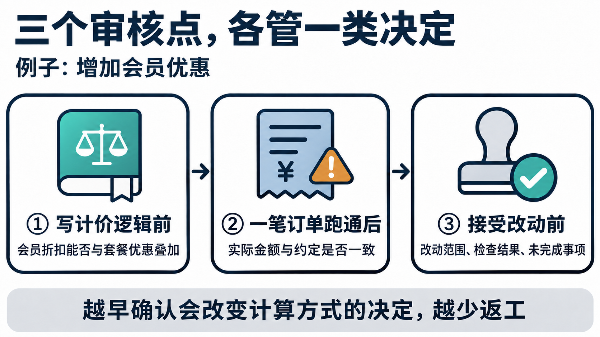

看完这张图，你要能：用会员优惠的例子说出三个审核点各在什么时候停下、看什么，并明白会改变计算方式的决定越早确认，返工越少。

| 到了哪一步 | 你先看什么 | 确认后继续做什么 |
| --- | --- | --- |
| 准备写计价逻辑 | 会员折扣能否与套餐优惠叠加 | 按确定的规则实现一笔代表订单 |
| 一笔订单已经跑通 | 实际金额、保存结果与约定是否一致 | 扩展其他已经约定的情况 |
| 准备接纳改动 | 改动范围、检查结果与未完成项 | 决定是否接纳本次成果 |

越早确认会改变计算方式的决定，后面越少返工；简单的边界修复可以合并这些节点。

**为什么这样做：** 规划模式会拦住业务文件修改和非白名单命令，但允许写指定方案文件，也允许按 Memory 规则保存你明确要求记住的事项。配置的 Hook 仍可能产生改动。先审阅方案，可以在业务实现前发现方向问题；小而明确的改动通常不用再做一轮完整访谈。

### 让追问集中在会改变方案的分歧上

**让它只问会影响修改范围或验收标准的问题，并说明不同答案的影响。**

可以这样说：

先从现有文件确认事实；只追问会影响修改范围或验收标准的问题。问题集中列出，每项说明选择不同答案会怎样影响实现。

还可以让它检查计划里有没有未经确认的前提：

列出这个方案依赖的条件。现有材料能查清的请给出依据；需要我决定的请说明不同选择的影响；仅仅可能发生的情况标为假设。

**为什么这样做：** 每个缺口都有合适的去处：能从文件里查到的，Agent 应该自己去查，只有真正要你决定的才来问你（见“一个可以执行的追问判断”）。问题少而准，你才会认真回答每一个。要求说明“不同答案会怎样影响实现”，你才知道每个问题为什么值得回答，也更容易发现它其实是在猜。

### 把含糊要求复述成两个有区别的例子

**用两个结果不同的例子复述需求，最容易暴露歧义。**

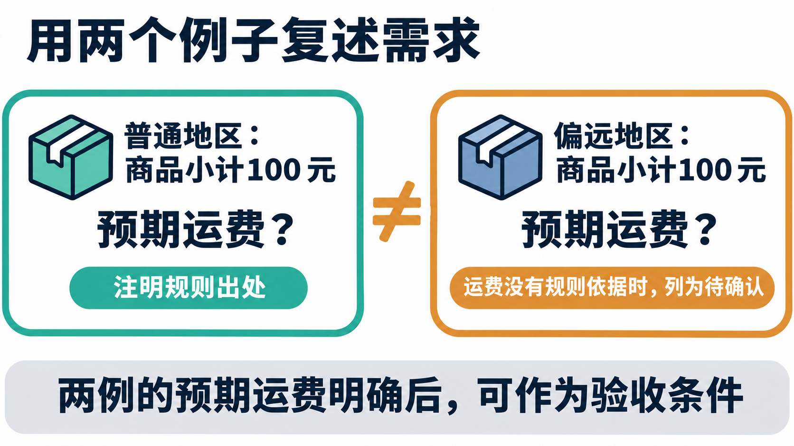

看完这张图，你要能：用“普通地区 100 元”和“偏远地区 100 元”两个例子把歧义找出来：注明规则出处，没有依据的列为待确认，确认后写成验收条件。

例如“满 100 免邮”可能漏掉地区例外。你可以这样输入：

先给出普通地区 100 元和偏远地区 100 元的预期运费，注明规则出处。没有依据的部分列为待确认，再指出哪个答案会改变实现。

然后核对它是否真的找到了规则。文件里写明的事实由工具读取；业务材料没定的条件，再来问你。两个例子的预期一旦明确，就能直接成为第 13 课的验收条件。

**为什么这样做：** “满 100 免邮”这句话，你和 Agent 可能理解得不一样，只看文字看不出来。让它算出两个具体例子，理解上的差别就会变成两个不同的数字，一眼就能发现（见“把开篇的目标问题变成可核对约定”）。

### 让计划能够被下一次任务接续

**跨多次讨论的任务，把关键决定写进一份短计划，别只留在聊天里。**

复杂任务讨论了好几次后，如果关键决定只留在聊天里，下次继续就容易漏掉原因。可以在独立练习副本中整理一份短计划：

| 要留下的内容 | 运费任务示例 |
| --- | --- |
| 已接受目标及来源 | 修复普通地区恰好门槛的行为，记录确认位置 |
| 范围与未决项 | 偏远地区规则保持；确实未确定的问题单列 |
| 执行步骤及条件 | 先核对规则，再准备 diff，再按有效授权修改 |
| 当前进度及依据 | 文件已修改，但检查未运行；附实际结果位置 |
| 决策变化 | 新要求替代了哪项旧条件，哪些检查需要更新 |

继续执行前，要对照第 11 课的执行事实（文件版本、已完成的动作、未确认的结果），再更新下一步。只写“分析、修改、测试”的计划，接手的人仍不知道做什么；要写清对照哪份规则、改哪里、用哪些输入核对。

**为什么这样做：** 新会话看不到上一次的聊天内容；同一会话聊得太长，旧内容也可能被压缩成摘要（第 9 课）。关键决定只留在聊天里，就可能在这些时候丢掉。写进文件，下次可以直接让 Agent 读这份计划接着做。

## 自测：这一课的概念分清了吗

**先自己作答，再看后面的答案。** 每题都能在本课正文里找到依据；带“动手验证”的题，可以照着做一遍，亲眼看到结果。

**1.** 你提出“把免邮门槛调高一点”。现有规则和函数位置都能从项目里查到，但没有材料写明新门槛。哪件事需要由你决定？

- A. 现有门槛是多少
- B. 新门槛改成多少
- C. 计算运费的函数在哪里

**2.** 你回答“新门槛改为 120 元，偏远地区不变”。从需求澄清与操作审批的区别看，这句话明确了什么？

- A. 业务目标和范围
- B. 一次具体文件写入的许可
- C. 修改后的验收已经通过

**3.** 判断：计划文档里勾了“已完成”，就足以证明修改和检查都已经做了。（对 / 错）

**4.** 你在终端的新会话里只输入 `/plan`，后面不带需求。会发生什么？

- A. 模型立即调查项目并生成方案
- B. 进入只读规划，提示你输入需求，不请求模型生成方案
- C. 因为缺少需求而报错，仍在普通模式

### 答案与依据

**1. 选 B。** 新门槛是材料里没有的业务决定。现有门槛和函数位置能查到，应先读取或搜索，不必让你重复提供。  
依据：本课“一个可以执行的追问判断”。

**2. 选 A。** 你确定了新金额和地区范围。业务要求明确了，不等于批准一次具体写入，也不能证明验收通过。  
依据：本课“把四种交互放回同一个任务”。

**3. 错。** 文档里的勾选不能替代运行结果。要判断做没做完，还要在运行记录里找到对应的修改和检查结果。  
依据：本课“可读计划怎样与运行状态对应”。

**4. 选 B。** 不带需求的命令只进入规划模式；新会话还没有方案，会提示你输入需求。进入模式不等于已经让模型开始规划。  
依据：本课“三种命令，三条处理路径”。  
动手验证：在仓库根目录，按能力卡《规划模式》（`demo-project/cards/plan.md`）的“准备”部分运行 `uv run python demo-project/prepare_shop_demo.py`。运行脚本输出的体验目录中的 `start-mybuddy.command`，进入新会话。不要发送卡中的规划需求，先只输入 `/plan`，应看到“当前为只读规划模式”和“还没有提交过方案。请输入需求，或使用 /plan &lt;需求>。”的提示。再输入 `/status`，“模式/运行”一行应显示“只读规划（禁止业务写入与测试）”。这两条命令都不请求模型。

## Q&A：常见追问

### Q1：为什么 Agent 不应该一遇到不确定就向用户提问？

因为有些答案就在项目里。测试入口写在说明文件中，Agent 可以先读。你刚确认的金额，也能从当前对话拿到。只有材料答不了、又会影响目标、范围或验收的选择，才值得请你决定。这样，你的注意力能留给真正需要判断的事。

### Q2：我确认了方案，为什么执行时还可能要审批？

要看确认方案时有没有同时改变权限模式。MyBuddy 先让模型把方案写进工作区的 `.plans/<会话>.md`，再调用 ExitPlanMode 提交；调用成功后本轮结束。审阅时有三个选项：同意并自动批准后续操作，会切到 `bypass`；同意且权限模式不变，执行仍按原模式检查；提意见继续规划，则还不开始实施。因此，只同意方案不等于批准每次文件写入，是否还要审批取决于所选模式和具体操作。

### Q3：Agent 向用户提问后，能否继续执行其他工作？

在 MyBuddy 当前实现里，提问成功后不能继续本轮工作。模型用 AskUserQuestion 提问，调用成功后本轮立即结束，等待用户回答；如果还有独立且已获准的调查，可以在提问前完成。终端会直接逐题让用户回答，Web 显示答题控件，答案作为下一条普通消息发回。此时 Goal 不评估、不自动续轮，用户的回答也不等于批准某个工具操作。

## 本课术语速查

| 本课说法 | 源码或命令中的名字 | 含义 |
| --- | --- | --- |
| 追问 / 澄清 | `AskUserQuestion` | 模型调用 `AskUserQuestion` 向你提问，你逐题回答或直接打字，答案作为新的输入 |
| 提问工具 | `AskUserQuestion` | 带问题和选项的工具调用；调用后这一轮结束，循环不在原地等待 |
| 方案确认 | `/plan` | 先讨论“打算怎样做”，确认后再执行 |
| 规划模式 | Plan | 调查和讨论方案，不修改项目或运行测试，只能写方案文件；明确要求保存的记忆按 Memory 规则处理 |
| 操作审批 | — | 对一次具体操作（如修改某个文件）的批准（第 6 课） |
| 运行中补充 | — | 任务进行中追加的要求，在安全的时机才生效 |
| 状态查看 | `/status`、`/status --verbose` | 查看当前会话、模式和最近的运行情况 |

## 继续阅读源码解析

理解本课概念后，可继续阅读源码解析里的模块、数据与调用流程。
