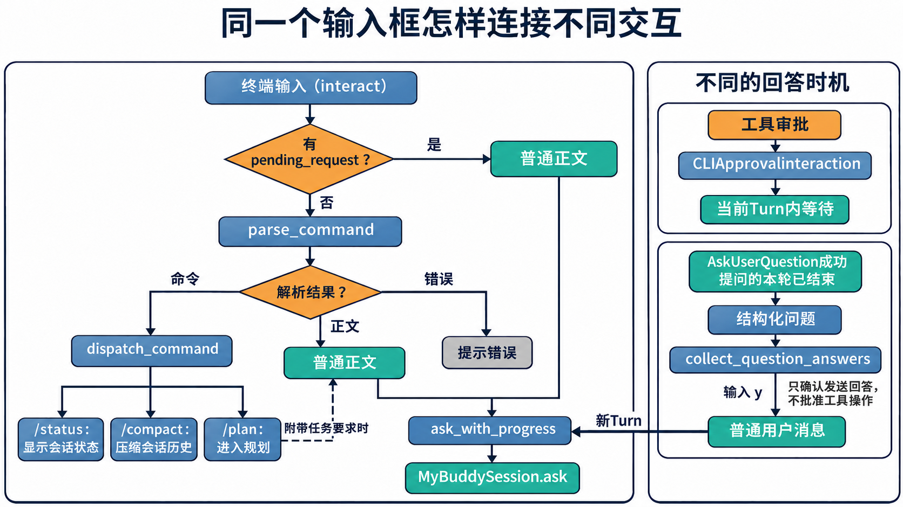
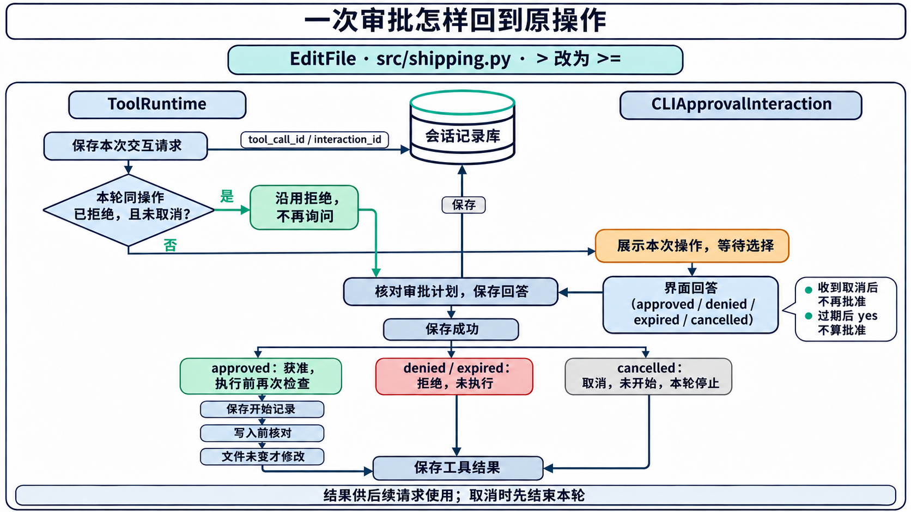

与第 5 课课程正文配套阅读。

你在终端输入“免邮门槛改成 120 元”，这是补充业务要求。输入 `/plan`，是在操作会话。在审批提示里输入 `yes`，则是在回答一次具体操作。正文里的最简分流只有一个判断：以 `/` 开头就当命令，否则交给模型。这一篇看 MyBuddy 真实的分流，以及每种回答最后落到哪里。

**怎么读：** 每一节先贴一段代码，再用几句话解释。代码从当前源码原样复制，上方标了文件和行号。`# ...` 表示省略了与本节无关的行。

先看几条路径。缩进表示“谁调用谁”：

```latex
CLIApplication.interact              cli.py               读输入，决定交给谁
├─ parse_command → CommandRegistry.parse  command_registry.py  识别命令
├─ dispatch_command                  cli.py               本地命令在这里处理
├─ ask_with_progress → MyBuddySession.ask   第 4 课的 Turn 入口
│  └─ ToolRuntime._resolve_approval  tool_runtime.py      需要审批时保存请求、等回答
│     └─ CLIApprovalInteraction.request  cli_approval.py  在终端读审批选项
├─ show_turn_answer / collect_question_answers  cli.py    问题表单
└─ PlanningCommands.after_turn       cli_planning.py      规划轮结束后的选择
```

## 从输入框开始



看完这张图，你要能：说出不同的输入（命令、任务、对问题的回答）各走哪条处理路径。

### 片段 1：`interact` 先看有没有规划反馈

`src/mybuddy/cli.py:821-833`

```python
        pending_request: str | None = None
        while True:
            try:
                if pending_request is not None:
                    # 规划反馈始终按用户正文处理，即使内容以斜杠开头也不当作命令。
                    command = ParsedCommand(None, pending_request)
                    pending_request = None
                    text = command.argument
                # /goal 的参数保留原始空白；其他输入先去掉两端空白再解析。
                else:
                    raw_text = await self.read_input()
                    text = raw_text if raw_text.startswith("/goal") else raw_text.strip()
                    command = parse_command(text, state=self.command_state())
```

`interact` 是 CLI 的主循环。每一圈先看 `pending_request`，它保存下一轮要发送的普通消息。这条消息可能来自继续规划时的补充要求，也可能来自你刚刚确认发送的问题表单答案。

有补充要求时，代码直接构造 `ParsedCommand(None, ...)`。`None` 表示“不是命令，是正文”。所以即使这段话以 `/` 开头，也不会被解析成命令。这就是正文约束 1。

没有补充要求时，才从终端读一行，交给 `parse_command`。

### 片段 2：命令表怎样识别一行输入

`src/mybuddy/platform/application/command_registry.py:71-86,122-126`

```python
    def parse(self, text: str, state: CommandState) -> ParsedCommand:
        """解析用户输入；命令不存在、参数不对或当前不能使用时抛出对应错误。"""
        stripped = text.strip()
        # 普通输入保留原来的空格。没有会话时不能发送非空输入；
        # 诊断模式下也只有明确允许输入时才能发送。
        if not stripped.startswith("/"):
            if stripped and (state.diagnostic_only and not state.explicit_input_allowed or not state.has_session):
                raise CommandParseError("command_unavailable", "")
            return ParsedCommand(None, text)
        parts = stripped.split(maxsplit=1)
        word = parts[0]
        descriptor = self.by_word.get(word)
        if descriptor is None:
            raise CommandParseError("unknown_command", word)
        if not descriptor.implemented:
            raise CommandParseError("unsupported_command", word)
        # ...
        if descriptor.name == "/compact":
            try:
                return ParsedCommand(descriptor.name, normalize_retention_focus(argument) or "")
            except ValueError as error:
                raise CommandParseError("invalid_arguments", word) from error
```

`parse` 先去掉两端空白。不以 `/` 开头的，原样作为正文返回。没有会话时，非空正文会被拒绝。

以 `/` 开头的，用 `split(maxsplit=1)` 分出命令名和参数，再查表。查不到报 `unknown_command`，不会把整句话悄悄当成任务。这就是正文约束 5。

后半段是 `/compact` 的参数处理：交给 `normalize_retention_focus` 规范保留重点。不合法时报 `invalid_arguments`。

命令表在 `__init__` 里建立。命令名和别名都是查找键。如果有重复，构造时直接抛 `command_name_duplicate`，不会让后注册的悄悄覆盖前一个。

### 片段 3：分发之后，正文才进会话

`src/mybuddy/cli.py:854-868`

```python
            dispatched = await self.dispatch_command(owner, command, text, planning_commands, goal_commands)
            if dispatched is None:
                continue
            if isinstance(dispatched, (int, SessionTransition)):
                return dispatched
            command = dispatched
            if command.name not in (None, "/init", "/goal"):
                raise RuntimeError("cli_command_handler_missing")
            # 新请求会取代上一轮未填写的问题，避免用户之后误答已经过时的问题。
            self.pending_questions = []
            text = (planning_commands.current_request(command.argument)
                    if command.name is None else command.argument)
            try:
                outcome = await self.ask_with_progress(text,
                                                 initialize_project=command.name == "/init")
```

`dispatch_command` 处理本地命令，比如 `/status`、`/trace`、`/compact`。它返回 `None` 表示已经处理完，回到循环开头。

只有正文、`/init` 和 `/goal` 会走到下面。其他命令如果漏到这里，直接报 `cli_command_handler_missing`，防止某个命令没写处理分支，却被当成普通请求发给模型。

新请求开始前，`pending_questions` 被清空。上一轮没填的问题从此作废，你不会误答一个过时的问题。最后 `ask_with_progress` 把文字交给 `MyBuddySession.ask`，进入第 4 课的 Turn。

## 普通回答和问题表单

模型用普通文字问“偏远地区也改吗”，你的回答就是下一次输入，走片段 3 的路径。代码不会因为这句话像一个决定，就把它当成工具批准。下面看问题表单。

### 先看工具说明：缺口是模型自己找的

正文用一段伪代码分析“先查还是先问”。源码里没有这段判断：MyBuddy 没有哪个函数去检查需求缺了什么。找缺口、决定问不问，都由模型完成。程序做三件事：给模型一个提问用的工具 `AskUserQuestion`，并在工具说明里写清怎么问；检查问题的格式；提问成功后结束这一轮，把问题交给界面（片段 4）。

系统指令里只有一句话把模型引到这个工具上：“需要用户澄清、且读项目找不到答案时，调用 AskUserQuestion 提问；选择明确时给出选项。”具体规则写在工具说明里：

`src/mybuddy/platform/tools/ask_user.py:23-38`

```python
def ask_user_schema() -> dict[str, Any]:
    """一次问 1 到 3 个问题；每题可以带最多 5 个选项，不带选项就是让用户自由回答。"""
    return {'type': 'function', 'function': {'name': ASK_TOOL,
        'description': ('Ask the user 1 to 3 questions when you need information that only the user can give and '
                        'that cannot be found by reading the project. Give options when the choices are clear; the '
                        'user may always type a free-form answer instead. Calling it ends your turn: call it alone, '
                        'as the last tool call. The answers arrive as the next user message. Answers are task '
                        'information only, never approval for a tool action. Never ask for passwords, keys or tokens.'),
        'parameters': {'type': 'object', 'additionalProperties': False, 'required': ['questions'], 'properties': {
            'questions': {'type': 'array', 'minItems': 1, 'maxItems': 3, 'items': {
                'type': 'object', 'additionalProperties': False, 'required': ['id', 'question'], 'properties': {
                    'id': {'type': 'string', 'pattern': '^[A-Za-z0-9_-]{1,40}$',
                           'description': 'Short unique identifier, for example "scope".'},
                    'question': {'type': 'string', 'maxLength': 1000},
                    'options': {'type': 'array', 'maxItems': 5, 'items': {'type': 'string', 'maxLength': 200},
                                'description': 'Choices to pick from. Omit for a free-form answer.'}}}}}}}}
```

逐句看这段说明为什么这样写：

- **“information that only the user can give and that cannot be found by reading the project”**。先查再问：能从项目里读到的，不该拿来问你。
- **“Give options when the choices are clear; the user may always type a free-form answer instead”**。选项是为了让你少打字，不是限制你。不带 `options` 就是自由回答。
- **“1 to 3 questions”、**`maxItems`**、**`maxLength`。这些数字和 `validate_questions` 检查的一样。上限是 3 个，模型就得先挑最影响下一步的问。
- **“Calling it ends your turn: call it alone, as the last tool call”**。提问之后要等你回答，这一轮没有别的事可做。提前告诉模型，它就不会在同一批里又问又改。
- **“The answers arrive as the next user message”**。工具本身不等你：它立刻返回“问题已交给用户”，你的回答是下一轮的普通输入（片段 3）。循环不用为“等回答”增加新的状态，也不存在等到一半进程退出该怎么恢复的问题。
- **“Answers are task information only, never approval for a tool action”**。这和代码的做法对应：答案被整理成一条普通用户消息（片段 5），审批走另一条路（片段 10 到 12）。
- **“Never ask for passwords, keys or tokens”**。你的回答会保存进会话记录，还会在后续请求里发给模型服务。密钥不该走这条路。

把提问做成工具而不是回复里的一段特殊文字，好处和 `ExitPlanMode` 一样：工具调用有登记、有结果，程序能确定地知道“这一轮问了没有、问的是什么”；参数还有 JSON Schema 约束，模型不容易写错格式。Claude Code 的 `AskUserQuestion` 也是一个工具。

这段说明规定了提问条件：需要用户提供信息，而且无法从项目中找到答案时才问。模型结合任务判断这些条件是否满足，代码只检查问题格式，不执行正文中的需求分析伪代码。

### 片段 4：提问成功后结束这一轮，把问题交给界面

`src/mybuddy/platform/application/turn.py:349-358`

```python
    async def _end_turn_after_user_tool(self, boundary: CompletionBoundaryContext) -> str | None:
        """每批工具结果保存后调用：模型提交了方案或向用户提了问，就直接结束这一轮，不再请求模型。
        返回的文字是这一轮的最终回复；返回 None 表示继续下一步。"""
        history = await self._host.inspect_history()
        # 方案内容由界面从方案文件读出来给用户看，这里只给一句提示。
        if self._host.planning and plan_submitted(history.events, boundary.turn_id):
            return "方案已提交，等待审阅。"
        # 提问后要等用户回答，所以把问题排成文字作为最终回复，然后结束。
        questions = asked_questions(history.events, boundary.turn_id)
        return questions_text(questions) if questions else None
```

每批工具结果保存后，循环会调用这个函数。`asked_questions` 只看已经保存的事件：这一轮里登记过 `AskUserQuestion`，并且结果是成功。问题格式不对时，策略会拒绝这次调用（原因码 `runtime.questions_invalid`），模型看到后可以改正再问；被拒绝的调用不算提过问。

函数返回文字，循环就直接结束这一轮，不再请求模型；返回的文字是这一轮的最终回复，这里是排好的问题列表。提交方案的 `ExitPlanMode` 用的是同一个出口（片段 7 后面那段）。

这一轮结束时，问题也放进结果的 `questions` 字段，终端先把它记下来：

`src/mybuddy/cli.py:352-358`

```python
    def show_turn_answer(self, outcome: Mapping[str, Any]) -> None:
        print_turn_answer(outcome, text_displayed=(self.stream_observer is not None
            and self.stream_observer.final_was_displayed(outcome)),
            stream=self.editor.output_stream if self.editor is not None else None)
        # 模型用 AskUserQuestion 提的问题随本轮结果带回来；最终回复里已经是排好的问题文字。
        self.pending_questions = (list(outcome.get("questions", []))
            if outcome.get("outcome") == "completed" and outcome.get("can_continue") is not False else [])
```

只有本轮正常完成，且还能继续时才保留问题。有问题时，终端随后直接进入逐题回答，不需要另外输入命令；这和方案提交后直接让你选择是同一种做法。Web 页面在这次调用下面显示答题控件。

### 片段 5：把答案整理成一条普通消息

`src/mybuddy/platform/application/questions.py:12-31`

```python
def format_answers(questions: list[dict[str, Any]], answers: Mapping[str, str | None]) -> str:
    """把问题和回答整理成普通用户消息，并检查消息大小。"""
    validated = validate_questions(questions)
    # 回答中不能出现问题列表里没有的编号，避免把不属于本次表单的内容加进去。
    if set(answers) - {question["id"] for question in validated}:
        raise ValueError("questions_invalid")
    # 回答只是给模型提供任务信息，不能当作用户对工具操作的批准。
    lines = ["以下是我对上一轮问题的回答（仅提供任务信息，不代表工具授权）："]
    for question in validated:
        identifier = question["id"]
        value = answers.get(identifier)
        # 没有提交回答和主动选择跳过是两种状态，需要分别写进消息。
        if identifier not in answers:
            answer = "未回答"
        elif value is None:
            answer = "跳过"
        elif isinstance(value, str) and value.strip():
            answer = "回答：" + value
        else:
            raise ValueError("questions_answer_invalid")
```

这一轮结束后，`interact` 调用 `collect_question_answers` 逐题读取。可以填选项编号、自由文字，空行跳过。输入 `q` 退出逐题回答，之后仍然可以直接打字回复。

全部填完后，`format_answers` 把问题和回答拼成一条普通用户消息。第一行就写明“仅提供任务信息，不代表工具授权”。“未回答”和“跳过”分开记录：前者是表单里没有这一项，后者是你主动留空。

整理好的文字先显示给你。输入 `y` 才发送。这个 `y` 只是确认发送消息，不是工具审批。发送后，它和普通正文一样走片段 3。

## 方案确认怎样产生后续请求

### 片段 6：进入规划模式

`src/mybuddy/platform/cli/cli_planning.py:62-68`

```python
    async def enter(self, request: str) -> str | None:
        await self.owner.set_planning(True)
        self._emit(f"当前为只读规划模式，方案会写进 {self.owner.plan_file}；Shift+Tab 可离开，但不会批准或执行方案。")
        if request:
            return request
        self._emit(self.owner.plan_text or "还没有提交过方案。请输入需求，或使用 /plan <需求>。")
        return None
```

`/plan` 由 `PlanningCommands.enter` 处理。它先请求会话进入规划模式，再告诉你两件事：方案会写进哪个文件，Shift+Tab 可以离开。

带需求时，返回需求，由 `interact` 当作正文送进会话。不带需求时，展示上一次提交的方案，或者提示你输入需求。

方案文件的路径由 `tools/plan_file.py` 的 `plan_file_path` 算出：工作区下的 `.plans/<会话编号>.md`。每个会话一份，重启后路径不变。

### 先看提示词：规划模式让模型做什么

片段 6 把会话切到规划模式。之后每次组装请求时，`RequestComposition.snapshot` 都会追加 `planning_rules`，内容由 `planning_instructions` 生成。怎样调查、什么时候提问、方案写成什么样，由这段提示词引导模型。工具调用仍要经过规划限制；文件工具只能写方案文件；方案是否提交，由 `ExitPlanMode` 的成功结果确定。

`src/mybuddy/platform/application/planning_candidate.py:9-22`

```python
_PLANNING_INSTRUCTIONS = """当前是只读规划。先调查和澄清，再把可执行的方案写进方案文件；不要为了填写模板猜测项目情况。用户本轮明确要求记住的事项，可按 Memory 规则保存，这不算执行方案。
规划期间，你的每一轮必须以一次工具调用结束，只有两种：缺少重要信息、需要用户做选择时调用 AskUserQuestion；其余情况把方案写进方案文件，再调用 ExitPlanMode 提交给用户审阅。不允许只用一段文字回复就结束这一轮，也不要在文字里向用户提问或列出选项让用户挑。用户的话比较笼统时（例如“看看有什么可以做的”），调查后要么用 AskUserQuestion 让用户选方向，要么把你推荐先做的事写成方案提交，由用户在审阅时修改。
方案文件：{plan_file}
这是规划期间唯一允许写入的文件，写它不需要用户批准。文件不存在时用 WriteFile 创建（expected_state 用 absent）；已经存在时先 ReadFile 再用 EditFile 修改，可以分多次逐步完善。其他文件一律不能修改；只能运行通过只读白名单检查的命令，例如 ls、git status，不能运行测试或脚本。
规划过程：
1. 理解用户目标和范围。针对代码任务，先读取或搜索相关代码、项目约定和已有检查方式，寻找可复用的函数与现有实现。可以复用上下文中仍适用的调查结果，不必重复读取。区分已核实的事实和假设，不编造文件路径或读取结果。
2. 如果缺少会影响方案的重要信息，调用 AskUserQuestion 向用户提出必要的问题，这一轮随即结束、等待用户回答；这时不要调用 ExitPlanMode。能够通过读取项目解决的问题先自行调查。
3. 基于调查把推荐方案写进方案文件：指出修改位置、复用能力、步骤顺序及依赖；对重要取舍说明原因。计划详略随任务规模调整，不扩大用户要求的范围，也不为小任务增加无关步骤。
4. 复核方案是否符合用户原意，关键路径是否有依据，仍有哪些阻塞问题。重要问题未解决时继续澄清，不提交方案。
5. 按任务选择验证方式，写明检查什么、怎样检查、什么结果代表满足要求。可选阅读对照、差异检查、语法/类型检查、相关测试或人工体验；不要把 unittest 或全量测试当成所有任务的默认验收。实现阶段先完成一组相关修改再做必要检查，不要求每改一点就测试。
方案正文自由组织，可使用段落、列表、表格、任意标题和必要的代码示例，不要求固定章节、顺序或措辞。内容应说明目标、修改范围、推荐行动、重要问题和验证方法，详略按任务选择。
ExitPlanMode 没有参数，方案内容从方案文件读取。调用成功后这一轮立即结束，所以要单独调用它，并放在最后。
请用户审阅方案只能通过 ExitPlanMode，不要用文字问“这个方案可以吗”“是否开始执行”。
ExitPlanMode 调用成功只代表方案已提交，不代表方案正确、用户批准或任务完成。整个规划期间禁止修改项目或执行测试；不要宣称方案已获批准、目标已达成、已经验证成功或已退出规划模式。"""
```

逐句看它为什么这样写：

- **“先调查和澄清，再把可执行的方案写进方案文件；不要为了填写模板猜测项目情况”**。这是对规划的要求：先读代码、理解目标、找可复用的实现，必要时澄清，再设计和复核。上面的注释也说明了它的边界：提示词只能要求调查，不能证明模型真的调查过。
- **“你的每一轮必须以一次工具调用结束，只有两种……不允许只用一段文字回复就结束这一轮”**。审阅选项只在 `ExitPlanMode` 调用成功后出现，答题控件只在 `AskUserQuestion` 调用成功后出现。如果模型用一段文字答完就结束，你开着规划模式却看不到任何入口，会以为规划没有生效。这条规则放在第二句，是因为实测中放在后面时，模型经常读完代码就直接用文字回答。连“看看有什么可以做的”这种笼统的话，也要求它要么让你选方向，要么把推荐先做的事写成方案交上来。
- **“方案文件：{plan_file}”**。路径是程序填进去的，不让模型自己起名。后面的写入检查、提交检查和展示给你看的内容，用的都是同一个路径。
- **“这是规划期间唯一允许写入的文件……可以分多次逐步完善”**。方案放在文件里有三个好处：长方案不受一条回复的长度限制；可以一段一段改，不用每次重写全文；你也能直接在编辑器里打开看。
- **“调用 AskUserQuestion 向用户提出必要的问题……这时不要调用 ExitPlanMode”**。规划可以分好几轮。还在问问题时不提交方案，程序就不会让你选“是否执行”。
- **“不要把 unittest 或全量测试当成所有任务的默认验收”**。验证方式随任务选，不默认跑全量测试，也不要求每改一点就测。
- **“方案正文自由组织……不要求固定章节、顺序或措辞”**。程序不检查方案标题和章节结构，但会检查文件能否安全读取、是否为非空 UTF-8 文本，以及是否超过 64 KiB。
- **“调用 ExitPlanMode 提交给用户审阅。它没有参数，方案内容从方案文件读取”**。提交是一次工具调用，不是回复里的一句话。工具调用有登记、有结果，程序能确定地知道“提交了没有”；从文字里猜“模型是不是写完了”则不可靠。
- **“请用户审阅方案只能通过 ExitPlanMode，不要用文字问‘这个方案可以吗’”**。如果模型只用文字问，程序不知道方案已经就绪，就不会给你同意或提意见的选择。
- **“ExitPlanMode 调用成功只代表方案已提交，不代表方案正确、用户批准或任务完成”**。要不要执行，由你在片段 8 里决定。
- **“整个规划期间禁止修改项目或执行测试”**。真正挡住写操作的是片段 7 的只读规则。这句话让模型一开始就不去提这类调用，免得被拒绝后白费一步。

这段提示词保证不了方案的质量，也证明不了模型读过哪些文件。不能交给提示词的有三件事：写别的文件和非只读命令由只读规则拦住；方案是否提交由工具结果决定，不靠正文措辞去猜；开始执行要你在片段 8 里亲自选择，之后每次修改还要按当前权限模式检查。

### 对照：这段提示词和 Claude Code 的有什么不同

Claude Code 的规划提示词是公开资料里能读到的。把两段放在一起看，相同的地方是骨架，不同的地方来自两个项目各自的条件。

先看相同的五点，这五点也是规划提示词最该有的内容：

1. 开头先讲禁令：现在不能改项目，只能做只读操作，唯一例外是方案文件。
2. 方案写进一个由程序指定路径的文件，可以分多次修改。
3. 提交方案只能用 `ExitPlanMode`，不能用文字问“这个方案行吗”。
4. 需要澄清就用提问工具，不要对用户的意图做大的假设。
5. 提示词要求每轮以提问或提交方案结束，避免模型只回复一段文字。但这不是代码强制的结束条件：模型仍可能只用文字结束，界面此时不会显示方案审阅选项，会提示继续规划。

不同的地方有四处：

| 对比项 | Claude Code | MyBuddy | MyBuddy 这样写的原因 |
| --- | --- | --- | --- |
| 调查由谁做 | 分阶段流程：先派 Explore 子任务并行调查，再派 Plan 子任务设计 | 主会话自己读代码、自己设计 | SubAgent 到第 19 课才讲，规划不依赖它也能完成；少一层子任务，你在轨迹里更容易看清模型做了什么 |
| 流程写得多细 | 五个阶段，每个阶段写明目标和可用的工具 | 五条编号的步骤，只写要做到什么 | 步骤越细，模型越容易照着格式走过场；小任务也没必要走完五个阶段 |
| 验证怎么写 | 方案里要有验证一节，说明怎样端到端检查 | 多写一句“不要把 unittest 或全量测试当成默认验收” | 模型常见的毛病是不分任务大小都写“运行全部测试”，这句话专门防它 |
| 不能宣称什么 | 没有单独强调 | 明确写“不要宣称方案已获批准、目标已达成、已经验证成功” | MyBuddy 把“提交”“同意”“验收”分成三件事，由程序和用户分别确认（第 13 课），提示词要和这个划分一致 |

为什么要这样写，可以归成三条经验，写别的提示词时也用得上：

- **提示词只写程序管不了的事。** 禁止写文件由只读规则保证，方案是否提交由工具结果判断，这些在提示词里各用一句话交代就够了。篇幅留给程序判断不了的事：怎样调查、什么时候该问、方案要写到多细。
- **每一条都针对一个具体的毛病。** “不要为了填写模板猜测项目情况”防的是模型为了把方案写满而编造；“不要把全量测试当默认验收”防的是千篇一律的验证步骤。说不出在防什么的句子就不写，提示词才不会越写越长。
- **提示词要和程序的行为说同一件事。** 程序规定调用 `ExitPlanMode` 后这一轮立即结束，提示词就写“要单独调用它，并放在最后”；程序规定同意方案不等于验收，提示词就写“调用成功只代表方案已提交”。两边说法不一致时，模型会按提示词行动，然后被程序拒绝，白费一步。

Claude Code 的写法适合它的条件：模型能力强，有现成的调查和设计子任务，用户多是熟练的工程师。条件不同，提示词就该不同。读别人的提示词，值得学的是它在解决什么问题，不是照抄它的句子。

### 片段 7：规划模式下，工具执行前先过只读规则

`src/mybuddy/platform/application/planning_policy.py:21-31`

```python
    async def evaluate(self, call: RegisteredToolCall) -> ToolPolicyEvaluation:
        if not self._planning():
            return await self._normal.evaluate(call)
        # 规划模式先按这个工具的规划模式规则检查；不同工具允许的操作可能不同。
        result = await self._readonly.evaluate(call)
        # 写方案文件是规划模式自己放行的，不再交给普通权限检查，否则默认模式下又会问用户一次。
        if result.decision["decision"] == "allow" and PLAN_FILE_WRITE_ALLOWED not in result.decision["reason_codes"]:
            # 规划模式规则允许不代表原有策略也允许：原有策略仍可能拒绝或要求用户批准。
            # 使用原有策略给出的结果和执行计划。
            result = await self._normal.evaluate(call)
        return replace(result, decision={**result.decision, "policy_fingerprint": self._fingerprint()})
```

这是“`/plan` 不只是一句提示”的落点。`PlanningPolicy` 包在原有工具策略外面。每次工具调用执行前，都会调用 `evaluate`。

不在规划模式时，直接用原有策略。在规划模式时，先用只读规则检查。只读规则允许了，还要再过一遍原有策略：它仍可能拒绝，或者要求审批。只有一种情况不再过原有策略：这次调用是写方案文件（原因码 `runtime.plan_file_write_allow`）。只读规则拒绝的，比如运行测试的 `Bash`，或者写方案文件以外的任何文件，根本到不了原有策略。

文件工具自己的策略先辨认方案文件写入和白名单只读命令，其余修改或命令拒绝：

`src/mybuddy/platform/tools/coding_tools.py:273-284`

```python
        # 规划模式只允许只读工具和通过白名单的命令，其他调用在准备计划前拒绝。
        # 唯一的例外是写方案文件：规划时模型要把方案写进这个文件，这次写入不用用户批准。
        arguments = call.call.get("arguments")
        writes_plan = self._plan_file is not None and is_plan_file(
            name, arguments.get("value") if isinstance(arguments, Mapping) else None, self._plan_file())
        value = arguments.get("value") if isinstance(arguments, Mapping) else None
        readonly_command = (name == "Bash" and isinstance(value, Mapping)
                            and is_readonly_command(value.get("command")))
        if self._readonly and name not in READ_NAMES and not writes_plan and not readonly_command:
            decision["decision_source"] = "plan_constraint"
            decision["reason_codes"] = ["runtime.coding_plan_readonly"]
            return deny(decision, "runtime.coding_plan_readonly")
```

规划模式下，模型的工具清单里有 `WriteFile` 和 `EditFile`，但只有目标是方案文件时才放行。`is_plan_file` 先把路径里多余的 `./` 去掉，再和方案文件路径逐字比较；写别的文件，仍以 `runtime.coding_plan_readonly` 拒绝。放行以后，这次写入不需要你批准：权限判断收到 `plan_file_write=True`，直接返回允许，原因码是 `runtime.plan_file_write_allow`。片段 7 的 `PlanningPolicy` 看到这个原因码，就不再把它交给原有策略，所以 `default` 模式下也不会多问一次。

### 再看一段代码：提交方案时程序核对什么

`src/mybuddy/platform/tools/plan_file.py:70-82`

```python
    async def evaluate(self, call: RegisteredToolCall) -> ToolPolicyEvaluation:
        # 模型调用这个工具只是提出“方案写好了”，程序要自己确认文件确实在，才算提交成功。
        reason = None
        if not self._planning():
            reason = 'runtime.plan_mode_inactive'
        elif read_plan_file(self._workspace, self._plan_path()) is None:
            reason = 'runtime.plan_file_missing'
        decision: dict[str, Any] = make_decision(call, self._ids.next('decision'), plain(self._fingerprint()),
            'deny' if reason else 'allow', [reason] if reason else [])
        if reason:
            # 拒绝时只给原因码；会话事件的错误字段是固定格式，不能附带别的内容。
            return deny(decision, reason)
        return AllowedToolPolicyEvaluation(decision, ToolExecutionPlan(PLAN_PROVIDER_ID, 1000, 'none'))
```

`ExitPlanMode` 没有参数。模型调用它，只是说“方案写好了”；程序自己核对两件事才放行：

- 当前确实在规划模式，否则拒绝，原因码 `runtime.plan_mode_inactive`；
- 方案文件存在、不为空、是工作区里的普通文件，否则拒绝，原因码 `runtime.plan_file_missing`。模型没写文件就来提交，会走到这里，它收到拒绝后可以先去写文件。

放行后工具本身什么都不改，只返回一句“方案已提交”。工具结果保存后，`turn.py` 发现方案已经提交，就直接结束这一轮，不再请求模型。这一轮结束时，它再检查这次调用有没有成功：

`src/mybuddy/platform/application/turn.py:489-497`

```python
        if events and prepared.parse_plan_reply and outcome["outcome"] == "completed":
            # 方案是否提交，只看这一轮里 ExitPlanMode 有没有调用成功，不从回复文字里猜。
            # 提交成功就把方案文件读出来给用户审阅；没有提交则仍在调查或等待用户回答。
            plan = (read_plan_file(self._host.workspace, plan_file_path(self._host.session_id))
                    if plan_submitted(events, turn_id) else None)
            outcome["plan_candidate_status"] = "ready" if plan is not None else "draft"
            self._host.plan_ready = plan is not None
            if plan is not None:
                self._host.plan_text = plan
```

`plan_submitted` 检查这一轮是否登记过 `ExitPlanMode`，且对应结果为成功。轮末还要重新读取方案文件，读取成功才记为 `ready`；没有成功提交，或文件已经无法读取时，都记为 `draft`，不会显示方案审阅选项。

### 片段 8：规划轮结束后的选择

`src/mybuddy/platform/cli/cli_planning.py:78-104`

```python
    async def after_turn(self, outcome: Mapping[str, object]) -> str | None:
        if not self.owner.planning or outcome.get("outcome") != "completed":
            return None
        # 只有模型调用 ExitPlanMode 提交了方案，才请用户选择；否则它还在调查或等用户回答。
        if outcome.get("plan_candidate_status") != "ready":
            self._emit("仍在只读规划中。请回答模型的问题，或直接说明需要调整的地方；也可输入“继续完善方案”。方案提交后可选择执行。")
            return None
        self._emit(f"方案已写入 {self.owner.plan_file}：\n\n{self.owner.plan_text}\n")
        decision = await self._choose()
        if decision.action == "leave":
            await self.leave()
            return None
        if decision.action == "continue":
            return decision.feedback or continue_planning_request()
        if decision.action == "execute":
            await self.owner.set_planning(False)
            # 同意方案本身不批准任何工具调用；只有用户选了“自动批准”，才把权限模式切到 bypass。
            # 两种选择都不等于接受或完成目标的验收条件。
            if decision.auto_approve:
                await self.owner.set_permission_mode("bypass")
                self._emit("方案已同意，权限模式切到 bypass，开始执行；后续操作不再逐次询问，验收条件未自动接受。")
            else:
                self._emit("方案已同意，开始执行；权限模式不变，修改和命令仍按当前模式处理，验收条件未自动接受。")
            return approved_plan_request(self.owner.plan_file, self.owner.plan_text,
                                         auto_approve=decision.auto_approve)
        self._emit("未批准方案，仍在只读规划；输入“继续”仅继续完善方案，不开始执行。")
        return None
```

`after_turn` 只在规划模式、且本轮正常完成时起作用。方案没有提交时（还在调查，或在等你回答），继续保持只读，等你输入。

方案提交后，先把方案文件的内容显示出来，再由 `_choose` 让你选：

- `leave`：离开规划，方案文件保留，不执行。
- `continue`：你的补充要求作为返回值，回到片段 1 的 `pending_request`。
- `execute`：先退出规划模式，再生成一条普通用户请求。请求会附上方案路径和全文；如果整条请求超过 8192 个 UTF-8 字节，就只附路径，要求模型开始前用 `ReadFile` 完整读取方案。选择“同意，后续操作自动批准”会先切到 `bypass`；选择“同意，权限模式不变”则保留原模式。

请求能放下时，方案全文会作为用户消息保存在对话里，留下你同意内容的记录。长方案只附文件路径，模型之后读到的是当时的文件内容；后续压缩也不保证逐字保留方案。不能据此承诺模型始终看到同意时的完整版本。

所以“确认执行”并不会批准任何工具调用。它只是让会话离开只读限制，开始新一轮。每一次写入，仍按当前权限模式检查。

你输入“继续”或“继续完善方案”，或者在片段 8 里选 `continue` 但没写意见时，发出去的是另一段固定文字。

`src/mybuddy/platform/cli/cli_planning.py:35-40`

```python
def continue_planning_request() -> str:
    return (
        "继续以只读方式完善和核查方案文件里的方案，检查遗漏、边界和验证步骤；"
        "保留已确认的需求，不实施修改或运行测试，不批准执行。"
        "如需澄清请提出具体问题，否则修改方案文件后再次调用 ExitPlanMode 提交。"
    )
```

代码注释说明了为什么要展开：“继续”两个字没说继续做什么，展开后模型才知道要按只读规划接着做。“不实施修改或运行测试，不批准执行”和前面一样：写操作由片段 7 拦住，执行要你在片段 8 里选。

### 对照：Claude Code 是怎么做的

MyBuddy 这套做法和 Claude Code 是同一个思路，下面三点两边一样：

- 规划时模型把方案写进一个方案文件，规划期间只有这个文件可以改，写它不需要审批。
- 写完后调用 `ExitPlanMode`。这个工具不带方案内容，程序从文件里读方案，再请用户审批。
- 同意方案时可以顺便选择放宽权限：Claude Code 可以选“之后自动接受修改”，MyBuddy 可以选“后续操作自动批准”。不选时，权限模式保持原样。

有一处流程不一样：Claude Code 在 `ExitPlanMode` 执行时就地等你审批，同意后模型在同一轮里接着执行。MyBuddy 提交方案后这一轮立即结束，你同意后的执行是新的一轮。这样循环里不用增加“等用户审批方案”这种状态，等待期间进程退出也不影响会话恢复。

另一处不一样在提示词：Claude Code 要求分阶段，并行启动专门的探索和规划子代理；MyBuddy 让主会话自己调查和设计。原因见前面“这段提示词和 Claude Code 的有什么不同”。

## 运行中补充一句话

### 片段 9：补充输入先进内存队列

`src/mybuddy/platform/application/pending_input.py:60-71`

```python
    def add(self, text: str, *, team_source: dict[str, str] | None = None) -> PendingInput:
        validate_pending_text(text)
        # 队列容量按 UTF-8 字节计算，中文通常不止一个字节，不能直接数字符。
        if (len(self.ordinary) >= MAX_PENDING_COUNT
                or sum(len(i.text.encode('utf-8')) for i in self.ordinary) + len(text.encode('utf-8')) > MAX_PENDING_BYTES):
            raise ValueError('pending_input_capacity')
        # 正在停止或已有插队输入时，新补充先暂停等待，不能附到插队请求上。
        state: InputState = 'suspended' if self.stopping or self.priority is not None else 'pending'
        item = PendingInput(self.ids.next('input'), text, state=state,
                            team_source=dict(team_source) if team_source is not None else None)
        self.ordinary.append(item)
        return item
```

运行中输入的补充，由 `PendingInputs.add` 收下。普通队列最多 16 条、合计 32768 个 UTF-8 字节。超限时抛 `pending_input_capacity`，草稿留在输入框里。

如果正在停止，或者已有插队输入，新补充先标为 `suspended`，不会附到插队请求上。

收下后，它只是内存里的 `pending`。会话到了 Step 边界，调用方先 `claim` 标记，再把它写成用户消息。写入确认后才 `confirm` 移出队列。写入结果未知时标为 `unknown`：不能取回，也不自动重发，避免同一条消息提交两次。进程退出，队列里的草稿就丢了。

## 一次工具审批怎样回到原操作



看完这张图，你要能：说明一次工具审批怎样靠标识回到原来的操作，以及取消、过期为什么不算批准。

### 片段 10：先保存审批请求，再问你

`src/mybuddy/platform/tools/tool_runtime.py:504-509,531-533,542-557`

```python
        # 先把请求写入数据库，询问用户时才能带上写入成功的确认信息。
        request_event = session_event(self._scope, head + 1, "interaction.requested", 1,
                self._ids.next("event"), self._clock.now(), thaw_json(interaction.request),
                producer="interaction", turn_id=context.turn_id, tool_call_id=call.tool_call_id,
                interaction_id=interaction.interaction_id)
        request_receipt = await self._interaction_commits.save(self._ids.next("batch"), [request_event])
# ...
        # 注意：找到本轮用户对相同操作的拒绝，且尚未收到取消时，直接沿用这次拒绝。
        # 这样不会通过反复询问来绕过用户的拒绝。
        if first_denial is not None and not signal.cancelled:
# ...
            try:
                response = await self._interaction.request(
                    InteractionRequest(
                        interaction_id=interaction.interaction_id,
                        tool_call_id=call.tool_call_id,
                        request=interaction.request,
                        checkpoint=request_receipt,
                        session_id=self._scope.session_id,
                        approval_plan=evaluation.execution.approval_plan,
                        allow_for_session=(self._session_tool_allowances.approval_callback(
                            evaluation.execution.approval_plan,
                            explicit_ask=evaluation.decision.get("decision_source") == "explicit_ask")
                            if self._session_tool_allowances is not None else None),
                    ),
                    signal,
                )
```

模型提出一次需要审批的调用，`ToolRuntime` 进入 `_resolve_approval`。

第一段：先把审批请求保存成 `interaction.requested` 事件。事件上带着 `turn_id`、`tool_call_id` 和 `interaction_id`。你的回答因此有明确对象，不是整个会话的永久许可。

第二段：同一轮里，你已经拒绝过同一操作，就直接沿用那次拒绝。“同一操作”按审批计划的哈希比较，不只比工具名。这样模型不能靠反复提问绕过你的拒绝。

第三段：否则交给交互对象。终端里就是 `CLIApprovalInteraction.request`。请求带上保存后的序号 `checkpoint` 和审批计划。

### 片段 11：读到 yes 之后，还要再检查两次

`src/mybuddy/platform/cli/cli_approval.py:148-159`

```python
        # 注意：输入和取消可能同时完成。只要已经收到取消，就不能把迟到的 yes 当成批准，
        # 否则用户以为操作已取消，工具却可能继续执行。
        if self.interrupt_requested or signal.cancelled:
            return self._response("cancelled")
        # 用户输入后还要再检查一次时间；即使输入了 yes，过期后也不能批准。
        if _time(self._clock.now()) >= _time(expires_at):
            return self._response("expired")
        choice = answer.strip().lower()
        if choice == "2" and request.allow_for_session is not None:
            request.allow_for_session()
            return self._response("approved")
        return self._response("approved" if choice in ("1", "yes") else "denied")
```

读答案之前，`request` 已经检查了请求范围、有效期和终端。不能交互、读到输入结束（EOF）、取消、超时，都不会返回批准。

这几行处理“输入和取消几乎同时发生”的情况。即使读到 `yes`，只要已经收到取消，就返回 `cancelled`。再看时间，过期了就返回 `expired`。输入 `1` 或 `yes` 返回 `approved`；支持会话放行的请求还接受 `2`，先记入当前会话的名单，再返回 `approved`。输入 `3` 或其他内容返回 `denied`。会话放行的匹配范围见第 6 课。

### 片段 12：保存回答，批准才可能执行

`src/mybuddy/platform/tools/tool_runtime.py:569-583`

```python
        # 等待答复期间，审批计划仍必须和策略决定中的审批请求一致，才能保存答复。
        self._assert_approval_plan(evaluation)
        # 注意：先把答复写进数据库，才能继续。
        # 这样后面的执行记录才能指向保存过的批准答复。
        resolution_event = session_event(self._scope, request_receipt + 1, "interaction.resolved", 1,
                self._ids.next("event"), self._clock.now(), thaw_json(response.payload),
                producer="interaction", turn_id=context.turn_id, tool_call_id=call.tool_call_id,
                interaction_id=interaction.interaction_id)
        resolution_receipt = await self._interaction_commits.save(self._ids.next("batch"), [resolution_event])
        return _ApprovalResolution(
            approved=response.resolution == "approved",
            head_seq=resolution_receipt,
            event_id=resolution_event["event_id"],
            cancelled=response.resolution == "cancelled",
            refusal=_approval_refusal_error(response, repeated=first_denial is not None),
```

回到 `_resolve_approval`。保存回答之前，先用 `_assert_approval_plan` 再核对一次审批计划：等待期间计划不能变。

然后把回答保存成 `interaction.resolved` 事件，带着同样的三个标识。只有 `resolution == "approved"`，`approved` 才为真。保存成功后，后面的执行记录会指向这条批准。读取历史时，`execution_facts.py` 还会检查审批和执行记录之间的对应关系。

### 再看提示词：审批没通过时，模型看到什么

审批被拒绝或过期时，调用不会执行，程序保存 `denied` 的工具结果，并附上对应的错误码和解释。取消审批走另一条分支，调用按未开始处理，本轮随后停止，不会再请求模型读取拒绝说明。

`src/mybuddy/platform/tools/tool_runtime.py:828-832,835-839,843-844`

```python
        # 失败时告诉模型状态和可用的错误信息，不把失败内容当成成功结果。
        failure_content: dict[str, Any] = {"status": status}
        if status != "succeeded" and isinstance(error, Mapping) and isinstance(error.get("code"), str):
            failure_content["error_code"] = error["code"]
            explanation = {
# ...
                "runtime.tool_user_denied": "用户未批准此操作。本轮不要重复申请；请说明限制或改用已允许的操作。",
                "runtime.tool_user_denial_repeated": "用户已在本轮拒绝相同操作；未再次询问，也未执行。",
                "runtime.tool_approval_expired": "本次批准请求已过期；未执行。",
                "runtime.tool_approval_unavailable": "宿主策略未提供此操作的批准；未执行。",
            }.get(error["code"])
# ...
            if explanation is not None and not settlement_event_ids:
                failure_content["explanation"] = explanation
```

用哪个错误码，由 `_approval_refusal_error` 按审批结果决定：

- 你选择拒绝或输入了无效选项：`runtime.tool_user_denied`。
- 片段 10 第二段沿用了本轮的拒绝：`runtime.tool_user_denial_repeated`。
- 过期：`runtime.tool_approval_expired`。
- 拒绝不是来自用户，而是由程序策略作答：`runtime.tool_approval_unavailable`。

逐句看它为什么这样写：

- **“本轮不要重复申请”**。就算模型再申请一次完全相同的操作，片段 10 第二段也会直接沿用拒绝，不再问你。这句话让模型别白费一步。真正防止“反复问到你同意”的，是那段按审批计划哈希比较的代码。
- **“请说明限制或改用已允许的操作”**。这句话让模型在被拒绝后告诉你做不到什么，或者换一个不需要你批准的办法，而不是假装已经做完。
- **“未再次询问，也未执行”**。沿用拒绝时你没有被问第二次。写明这一点，模型就不会说“你又拒绝了一次”。
- **“宿主策略未提供此操作的批准”**。这里拒绝的不是你，措辞和“用户未批准”分开，模型就不会对你说“你拒绝了”。
- **每条都写“未执行”**。这类结果只在调用没有开始执行时出现（`not settlement_event_ids`）。写明“未执行”，模型就不会把一次被拒的修改当成已经生效。

取消不在这张表里：取消时 `_approval_refusal_error` 返回 `None`，调用按未开始处理，不算拒绝。对于需要审批的调用，`approved` 为真只是继续执行的必要条件；后面仍可能因取消、执行前 Hook 拒绝或执行条件变化而停止。模型怎样理解这几句解释，不会替代这些检查。

## 读码练习

1. 在“补充要求”里输入 `/status`，它会被当成命令吗？在哪一行决定的？
2. 用“模型问要改哪个地区”和“程序询问是否执行一次文件修改”各走一遍：谁在等待？答案通过哪个入口？
3. 规划模式下，模型提出一次 `ReadFile`。它要经过几道检查？
4. 审批提示出现后，你输入了 `yes`，但几乎同时按了 Ctrl+C。结果是什么？
5. 同一轮里你拒绝过一次 `EditFile`，模型又提出完全相同的修改。会再问你吗？

参考答案

**第 1 题** 不会。片段 1 的 `ParsedCommand(None, pending_request)` 直接把它当正文。只有从终端新读的一行，才交给 `parse_command`。 **第 2 题** - 模型的问题：本轮回复结束后，Turn 已经结束。没有谁在原地等。你的回答从 `interact` 读入，经片段 3 交给 `ask`，开始新的 Turn。模型调用 `AskUserQuestion` 提问时，这一轮同样在工具结果保存后结束；终端逐题收集的回答，先经片段 5 整理成普通消息。它补充的是业务信息。 - 工具审批：当前 Turn 在 `_resolve_approval` 中等待，`approval_reader` 单独读取答案，答案不作为普通对话消息。选择“仅本次允许”只批准当前操作；支持会话放行时，选择“本次会话都允许”还会记下允许项，后续匹配的操作不再重复询问。 **第 3 题** 从片段 7 的外层策略看有两道：先检查规划限制，通过后再检查原有工具策略。写方案文件是例外，省去后面的普通策略和人工审批，但仍要通过参数、文件状态和读取引用等检查；并不是只要路径写对就能执行。 **第 4 题**`cancelled`。片段 11 先检查 `self.interrupt_requested or signal.cancelled`，再看答案。迟到的 `yes` 不算批准。 **第 5 题** 不会。片段 10 第二段按审批计划的哈希找到本轮第一次拒绝，直接返回 `denied`。回应来源记为策略，不是你的新回答。
