模型写出一条命令，到电脑真正运行它、拿回结果，中间要回答三个问题：该不该用命令？这条命令在这台电脑上是不是这个意思？运行结果说明了什么？

## 本课导览

模型写出一条命令，电脑不会因此自动运行它。上一课讲“一项操作能不能执行”，这一课专看命令：**一条命令从模型写出来，到在你的电脑上运行并交回结果，要经过哪些判断？**

学完后，你应能判断一条命令是否适合当前任务和环境，并正确解读它的运行结果。

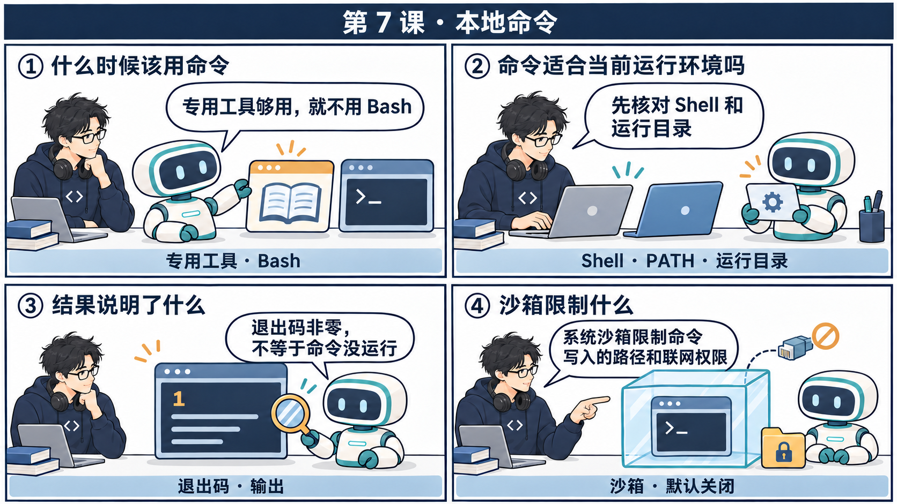

## 一、什么时候该用命令？

**专用工具能拿到的信息，就不必写命令；需要组合程序或运行项目检查时，才用 Bash。**

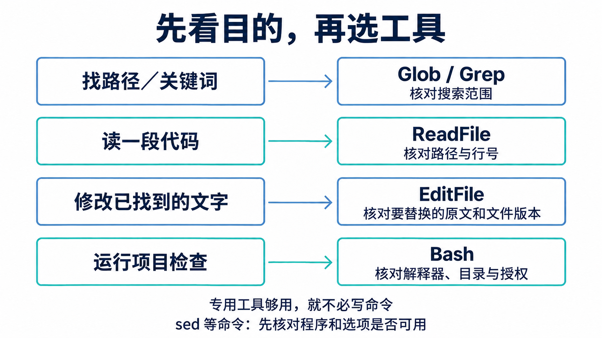

看完这张图，你要能：按读取、局部修改或运行检查的目的选择专用工具或 Bash。

### 模型为什么会写出 `sed`

**模型会写命令，是因为它在训练时见过大量命令；但它不了解你这台电脑。**

假设要看 `src/shipping.py` 的第 10～21 行，模型可能提出：

```shell
sed -n '10,21p' src/shipping.py
```

`-n` 表示不默认打印每一行，`10,21p` 表示只打印第 10 到 21 行。模型在训练中见过大量这类命令，再结合工具说明、项目约定和前面的结果，就能写出它。

可是会写，不等于了解你这台电脑。`sed` 装了没有？选项支不支持？Shell 对不对？这些都要在实际环境里核对。而且，模型在回答里写一段命令，电脑不会运行它。只有通过 Harness 的执行工具、经过检查和授权，命令才会真正执行。

回到 MyBuddy：只是想看这几行代码，用 `ReadFile` 就够了：给出路径和行范围，直接拿到带行号的内容。选工具时先问：**已有的专用工具能不能拿到我要的信息？** 能，就不必写命令。

### 命令从哪里来，怎样交给程序

**命令通过** `Bash` **工具交给程序：一段命令文字，加一个运行目录。**

MyBuddy 运行命令的入口是 `Bash` 工具，项目的测试也通过它运行。例如运费练习副本用 Python 自带的 unittest，模型可以提出这样一个调用：

```json
{"command": "python3 -B -s -m unittest discover -s tests -p 'test_*.py'", "cwd": "."}
```

`command` 是要运行的命令，`cwd` 是相对于工作区的运行目录。这段参数交给 Bash 工具，经过参数检查、权限判断和必要的批准，才会启动进程。

命令里的 `-B` 表示不生成字节码缓存文件，`-s` 表示不加载用户目录下的额外包。这个练习副本来自《实践准备》。

### 哪些命令不用再问你

例如 `ls`、`git status` 和 `cat README.md | wc -l`：程序能按白名单确认它们只是查看信息，就在 `default`、`accept_edits` 下直接运行。`/trace` 和 Web 轨迹会写“只读命令，自动放行”，原因码是 `runtime.permission_readonly_command`。规划模式也允许这些命令，但测试、脚本和其他非只读命令仍被拒绝。

白名单包括 `ls`、`pwd`、`cat`、`head`、`tail`、`wc`、`grep`、`rg`、`find`、`which`、`file`、`stat`、`du`、`df`、`tree`、`basename`、`dirname`、`realpath`、`sort`、`uniq`、`cut`、`tr`、`diff`、`echo`、`date`、`whoami`、`uname` 的已知只读用法。Git 只包括 `status`、`log`、`diff`、`show`、`branch`、`rev-parse`、`ls-files`、`blame`、`remote`；`branch` 默认只允许列举，带名字须明确写 `--list`，`remote` 只允许无参数或 `-v` / `--verbose`。`python`、`python3`、`uv`、`go`、`cargo`、`java` 只能单独带 `--version` 或 `-V`；某个程序不支持这个版本选项时，仍会正常报告执行失败。

为什么用白名单？只排除几个危险命令，会漏掉同一程序中能写文件的选项。例如 `sort -o 结果.txt` 会写文件，`find -exec` 会运行别的程序。因此命令名和选项都要在白名单内；未知选项也不自动放行。`sed`、`awk`、`tee`、`xargs`、`env`、`bash/sh` 和执行脚本的用法都不在名单里。`find -exec/-execdir/-delete/-fprint/-fprint0/-fprintf/-fls/-ok/-okdir`、`sort -o/--output/--compress-program`、`tree -o`、`rg --pre/--hostname-bin/-z`、`file -C`、`date -s/--set`、Git 修改选项和 `--output` 都不放行；`uniq` 也不能有第二个输出文件。长选项缩写和没列出的选项同样要询问，完整选项表见 `src/mybuddy/platform/tools/readonly_commands.py`。

`|` 可以连接多个命令，但每一段都要通过检查。`;`、`&&`、`||`、`&` 会组合或另起动作，`>`、`>>`、`<`、`<<` 会重定向输入输出，`$(` 和反引号能执行子命令，换行和 `${` 也不允许自动放行。程序额外排除变量、通配符、花括号、括号和反斜杠，避免 Bash 展开后的参数与检查时不同；这些字符即使在引号里也保守地交回审批。命令用 `shlex`（Python 里按空格和引号拆分命令的模块）拆不开、管道符一侧没有命令、带 `FOO=1 ls` 这样的环境变量前缀，同样不算只读。

这里的“不是只读”表示没有通过这份小白名单，不表示命令一定危险。普通模式下照常按权限和已有会话名单处理；规划模式下拒绝。`bypass` 的普通审批规则不变。白名单只省去询问：工作目录、超时、输出上限、沙箱、执行前的 `pre_tool_use` Hook 都继续检查。它也不限制读文件的范围；命令本身、安装的程序与本机配置必须可信，文件访问隔离仍由沙箱负责。

### 通用执行工具为什么既有用，又需要约束

**能跑命令，模型就能组合各种程序；但新写的脚本仍跑在同一个执行器里，受同样的目录、超时和输出限制。**

能运行命令，模型就可以组合现有程序，甚至临时写个小脚本做统计、筛选。不必为每种需求都预先做一个专用工具。

但写出一个新脚本，并没有获得一项新的可信能力。脚本仍由同一个执行器运行，受同样的目录、超时和输出限制，也可能产生同样的副作用。一个很短的 Python 脚本，也可能启动别的程序或联网。所以实现 Harness 时，要管住实际执行。使用 Agent 时，要看清脚本会读什么、写什么、凭什么判断完成。

### 按目的选工具

**先想清楚要做什么，再选工具。**

| 目的 | 可以选的方式 | 先核对什么 |
| --- | --- | --- |
| 看一段代码 | `ReadFile`，或环境里的文本命令 | 路径、行号、大小限制 |
| 找函数或关键词 | `Grep`、`Glob`，或 `rg` 等程序 | 搜索范围、是否忽略某些文件 |
| 改已定位的文字 | `EditFile`，或经批准的脚本 | 原文唯一、文件版本、转义 |
| 运行测试 | 项目声明的测试命令，通过 Bash 运行 | 解释器、依赖、运行目录、授权 |

如果项目没有 unittest 测试目录，就先读项目说明，找到适用的检查命令。

容易误会的地方：

- 没运行任何测试，不能报告“通过”。
- 也不能为了通过，去改验收条件。

## 二、命令要符合这台电脑

**同一条命令换一台电脑，含义可能就变了；先核对环境，再写命令。**

### 环境不能靠操作系统名字猜

**命令的含义取决于实际的 Shell、程序版本、运行目录和解释器，不只看系统名字。**

同一条命令换一台电脑，就可能失败。命令能不能执行、是什么意思，取决于：

- 操作系统和实际使用的 Shell；
- 装了哪些程序、什么版本；
- 当前目录；
- Python 解释器和虚拟环境。

比如项目说明里的 `python` 可能指虚拟环境里的解释器，而终端默认的 `python` 可能是另一套安装。

Windows 上有 PowerShell、cmd、WSL，语法和程序都不同。macOS 和 Linux 上同名的文本工具，选项也可能不同。只读的 `sed -n` 和直接改文件的 `sed -i` 是两种操作，后者在不同系统上的写法还不一样。

稳妥的做法：

1. 先看 Harness 提供的环境信息和项目说明；
2. 缺关键信息时，做一次小范围探测；
3. 根据结果选工具；
4. 失败后先查原因，再调整。

缺一个程序时，不能自动安装软件，也不能擅自换到另一个执行环境。

### MyBuddy 的 Bash 在什么环境里运行

**MyBuddy 的 Bash 固定用** `/bin/bash`**，不加载你终端的启动配置，PATH（查找可执行程序的目录列表）也由程序指定。**

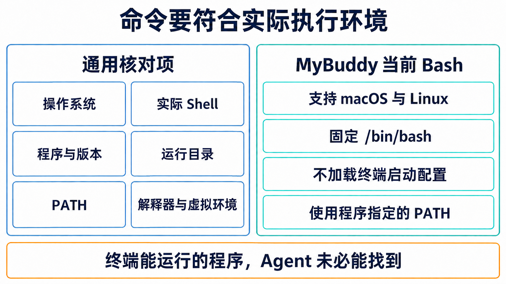

看完这张图，你要能：指出跨环境命令失效时需要核对的实际执行条件。

MyBuddy 的 Bash 工具在 macOS 和 Linux 上都固定使用 `/bin/bash`。它**不加载你终端的启动配置**（`.bash_profile`、`.bashrc` 之类），用的是程序指定的 PATH。所以你在自己终端里能运行 `uv`，Agent 执行时却可能找不到它。

可以让 Agent 先运行 `command -v uv`，看看实际位置，再核对项目的解释器。确实需要时，在你维护的启动配置里，用 `[sandbox]` 下的 `path_prepend = ["/绝对路径/bin"]`，把目录加在固定 PATH 前面。它只来自可信配置，会改变 `python3`、`uv` 解析到哪个程序。修改后重新启动生效，也可以恢复旧会话；之后的命令使用当前配置。

每次运行还有几项限制：

| 限制 | 数值 |
| --- | --- |
| 超时 | 默认 30 秒，最多可以要求 120 秒 |
| 输出 | 标准输出和错误输出合计最多保留 64 KiB；超过上限会停止命令 |
| 管道失败 | 开启 `pipefail`：管道中有命令失败，管道的退出状态就是非零 |

注意 `pipefail` 只管管道本身。管道后面的命令仍可能继续运行，并影响整段命令的最终退出码。

把这些限制放进一个通风橱里看：炉头固定，门上贴着环境说明，计时器管时长，量杯管输出，外面还可以再罩一层玻璃罩。

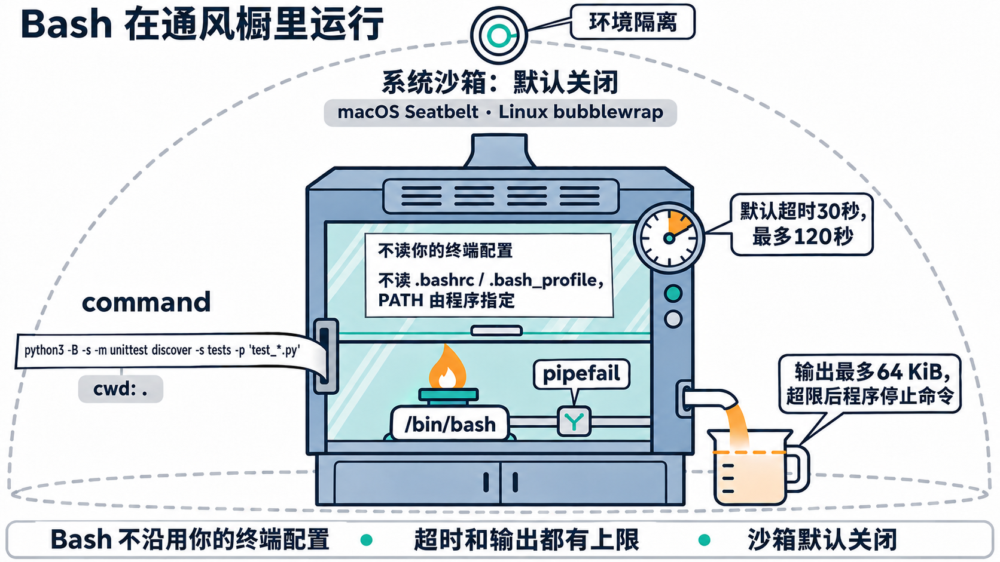

看完这张图，你要能：用“通风橱”记住 Bash 的运行环境：固定用 /bin/bash，不读你的终端配置，PATH 由程序指定；超时和输出都有上限；系统沙箱是额外加的玻璃罩，默认关闭。

### 参数列表和 Shell 字符串有什么区别

**参数列表直接交给程序；Shell 字符串要先经过 Shell 解释。MyBuddy 用的是后一种。**

程序启动一个命令有两种方式，用 Python 示意：

```python
# 方式一：直接启动程序，每个参数已经分开。
subprocess.run(["sed", "-n", "10,21p", "src/shipping.py"])

# 方式二：把整段文字交给 Shell，由 Shell 再解释。
subprocess.run("sed -n '10,21p' src/shipping.py", shell=True)
```

方式一传的是**参数列表**（argv）。每一项就是一个参数，路径里有空格也还是一项。

方式二交给 Shell 的是一整段文字。Shell 会处理变量、管道、重定向、通配符等语法。如果把不可信的文件名直接拼进去，文件名里的特殊字符就可能被当成命令语法。

方式一少了 Shell 这层解释，但参数本身仍要检查。比如以 `-` 开头的文件名，可能被程序当成选项。

MyBuddy 的做法是：直接启动 `/bin/bash` 这个程序，再把模型写的命令文字交给 Bash 解释。所以 Shell 这层解释是存在的。命令里的引号、管道等，都按 Bash 规则处理。

既然方式二有风险，为什么还选它？因为对 Agent 来说，它的好处更大：

- **模型本来就会写 Shell 命令。** 模型从大量教程、文档和脚本里学到的就是 `grep -n x src | head` 这种写法。让它直接写命令文字，比让它把每个参数拆成列表更自然，出错也更少。
- **真实任务离不开 Shell 语法。** 排查和验证时常常要用管道（`|`）把结果交给下一个命令，用 `2>&1` 合并错误输出，用 `&&` 表示“前一步成功才做下一步”，或者先 `cd` 到子目录再运行。参数列表只能启动一个程序，这些都做不到。
- **主流 Coding Agent 也这样做。** Claude Code 和 Codex 的命令工具都是把整段命令交给 Shell，你在这里学到的用法可以直接迁移过去。

MyBuddy 把模型写好的整段命令作为一个参数交给 `/bin/bash -c`，外层仍用参数列表启动 Bash。命令执行前要经过权限判断，需要时再请你批准（第 6 课）。你还可以打开系统沙箱，限制文件写入和网络访问（本课第四节）；程序构造的环境变量也不会继承模型凭据。

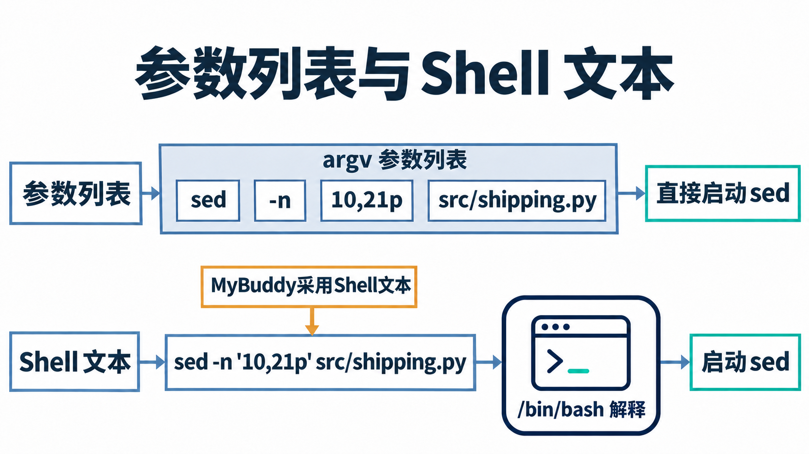

看完这张图，你要能：区分直接传参数列表与交给 Shell 解释的两条路径，并说明 MyBuddy 实际采用哪一条。

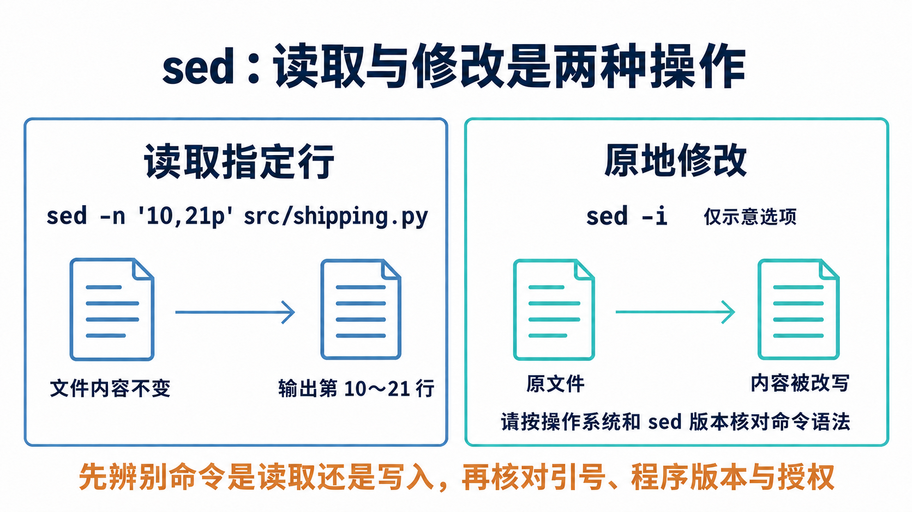

看完这张图，你要能：辨别命令参数改变的是输出范围还是文件内容。

## 三、命令怎样运行，结果说明什么？

**命令先经过权限判断，需要时请你批准，再核对、启动并确认停下；结果要结合退出码和实际输出一起读。**

### 先看最简版：拿到命令就运行

**最简单的执行器只有一行：把命令交给 Shell，等它结束。**

下面是一段 Python 风格的**教学伪代码**：

```latex
结果 = subprocess.run(命令, shell=True, capture_output=True)
把 结果.returncode 和 结果.stdout 交回模型
```

真实运行时，这个版本会出好几种问题。我们一次加一个约束：

1. **命令可能有副作用 → 先按权限模式判断，需要时等你批准。** 第 6 课讲过。
2. **批准后环境可能变了 → 启动前再核对一次。** 运行目录、解释器等条件变了，就不按旧计划执行。
3. **你的终端配置会改变命令含义 → 用固定的 Shell 和精简环境。** 上一节讲过。
4. **命令可能永远不结束 → 设超时。** 默认 30 秒。
5. **命令可能输出几 GB 日志 → 只保留 64 KiB，超了就停。** 但管道要继续读空，否则进程会卡住。
6. **命令可能启动了后台子进程 → 结束后确认整组进程都停下了。** 确认不了，就不能继续做有副作用的操作。
7. **你想限制它能写哪里、能不能联网 → 交给操作系统沙箱。** 第四节讲。

### 从批准到拿回结果

**把这些约束串起来，就是一条命令的完整路径。**

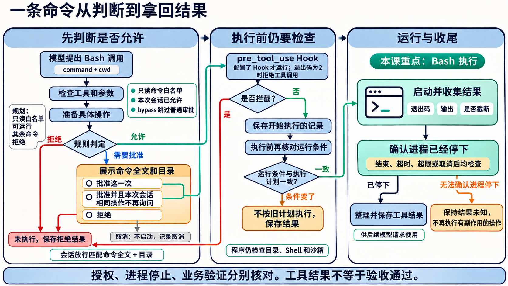

看完这张图，你要能：说出一条 Bash 命令的四步：按权限模式决定要不要问你，执行前再检查一次，启动并收集结果，确认进程停下后才交回模型；任何一步失败都不再往下执行。

1. **判断要不要批准**。按当前权限模式（第 6 课）：`default` 和 `accept_edits` 下，只读白名单 Bash 自动放行，其余命令按已有会话名单和审批处理；`bypass` 跳过普通审批。规划模式允许只读工具、只读白名单 Bash 和对方案文件的写入，非只读命令仍被拒绝。Buddy 预设只提供默认权限，不额外强制询问。需要批准时，展示具体命令和运行目录，等你批准。
2. **执行前再核对**。确认运行目录等条件和批准时一致。
3. **启动并收集结果**。记录退出码、输出，以及输出有没有被截断。
4. **确认进程已经停下**。命令结束、超时、输出超限或被取消时，检查受管的进程组是否都停了，并处理完输出管道。无法确认时，会话不能继续执行有副作用的操作。课程里把这些停止、清理和状态确认叫作**停稳**，第 12 课会细讲。

结果最后整理成工具结果，交回模型。

第 1 步会先拆词检查命令和选项是否命中只读白名单。需要审批时，界面展示整段命令，不会替你解释每一部分的效果。你要读懂完整命令，不能只看开头的程序名。例如 `cat a.txt > b.txt` 会覆盖 `b.txt`，`grep ... && rm ...`、`$(...)` 和管道后面的部分也要一起检查。

### 读结果：非零不等于没运行，零不等于做对了

**退出码只说明命令是怎样结束的；命令到底检查了什么，要看实际输出。**

退出码非零，不一定是“命令没运行”。可能测试确实跑了、发现了失败；也可能导入依赖就失败了。反过来，退出码为零，也只说明命令正常结束。还要看它实际检查了什么。

| 看到的结果 | 下一步判断 |
| --- | --- |
| 程序不存在 | 修正对环境的假设；当前工具做不到就明确停下 |
| 选项不支持 | 核对程序版本和语法，不要机械重复 |
| 测试导入失败 | 检查运行目录、解释器、模块路径和依赖 |
| 断言失败 | 测试真的跑了，去分析业务代码和测试预期 |
| 输出达到上限被截断 | 没显示的部分不能当作检查过 |
| 超时，且无法确认进程已经停下 | 先保留“结果未知”，不要开始下一次写入 |

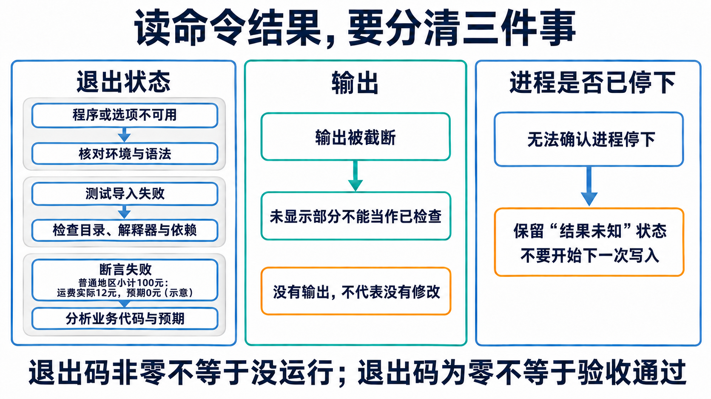

看完这张图，你要能：按环境失败、断言失败、输出截断或无法确认停下来判断下一步。

### 被拒绝了：是权限、沙箱，还是业务问题

**审批决定能不能执行；沙箱限制启动后能碰到什么；断言失败是业务问题。三者要分开查。**

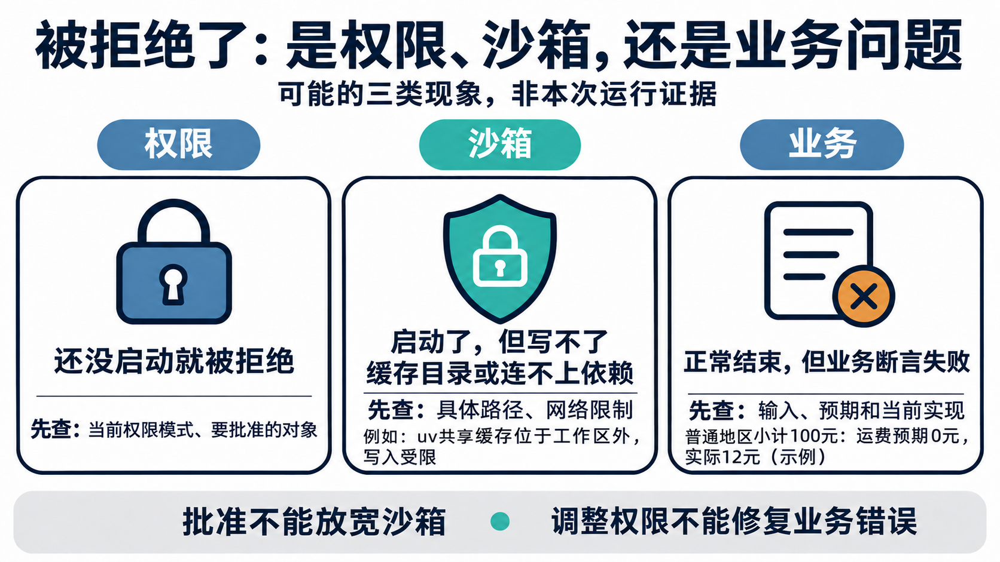

看完这张图，你要能：按现象把失败分成权限、沙箱、业务三类，并说出各自先查什么。

一次测试失败，可以按现象分三类排查：

| 现象 | 先查什么 | 合理的下一步 |
| --- | --- | --- |
| 还没启动就被拒绝 | 当前权限模式、是否在规划模式、要批准的对象 | 确认操作属于任务，换用允许的方式或申请需要的权限 |
| 启动了，但写不了缓存目录或连不上依赖 | 进程环境、具体路径、网络限制 | 把缓存放到允许的位置，或明确提出需要的环境变化 |
| 正常结束，但业务断言失败 | 输入、预期和当前实现 | 回到业务逻辑定位；调权限修不好断言 |

容易误会的地方：

- 没收到输出，不说明进程没改过文件。
- 非零退出码，不说明被沙箱拦了。断言失败、命令不存在、路径错误都会非零退出。
- 一遇到失败就关掉隔离，是错的做法。
- 批准不能放宽沙箱限制。
- 自己离开进程组的子进程，不在“停稳”的确认范围内。
- 你刚拒绝了一项文件修改，模型又提出用 `sed -i` 或 Python 脚本做同样的改动，这不是“换一种允许的方式”，而是绕过你的决定，应该拒绝。第 6 课的反例表里有这一条。

## 四、可选的系统沙箱

**沙箱让操作系统直接限制命令能写哪里、能不能联网；它默认关闭。**

### 把访问限制交给操作系统

**前面讲的审批和路径检查都在 MyBuddy 程序里；沙箱则由操作系统强制执行。**

前面的审批和路径检查，都在 MyBuddy 程序里进行。**沙箱**则让操作系统直接限制进程：命令想写别的目录、想联网，操作系统会拒绝。MyBuddy 在 macOS 上用系统自带的 Seatbelt，在 Linux 上用 bubblewrap，为 Bash 命令加一层沙箱。

沙箱**默认关闭**，要在你维护的启动配置里打开：

```toml
[sandbox]
enabled = true
network_enabled = false
extra_write_paths = []
```

修改配置后，在新建或重启的会话中生效。

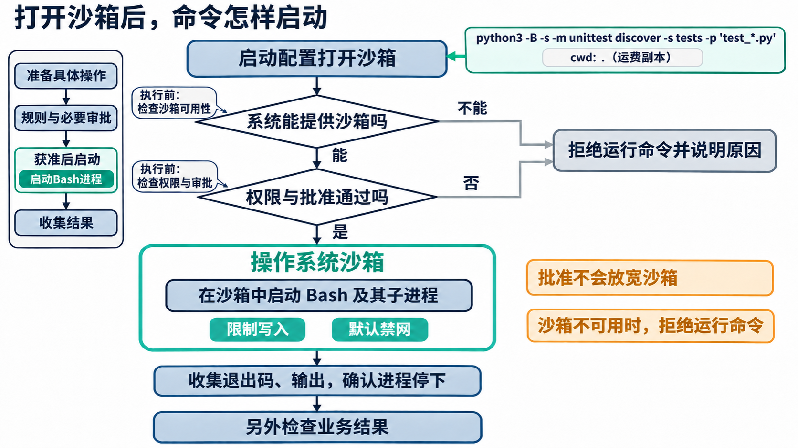

看完这张图，你要能：看清打开沙箱后的两个判断：系统提供不了沙箱或权限不通过都拒绝运行；通过后 Bash 及其子进程在操作系统沙箱里运行，业务结果另外检查。

图里有两个判断：系统能不能提供沙箱，权限与批准是否通过。通过后，进程在操作系统沙箱内运行，文件写入和网络访问继续受限。

- **批准不会放宽沙箱**。第 6 课的 `bypass` 只跳过普通审批，也不会解除沙箱。
- 打开沙箱后，如果系统提供不了，命令会被拒绝。不会悄悄改成不加限制地运行。

### 沙箱限制什么，不限制什么

**沙箱主要管写入和网络；读取限制得比较宽，也只管 Bash 及其子进程。**

| 对象 | 限制 | 注意 |
| --- | --- | --- |
| 写入 | 只能写业务工作区、本次运行专用的临时目录，以及配置里 `extra_write_paths` 列出的目录 | 工作区里 MyBuddy 自己的状态和凭据等受保护位置仍然禁止写 |
| 网络 | 默认禁止，只能通过 `network_enabled` 打开 | 由操作系统禁止，不是只拦截 `curl` 这个名字 |
| 环境变量 | 只传必要的几项，例如 PATH、语言设置、临时目录 | 不会把模型的凭据传进去 |
| 读取 | 目前限制得比较宽 | 不保证秘密文件读不到；读出的内容仍可能进入模型请求 |
| 覆盖范围 | 只管 Bash 及它启动的子进程 | MyBuddy 主程序、文件工具、MCP 服务等不在这层沙箱内 |

macOS 不用另装软件。Linux（包括 WSL2）打开沙箱前，要注意下面三件事；不开沙箱，这三件事都不用管：

1. **先装 bubblewrap**：`sudo apt install bubblewrap`。
2. **Ubuntu 24.04 起，系统可能挡住它。** 开沙箱后报 `sandbox_probe_failed`，就运行 `sysctl kernel.apparmor_restrict_unprivileged_userns` 看一下。结果是 0，或者提示没有这一项，就不是这个原因。结果是 1，就加载 Ubuntu 自带的一份放行配置。它只针对 bubblewrap，不会放开整个系统的限制：

```bash
sudo apt install apparmor-profiles
sudo install -m 0644 /usr/share/apparmor/extra-profiles/bwrap-userns-restrict /etc/apparmor.d/
sudo apparmor_parser -r /etc/apparmor.d/bwrap-userns-restrict
```

3. **要保护的路径不能经过符号链接。** 可写目录里要保护的路径（例如放在工作区里的 MyBuddy 状态目录）必须真实存在，不能经过符号链接。否则报 `sandbox_protected_path_unsupported`，命令不会运行。

命令输出会进入模型请求和会话记录。不管开不开沙箱，`cat` 一份凭据文件或 `.env`，内容都会原样进去；诊断时只打印需要的那一项。

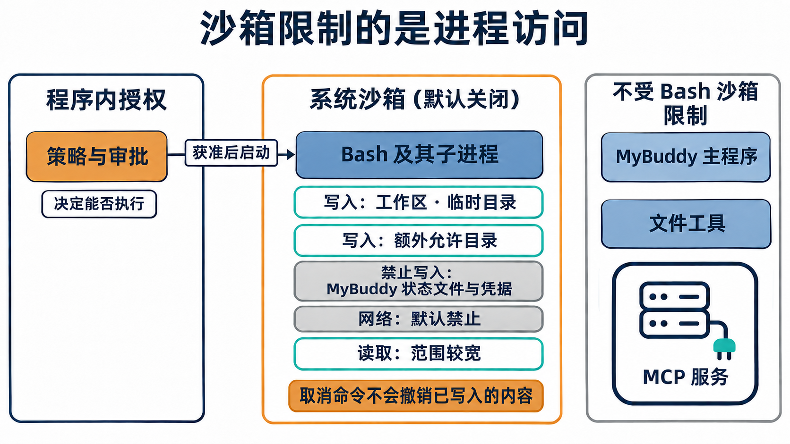

看完这张图，你要能：区分程序内的授权、操作系统对写入和网络的限制，以及仍然开放的读取范围。

### 在收银台任务中怎么用

**终端里能跑的命令，放进沙箱不一定能跑；先换运行方式，别急着放宽沙箱。**

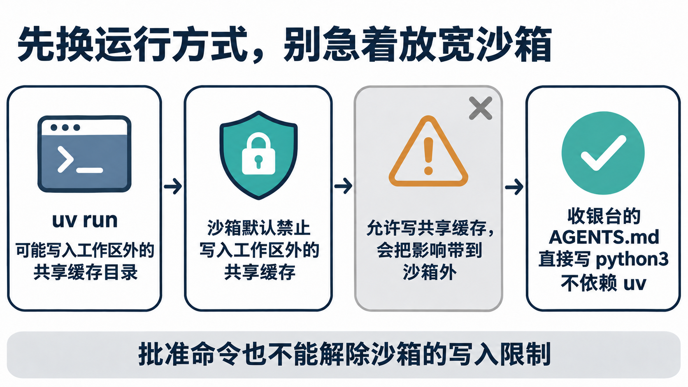

看完这张图，你要能：用 uv run 写共享缓存的例子说明：命令在沙箱里跑不通时，换一种运行方式（收银台直接用 python3），不要为了让命令通过去放宽沙箱。

以“按支付方式汇总”为例：先确认金额口径，再用文件工具改报表，最后用 Bash 运行项目检查。三类证据分开保留：

1. 这次操作的授权；
2. 执行时实际施加的限制；
3. 现金和扫码金额是否符合预期。

比如 `uv run` 可能要写工作区外的共享缓存目录，而沙箱默认不允许写那里。共享缓存里的内容会长期留下，以后在沙箱外也会用到。开放它，就等于给了命令一条把影响带出沙箱的路。所以收银台的 AGENTS.md 直接写 `python3`，不依赖 uv。

遇到这类失败，先换一种不需要写共享位置的运行方式。不要为了让命令通过去放宽沙箱。批准弹窗也解除不了写入限制。

容易误会的地方：

- 沙箱是访问限制，不是一次性容器。允许目录里的写入是真实修改，失败、超时或取消都不会自动回滚。
- 独立副本或 Git 工作树代替不了沙箱。它们只是把文件目录分开了。

## 五、动手：修复前后各运行一次检查

**修复前后各跑一次测试，按当前权限和会话放行名单决定是否询问，再分别核对结果。**

### 实践

**两次运行各有自己的记录：分别检查是否获准，分别核对结果。**

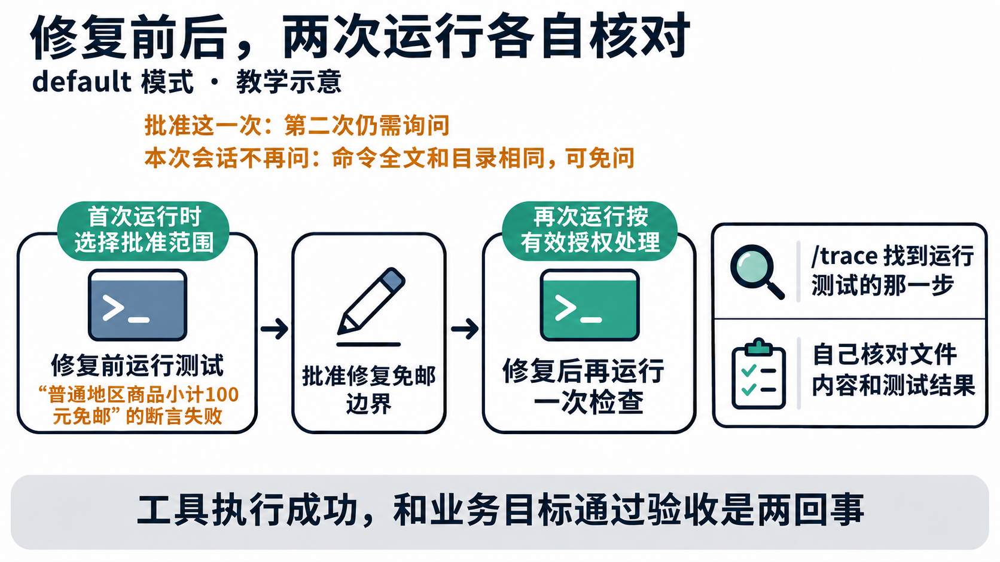

看完这张图，你要能：把练习的三步排成时间线：修复前后各运行一次测试，按有效的授权处理，再用 /trace 找到运行记录、确认结果。

1. 在独立副本中，先让 MyBuddy 运行现有测试，观察“恰好 100 元”的断言失败。
2. 按第 6 课批准边界修复。
3. 再让它运行一次检查。

两次运行各有自己的命令和结果。在 `default` 模式下，第一次若选择“批准这一次”，第二次仍要询问；若选择“本次会话不再问”，相同命令全文和工作目录可免询问。

用 `/trace` 找到运行测试的那一步。完整命令以批准时展示的为准，`/trace` 不显示全部参数。最后自己核对文件内容和测试结果。工具执行成功，和业务目标通过验收（第 13 课）是两回事。

想看命令怎样传给进程、输出怎样截断、超时后怎样确认进程停下，请读本课源码解析。

### 换一个环境想一想

**换一台没有** `sed` **的电脑，就重新选那台电脑上可用的工具。**

同样是读十行代码，换到一台没有 `sed` 的电脑，该怎么做？答案是重新选择那台电脑上可用的工具。不要假设所有终端都有同一套命令。

**能力卡**：想在收银台副本里亲手试一遍，就照着能力卡《本地命令与系统沙箱》（`demo-project/cards/sandbox.md`）做。

## 使用小妙招

### 报错时，把执行条件和错误一起交给 Agent

**把目录、解释器、实际命令、退出码和关键错误一起给它，它才有线索。**

如果 Agent 反复改命令却没有进展，就把这些一起交给它：工作目录、解释器或工具版本、实际命令、退出码和关键错误。同一条命令在你的终端能跑、在 Agent 那里失败，这个差别本身就是线索。让它先比较两边的环境，再判断该修业务代码，还是调整执行方式。

在 Claude Code 里，可以在输入框开头加 `!` 直接运行一条命令，例如 `!python --version`，命令和输出会进入对话，Agent 也能看到。

**为什么这样做：** 命令的结果由很多条件一起决定：在哪个目录跑、用的是哪个解释器、环境变量是什么（见“环境不能靠操作系统名字猜”）。Agent 只看到一句报错时，只能一次次改命令去试。把这些条件一起给它，它才能找到真正不一样的那一项。

### 跨环境时，让它先核对工具，再改写命令

**先确认 Shell、程序版本和路径，再选命令。**

准备用 `sed` 修改文件之前，可以先要求：

确认当前 Shell、sed 的版本和目标路径；给出适用的命令和预期修改。如果有专用编辑工具，说明采用哪一种。

需要跨环境复现时，只核对和当前任务有关的几项：

在实际执行工具的环境中，确认工作目录、Shell、项目解释器和本次需要的程序。列出结果和仍不确定的条件，再选择命令。

在 POSIX Shell（macOS、Linux 上常见的 bash、zsh 这类）中，可以用 `pwd` 核对目录，用 `command -v python` 核对命令位置。在 PowerShell 中，可以用 `$PSVersionTable.PSVersion` 看版本，用 `Get-Command python` 看命令位置。项目用 `python3` 或 `uv run python` 时，就沿那个入口确认解释器：

```shell
python -c "import os, sys; print(sys.executable); print(os.getcwd())"
```

（把 `python` 换成项目实际使用的入口。）这些跨平台示例，不代表 MyBuddy 的 Bash 工具已经支持 PowerShell。

**为什么这样做：** 模型会写命令，但不了解你这台电脑（见“模型为什么会写出 `sed`”）。比如同样是 `sed`，macOS 和 Linux 上支持的选项就不完全一样，同一条命令换台电脑就可能失败，甚至改错文件。先查清实际环境再选命令，比失败后再猜原因省事。

## 自测：这一课的概念分清了吗

**先自己作答，再看后面的答案。** 每题都能在本课正文里找到依据。

**1.** 你只想读一小段代码，已有的专用读取工具能按所需范围返回内容。怎样选工具更合适？

- A. 优先用专用读取工具。
- B. 优先用 Bash，因为通用执行工具总比专用工具合适。

**2.** 判断：直接传参数列表，少了 Shell 这层解释，所以参数本身就不用再检查。（对 / 错）

**3.** 你运行项目测试，输出中明确出现了业务断言失败，退出码非零。下面哪种判断正确？

- A. 命令没有运行，直接重试同一条命令就行。
- B. 测试确实跑了，应核对业务代码和测试预期。
- C. 非零退出码说明被沙箱拦了，应放宽沙箱限制。

**4.** 你在已启用系统沙箱、禁用网络的 MyBuddy 会话里，切换到 `bypass`。下面哪项正确？

- A. 普通审批可以跳过，沙箱的写入和网络限制仍然保留。
- B. 不再需要普通审批，沙箱的写入和网络限制也随之解除。
- C. 沙箱只在需要批准的命令上生效，免询问的命令不受限制。

### 答案与依据

**1. 选 A。** 专用工具已经能拿到需要的信息，就不必写命令。B 把“能组合各种程序”误当成了“任何操作都更适合用命令”。  
依据：本课“按目的选工具”。

**2. 错。** 参数列表少了 Shell 这层解释，但参数仍可能被程序当成选项。例如以 `-` 开头的文件名，仍要检查怎样传给程序。  
依据：本课“参数列表和 Shell 字符串有什么区别”。

**3. 选 B。** 输出中的断言失败说明测试跑到了相应检查，应分析实现和预期。非零退出码不等于没运行，也不能单凭它认定是沙箱问题。  
依据：本课“读结果：非零不等于没运行，零不等于做对了”。

**4. 选 A。** `bypass` 只跳过普通审批，不会解除沙箱。是否需要询问，和执行时能访问什么，是两件事。  
依据：本课“把访问限制交给操作系统”。

## Q&A：常见追问

### Q1：Agent 生成了 Shell 命令，为什么仍要检查后再执行？

能生成命令，不代表命令适合当前环境，也不代表用户已经允许它执行。模型会结合任务、工具说明和环境信息提出命令，但仍可能写错参数或选错路径。例如只想查找文件，却生成带删除动作的命令，就不能直接运行。执行前要看实际影响范围和权限；只读白名单通过后可以省去询问，其他检查仍在。规划模式也只能运行这种命令。执行后再看输出、退出码和文件状态。

### Q2：同一条命令为什么在另一台电脑失败？

Shell、程序和版本、PATH、工作目录、编码和权限都可能不同。实际的报错和环境信息，能帮模型找出差别，再写出等价的命令。只说“换成 Windows 命令”，仍没说清那台电脑上有哪些程序可用。

### Q3：有 Shell 以后，专门的读文件和修改工具是不是多余？

不多余。专用工具能把范围、来源和修改依据表达清楚，方便检查和展示。Shell 适合组合已有程序，但解释层次更多，副作用更复杂。只读一段代码时，专用工具更容易控制；要运行项目自己的检查时，再用 Bash。两者配合使用。

### Q4：命令字符串里的路径加了引号，是不是就安全了？

引号只解决一部分语法问题。加了引号，不能说明命令获准、路径正确或程序可信。参数可能经过 Shell、子命令等好几层解释。能直接传参数列表时，就分开传。需要 Shell 语法时，仍要核对展开、运行目录和实际影响范围。

### Q5：我自己的终端能运行，为什么 Agent 仍然找不到命令？

两边可能用了不同的 Shell、PATH、虚拟环境或工作目录。MyBuddy 的 Bash 还不加载你终端的启动配置。让 Agent 在它实际执行命令的环境里检查程序路径和解释器，再和你的终端比较。只在提示词里改系统名称，改变不了执行器实际启动的环境。

## 本课术语速查

| 本课说法 | 源码或配置中的名字 | 含义 |
| --- | --- | --- |
| Bash 工具 | `Bash`，参数 `command`、`cwd` | MyBuddy 运行命令的入口 |
| 参数列表 | argv | 直接启动程序时逐项传入的参数 |
| Shell 字符串 | `shell=True` 时的命令文本 | 交给 Shell 再解释的一整段文字 |
| 超时 | 默认 30 秒，最多 120 秒 | 命令运行时间上限 |
| 输出上限 | 64 KiB | 标准输出和错误输出合计保留的最大量 |
| 停稳 | — | 确认受管进程组停止并完成必要清理（第 12 课） |
| 系统沙箱 | `[sandbox]`，macOS Seatbelt / Linux bubblewrap | 由操作系统限制 Bash 命令能写哪里、能否联网 |

## 继续阅读源码解析

理解本课概念后，可继续阅读源码解析里的模块、数据与调用流程。
