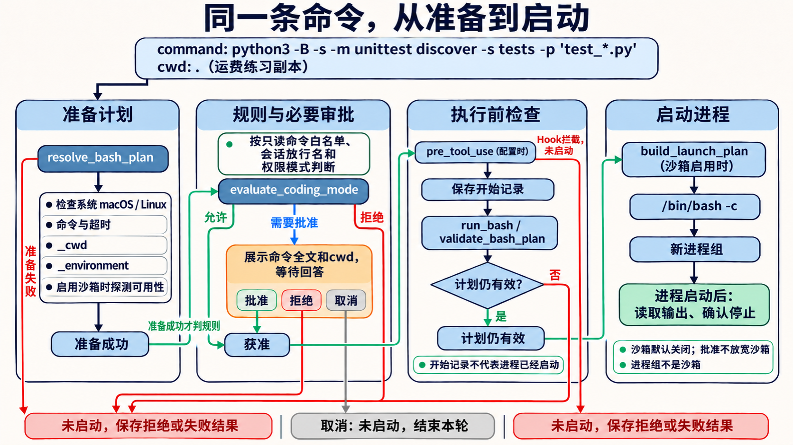
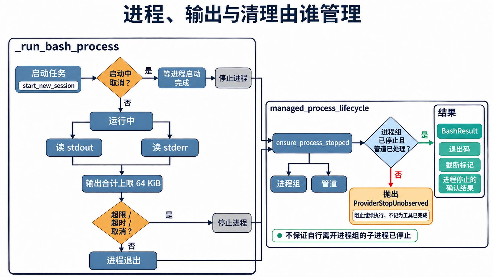

与第 7 课课程正文配套阅读。

正文从最简执行器开始：`subprocess.run(命令, shell=True)`，然后一次加一个约束。这一篇顺着代码，看正文里那条测试命令怎样变成一次具体的执行：命令和运行目录怎样固定下来，进程怎样启动，输出怎样收回，最后怎样确认进程都停了。

**怎么读：** 每一节先贴一段代码，再用几句话解释。代码从当前源码原样复制，上方标了文件和行号。`# ...` 表示省略了与本节无关的行。

先看整条调用链。缩进表示“谁调用谁”：

```latex
CodingPlanRegistry.prepare            coding_tools.py      Bash 分支：准备计划，不运行
└─ resolve_bash_plan                  coding_bash.py       检查命令、目录、超时、环境、沙箱
   ├─ _cwd                            coding_bash.py       运行目录不能逃出工作区
   └─ _environment                    coding_bash.py       精简环境
（审批，见第 6 课）
CodingToolProvider.execute            coding_tools.py      执行，整理结果
└─ run_bash                           coding_bash.py       再核对计划，按需套沙箱
   └─ _run_bash_process               coding_bash.py       启动、读输出、等结束
      └─ ensure_process_stopped       managed_process_lifecycle.py  确认整组进程停下
```

## 从工具参数走到进程



看完这张图，你要能：说出一条命令从文本到结束经过哪些环节：受管进程、系统限制、输出收集、确认停止。

### 先看提示词：模型看到的 `Bash` 说明

模型写什么命令，代码不替它挑。“看代码用 `ReadFile`，不用 `sed`”这类选择，靠的是工具说明。程序只检查写出来的参数是否合规（片段 2、3），能不能运行由权限和审批决定。模型看到的 `Bash` 说明和参数说明是这一段：

`src/mybuddy/platform/tools/coding_contract.py:108-112`

```python
        ("Bash", 'Run foreground Bash with pipefail, without implicit errexit. No interactive/background jobs or guessed host paths. Use file tools for file operations.',
         _object({"command": _text(16384, 1),
                  "cwd": {**path, "description": "Directory; default '.'."},
                  "timeout_ms": {"type": "integer", "minimum": 100, "maximum": 120000, "description": 'Milliseconds; default 30000. Timeout stops the command.'},
                  "description": {**_text(256), "description": "Purpose in the user's language."}}, ["command"])),
```

逐句看它为什么这样写：

- **“with pipefail, without implicit errexit”**。和片段 4 的 `_ARGV_PREFIX` 一致：加了 `-o pipefail`，没有加 `-e`。没有 `-e`，前一条命令失败后，后面的命令照样运行，最终退出码由 Bash 规则决定。把这两点写明，模型才知道不能只看最后一条命令的结果，去推断整段命令都成功了。需要中途停下，模型可以自己在命令里写 `set -e` 或 `&&`。
- **“No interactive/background jobs”**。对应两处代码：片段 7 把标准输入接到 `DEVNULL`，等输入的程序读不到任何东西；片段 2 的 `_bare_background` 拒绝单独的 `&`。先说清楚，模型就不会写一条等你输入的命令，或者把服务放到后台再接着做别的。`_bare_background` 只是保守检查，所以说明里直接说“不支持”，不指望这项检查拦住所有情况。
- **“No ... guessed host paths”**。这句话让模型不凭印象写宿主机上的程序路径。对应片段 4：PATH 只有四个系统目录，加上可信配置里的 `path_prepend`，也不读你的终端配置。模型以为装在某处的程序，在这里可能找不到。正文建议先运行 `command -v uv` 看实际位置，就是这个原因。
- **“Use file tools for file operations”**。这是正文“专用工具能拿到的信息，就不必写命令”在说明里的写法。代码里有两点对应：
    - 文件工具返回带行号的结果，有大小限制，编辑要凭 `ReadFile` 的读取记录。用 Bash 改文件，这些都没有，`execute` 还会在运行前让所有读取记录失效（片段 6 之后那段）。
    - 批准一次文件编辑，不等于批准用 Bash 改同一个文件。两者是不同的计划，各自审批。
    - 这句只是偏好，不是禁令。说明里没有说“禁止”，`sed` 不在自动放行白名单里，正常模式仍可按审批结果执行。
- `timeout_ms` **的** `minimum: 100`**、**`maximum: 120000`**、“default 30000”**。和片段 1、片段 2 的数字一样。**“Timeout stops the command”** 对应片段 11：超时后停止整个进程组。告诉模型这一点，它就知道超时是“被停下了”，结果不完整，不是“还在后台跑”。
- `command` **的上限 16384**。这里按字符数算，片段 2 按 UTF-8 字节数算。命令里有很多汉字时，可能通过参数格式检查，却在片段 2 报 `coding_bash_command_too_large`。
- `description`**：“Purpose in the user's language”**。这一项只是说明用途，不参与执行。审批时展示的是工作目录、完整命令和超时（`render_plan`），不展示它。同一轮里判断“是不是刚被拒绝过的同一操作”时，也会先把它去掉（`approval_denials.py`）。所以模型换一句说明，不会变成一个新请求。

这段说明没有告诉模型“哪些命令有副作用”。片段 1 把 Bash 的副作用一律记为 `"unknown"`，权限判断会先拆词检查只读白名单，但不把它当作完整的 Shell 分析器。命令能不能运行，最后由权限模式、你的批准和可选的系统沙箱决定，不由模型读没读懂这段说明决定。

### 只读命令怎样省去询问

`CodingPolicy.evaluate` 在规划模式下先用同一个 `is_readonly_command` 检查命令；不通过就拒绝。通过后仍要准备 Bash 计划，检查工作目录、超时和沙箱，再交给 `evaluate_coding_mode`。在 default、accept_edits 下命中白名单时，它返回 allow 和 `runtime.permission_readonly_command`；bypass 沿用原决定。明确要求询问的操作在这一步之前处理，会话放行名单仍保留。

`src/mybuddy/platform/tools/readonly_commands.py:101-112`

```python
def is_readonly_command(command: object) -> bool:
    if not isinstance(command, str) or not command.strip():
        return False
    # 连引号里的这些字符也不放行。额外排除变量、通配符、花括号展开和子 Shell，
    # 否则 shlex 看到的词可能与 Bash 展开后的词不同，例如 * 展开成 --output=文件。
    if any(char in command for char in ";&<>`\n\r$*?[]{}()\\") or "||" in command:
        return False
    try:
        # 逐段拆词也会拒绝空管道和引号不完整的命令；引号里的 | 宁可交回普通审批。
        return all(_readonly_segment(shlex.split(part)) for part in command.split("|"))
    except ValueError:
        return False
```

先检查原始文字，再用 `shlex` 拆词。`;`、`&&`、重定向、命令替换等语法会让一条看似读取的命令夹带写入，所以不自动放行；管道则逐段检查。连引号里的特殊字符也保守处理。环境赋值前缀不是白名单命令名，拆词失败也返回 False。

`_readonly_segment` 先看命令名，再看选项白名单。只检查命令名会误放 `find -exec`、`sort -o`、`git branch 新分支`；用危险词黑名单又容易漏掉新选项，所以未知选项一律交回普通审批。`uniq` 的第二个文件名会写入，`date` 的普通参数在部分系统会设置时间，它们另有小检查。允许的命令及禁止选项见正文的“哪些命令不用再问你”和本文件的 `_OPTIONS`、`_GIT_OPTIONS`。

它返回 True 只表示省去询问。后面的 ToolRuntime 仍保存决定、运行 PreToolUse Hook，再交给 CodingToolProvider 和 run_bash；启用的沙箱仍会包装进程。执行时间和输出上限照旧，规划时也不能运行测试或脚本。

### 片段 1：`Bash` 调用先变成一份计划

`src/mybuddy/platform/tools/coding_tools.py:170-181`

```python
        elif name == "Bash":
            from .coding_bash import resolve_bash_plan
            # Bash 没指定工作目录时从工作区根目录运行；默认超时 30000 毫秒（30 秒），
            # 可指定 100 到 120000 毫秒。超时后程序会尝试停止命令，仍需看返回的停止状态。
            bash = resolve_bash_plan(self.workspace.root, arguments["command"],
                cwd=arguments.get("cwd", "."), timeout_ms=arguments.get("timeout_ms", 30000),
                sandbox_configuration=self.sandbox_configuration,
                sandbox_protected_paths=self.sandbox_protected_paths,
                sandbox_requirements=self.sandbox_requirements)
            resolved = bash.safe_value()
            side_effect = "unknown"
            timeout = arguments.get("timeout_ms", 30000)
```

模型提出的 `command`、`cwd` 和 `timeout_ms`，在 `prepare` 的 `Bash` 分支交给 `resolve_bash_plan`。没给 `cwd` 就用工作区根目录，没给超时就用 30 秒。

这一步只准备计划，不运行命令。计划交给权限判断，需要时展示给你审批。

`side_effect` 记为 `"unknown"`。和文件编辑的 `"reversible"` 不同：Shell 能做的事太多，无法提前知道副作用。

### 片段 2：检查命令、超时和沙箱是否可用

`src/mybuddy/platform/tools/coding_bash.py:229-245,273-276`

```python
    """审批前检查命令、目录和沙箱要求，并记下解释器与环境的信息。"""
    if sys.platform not in ("darwin", "linux"):
        raise BashPlanError("coding_bash_unsupported_host")
    # 限制按 UTF-8 编码后的字节数计算；例如一个汉字通常不止一个字节。
    if type(command) is not str or not command or "\x00" in command:
        raise BashPlanError("coding_bash_invalid_command")
    try:
        command_size = len(command.encode("utf-8"))
    except UnicodeEncodeError:
        raise BashPlanError("coding_bash_invalid_command") from None
    if command_size > _MAX_COMMAND_BYTES:
        raise BashPlanError("coding_bash_command_too_large")
    if _bare_background(command):
        raise BashPlanError("coding_bash_background_unsupported")
    # 超时最短为 100 毫秒，最长由 _MAX_TIMEOUT_MS 决定。
    if type(timeout_ms) is not int or not (100 <= timeout_ms <= _MAX_TIMEOUT_MS):
        raise BashPlanError("coding_bash_invalid_timeout")
    # ...
    if configuration.enabled:
        availability = probe_sandbox()
        if not availability.available:
            raise BashPlanError(availability.reason_code or "sandbox_unavailable")
```

第一段按顺序检查：

- 只支持 macOS 和 Linux（Windows 上在 WSL2 里运行，就是 Linux），否则报 `coding_bash_unsupported_host`。
- 命令不能为空，UTF-8 编码后最多 16 KiB。
- 不接受单独的后台操作符 `&`。这只是保守检查，不是完整的 Bash 语法分析，更不是沙箱。
- 超时在 100 毫秒到 120 秒之间。

第二段：配置打开了沙箱，就在审批前探测系统沙箱（macOS 是 Seatbelt，Linux 是 bubblewrap）能不能用。不能用就直接拒绝。这样你不会批准了之后，才发现命令根本没法按计划运行。

### 片段 3：运行目录不能逃出工作区

`src/mybuddy/platform/tools/coding_bash.py:120-139`

```python
def _cwd(root: Path, relative: str) -> tuple[Path, str]:
    # 拒绝绝对路径和 ..，避免用工作区外的路径作为命令的当前目录。
    if type(relative) is not str or not relative or "\x00" in relative:
        raise BashPlanError("coding_bash_invalid_cwd")
    candidate = Path(relative)
    if candidate.is_absolute() or ".." in candidate.parts:
        raise BashPlanError("coding_bash_invalid_cwd")
    # 逐级检查可以发现路径中间的符号链接，避免通过它绕出工作区。
    current = root
    for component in candidate.parts:
        if component in ("", "."):
            continue
        current = current / component
        try:
            metadata = current.lstat()
        except OSError:
            raise BashPlanError("coding_bash_invalid_cwd") from None
        if not stat.S_ISDIR(metadata.st_mode):
            raise BashPlanError("coding_bash_invalid_cwd")
    return current, current.relative_to(root).as_posix() or "."
```

`_cwd` 拒绝绝对路径和 `..`。然后逐级用 `lstat` 检查每一层：必须是真实目录，不能是符号链接。这样就不能通过一个指向外面的链接绕出工作区。

注意：这只确定命令“从哪里启动”。命令启动后，照样可以访问别的目录。限制访问范围是沙箱的事。

### 片段 4：固定的 Shell 和精简的环境

`src/mybuddy/platform/tools/coding_bash.py:33-49,169-174`

```python
# 固定使用 macOS 和 Linux 上的 /bin/bash，避免从 PATH 中找到同名的其他程序。
_BASH = Path("/bin/bash")
# 不读取 Bash 的启动配置，减少用户环境对命令的影响。pipefail 让管道中间的命令
# 失败时也能反映在管道退出状态里；后续命令仍可能影响整个脚本的最终退出码。
_ARGV_PREFIX = ("--noprofile", "--norc", "-o", "pipefail", "-c")
# 默认只搜索这些系统目录；额外目录可由配置加在前面，否则其中的程序可能找不到。
_PATH = "/usr/bin:/bin:/usr/sbin:/sbin"
# Ubuntu 默认只带 C.UTF-8；设成未安装的 en_US.UTF-8 会让 Bash 在错误输出里打印警告。
_LOCALE = "en_US.UTF-8" if sys.platform == "darwin" else "C.UTF-8"
# 命令按 UTF-8 编码后最多 16 KiB。
_MAX_COMMAND_BYTES = 16 * 1024
# 标准输出和错误输出合计最多保留 64 KiB；读到更多内容时会尝试停止进程组。
_MAX_OUTPUT_BYTES = 64 * 1024
# 未指定超时时默认等待 30 秒。
_DEFAULT_TIMEOUT_MS = 30_000
# 调用方指定的超时最多为 120 秒。
_MAX_TIMEOUT_MS = 120_000
# ...
def _environment(path_prepend: tuple[str, ...]) -> tuple[tuple[str, str], ...]:
    # 只用这里列出的值构造环境，不复制 os.environ。这样不会继承 Bash 函数、
    # BASH_ENV、动态加载配置或当前进程环境中的模型凭据；命令仍可能通过其他途径读取文件。
    return tuple(sorted({"PATH": ":".join((*path_prepend, _PATH)), "HOME": pwd.getpwuid(os.getuid()).pw_dir,
                         "LANG": _LOCALE, "LC_ALL": _LOCALE,
                         "TMPDIR": "/tmp"}.items()))
```

第一段是常量。`/bin/bash` 固定路径，不从 PATH 里找。`--noprofile --norc` 不读启动配置，所以你终端里的别名和 PATH 设置都不生效。`pipefail` 让管道中间的失败也反映在退出状态里。

第二段是 `_environment`。它从零构造环境，不复制 `os.environ`。所以不会继承 `BASH_ENV`、Bash 函数，或当前进程里的模型凭据。PATH 是固定的四个系统目录，前面可以加上可信配置里的 `path_prepend`。

## 从计划启动 Bash

### 片段 5：执行前把计划重做一遍

`src/mybuddy/platform/tools/coding_bash.py:303-314`

```python
    # 先检查计划的哈希值是否与审批字段一致，发现字段改变后仍保留旧哈希值的情况。
    if plan.plan_digest != _hash_json(_safe_plan_fields(plan)):
        raise BashPlanError("coding_bash_plan_changed")
    # 重新准备计划，检查审批后目录、解释器或沙箱配置等是否改变；
    # 有变化就不能按旧计划执行，需要重新审批。
    rebuilt = resolve_bash_plan(plan.root, plan.command, cwd=plan.cwd_relative,
                                timeout_ms=plan.timeout_ms,
                                sandbox_configuration=plan.sandbox_configuration,
                                sandbox_protected_paths=plan.sandbox_protected_paths,
                                sandbox_requirements=plan.sandbox_requirements)
    if plan != rebuilt:
        raise BashPlanError("coding_bash_plan_changed")
```

批准和执行之间有时间差。`validate_bash_plan` 先比对哈希，发现字段被改过就拒绝。

然后用同样的参数重新调用 `resolve_bash_plan`。如果目录变成了符号链接等不合规状态，会直接返回相应检查错误，例如 `coding_bash_invalid_cwd`。重建成功后，再和旧计划逐项比较；两份计划不同才报 `coding_bash_plan_changed`。这些情况下命令都不会按旧计划运行。

### 片段 6：组装启动参数，按需套上沙箱

`src/mybuddy/platform/tools/coding_bash.py:319-338`

```python
    validate_bash_plan(plan)
    if signal.cancelled:
        return BashResult("cancelled", None, None, b"", b"", False, True)
    temporary: Path | None = None
    cleanup_safe = True
    try:
        argv: tuple[str, ...] = (str(_BASH), *_ARGV_PREFIX, plan.command)
        environment = dict(plan.env)
        # 审批决定这条命令能不能运行；启用沙箱后，沙箱还会限制运行时能做什么。
        # 即使用户批准了命令，也不会因此取消沙箱对写入和网络的限制。
        if plan.sandbox_configuration.enabled:
            temporary = Path(tempfile.mkdtemp(prefix="mybuddy-bash-")).resolve()
            try:
                launch = build_launch_plan(plan.sandbox_configuration, workspace=plan.root,
                    temporary_directory=temporary, protected_paths=plan.sandbox_protected_paths,
                    command=argv, environment=environment, requirements=plan.sandbox_requirements)
            except SandboxUnavailable as error:
                raise BashPlanError(error.reason_code) from None
            argv, environment = launch.argv, dict(launch.environment)
        return await _run_bash_process(plan, signal, argv=argv, environment=environment)
```

`argv` 就是 `/bin/bash --noprofile --norc -o pipefail -c <命令>`。

打开沙箱时，先为这次执行建一个私有临时目录。`build_launch_plan` 用 Seatbelt（macOS）或 bubblewrap（Linux）包装 `argv` 和环境。批准不会改变这里的限制。

`finally` 里删除临时目录。但如果无法确认进程已经停下（`ProviderStopUnobserved`），就不删：进程可能还在用它。删除临时目录也不会撤销命令对工作区的修改。

在调用 `run_bash` 之前，`CodingToolProvider.execute` 还会先清掉所有文件的观察引用：即使命令失败，它也可能改过文件。



看完这张图，你要能：在执行器里找到谁负责启动进程、读取 stdout/stderr、处理超时和清理。

### 片段 7：启动进程，处理启动中的取消

`src/mybuddy/platform/tools/coding_bash.py:355-375`

```python
    # 创建独立会话，让后面的清理可以处理该进程组，而不只是等待 shell 主进程。
    # 命令如果自行离开这个进程组，这里的清理无法确认它是否结束。
    starting = asyncio.create_task(asyncio.create_subprocess_exec(
        *argv, cwd=plan.cwd,
        env=dict(environment), stdin=asyncio.subprocess.DEVNULL,
        stdout=asyncio.subprocess.PIPE, stderr=asyncio.subprocess.PIPE,
        start_new_session=True))
    try:
        process = await asyncio.shield(starting)
    except asyncio.CancelledError:
        # 注意：启动过程中收到取消时，进程仍可能被创建。要先取得启动结果，
        # 再停止进程并处理输出管道，不能直接丢下正在运行的命令。
        try:
            process = await finish_cleanup(managed_process_lifecycle.await_process_started(starting))
        except Exception:
            raise BashCancelled() from None  # 等待启动结果时出错，没有取得进程句柄。
        readers = managed_process_lifecycle.discard_process_output(process)
        await managed_process_lifecycle.ensure_process_stopped(process, readers)
        raise BashCancelled() from None
    except OSError:
        return BashResult("start_failed", None, None, b"", b"", False, True)
```

`*argv` 逐项传给 `create_subprocess_exec`。但其中的命令文字仍交给 Bash 解释，所以管道、引号、重定向都有 Shell 语义。

标准输入关闭，两路输出各接一个管道。`start_new_session=True` 让进程有自己的进程组，后面可以按组停止。进程组不是沙箱，也管不住自己离开这个组的子进程。

如果启动过程中收到取消，进程仍可能已经创建。程序先取得启动结果，再启动丢弃输出的读取任务，同时请求进程组停止，最后等待进程退出和管道读完。它不会先等管道读空再停止进程，否则仍在运行的命令可能让清理一直等下去。

## 读取输出并确认停止

### 片段 8：输出只保留 64 KiB，但管道一直读

`src/mybuddy/platform/tools/coding_bash.py:378-391`

```python
    output_limit = asyncio.Event()
    # stdout 和 stderr 共用上限；total 也计入超限后读到但没有保存的字节。
    total = 0

    async def read_stream(stream: asyncio.StreamReader, target: bytearray) -> None:
        """只保留上限内的输出，但持续读取管道，避免管道写满后进程无法退出。"""
        nonlocal total
        # 分块读取管道；总共保留多少输出由 _MAX_OUTPUT_BYTES 控制。
        while chunk := await stream.read(4096):
            space = max(0, _MAX_OUTPUT_BYTES - total)
            target.extend(chunk[:space])
            total += len(chunk)
            if total > _MAX_OUTPUT_BYTES:
                output_limit.set()
```

stdout 和 stderr 各有一个读取任务，共用 64 KiB 的上限。超过后不再保留新内容，并设置 `output_limit` 通知主循环停止。

但读取不停。如果不读了，管道写满，子进程就会卡住，永远不退出。

### 片段 9：主循环等四种结局

`src/mybuddy/platform/tools/coding_bash.py:400-416`

```python
    try:
        while True:
            if signal.cancelled:
                outcome = "cancelled"
                break
            if output_limit.is_set():
                outcome = "output_limit"
                break
            if loop.time() >= deadline:
                outcome = "timed_out"
                break
            # 主进程退出后管道里仍可能有输出，要等两条管道读完才结束等待。
            if all(reader.done() for reader in readers) and process.returncode is not None:
                for reader in readers:
                    reader.result()  # 读取管道失败时不能当作完整结果。
                break
            await asyncio.sleep(_POLL_SECONDS)
```

每 0.02 秒检查一次，按顺序看：取消、输出超限、超时、正常结束。

“正常结束”要求两件事都满足：主进程已退出，两路输出也都读完了。主进程退出后，管道里可能还有没读完的输出。

超时用的是单调时钟（`loop.time()`），调整系统时间不影响它。

### 片段 10：不管怎样结束，都要确认整组停下

`src/mybuddy/platform/tools/coding_bash.py:423-435`

```python
    # 注意：取消、超时或主进程退出后，仍要确认同组进程都已结束并处理完输出管道。
    # 否则子进程可能在调用方以为命令结束后继续修改文件。
    await managed_process_lifecycle.ensure_process_stopped(process, readers)
    # 清理期间也可能收到取消；确认进程结束后再把取消通知调用方。
    current = asyncio.current_task()
    if current is not None and current.cancelling():
        raise BashCancelled()
    if signal.cancelled:
        outcome = "cancelled"
    code = process.returncode
    result = BashResult(outcome, code, -code if code is not None and code < 0 else None,
                        bytes(stdout), bytes(stderr), outcome == "output_limit", True)
    return result
```

无论是取消、超时、超限还是正常退出，最后都调用 `ensure_process_stopped`。否则同组的子进程可能在你以为命令结束后，还在改文件。

确认之后，才把结果整理成 `BashResult`：结局、退出码、终止信号、两路输出、是否截断。

### 片段 11：怎样才算“停稳”

`src/mybuddy/platform/tools/managed_process_lifecycle.py:31-52`

```python
    loop = asyncio.get_running_loop()
    # 先给进程机会自行退出；还不能确认进程组消失时，再用 SIGKILL 强制结束。
    for signal in (os_signal.SIGTERM, os_signal.SIGKILL):
        if observe_process_group(process.pid) == "absent":
            break
        try:
            os.killpg(process.pid, signal)
        except (ProcessLookupError, PermissionError):
            # 发送信号时进程可能刚退出，也可能是没有权限；不能只凭异常判断进程已经结束。
            # 还要继续检查进程组，并等待主进程退出、管道读取完成。
            pass
        until = loop.time() + STOP_GRACE_SECONDS
        while (loop.time() < until
               and observe_process_group(process.pid) != "absent"):
            await asyncio.sleep(POLL_SECONDS)
    # 主进程退出后，管道里可能还有输出。分别等待进程和读取任务，任一等待超时就返回 False。
    try:
        await asyncio.wait_for(process.wait(), timeout=STOP_GRACE_SECONDS)
        await asyncio.wait_for(asyncio.gather(*readers), timeout=STOP_GRACE_SECONDS)
    except TimeoutError:
        return False
    return observe_process_group(process.pid) == "absent"
```

`stop_process_group` 先发 `SIGTERM`（请进程自己退出的信号），给进程机会自己退出。宽限期内进程组还在，再发 `SIGKILL`（强制结束的信号）。

发信号报错，不能说明进程已经结束：可能刚退出，也可能没有权限。所以还要继续观察进程组。

最后等主进程退出、两路输出读完，并确认进程组已经不存在，才返回 `True`。任何一项等不到，返回 `False`。`ensure_process_stopped` 收到 `False` 就抛 `ProviderStopUnobserved`，不当作普通完成。

### 片段 12：只有退出码为零才算成功

`src/mybuddy/platform/tools/coding_tools.py:458-472`

```python
                # 转义输出中的控制字符，避免命令输出干扰界面显示。
                result = {"process_outcome": process.outcome, "exit_code": process.exit_code,
                          "terminating_signal": process.terminating_signal,
                          "stdout": _visible_output(process.stdout), "stderr": _visible_output(process.stderr),
                          "output_truncated": process.output_truncated,
                          "stop_observed": process.stop_observed, "goal_assessed": False,
                          "isolation": sandbox_backend() if entry.bash.sandbox_configuration.enabled else "trusted_host_no_os_sandbox",
                          "sandbox_policy_digest": entry.bash.sandbox_policy_digest}
                if process.outcome == "cancelled":
                    return ToolDispatchOutcome(request.execution_id, "cancelled", result)
                # 只有命令正常退出且退出码为 0，才把工具调用记为成功；这不代表用户的目标已经完成。
                if process.outcome != "exited" or process.exit_code != 0:
                    return ToolDispatchOutcome(request.execution_id, "failed", result,
                                               error=_error("runtime.coding_bash_failed"))
            return ToolDispatchOutcome(request.execution_id, "succeeded", result)
```

回到 `CodingToolProvider.execute`。结果里带着退出码、两路输出（控制字符已转义）、是否截断、是否确认停下，以及有没有用沙箱（`isolation`）。

`goal_assessed` 固定为 `False`：工具只报告命令怎样结束，不判断你的目标是否完成。

只有正常退出且退出码为零，才记为 `succeeded`。超时、输出超限、非零退出码都记为 `failed`。之后 `bash_text` 把这些整理成模型看到的文字。

### 再看提示词：被拒绝或失败之后怎么做

片段 12 之后，结果文字交回模型（文字怎样排，见第 13 课源码解析的 `bash_text`）。接下来模型怎么做：换个参数再试，还是如实告诉你，代码里没有判断。这部分靠系统指令 `CODING_SYSTEM`。整段由第 3 课讲，这里只看和命令有关的三句：

`src/mybuddy/platform/tools/coding_contract.py:275-275,279-279,285-285`

```python
    "文件工具路径与 Bash cwd 均相对工作区，不接受绝对路径或 ..。用户给出路径时以该路径为目标，不凭印象换成其他文件。"
# ...
    "WriteFile/EditFile 或 Bash 被拒绝后，不改参数绕过审批。"
# ...
    "失败和 unknown 如实报告，依据实际 status、error_code 和 details，不虚构或改写错误码，不自动重试有副作用的操作。"
```

逐句看它为什么这样写：

- **“Bash cwd 均相对工作区，不接受绝对路径或 ..”**。和片段 3 的 `_cwd` 一样：绝对路径和 `..` 直接报 `coding_bash_invalid_cwd`。先告诉模型，它就不会写出一个注定被拒绝的调用。这句只讲 `cwd`。命令本身里的 `cd` 和绝对路径，代码不检查（读码练习第 4 题）。
- **“Bash 被拒绝后，不改参数绕过审批”**。代码只能拦住“完全相同”的请求：同一轮里你拒绝过的操作，再提一次会直接得到 `runtime.tool_user_denial_repeated`，不再问你。换了命令、换了运行目录，就是新计划，代码认不出它和刚才那次是同一个意图。正文举的例子就是这种：拒绝了 `EditFile`，模型又提出用 `sed -i` 做同样的改动。这句话是让模型自己不这样做。真提出来了，`default` 模式下仍要你批准，你可以再拒绝。
- **“依据实际 status、error_code 和 details”**。对应片段 12：超时、输出超限、启动失败的错误码都是 `runtime.coding_bash_failed`，具体原因在 `details` 的 `process_outcome` 里。模型要看 `details`，才分得清是超时、截断，还是测试真的失败。
- **“不自动重试有副作用的操作”**。片段 1 把 Bash 的副作用记为 `"unknown"`。一条失败或超时的命令，可能已经改过文件（`execute` 正是因此在运行前让读取记录失效）。这时再跑一次，可能把同样的修改做两遍。设计记录里也是这样定的：清理失败就保留“结果未知”，不自动重试有副作用的命令。

这三句管的是模型的下一步。真正不能交给提示词的，都在代码里：`cwd` 的检查（片段 3）、批准后计划变了就拒绝（片段 5）、确认不了进程停下就不再继续有副作用的操作（片段 11 和读码练习第 5 题）。模型就算没照提示词做，这些检查也照样生效。

## 读码练习

1. 模型提出 `{"command": "python3 -m unittest", "cwd": "../other"}`，会在哪一步被拒绝？
2. 为什么输出达到上限后，还要继续读取管道？
3. 你批准了一条 `cwd` 为 `tests` 的命令。批准后，有人把 `tests` 目录换成了指向外部的符号链接。执行时会发生什么？
4. 命令在工作区里启动，为什么不能说明它只能访问工作区？
5. 命令超时后，代码发了 `SIGKILL`，但进程组仍在。工具结果会是什么？

参考答案

**第 1 题** 在片段 3 的 `_cwd`。`..` 出现在路径里，直接报 `coding_bash_invalid_cwd`。这发生在准备计划时，还没到审批。 **第 2 题** 管道有容量上限。不读了，子进程写满管道就会阻塞，永远不退出。片段 8 只是不再保留，读取一直继续。 **第 3 题** 片段 5 重做计划时，`_cwd` 逐级 `lstat`，发现 `tests` 不再是真实目录，报 `coding_bash_invalid_cwd`。即使改动没被这一步发现，目录身份变了也会让新旧计划不相等，报 `coding_bash_plan_changed`。命令不会运行。 **第 4 题**`cwd` 只是起始目录。命令可以 `cd` 到别处，或直接用绝对路径。精简环境只控制传入的环境变量。系统沙箱默认关闭；开启后主要限制写入目录和网络，普通 Bash 仍可读取工作区外的宿主文件，因此也不能据此认定命令只能访问工作区。 **第 5 题** 片段 11 返回 `False`，`ensure_process_stopped` 抛 `ProviderStopUnobserved`。这不是普通的“超时失败”。它属于会话运行错误（`SessionRuntimeError`），`ToolRuntime` 不把它包装成工具结果，而是继续向上传。会话保留运行权和文件锁，避免别的程序接手后重复执行。片段 6 的临时目录也不删。第 12 课细讲。
