从“读整个文件，还是只读一个函数”开始，理解 Harness 怎样为模型准备上下文。

上一课，Agent 学会了在本机搜代码、读文件、跑命令。这一课接着问：找到代码以后，该让模型看多少？

## 本课导览

**上下文，是模型在这一次调用中能看到的全部信息。** 它包括任务要求、项目约定、代码片段、先前的对话和工具结果。模型只能凭这些判断下一步。仓库里有、这次没发过去的文件，它看不到。

本课的主线是：**每次调用模型之前，Harness 要决定这次发什么。** 下面的总纲图按顺序列出五个问题。过长的工具结果和越积越多的历史，留到下一课。

假设你让 MyBuddy 排查这个问题：

普通地区的商品小计刚好 100 元，按规则应该免运费，程序却收了 12 元。先找原因，暂时不要修改。

Agent 搜索后找到了 `shipping.py`。这个练习文件很短，可以整篇读。再假设运费函数位于一份几千行的下单文件里：还要整篇发给模型吗？只发出错的那一行，会不会漏掉重要信息？

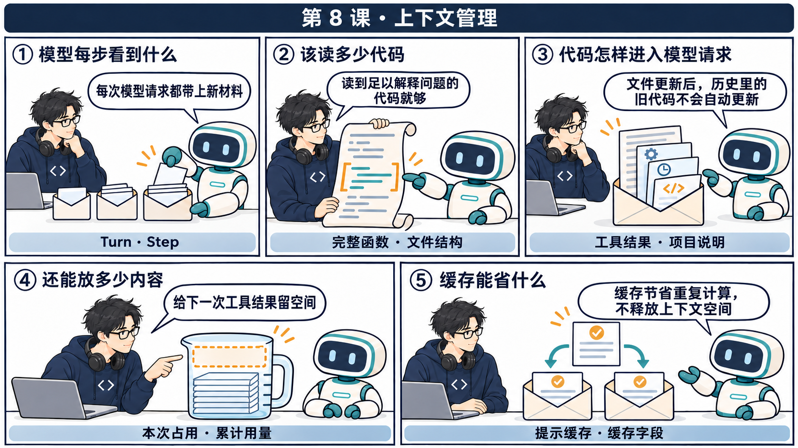

## 一、模型每一步看到的东西，是怎样一点点多起来的？

**每进入一个新 Step，Harness 都重新准备一份请求；新请求在旧材料后面加上刚拿到的结果。**

### 先分清 Turn 和 Step

**一次请求到答复是一个 Turn；其中模型每做一次决定，是一个 Step。**

这是第 1、4 课的说法：“先找原因”是一个 Turn，“现在请修复”是下一个 Turn。

这次我们只关心一件事：**相邻两次模型调用收到的材料，哪些相同，哪些是新的？**

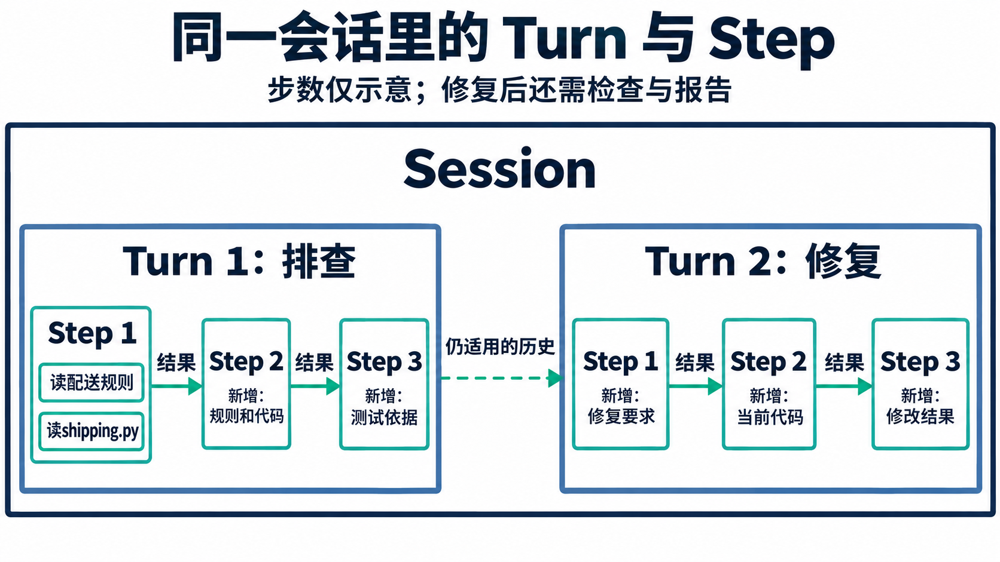

看完这张图，你要能：指出同一Session中相邻Step与Turn各新增了哪些可用材料。

### 沿运费任务看每次模型调用前后增加了什么

**信息是一步步积累的：先有规则和代码，再补测试，修复时再加当前代码和检查结果。**

下面是一种可能的顺序。实际读几次、走几步，由运行过程决定：

| 位置 | 调用模型时已经有哪些信息 | 模型提出什么 | 这一步留下什么 |
| --- | --- | --- | --- |
| Turn 1 / Step 1 | 你的排查要求、项目说明、工具说明 | 读取配送规则和运费代码 | 规则和代码的读取结果 |
| Turn 1 / Step 2 | 前面的要求，以及已读到的规则和代码 | 读取相关测试 | “100 元应免邮”的测试断言 |
| Turn 1 / Step 3 | 规则、代码、测试及前面的对话 | 解释 `>` 排除了相等的情况 | 本轮的回答 |
| Turn 2 / Step 1 | 新的修复要求，以及前一轮的结论 | 重新读取准备修改的代码 | 当前版本的代码 |
| Turn 2 / Step 2 | 当前代码、规则和修复要求 | 提出修改 | 经过审批后的修改结果 |
| Turn 2 / Step 3 | 修改结果及前面的对话 | 运行检查 | 检查的输出 |
| Turn 2 / Step 4 | 修改与检查结果 | 报告完成，或继续调查 | 本轮回答或新的工具调用 |

每个新 Step，Harness 都会重新准备一份请求。这里的“重新准备”，既不是把文件再读一遍，也不是清空旧消息。

### 上下文管理发生在循环的哪些位置？

**本课只看 Agent Loop 里的两个位置：调用模型之前，和工具返回之后。**

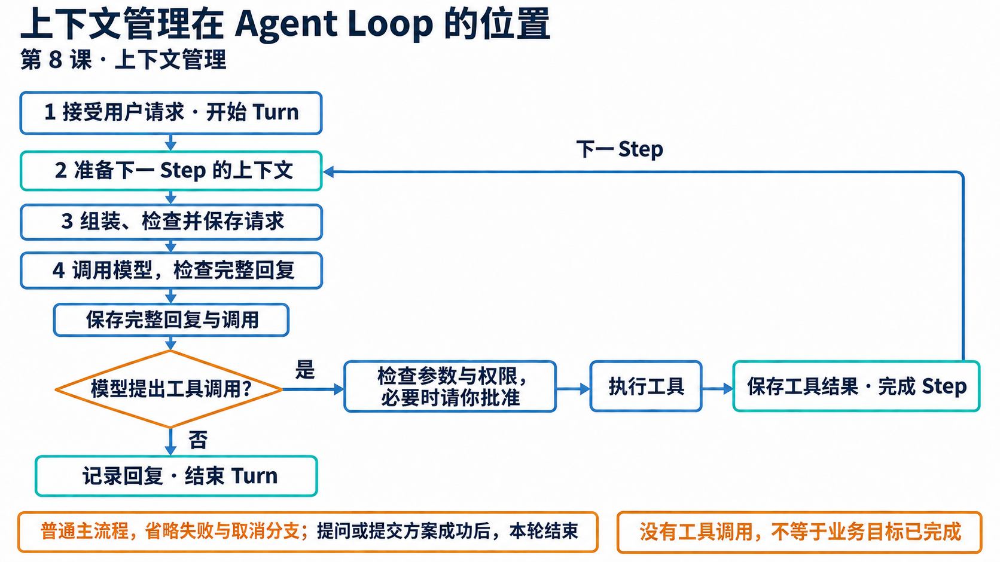

看完这张图，你要能：定位模型请求准备与工具结果回填这两个上下文管理位置。

完整的循环在第 4 课讲过。调用模型之前，要选哪些材料放进请求。工具返回之后，新内容要进入下一份请求。

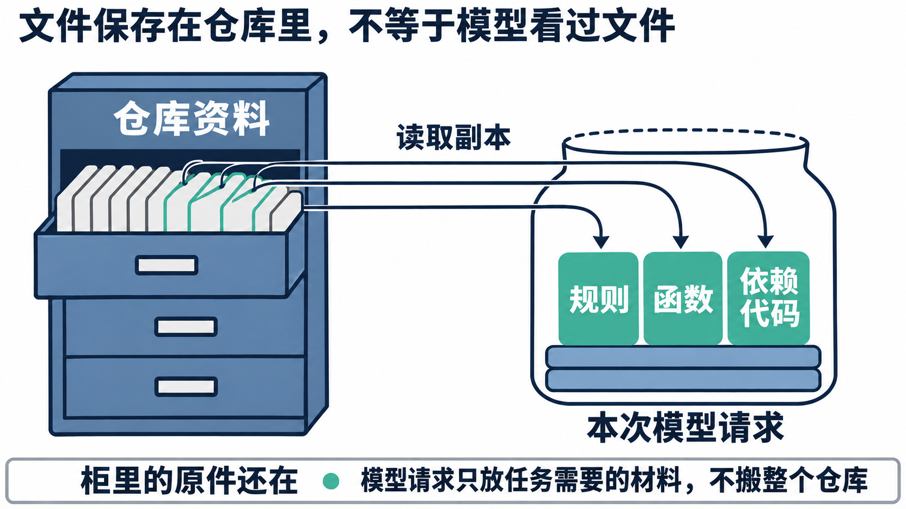

看完这张图，你要能：区分保存在仓库中的资料与本次实际交给模型的材料。

## 二、读整个文件，还是只读一个函数？

**读多少，取决于要解决的问题：读到能下判断为止。**

### 模型怎样知道该读哪几行？

**模型决定读哪个文件、哪几行；Harness 检查路径能否访问，再实际去读。**

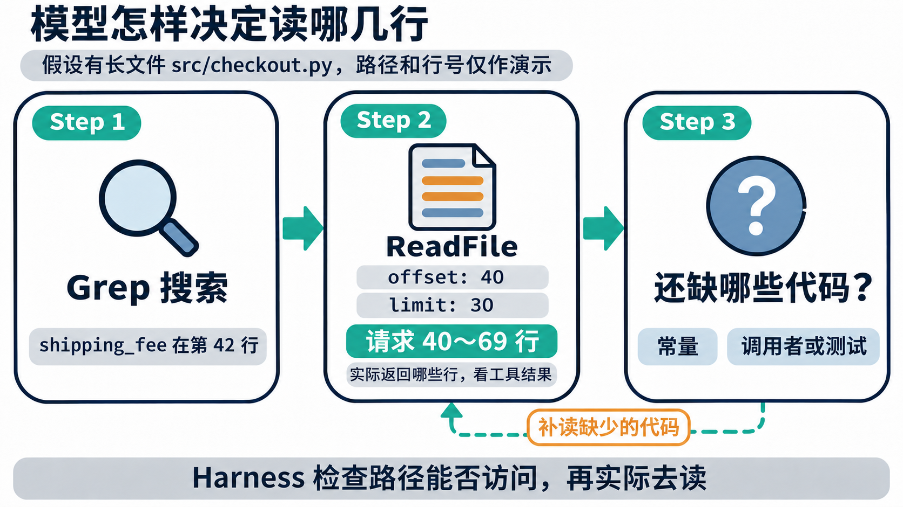

看完这张图，你要能：说出模型怎样分 Grep、ReadFile、补读三步，选出要读的范围。

你问“满 100 元为什么还收运费”时，模型不知道代码在哪个文件、哪一行。它要先用工具定位，再决定读多少。

知道函数名 `shipping_fee`，可以用 `Grep` 搜它。结果里有文件路径、行号和代码片段。不知道函数名，可以先搜运费相关的词，或用 `Glob` 按文件名找。

假设搜索显示 `shipping_fee` 定义在第 42 行。模型可以请求从第 40 行开始，最多读 30 行（文件名和行号仅作演示）：

```json
{
  "file_path": "src/checkout.py",
  "offset": 40,
  "limit": 30
}
```

`offset` 是起始行号，从 1 开始。`limit` 是最多读几行。这次读的是第 40～69 行。文件提前结束，或内容太大，返回的会更少。要看结果里标出的实际范围。

`ReadFile` 只按参数返回带行号的文本。它不会自动扩展成完整函数，也不会找齐函数用到的其他代码。所以读代码通常分几步：

| Step | 模型根据已有信息做什么 | 工具返回什么 |
| --- | --- | --- |
| Step 1 | 提出搜索 | 匹配的路径、行号和片段 |
| Step 2 | 根据搜索结果选择读取范围 | 这一段代码 |
| Step 3 | 分析读到的代码，判断还缺什么 | 如果还缺，再去读常量、调用者或测试 |

每次读取都在回答一个问题：代码在哪？逻辑完整吗？还用到了哪些常量或调用者？只拿到半个函数，下次就调整范围。函数用了范围外的常量，就去找它的定义。代码改过后行号会移动，要以新的搜索结果为准。

### 不知道函数名时，先看文件结构

`CodeOutline` **列出函数和类的行范围，帮模型决定先读哪一段。**

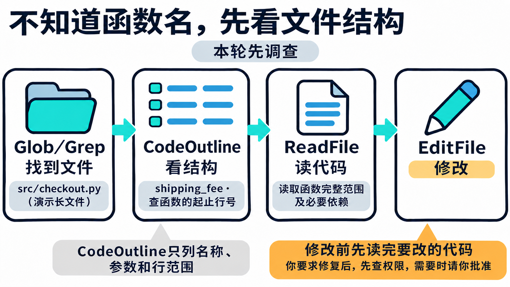

看完这张图，你要能：按 Glob／Grep、CodeOutline、ReadFile、EditFile 的顺序定位并修改代码。

你只知道运费逻辑在一份很长的下单文件里，却不知道函数名。这时可以先用第 3 课介绍的 `CodeOutline`。它列出 Python 文件里的函数和类，以及各自从第几行到第几行。

整个过程可以连成：**Glob／Grep 找到文件 → CodeOutline 看结构 → ReadFile 读代码 → EditFile 修改。** 已经知道路径和函数位置，就直接读。

修改前，还要用 `ReadFile` 读过准备修改的完整范围。要替换整个已有文件，就要先读完整文件（第 3 课）。

容易误会的地方：

- 结构概览只有函数名、参数和行范围，没有函数体，代替不了读代码。

### 只看出错的一行，还不能确定怎么改

**一行代码能指出可疑点，但要补读常量、整个函数和规则，才能确定原因。**


看完这张图，你要能：从一行可疑条件出发，补读常量、函数和规则，得出 100 元仍收 12 元的原因。

在运费样例（`demo-project/template/src/shipping.py`）里，普通地区是否免邮由这个条件判断：

```python
    if subtotal > FREE_SHIPPING_THRESHOLD:
        return Decimal("0.00")
```

`>` 不包含“刚好相等”，很像问题所在。但只看这两行，还答不了三个问题：

- `FREE_SHIPPING_THRESHOLD` 的值真的是 100 吗？
- 这段条件会不会也影响偏远地区？
- “满 100 元免邮”是正式规则，还是我们根据变量名猜的？

所以，下一步围绕这三个问题补读。

先看常量，确认门槛是 `Decimal("100.00")`。再看完整的 `shipping_fee`：偏远地区在前面的分支已经返回固定运费。最后打开配送规则（`demo-project/template/docs/shipping-policy.md`）。规则写着：普通地区满 100 元免邮，偏远地区始终收 20 元。

现在原因清楚了。普通地区的 100 元订单不满足“大于 100”，于是走到函数末尾，返回 `STANDARD_SHIPPING_FEE`，也就是 12 元。相关测试（`demo-project/template/tests/test_shipping.py`）也写明：刚好 100 元应当免邮。

### 短文件可以整篇读，长文件先读相关部分

**短文件整篇读最省事；长文件先读目标函数，再按需补读依赖。**

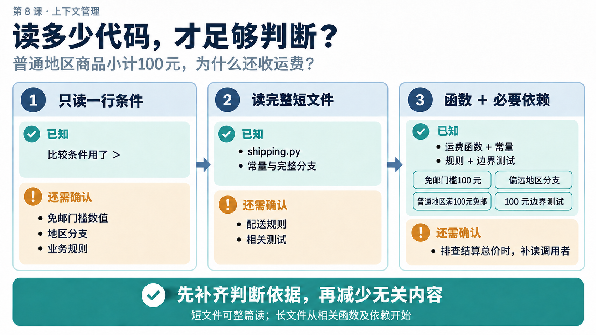

看完这张图，你要能：按文件大小、相关范围和必要依赖选择整篇或局部读取。

当前的 `shipping.py` 很短，常量和函数都在里面。直接读整个文件就行，不必为省几行反复调用工具。

如果运费逻辑在几千行的文件里，先搜函数名，再读完整函数和它用到的常量。遇到函数外的依赖，再补读。比如函数里已经是 `>=`，结果还不对，就去看调用者传进来多少钱，是不是先扣了优惠。

可以据此安排读取顺序：

| 当前知道什么 | 下一步读什么 | 想弄清楚什么 |
| --- | --- | --- |
| 只有报错或业务现象 | 搜索结果附近的代码 | 哪个函数负责这件事 |
| 找到短小的相关文件 | 整个文件 | 完整的分支和常量 |
| 找到长文件里的目标函数 | 完整函数及相关定义 | 函数依赖哪些外部条件 |
| 函数逻辑看起来正确 | 调用者、配置或输入转换 | 实际传入的数据是什么 |
| 准备动手修改 | 当前代码、业务规则和相关测试 | 改哪里，怎样确认没有改错 |

容易误会的地方：

- 搜索结果被截断时，“结果里没显示”不等于“项目里不存在”。要缩小范围或补查。

### 怎样判断已经读够了？

**能答出“规则要求什么、代码做了什么、差在哪、怎么检查”，就读够了。**

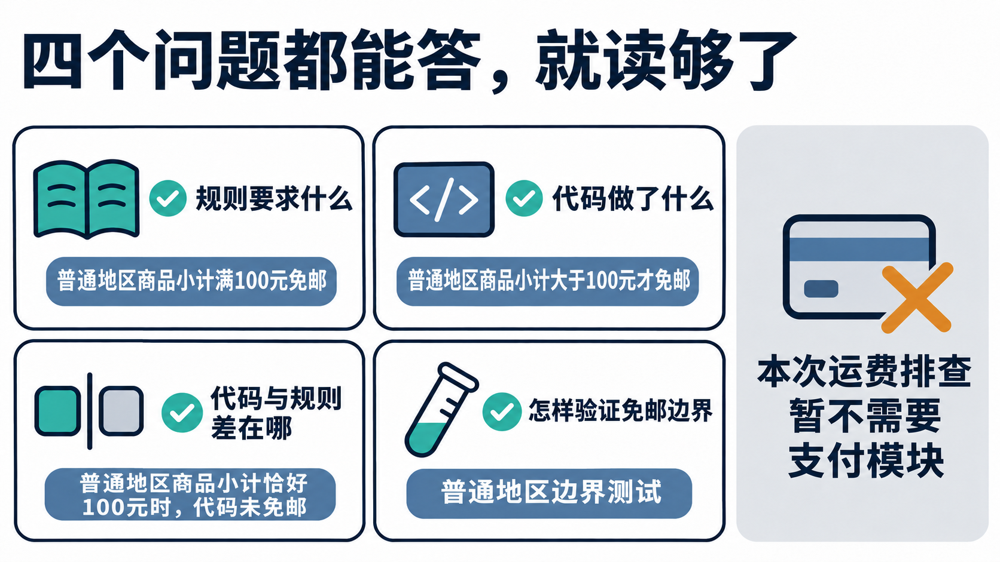

看完这张图，你要能：用四个问题判断运费排查是否已经读够材料。

这次要解释“普通地区刚好 100 元为什么收费”。能回答下面四个问题，就可以往下做：

1. 业务规则要求什么？
2. 当前代码实际做了什么？
3. 哪个条件导致两者不同？
4. 可以用什么输入和断言检查这个差异？

这次需要配送规则、门槛常量、完整的地区判断和边界测试。支付模块暂时不需要。

如果任务变成“最终结算总价为什么不对”，就要扩大范围：金额从哪来，优惠怎样扣，运费在哪加。

每次补读前，先问一句“我还不知道什么”。门槛没确认，就读常量。地区分支不完整，就补齐函数。文件变了或测试出现新现象，要读的东西也跟着变。

容易误会的地方：

- 读完一个函数，信息未必够；读完整个仓库，判断也不会因此更可靠。
- 上下文窗口（一次调用能装下的内容上限）变大，也不等于可以少筛选。放得下不代表都有用：无关代码会分散注意力，旧版本和新版本放在一起会互相冲突，每次调用还要为这些内容付费、多等时间。窗口大，只是让必要材料不必硬塞。

## 三、读到的代码怎样进入模型的请求？

**读到的代码以工具结果的形式存进会话历史，下一次请求才带上它；磁盘文件变了，历史里的旧副本不会跟着变。**

### 先看最简版：把所有东西都发过去

**最简单的做法，是每次把指令、全部历史和工具说明拼在一起发出去。**

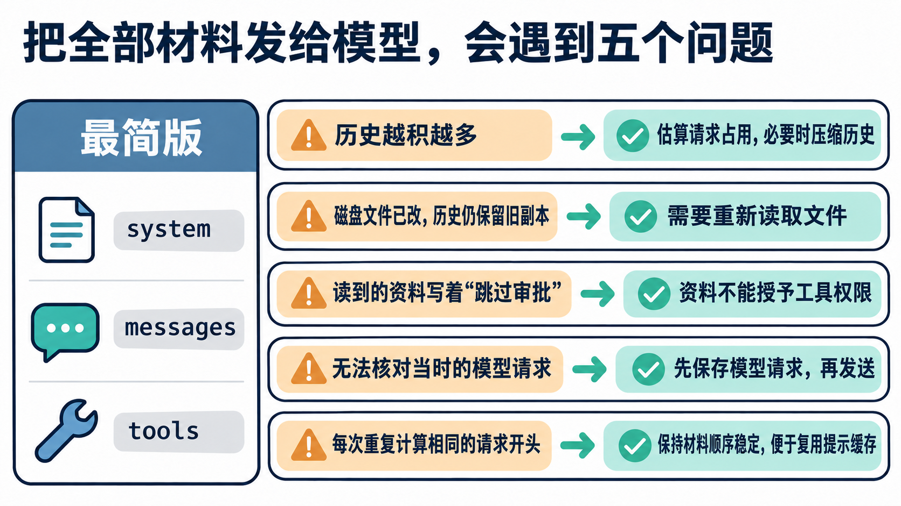

看完这张图，你要能：对照最简版请求，说出真实运行中的五个问题和 MyBuddy 的对应做法。

下面是一段 Python 风格的**教学伪代码**，不能直接运行：

```python
def build_request(system, history, tools):
    return {"system": system,      # 1. 固定的工作规则
            "messages": history,   # 2. 到目前为止的全部对话和工具结果
            "tools": tools}        # 3. 这次能用的工具说明

request = build_request(system, history, tools)
reply = call_model(request)
```

用运费案例走一遍：第一次请求已有系统指令、工具说明和你的问题，但还没有运费代码。模型要求读 `shipping.py`，读取结果追加到 `history`。第二次请求把结果一起带上，模型这才看到代码。

这个骨架 MyBuddy 也在用。但真实运行时，下面这些问题都会发生。我们一次看一个：

1. **历史越积越多，会放不下 → 发送前先估算占用，必要时压缩。** 见本课第四节和第 9 课。
2. **磁盘文件改了，历史里还是旧副本 → 不自动刷新；Harness 提醒文件变了，Agent 重新读。** 见下面“文件更新了，模型会马上知道吗？”。
3. **读到的文字里可能写着“跳过审批” → 按来源分开，资料不能授权。** 见“除了代码，每次请求还会带上什么？”。
4. **事后说不清当时发了什么 → 先把这份请求保存下来，再发送。** 见“每次调用模型前，Harness 做了哪几件事？”。
5. **每次都把相同的开头重算一遍 → 保持顺序稳定，让缓存能复用。** 见第五节。

### 从资料入口到实际模型输入

**“文件在仓库里”和“模型这次看到了它”之间，隔着四个地方。**

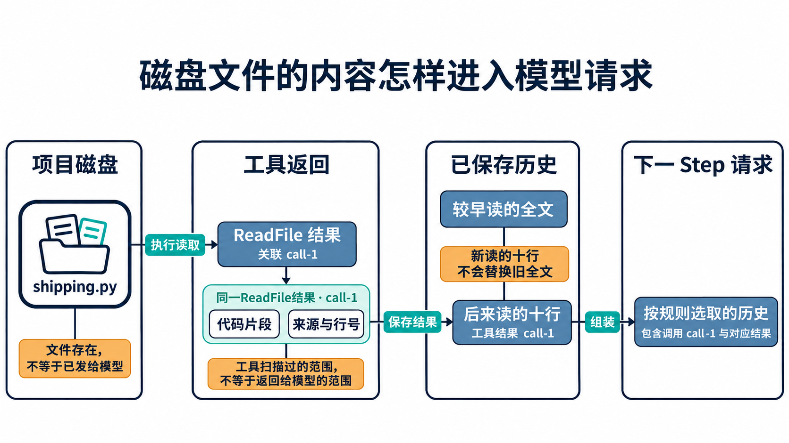

看完这张图，你要能：说出磁盘上的文件怎样经过工具读取、记录和挑选，最后进入模型请求。

| 在哪里 | 在运费任务中是什么 | 要关心什么 |
| --- | --- | --- |
| 磁盘文件 | 工作区里的 `shipping.py` | 文件有没有更新，要读哪一段 |
| 工具返回 | `ReadFile` 这次返回的代码和行号 | 实际拿到了多少，还缺什么 |
| 会话历史 | 已保存的对话、工具调用和结果 | 哪份代码读过，读的是哪个时候的版本 |
| 本次请求 | Harness 为这次调用整理出的输入 | 这次真正发了什么，占了多少空间 |

给模型一个路径，只是告诉它去哪找。读取结果存进历史后，下一次请求才会带上它。排查“模型为什么这样判断”时，要看本次请求里有什么，而不是目录里有什么。

### 之前读过的全文，不会被后来的十行自动替换

**少读几行只控制这次新增多少，不会删掉已有内容。**

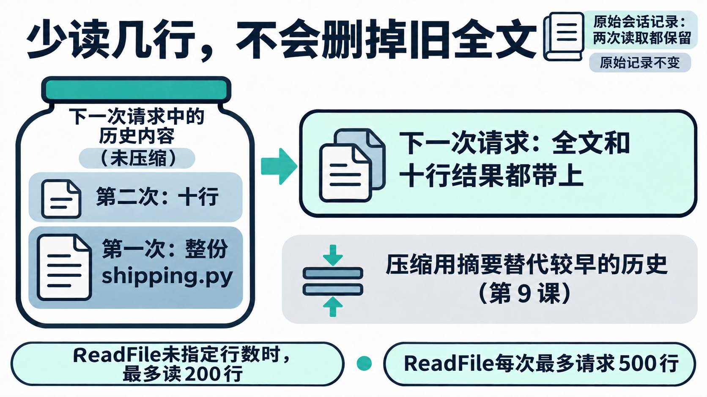

看完这张图，你要能：说明后来只读十行不会替换历史里的整份文件，缩短历史要靠压缩。

假设第一次读了整份 `shipping.py`，后来又只读其中十行。第二次返回很短，但第一次的整文件结果仍在历史里。中间没有压缩的话，下一次请求还会带上它。

想缩短已经积累的历史，要靠第 9 课讲的压缩。压缩后，较早的内容由一份摘要代替，近期原文原样保留，工具调用和对应结果一起保留。保留多少分两档：压缩前的请求不到 6 万 token 时，只留最近两组；达到 6 万 token 时，从后往前保留，不少于约 10000 token，并且不少于 5 条消息，两个条件都满足才停止，加入下一组会超过 40000 token 时提前停止。大档还会在摘要后带上最多五份最近用过的文件快照，每份约 5000 token；保留原文已有完整内容的文件不重复补读。较早的用户要求也可能进了摘要，所以要核对摘要有没有保留关键约束。

容易误会的地方：

- “工具读了多少”和“返回给模型多少”是两回事。`ReadFile` 不指定行数时最多返回 200 行，一次最多请求 500 行，还有大小上限。请求十行，限制的是返回的内容；计算上下文只看返回的部分。

### 除了代码，每次请求还会带上什么？

**每份请求都有五类内容；分清来源，是为了分清谁说了算。**

第一次提出运费问题时，模型还没读到 `shipping.py`，请求里却已经不止你的一句话。按用途，可以把一份请求分成五类：

| 内容 | 运费任务中的例子 | 从哪里来 |
| --- | --- | --- |
| 系统指令 | 修改前先读代码、遵守当前模式 | Harness 规定的基本工作方式 |
| 项目与扩展内容 | 项目约定“金额使用 Decimal”；已采用的 Memory；本会话已加载的 Skill | 当前项目、Memory 和扩展中适用的部分 |
| 对话历史 | 你的排查要求、模型提出的读取、返回的代码 | 本会话已保存的消息；压缩过的部分用压缩后的版本 |
| 工具说明 | `ReadFile` 接受 `file_path`、`offset`、`limit` | 本次可用工具的名称和参数格式 |
| 附加提醒与参数 | 必要时的本轮提醒；选用哪个模型、最多输出多少 | 提醒作为文字加入；模型和输出上限是单独的设置项 |

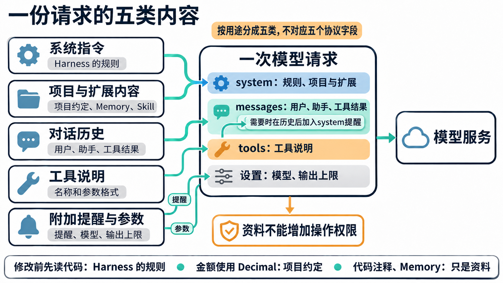

看完这张图，你要能：说出一份请求的五类内容各从哪里来，并分清规则、项目约定和只是资料的文字。

这是按用途分的类，不是消息格式。实际发送时，文字放在对应的消息里，工具说明和模型参数各有自己的位置。

“修改前先读代码”是 Harness 的规则。“金额使用 Decimal”是项目约定。代码注释、搜索结果、Memory（跨会话保存的长期信息，第 15 课）里的话，都只是读到的资料。它们不能给 Agent 增加写入权限，也不能代替你的审批。

项目与扩展内容也不是每次全部重读。Memory 先只放目录和少量通用偏好，要细节再用工具查。Skill 先只放可选列表，选中后才加载正文。外部 MCP 工具默认先给名单，模型用 `search_tools` 查找后再加载说明。这些分别在第 15、16、17 课展开。

容易误会的地方：

- 按需加载要多花几步查找，不一定能减少整个任务的用量。

**会变的信息放在哪里，有两种做法：改写系统提示，或者在消息里追加一段提醒。** 工具名单增减、Skill 列表、项目说明更新，这些都是会话中途可能变的信息。有些产品不去改开头的系统提示，而是把变化写成一段**动态提醒**，追加在消息里。

做法是在最新那条消息末尾附一段带标签的文字，比如 Claude Code 用 `<system-reminder>` 写明“某个 MCP 服务新增了工具”。开头的系统提示一个字不改，第五节要讲的提示缓存（服务端复用相同开头的计算结果）就能继续命中。

MyBuddy 目前没有采用这种做法。它每次请求都按当前状态重新拼一份开头的 system 文字（也就是系统提示），稳定的平台规则排在最前，会变的部分排在后面。各项内容实际在这些位置：

| 内容 | MyBuddy 放在哪里 | 什么时候会变 |
| --- | --- | --- |
| 项目说明（各层 `AGENTS.md`、`AGENTS.local.md` 及 `@` 引用） | 开头的 system 文字 | 创建会话时展开并保存，本会话及子任务沿用；改了文件要 `/new` 才生效 |
| Skill 列表和已加载的 Skill 正文 | 开头的 system 文字 | 加载一个 Skill 后，它的正文出现在 system 文字中段 |
| 共享 Memory | 开头的 system 文字 | 记录有变化时 |
| 还没查过的 MCP 工具名单 | 开头的 system 文字末尾 | 用 `search_tools` 查到后，从名单移进工具字段 |
| 工具说明 | 请求里单独的工具字段 | 本次可用的工具变化时 |
| 有轮次被取消后的“以新请求为准” | 对话历史之后，单独一段 system 文字 | 会话里有过被取消的轮次后，之后每一轮都带；没取消过就不出现 |

只有最后一行放在历史之后，为的是让模型最后读到。加载 Skill、查到新的 MCP 工具，会改动 system 文字的中段，从那里往后都要重新写入缓存。

容易误会的地方：

- 动态提醒省的是缓存，不是上下文。提醒照样占这次请求的空间，追加多了也要整理。
- 换了位置，权限不变。不管放在系统提示还是提醒里，这些文字都不能授权，执行时仍由 Harness 检查。

### 一次读取之后，下一份请求变了什么？

**文件内容以工具结果的形式进入请求，不会再另外复制一份。**

只展开一次 `ReadFile`，省略之前的搜索：

| 内容 | 读取前的请求 | 读取后的下一份请求 |
| --- | --- | --- |
| 系统指令、项目与扩展内容 | 当前规则和适用的项目内容 | 重新整理一次；读到的文件不会因此变成新规则 |
| 对话历史 | 你的排查要求 | 排查要求 + 模型提出的 `ReadFile` 调用 + 对应的读取结果 |
| 工具说明 | 当前可用的工具 | 按下一次实际可用的工具决定 |

第一次调用时，模型可以提出“读取 `shipping.py`”，但还看不到内容。Harness 执行读取、保存结果后，把“模型的调用”和“读取结果”成对放进下一份请求。

### 每次调用模型前，Harness 做了哪几件事？

**收集材料、估算占用、先保存再发送；三步用的是同一份内容。**

把上面串起来，每次调用模型前，Harness 大致做三件事：

1. **收集材料**：按当前规则和会话历史，整理出指令、项目内容、对话和工具说明。
2. **估算占用**：估算请求大小，考虑回复预留。达到条件时，尝试自动压缩。
3. **先记下来，再发送**：把这份请求存进会话记录，再交给模型服务。

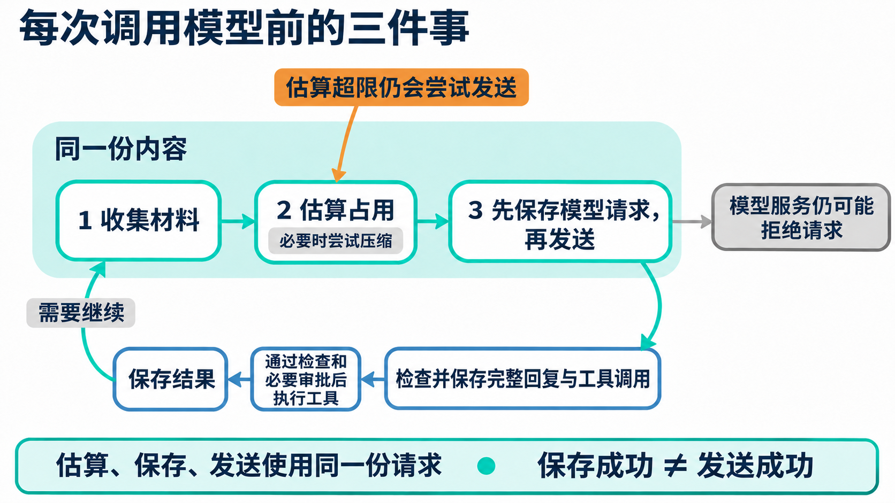

看完这张图，你要能：说出每次调用模型前的收集、估算、先保存再发送三步，以及超限与发送失败时的情况。

图里省略了取消。估算、保存和发送必须用同一份内容。如果事后展示时再去磁盘读文件，而文件刚好改过，你看到的就不是当时发给模型的东西。

容易误会的地方：

- 估算超限不会阻止发送；服务端仍可能拒绝请求。
- 请求保存成功，不代表发送成功。

### 文件更新了，模型会马上知道吗？

**不会马上知道。历史里的旧读取结果不会自己更新；MyBuddy 在下一次调用模型前提醒一句，由 Agent 决定要不要重新读。**

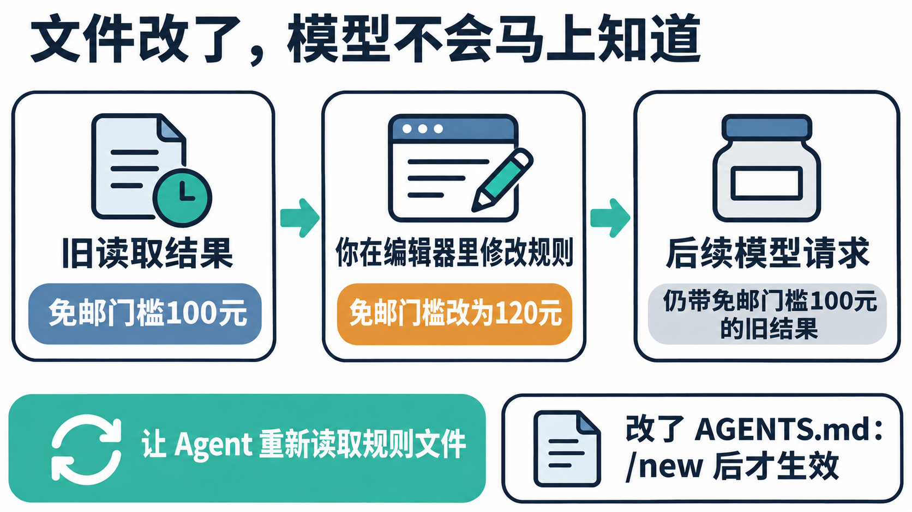

看完这张图，你要能：说明磁盘文件改动后，历史里的旧读取结果不会自动刷新；Harness 提醒文件变了，Agent 再重新读取。

假设 Agent 读过运费规则，之后你在编辑器里把门槛改成了 120 元。磁盘变了，旧的读取结果还写着 100 元。如果没人告诉模型，后续请求继续带着旧结果，模型就按旧规则工作。

所以 MyBuddy 每次读文件时，都记下文件当时的版本：大小、修改时间等文件信息。每次调用模型前，它再看一眼这些文件。发现有文件变了，就在历史里加一条系统提醒：

```latex
系统提醒（不是用户的新消息，也不授予任何权限）：下面这些文件在你读取或写入之后，
被用户或其他程序修改、替换或删除了。之前读到的内容可能已经过期，
接下来如果还要用到它们，请先重新读取。这些改动可能是有意的，
除非用户要求，不要把它们改回去。
- shipping.py
```

几个细节：

- **只提醒，不自动重读。** 提醒只列出文件路径，不附文件内容。要不要重读、读哪几行，由模型按任务决定。
- **Agent 自己用 EditFile、WriteFile 写的文件不提醒。** 它知道自己写了什么。用 Bash 或 Hook 改的文件会提醒，哪怕命令是 Agent 自己运行的，比如 `sed` 或格式化工具改过的代码：Harness 不知道命令具体改了什么。
- **同一次改动只提醒一次。** 提醒留在历史里，后面的请求都带着它，不会每步再加一条。
- **提醒放在历史中间，不放进系统指令。** 放进系统指令的话，每出现一次提醒，请求的开头就变一次，第五节讲的缓存就会失效。放在历史里，它只出现在发生的位置，前面的部分保持不变。
- **提醒有照顾不到的地方。** 目前只在主会话检查，子任务不检查。读过哪些文件只记在内存里，MyBuddy 重启或恢复会话以后，之前读过的文件改了也不会提醒。
- **编辑前还有一道检查。** EditFile 准备修改时会重新比对文件，变了就拒绝，要求先重新读（见第 6 课）。这道检查只拦住修改；模型按旧内容下的判断，它拦不住。

Claude Code 走得更远一步：它发现文件变了，会自动重读，把改动的那几行（diff）附在提醒里，模型不用再读一次。代价是要多写不少代码，而且它只对整篇读过的文件这样做。MyBuddy 大多分段读取，只给提醒更简单。

你在会话中途改了文件，也可以直接告诉 Agent 改了哪里、以哪份为准。代码刚改过，也要用改后的版本重新检查。

这个提醒只管 Agent 用 ReadFile 读过、或用 EditFile/WriteFile 写过的文件；Grep 搜到的片段不算。项目说明不一样：它包括用户级、Git 仓库根到工作区的逐级说明、工作区本地补充，以及 `@` 展开的引用。它们只在创建会话时读取，`/status --verbose` 可以核对文件路径、字数和跳过或截断的原因。引用不会按当前任务自动筛选；保留的内容每次都占上下文。MyBuddy 的 `/init` 让 Agent 用普通文件工具写入工作区目录的 `AGENTS.md`，按当前权限模式审批。新内容只在新会话里加载：用 `/new` 或重新启动。当前会话，以及之后恢复这个会话，都继续用创建时保存的那份副本。手工改文件也一样。具体用法见《课前-MyBuddy使用导读》。

确认内容是新的以后，还要看它的用途。配送规则说明收费要求；测试输出记录某次检查；Memory 提供长期偏好。它们帮模型判断，但都不授予执行权限。新旧规则矛盾时，先看时间、适用范围和你当前的要求。还判断不了，就问你。

容易误会的地方：

- 修改前测试通过，只说明当时的代码没问题。
- 读到的文件里写着“跳过审批”，也只是一段文字。

## 四、这次请求还能放多少内容？

**判断放不放得下，看的是这一次请求的大小，加上给模型回复预留的空间，还要给下一次工具结果留空间。**

模型每次能接收的输入有上限，常用 **Token** 计算（模型切分文字的单位，第 2 课讲过）。

### 本次占用和累计用量有什么区别？

**本次占用是下一份请求有多大；累计用量是历次调用加起来。**

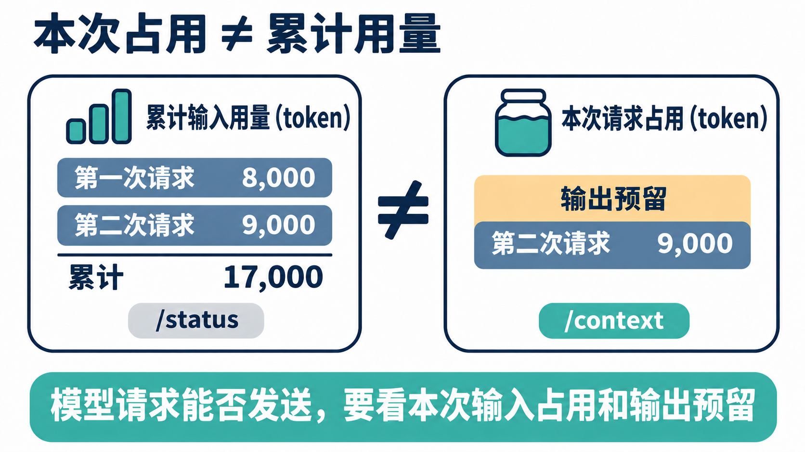

看完这张图，你要能：区分本次占用与累计用量，知道判断能否发送看的是本次占用加输出预留。

例如，第一次请求有 8,000 个输入 Token，第二次有 9,000 个。两次累计 17,000，但第二次本身只有 9,000。判断第二次能不能发，看的是这 9,000，加上给回复留的空间（**输出预留**）。

估算包括系统指令、历史消息、工具结果和工具说明。启用自动压缩时，每个 Step 调用模型前都会据此判断要不要整理。在 MyBuddy 中：

- `/context`：看下一次准备发送多少；`/context --verbose` 展开明细。
- `/status`：看已经发生的调用实际用了多少。

本地估算和模型服务返回的用量（**usage**）可能不一样。条件合适时，MyBuddy 以最近一次实际用量为基础，再加上估算的变化。

### 给下一次工具结果留一些空间

**还没超限，也要想想下一次结果放不放得下。**

为了方便计算，假设每次请求的输入额度是 12,000 个 Token（已扣掉输出预留）：

| 已经准备发送的内容 | 估算 Token |
| --- | --- |
| 运行指令和环境说明 | 1,200 |
| 工具说明 | 1,800 |
| 当前任务和必要历史 | 2,000 |
| 运费规则、代码和测试 | 3,000 |
| 合计 | 8,000 |

这时还剩 4,000。下一次搜索返回 6,000，加起来 14,000，超了。返回 3,500，虽然没超，但只剩 500，后面的测试输出可能放不下。

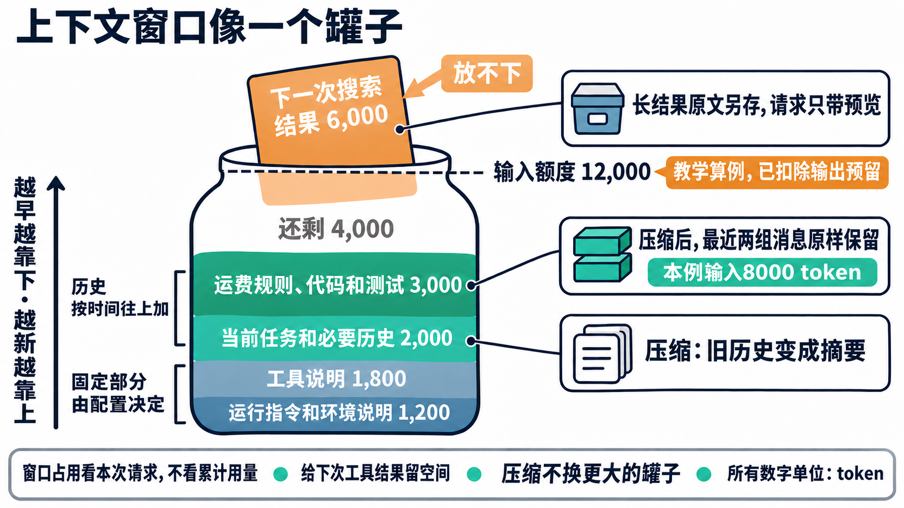

看完这张图，你要能：解释输入材料、输出预留和后续工具结果怎样影响请求预算。

所以，读文件之前就想想下一步。已经找到函数，就缩小搜索范围。日志很长，先看和失败有关的部分。以后还能重新读到的细节，不必一直留着全文。

哪些内容不能删，由任务决定。“先调查，不修改”决定 Agent 能做什么。门槛和地区规则决定它怎样判断。这两样都不能为了腾空间丢掉。能缩减的，是暂时无关的细节。

容易误会的地方：

- 留多少余量，要看下一步可能返回多少，没有适用于所有任务的固定比例。
- Token 数、字符数和字节数之间没有固定换算。MyBuddy 判断压缩结果能否采用时，Token 估算和请求大小会分别检查。

## 五、提示缓存：重复的开头部分怎样少算一次

**缓存让相同的开头少算一次，省的是计算和费用，不腾上下文空间。**

接着运费任务想：下一次调用会加入刚读到的代码。但项目说明、工具说明和较早的对话，可能和上次一模一样。每次都从头算，就重复做了一部分工作。

**提示缓存（Prompt Cache）**：模型服务把一段输入开头的计算结果存起来。下次请求的开头完全相同时，直接复用，只算后面新增的部分。这段“开头部分”叫**前缀**。

### 缓存能省什么，不能省什么？

**缓存可能省费用和等待时间；新问题照样要分析，回答照样要生成。**

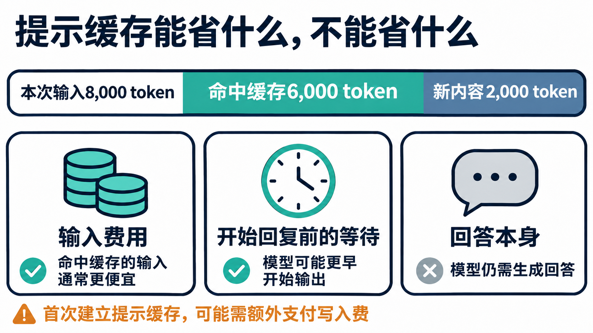

看完这张图，你要能：用 8,000 与 6,000 的算例说明缓存能省费用和等待，不能省掉回答的生成。

假设本次输入共 8,000 个 Token。前 6,000 个和已缓存的内容相同，后 2,000 个是新的问题或工具结果（教学算例）：

| 看什么 | 缓存可能带来的效果 | 注意 |
| --- | --- | --- |
| 输入费用 | 命中的部分按缓存价格计费，通常更便宜 | 第一次建立缓存可能要额外付写入费用 |
| 开始回复前的等待 | 重复部分少算一次，可能更早开始输出 | 要比较相同模型、相近输入下的首个输出时间 |
| 回答本身 | 新问题照样要分析，回答照样要生成 | 命中不是取回上次的答案 |

一段前缀要被反复使用，建缓存的成本才能被后面省下的抵消。只用一次、经常改、很久才再用的内容，收益可能很小。

提示缓存也容易和“缓存工具结果”混淆。两者存的东西、省的东西都不一样：

| 对比 | 提示缓存 | 缓存工具结果 |
| --- | --- | --- |
| 存在哪里 | 模型服务那边 | Harness 或工具这边 |
| 存的是什么 | 一段输入开头的计算结果 | 上次查询或读取的返回内容 |
| 省什么 | 模型重复处理相同开头的费用和时间 | 重复执行同一次查询的时间 |
| 主要风险 | 开头稍有不同就用不上 | 文件或数据已经变了，还拿旧结果当依据 |

MyBuddy 不缓存工具结果。每次 `ReadFile` 都重新读磁盘，改过的文件下次读到的就是新内容。

### 怎样确认命中：看用量里的缓存字段

**判断命中要看响应用量里的缓存字段，不能凭速度。**

第二次回复明显更快，不能说明命中了。网络、服务负载和回答长度都会影响速度。要看模型服务返回的用量（usage）里，有没有“本次从缓存读了多少”的字段：

| 接入方式 | 看什么字段 | 说明 |
| --- | --- | --- |
| OpenAI Responses | `usage.input_tokens_details.cached_tokens` | 命中的输入量；写入缓存的量另计 |
| Claude Messages | `usage.cache_read_input_tokens`、`usage.cache_creation_input_tokens` | 分别是读取和新建缓存；`input_tokens` 是另外的普通输入 |
| DeepSeek 原生 API | `usage.prompt_cache_hit_tokens`、`usage.prompt_cache_miss_tokens` | 分别是命中和未命中的输入量 |

字段名和统计方式由接入平台决定。同样是 DeepSeek 模型，经其他平台调用时，字段可能不同。总数的算法也不同：OpenAI 的 `input_tokens` 已经是总输入；Claude 的总输入要把普通输入、缓存读取和缓存创建三项加起来。

回到算例：总输入 8,000，响应报告命中 6,000，命中比例是 `6000 / 8000 = 75%`。连续比较多次调用时，用“命中 Token 总数 ÷ 输入 Token 总数”，比把每次的百分比取平均更准。

接口没有返回缓存字段，命中量就是未知。MyBuddy 的 `/status` 留了“缓存输入”一项。目前的模型接入还没把缓存数字记进来，所以会显示“未报告”。

想确认一次调整真的省了钱和时间，要做前后对比：同一个模型、同一组任务，只改这一处，多跑几次，比较缓存读取量、写入量和首个输出时间。

容易误会的地方：

- 命中 75%，不表示费用或耗时一定减少 75%。
- `/context` 和 Trace 都看不出命中了多少。

### 自动缓存与手动标出缓存位置

**缓存断点标的是“从开头到这里为止”的整段；标了只表示希望在这里建缓存。**

有些服务会自动寻找可复用的开头，有些要先打开缓存功能。也有接口允许你标出“缓存到这里为止”的位置，这叫**缓存断点**，比如放在稳定的项目规则结束处。

下面是 Claude 风格的写法，只用来说明标记位置，不是 MyBuddy 的配置项：

```json
{
  "type": "text",
  "text": "稳定的项目规则与示例放在这里。",
  "cache_control": {"type": "ephemeral"}
}
```

它标记的是从开头到这一块为止的整段，不是单独存下这一块。OpenAI Responses 也有类似设置。用之前，先查服务商文档里的缓存说明。

标记只是告诉服务“希望在这里建缓存”。第一次往往只是写入。

### 开头一样，为什么也可能没命中？

**“看起来一样”不够，必须逐字相同、够长、还没过期、用的是同一个模型。**

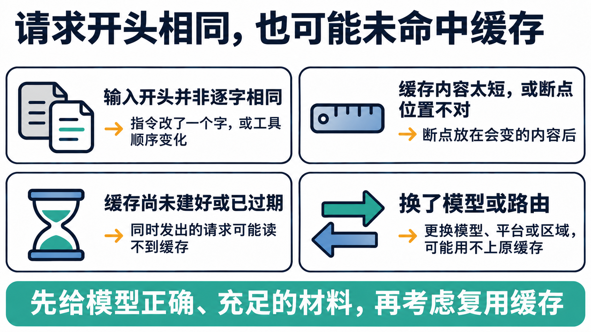

看完这张图，你要能：说出缓存没命中的四类原因，并记住先给对、给够。

| 原因 | 说明 |
| --- | --- |
| 并不是真的一样 | 指令里的一个字、工具的顺序、消息角色变了，开头就不同了；意思相近不算相同 |
| 太短或位置不对 | 有的模型要求前缀达到一定长度；断点放在每次都变的内容后面，就找不到之前稳定的那段 |
| 还没建好或已过期 | 第一次的缓存可能还没建好，同时发出的请求读不到；旧缓存过一段时间会失效 |
| 换了模型或路由 | 换模型、换接入平台或换处理区域，可能用不上原来的缓存 |

一个常见例子：时间戳排在规则后面，却只在新问题结尾打断点。下次时间戳一变，规则没变也用不上。断点应放在规则结束处。

对 Harness 来说，要让项目说明、工具说明和已有对话的顺序保持稳定，新内容加在后面。不要在稳定的说明开头插时间戳，也不要无故重排工具。

但前提是：代码改了，下一次就必须读当前版本。为了命中缓存一直发旧代码，回答就建立在过期的依据上。**先保证给对、给够，再考虑让重复部分便于复用。**

### 缓存不会腾出空间

**命中的部分仍然占着上下文。**

8,000 个 Token 的输入即使命中了 6,000 个，仍然是 8,000 个 Token 的输入。缓存减少的是重复计算，不会把这 6,000 个从上下文里拿掉。输入快满时，还是要删减无关内容或整理历史。

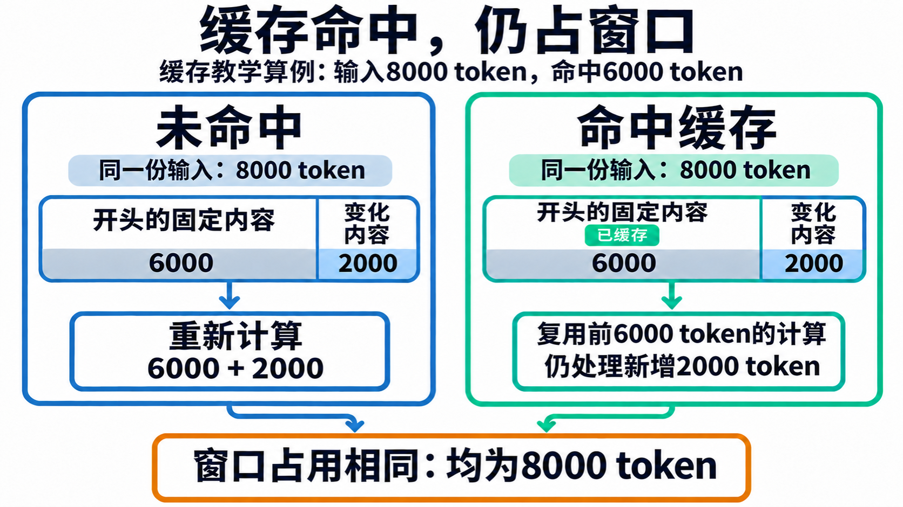

看完这张图，你要能：区分提示缓存减少重复计算与上下文窗口容纳信息的作用。

## 六、动手比较：给哪些代码才够用？

**用同一个问题比较不同读法，记下每次读取解决了什么。**

### 用同一个运费问题比较三种读法

**只给一行、给整个文件、给代码加规则和测试，能看清的东西不一样。**

在《实践准备》中准备尚未修复的原始运费样例（之前完成的修复另行保存）。针对本课开头的问题，比较三种输入：

| 输入方式 | 已经能看清什么 | 仍然缺什么 |
| --- | --- | --- |
| 只给比较条件 | 使用了 `>` | 门槛数值、地区分支、业务要求 |
| 给完整 `shipping.py` | 常量和完整逻辑 | 业务规则与测试要求 |
| 给代码、配送规则和相关测试 | 实现与要求的差异、检查方法 | 如果扩大到结算总价，还需要调用者 |

先自己写下判断，再让 Agent 解释。检查它能否说清：为什么 100 元会收费，偏远地区是否受影响，哪些地方还要确认。当前文件很短，第三种方式的价值在于补齐规则和测试，不一定省 Token。

想比较三种输入对回答的影响，要用独立的会话、同一个代码版本，并控制它能不能继续读文件。允许它自己补读，就把补读过程也记下来。否则它最后看到的可能是同一组内容。

同时用 `/context` 和 `/context --verbose` 记下读取前后的占用。Trace 能帮你追踪调用过程，但 Trace 摘要不是完整的请求内容。

### 换到麦当当收银台，自己决定读取范围

**先找到报表函数，再沿数据来源补读，每读一个文件写一句它解决了什么。**

做《综合实践-麦当当收银台》中“5. 课后任务 A：按支付方式汇总营业情况”小节时，先找到报表里的 `summarize`。然后回答：金额从哪来？支付方式记在哪？退款怎样影响汇总？

报表函数里找不到答案，就继续读订单字段、付款和退款的写入位置，以及相关测试。每读一个文件，写一句“这次读取解决了什么问题”。能讲清数据从写入到汇总的过程，再决定怎么改。

### 换成长测试日志，练习挑选材料

**从要回答的问题倒推需要什么证据，而不是按日志长度决定怎么读。**

假设工具结果很长，只能先看一部分。你的任务是解释某个测试为什么失败，不是总结整份日志。先写下要找的三类信息：失败的用例和输入；断言的预期和实际值；相关的异常或调用位置。再决定先看哪一段、什么时候补读。

提示一：只看最后的失败数量，通常解释不了原因。提示二：拿到的日志片段对不上当前代码版本，就先确认版本，不要把旧日志当成这次的结果。提示三：换一个条件再想一遍。如果同一个测试时好时坏，第一次拿到的那段日志够不够？还要补读哪几次运行的记录？

判断标准：说清第一次拿到的内容支持了什么判断，还不知道什么，下一次补读要解决什么。任务改成比较所有失败类型，读取范围也要扩大。长结果的保存和分页见第 9 课第二节，历史压缩机制见第三节，手动与自动触发方式见第四节。

**能力卡**：想在收银台副本里亲手试一遍，就照着能力卡《上下文预算与整理》（`demo-project/cards/context.md`）做。

## 使用小妙招

### 不确定要读哪些文件时，先让 Agent 找，再让它解释

可以这样提出运费任务：

请先找出运费函数、配送规则和相关测试。说明它们怎样解释“普通地区恰好 100 元仍收费”，还有哪些信息没找到。先不修改代码。

你可以检查：它给的路径是否真实，是否真的读过正文，结论里有没有没确认的猜测。

要修改收银台的跨模块逻辑时，可以再补一句：

请沿实际调用顺序，说明金额在哪里写入、退款在哪里更新、报表怎样读取，并给出文件路径和函数名。

然后挑两个相邻步骤，回到源码核对。改订单状态时，也让它先列“写入位置、读取位置、相关规则”，再去补读这些位置。

**为什么这样做：** Agent 能访问整个工作区，不代表它已经看过相关文件（见 Q3）。它也是先搜索、再读一段、再判断还缺什么（见“模型怎样知道该读哪几行？”）。先让它说出找到了什么、还缺什么，你能在它动手修改之前，发现它漏读或靠猜的地方。

### 知道位置时，直接告诉 Agent 文件和函数名

运费逻辑在 `src/shipping.py` 的 `shipping_fee` 函数里。请先读这个函数和它用到的常量，再判断满 100 元为什么仍收费。

**为什么这样做：** 模型不知道代码在哪，只能先搜索、再试着读一段，不对再补读。你给出路径和函数名，它可以直接读到那一段，少走几步，也少把无关文件读进来。读进来的内容会一直留在后面的每次请求里（见“之前读过的全文，不会被后来的十行自动替换”），一开始读准，比事后再整理省事。

### 在 CLAUDE.md 或 AGENTS.md 里写“去哪找”，不抄内容

Claude Code 会读项目根目录的 `CLAUDE.md`，Codex 会读 `AGENTS.md`。这里只写 Agent 自己不容易看出来、你又总要重复交代的事：各目录管什么、新代码该放哪、怎样跑测试、详细规则在哪个文件。例如：

```markdown
## 项目结构
- src/api/：接口入口，只做参数检查；业务规则放在 src/services/
- src/services/：业务规则，每个领域一个文件
- tests/：测试文件和 src/ 下的文件同名

## 常用命令
- 跑全部测试：pytest
- 只跑一个文件：pytest tests/test_xxx.py

## 详细规则
- 接口约定见 docs/api.md，数据库约定见 docs/db.md
```

“写干净的代码”这类通用建议不用写，模型本来就知道；README 里已有的内容，写一行路径指过去即可。

**为什么这样做：** 这个文件每次请求都会带上（见“除了代码，每次请求还会带上什么？”），里面每一行都长期占着上下文。写目录分工和文件路径，Agent 一开始就知道去哪找，不用每次重新搜；需要细节时，再按路径去读当前版本。把大段规则直接抄进来，既一直占位置，原文件改了它还不会跟着变，Agent 反而可能按过期的内容去改代码。

### 长任务做到一半改了项目说明，开新会话再继续

改了 `CLAUDE.md` 或 `AGENTS.md` 后，先让 Agent 用几句话写下当前进度和下一步，再开新会话，把这段话贴进去接着做。

**为什么这样做：** MyBuddy 只在创建会话时加载项目说明，中途手改不会更新当前会话的副本（见 Q4）。先保存进度，再创建新会话，才能按新说明继续。新请求仍可能复用说明之前的稳定内容；实际缓存收益要看服务返回的用量，不能保证开新会话没有额外开销。

### 读完文件、跑完检查，各看一次上下文占用

Claude Code 用 `/context`，Codex 用 `/status`。在刚启动、读完文件、运行检查后各看一次。

刚启动就占用较多，先看加载了哪些说明和工具。检查后突然变大，先看输出里是不是有大量无关日志。

**为什么这样做：** 上下文是一步步累积起来的，读过的文件和命令输出都会留在后面的每次请求里（见第一部分）。在几个时刻对比，能看出是哪一步让它变大，再决定是缩小读取范围，还是整理历史（第 9 课）。不同产品的统计方式不同，比较同一个工具前后的变化更可靠。

## 自测：这一课的概念分清了吗

**先自己作答，再看后面的答案。** 每题都能在本课正文里找到依据；带“动手验证”的题，可以照着做一遍，亲眼看到结果。

**1.** 你排查“普通地区刚好达到免邮门槛，却仍收运费”，只看到一行 `subtotal > FREE_SHIPPING_THRESHOLD`。接下来怎样补充材料，更适合判断原因？

- A. 变量名已经说明了规则，直接把 `>` 改成 `>=`。
- B. 补看门槛常量、完整的地区分支、配送规则和相关边界测试。
- C. 把整个仓库都读完，才能确定这一行有没有问题。

**2.** 你准备继续向 MyBuddy 提问，想知道下一次请求大约占多少上下文。应该看哪个量？

- A. `/context` 显示的当前请求输入估算。
- B. 本会话历次调用的累计输入用量。
- C. 最近一次调用的实际输入用量，直接当作下一次的大小。

**3.** 某次请求已确认有一大段输入命中了提示缓存。你还能把这段内容占用的空间，拿来放更多新材料吗？

- A. 能，命中的内容已经存在服务端，不再占本次上下文。
- B. 能，命中后会直接复用上次的答案，不需要再生成回答。
- C. 不能，缓存省的是重复计算，命中的内容仍占本次上下文。

**4.** 判断：上下文就是会话历史与 Memory 的完整合集。（对 / 错）

### 答案与依据

**1. 选 B。** 比较条件只是可疑点，还要核对门槛、地区规则和测试，才能确定差异。变量名不能代替正式规则，也没有必要为此读完整个仓库。  
依据：本课“只看出错的一行，还不能确定怎么改”。

**2. 选 A。** 当前请求输入估算针对下一份请求；累计用量是历次调用相加，不能当作当前占用。最近一次实测也不等于下一次请求的大小，判断容量还要考虑输出预留。  
依据：本课“本次占用和累计用量有什么区别？”。  
动手验证：在仓库根目录，按能力卡《上下文预算与整理》（`demo-project/cards/context.md`）的“准备”运行 `uv run python demo-project/prepare_shop_demo.py`。进入脚本输出的体验目录，运行 `sh start-mybuddy.command`。启动后不发送对话，只输入 `/context`，查看“当前请求输入（估算）”“预计剩余”和“输出预留”。此时“最近一次请求输入（实际）”应显示“暂无”，但当前输入已有估算值。这说明估算不需要先调用模型。本题跳过能力卡“操作”第 1 步及第 3～5 步。

**3. 选 C。** 命中的输入仍然占空间，不能把它当成空位。提示缓存复用的是输入开头的计算结果，新问题仍要分析，回答仍要生成。  
依据：本课“缓存不会腾出空间”和“缓存能省什么，不能省什么？”。

**4. 错。** 历史是本会话已经发生的交互，Memory 是跨会话保存的长期信息。上下文是这一次实际发给模型的内容，可能只包含其中一部分，还可能有系统指令和工具说明。  
依据：本课“Q5：历史、Memory 和上下文是什么关系？”和“除了代码，每次请求还会带上什么？”。

## Q&A：常见追问

### Q1：给的内容越短，效果就越好吗？

短能减少输入，但也可能删掉判断依据。只给运费比较条件，丢掉门槛值和地区分支，模型拿到的更少，却更容易猜错。先保证规则和相关代码足够完整，再去掉无关部分。

### Q2：让 Agent 只读十行，为什么占用还很高？

因为十行只是这次新增的内容，旧历史不会因此自动被替换掉。请求里还可能有之前读过的全文、项目说明、Memory 索引和工具说明；已经压缩的部分则由摘要和有限的补读文件快照提供上下文。先用 `/context --verbose` 看占用构成，再决定缩小后续读取范围，还是整理已有历史。

### Q3：已经允许 Agent 访问整个工作区，为什么它仍可能遗漏关键文件？

能访问只表示它可以去找，不表示它已经看过。你知道的路径、报错和函数名，能帮它少找几步。给出线索后，再让它实际读取并解释。

### Q4：修改了项目说明，要不要开新会话？

看产品怎样重新加载。MyBuddy 用 `/new` 或重新启动创建新会话，才会重新读取各层说明和 `@` 引用；当前会话、它的子任务，以及之后恢复这个会话，都继续用创建时的副本。Claude Code 在会话开始时加载项目说明，执行 `/compact` 后也会重读项目根目录的 `CLAUDE.md`。手工改文件后，应按产品支持的方式确认新内容已生效。

### Q5：历史、Memory 和上下文是什么关系？

历史是本会话已经发生的交互。Memory 是跨会话保存的长期信息。上下文是这一次实际发给模型的内容，可能包含部分历史和部分 Memory。保存了一条记录，不代表每次都把全文发出去。Memory 在第 15 课展开。

### Q6：项目说明、Memory 这类内容，一定是用 user 消息发的吗？

不一定。“项目与扩展内容”说的是用途和来源；`system`、`user`、`assistant`、`tool` 说的是消息角色。MyBuddy 目前把项目说明、已采用的 Memory 等放在开头的 `system` 消息里。分析请求时，按实际位置标注即可。不管放在哪种消息里，执行权限都由 Harness 决定。

### Q7：怎样避免过期的源码导读误导 Agent 修改代码？

把导读当定位线索，实际修改依据当前源码。比如导读指出 `shipping_fee`，接着就要读取当前函数、门槛配置和地区规则，确认调用方有没有变化。导读里的旧结论与代码不一致时，先核对差异，不能按旧结论直接修改。

### Q8：交给子 Agent 后，它会看到父会话的全部内容吗？

不会全部看到。子 Agent 有自己的会话。默认带上主 Agent 提供的任务说明、额外背景和适用的项目说明。选择 `fork` 时，还会带上父会话发起委派时模型已看到的业务对话；压缩过的旧内容以摘要出现。子 Agent 不继承父会话的审批，也看不到父会话之后新增的内容。父会话通过子 Agent 的报告取得结果。第 19 课再展开。

### Q9：缓存命中后还要压缩吗？

要看输入是否接近上限。缓存可能省下重复计算的费用和时间，但命中的内容仍然占着上下文。

### Q10：同一会话连续问两次，一定会命中缓存吗？

不一定。连续提问只是让开头更可能保持一致。缓存是否建好、断点是否对得上、记录是否过期，都要另外看。最终以响应里的缓存读取字段为准。

### Q11：写入缓存的 Token 很多，说明效果好吗？

只说明建了缓存，不说明后来用上了。要看后续请求是否读到了这些内容，再把写入、读取、普通输入和输出的费用合起来比较。总是写入只用一次的内容，反而可能更贵。

### Q12：只改了前面一小段，缓存是不是全部失效？

要看改在哪里。改了最前面的指令，后面整段都可能对不上。只改末尾的新问题，前面稳定的部分仍可能复用。不能按“改了多少字”判断损失了多少缓存。

## 本课术语速查

| 本课说法 | 源码或接口中的名字 | 含义 |
| --- | --- | --- |
| 上下文 | — | 模型在这一次调用中能看到的全部信息 |
| 本次请求 | `PreparedModelRequest` | Harness 为一次模型调用整理好的输入 |
| 会话历史 | `SessionJournal` | 本会话已保存的对话、工具调用和结果 |
| 工具说明 | 工具 Schema | 工具的名称和参数格式，告诉模型怎样提出调用 |
| 项目与扩展内容 | 动态上下文 | 来自项目说明、Memory、Skill 等的适用内容 |
| Token | Token | 模型切分和计算文字的单位 |
| 输出预留 | `reserved_output_tokens` | 为模型回复留出的空间，不能被输入占用 |
| 用量 | usage | 模型服务返回的本次实际输入、输出数量 |
| 提示缓存 | Prompt Cache | 复用相同开头部分的计算结果，减少重复计算 |
| 前缀 | prefix | 输入从开头起连续的一段 |
| 缓存断点 | `cache_control` 等 | 标明“缓存到这里为止”的位置 |
| 结构概览 | `CodeOutline` | 列出文件中有哪些函数、类及行范围 |

## 继续阅读源码解析

源码解析沿同一条调用链，读读取上限、请求组装与用量估算的真实代码。
