任务越做越长，模型每次能看的空间却不变。怎样让它在下一步仍然看到需要的信息？

## 本课导览

你让 Agent 查了规则、读了代码、试了几种改法，又跑了好几次测试。下一步其实只要三件事：当前目标、哪些结论仍然有效、最后一次失败的依据。可会话里已经堆满了旧材料。

这一课回答一个问题：**材料太多、放不下时，怎样让 Agent 继续工作，又不丢关键信息？** 下面的总纲图按顺序列出五步。学完后，你应能判断：现在该缩小读取、按页取结果、压缩历史，还是开新会话。

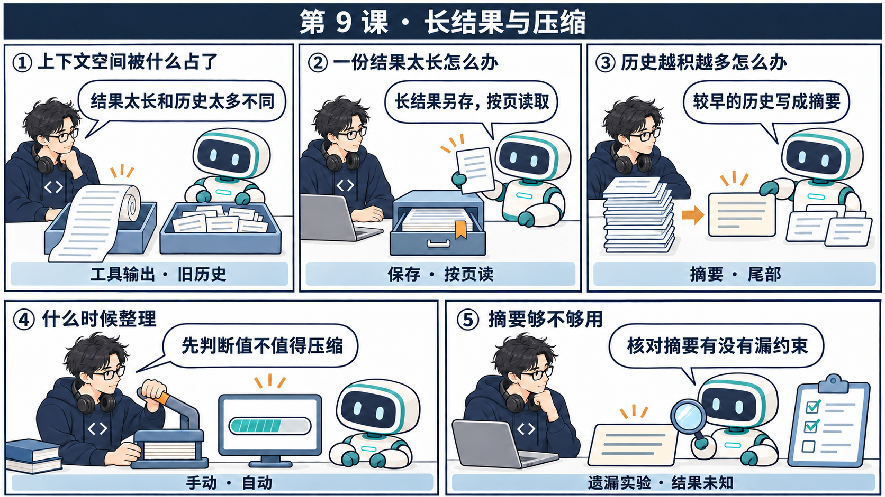

## 一、空间被什么占了？

**先分清是“一份结果太长”还是“历史越积越多”，两者的办法不同。**

### 两种“放不下”，原因不同

**一份结果太长就另存按页读；历史太多就整理成摘要。**

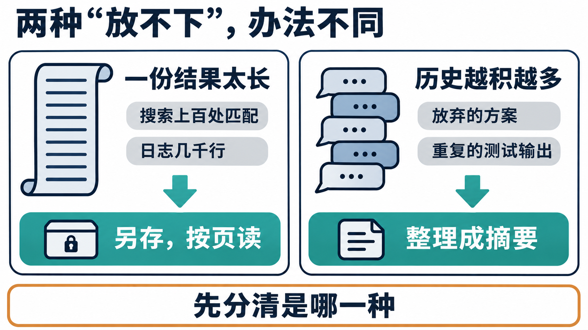

看完这张图，你要能：先分清是一份结果太长还是历史越积越多，再选另存按页读或整理成摘要。

第 8 课讲过，每次请求能装的内容有上限。任务做久了，放不下通常有两种情况：

| 情况 | 例子 | 对应办法 |
| --- | --- | --- |
| 一份结果太长 | 一次搜索返回上百处匹配，一份测试日志几千行 | 把完整结果另外保存，请求里只放开头和取回入口（第二节） |
| 历史越积越多 | 读过的代码、放弃的方案、重复的测试输出，一轮轮累积 | 把较早的历史整理成摘要（第三节） |

占用主要来自这一次的巨大输出，反复整理旧历史也帮不上忙。反过来，几十轮旧讨论占满了空间，缩小下一次读取也没用。

### 本课说的“压缩”是什么

**压缩改的是“这次发给模型的内容”，不删原始记录，也不改文件。**

本课的**压缩**，是把一部分要发给模型的旧历史，改写成更短的**摘要**，再用摘要构造后续请求。

先分清两样东西：

- **原始记录**：会话里实际发生过的一切，按第 11 课的方式存在会话日志里。压缩不删它。
- **模型输入**：每次请求时，从原始记录里挑选、组装出来交给模型的内容。压缩改的是这一份。

压缩不会让源文件变短，不改变模型，也不扩大模型能看的空间。它只让下一次请求里，旧材料占的地方小一些。

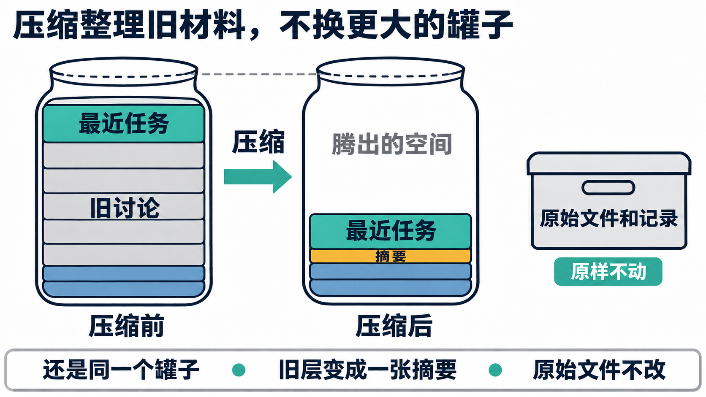

看完这张图，你要能：说明压缩整理的是旧历史在请求中的表示，而非扩大窗口或修改原始文件。

## 二、一份结果太长：保存起来，按页读取

**最简单的办法是截掉后半段；MyBuddy 改成把完整结果存起来，让模型按页取。**

### 只截掉后半段，会出什么问题

**悄悄截断会让模型把“没看到”当成“不存在”。**

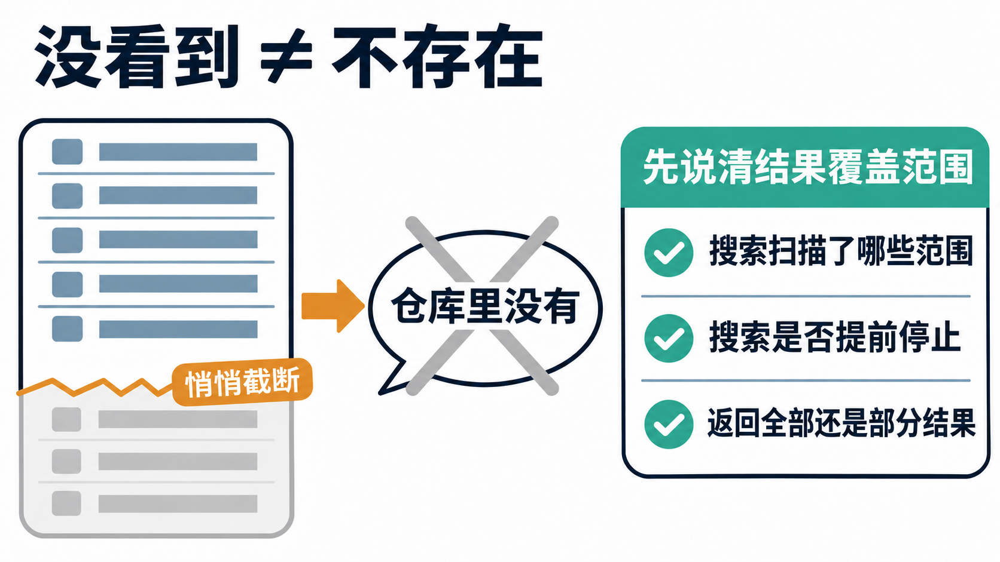

看完这张图，你要能：说明悄悄截断的风险，以及长结果要先说清覆盖范围。

在较大的代码库里，一次搜索可能返回上百处匹配。直接截掉超长部分又不告诉模型，它可能把“我没看到”当成“仓库里没有”。

所以处理长结果，第一件事是**说清这份结果覆盖了什么**：扫描了哪些范围，有没有提前停，返回的是全部还是一部分。

### MyBuddy 怎样处理长结果

**完整结果另存为 Artifact，请求里只放预览和一个结果标识，模型用** `read_tool_result` **按页取。**

MyBuddy 默认开启长结果能力。ReadFile、search_tools、load_skill 和 read_tool_result 的结果直接返回，仍受各自的大小限制。其他工具的结果超过保存阈值时，按下面的流程处理：

1. 完整结果存进 MyBuddy 自己管理的存储。这份存下来的结果叫 **Artifact**。
2. 请求里只放一段开头（预览）、一个**结果标识**（`result_id`），以及“后面还有内容”的说明。
3. 模型要看后面的内容，就调用 `read_tool_result`，告诉它结果标识和从哪接着读（`offset`）。
4. 运行时先核对：当前会话是否持有这个引用。核对通过，才取回下一页。这一页作为新的工具结果，进入下一次请求。

可以用寄存行李来想。前面一直把每次发给模型的请求比作一个罐子；长结果整份放进去太占地方，就寄存在罐外的柜子里。罐里只留一段预览，和一张取件牌（就是结果标识）。模型想看后面的内容，就凭这张牌去柜子里一页一页取。

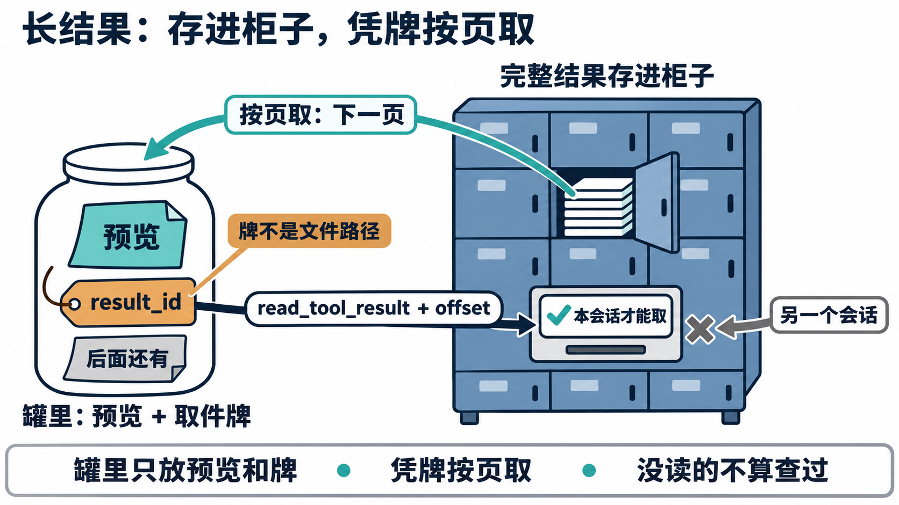

看完这张图，你要能：用“寄存柜和取件牌”说明：完整结果存在请求之外，请求里只有预览和 result_id，本会话凭这张“牌”按页取回。

每次用 `read_tool_result` 取回的一段，就是“一页”。页太小，模型要翻很多次，可能把步数用光。页太大，又失去了分页的意义。

```latex
工具返回很长的结果
  → 完整结果保存为 Artifact
  → 请求里放：预览 + 结果标识 + “还有后续”
  → 模型按需调用 read_tool_result 取下一页
```

结果标识不是文件路径，模型不能拿它读任意文件。能读哪些，由当前会话已保存或继承的引用决定。结果太大或保存失败时，模型只会收到标明“不完整”的片段，不会拿到一个读不出内容的假标识。

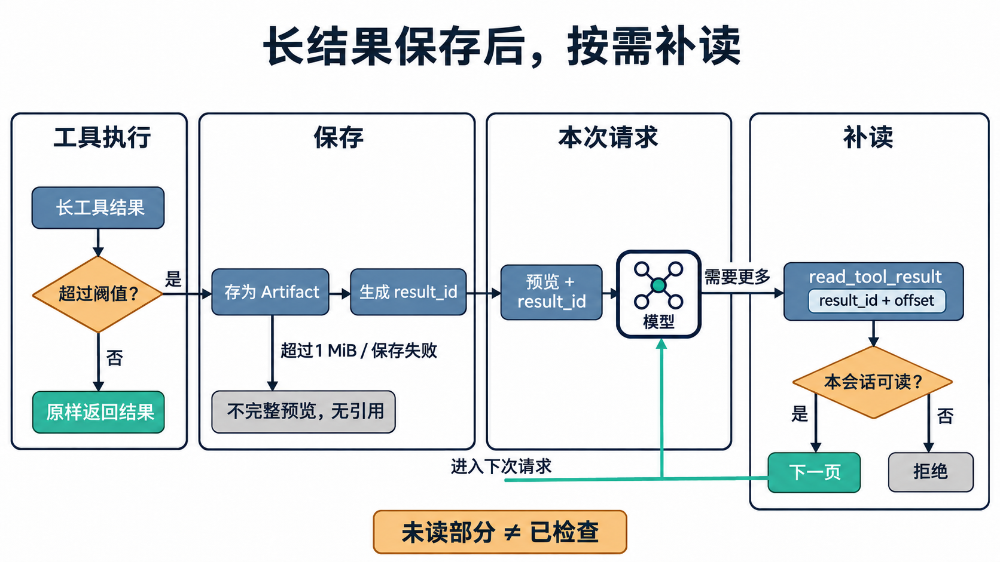

看完这张图，你要能：按顺序说出长工具结果怎样保存、怎样给出预览和标识，模型又怎样按页补读。

容易误会的地方：

- Artifact 只保存工具这次实际返回的内容。比如搜索工具提前停止、只扫描了一部分目录，没扫到的部分 Artifact 里也没有。

### 想体验这项能力

**默认就开着；配置里是** `false` **的话，改成** `true` **再新建会话。**

长结果能力默认开启，`config/config.example.toml` 示例也是开启。你的启动配置里如果是 `false`，可以改为：

```toml
[experimental]
long_tool_results = true
```

然后新建会话，让 Agent 读一份较长的材料。观察：结果里有没有“不完整”的说明，模型是否按需调用 `read_tool_result`，取回的内容是否对得上原文。工具输出没长到需要保存，就如实记为“未触发”。

### 只看了前一段，不能下否定结论

**只看了第一页，就不能回答“没有”。**

你问“所有匹配里有没有某种用法”，模型只看了第一页，就不能答“没有”。合理的做法是：缩小搜索范围，继续翻页，或者说明证据不足。

容易误会的地方：

- “工具执行成功”“结果已保存”“结论完整”，是三件要分别判断的事。

## 三、历史越积越多：整理成摘要

**较早的历史换成一份摘要，最近的消息原样保留；摘要要先通过检查、保存成功，才会被采用。**

### 先看最简版：把旧历史换成一段总结

**最简单的压缩只有三步：切开、总结前半段、拼回去。**

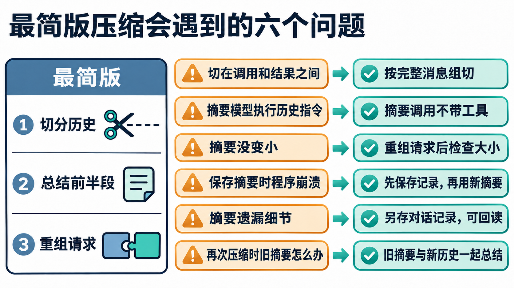

看完这张图，你要能：对照“切开、总结、拼回”的最简版，说出 MyBuddy 加上的六条约束。

下面是一段 Python 风格的**教学伪代码**，不能直接运行：

```python
def compact(history, keep=2):
    old, recent = history[:-keep], history[-keep:]    # 1. 切成“旧的”和“最近的”
    summary = call_model("请总结下面的对话：" + str(old))  # 2. 让模型写总结
    return [summary] + recent                          # 3. 总结在前，近期原文在后
```

用运费任务走一遍：几十条搜索、读取和测试输出成了 `old`。模型把它们写成“门槛应为 >=，偏远地区不变，测试还没跑”。下一次请求只带这段总结和最后两条消息。

骨架就这么简单，MyBuddy 也是这样做的。但真实运行时，这几行会出不少问题。我们一次看一个：

1. **切点可能落在工具调用和结果之间 → 按完整的“消息组”切。** 带工具调用的助手消息，和这批调用的全部结果，算一组。近期原文按完整消息组保留。
2. **总结时，模型可能照着历史里的指令去做 → 摘要调用不带任何工具。** 它只能写字，不能读文件、改代码。
3. **摘要可能没变小，或者整份请求还是放不下 → 拼回完整请求再量一次。** 新请求的估算必须严格变小，并且放得下，否则不采用。
4. **写到一半程序崩了，说不清用没用新摘要 → 先保存一条压缩记录，确认后才采用。** 失败时，后续请求继续用原来的摘要和消息。
5. **摘要漏了细节，找不回来 → 另存一份对话记录，需要时回读。** 见本节最后两小节。
6. **再压一次，旧摘要怎么办 → 旧摘要和新的一段合成一份新摘要。** 请求里永远只放最新一份。

后面几小节逐条展开。“什么时候压”“失败了还试不试”放到第四节。

### 哪些整理成摘要，哪些留在尾部

**旧讨论和已结束的工具调用进摘要；近期原文按窗口保留；规则和工具说明不进摘要。**

长结果处理“这一份”太长；压缩处理“历史”太长。不同材料，处理方式不同：

| 材料 | 怎样处理 | 不能丢掉什么 |
| --- | --- | --- |
| 较早的讨论、探索过程、重复解释 | 归纳成当前决定和已排除的原因 | 推测与事实要分开；放弃的方案不能变成当前要求 |
| 已经结束的旧工具调用和输出 | 按完整的“调用＋结果”整体归纳 | 失败记录和覆盖不足的说明 |
| 最近的完整消息组 | 原样留在尾部；更早的用户要求也可能进入摘要 | 摘要应保留仍有效的要求、纠正与未知状态，但不保证逐字保留 |
| 系统规则、权限、工具说明 | 不进摘要，按当前会话绑定的配置正常装配 | 摘要不能改写规则或取得新权限 |
| 会话日志、工作区文件、已执行的操作 | 不受压缩影响 | 输入变短不等于事情没发生或文件被回滚 |

压缩分两档，先看压缩前的整份请求有多大：

| 压缩前的请求 | 保留多少原文 | 补读最近的文件 | 常见场景 |
| --- | --- | --- | --- |
| 不到 6 万 token | 最近两组完整消息 | 不补读 | 中等长度时手动 `/compact`，目的是腾出空间 |
| 6 万 token 及以上 | 约 1 万到 4 万 token（规则见下） | 补读最多 5 个 | 快满时的自动压缩，目的是压缩后能接着干活 |

为什么要分档？大档压缩后最多会剩下“1 万到 4 万 token 原文 + 约 2.5 万 token 补读内容 + 摘要”。历史本身只有两三万 token 时，这些内容会把省下的空间吃掉，压缩就没有收益。所以中等长度时只留最近两组，先把空间腾出来；快满时历史已经很长，多留一些原文和文件内容，压缩后模型不用从头再读。

大档具体怎样选窗口？从最后一组往前累加，用第 8 课的本地 token 估算办法：**累计不少于约 10000 token，并且已经保留至少 5 条消息，两个条件都满足才停止**。比如一条长回复已达到约 10000 token，还要继续往前保留，凑足五条；五条消息很短时，也要继续往前累计到约一万 token。历史不足时就全部保留。

每次加入前还要检查 **40000 token 上限**。下一组放进去会超限，就把它和更早的部分交给摘要；如果最后一组本身就超限，也整组进入摘要。工具调用和结果不能拆开，因此实际保留条数可能超过五条，也可能因上限少于五条。全部消息都在保留窗口里时，没有可整理成摘要的旧消息，直接返回“无变化”。

“调用＋结果”要整体处理，因为每个工具调用都要有对应结果（第 3 课）。压缩时调用被并进了摘要，结果却还单独留在后面，模型就会看到一个找不到来源的结果。

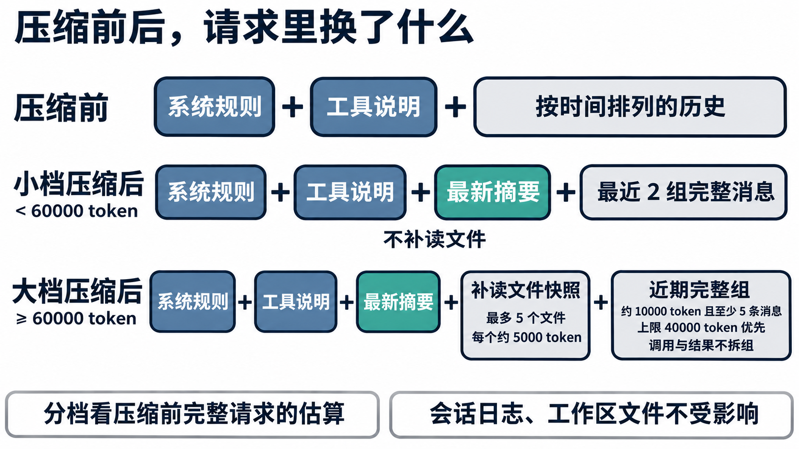

看完这张图，你要能：比较压缩前后请求的组成，知道规则与工具说明不变、旧历史换成摘要、尾部原样保留。

压缩前后的请求文字版：

```latex
压缩前：系统规则 + 工具说明 + 按时间排列的完整历史
小档压缩后：系统规则 + 工具说明 + 最新摘要 + 最近两组完整消息
大档压缩后：系统规则 + 工具说明 + 最新摘要 + 补读文件快照 + 完整尾部
```

一条普通的用户或助手文本，算一组。带工具调用的助手消息和它的全部结果，合成一组。系统规则和工具说明本身就占了大部分空间时，压缩旧历史能腾出的地方很少。

容易误会的地方：

- 消息条数不是 Turn 数，也不是组数。一个助手调用两个工具，连同两条结果共三条消息，但整组一起保留或一起整理。
- 当前的用户要求如果落在被整理的部分，也会进摘要，不保证逐字保留。

### 三种缩减办法

**截断简单但会丢信息，外置不丢但要多取一步，摘要紧凑但可能漏约束。**

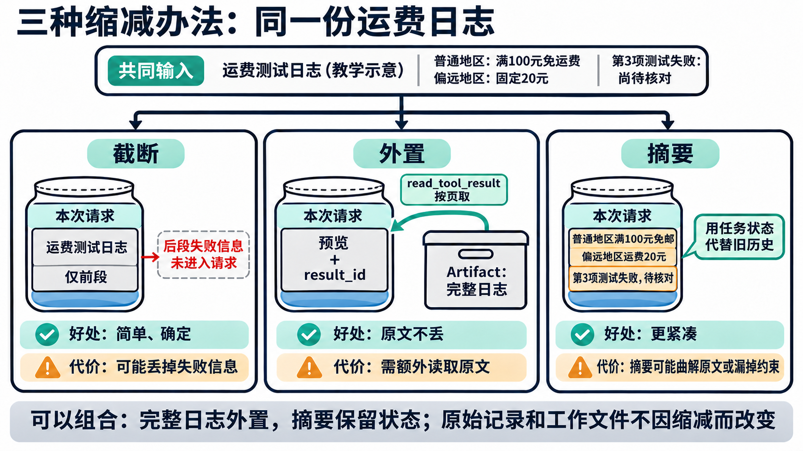

看完这张图，你要能：比较截断、外置、摘要三种办法的好处与代价。

| 办法 | 怎样做 | 好处 | 代价 |
| --- | --- | --- | --- |
| 截断 | 只保留前面一部分 | 简单、确定 | 可能刚好丢掉最后的失败信息 |
| 外置 | 原文另存，请求里只放预览和入口 | 原文不丢 | 要多一步取回 |
| 摘要 | 用一段总结代替旧历史 | 留下更紧凑的任务状态 | 可能误解原文或漏掉约束 |

三种办法可以组合。完整测试日志外置保存；摘要里写“第 3 项失败，原文见结果 R 的后段”；近期原文按完整消息组保留。没有哪种办法能同时做到：不丢信息、不多花调用、输入最短。

### MyBuddy 怎样生成并采用一份摘要

**一次压缩分四步：选、写、量、存；任何一步不通过，就保持原样。**

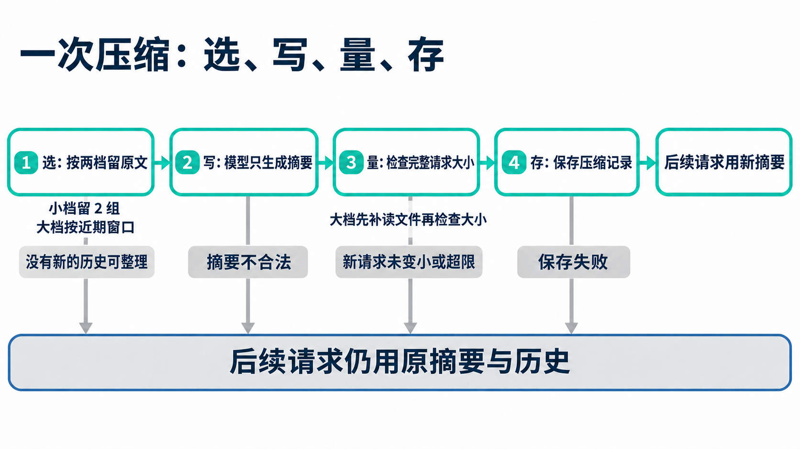

看完这张图，你要能：说出一次压缩的四步“选、写、量、存”，以及任何一步不通过时都保持原样。

MyBuddy 让模型用 Markdown 写一份**工作摘要**，内容包括目标与约束、关键依据、已做的操作、未决问题和下一步。一次压缩分四步：

1. **选出要整理的部分**：按档保留近期原文（小档两组，大档按窗口），把上次摘要之后、新切点之前的部分交给摘要模型。没有新内容可整理，就直接返回。
2. **调用一次模型**：输入上一份摘要、新整理的部分和本次保留重点，写出新摘要。这次调用不带工具。
3. **检查完整请求**：摘要不能为空，也不能太长。大档先补读最近的文件；再用摘要、快照（小档没有）和尾部拼出完整的业务请求，确认估算严格变小，并且放得下。
4. **保存后采用**：先保存一条压缩记录。保存确认后，后续请求才用新摘要。

```latex
如果现在不适合整理：返回原因
按档保留最近的完整消息组，选择新截止点
如果没有新历史可整理：保持原样；摘要请求发送失败时，也不采用新摘要
摘要 = 一次无工具模型调用(旧摘要, 新吸收前缀, 本次保留重点)
如果摘要不合法：保持原样
补读文件快照 = 大档时安全读取最近用过的最多五个文件，并限制每份长度；小档为空
新请求 = 正常装配的指令和工具 + 新摘要 + 补读文件快照 + 完整尾部
如果新请求不够小或装不下：保持原样
启用长结果时，另存一份有界的对话记录
保存一条压缩记录，确认后采用新摘要
```

再次压缩时，上一份摘要和新的一段合成一份新摘要。从分支或 fork（以另一个会话的历史为起点）继承来的上下文，会进入第一份摘要，之后不再整份重复。

容易误会的地方：

- “模型返回了摘要”和“后续请求已经用上它”是两个时刻。
- 程序能检查格式、大小和保存结果，但查不出摘要的意思有没有遗漏。这要靠第五节的检查。

### 摘要里没有的细节，还能找回来

**开着长结果能力时，每次压缩都另存一份对话记录，模型可以按页回读。**

每次压缩成功，MyBuddy 会保存一份从会话开头到本次切点的对话记录。里面有用户与助手的文字、工具名和参数，以及模型看到的工具结果。

工具里有 `read_tool_result` 时，摘要末尾会附上一条读取提示，里面的 `result_id` 指向这份记录。模型可以按需分页读。每次压缩生成新的引用，早期的引用仍然有效。

容易误会的地方：

- 这份记录每项和整体都有大小上限，太长的内容会被截断，算不上原始事件的完整备份。
- 回读只取当时的记录，不重新执行工具。要确认文件现在的内容，就重新读文件。
- 关闭长结果能力时，不保存这份记录，也没有回读提示。

### 最近读过的文件，自动补一份内容

**摘要可能只说“读过 shipping.py”，没留下代码。因此大档压缩时会补读最近用过的文件，把内容放在摘要后面；小档不补读。**

运行时从本会话成功的 `ReadFile`、`EditFile`、`WriteFile` 结果中，按最后使用时间找不同路径，最多补五个。保留原文里已经包含完整内容的文件不再补；如果后来又编辑过，旧的完整内容就不算数。

补读走 ReadFile 的底层安全读取：只读工作区内的普通文件，不跟随符号链接，并限制读取字节数。已删除、读不了或不是可解码文本的文件跳过。每份内容按同一个估算办法限制在约 5000 token，过长就截断，并注明“已截断，需要时用 ReadFile 读取完整内容”。

补读发生在摘要生成后、检查收益前。路径、实际读到的内容和截断标记随 `context.compacted` 一起保存，后续请求使用保存的快照。即使文件后来变化或删除，重启和重建旧请求得到的内容仍一致。它说明的是压缩时的内容，不保证一直是最新版本；要编辑仍需调用 ReadFile 取得正式读取记录。

这项补读不依赖长结果开关。Skill 正文已经在整个会话中有效，仍由正常请求组装加入，不在文件快照里重复放一份。补读内容也占窗口，必须和摘要、工具说明、近期原文一起参与收益检查；整份请求没有变小或仍超限，就不采用新摘要，也不保存这批快照。

### 业务请求都放不下了，摘要请求为什么还发得出去

**因为摘要请求是另一份更小的请求：不带业务工具，也不带保留的尾部。**

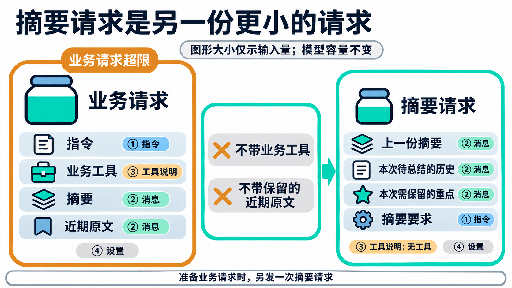

看完这张图，你要能：说明业务请求放不下时，摘要请求为什么仍可能发得出去。

摘要请求只带上一份摘要、新整理的部分、本次保留重点和摘要要求。把这些内容打包成一份请求，本身也要占一些空间。摘要请求过长时，模型服务可能返回错误。摘要回来后，程序再检查压缩后的业务请求放不放得下。

## 四、什么时候整理：手动与自动

**阶段切换时最值得压缩；正在等工具结果时不能压缩。**

### 先判断值不值得压缩

**压缩前先看：下一步还要不要这些细节，占用主要来自哪里。**

| 你看到的情况 | 可以怎样做 |
| --- | --- |
| 刚开始排查，材料很少，下一步还要逐行比较代码 | 继续原会话。过早压缩可能丢掉正要用的细节 |
| 规则已经查清，历史里堆满了搜索和重复日志，准备开始修改 | 好时机：调查阶段的过程可以概括，结论和约束留下 |
| 占用接近上限，接下来还要读不少材料 | 先看占用来源：旧历史就压缩，单份大结果就按页读 |
| 占用主要来自这一次的巨大输出或重复加入的文件 | 先缩小读取范围，压缩旧历史作用不大 |
| 测试还在运行，或修改是否完成还说不准 | 先弄清执行结果，压缩不能代替确认 |
| 本轮已经结束，暂时没有后续任务 | 不必为了让数字变小而压缩 |

“调查结束、开始修改”是典型的整理时机。探索过程可以概括，确认过的原因和约束要留下。

还有一个硬条件：**正在等工具结果时不能压缩。** 模型刚提出调用、结果还没回来，这时压掉前面的历史，可能拆散调用和结果。所以自动压缩只在 Step 之间检查：第一个 Step 之前，或上一个 Step 完整结束之后。手动压缩要求会话空闲。

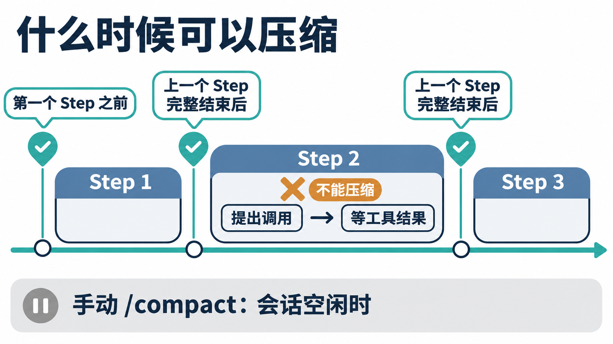

看完这张图，你要能：指出自动压缩只在 Step 之间检查，等工具结果时不能压缩，手动压缩要求会话空闲。

### 手动与自动的区别

**区别只在谁发起、什么时候发起；整理流程是同一套。**

| <br> | 手动压缩 `/compact` | 自动压缩 |
| --- | --- | --- |
| 谁发起 | 你 | 运行时 |
| 什么时候 | 会话空闲时 | 首个 Step 前，或上一步完整结束后、下一次请求之前 |
| 适合 | 你知道阶段结束了，想指定保留重点 | 长任务中不必一直盯着占用 |
| 对当前任务的影响 | 单独的一次整理，不算新的一轮任务，也不推进 Goal | 在原来那一轮里进行，花费计入这一轮 |
| 质量 | 都需要检查，自动不意味着更可靠 | 同左 |

MyBuddy 的自动压缩按三条规则工作：

1. **什么时候尝试**：在 Step 之间，估算输入达到额度的 80%，或整份请求已经放不下。没有新内容可整理就跳过。每个 Turn 最多调用两次摘要模型。
2. **怎样算成功**：新请求的估算变小、放得下，并且保存成功。
3. **失败了还试不试**：连续两次调用了摘要模型却没成功，就暂停自动压缩。重启，或手动压缩成功一次，会解除暂停。发新任务不会解除。

预算要算整份请求：系统说明、工具定义、摘要、补读文件快照、回读提示和尾部，不能只数摘要正文。

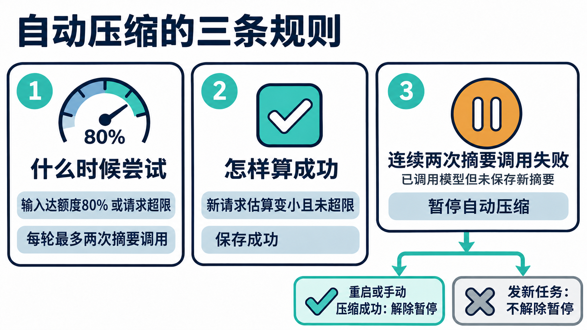

看完这张图，你要能：记住自动压缩什么时候尝试、怎样算成功、连续失败后怎样暂停和解除。

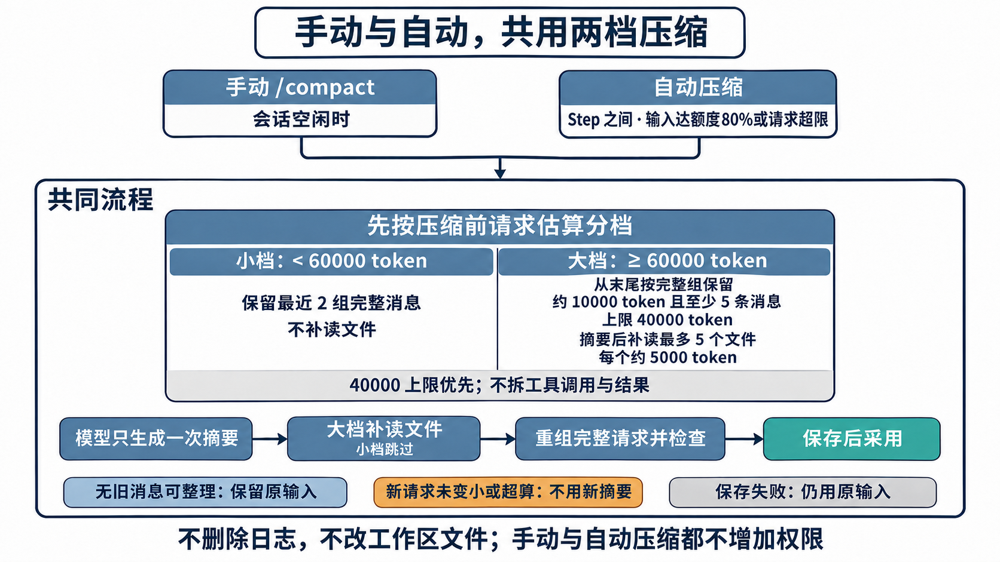

看完这张图，你要能：区分手动与自动压缩的触发时机，理解共用流程及失败时保留原输入。

容易误会的地方：

- 本地估算放得下，不保证服务一定接受请求。

**模型服务直接回“上下文太长”时，MyBuddy 不会自动压缩再重发。** MyBuddy 不读服务返回的错误正文，因为正文可能含敏感内容。HTTP 错误里，只有认证（401/403）、余额不足（402）、请求过于频繁（429）和服务端错误（5xx）单独区分，其余一律记成 `runtime.model_http_failed`。所以服务即使回的是“上下文过长”，MyBuddy 也认不出来，本轮按模型失败结束，历史照常保留。想继续，可以先 `/compact`，再重新发出任务。有些产品会识别这种错误，自动压缩一次再重发。MyBuddy 把功夫放在发送之前：每个 Step 前先在本地估算，接近额度或整份请求放不下就自动压缩。这样不用去解析各家服务格式不一的错误文字，也不会在一次失败之后悄悄再花一次摘要调用。代价是：本地估算和服务的实际计数有出入时，请求仍可能被拒绝，这时要你手动处理。

### 给手动压缩指定保留重点

**保留重点只影响这一次整理的取舍，不改默认规则，也不能让摘要写出历史里没有的事。**

完成运费规则调查、准备修改时，可以输入：

```latex
/compact 保留普通地区满100元免邮的规则、偏远地区例外、已确认的文件位置，以及尚未执行的测试；压缩重复的搜索过程。
```

保留重点有长度上限，写一两句就够。留空等于不指定。它不影响以后的自动压缩。摘要提示本来就要求保留影响下一步的约束、未完成事项和失败记录。

命令发出后，看命令结果，再用 `/context` 核对下一次请求的占用。历史太短时，命令可能什么都不做。

容易误会的地方：

- 写了保留重点，模型仍可能遗漏，要自己检查。
- 命令发出，不等于摘要已经采用。

### 压缩后为什么很快又满了

**压缩腾出的是下一段工作的空间，窗口本身没变大。**

常见原因：

| 情况 | 先检查什么 |
| --- | --- |
| 压缩成功，之后又读了很多材料 | 压缩后新增了哪些读取和工具输出 |
| 刚压完立刻又满 | 是否反复加载同一份大文件或大输出；改为缩小范围或按页读 |
| 总输入很大，可整理的历史却很少 | 是否主要被系统规则、工具说明或当前大消息占用 |
| 检查过，但没有压缩成功 | 是摘要调用失败，还是候选超预算或没有收益 |
| 自动压缩不再尝试 | 是否连续两次失败而暂停，或本轮已调用两次；先检查失败原因 |
| 本地显示还有余量，服务却拒绝请求 | 本地估算与服务的实际计量有差异，不能只看百分比 |

一个教学算例：输入额度 10,000 Token，压缩把占用从 8,500 降到 5,000。接着新读的材料又加了 4,500，下一次就到 9,500。每次刚腾出空间，就重新放进同一份巨大材料，就会反复“压缩—填满”。

手动 `/compact` 在两种情况下有帮助：上次压缩后又积累了不少历史；或自动尝试连续失败暂停了，你想再试一次。占用主要来自保留尾部或固定配置时，手动压缩同样没有收益。频繁“刚压完又满”，要回头查材料是怎样进入请求的。

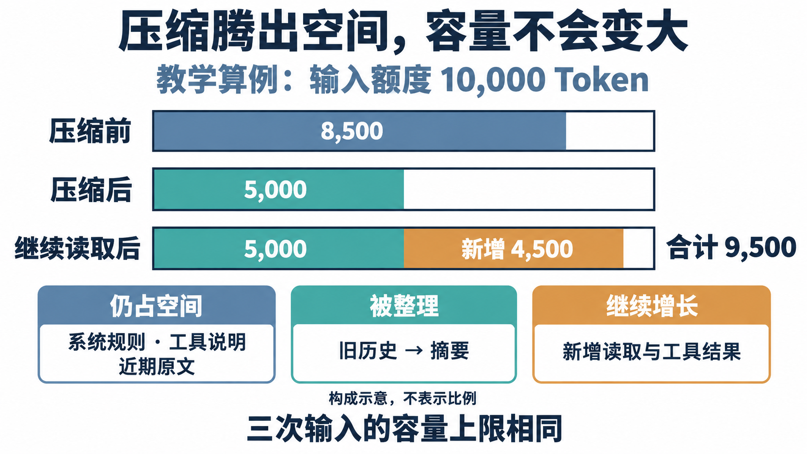

看完这张图，你要能：根据输入构成判断可压缩空间和后续增长来源。

## 五、整理得好不好：检查摘要能不能支撑下一步

**好摘要让 Agent 依据正确的目标和事实继续工作；只追求短，反而会出错。**

### 一份能用的摘要要回答什么

**目标、约束、做完了什么、还剩什么、依据在哪、哪些结果未知。**

只追求摘要短，把偏远地区例外、没做完的检查也删掉，下一步反而出错。下面是一个运费样本：

```latex
目标：只修普通地区恰好 100 元的免邮边界。
约束：低于门槛与偏远地区收费保持不变。
已确认：规则要求 >=；当前实现为 >，见规则文件与 shipping.py。
已执行：比较条件已修改成功。
待完成：修改后的测试还没有有效结果。
未知：测试执行中断，不能判断是否通过。
```

最后两行最容易在“更简洁”的摘要里消失。摘要写成“已修好”，后续模型就可能跳过验证。（另外，MyBuddy 遇到结果未知的执行，会先要求处理它，不允许直接压缩继续，见第 11 课。）

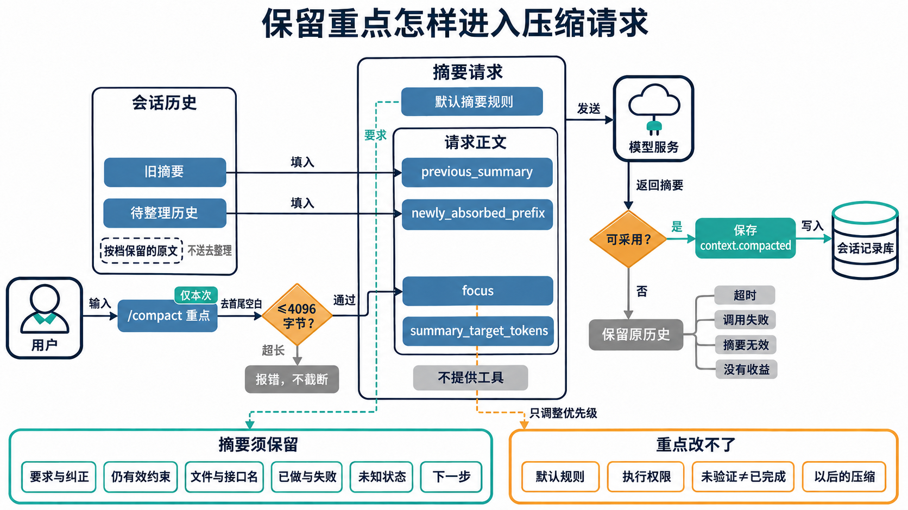

看完这张图，你要能：说明保留重点怎样指导本次取舍，而不改变默认规则。

### 用一个遗漏实验检查摘要

**拿同一个后续问题，对比“用原始历史”和“用摘要”的两个会话怎么做。**

假设原记录里有三条决定：“只改普通地区”“用户拒绝运行测试”“文件已修改，但没有执行检查”。摘要写成“完成运费修复，下一步运行测试”，就把“改了”当成了“完成”，还丢了用户拒绝测试这件事。

更可靠的写法是：“普通地区比较条件已修改；范围不含偏远地区；本次测试请求被用户拒绝，还没有验证结果。”它保留了影响下一步的状态，又不用复述每段日志。

检查时，看两个会话接下来怎么做：有没有忽略限制、重复修改、引用错误证据，或者提前宣布完成？

### 从三个方面评价一次压缩

**看意思有没有丢、后续做得对不对、总体花得值不值。**

| 方面 | 运费任务中看什么 | 不能拿什么代替 |
| --- | --- | --- |
| 意思有没有丢 | 门槛、地区例外、未执行或未知的结果是否还在 | 摘要格式正确、字数变少 |
| 后续做得对不对 | 是否补读必要证据、避免重复修改、验证后再宣布完成 | 模型说“我理解了” |
| 花得值不值 | 后续输入少了多少，摘要本身花了多少调用和时间，有没有增加补读和返工 | 只看压缩后的 Token 估算 |

总花费 = 压缩这一步 + 后续的模型和工具工作 + 额外的补读或返工。后面只剩一句收尾，压缩可能得不偿失。后面还有很多次调用，少带重复材料才更可能划算。

连续压缩也不会无限变小。摘要、补读文件快照、保留尾部和系统规则都占空间。每多概括一次，丢信息的风险也在累积。重要决定之前，可以回读对话记录或原始来源核对。

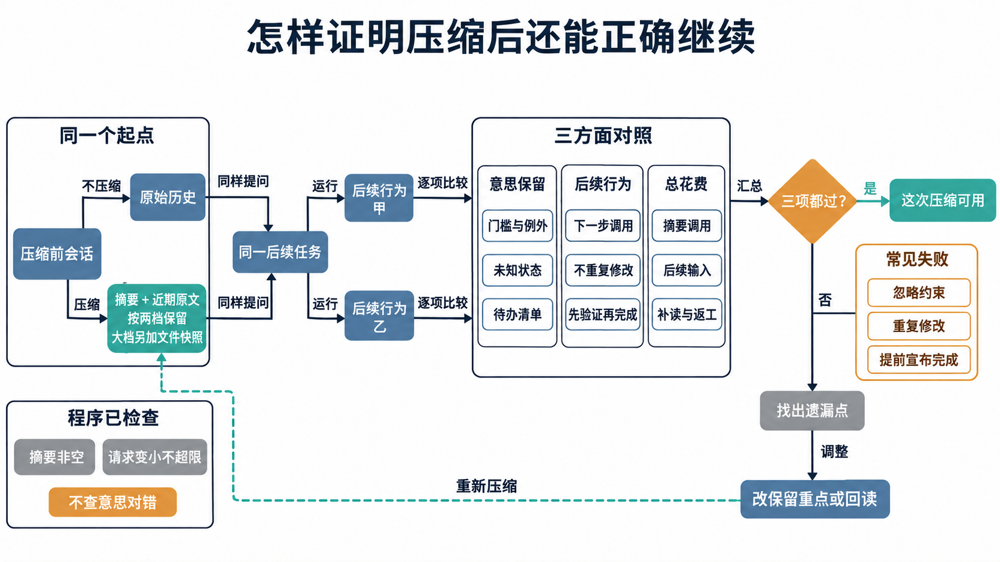

看完这张图，你要能：从意思有没有保留、后续行为对不对、总花费多少三方面评价一次压缩。

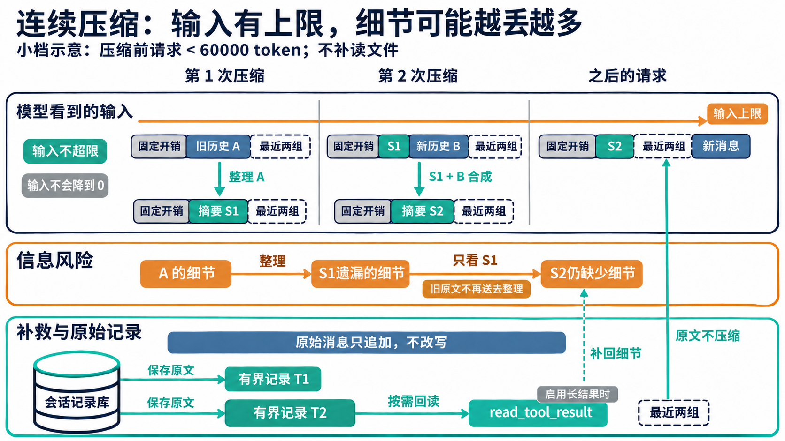

看完这张图，你要能：理解累计摘要的收益与遗漏风险，以及保留尾部和按需回读的作用。

### 压缩在上下文工程中的位置

**压缩只是上下文工程的一环；材料一开始就找错了，摘要再好也救不回来。**

**上下文工程**（Context Engineering）关心每次请求放进哪些材料，怎样取得、组织和更新。压缩只是其中一环：

```latex
找到相关材料：搜索、读取              ← 第 8 课
组织本次输入：指令、工具说明、历史     ← 第 3、8 课
历史太长时整理：按页读、摘要、保留原文  ← 本课
用结果检查并更新：事实是否仍然有效     ← 第 11、13、15 课
```

Agent 一直读错规则文件，问题出在找材料这一步。压缩摘要不会自动变成长期 Memory（第 15 课）；提示缓存（第 8 课）省费用，但不腾窗口空间。另外两个常一起出现的说法：**Prompt Engineering** 管怎样写指令，**Harness Engineering** 管整个运行过程（工具执行、审批、保存、停止和检查）。三者是看问题的角度，不一定对应三个模块。

## 六、动手：在实际任务中核对压缩效果

**每个练习都要对照实际材料，不要只问 Agent“你记住了吗”。**

### 练习一：判断时机

判断三种情况各该怎么做，并写出理由：刚读完两份短文件；调查已经完成、准备修改；任务已经完成、准备处理一项无关需求。判断时不能只数对话进行了多少轮，要看下一步还需不需要那些细节。

### 练习二：长结果与手动压缩

1. 在新会话中让 Agent 读一份前后段都有关键证据的长材料。先让它说明读了哪些范围，再按需取后面的页。没触发保存就如实记录。
2. 会话空闲时运行 `/compact`，比较压缩前后的 `/context`。再问一个要用到早期结论的问题，看回答对不对。失败或没有收益时，保留实际提示。

### 练习三：手写一份摘要

从一段包含“读取、批准修改、测试中断”的记录里写一份摘要。让同伴只看摘要说出下一步。同伴认为可以直接宣布成功，就检查你是不是丢了未知状态或验证条件。

### 收银台练习：压缩后还记得哪些业务约束

用《综合实践-麦当当收银台》中“5. 课后任务 A：按支付方式汇总营业情况”小节积累的真实记录练习。确实需要压缩时，先保存目标和当前证据。再核对压缩后是否保留了：支付失败不计收入，退款归入原支付方式，制作后售后不等于退款，以及哪些文件改了但还没验证。

中途改过需求的话，还要确认旧要求已被明确替换。让 Agent 指出当前依据和下一步，再和实际材料对比。

源码入口：

- 长结果保存：`src/mybuddy/platform/tools/result_artifacts.py`
- 压缩流程说明：`src/mybuddy/platform/context/compaction/README.md`

读的时候分别找：长结果怎样保存和分页，压缩怎样选择、检查和采用摘要。

**能力卡**：想在收银台副本里亲手试一遍，就照着能力卡《上下文预算与整理》（`demo-project/cards/context.md`）、《长结果的保存与翻页》（`demo-project/cards/long-result.md`）做。

## 使用小妙招

### 同一任务继续做，什么时候值得压缩

先问自己：下一步还在做同一件事吗？是的话，再看空间主要花在哪。调查结束、准备修改，往往适合整理。刚拿到的材料马上要用，就不急着压缩。

在 Claude Code 中，可以先用 `/context` 看占用，再按需输入（Codex 也有 `/compact`）：

```latex
/compact 保留当前运费目标、地区限制、依据位置、已修改文件、实际测试结果和未决问题；区分已完成与待验证。
```

MyBuddy 也支持这种写法。压缩后，用“本次只改什么、哪些检查已执行、下一步先做什么”检查关键条件，再核对来源。地区例外丢了，就补读规则并纠正。

**为什么这样做：** 压缩会用摘要代替较早的历史，可能遗漏细节。马上要用的原文若被概括，下一步可能还要补读。在阶段结束时整理，通常更容易区分已用完的过程和仍有用的结论。在 `/compact` 后写明保留重点，可以提醒模型优先留下关键条件，但压缩后仍要核对。

### 什么时候应该新开会话

先判断旧历史里还有多少是下一步真正要的：

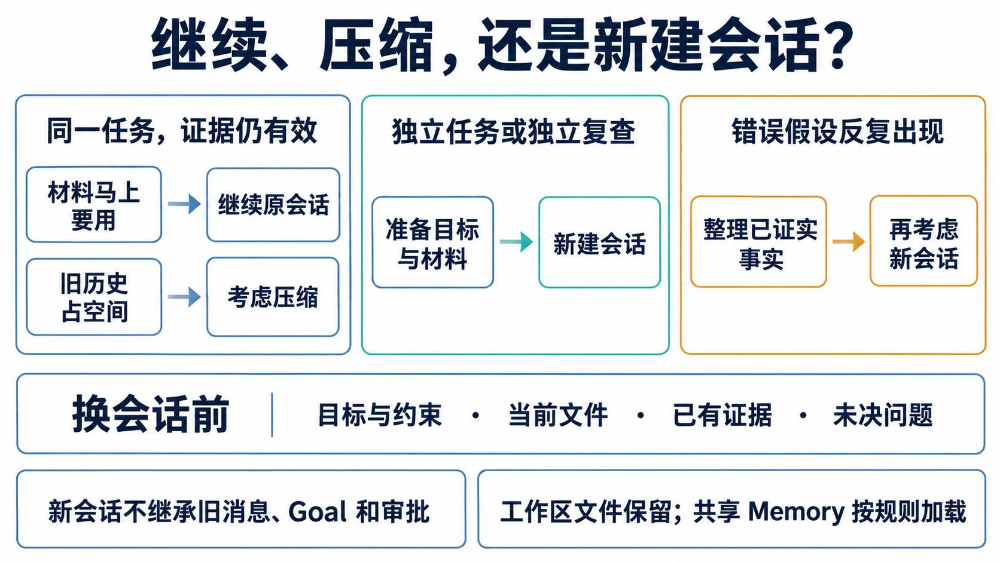

看完这张图，你要能：根据任务连续性、材料相关性和交接成本选择会话策略。

| 下一步要做什么 | 选择 | 开始前准备什么 |
| --- | --- | --- |
| 继续同一个修复，近期讨论和证据仍有效 | 继续原会话；需要空间时再压缩 | 保留当前目标、约束和结果 |
| 运费修复已验收，现在改写登录页文案 | 新开会话 | 新任务的目标与材料；旧任务留下结束记录即可 |
| 还在修运费，但历史里满是被推翻的方案，纠正后仍反复引用错误假设 | 先整理已证实的事实，再考虑新会话 | 写明哪些旧结论作废，附当前文件和失败证据 |
| 想从另一个角度独立检查当前 diff | 新会话做一次范围明确的复查 | 需求、差异和测试材料，不预先要求它认可原结论 |

只为采用新的工具说明或运行配置，不必丢掉旧会话：正常关闭后恢复即可，程序会提示变化。项目说明文件例外，恢复仍用创建时冻结的副本。

新开会话的入口：Claude Code 用 `/clear`，Codex 用 `/new`，MyBuddy 用 `/new`（也可以输入 `/clear`）。新会话只是不带旧消息，工作区里的文件修改都还在。只是忘了一个常量，补读就行，不必丢掉仍然有效的工作过程。

**为什么这样做：** 旧历史会随每次请求一起发给模型。已经推翻的方案、错误的假设留在里面，模型还会看到、还会引用，你纠正一次，它可能下一步又用回去。换成不相关的任务时，旧内容只占位置。这时开新会话，模型看到的就只有新任务需要的东西。

### 在阶段交接时，写一份可以重新核对的续接说明

准备压缩或换会话前，先留下阶段记录。规则分析完成、准备修改时，可以在练习目录保存一份续接说明：

| 内容 | 运费任务示例 |
| --- | --- |
| 目标与约束 | 修复普通地区门槛；保留偏远地区规则 |
| 已确认依据 | 规则文件、函数位置及对应版本 |
| 已做操作 | 哪些文件已修改；哪些检查实际运行过 |
| 未决事实 | 没跑的测试、没确认的副作用、仍需澄清的条件 |
| 下一步 | 先核对当前文件，再决定修改或验证 |

新会话开始时，让 Agent 读这份说明，并重新核对当前文件和检查结果。不能把“打算运行”写成“已经通过”，也不能把上个会话的临时批准当成下一次操作的批准。这份文档帮助交接，实际执行状态以第 11 课的执行记录为准。

**为什么这样做：** 压缩的摘要由模型来写，会漏什么你事先不知道（见“一份能用的摘要要回答什么”）；新会话则什么都不记得。续接说明是你核对过的，写在文件里，压缩和换会话都不会丢。新会话让 Agent 先读它，就能接着做，不用你把前面的事重讲一遍。

## 自测：这一课的概念分清了吗

**先自己作答，再看后面的答案。** 每题都能在本课正文里找到依据；带“动手验证”的题，可以照着做一遍，亲眼看到结果。

**1.** 你准备查看一份很长的测试日志，旧讨论并不多。为了避免这份日志一次占满请求，哪种处理更合适？

- A. 反复压缩旧讨论，再把完整日志放进请求。
- B. 把完整日志另存，请求里保留预览和取回入口，按需读取。

**2.** 你想确认所有搜索匹配里有没有某种用法，只看了第一页，没有找到。此时能得出什么结论？

- A. 工具执行成功，说明这种用法不存在。
- B. 完整结果已经保存，说明已经检查了全部匹配。
- C. 目前看到的范围不足以证明不存在，还要继续检查或说明证据不足。

**3.** 你刚启动一个全新的 MyBuddy 会话，还没发送任何消息，就输入 `/compact`。会发生什么？

- A. 保持原样，没有可整理的旧历史，不调用摘要模型。
- B. 仍会调用摘要模型，先生成一份空会话的摘要。
- C. 没有旧历史可整理，就改为压缩系统规则和工具说明。

**4.** 判断：压缩后输入估算下降，就足以证明这份摘要能正确支撑下一步。（对 / 错）

### 答案与依据

**1. 选 B。** 主要占空间的是这一份长结果，另存后按需取回更合适。反复压缩少量旧讨论，解决不了完整日志再次占满请求的问题。  
依据：本课“一、空间被什么占了？”。

**2. 选 C。** 没在第一页看到，不代表后面没有。结果已保存，只说明内容可以取回，不等于已经检查完。  
依据：本课“只看了前一段，不能下否定结论”。

**3. 选 A。** 没有可整理的旧历史，就直接返回，不调用摘要模型。系统规则和工具说明不会因此改成摘要。  
依据：本课“MyBuddy 怎样生成并采用一份摘要”、本课“哪些整理成摘要，哪些留在尾部”。  
动手验证：按能力卡《上下文预算与整理》（`demo-project/cards/context.md`）的“准备”，在仓库根目录运行 `uv run python demo-project/prepare_shop_demo.py`。进入脚本输出的“体验目录”，运行 `sh ./start-mybuddy.command`。先不做卡片“操作”的第 1 步，也不恢复旧会话；在全新会话里直接输入 `/compact`。终端的“结果”下会显示“当前对话较短，没有可整理的旧历史。”，不会生成摘要。

**4. 错。** 输入变短，仍可能漏掉地区例外，或把“尚未验证”写成“已完成”。要核对关键约束、事实和未知状态，不能只看输入估算。  
依据：本课“从三个方面评价一次压缩”。

## Q&A：常见追问

### Q1：已经自动压缩了，为什么上下文还是会满？

自动压缩只能腾出一部分空间，不能保证以后不再满。后续读取还会增加内容，固定规则和工具说明也不会因为摘要变短就消失。MyBuddy 的自动压缩在连续两次调用摘要模型却未保存新摘要后会暂停，期间成功压缩会清零计数；因此要先看最近一次压缩结果，再看后续新增材料和固定占用，分别处理。

### Q2：满了以后再手动压缩，比自动压缩更强吗？

不一定。两种方式用的是同一套流程。手动压缩的作用是重新发起一次整理：处理后来积累的历史，或在自动尝试暂停后再试一次。没有新的可整理材料、输入仍然超限时，手动也会失败。

### Q3：同一个会话连续压缩，大小会不断变小吗？

不会。刚压完、没有新内容可整理时，MyBuddy 直接返回，不再调用摘要模型。积累了新历史才会再次摘要；结果没变小或放不下，也不采用。摘要、尾部和固定材料都占空间。

### Q4：对摘要再做摘要，会不会越压越失真？

有这个风险。第一次摘要丢了地区例外，第二次只读摘要，就找不回来了。原本的推测，也可能在反复概括中变成肯定的说法。所以要保留原始来源和关键约束，重要决定前回读原文。原文还在，也不会每次自动重读。

### Q5：压缩后 Token 少了，是不是这一任务就省钱了？

不一定，要比较完成同一任务的总开销。压缩本身要调用摘要模型，遗漏信息还可能导致重新读取或返工；后续请求的价格也受缓存影响。例如已经只剩一句收尾，再调用一次摘要模型，通常没有多少后续输入可省。应同时看后续输入减少多少、摘要是否漏掉关键事实，以及完成任务的总费用和耗时。

### Q6：压缩后上下文没有降到摘要那么小，是压缩没成功吗？

不一定。摘要只是请求的一部分。系统规则、工具说明、近期原文和重新读入的材料，都还占着空间。旧历史已经很短，却每次都加载一份大文件，请求依然会很大。这时调整加载范围，比继续缩短摘要更有用。

### Q7：长任务一定要清空上下文，换一个 Agent 才能继续吗？

不一定，要看现有上下文还能不能支持下一步。任务仍然连贯，只是历史太长，可以压缩；目标已变，或大量旧方案会干扰判断，可以新开会话。两种方式都可能漏信息，所以要留下当前目标、已核实事实、未完成事项和材料入口，并重新核对文件。无论选哪种，之前结果未知的操作都要单独查清，清空对话不能证明它没有执行。

## 本课术语速查

| 本课说法 | 源码或命令中的名字 | 含义 |
| --- | --- | --- |
| 压缩 | `CompactionService`、`/compact` | 把较早的历史改写成摘要，用于后续请求 |
| 摘要（工作摘要） | — | 记录目标、约束、依据、已做操作和下一步的 Markdown |
| 原始记录 | 会话日志（第 11 课） | 实际发生的一切；压缩不删除它 |
| 模型输入 | 请求历史 | 每次根据会话记录和当前配置组装、交给模型的内容 |
| 长结果 | `[experimental].long_tool_results` | 太长的工具结果另存、按页读取的可选能力 |
| Artifact | `LocalArtifactStore` | MyBuddy 管理的已保存结果对象，也可保存有界对话记录 |
| 结果标识 | `result_id`、`read_tool_result` | 取回长结果下一页的入口，不是文件路径 |
| 回读对话记录 | `result_id`、`read_tool_result` | 启用长结果后，按页读取压缩覆盖范围的有界记录，不重新执行操作 |
| 保留重点 | `/compact` 后的文字 | 只影响这一次整理的取舍提示 |
| 暂停自动压缩 | `CompactionBreaker` | 连续两次自动摘要尝试失败或无收益后暂停，重启或手动成功后恢复 |

## 继续阅读源码解析

源码解析沿同一条调用链，读长结果另存、分页与压缩的真实代码。
