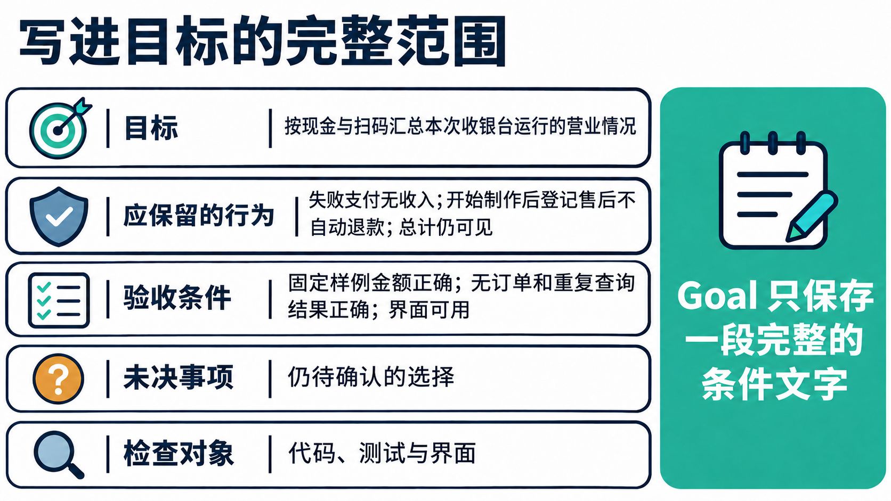
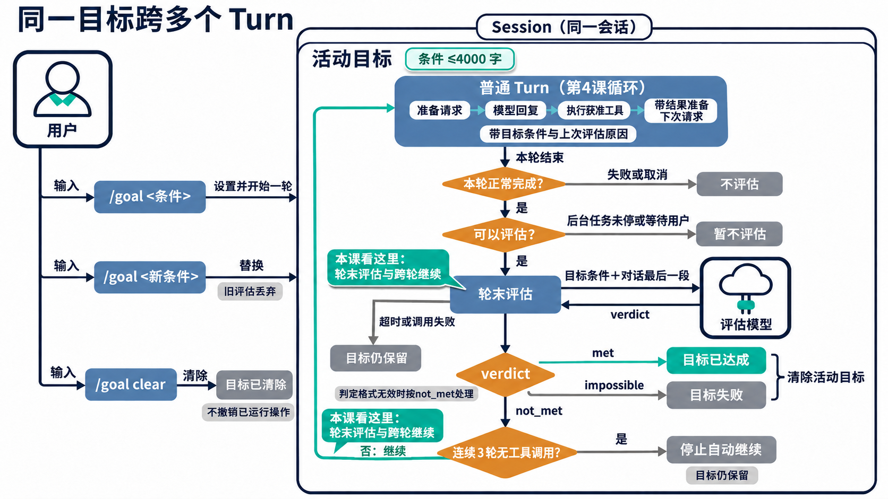
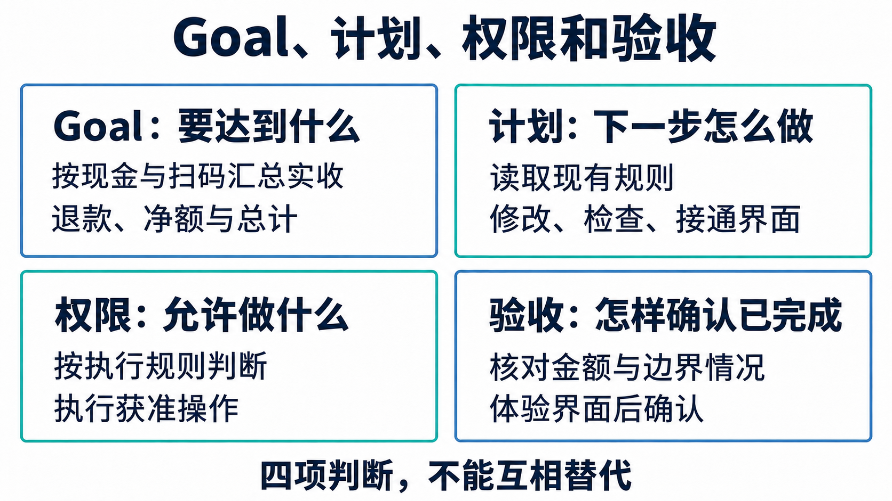
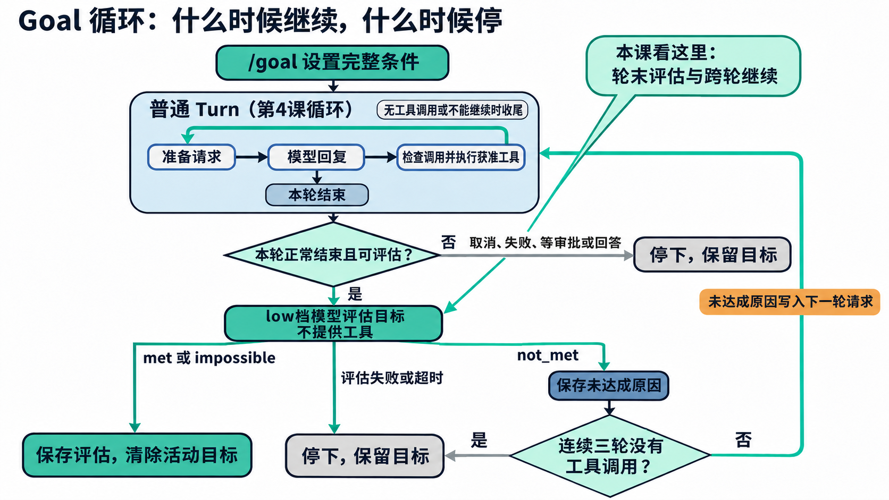
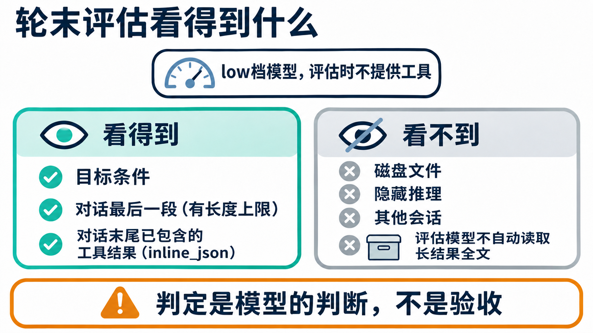
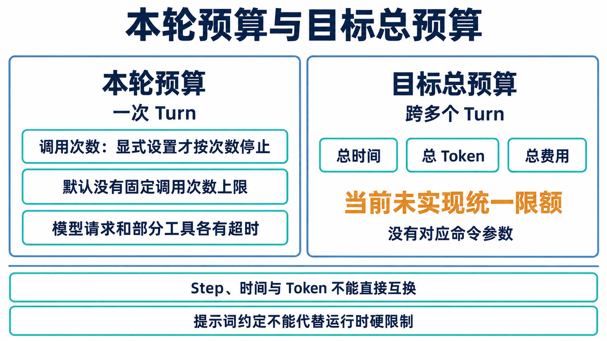
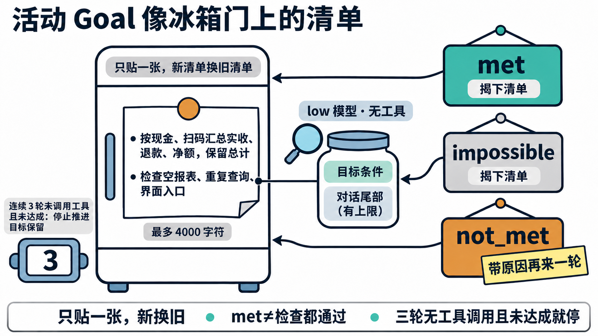
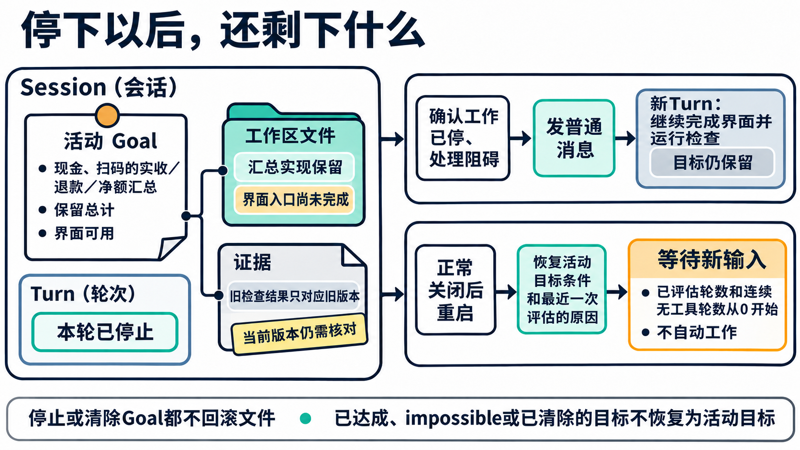
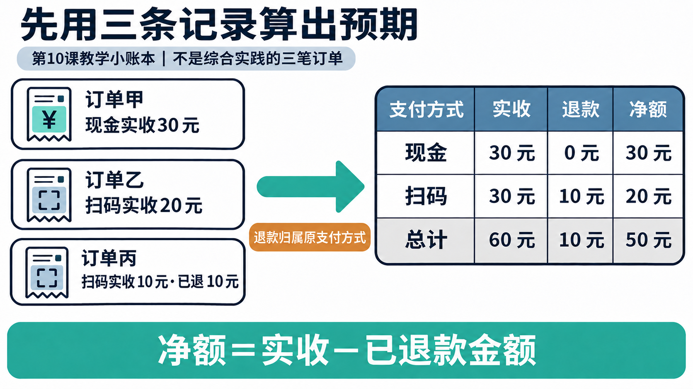
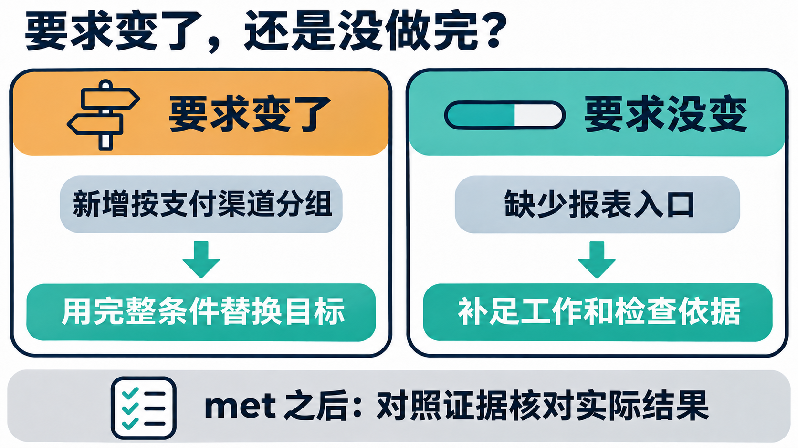

从一次回复走向可追踪的目标：设置条件、轮末评估、自动继续与安全停止。

## 本课导览

上下文整理让模型能继续处理信息；Goal 则保存一件事的完成条件。设置后，会话只在符合条件的正常轮末评估目标。目标未达成且允许继续时，程序才自动开始下一轮。本课用收银台报表，区分一次 Turn 和跨多个 Turn 的目标，下面的总纲图列出本课主线。

学完后，你应能解释“本轮结束了，但目标还没完成”的原因。下一课讨论这些目标和执行事实怎样保存与恢复。


## 一、一个目标怎样跨越多个 Turn？

**一轮结束只说明这轮停了；给任务设定 Goal 并写明完成条件后，程序可以在轮末评估，再决定是否自动推进下一轮。**

前两课让 Agent 有足够的信息继续工作。可“继续”总得有个方向：这件事要做到什么程度？

### 用户要完成一件事，模型却只结束了一轮

**模型停止输出，不等于整个目标完成。**

“解释报表算法”通常一次 Turn 就能答完。“给收银台增加按支付方式汇总，并保持退款与界面一致”，可能要经过调查、澄清、修改、检查和人工体验。某轮模型停止输出，只说明这轮到了一个结束点。

可以把 Goal 理解成这件事持续有效的“完成要求”。推进到了哪里，还要结合对话和实际检查判断。它和几样东西各管一件事：

- **计划**：安排下一步。
- **工具策略**：决定哪些工具操作能执行。
- **轮末评估**（每轮结束时做的一次检查）：根据可见对话，判断条件是否满足。

### 建立目标以前，先把未知条件找出来

**代码里能查到的先查，真正影响结果的选择再问用户；接受后，把完整范围写进目标。**

收银台用户说“按付款方式统计一下营业额”。怎样先查代码、再问出退款归属和总计这类关键选择，第 5 课已经讲过。本课关心的是用户接受之后：把完整范围写进目标，不要只存最后一句“可以”。



看完这张图，你要能：把收银台报表的目标、应保留行为、验收条件、未决事项和检查对象写成一段完整条件。

| 需要保存的信息 | 收银台示例 |
| --- | --- |
| 目标 | 按现金与扫码汇总本次进程营业情况 |
| 应保留的行为 | 失败支付无收入，制作后售后不自动退款，总计仍可见 |
| 验收条件 | 固定样例金额、无订单、重复查询与界面接通 |
| 未决事项 | 输入材料不足，或产品需求中仍有待确认的选择 |
| 检查对象 | 本次条件对应的代码、测试与界面 |

这些是写条件的要点，不是 Goal 的结构化字段。Goal 只保存一段完整的条件文字。用户改了统计范围，就用新的 `/goal <条件>` 替换当前目标。已有的检查结果，要逐项判断还适不适用。



看完这张图，你要能：解释活动 Goal 如何通过轮末评估衔接多个 Turn，以及新条件如何替换当前目标。

### MyBuddy 的 Goal 入口

`/goal` **查看，**`/goal <条件>` **设置并开始一轮，**`/goal clear` **清除。**

在交互会话中输入下面的命令。它们是斜杠命令（Slash Command，以 `/` 开头、由 MyBuddy 自己处理），不是 Shell 命令。使用前看一下当前的 `/help`；能不能用，还要看当前是不是在规划模式、诊断状态，以及会话是否正忙。

| 命令 | 用途 | 需要注意 |
| --- | --- | --- |
| `/goal` | 查看条件、已评估轮数、最近判定和原因 | 查询本身不启动模型 |
| `/goal <完整条件>` | 设置唯一活动目标，并以条件启动一轮 | 条件不能全为空白，最多 4000 字符；已有目标会被替换。`clear`、`stop`、`off`、`reset`、`none`、`cancel` 单独作为参数时表示清除 |
| `/goal clear` | 清除当前活动目标 | 不取消已派发动作，不回滚文件或删除历史 |

建立目标可以从下面这段开始：

```latex
/goal 为收银台增加现金和扫码的收款、退款、净额汇总，保留总计。先读取现有规则；按约定的样例验证，检查空报表、重复查询和操作界面入口，说明实际结果及未验证项。
```

设置和清除都要求会话空闲、没有待处理的输入。设置后，条件作为一条普通消息开始这一轮。规划模式和工具权限照常约束本轮行为。



看完这张图，你要能：区分要达到的结果、下一步路径、允许动作与完成证据。

容易误会的地方：

- 条件不会自动变成测试；怎样检查，仍由模型根据任务选择。

## 二、停止条件与预算边界

**模型决定下一步做什么，会话决定要不要再开一轮；当前的预算只管单个 Turn，没有整个目标的总预算。**

目标存下来以后，是谁让任务往前走？把分工理清楚，才不会把“有一个 Goal”理解成程序在后台无限运行。

### 先看最简版：做一轮、评一次、没完成就再来

**最简单的 Goal 循环只有几行：跑一轮，问一次“完成了吗”，没完成就带着条件再跑。**

下面是一段 Python 风格的**教学伪代码**，不能直接运行：

```python
def run_goal(condition):
    text = condition
    while True:
        ask(text)                                # 1. 跑一轮普通任务
        verdict = judge(condition, conversation) # 2. 让模型判断条件是否满足
        if verdict == "met":                     # 3. 满足了就停
            return
        text = condition                         # 4. 没满足，带着条件再来一轮
```

用收银台走一遍：第一轮写好了汇总函数。评估说“界面入口还没接”。第二轮带着同一个条件继续，接上了入口。评估说满足了，循环结束。

MyBuddy 也是这个骨架。但真实运行时，这几行会出不少问题。我们一次看一个：

1. **这一轮可能没正常结束 → 只在正常结束后评估。** 取消、失败、等你审批或回答时，不评估，停下并保留目标。
2. **评估的模型可能照着对话里的指令去做事 → 评估不带工具。** 它只能读一段有限长的对话尾部，返回判定和一句原因。
3. **条件可能根本做不到 → 多一种判定** `impossible`**。** 和 `met` 一样，停下并清除活动目标。
4. **模型可能一直空谈、什么都不做 → 连续三轮没有工具调用，就停止自动继续。** 目标仍保留。
5. **评估本身可能失败或超时 → 停下并保留目标，不自动重试。**
6. **下一轮可能忘了上次差在哪 → 把上次的原因放进下一轮的请求。**
7. **两轮之间可能插进别的请求 → 整个推进期间占住会话入口。**

下面的流程图把这些约束画了进去：



看完这张图，你要能：沿 Goal 循环说出哪些情况继续下一轮、哪些情况停下并保留或清除目标。

### 持续推进由谁驱动

**一轮里，模型提出动作、Harness 执行；轮与轮之间，由会话评估后决定是否继续。**



看完这张图，你要能：说明轮末评估用 low 档模型无工具调用，只看目标条件和有限长的对话尾部。

一次推进中，模型提出读取、修改和检查等工具调用。Harness 执行获准的操作，并返回结果。正常轮结束后，会话先检查能否评估；本轮已向用户提问，或仍有后台子任务没停下时，先保留目标并交还控制。符合条件时才评估并决定是否自动续轮。

评估用的是 **low 档模型的一次无工具调用**：用配置里 `low` 预设对应的模型调用一次，不给它任何工具。它收到目标条件，和对话最后一段（长度有上限）。这一段里有用户和模型的文字，以及模型调用工具得到的结果。评估器不读磁盘上的文件，看不到模型隐藏的推理，也看不到其他会话。

判为 `not_met`（目标尚未达成）并保存后，条件作为下一轮的用户消息，原因写进下一轮给模型的额外指导。第三个无工具轮仍会评估；还没达成，就停止自动继续，保留目标。

当前会话还有后台子任务没停下时，会跳过本次评估和自动继续，把控制交还给你。后台任务结束后，也不会自动接着推进。

### 预算怎样限制持续推进

**MyBuddy 只有本轮预算；跨轮的总时间、Token 或费用限额目前没有。**

先分清两种范围：

- **本轮预算**：限制一次 Turn，比如最多允许多少次模型决策。
- **目标总预算**：覆盖多轮推进，比如这项任务总共能花多少时间或费用。

Step 数、时间和 Token 不能直接互换。一个 Step 里的测试命令可能等很久；一句短回答也可能消耗很多输入。



看完这张图，你要能：分辨不同预算指标的控制范围与当前支持边界。

MyBuddy 现在沿用普通 Turn 的预算检查。默认没有固定的调用次数上限；显式设置了上限，才按次数停下，业务请求和自动摘要（上下文太长时自动压缩历史用的调用）共用这个上限。模型请求和部分工具各有超时。交互工作没有整体计时器。目标级的总限额，也没有对应的命令参数。

你可以在目标里写清“遇到什么情况就停下报告”，帮模型判断何时要你介入。

假如预算用完时，报表只做完了汇总逻辑，界面还没改，任务就停在“目标尚未完成”。这时看剩余工作和后续预算，再决定怎样继续。

容易误会的地方：

- 提示词里的约定不能代替计数和检查；要强制停下，只能靠运行时的限制。
- 重新开始计数，不会抹掉之前的消耗。

## 三、停止、清除与轮末判定分别改变什么？

**判定决定目标是否还活动；停止和清除都不会回滚文件。**

目标开始推进后，要分别看三件事：本轮是否正常结束，评估怎样判断，还能不能继续。

### 三种判定怎样影响目标

`met` **和** `impossible` **清除活动目标，**`not_met` **保留目标并带着原因继续。**

| 判定 | 含义 | 接下来做什么 |
| --- | --- | --- |
| `met` | 根据提供的对话，条件已满足 | 保存评估并清除活动目标 |
| `not_met` | 条件尚未满足，或证据不足 | 保存原因，符合继续条件时开始下一轮 |
| `impossible` | 条件确实无法完成 | 保存评估并清除活动目标，显示失败原因 |

用冰箱门上的清单把这张表记成一幅画：门上只贴一张，评估只决定揭下还是带着原因再来。



看完这张图，你要能：用“冰箱门上只贴一张清单”记住活动 Goal：low 档模型不用工具来评估，met 或 impossible 就揭下清单，not_met 带着原因再来一轮，连续 3 轮没用工具就停下，但目标保留。

评估输出格式不对，就当作 `not_met`，原因记为“评估结果无效”。评估调用失败或超时，就停下并保留目标，不自动重试。

容易误会的地方：

- 判定是模型的判断，不是程序认证测试通过，也不代表你已经验收。
- 评估只看有限长的对话，可能漏看细节或判断错误；金额、界面和当前文件要用实际检查核对。

### 停止和清除之后还剩下什么

**停下时目标保留，文件不回滚；补齐信息后发普通消息就能接着推进。**



看完这张图，你要能：说明停止后目标保留、文件不回滚，发普通消息可继续，重启只恢复活动目标。

取消或失败后，目标保留，先确认当前工作已停止。交互入口的工具审批可以在本轮内等待；AskUserQuestion 成功后则立即结束本轮，跳过目标评估和自动续轮。终端逐题收集回答，经你确认后作为下一轮普通消息发送。非交互入口遇到审批或提问也会停止自动继续。连续三个正常 Goal 轮没有登记工具调用且未达成时，同样交还控制。

停止不是文件回滚。先按第 12 课确认已派发的工作是否停稳（进程确实停了、清理也做完了），再看文件差异和遇到的阻碍。补齐信息后，发一条普通消息，就能推进保留的目标。要求变了，用 `/goal <完整条件>` 重新设置。

正常重启只恢复仍活动的目标，不会自动开始工作。已评估轮数和连续无工具计数从 0 重新开始；最近一次的原因仍可指导下一轮。已达成、失败或清除的目标，不会恢复成活动目标。

### 跟着一份报表，把目标、进展与评估连起来

**用具体金额把目标写成能判断对错的要求，每轮结束后先问“哪部分有证据”。**

下面是教学推演，金额为便于计算而设。

#### 第一步：先写出可以检查的结果

假设已有现金收款报表，我们想增加扫码收款，并要求退款归到原支付方式。

先不急着让 Agent 改文件。拿三条记录算一遍，目标就具体多了：



看完这张图，你要能：用三条示意记录算出按支付方式的预期报表，把目标写成能判断对错的要求。

| 记录 | 支付方式 | 收入 | 已退款金额 |
| --- | --- | --- | --- |
| 订单甲 | 现金 | 30 元 | 0 元 |
| 订单乙 | 扫码 | 20 元 | 0 元 |
| 订单丙 | 扫码 | 10 元 | 10 元 |

按“净额＝收入－已退款金额”，预期报表应该是：

| 支付方式 | 收入 | 退款 | 净额 |
| --- | --- | --- | --- |
| 现金 | 30 元 | 0 元 | 30 元 |
| 扫码 | 30 元 | 10 元 | 20 元 |
| 总计 | 60 元 | 10 元 | 50 元 |

这些数字还揭示出一个隐藏条件：退款要按原支付方式归属，不能统一从现金里扣。

于是，目标说明可以这样组织：

```latex
结果：按现金和扫码分别显示收入、退款和净额，保留总计。
范围：使用当前进程中的订单；退款归属原支付方式。
约束：查询报表不修改订单，也不再次触发付款或退款。
检查：三条示意记录得到约定金额，空报表可查看，重复查询不改变结果。
交付：能从操作界面进入报表，展示实际检查结果与尚未验证的部分。
```

这是目标说明的写法，不是新的配置格式。实际使用时，把这些条件合进完整的 `/goal` 文字。

#### 第二步：一次推进完成以后，先问“哪部分有证据”

假设第一轮只做完了汇总函数，直接调用函数得到了预期数字。界面还没有入口。

这时可以写下这份进展：

| 条件 | 当前依据 | 还差什么 |
| --- | --- | --- |
| 分支付方式计算金额 | 函数检查得到预期数字 | 核对实际订单字段是否接通 |
| 保留总计 | 示例合计为 50 元 | 核对界面显示 |
| 查询不产生业务写入 | 尚未检查 | 检查查询调用链与重复查询 |
| 从操作界面使用 | 尚未完成 | 增加入口并实际体验 |

“代码已经写好了”覆盖不了整张表。这些缺口出现在可见对话里时，评估器应判为 `not_met`，比如给出“界面入口尚未接通”的原因。

原因保存后，满足自动继续的条件，下一轮就沿用同一个条件，去接通入口、补充检查。

#### 第三步：需求变化后，重新判断哪些证据仍然适用

现在你补了一句：“扫码里还要区分两种渠道。”

这会影响分组方式，但不必全部从头再来。先逐项比较：

| 原有条件 | 新要求的影响 |
| --- | --- |
| 净额等于收入减退款 | 计算关系继续保留 |
| 退款归属原支付方式 | 需要进一步确认是否也归属原渠道 |
| 现金、扫码两组 | 扫码组需要细分，显示结构变化 |
| 总计保留 | 继续保留，并检查子组之和 |
| 原来三条测试记录 | 要补充渠道字段与跨渠道样例 |

订单根本没记渠道的话，先报告数据结构的缺口。不能从金额猜渠道，也不能悄悄删掉“区分渠道”来交差。

用 `/goal <完整条件>` 替换目标后，原来“扫码净额 20 元”的结果还能帮着核对总数，但证明不了两种渠道分对了。

判断要落到变化的那条条件上。

#### 第四步：评估达成以后，仍要核对业务结果

评估返回 `met` 后，活动目标被清除。你还要对照完整条件检查报表。模型判断达成，和真实的业务检查，是两种依据。

比如金额都对，但只能在内部函数调用里看到，操作界面打不开，就没满足“从操作界面进入”。

反过来，界面很完整，但退款被算成了收入，也没满足金额条件。两类问题要分别告诉 Agent，不能只说一句“效果不太好”让它重新猜。

可以这样反馈：

```latex
分组金额已与样例一致，保留这部分实现。
操作界面仍缺少报表入口，请补上入口。
补齐后重新检查界面显示和重复查询，不改变已接受的退款口径。
```

目标仍处于活动状态时，这份反馈可以直接开始新一轮。目标已清除，就用完整条件重新设置。你核对的是整个目标是否成立，不只是最后一轮的总结漂不漂亮。

### 先猜下一步：现在该补材料、换条件，还是核对结果？

**关键是分清：完成要求变了，还是要求没变、工作还没做完。**



看完这张图，你要能：分清完成要求变了还是工作没做完，分别选择替换目标或补足工作。

不操作程序，先判断下面四种情况：

| 当前情况 | 下一步主要处理什么 |
| --- | --- |
| 已有报表缺少一个明确要求的入口 | 说明缺口，继续完成原目标 |
| 想增加一个原先未要求的渠道维度 | 澄清变化，用完整条件替换目标 |
| 已因缺资料停下，现在补齐了资料 | 交代新材料，再按当前状态继续 |
| 评估为 met，目标已清除 | 对照实际证据核对结果，发现缺口时重新提出任务 |

要求变了，就重新设置完整条件。要求没变，就补足工作和检查依据。

## 四、观察同一目标的评估与两次推进

**设置一个真实目标，记下每轮做了什么、检查结果和评估原因。**

跟着目标设置、轮末评估和自动继续，记下条件、实际改动和检查依据。下一课接着讲这些事实怎样留给重启后的会话。

### 设置目标，观察原因怎样进入下一轮

`not_met` **时看下一轮是否围绕缺口继续；**`met` **或** `impossible` **时看目标是否被清除。**

在独立的收银台副本中，先核对规则和测试入口，再提交上面的 `/goal` 命令。审阅实际修改和命令审批。正常轮结束后，观察判定和原因：

- `not_met`：看下一轮是否围绕缺口继续。
- `met` 或 `impossible`：看活动目标是否被清除。

记下两轮各做了什么、实际检查结果和评估原因。没有出现第二轮，就记下真实的停止原因。遇到取消、失败或等待输入，也不要写成已达成。

想停止练习时，取消当前工作，等收尾后用 `/goal` 看保留的条件。在空闲状态用 `/goal clear` 清除，再核对项目文件和历史都还在。

源码导航：

- 目标命令：`src/mybuddy/platform/application/goal_commands.py`
- 会话推进：`src/mybuddy/platform/application/application_session.py`
- 轮末评估：`src/mybuddy/platform/application/goal.py`
- 目标状态：`src/mybuddy/platform/sessions/state/goal.py`

沿“设置—普通轮—评估—保存—继续或停止”核对职责。

**能力卡**：想在收银台副本里亲手试一遍，就照着能力卡《Goal 目标与验收》（`demo-project/cards/goal.md`）做。

## 使用小妙招

### 需求变化后，核对合并后的完整目标

MyBuddy 用 `/goal` 管理目标；用 Claude Code、Codex 时，可以把完整目标写在一条消息或一份计划文件里，做法相同。

先用 `/goal` 查看当前目标，再请 Agent 把新要求和已有目标合成一份草稿，核对哪些条件新增、被替代、继续保留（做法见上面“第三步”）。确认后用 `/goal <完整条件>` 替换。只补充实施细节、没改完成条件时，不必重写目标。

阶段目标也要能交出可检查的结果：“先通过现有入口查询一笔付款的汇总”比“先写三个文件”更容易核对。

**为什么这样做：** Agent 每做完一轮，都要拿目标来判断“做完了没有”（见“三种判定怎样影响目标”）。只补一句新要求，旧条件和新条件混在一起，哪条被替代了并不清楚，它可能还按旧条件判断“已完成”。合成一份完整目标，判断才有统一的标准。

### 停下来时先读阻碍，再决定继续方式

阻碍说明了下一次推进缺什么：资料不足就补材料，条件不清就澄清，调用失败就先查原因。目标保留时，一条新的普通输入就能开始一轮，轮末照常评估。重新设置目标会替换条件和评估状态，但不能借此绕过运行时对“结果未知”操作的阻断。

**为什么这样做：** Agent 停下来时说明的阻碍，就是它判断下一步还缺什么（见“先猜下一步：现在该补材料、换条件，还是核对结果？”）。不看阻碍、只说一句“继续”，缺的东西还是缺，它很可能在同一个地方再停一次。

## 自测：这一课的概念分清了吗

**先自己作答，再看后面的答案。** 每题都能在本课正文里找到依据；带“动手验证”的题，可以照着做一遍，亲眼看到结果。

**1.** 你要求报表金额正确，并且能从操作界面进入。模型结束一轮，回复“汇总函数已完成”。你检查后发现函数算得对，但界面还没有入口。怎样判断这件事是否完成？

- A. 这一轮已经结束，可以把整个目标看作完成。
- B. 完成条件还缺界面入口，不能只凭这一轮的回复确认目标完成。
- C. 函数检查通过就够了，界面入口不影响目标是否完成。

**2.** 你刚在新副本里启动 MyBuddy，还没有设置目标，也没有发送任务，只在空闲会话中输入 `/goal`。会发生什么？

- A. 程序显示“未设置目标”，不会启动模型处理任务。
- B. 模型先分析项目，再替你建立一个目标。
- C. 程序直接开始一轮，等模型回复后才显示目标状态。

**3.** 判断：计划已经列出实施步骤，就可以代替 Goal 的完成条件。（对 / 错）

**4.** 你原先只要求报表区分现金与扫码，旧测试检查了这两组金额。现在你增加要求，扫码还要区分两种渠道。旧测试的结果该怎样使用？

- A. 总金额没变，旧测试通过就证明新增的渠道分组也正确。
- B. 要求变了，旧测试结果全部作废，连没变的计算关系也不能参考。
- C. 逐项判断旧结果还覆盖哪些条件；新增渠道分组需要补充检查。

### 答案与依据

**1. 选 B。** 一轮结束不等于整个目标完成。界面入口是你明确提出的完成条件，函数检查通过还不能覆盖它。  
依据：本课“用户要完成一件事，模型却只结束了一轮”。

**2. 选 A。** 不带条件的 `/goal` 只查看状态，不启动模型。它和设置目标并开始一轮的 `/goal <完整条件>` 不同。  
依据：本课“MyBuddy 的 Goal 入口”。  
动手验证：在仓库根目录按能力卡《Goal 目标与验收》（`demo-project/cards/goal.md`）的“准备”部分运行 `uv run python demo-project/prepare_shop_demo.py --case K8`。按脚本输出找到本次生成的练习目录，在该目录运行 `sh start-mybuddy.command`；启动脚本与 `project/` 文件夹同级。进入 MyBuddy 后，先不做卡中设置目标的操作，也不发送任务，只输入 `/goal`；终端会显示“未设置目标”，随后仍等待你输入，不会开始模型回复。

**3. 错。** 计划安排下一步，Goal 保存持续有效的完成条件。列出了怎么做，还需要说明做到什么程度才算完成。  
依据：本课“用户要完成一件事，模型却只结束了一轮”。

**4. 选 C。** 旧结果可以帮助核对未变的条件，但不能证明新增的渠道分组正确。要求改变不等于所有旧证据都失效，也不等于旧证据自动覆盖新要求。  
依据：本课“跟着一份报表，把目标、进展与评估连起来”。

## Q&A：常见追问

### Q1：有计划文件，为什么还需要 Goal？

计划说明准备怎样做，Goal 保存持续有效的完成条件，两者不能互相代替。例如计划列出“修改运费条件、运行检查”，Goal 可以要求“100 元免运费且地区例外仍正确”。MyBuddy 只在符合条件的正常轮末评估目标；已向用户提问或后台子任务还没结束时，不评估。当前代码没有单独排除规划轮，提交方案也可能触发评估；方案提交和计划打勾都不能代替实际检查。

### Q2：一轮已经停止，Goal 为什么仍未完成？

一轮停止只说明这轮不再执行，不一定满足 Goal。正常结束后，评估结果为 `not_met` 才可能自动继续；取消、失败或 AskUserQuestion 提问后，不会评估并自动续轮，目标仍保留。连续三轮正常结束且没有登记工具调用时，也会停止自动继续但保留目标；这里统计的是有没有提出工具调用，不保证工具实际执行成功。

### Q3：取消或者清除目标，会撤销修改吗？

不会。取消当前工作要等收尾；清除只移除活动目标。要撤销文件，另外说清范围和版本。

### Q4：判定 met，就表示检查都通过了吗？

不是。`met` 只表示评估模型根据最近的有限对话，判断完成条件已经满足；它不自己运行测试，也不重新读取工作区。例如对话里声称“测试通过”，仍要核对有没有对应的命令和真实输出，以及后来代码是否又变了。Goal 的判断可以帮助推进任务，不能替代测试和实际验收。

### Q5：换一个目标后，旧测试结果还有用吗？

可以作为历史线索，但要重新判断它是否覆盖当前条件、代码版本和工作区。没变的独立事实可能仍适用，变化的部分要补验。

## 本课术语速查

| 本课说法 | 源码或命令中的名字 | 含义 |
| --- | --- | --- |
| 目标条件 | `/goal <完整条件>` | 本会话唯一活动目标，设置后开始一轮 |
| 轮末评估 | `met` / `not_met` / `impossible` | low 模型根据可见对话作出的判定 |
| 继续原因 | `reason` | 未达成时进入下一轮模型指导的简短说明 |
| 清除目标 | `/goal clear` | 移除活动目标，不回滚文件 |
| 本轮预算 | — | 显式配置的调用上限等普通 Turn 限制 |
| 目标总预算 | — | 跨轮总量限制；当前没有独立 Goal 参数 |
| 无工具停止 | 连续 3 轮 | 正常 Goal 轮没有工具调用且仍未达成时停止自动继续 |

## 继续阅读源码解析

源码解析沿同一条调用链，读命令解析、轮末评估与推进循环的真实代码。
