重启以后，凭保存下来的记录判断：哪些动作做完了，哪些还没开始，哪些说不准，再决定怎样继续。

## 本课导览

上一课的目标可能要好几轮才能完成，可程序随时可能退出：进程被 `kill -9` 强行结束，或者电脑在修改途中突然断电。下次打开 MyBuddy，它怎样知道之前做到了哪里？

这一课只回答这一个问题，下面的总纲图列出四步。学完后，你应能说清：重启后能确认什么、还要查什么，以及哪些动作不能直接重做。

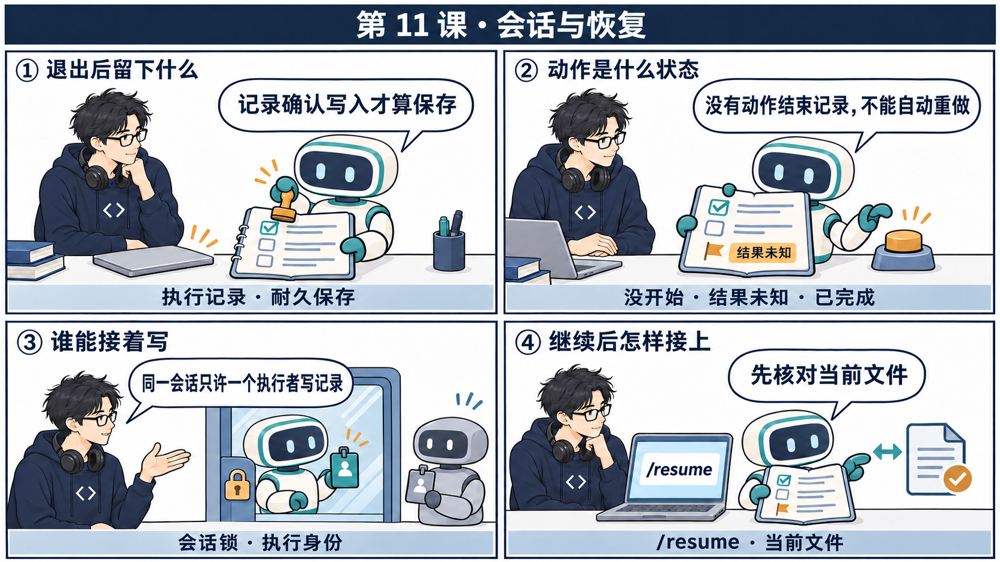

## 一、退出以后，程序留下了什么？

**能用来恢复的，只有程序在工作中亲手写下、并且确认存好的记录。**

### 只保存最后一句回答，为什么不够

**最后一句回答是模型说的话，不是发生过的事实。**

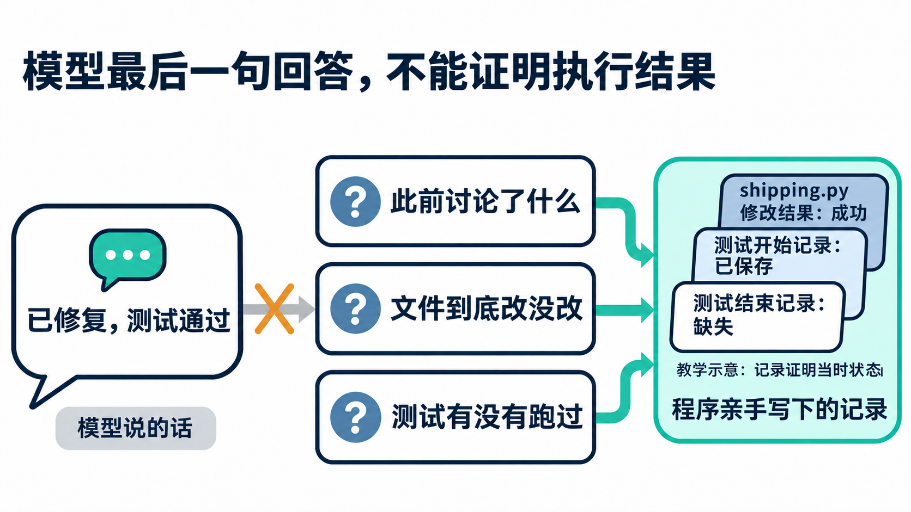

看完这张图，你要能：说明为什么恢复要依靠程序亲手写下的记录，而不是最后一句回答。

你让 MyBuddy 读了代码，又批准了它的一次修改，然后退出。下次打开时，你想知道三件事：此前讨论了什么，文件到底改没改，测试有没有跑过。

最后一句回答可能写着“已修复，测试通过”。但这句话是模型说的：它可能只说了一部分过程，也可能把“打算运行测试”说成了“测试通过”。要回答这三件事，需要程序亲手写下的记录。

### 先看最简版：退出前把消息存进文件

**最简单的做法，是退出时把消息列表写进一个文件，下次再读回来。**

第 4 课的最简循环里，对话都放在内存里的 `messages` 列表中。想让它“重启后还在”，最直接的写法是这样：

```python
# 最简版（教学示意，不是 MyBuddy 的代码）
def on_exit(messages):
    save_json("session.json", messages)

def on_start():
    messages = load_json("session.json")
    return agent_loop(messages)  # 接着问模型
```

正常退出时，这几行够用。可程序不总是正常退出。

### 从最简版到 MyBuddy：一次加一个约束

**最简版假设“退出前一定来得及保存”；MyBuddy 多出来的设计，都在处理来不及的情况。**

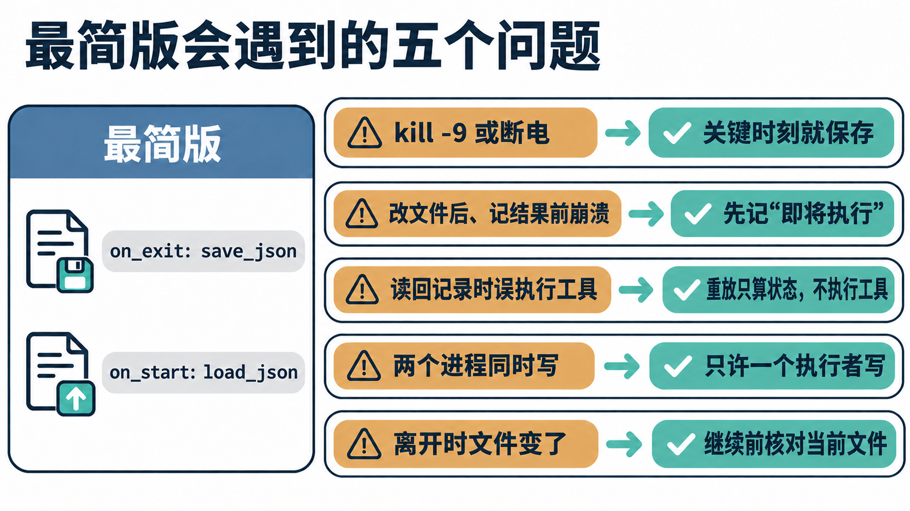

看完这张图，你要能：对照退出前存文件的最简版，说出 MyBuddy 加上的五条约束。

我们一次只看一个问题：

1. **进程可能被强行结束 → 每到关键时刻就保存，不等退出。** 最简版只在退出时写文件。`kill -9` 或断电时，这段代码根本没机会运行。MyBuddy 在每个关键时刻都写一条记录，确认写好才往下走。
2. **改文件和写记录之间可能崩溃 → 动手前先记一笔“即将执行”。** 最简版只记结果。如果文件改了、结果还没记，重启后就以为没改。MyBuddy 先存“即将执行”，再改文件，再存结果。这样重启后，至少知道“可能已经改了”。
3. **读回记录时可能误触动作 → 重放只算状态，不执行。** 最简版读回 `messages` 后马上接着跑。MyBuddy 读回记录时只重新算出状态，不会把记录里的工具再运行一次。
4. **可能有两个进程同时写 → 同一时间只许一个执行者写。** 两个终端打开同一个会话，最简版会互相覆盖。MyBuddy 给每次运行发一张“工作证”，旧的作废后就写不进去。
5. **文件可能在你离开时变了 → 继续前重新核对当前文件。** 记录描述的是过去。继续工作前，要让 Agent 重新读一遍相关代码。

下面依次展开这几条。约束 1 在本节，约束 2、3 在第二节，约束 4 在第三节，约束 5 在第四节。

### 执行记录：程序在关键时刻写下的事实

**每条执行记录说明一件已经发生的事，按顺序保存在本机数据库里。**

MyBuddy 在每个关键时刻写下一条**执行记录**（源码里叫事件，event）。例如：

```latex
收到用户请求
模型返回了一条回复，其中请求修改 shipping.py
用户批准了这次修改
记录即将执行修改
工具执行结果已记录：修改成功
供模型使用的修改结果已保存
本轮处理结束
```

把这些记录想成一串挂在卡盒上的记录卡：只有写进卡盒的才算数；在哪一张断掉，后面的卡就都没写下。

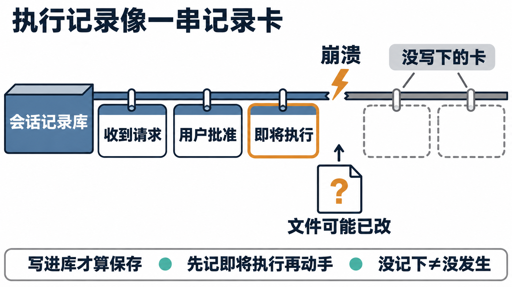

看完这张图，你要能：用“一串记录卡”说明：执行记录按顺序写进会话记录库才算保存；程序崩溃后，没写下的卡不能证明文件没改。

这些记录按顺序存在本机的 SQLite 数据库里，每个会话一个文件。**SessionJournal**（会话日志）负责检查新记录，再交给数据库保存。

一条记录写进数据库并得到确认，才算**已保存**（课程里也叫“耐久保存”）。内存里改了对象，或者刚发出写入请求，都不算。发送模型请求、执行工具之前，MyBuddy 会先确认相关记录已经保存。

上面有两条记录很像。“工具执行结果已记录”记的是工具实际怎样结束。“供模型使用的结果已保存”记的是后面的模型请求能用的结果。它们分开保存。所以可能出现“执行结果记下了，供模型使用的结果还没存”的情况。下一节会用到这个区别。

### 哪些东西会随进程消失

**界面进度、网络连接、运行中的代码都只活在进程里；恢复是重新算状态，不是让它们复活。**

进程退出，这些东西就没了。重启后，程序可以根据执行记录重新算出“现在处于什么状态”。但它不能让原来那次网络请求或函数调用“接着跑下去”。

所以恢复的意思不是“回到退出前那一刻继续运行”。它是“读一遍记录，弄清做到了哪里，再决定下一步”。

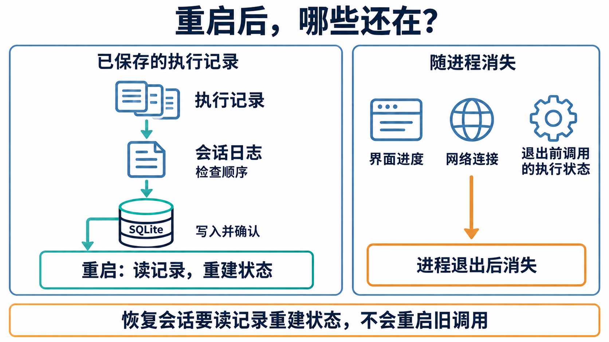

看完这张图，你要能：区分会保存下来的执行记录与随进程消失的运行状态。

容易误会的地方：

- 内存里改好了，或者写入请求已经发出，都还不算“已保存”。
- “执行结果已记录”不说明模型已经看到了这个结果。

## 二、重启时，怎样从记录判断每个动作的状态？

**记录最后停在哪一条，决定了你能确认什么；没有结束记录，就不能自动重做。**

### 记录停在哪里，决定你能知道多少

**“即将执行”和“执行结果”之间，是真正改文件的时刻；崩溃落在这里，结果就说不准。**

假设一次需要审批的文件修改，执行中遇到崩溃。下面是简化的时间线：

```latex
① 调用已登记 → ② 用户批准 → ③ 记录即将执行 → 【文件被改动】
  → ④ 记录执行结果 → ⑤ 保存供模型使用的结果
```

崩溃发生在不同位置，重启后能确认的事情就不同：

| 崩溃时最后保存的记录 | 能确认什么 | 重启后怎样处理 |
| --- | --- | --- |
| 还没有③“记录即将执行” | 这次修改没有开始 | 不会自动执行；如果仍要修改，重新检查文件和授权，按新动作处理 |
| 有③，没有④ | 修改**可能**发生了，也可能没发生 | 按**结果未知**处理，不能自动重做 |
| 有④，没有⑤ | 执行状态要看④的内容，也可能是结果未知 | 历史尚未闭合，拒绝继续，不再执行一次 |
| 本轮已经结束 | 有本轮结束记录；仍须检查其他未完成事项和运行条件 | 通过续接检查后，可以接收新请求 |

第二行最值得多想一会儿。文件可能已经改好了，只是程序还没写下④就崩溃了。数据库里找不到执行结果，能说明文件没改吗？不能。改文件和写数据库是两个独立的动作，可能只完成了前一个。

这就是**结果未知**：外部动作可能已经发生，程序却没有足够证据确认。如果把它当成“失败”再做一次，就可能重复改文件，或者重复向外部系统发请求。

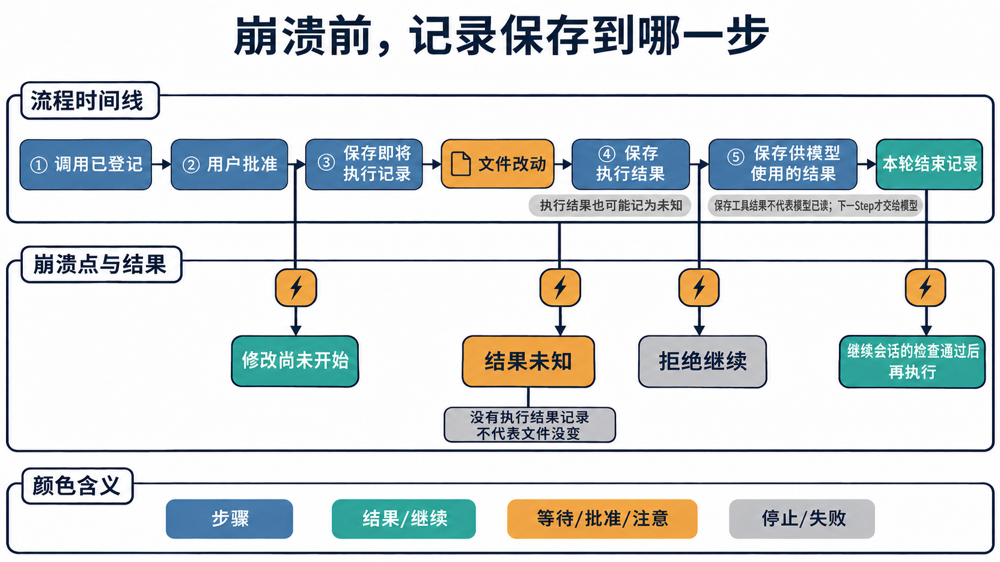

看完这张图，你要能：依据最后保存的记录，区分没开始、结果未知、已完成三种状态。

### 恢复不等于“再试一次”

**历史没有完整闭合（有动作开始了，却没有对应的结束记录）时，MyBuddy 拒绝继续，而不是猜着继续。**

普通工具缺少结果或本轮尚未结束时，程序不会猜测结果来修补历史。已正常结束并释放运行权的子任务有一个例外：确认子会话记录完整后，可以补记父会话缺失的结束结果，不重新运行子任务。能否继续，都要先通过续接检查。

这种拒绝是在保护你的文件，不是故障。异常中断后，要先核对实际情况：文件改没改，相关进程还在不在。然后再决定怎样处理。

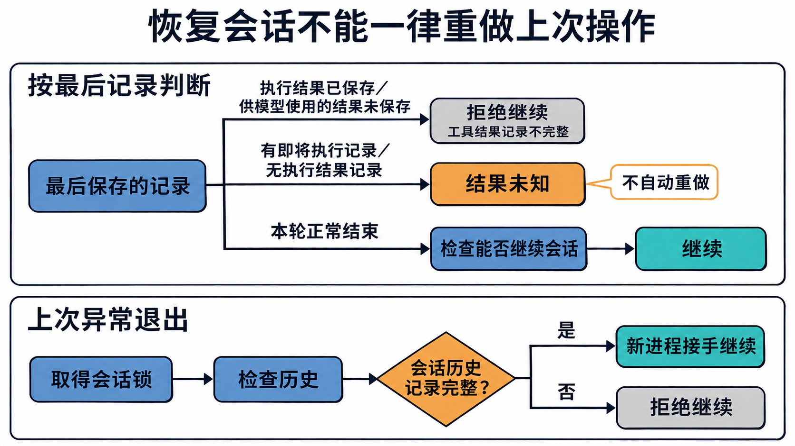

看完这张图，你要能：根据已有记录，理解为什么有的结果是“未知”，为什么会拒绝继续。

续接检查不只做一次。程序在启动前、拿到文件锁后、拿到执行身份后（这两样见第三节），都会检查历史。这样不会只凭较早的一次读取就决定继续。

### 回看记录，不会再做一次动作

**重放只是把记录读一遍、算出状态；需要继续的工作，要作为新动作重新检查和授权。**

重启时，程序把记录从头读一遍，算出当前状态。这个过程叫**重放**。读到“工具开始执行”时，它只记下“当时开始过”，绝不会真的再运行一次工具。否则，打开一份历史就可能把文件又改一遍。


看完这张图，你要能：理解重放历史与重新执行外部操作的区别。

容易误会的地方：

- 没有执行结果记录，不说明文件没改。
- 有“即将执行”记录，也不说明工具一定运行过。后面仍可能被取消或阻止。
- 续接被拒绝不是程序坏了，而是记录不足以安全地继续。

## 三、谁可以接着往会话里写记录？

**同一时间，只有拿着当前有效“工作证”的执行者，才能往一个会话里写记录。**

### 两个进程打开同一个会话会怎样

**两边都写，记录就乱了；所以要先锁住会话，再发一张工作证。**

假设你在一个终端里还开着 MyBuddy，又在另一个终端里继续同一个会话。两边都认为该自己处理下一步，记录很快就会乱掉。

MyBuddy 的做法分三步：

1. 先拿到本机的**会话锁**（一个文件锁）。
2. 再登记一个**执行身份**（源码里叫 Activation，可以理解为“这一次运行的工作证”）。
3. 然后重新读取历史。

之后每次新增记录，数据库都会核对：这张工作证还是不是当前有效的那一张。

### 旧进程迟到的结果怎么办

**旧进程的工作证已经作废，它迟到的写入会被拒绝。**

有一种情况很隐蔽：旧进程退出前发出了模型请求，过了一会儿才收到回复。如果它这时把回复写进会话，就会混进新一次运行的历史。

因为旧工作证已经失效，这次写入会被拒绝。

工作证怎样交接？上一个执行者正常退出时，会交还工作证。如果进程已经退出、没来得及交还，新进程要先拿到会话锁，并确认历史完整闭合，才能接管。MyBuddy 不会因为“等得够久了”就转交写入资格。

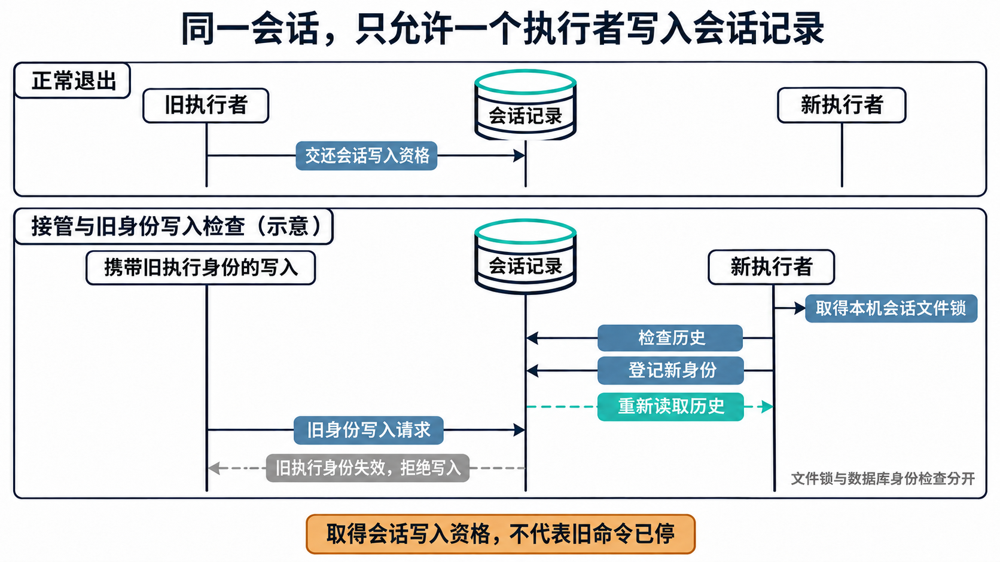

看完这张图，你要能：解释执行身份怎样阻止旧进程的迟到结果写进新的运行。

### 继续之前，还要核对运行条件

**能打开记录，和能继续执行是两回事。恢复要确认工作区没换、历史读得懂、没有结果不明或尚未结束的工作。**

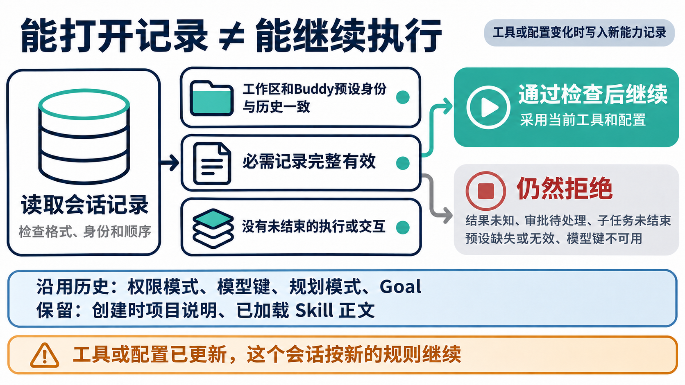

看完这张图，你要能：区分运行状态的安全检查与工具、配置的更新，知道恢复后哪些设置沿用历史。

继续之前，程序先读取会话记录，检查格式、会话身份和顺序，再算出当前状态。下面这些情况仍然不能继续：

- 工作区不是同一个；
- 工具已经开始，但不知道结果；
- 审批还没处理完，或一轮工作、子任务还没有结束；
- 缺少当前程序必须的记录，例如模型选择事件、规划状态或必需的配置来源；
- 从普通入口直接打开子会话，或冷启动恢复从规划模式创建的分支。

工具说明、Hook、Buddy 预设、MCP、搜索、沙箱、子任务或工作树的配置变了，旧会话照样可以恢复，恢复后按新配置继续。比如你给 `turn_end` 加一条日志命令，正常关闭的旧会话恢复后，每轮结束都会运行这条命令，之前的轮次不会补跑。

恢复会采用当前工具和配置，写入这次运行的新能力记录。终端会打印、Web 会显示一条通知：

工具或配置已更新，这个会话按新的规则继续。

用 `/status --verbose` 能看到“恢复时已更新”，后面只列工具说明和变化的配置项名，不展示配置内容。之前的能力记录和请求仍保留原样；之后的新请求和检查以新能力记录为准。

不过，“用当前配置”不等于把你的会话设置重置一遍：

| 内容 | 恢复时从哪里来 |
| --- | --- |
| 当前工具及其说明，Hook、Buddy 预设、MCP、搜索、沙箱、子任务、工作树配置，长结果与自动记忆开关 | 当前程序与配置 |
| 会话中切换的权限模式、模型选择、规划模式、仍活动的 Goal | 会话历史；保留模型键，地址和预算取当前目录；模型键缺失或不可用仍拒绝 |
| 共享记忆是否可用 | 主会话固定开启，子会话固定关闭，不从历史猜开关 |
| 项目说明（包括 `AGENTS.md`） | 创建会话时冻结的副本，不重读磁盘；要采用文件修改，需新建会话 |
| 已加载的 Skill 正文 | 历史中的成功加载结果，不用磁盘新正文替换 |

如果上次在规划模式中正常结束，继续时仍是规划模式。打开会话不会自动调用模型或执行旧工具。Buddy 的使用方式见第 14 课。

容易误会的地方：

- 拿到写入资格，只说明“现在由我来写记录”。旧进程启动的测试或命令不一定已经**停稳**（确认进程真的停下来了）。异常退出后，要另外核对这些进程。
- 能查看历史，不说明已经取得执行资格。

## 四、继续以后，怎样接上当前的工作？

**记录描述的是过去；继续工作前，要把记录和今天的文件对起来。**

### 继续会话、撤销文件、压缩上下文，改变的是不同的东西

**这三个操作分别作用于会话、文件和模型输入，互不代替。**

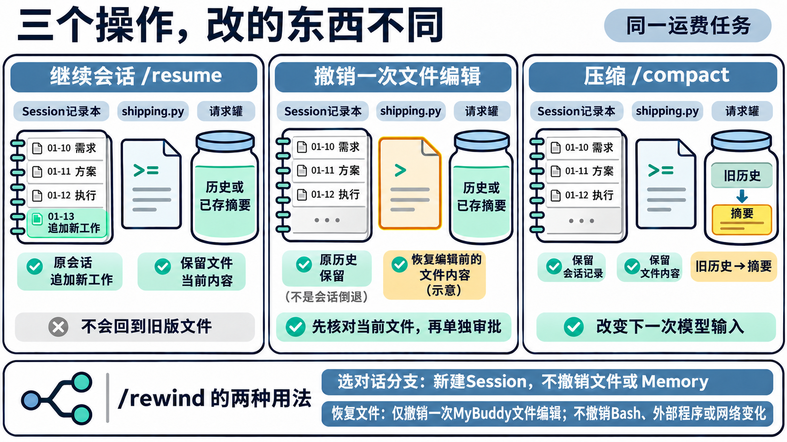

看完这张图，你要能：区分 /resume、撤销文件、压缩各改变什么，并记住 /rewind 的两种用法。

| 操作 | 改变什么 | 不改变什么 |
| --- | --- | --- |
| 继续会话（`/resume`） | 在原来的会话里接着工作 | 不把业务文件恢复到当时的版本 |
| 撤销文件 | 按所用方式恢复文件内容 | 不自动回退整段会话历史 |
| 压缩上下文（第 9 课） | 下一次模型请求看到的材料 | 不改变文件，也不删除原始记录 |

压缩会把较早的对话写成一份摘要，存成一条记录。正常重启时，程序直接用存好的摘要和最近的消息，不重新执行摘要里提到的工具。细节见源码解析。

MyBuddy 的 `/rewind` 有两种用法：

- **选择对话分支**：保留到所选轮次的对话，新建一个会话。它不撤销文件，也不撤销 Memory。
- **恢复一次受管文件编辑**：用本机保存的那次编辑备份。它先核对当前文件，再经过单独审批，然后才恢复。

`/rewind` 不能撤销 Bash 命令、外部程序或网络请求造成的变化。备份存在本机，没有加密，不能当作通用备份系统。

### 对话历史和代码目录要分别核对

**切分支改的是代码，继续会话改的是对话；两者不会自动同步。**

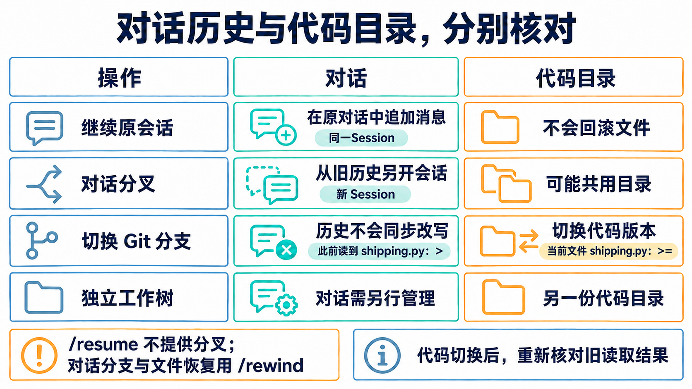

看完这张图，你要能：分别判断继续会话、对话分叉、切换分支与独立工作树改变的对象。

| 操作 | 改变的对象 | 继续前要核对 |
| --- | --- | --- |
| 继续原会话 | 在原对话里追加工作 | 文件是否被你或其他任务改过 |
| 复制一段对话另起会话（分叉） | 以旧历史为起点开一段新对话 | 是否和原会话共用同一个目录 |
| 切换 Git 分支 | 工作目录里的代码版本 | 历史里读过的代码是否来自旧分支 |
| 使用独立工作树（第 20 课） | 另一份代码目录 | 环境和外部服务是否也需要分开 |

例如，会话里记着“免邮条件是 `>`”。随后你切到了已经改成 `>=` 的分支。那条读取记录仍然是真的，只是它描述的是旧代码。继续前应让 Agent 重新读取相关代码。MyBuddy 当前的 `/resume` 不提供对话分叉，也不会自动创建工作树。

### 中断后，拿事实回答开篇的问题

**能确认的就确认，说不准的就记成未知；补跑一次是新结果，不能补写成旧结果。**

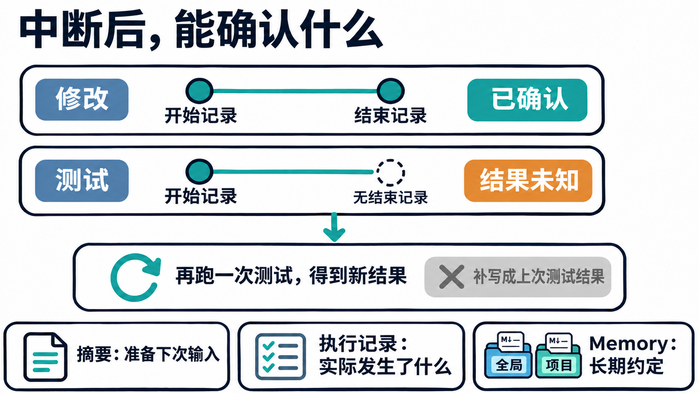

看完这张图，你要能：区分已确认与结果未知的动作，知道再跑一次是新结果，并分清摘要、执行记录与 Memory。

第 1 课“从七个问题看 Harness 的工作”小节问过：中断后还能确认什么？现在可以回答了。

假设记录显示修改已经完成，测试却只有“开始执行”、没有“执行结束”。那么修改可以确认，测试结果未知。你再跑一次测试，那是一次新的执行。这次运行要记成新结果，不能补写成“上次的测试通过了”。

还要分清三种材料：

- 第 9 课的**摘要**：帮模型重建输入。
- 本课的**执行记录**：说明实际发生了什么。
- 第 15 课的 **Memory**：保存长期有用的约定。

摘要或 Memory 里写着“测试通常能通过”，不能代替对当前文件的检查。

### 练习：从三份材料中找出真正要做的工作

**旧记录是真的，但它证明的是旧代码；只为没确认的部分安排新工作。**

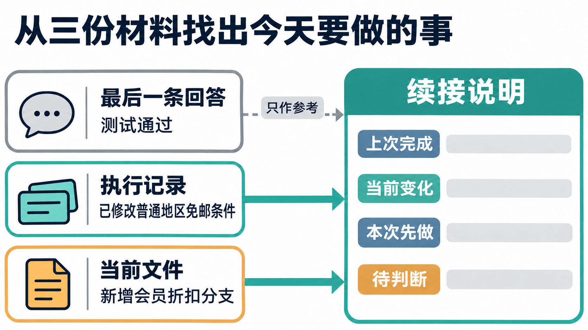

看完这张图，你要能：对照最后的回答、执行记录和当前文件，写一份只针对没确认部分的续接说明。

假设昨天的任务正常结束了。今天你继续同一个会话，看到三份材料：

| 材料 | 其中的内容 |
| --- | --- |
| 最后一条回答 | 运费边界已经修复，测试通过 |
| 执行记录 | 修改了普通地区条件，并运行过一次检查 |
| 当前文件 | 昨晚又有人增加了会员折扣分支 |

先想一想：今天能直接说“整个运费功能已经检查过了”吗？

不能。昨天的记录是真的，但今天的代码多了一段没检查过的分支。问题不在记录可不可信，而在于它证明的是哪一份代码。可以分三步处理：

1. **用记录确定上次做到哪里。** 找出上次读过和改过的范围、跑过的检查和结果。记录齐全时，不必因为重开会话就认为旧结果全部无效。记录里没有的检查，也不能凭最后一句回答补出来。
2. **用当前文件确定现在是什么样。** 查看相关文件和差异，判断会员分支会不会影响参与免邮判断的金额。新读到的内容要进入后面的模型请求。否则你知道代码变了，模型却还在用昨天的版本。
3. **只为没确认的部分安排新工作。** 把两份依据对起来，写成一份续接说明：

```latex
上次完成：普通地区免邮比较条件已修改，旧版检查有记录。
当前变化：新增会员折扣分支，可能改变参与免邮判断的金额。
本次先做：读取折扣与运费的调用顺序，确认边界样例是否受影响。
待判断：是否需要补充组合测试，以及原修改是否仍满足规则。
```

它比一句“继续上次任务”多了关键信息：**上次的结论和现在的文件在哪里分开了**。

### 三种“恢复好了”，分别能证明什么

**历史能查看、会话能继续、任务能接着做，是三层不同的“恢复”。**

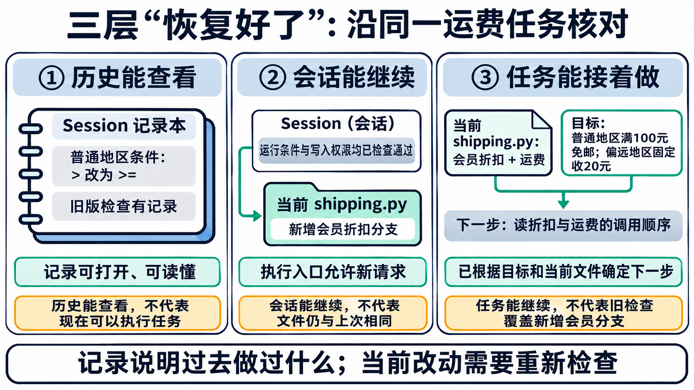

看完这张图，你要能：区分历史能查看、会话能继续、任务能接着做三层恢复各能证明什么。

| 层次 | 能确认什么 | 不能直接推出什么 |
| --- | --- | --- |
| 历史能查看 | 保存的记录可以打开、可以读懂 | 现在可以继续执行 |
| 会话能继续 | 已通过运行条件和写入资格的检查 | 当前文件和上次读到的一样 |
| 任务能接着做 | 目标、当前文件和下一步已经对齐 | 旧测试覆盖了新改动 |

这三层不必一次全部满足。例如，你可以查看历史，程序却因为某个工具结果未知而拒绝继续。遇到问题时沿这三层排查：打不开的是历史，受阻的是执行入口，还是缺少今天的业务依据。

容易误会的地方：

- 继续会话不会把文件恢复到当时的版本。
- 压缩时导出的旧对话只用来补细节，不能代替执行记录，也不说明今天的文件没变。
- 记录是真的，不说明它适用于今天的代码。

## 五、动手：先“查看”，再“继续”

**先用只读命令看清历史，再从原状态目录、在同一工作区继续；恢复会采用当前配置。**

### 实践：正常退出后查看并继续一个会话

**查看历史和继续执行是两条命令，分开做。**

完成一次只读任务，或一次已经正常结束的修改任务，用 `/exit` 正常退出。然后在仓库根目录运行（详见《课前-MyBuddy使用导读》）：

```shell
uv run python -m mybuddy sessions
uv run python -m mybuddy history "会话ID" --show-messages
```

第一条列出可查看的会话。复制其中的会话 ID，填进第二条。`--show-messages` 会显示用户与助手的消息正文。如果启动时指定了 `--config`，查询时也要用同一份配置。

要继续时，让配置指向原来的状态目录，在同一工作区启动，并传入 `--resume "会话ID"`。工具和运行配置可以更新，恢复后按当前配置继续。

不再需要的会话可以删除：

- 运行 `uv run python -m mybuddy sessions delete "会话ID"`，或点 Web 侧栏的“删除”按钮。
- 程序不会直接抹掉文件。它把会话、子会话和文件编辑副本一起移到状态目录下的 `trash/` 回收站，并打印回收目录。
- 想恢复时，把其中的文件按原相对路径移回状态目录。
- 正在运行的会话不能删除。子会话也不能单独删除，只能随父会话一起移走。

### 纸面练习：三个崩溃位置

**不用真的弄坏会话，在纸上推一遍三个崩溃位置即可。**

按第二节的时间线，分别写出下面三种情况：能确认什么，哪些未知，可以做什么，必须避免什么重复执行。

- 执行开始记录之前；
- 改动之后、执行结果记录之前；
- 执行结果已记录、本轮尚未结束。

写完后对照第二节的表格检查。想看代码怎样实现，可以读源码解析：执行权、保存、原子事务和续接检查各有一段。

### 收银台练习：继续开发，但别混淆两种数据

**MyBuddy 会话存的是开发过程，收银台订单只活在收银台进程里。**

在《综合实践-麦当当收银台》的“5. 课后任务 A：按支付方式汇总营业情况”小节中，等一次执行结束后，记下已改文件和还没验证的部分。正常退出 MyBuddy，再继续同一会话。先核对差异、执行记录和待办，再决定哪些工作要重做。

继续 MyBuddy 会话，找不回收银台退出前的订单。重新验证业务时，要重新录入测试数据。另外，正常退出后继续，不能代替对崩溃恢复的验证。

**能力卡**：想在收银台副本里亲手试一遍，就照着能力卡《查看与继续会话》（`demo-project/cards/resume.md`）、《恢复一次文件编辑，另开对话分支》（`demo-project/cards/rewind.md`）做。

## 使用小妙招

### 恢复对话后，先核对工作区有没有变

恢复旧会话的入口：Claude Code 用 `claude --continue` 或 `/resume`，Codex 用 `codex resume`。继续历史任务时，可以先输入：

根据当前文件核对上次交接：哪些修改仍在，哪些检查对应旧版本，下一步可以安全执行什么？

结果未知时，先核对进程和执行记录，不要把“再开一次”当作恢复完成。

**为什么这样做：** 恢复的是聊天记录，不是文件（见“对话历史和代码目录要分别核对”）。离开的这段时间里，你、同事或别的会话都可能改过文件，记录里说的“已修改”“测试通过”对应的是当时的版本。先让 Agent 对照当前文件，它才不会照着过时的记录继续做。

### 尝试另一方案前，弄清撤销覆盖什么

Claude Code 的 `/rewind`（或连按两次 Esc）可以选择回退对话、代码或两者；只被 Bash 命令改过的文件不在回退范围内。MyBuddy 的 `/rewind` 提供两种选择：新建对话分支时不撤销文件；恢复文件时，只针对一次有备份的受管编辑，并另行审批（第四节）。尝试新方案前，先用 Git 提交或保存需要的版本，回退后再看一次 `git diff`。

**为什么这样做：** 对话和文件是两样东西，各有各的回退方式（见“继续会话、撤销文件、压缩上下文，改变的是不同的东西”）。以为“都回去了”，其实文件可能还停在新方案的版本，接下来的修改就叠在错误的基础上。先用 Git 留一个版本，不管 Agent 的回退能覆盖多少，你都能自己退回去。

### 把换会话当作一次交接

交接材料怎样写，见第 9 课“在阶段交接时，写一份可以重新核对的续接说明”。接班时多做一步：逐项核对它还对不对。文件变了，记录里的“测试通过”就要重新判断；文档写着“测试已结束”，也不能证明进程已经停下。

**为什么这样做：** 交接记录写的是写下那一刻的情况。新会话的 Agent 不知道之后发生过什么，只会照着记录做；先逐项核对，过时的内容才不会被当成事实。

## 自测：这一课的概念分清了吗

**先自己作答，再看后面的答案。** 每题都能在本课正文里找到依据；带“动手验证”的题，可以照着做一遍，亲眼看到结果。

**1.** 纸面分析：一次文件修改的记录停在“即将执行”，没有执行结果记录。只凭这些记录，能确定什么？

- A. 文件肯定没改，因为没有执行结果记录。
- B. 文件肯定改了，因为已经记录“即将执行”。
- C. 修改可能发生了，也可能没发生，结果未知。

**2.** 昨天的执行记录显示，旧代码的检查通过了。今天你发现文件里新增了会员折扣分支。哪种判断有依据？

- A. 昨天的记录仍能证明旧代码的检查结果，但不能证明新增分支已经检查过。
- B. 昨天的检查通过了，今天整个运费功能也可以直接算检查通过。
- C. 文件变了，昨天的执行记录就全都不可信了。

**3.** 在默认收银台副本里，你正常退出会话，随后手动给业务文件加了一行注释。再用 `/resume` 继续原会话，不发新请求。那行注释会怎样？

- A. 被删掉，文件回到退出会话时的版本。
- B. 仍然保留，继续会话不会把业务文件恢复成旧版本。
- C. 因为文件变过，原会话一定无法继续。

**4.** 判断：摘要和 Memory 都能保存文字，所以其中写着“测试通常能通过”，就能代替当前文件的执行记录和检查。（对 / 错）

### 答案与依据

**1. 选 C。** 改文件和保存执行结果是两个动作，中间可能崩溃。没有结果记录不能证明文件没改；“即将执行”也不能证明修改一定发生了。  
依据：本课“记录停在哪里，决定你能知道多少”。

**2. 选 A。** 旧记录证明的是当时那份代码，新增分支仍需核对。文件变化不会让旧记录变假，也不会让旧检查自动覆盖新代码。  
依据：本课“练习：从三份材料中找出真正要做的工作”。

**3. 选 B。** 继续会话接上的是历史和执行状态，不会回滚业务文件。文件内容变过，也不等于工作区换了。  
依据：本课“继续会话、撤销文件、压缩上下文，改变的是不同的东西”。  
动手验证：按能力卡《查看与继续会话》（`demo-project/cards/resume.md`）的准备命令 `uv run python demo-project/prepare_shop_demo.py` 生成副本，参照第 1 步运行副本里的 `start-mybuddy.command`。本题不提问，输入 `/status --verbose`，记下 `Session:` 后的完整会话编号，再输入 `/exit`。用编辑器在副本的 `project/src/pricing.py` 末尾加一行注释并保存；再次运行同一个启动文件，输入 `/resume <完整会话ID>`，把占位内容换成刚记下的完整编号。终端显示切换会话后，重新打开该文件，确认注释仍在。全程不需调用模型。

**4. 错。** 摘要帮模型重建输入，Memory 保存长期有用的约定，执行记录说明实际发生过什么。“通常能通过”不能证明当前文件已经检查通过。  
依据：本课“中断后，拿事实回答开篇的问题”。

## Q&A：常见追问

### Q1：保存了聊天记录，为什么还不能保证继续执行？

聊天文字不一定包含执行状态、审批、待回答的问题和读取时的文件版本。继续执行要知道哪些动作已经发生、谁可以接着写、哪些结果仍未知。这些要从执行记录里确认。模型读懂一份总结，不能代替这些检查。

### Q2：原始历史还在，为什么恢复后模型会忘记细节？

记录保存下来，说明材料还在。模型能看到什么，取决于这一次请求带了什么。后续请求可能只带部分历史或摘要。沿“有没有保存、还适不适用、有没有进入请求”这条路排查，就能找到遗漏在哪一步，再决定补读还是纠正。

### Q3：恢复会话，会把文件恢复到当时的版本吗？

不会。会话恢复重建的是执行状态和历史，不会回滚工作区。这期间文件可能被你或其他任务改过，所以继续前要重新核对实际文件。需要撤销文件时，用明确覆盖这个范围的回滚方式。

### Q4：崩溃前已经写成功，但没有看到结果，为什么不能直接再试？

没看到结果，不能证明写入没发生。要先根据执行记录和实际文件判断上次走到了哪一步。如果写入已经完成，再写一次可能覆盖文件，或者重复产生外部结果。确认这些事实以后，才能判断要不要重做。

### Q5：有进度文件和 Git 历史，还需要 Journal 吗？

看你要解决什么问题。进度文件和版本历史帮人和模型接续工作。可靠运行还要记录每次调用、审批、执行结果和谁有写入资格。代码已提交，外部动作不一定有了结果；进度文字也可能过期。两类材料可以互相引用，但不能互相代替。

### Q6：执行记录为什么存进 SQLite，而不是一行一条地追加到 JSONL 文件？

主要是为了让相关记录一起保存，并方便按序号查找。MyBuddy 每个会话使用一个 SQLite 文件，`events` 表以序号为主键；写入时在同一事务里核对执行者身份和当前末尾序号，再提交整批记录，避免只保存半批就继续运行。

JSONL 也能追加记录，但写到一半崩溃、整批提交和快速查找都需要额外设计。MyBuddy 选择复用 SQLite 的事务与索引，并设置 `synchronous = FULL`，让提交按更严格的同步规则完成。每个会话有自己的数据库，因此不会因为共用一个会话数据库的写锁，就把所有会话串行化；共享业务文件的冲突仍要另外处理。

## 本课术语速查

读源码解析时，会看到下面这些源码里的名字：

| 本课说法 | 源码中的名字 | 含义 |
| --- | --- | --- |
| 执行记录 | 事件（event），如 `tool.execution_started` | 程序在关键时刻写下的一条事实 |
| 会话日志 | `SessionJournal` | 检查新记录并交给数据库保存，恢复时检查历史的模块 |
| 已保存（耐久保存） | `save` 返回的末尾序号 | 记录已写进数据库并得到确认 |
| 执行结果记录 | `tool.execution_settled` | 工具返回的执行状态和符合条件的原始返回值，也可能是结果未知 |
| 供模型使用的结果 | `tool.result_committed` | 已保存、可用于后续模型请求的工具结果 |
| 结果未知 | `outcome_unknown` 等 | 动作可能发生了，但没有足够证据确认；中断时也可能没有保存该状态 |
| 本轮结束（闭合） | `turn.ended` | 这一轮的结束记录已经保存 |
| 重放 | — | 读记录算出当前状态，不重新执行动作 |
| 执行身份 | `ActivationOwner` | 这一次运行的写入资格，同一时间只有一个有效 |
| 停稳 | — | 确认相关进程真的已经停下来（第 12 课展开） |

## 继续阅读源码解析

源码解析沿“写记录 → 检查续接 → 取得执行权”读真实代码。
