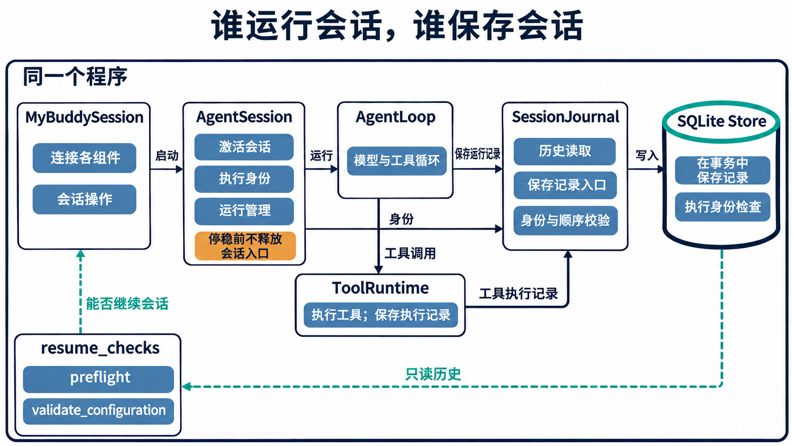
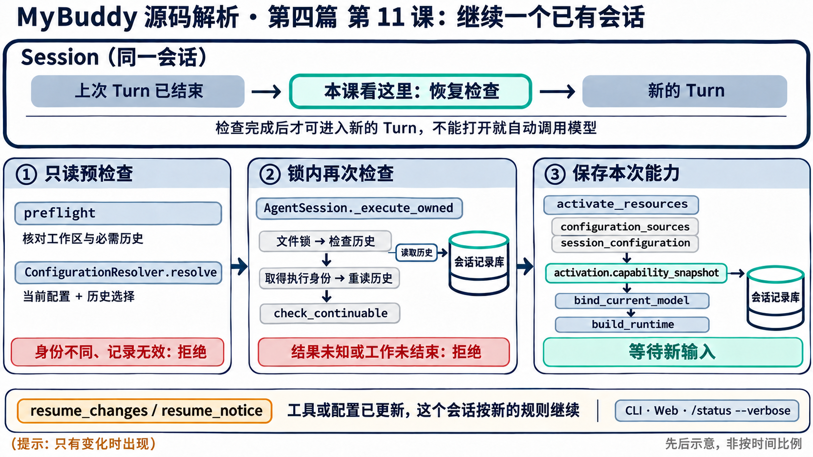

与第 11 课课程正文配套阅读。

正文先给了一个“退出前存文件”的最简版。这一篇读 MyBuddy 的真实代码，看它怎样处理“来不及保存”的情况。

**怎么读：** 每一节先贴一段代码，再用几句话解释。代码从当前源码原样复制，上方标了文件和行号。`# ...` 表示省略了与本节无关的行。

下面沿用运费任务：昨天改了 `shipping.py`，今天想继续同一个会话。先看工作中怎样写记录，再看重启时怎样检查和接管。

恢复主线从 `MyBuddySession.initialize`（`application_session.py`）读起：它依次检查历史、恢复会话内选择、保存当前能力并准备运行组件。下面先解释工作中写记录的基础，再展开这条恢复主线。缩进表示“谁调用谁”：

```latex
写记录（工作中）
ToolRuntime 执行工具            tool_runtime.py         先存“即将执行”，再调用工具
└─ _ScopedCommits.save          session_journal.py      只许写自己负责的事件
   └─ SQLiteSessionStore.append sqlite_session_store.py 一个事务里核对工作证和末尾序号

继续会话（重启后）
resume_checks.preflight         resume_checks.py        只读检查工作区、子会话与历史结构，检查完就返回
MyBuddySession.start            application_session.py  正式打开会话
└─ AgentSession.run_closed      agent_session.py        登记“闭合检查”
   └─ _execute_owned            agent_session.py        文件锁 → 检查历史 → 工作证 → 再读一次
      └─ check_continuable      continuation_checks.py  有没闭合的工作就拒绝
```



看完这张图，你要能：指出会话管理、Journal、Store和续接检查各自的责任。

## 工作中：先记下，再动手

### 片段 1：工具运行前，先存“即将执行”

`src/mybuddy/platform/tools/tool_runtime.py:627-635`

```python
        # 注意：先把工具即将开始的记录写入数据库，确认写入成功后才继续运行。
        # 这样重启后能看到工具可能已经运行过，避免把同一笔转账之类的操作盲目做两次。
        # 有开始记录也不代表工具一定被调用过，因为后面仍可能取消或被阻止。
        batch_id = self._ids.next("batch")
        event = session_event(self._scope, head + 1, "tool.execution_started", 1,
            self._ids.next("event"), self._clock.now(), execution, producer="tool",
            turn_id=context.turn_id, step_id=context.step_id,
            tool_call_id=call.tool_call_id, execution_id=execution_id)
        start_receipt = await self._tool_commits.save(batch_id, [event])
```

这就是正文时间线里的③。`tool.execution_started` 先交给 `save`。`save` 返回后，才会走到调用工具的代码。

如果保存开始记录失败，程序不会继续调用这次工具实现。因此，由这次受管工具执行造成的文件修改，前面应有对应的开始记录。这个结论不包括 Hook、其他程序或用户手动造成的修改。反过来，有开始记录也不证明工具已经运行：工具仍可能在之后被取消或阻止。

### 片段 2：等待中被取消，记为结果未知

`src/mybuddy/platform/tools/tool_runtime.py:654-662,670-674`

```python
        try:
            if signal.cancelled:
                outcome = ToolDispatchOutcome(execution_id, "cancelled")
            elif not execution.decision.proceed:
                outcome = ToolDispatchOutcome(execution_id, "failed", error=
                    _error_info("runtime.lifecycle_effect_blocked", "policy"))
            else:
                dispatched = True
                outcome = await self._provider.execute(execution.request, signal)
# ...
        except asyncio.CancelledError:
            # 注意：等待时被取消，不能断定工具没有修改外部数据，所以记录为不知道结果。
            cancelled = True
            outcome = ToolDispatchOutcome(execution_id, "outcome_unknown", error=
                _error_info("runtime.tool_outcome_unknown", "unknown"))
```

前半段是正常路径：没取消、没被阻止，就调用 `self._provider.execute`。

后半段处理等待中被取消。这时工具可能已经改了文件，所以不记成“失败”，而是 `outcome_unknown`。

### 片段 3：重放时，把未知结果记进状态

`src/mybuddy/platform/sessions/state/tools.py:58-63`

```python
def record_unknown_result(state: SessionState, event: Event) -> None:
    # 如果不知道工具是否真的运行完，记下执行编号或调用编号。
    # 即使这一轮结束，这条记录也要保留，避免把可能发生的操作当成没有发生。
    if event['payload'].get('status') == 'outcome_unknown':
        identity = event.get('execution_id') or event['tool_call_id']
        state.tools.unknown_results.add(identity)
```

重放就是把事件逐条交给这类函数，算出状态。读到一条 `outcome_unknown`，就把执行编号放进 `unknown_results`。

注意，这里只是往集合里加一个编号。重放不会调用工具。

## 保存：每个写入者只写自己的事件

### 片段 4：`_ScopedCommits.save`——先查写入者的权限

`src/mybuddy/platform/sessions/session_journal.py:161-162,180-184`

```python
    async def save(self, batch_id: str, events: Sequence[Mapping[str, Any]]) -> int:
        # 每个写入者只能添加自己负责的历史记录。
# ...
        if self._owner not in allowed or any(
                not isinstance(e.get("event_type"), str) or e["event_type"] not in allowed[self._owner]
                for e in events):
            raise SessionRuntimeError("port_capability_violation")
        return await self._journal._save_events(self._scope, self._owner, batch_id, events)
```

省略的部分是一张表 `allowed`，列出每个写入者能写哪些事件。例如 `tool` 只能写 `tool.execution_started`、`tool.execution_settled` 等四种。

事件不在自己的表里，就报 `port_capability_violation`。检查通过后，交给 `_save_events`。它再检查新事件和当前状态是否接得上，最后调用 Store。成功时返回整数末尾序号，这就是正文说的“已保存”。

### 片段 5：同一批次重试，返回原来的结果

`src/mybuddy/platform/sessions/sqlite_session_store.py:383-397`

```python
        def append_batch() -> int:
            # 同一请求可能在数据库写成功后、调用方收到结果前中断。重试时先查写入确认信息；
            # 如果哈希值一致，就返回原结果，不重复写入，也不再检查当前运行权或历史记录末尾的序号。
            prior = self._database.execute(
                """
                SELECT content_hash, last_seq
                FROM batches WHERE batch_id = ?
                """,
                (request.batch_id,),
            ).fetchone()
            if prior is not None:
                # 内容不同不能共用请求编号，否则重试会错误地确认另一批事件。
                if prior["content_hash"] != digest:
                    raise SessionRuntimeError("batch_id_conflict")
                return cast(int, prior["last_seq"])
```

每个会话一个 SQLite 文件，里面有 `session_meta`、`events`、`batches` 三张表。`append_batch` 整个在一个事务里运行。

先查 `batches` 表。数据库可能已经写成功，调用方却没收到确认就中断了。这时用同一个 `batch_id` 重试，内容一样就直接返回原来的 `last_seq`，不会写两遍。内容不一样，报 `batch_id_conflict`。

### 片段 6：新批次要核对工作证和末尾序号

`src/mybuddy/platform/sessions/sqlite_session_store.py:399-414`

```python
            now_text = self._clock.now()
            _timestamp(now_text, "runtime.clock_invalid")
            self._require_current_activation(
                request.session_id,
                request.activation_id,
                request.lease_generation,
            )
            row = self._database.execute(
                "SELECT head_seq FROM session_meta WHERE session_id = ?",
                (request.session_id,),
            ).fetchone()
            # 如果历史记录末尾的序号与调用方读到的不一致，说明它可能基于过期历史写入。
            # 此时拒绝整批事件，避免把它们接到错误的位置。
            current_head = cast(int, row["head_seq"])
            if current_head != request.expected_head_seq:
                raise SessionRuntimeError("session_head_conflict")
```

新批次先过两道检查：

- `_require_current_activation`：工作证是否仍然有效（下一个片段）。
- `expected_head_seq`：调用方以为的末尾序号，必须等于数据库里的。不等说明它读的是过期历史，报 `session_head_conflict`。

两道都过了，才插入事件、更新 `session_meta` 和 `batches`。任何一步出错，整个事务撤销。

### 片段 7：`_require_current_activation`——旧工作证写不进去

`src/mybuddy/platform/sessions/sqlite_session_store.py:226-244`

```python
    def _require_current_activation(
        self,
        session_id: str,
        activation_id: str,
        lease_generation: int,
    ) -> _ActivationRow:
        """检查会话的运行权尚未放弃，且两项运行编号与当前记录一致。"""
        current = self._read_activation(session_id)
        if (
            current is None
            or current.released_at is not None
        ):
            raise SessionRuntimeError("session_owner_expired")
        if (
            current.activation_id != activation_id
            or current.lease_generation != lease_generation
        ):
            raise SessionRuntimeError("session_owner_expired")
        return current
```

`session_meta` 里存着当前工作证：`activation_id` 标识这次运行，`generation` 是每次重新取得运行权时递增的编号，`released_at` 为 NULL 表示还没交还。

旧进程迟到的回复，带的是旧的 `activation_id` 或旧代次。它会在第二个 `if` 被拒绝，报 `session_owner_expired`。这里没有任何“等待多久就算过期”的判断。

## 继续会话：先只读检查，再接管

### 片段 8：`preflight`——只读检查，不拿执行权

`src/mybuddy/platform/application/resume_checks.py:81-95`

```python
def preflight(session_id: str, *, workspace_id: str, read_events: Callable[..., History],
              resolve_configuration: Callable[..., Any], make_baseline: Callable[..., Mapping[str, Any]],
              validate: Callable[..., None]) -> None:
    """切换会话前检查工作区、配置和历史；实际启动时再取得文件锁。"""
    # 不能把其他工作区的会话当作当前工作区的会话继续运行。
    events = read_events(session_id)
    if not events or events[0]["payload"]["workspace_id"] != workspace_id:
        raise ValueError("mvp_resume_incompatible")
    history_shape = validate_session_history_shape(events)
    # 子会话不能从普通会话的入口继续运行。
    if parse_child_scope_baseline(events[0]['payload']) is not None:
        raise ValueError('subagent_resume_execution_unsupported')
    configuration = resolve_configuration(events, history_shape=history_shape)
    candidate = make_baseline(events[0]['payload'], configuration)
    validate(events, baseline=candidate, configuration=configuration)
```

这是继续会话的第一道检查，只读历史，不取得执行权。依次检查：

- 第一条事件里的工作区必须和当前一致，否则 `mvp_resume_incompatible`；
- 子会话不能从普通入口继续；
- 读取当前配置，保留历史里的会话内选择；
- 构造这次使用的配置，交给 `validate` 检查运行状态。

`validate` 调用同文件的 `validate_configuration`，只核对工作区和身份，不要求整份配置或工具说明的哈希相同。随后检查子任务、审批和工具执行是否留下未完成事项，结果未知仍拒绝。



看完这张图，你要能：说出继续旧会话的四步：检查能不能继续、取得写入权、读取历史、接收新输入。

### 配置取谁的，更新记在哪里

`session_settings.py` 的 `ConfigurationResolver.resolve` 先读取当前启动开关，再用历史找回权限、模型和冻结项目说明。Buddy 按旧身份读取当前预设，已加载 Skill 正文仍由历史加载结果提供。规划模式从最新能力记录的 `planning` 读取，不再拿当前工具哈希猜旧模式；旧数据缺少这个字段时以 `branch_planning_invalid` 拒绝。保留历史模型键，但地址和预算等取当前目录；变化时由 `session_runtime.bind_current_model` 保存一条新的模型选择事件。

`MyBuddySession.initialize` 通过检查后调用 `session_runtime.activate_resources`。下面这一段把本次配置放入能力记录，并与上次打开采用的记录比较：

`src/mybuddy/platform/application/session_runtime.py:75-84`

```python
    # 创建记录保持原样。这次实际使用的配置跟能力一起保存，后续请求与检查读取这一份。
    session.configuration_sources = [selection_source(session.model_choice.payload())
        if source['source_id'] == 'model.selection.v1' else source for source in session.configuration_sources]
    session.activation['configuration_sources'] = session.configuration_sources
    session.activation['session_configuration'] = plain(session._session_configuration)
    if session._resume:
        history = await session.inspect_history()
        previous = next((event['payload'] for event in reversed(history.events)
                         if event['event_type'] == 'activation.capability_snapshot'), session.baseline)
        session.resume_changes = resume_changes({**session.baseline, **previous}, session.activation)
```

`resume_changes` 只返回变化项名；CLI 启动信息、Web 通知和 `/status --verbose` 用这份列表说明“工具或配置已更新，这个会话按新的规则继续”。不把命令或其他配置内容显示出来。

随后 `activate_resources` 先保存新的 `activation.capability_snapshot`，再调用 `bind_current_model`：如果历史模型键对应的地址、预算等配置变了，就追加 `session.model_selection_committed`，然后给模型接上已确认的预算。两步都成功后才创建 Loop。当前工具哈希、规划状态、会话配置和配置来源都跟着新能力记录；后续请求以它为准。旧 baseline 和旧请求仍描述过去，不被当前值覆盖。

### 片段 9：`_execute_owned`——锁、检查、工作证、再读一次

`src/mybuddy/platform/sessions/agent_session.py:186-196,223-226,239-243`

```python
        self._phase = "acquiring_guard"
        self._acquire_guard()
        self._guard_was_acquired = True
        closed_events: tuple[Mapping[str, Any], ...] | None = None
        # 持锁后检查历史；即使上次进程没有释放运行权，只要历史里每一轮都已写完结束记录，会话也可以继续。
        # 这时还没有申请新的运行权，检查失败可以释放文件锁。
        if self._closed_check is not None:
            try:
                archive, validate = self._closed_check
                closed_events = archive.read_events(self._request.session_id)
                validate(closed_events)
# ...
        self._phase = "acquiring_lease"
        # 继续已关闭的会话时已持有文件锁并检查过历史，可以接管崩溃进程留下的运行记录。
        lease = await self._journal.acquire_activation(self._request, take_over=self._closed_check is not None)
        self._lease = lease
# ...
            snapshot = await self._journal.inspect_recovery(lease)
            # 如果两次读取之间历史变了，就拒绝继续，避免使用刚才检查过的旧内容。
            if self._closed_check is not None:
                if snapshot.events != closed_events:
                    raise ValueError("mvp_resume_history_changed")
```

三段对应正文第三节的三步：

1. `_acquire_guard` 拿本机文件锁。锁被占用时立即失败。拿到锁后，先读历史，再调用 `validate` 检查配置和未完成的工作。
2. `acquire_activation` 申请工作证。继续已有会话时传 `take_over=True`：已经持锁并检查过历史，就能接管崩溃进程没交还的工作证。
3. `inspect_recovery` 再读一次历史，和第 1 步读到的比较。不一样就报 `mvp_resume_history_changed`。一样的话，再用同一个检查函数检查一次。

为什么要读两次？文件锁只拦得住遵守同一规则的进程。拿到工作证后再比较一次，能发现中途被别人改过的历史。

工作结束时，先交还工作证，再关文件锁。如果无法确认外部调用已经停下，两者都不交出。

### 片段 10：接管时，代次加一

`src/mybuddy/platform/sessions/sqlite_session_store.py:267-282`

```python
            current = self._read_activation(request.session_id)
            if (
                current is not None
                and current.released_at is None
            ):
                if (
                    current.activation_id == request.activation_id
                    and current.owner_instance_id == request.owner_instance_id
                ):
                    return self._activation_from_row(current)
                # 只有调用方已持有会话文件锁时才接管：锁由系统在旧进程死亡时释放，
                # 拿到锁就说明记录里的旧运行者已经不在了。
                if not take_over:
                    raise SessionRuntimeError("runtime.activation_lease_conflict")
            # 接管或重新取得运行权时增加编号，让旧的运行记录不能冒充新的运行。
            generation = 1 if current is None else current.lease_generation + 1
```

旧工作证还没交还（`released_at` 为 NULL）时：

- 同一个运行自己重复申请，返回原记录；
- 别人申请且没有 `take_over`，报 `runtime.activation_lease_conflict`；
- 带 `take_over` 时才接管。

接管时 `generation` 加一。旧进程手里的代次就对不上了，片段 7 会拒绝它的写入。

### 片段 11：`check_continuable`——有没闭合的工作就拒绝

`src/mybuddy/platform/sessions/continuation_checks.py:20-39`

```python
def check_continuable(events: Sequence[Mapping[str, Any]]) -> int:
    """检查是否还有不能跳过的工作，并返回已结束的普通 Turn 数量。"""
    state = fold(events)
    # 注意：如果不知道工具有没有真的运行完，先停止继续处理。
    # 不能因为后面有取消记录，就忽略工具可能已经产生的结果。
    # 例如转账工具可能已经完成，盲目再运行一次就可能重复转账。
    if state.tools.unknown_results:
        _fail('mvp_resume_unsupported')
    # 取消的 Turn 必须在结束时就满足结束条件；后来的事件不能补救当时缺少的条件。
    if not all(state.turns.cancelled_closed.values()):
        _fail(_NOT_CLOSED)
    # 还有等待回应的交互或等待处理的输入时，不能直接开始新的 Turn 把它们跳过去。
    if state.pending_interactions or state.turns.pending_inputs:
        _fail(_NOT_CLOSED)
    # Memory 操作完成后还可能有等待采用的内容；这时仍要阻止继续。
    if state.memory.view.pending is not None:
        _fail('shared_memory_operation_blocked')
    if state.turns.open_turn is not None or state.turns.open_step is not None:
        _fail(_NOT_CLOSED)
    return state.turns.closed_count
```

`fold(events)` 就是重放：从事件算出状态。然后依次检查：

- 有未知工具结果（片段 3 记下的），报 `mvp_resume_unsupported`；
- 取消的 Turn 当时没有正常收尾；
- 有等待回应的交互，或等待处理的输入；
- 有 Memory 操作等待采用；
- 还有打开的 Turn 或 Step。

正文表格里“有③没有④”的情况，会停在最后一条：本轮没闭合。程序只报错，不补写结果，也不重跑工具。

## 压缩后的上下文怎么接上

上一课讲过压缩。入口是 `src/mybuddy/platform/context/compaction/session.py` 的 `SessionCompaction`，主要逻辑在同目录的 `service.py`。

- 有可压缩的消息时，程序调用一次摘要模型。压缩后的请求要有足够收益，才提交摘要。
- `select_cut_point` 分两档保留完整消息组。压缩前完整请求不到 60000 token 时，保留最近两组，不补读文件。达到 60000 token 时，从末尾向前保留，累计至少约 10000 token 且不少于 5 条消息才停；加入下一组会超过 40000 token 时提前停止，并补读最多 5 个最近用过的文件。工具调用和它的全部结果不会被拆开。
- 成功时保存一条 `context.compacted` 事件，包含摘要和截止点。重启后直接用它和尾部消息，不重新执行摘要里提到的工具。
- 启用长结果存储时，截止点之前的对话可以导出，模型用 `read_tool_result` 分页读取。导出内容有大小限制，过长的条目会被截断。
- 无法确认摘要是否保存成功时，程序暂停后续的模型请求和工具执行。

## 对话和文件分别恢复

`/rewind` 在 `src/mybuddy/platform/application/command_registry.py`。文件恢复在 `src/mybuddy/platform/application/file_edit_restore.py` 的 `execute_restore`。

选择对话分支，改变的是后续对话的起点。恢复单次受管文件编辑，要用保存的备份并核对当前文件。两者都不能撤销 Bash 或外部服务造成的变化，也不撤销 Memory。

所以继续昨天的运费任务后，仍要重新读取今天的代码。历史告诉你昨天做过什么，却不能证明此后没人改过文件。

## 读码练习

1. 在片段 1 里，如果 `save` 抛出异常，工具还会被调用吗？这和正文时间线的哪一格对应？
2. 旧进程拿着 `generation=3` 的工作证迟到写入，而数据库里已是 `generation=4`。它会在哪个片段的哪个判断被拒绝？报什么错误码？
3. 调用方写入成功，但没收到确认就重试了同一批事件。片段 5 和片段 6 哪一段先起作用？结果是什么？
4. 崩溃落在“即将执行”和“执行结果”之间。`check_continuable` 会在哪一条判断拒绝？为什么不能把这次执行当作失败、重跑一次？
5. 片段 9 为什么在拿到工作证后，还要再读一次历史并比较？

参考答案

**第 1 题** 不会。`save` 成功才返回序号；抛出异常时，后面调用工具的代码走不到。这对应时间线“还没有③”：修改没有开始。 **第 2 题** 片段 7 的第二个 `if`：`current.lease_generation != lease_generation`，报 `session_owner_expired`。它在片段 6 里被调用，所以整批事件都不会写入。 **第 3 题** 片段 5 先起作用。`batches` 表里已有这个 `batch_id`，内容哈希一致，直接返回原来的 `last_seq`。它不再检查工作证和末尾序号，也不会重复写入。 **第 4 题** 这时有 `tool.execution_started`，没有 `tool.execution_settled`，本轮也没有 `turn.ended`。它会停在最后一条：`open_turn` 不为空，报 `mvp_resume_not_closed`。 不能重跑，是因为文件可能已经改了。改文件和写记录是两个动作，崩溃可能发生在两者之间。重跑可能把同一个修改做两次。 **第 5 题** 文件锁只拦得住遵守同一锁规则的进程。从第一次读到拿到工作证之间，历史可能被别的写入者改过。再读一次并比较，不一样就报 `mvp_resume_history_changed`，避免用过期的检查结果继续。
