按下取消，或者想“再试一次”之前，先弄清两件事：工作真的停下了吗？上一次到底做没做成？

## 本课导览

上一课讲的是程序意外退出。这一课讲两种你主动做的事：中途取消，以及失败后再试一次。它们都绕不开一个问题：**停下来以后，怎样确认现在的状态，才能安全地开始下一步？** 下面的总纲图列出四个问题。学完后，你应能先确认已有结果和进程状态，再决定要不要重试。下一课把这些事实用于判断任务是否完成。

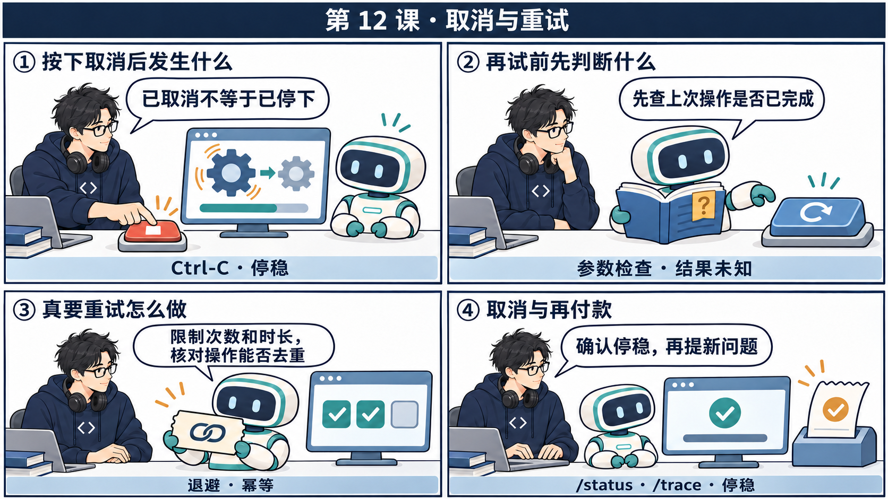

## 一、按下取消以后，发生了什么？

**按下取消只是开始；确认相关工作都停下、结束状态也记好了，才能开始下一步。**

### 先看最简版：按下就算取消

**最简版把“发出取消”当成“已经停下”。**

用 Python 写一个能取消的 Agent，最直接的写法是这样：

```python
# 最简版（教学示意，不是 MyBuddy 的代码）
task = asyncio.create_task(run_turn())
on_ctrl_c(lambda: task.cancel())   # 按下 Ctrl-C 就取消
# ……然后马上接收下一条输入
```

`task.cancel()` 只是请求任务停下。它不会等任务停好，也管不到电脑上另一个正在跑的测试进程。

### “已取消”和“已停下”不是一回事

**界面收到取消、MyBuddy 停止安排新工作、外部进程真正退出，是三个不同的时刻。**

测试跑太久，你按下 Ctrl-C，想取消当前的**用户请求轮次（Turn）**。这时有三件事，发生在不同时刻：

1. 界面收到了你的取消。
2. MyBuddy 停止安排新工作，并通知正在进行的工作停止。
3. 如果正在跑 Bash 命令，MyBuddy 还要确认它启动的那一组进程（进程组：命令本身，加上命令再启动的子进程）都已经停止。

用关火的炉灶记住这几个时刻：旋钮拧到“关”，火不一定已经灭了。

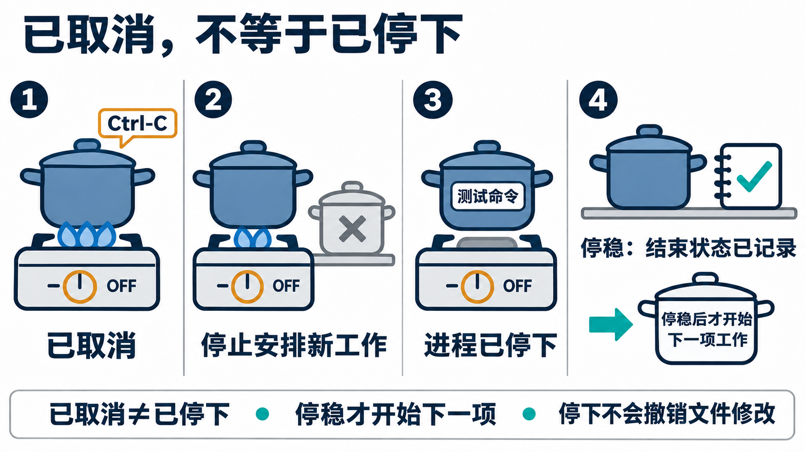

看完这张图，你要能：用“炉灶的四个状态”区分：已取消、不再安排新工作、进程已停下、已停稳；停稳之后才开始下一件事。

如果程序在第 1 步就显示“已取消”，马上开始下一项修改，而测试进程其实还在跑，新的修改和旧的测试就可能同时读写同一批文件。

所以课程里用一个专门的词：**停稳**。意思是：相关的进程和工作都已停下，结束状态也已记录好。停稳以后，才能安全地开始下一项工作。

最容易出错的是**进程刚开始启动**时取消：MyBuddy 还没接管这个进程，这时直接放弃，就会留下一个没人管的进程。MyBuddy 先等启动结果，拿到进程后再停止并清理；清理到了时限还确认不了，会话就一直挡住，不接受新的一轮。

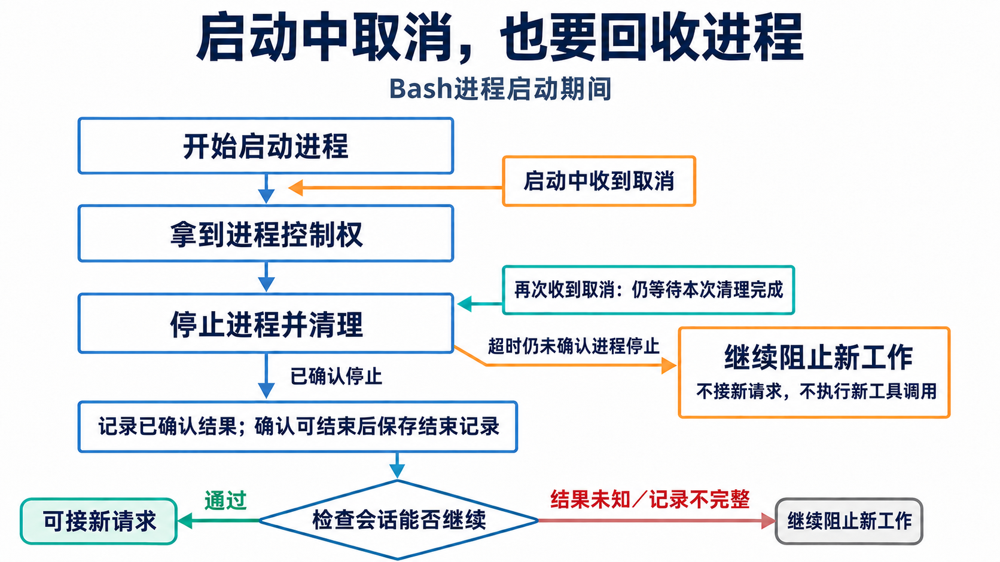

看完这张图，你要能：说明为什么取消了等待之后，仍要拿到并清理外部进程。

### 取消的顺序

**收到取消后，MyBuddy 先停新工作，再等清理，最后才决定会话能不能继续。**

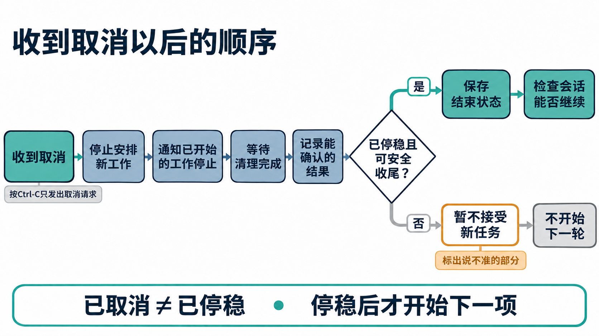

看完这张图，你要能：按顺序说出取消后的四件事：不再安排新工作、通知、等待清理、记录结果，以及停不稳时继续挡住新请求。

下面是教学伪代码：

```latex
收到取消
停止安排新工作
通知已经开始的工作停止
等待负责执行的部分完成清理
记录能够确认的结果，以及哪些调用还没开始
如果 工作已停稳并且可以安全收尾：
    保存结束状态，再检查会话能否继续
否则：
    保持阻断，标出说不准的部分，不开始下一轮
```

按下 Ctrl-C 只对应伪代码的第一行。会话什么时候能继续，要看最后那个条件。

当前命令行里，运行中按 Ctrl-C，取消的是当前这一轮。收尾后，你还留在同一个会话里。空闲时退出程序、退出后再从新进程继续会话、取消当前轮，是三种不同的操作，各有各的命令或按键。

### 在不同位置取消，要收拾的东西不同

**取消落在哪里，就要防哪一种“迟到”：迟到的回复、迟到的批准，或还在跑的进程。**

| 取消时正在做什么 | 要处理什么 | 主要风险 |
| --- | --- | --- |
| 等模型回复 | 这次请求和可能迟到的回复 | 旧回复被接到下一轮里 |
| 等你审批 | 这次审批请求和读取你输入的等待 | 取消后才到的“yes”被当成批准 |
| 运行工具 | 实际的进程、结果，以及同一批里还没开始的调用 | 进程还在运行，程序却以为已经结束 |

几个细节：

- 如果模型已经完整回复、这一轮也已记录结束，取消到达时只剩界面收尾可做。这时要保留已完成的事实，不能统一改成“已取消”。
- 审批被取消后，迟到的确认不能推翻“已取消”。
- 同一批里还没开始的工具调用，记成“因取消没有执行”，不能补写成“已执行”。已经改了文件的工具，要如实保留它的结果。

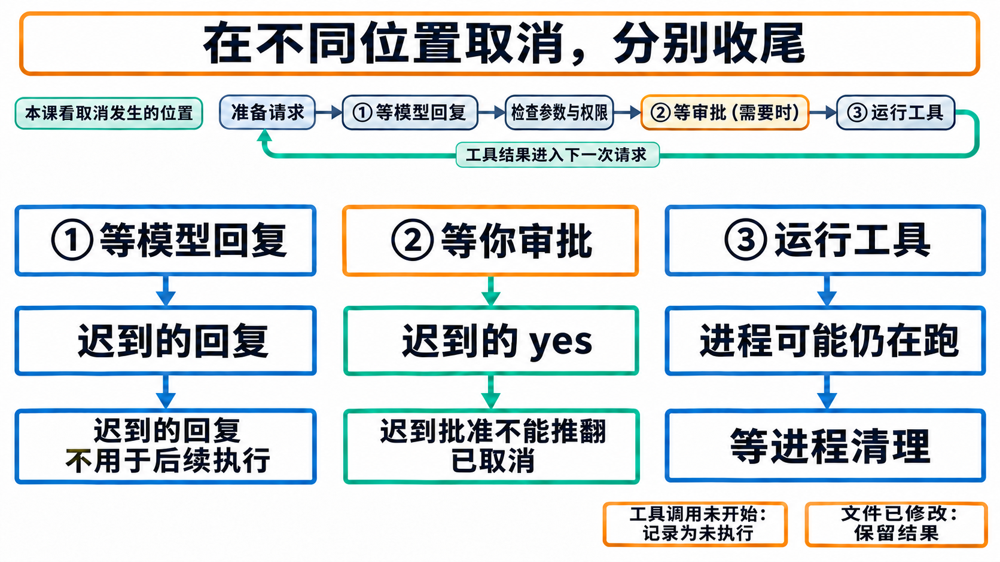

看完这张图，你要能：根据取消发生的位置，认出三种风险：迟到的回复、迟到的批准、还在运行的进程。

容易误会的地方：

- 取消不会撤销已经发生的文件修改，需要另外核对。
- 有些进程会自己脱离 MyBuddy 管理的进程组。MyBuddy 确认不到它们，“停稳”也不包括它们。

## 二、想再试一次之前，先判断上次做成了没有

**再试之前先问：上次是没开始、明确失败，还是做了却没拿到结果？三种情况的下一步完全不同。**

### 先看最简版：失败就再来一次

**最简版不管失败原因，也不管上次做了什么，出错就重来。**

```python
# 最简版（教学示意，不是 MyBuddy 的代码）
for _ in range(3):
    try:
        return run_tool(call)
    except Exception:
        time.sleep(1)
```

对一次读文件，这样往往没问题。可把 `run_tool` 换成“在文件末尾追加一行”，问题就来了。

### 从最简版到 MyBuddy：一次加一个约束

**最简版假设“失败 = 什么都没发生”；真实情况下，这个假设经常不成立。**

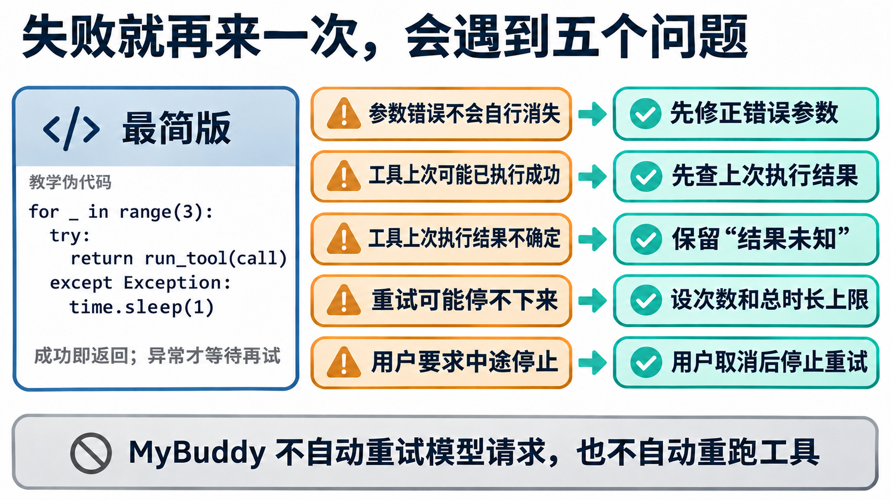

看完这张图，你要能：对照“失败就再来”的最简版，说出五条约束，并记住 MyBuddy 不自动重试。

1. **错误可能不会自己变好 → 先改原因，不原样重试。** 路径写错、权限被拒，重试多少次都一样。要先修正输入，形成一个新请求。
2. **上次可能已经做成了 → 先找结果，不重复做。** 追加已经成功，只是显示失败。这时再追加一次，就多了一行。
3. **上次可能说不准 → 保留“结果未知”，先核对。** 开始执行后连接断了，文件可能变了也可能没变。重做可能做两次。
4. **重试可能停不下来 → 设次数和总时长上限。** 见第三节。
5. **你可能想中途停 → 重试也要服从取消。** 等待重试时收到取消，就不再试。

MyBuddy 当前的选择更保守：它**不自动重试**模型请求，也不自动重跑工具。工具失败后，结果交回模型，由模型在下一步决定怎样做（第 4 课）。下面的判断方法，既帮你读懂 MyBuddy 的结果，也帮你在设计别的系统时用上。

### “再试一次”可能是四件不同的事

**口头上的“再试一次”，在程序里对应四种不同的动作，风险各不相同。**

| 说法 | 实际含义 |
| --- | --- |
| 重新请求模型 | 同一步里，把同样的输入再发给模型一次 |
| 再执行一次工具 | 可能再次改文件或调用外部服务 |
| 换个办法 | 模型根据新的结果，选择不同的下一步 |
| 崩溃后恢复 | 根据保存的记录，判断能不能接着做（第 11 课） |

它们需要不同的记录和判断。尤其是再次执行工具，可能重复修改文件或重复调用外部服务。

### 不同的失败，重试前要知道的事不同

**失败类型决定重试前要查什么；有些失败根本不该重试。**

| 失败类型 | 重试前至少要知道 |
| --- | --- |
| 只读查询暂时失败 | 是否允许重试，数据来源有没有变，预算够不够 |
| 写入明确还没开始 | 原来的计划和授权是否仍然有效 |
| 写入已经成功并记录，只是显示失败 | 应该补上显示，为什么还要再写一次？ |
| 开始执行后失去了结果 | 能不能单独查询实际效果，有没有可靠的去重机制 |
| 测试断言失败 | 代码哪里不符合预期；原样再跑一遍有什么意义？ |
| 请求参数错误 | 参数要怎么改；原样重试只会得到同样的错误 |

只读也不是零代价。外部接口可能收费，或者限制调用频率，同一个查询的结果也可能变。所以重试需要次数和总时间上限，并记下每次的原因。

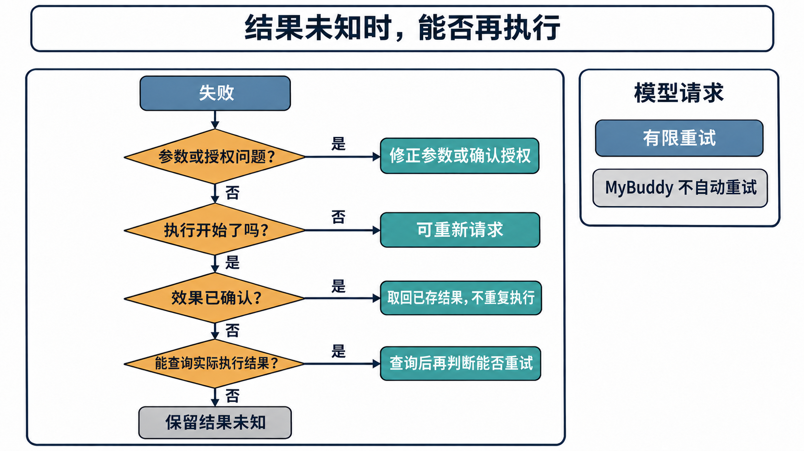

看完这张图，你要能：根据失败类型和副作用状态，判断该补结果、改原因、有限重试还是保持未知。

### 用两个小操作理解“能不能重跑”

**同样叫“写文件”，重复执行的效果可能完全不同；要看动作怎样改变对象，不能只看工具名。**

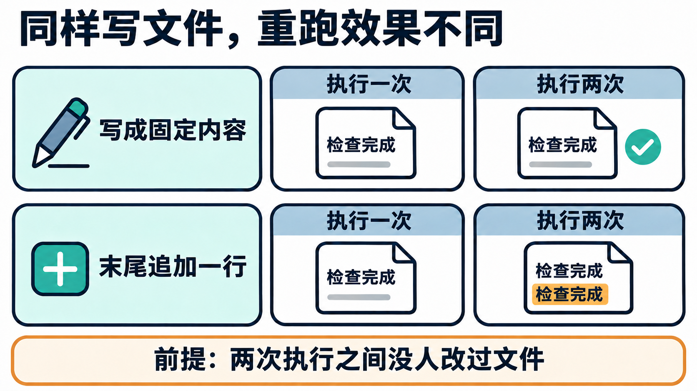

看完这张图，你要能：比较覆盖写入与追加写入重复执行的效果，记住“两次之间没人改过”的前提。

先在纸上想两个文件操作（不需要真的运行）：

```latex
操作一：把 result.txt 的内容写成“检查完成”
操作二：在 result.txt 末尾追加一行“检查完成”
```

| 操作 | 执行一次后 | 执行两次后 |
| --- | --- | --- |
| 写成固定内容 | 一份固定内容 | 还是同一份内容 |
| 末尾追加一行 | 多了一行 | 又多了一行 |

也别急着说“覆盖写入一定能重试”。两次执行之间，如果有人在文件里补了一段说明，第二次覆盖就会把它删掉。“结果相同”有个前提：**两次之间，相关的东西没被别人改过。**

改代码也一样。即使补丁看起来还是那几行，也要重新核对文件。旧的批准和旧的读取结果，不能当成永远有效。

### 同样是“没收到结果”，下一步可能完全不同

**问题出在哪一步，下一步就针对哪一样东西：参数、显示，或文件的实际状态。**

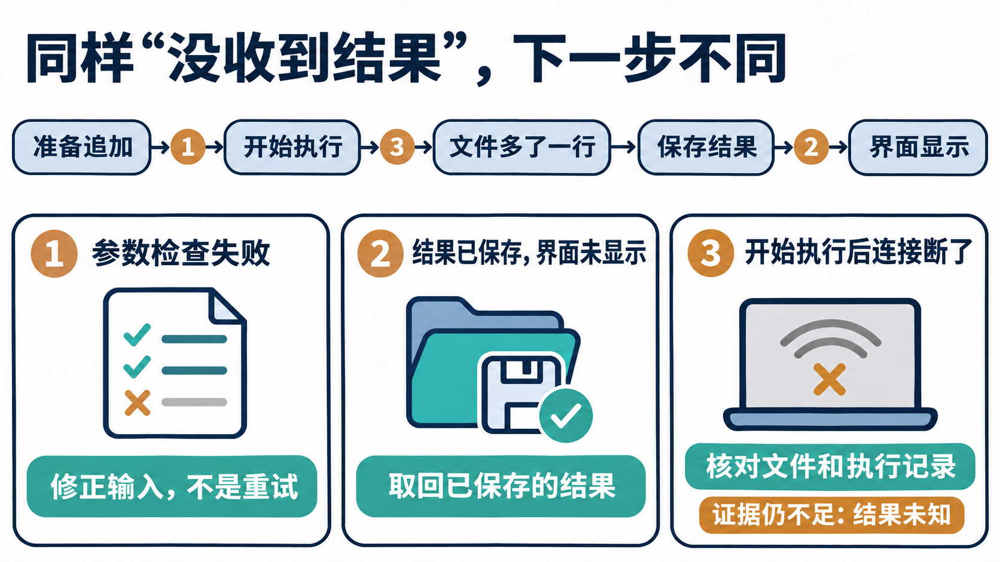

看完这张图，你要能：按失败发生的位置，分别修正输入、取回已保存结果或核对文件与执行记录。

给追加操作加上时间线：

```latex
准备追加 → 开始执行 → 文件多了一行 → 保存结果 → 界面显示
```

把“没收到结果”分别放在三个位置来看：

**情况一：参数检查就失败了。** 比如路径不合法。原样再发还是同样的错误，要找到真实路径形成新请求。这叫修正输入，不是重试。

**情况二：已经追加，结果也保存了，只是界面没显示。** 应该取回已保存的结果。再追加一次，显示问题就变成了重复写入：收据已经开好，该去找收据，而不是再做一次交易。

**情况三：开始执行后连接断了，结果没保存。** 文件可能没变，也可能多了一行。文件里本来就有同样一行时，光看现在的内容判断不了这次追加有没有发生，还要看修改前读到的内容和执行记录。这些都不够时，就保留**结果未知**。

| 情况 | 下一步针对什么 | 为什么 |
| --- | --- | --- |
| 参数检查失败 | 请求参数 | 原请求不满足执行条件 |
| 结果已保存 | 结果的显示 | 动作已经完成，不能重复 |
| 开始后失去结果 | 文件的实际状态和执行记录 | 还不知道动作是否完成 |

三种情况你可能都会口头说成“失败了”。Harness 要保留它们的区别，模型才能选对下一步。

### 好的错误信息帮你判断下一步

**好的错误信息不假装知道答案，而是说清：错在哪一层，哪些已确认，哪些还未知。**

比较两份错误信息（教学示意，不是 MyBuddy 的实际格式）：

```latex
写入失败，请重试。
```

```latex
操作：向 result.txt 追加一行。
最后确认的位置：已经开始执行。
是否改了文件：尚未确认。
下一步：先核对文件与执行记录，不要再次追加。
```

第二份能指导下一步。把完整的报错堆栈（程序出错时列出的函数调用路径）直接交给模型，也不一定有这些判断。堆栈可能说明“读回复时出错”，却说明不了远端的操作有没有完成。

容易误会的地方：

- 没收到结果，不说明动作没执行。
- 给新请求换一个编号，不能让旧操作的效果变得可知。
- 覆盖写入看起来能重做，前提是两次之间没人改过文件。

## 三、真要重试时：设上限，看对象是否支持去重

**真要重试，就给它设上限；想让重复提交只生效一次，要靠执行方自己的去重。**

### 重试要有预算

**有上限的退避：逐渐拉长等待，同时受次数、总时长、预算和取消的约束。**

对已经确认适合重试的读取或模型请求，可以用**有上限的退避**。第一次稍等再试，之后逐渐拉长等待，并加一点随机时间差。这样许多程序不会同时重新请求，再次压垮服务。服务端明确说了“多久以后再试”，就按它说的来。次数上限、总时长、任务剩余预算（时间或费用额度）和你的取消，都要同时生效。

等一会儿再试，只对一部分错误有用。网络暂时断了，稍后可能恢复。参数写错、权限被明确拒绝，等多久也不会变好。这类问题要先改正原因，否则只是重复失败，甚至反复弹出同一个审批请求。

每次重试都记下原因和结果，就能说清下一次改变了什么。到达上限时，最后的状态能帮使用者接着处理。只有一句“正在重试”，既看不出失败了多少次，也看不出为什么。

MyBuddy 当前每一步只发一次模型请求（叫一次 **Attempt**），不会自动重试。上面的退避是一种设计方法，MyBuddy 当前没有自动执行。

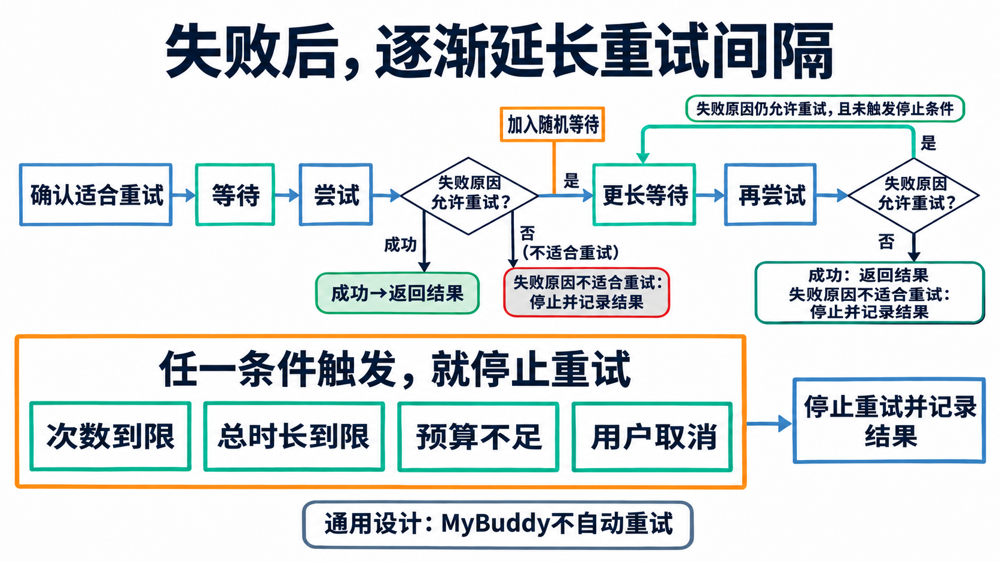

看完这张图，你要能：按失败原因、次数、总时长和取消条件设计有上限的重试。

### 幂等：重复执行也只产生一次效果

**幂等要由执行方保证；自己生成一个随机编号，不能让任意命令变得幂等。**

**幂等**是指同一个操作执行多次，效果和执行一次一样。比如“写成固定内容”在没人改动的前提下是幂等的，“追加一行”就不是。

有些外部服务支持**幂等键**。你给一个操作带上固定的标识。服务发现同一标识重复提交，就返回第一次的结果，不做第二次。但这需要服务本身提供保证，键也必须绑定同一个操作。每次重试都换一个新编号，反而会被当成新操作。

MyBuddy 的会话日志（第 11 课）也有类似的去重。提交一批记录时，带上批次编号。写入成功但确认丢了，用相同编号和内容再提交，存储层返回原来的结果，不再追加。这解决的是“有没有记下来”，不能证明远端的操作没执行过。

改代码看起来只是替换几个字，重复执行也可能因为原文已经不在而失败。这个失败不说明第一次没成功，也不该引导模型换一种替换方式再试。

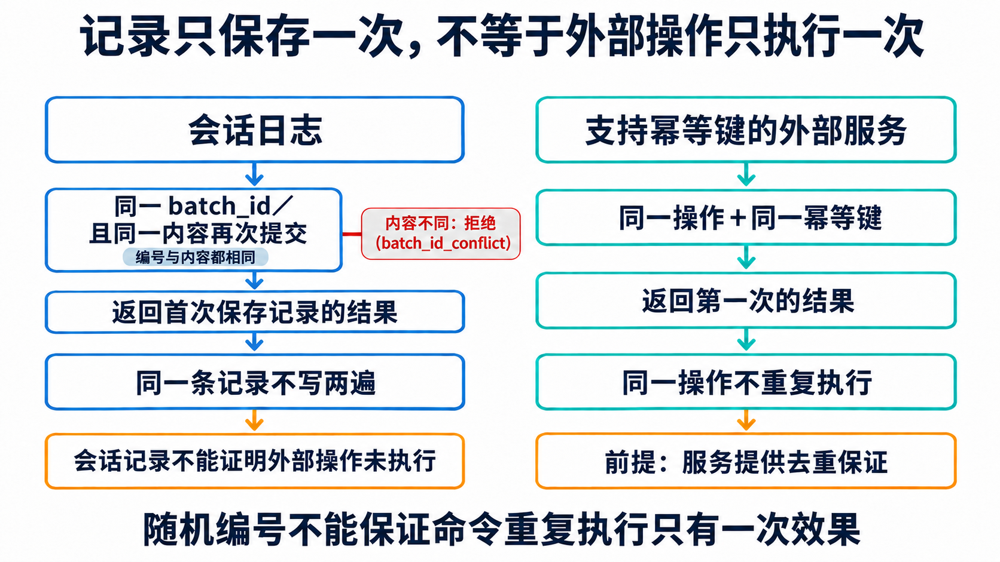

看完这张图，你要能：区分会话日志的记录去重与外部服务的操作去重。


看完这张图，你要能：区分要求停止、确认停稳和撤销已经产生的修改。

容易误会的地方：

- 记录去重只管“记没记下”，代替不了外部服务的操作去重。
- 重复替换失败，不说明第一次替换没成功。

## 四、动手：取消一次 Agent，对比一次再付款

**取消之后先确认收尾，再提新问题；业务上的“再付款”和程序重跑工具，需要的依据不同。**

### 实践：取消后能不能接着问第二个问题

**光标在闪烁，不足以证明已经收尾；要用** `/status` **确认。**

在独立副本中，趁模型还在回复或正在等你审批时按 Ctrl-C。看系统是否明确结束了当前这一轮。

1. 确认界面上的活动已经结束、输入框恢复。
2. 用 `/status` 查看运行状态和最近轮结果。
3. 如果提示“会话暂不可继续”，再用 `/trace` 查看。
4. 确认会话可以继续后，才提一个只读问题。

检查第二个问题属于新的一轮，上一轮的一次性批准和未执行的工具调用不会被直接拿来继续；此前选择的“本次会话都允许”仍可放行符合条件的新调用。

如果取消的是正在运行的命令，重点看三件事：它启动的进程是否真的停下了，MyBuddy 是否还在安排执行旧的工具调用，能否开始新的一轮。没有合适的环境时，可以沿源码解析记下取消怎样传递、怎样清理、结果怎样保存，并注明“没有实际观察到停稳”。

### 收银台练习：两种“再试一次”

**收银台的支付立刻知道结果；Harness 的工具中途失去结果时，实际效果可能未知。**

《综合实践-麦当当收银台》的“4. 随课任务：先只读解释一笔失败支付”小节，能帮你分清业务规则和执行器的责任。收银台的模拟支付立刻知道结果，代码用订单状态避免重复收款。

请分别解释：“顾客再次尝试付款”和“程序重启后再执行一次工具”，各需要哪些依据？前者的业务测试通过，不能证明后者可以安全重试。另外，收银台里的“撤单”是业务操作，和取消 Agent 是两回事。

**能力卡**：想在收银台副本里亲手试一遍，就照着能力卡《取消当前一轮》（`demo-project/cards/cancel.md`）做。

## 使用小妙招

### 方向偏了就中断，再清点已经发生的事

在 Claude Code 中，Agent 运行时按 Esc 可以中断；按 `Ctrl+C` 也能中断，但空闲时它还有清空输入、退出等作用，要看当时的界面状态。

中断后，先检查已经做的修改、最后一个工具的结果和仍在运行的任务，再发新指令。例如：“保留当前修改，先列出已完成的步骤和还没确认结果的操作。”按键生效，不等于所有外部进程都已经停下。

**为什么这样做：** 按下中断，不等于一切都停下了（见“‘已取消’和‘已停下’不是一回事”）。按下中断时，可能有文件刚改了一半，可能有命令还在后台跑。不先清点就发新指令，新任务可能叠在半成品上，或者和还没停的进程抢同一个文件。

### 重试之前，先判断会不会重复产生结果

只读查询通常可以重做。修改文件、创建记录或发送请求，要先找到上一次的结果。对“超时了，但不知道是否成功”的操作，优先查对象的当前状态或执行记录。

可以直接要求：“先核实上一次是否生效，再决定是否重试。”在提示词里多写几句，也代替不了外部系统自己的去重机制。

**为什么这样做：** “超时了”只说明没等到结果，不说明没执行（见“同样是‘没收到结果’，下一步可能完全不同”）。读文件重做一次没有影响；付款、发消息、建记录重做一次，就可能产生两笔。先查清上一次的结果，才知道能不能再来一次。

## 自测：这一课的概念分清了吗

**先自己作答，再看后面的答案。** 每题都能在本课正文里找到依据。

**1.** 你在 MyBuddy 等待模型回复时按 Ctrl-C，随后看到“当前轮已停止并完成记录闭合”的提示。这表示什么？

- A. 整个程序已经退出，要重新启动才能查看会话。
- B. 当前这一轮已停止，会话仍在，可以用 `/status` 核对状态。
- C. 程序会自动重新发送刚才的模型请求。

**2.** 一个追加操作已经让文件多了一行，成功结果也已保存，只是界面没有显示。下一步应该做什么？

- A. 再追加一次，让界面有机会显示成功。
- B. 把操作记为“结果未知”，因为界面没有显示就无法确认成功。
- C. 取回已保存的结果，处理显示问题。

**3.** 一个追加操作开始后连接断了，结果没有保存。文件里原本就有同样的一行，现在也能看到这一行；你没有足够的修改前内容和执行记录。能得出什么结论？

- A. 仍是“结果未知”，不能据此直接再追加。
- B. 看到同样的一行，就能确认这次追加成功。
- C. 没有保存结果，就能确认这次追加没有发生。

**4.** 判断：只要客户端每次重试都带上同一个固定编号，即使执行方不支持去重，也能保证操作只产生一次效果。（对 / 错）

### 答案与依据

**1. 选 B。** 取消当前这一轮和退出程序是两种操作。会话保留，也不表示程序会自动重试刚才的模型请求。  
依据：本课“取消的顺序”和“重试要有预算”。

**2. 选 C。** 动作成功且结果已保存，缺的是界面显示。再追加会重复写入，不能用重做动作来补显示。  
依据：本课“不同的失败，重试前要知道的事不同”。

**3. 选 A。** 原本就有同样的一行，光看现在的内容，分不清这次有没有追加。没有保存结果也不能证明没有执行，证据不足就保留“结果未知”。  
依据：本课“二、想再试一次之前，先判断上次做成了没有”。

**4. 错。** 固定编号只是识别同一个操作的线索。执行方需要识别重复提交并避免重复执行，编号本身不能提供这个保证。  
依据：本课“幂等：重复执行也只产生一次效果”。

## Q&A：常见追问

### Q1：按下取消以后，还能立即开始下一项修改吗？

界面收到取消、程序停止等待、外部进程退出，可能发生在不同时刻。如果旧进程还可能写文件，马上开始新修改就会和它冲突。已经写入的内容也不会因为取消自动撤销。等工作停稳、结束状态记录好，新任务才能从确定的状态开始。

### Q2：超时了，直接重试不是最省事吗？

超时只说明没及时拿到结果，不能证明动作没执行。只读查询在预算和规则允许时可以重试。修改操作要先核对是否已经发生、能否查询状态、是否支持去重。输入错误或测试断言失败，需要改变原因，原样重跑通常没用。

### Q3：每次请求都加一个唯一 ID，就能避免重复执行吗？

不能。ID 只提供关联线索。真正的幂等需要执行方认出“同一个动作”，返回原来的结果或拒绝重复执行，还要说明有效期和范围。每次重试都生成新 ID，反而会被当成新动作。会话日志的记录去重，也代替不了外部服务的执行保证。

## 本课术语速查

| 本课说法 | 源码中的名字 | 含义 |
| --- | --- | --- |
| 停稳 | — | 确认相关进程和工作都已停下，结束状态已记录 |
| 结果未知 | `outcome_unknown` | 动作可能发生了，但没有足够证据确认（第 11 课） |
| 因取消没有执行 | — | 同一批里还没开始的调用，记录为没有执行 |
| 请求尝试 | Attempt | 一步里的一次模型请求尝试；准备失败时可能尚未发出，当前每步一次，不自动重试 |
| 有上限的退避 | — | 逐渐拉长等待、并设次数和时长上限的重试方法 |
| 幂等 | — | 同一操作执行多次，效果和执行一次相同 |
| 幂等键 | — | 外部服务用来识别重复提交的固定标识 |
| 记录去重 | 批次编号（`batch_id`） | 相同提交返回原末尾序号，不代表外部动作只做了一次 |

## 继续阅读源码解析

源码解析沿“按键 → 等待清理 → 停止进程 → 判断能否继续”读真实代码。
