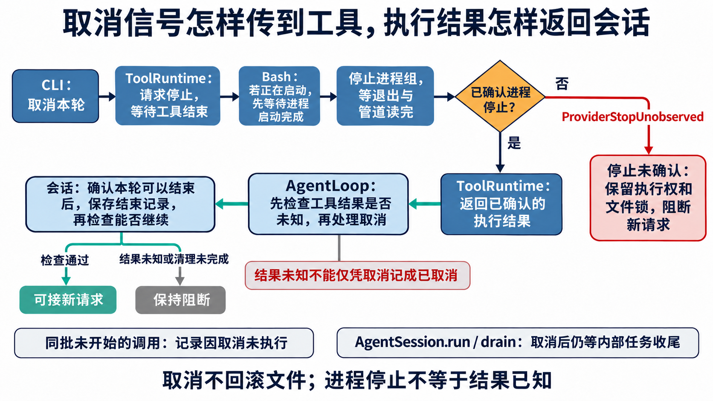
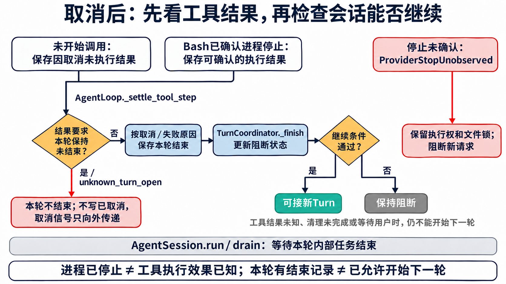

与第 12 课课程正文配套阅读。

正文的最简版只写了一句 `task.cancel()`。这一篇读 MyBuddy 的真实代码，看它在这句之后还做了什么：等待清理、停止进程、判断能不能继续。

**怎么读：** 每一节先贴一段代码，再用几句话解释。代码从当前源码原样复制，上方标了文件和行号。`# ...` 表示省略了与本节无关的行。

假设你让 MyBuddy 运行测试，等得太久，按下 Ctrl-C。先看整条调用链。缩进表示“谁调用谁”：

```latex
interruptible_turn.cancel       cli_control.py          按键入口：只发一次停止请求
└─ AgentSession.run             agent_session.py        取消后仍等内部任务收尾
   └─ AgentLoop.run_turn        agent_loop.py           每步只发一次模型请求
      └─ ToolRuntime.execute_batch  tool_runtime.py     未开始的调用记“已取消”
         └─ _run_until_stopped  tool_runtime.py         请求停止后，等工具任务结束
            └─ _run_bash_process  coding_bash.py        启动中取消也要拿到进程
               └─ ensure_process_stopped  managed_process_lifecycle.py  停进程组，确认消失
      └─ _settle_tool_step      agent_loop.py           结果未知时不能记成“已取消”
```



看完这张图，你要能：说出取消信号怎样传到执行层，清理结果又怎样回到会话。

## 从按键到这一轮

### 片段 1：按键入口只发一次停止请求

`src/mybuddy/platform/cli/cli_control.py:103-112`

```python
    def cancel() -> None:
        # 按多次停止键也只通知一次，避免重复取消同一个任务。
        nonlocal requested
        if not requested and not task.done() and not task.cancelling():
            requested = True
            notice()
            # 如果取消审批输入成功，就让工作任务继续处理这个取消结果；
            # 没有活动审批输入或取消未成功时，才取消工作任务。
            if cancel_interaction is None or not cancel_interaction():
                task.cancel()
```

前台工作运行时，Ctrl-C 和 SIGINT（操作系统发来的中断信号）都会调用这个 `cancel`。

- `requested` 保证同一轮只通知一次。连按几次，也只取消一次。
- 正在等你审批时，先取消审批输入。审批取消成功，就让工作任务自己处理这个结果。
- 没有审批可取消，才调用 `task.cancel()`。

CLI 收到 SIGHUP（终端断开时发来的信号）或 SIGTERM（请程序退出的信号）时，也会请求停止并等待清理，然后关闭会话再退出。

### 片段 2：发出停止请求后，仍要等任务结束

`src/mybuddy/platform/cli/cli_control.py:114-133`

```python
    with foreground_interrupt(cancel), control.bind(cancel) if control is not None else nullcontext():
        try:
            # shield 让上层取消先交给这里处理，而不是直接打断等待中的工作任务。
            # 下面会请求工作任务取消并等待它结束，避免留下无人等待的任务。
            return await asyncio.shield(task)
        except asyncio.CancelledError:
            # 上层取消时先等待工作任务结束；如果工作任务抛出其他异常，该异常会继续向外传递。
            if caller is not None and caller.cancelling():
                if not task.done() and not task.cancelling():
                    task.cancel()
                from mybuddy.core.runtime.cancellation import drain
                try:
                    await drain(task)
                except asyncio.CancelledError:
                    pass
                raise
            # 发出停止请求不代表任务已经结束；只有任务确实取消后才报告前台取消。
            if requested and task.cancelled():
                raise ForegroundTurnCancelled() from None
            raise
```

`await asyncio.shield(task)` 让外层的取消先落到这里，不会直接打断工作任务。

如果是上层取消（`caller.cancelling()`），代码先取消工作任务，再用 `drain` 等它结束，然后才把取消往外传。

最后两行很关键：只有 `task.cancelled()` 为真，才报告“前台已取消”。发出请求不算，任务真的以取消结束才算。

### 片段 3：`AgentSession.run`——调用方取消时也等收尾

`src/mybuddy/platform/sessions/agent_session.py:123-141`

```python
    async def run(self, work: Callable[[RecoveryInput], Awaitable[T]]) -> T:
        """启动会话工作；调用方取消时，也要等内部任务完成清理。"""
        if self._used:
            raise RuntimeError("runtime.activation_already_used")
        self._used = True
        self._owner_in_flight = True
        # 把整个启动、工作和关闭过程放在单独的任务里，取消调用方时才能继续等待清理。
        owner = asyncio.create_task(self._own(work))
        try:
            # 注意：shield 避免调用方的取消直接打断内部任务，否则可能跳过运行权的清理。
            return await asyncio.shield(owner)
        except asyncio.CancelledError:
            self._stopping = True
            if self._cancel_work is not None:
                self._cancel_work()
            # 注意：取消请求不代表工作已经停止。即使调用方再次取消，
            # 也要等待内部任务结束清理，不能提前交出运行权。
            await drain(owner)
            raise
```

整段会话工作放在 `owner` 任务里。调用方被取消时：

1. 设置 `_stopping`，请求内部工作停止；
2. 用 `drain(owner)` 等它清理完；
3. 再把取消往外传。

这样不会提前交出执行权。第 11 课片段 9 还讲过：如果无法确认外部调用已经停下，工作证和文件锁都不交出。

### 片段 4：`drain`——反复被取消，也继续等同一个任务

`src/mybuddy/core/runtime/cancellation.py:11-23`

```python
async def drain(task: asyncio.Task[T]) -> T:
    """等待传入的任务结束；等待者反复被取消时，仍继续等待这个任务。"""
    # 注意：再次取消等待者时，不能让正在等待的任务跟着中断，
    # 否则清理工作可能只做了一半。shield 保护这个任务；
    # 如果任务自己被取消，则把取消继续抛给调用方。
    while not task.done():
        try:
            return await asyncio.shield(task)
        except asyncio.CancelledError:
            if task.cancelled():
                raise
    # 收到取消时任务也可能刚好结束；取结果时仍要让任务自己的异常传给调用方。
    return task.result()
```

`shield` 防止等待方被取消时，顺带取消这个任务。等待方收到取消后，循环继续等。

只有任务自己被取消（`task.cancelled()` 为真），取消才向外传。这就是正文说的“再按一次取消，也继续等同一份清理”。

注意，`drain` 只保护等待过程。命令已经写入的文件，它不会撤销。

## 工具与进程：等待工作停下

### 片段 5：取消之后，没开始的调用记“已取消”

`src/mybuddy/platform/tools/tool_runtime.py:302-310,377-385`

```python
        # 出现取消或其他停止条件后，后面的调用仍要记录结果，但不能再运行工具。
        def stopping() -> bool:
            return signal.cancelled or task_cancelled or business_cancelled or continuation_blocked

        for call in calls:
            pending: _PendingResult
            if stopping():
                pending = self._unstarted(head, unknown=continuation_blocked)
            else:
# ...
    @staticmethod
    def _unstarted(head: int, *, unknown: bool = False) -> _PendingResult:
        """为没有运行的调用准备结果，不编造工具执行记录。

        普通取消记为 cancelled。unknown=True 时，是前面某个调用结果未知而停下了整批：
        这条调用确定没运行，记为 not_started，错误码则说明它是被那个未知结果拦下的。"""
        return _PendingResult(head, "not_started" if unknown else "cancelled", _error_info(
            "runtime.tool_outcome_unknown" if unknown else "runtime.tool_cancelled",
            "unknown" if unknown else "cancelled"), business_cancelled=not unknown)
```

`execute_batch` 逐个处理同一批工具调用。前半段的 `stopping()` 汇总了几种停止条件，取消是其中之一。

一旦停止，后面的调用不再运行，而是交给 `_unstarted`。它只准备一个 `cancelled` 结果，不编造执行记录。如果是因为前面有结果未知而停（`unknown=True`），则记成 `not_started` 加 `runtime.tool_outcome_unknown`。

每个调用最后都会保存一个结果，即使它没运行。这样模型能按顺序读到每个调用的结局。

### 片段 6：`_run_until_stopped`——请求停止后，等到工具任务结束

`src/mybuddy/platform/tools/tool_runtime.py:355-375`

```python
    async def _run_until_stopped(
        self, execution: _Execution, signal: CancellationSignal,
    ) -> tuple[_ProviderResult, bool]:
        """在单独的任务中运行工具，并返回外层等待是否收到过取消。
        取消只是在请求工具停止；这里会继续等到任务结束。"""
        worker = asyncio.create_task(self._run_provider(execution, signal))
        caller_cancelled = False
        while not worker.done():
            try:
                await asyncio.wait((worker,))
            except asyncio.CancelledError:
                if not caller_cancelled:
                    worker.cancel()
                caller_cancelled = True
                if isinstance(signal, _BatchCancellation):
                    signal.requested = True
        if worker.cancelled():
            # 工具任务在协程开始运行前就被取消了；虽然开始记录已保存，但工具没有被调用。
            return _ProviderResult(ToolDispatchOutcome(
                execution.request.execution_id, "cancelled"), False, True), caller_cancelled
        return worker.result(), caller_cancelled
```

工具在单独的 `worker` 任务里运行。外层收到取消时，只调用一次 `worker.cancel()`，然后继续循环等待。

`worker.cancelled()` 为真，说明工具协程还没开始就被取消了。这时虽然有“即将执行”记录，工具其实没被调用，所以记成 `cancelled`。

工具已经在跑时被取消，结果由工具自己报告。第 11 课片段 2 讲过：等待中被取消会记成 `outcome_unknown`。

### 片段 7：启动过程中取消，先拿到进程再清理

`src/mybuddy/platform/tools/coding_bash.py:355-373`

```python
    # 创建独立会话，让后面的清理可以处理该进程组，而不只是等待 shell 主进程。
    # 命令如果自行离开这个进程组，这里的清理无法确认它是否结束。
    starting = asyncio.create_task(asyncio.create_subprocess_exec(
        *argv, cwd=plan.cwd,
        env=dict(environment), stdin=asyncio.subprocess.DEVNULL,
        stdout=asyncio.subprocess.PIPE, stderr=asyncio.subprocess.PIPE,
        start_new_session=True))
    try:
        process = await asyncio.shield(starting)
    except asyncio.CancelledError:
        # 注意：启动过程中收到取消时，进程仍可能被创建。要先取得启动结果，
        # 再停止进程并处理输出管道，不能直接丢下正在运行的命令。
        try:
            process = await finish_cleanup(managed_process_lifecycle.await_process_started(starting))
        except Exception:
            raise BashCancelled() from None  # 等待启动结果时出错，没有取得进程句柄。
        readers = managed_process_lifecycle.discard_process_output(process)
        await managed_process_lifecycle.ensure_process_stopped(process, readers)
        raise BashCancelled() from None
```

`start_new_session=True` 让命令有自己的进程组，后面能整组停止。

启动本身是一个任务 `starting`，用 `shield` 等待。启动中收到取消时，进程可能已经创建了。所以代码不直接放弃，而是：

1. 用 `finish_cleanup` 等到启动结果；
2. 拿到进程后，持续读出并丢弃命令的输出；
3. 调用 `ensure_process_stopped` 停止进程组。

运行中收到取消、超时或输出超限，也走同一个 `ensure_process_stopped`。

### 片段 8：停止进程组，并确认它真的消失了

`src/mybuddy/platform/tools/managed_process_lifecycle.py:31-52`

```python
    loop = asyncio.get_running_loop()
    # 先给进程机会自行退出；还不能确认进程组消失时，再用 SIGKILL 强制结束。
    for signal in (os_signal.SIGTERM, os_signal.SIGKILL):
        if observe_process_group(process.pid) == "absent":
            break
        try:
            os.killpg(process.pid, signal)
        except (ProcessLookupError, PermissionError):
            # 发送信号时进程可能刚退出，也可能是没有权限；不能只凭异常判断进程已经结束。
            # 还要继续检查进程组，并等待主进程退出、管道读取完成。
            pass
        until = loop.time() + STOP_GRACE_SECONDS
        while (loop.time() < until
               and observe_process_group(process.pid) != "absent"):
            await asyncio.sleep(POLL_SECONDS)
    # 主进程退出后，管道里可能还有输出。分别等待进程和读取任务，任一等待超时就返回 False。
    try:
        await asyncio.wait_for(process.wait(), timeout=STOP_GRACE_SECONDS)
        await asyncio.wait_for(asyncio.gather(*readers), timeout=STOP_GRACE_SECONDS)
    except TimeoutError:
        return False
    return observe_process_group(process.pid) == "absent"
```

先发 SIGTERM，给进程机会自己退出。限时内进程组还在，再发 SIGKILL。

发信号不等于退出。所以最后还要等主进程退出、两条输出管道读完，并再查一次进程组是否 `absent`。任何一步超时，就返回 `False`。

### 片段 9：确认不了，就报“停止未观察到”

`src/mybuddy/platform/tools/managed_process_lifecycle.py:55-65`

```python
async def ensure_process_stopped(
    process: asyncio.subprocess.Process,
    readers: tuple[asyncio.Task[None], asyncio.Task[None]],
) -> None:
    """等待同一次清理完成；等待期间再次收到取消也继续等，无法确认进程退出时抛错。"""
    try:
        stopped = await finish_cleanup(stop_process_group(process, readers))
    except Exception as error:
        raise ProviderStopUnobserved() from error
    if not stopped:
        raise ProviderStopUnobserved()
```

`stop_process_group` 返回 `False` 或出错，就抛出 `ProviderStopUnobserved`。

这个异常一路传到 `AgentSession._execute_owned`，会话不交出执行权。这就是正文说的“清理到时限还不能确认，就保持阻断”。



看完这张图，你要能：在源码里找到三处判断：取消怎样传下去、清理怎样收尾、会话什么时候能接收新请求。

## 回到结果：能否继续，能否重试

### 片段 10：每一步只有一次 Attempt

`src/mybuddy/core/runtime/agent_loop.py:285-289`

```python
            step_id = self._ids.next("step")
            attempt_id = self._ids.next("attempt")
            model_completion = await self._request_model(
                context, commits, progress, step_id, attempt_id, active_signal,
            )
```

每个 Step 生成一个 `step_id` 和一个 `attempt_id`，然后调用一次 `_request_model`。这里没有重试循环。

准备阶段失败或取消时，请求不一定发出去了。模型根据工具失败换一种做法，是下一个 Step，不是把同一请求重发。

### 片段 11：`_settle_tool_step`——先看结果未知，再看取消

`src/mybuddy/core/runtime/agent_loop.py:529-550`

```python
        next_action = _tool_batch_next_action(tool_outcome, signal_cancelled=signal.cancelled)
        if next_action == "unknown_open":
            if tool_outcome.task_cancelled:
                # 向调用者传播取消，但不把不知道工具是否运行完的本轮记为已取消。
                # 工具可能已经产生外部改动，不能因为取消就再次执行。
                raise asyncio.CancelledError
            # 保留未结束的本轮，让会话阻止后续执行，避免不知道工具是否运行完时重复执行。
            return {
                "outcome": "unknown",
                "reason_code": "runtime.tool_outcome_unknown",
                "head_seq": progress.head,
                "step_count": progress.step_index,
            }
        # 可以结束本轮时，先保存取消记录，再向任务调用者传播取消。
        if next_action == "task_cancelled":
            await finish_cleanup(end_turn("cancelled", "runtime.turn_cancelled"))
            raise asyncio.CancelledError
        if next_action == "cancelled":
            return await end_turn("cancelled", "runtime.turn_cancelled")
        if next_action == "blocked":
            # 某个工具结果未知，后面的调用都没运行；不能让模型带着这个未知结果继续，本轮按失败结束。
            return await end_turn("failed", "runtime.tool_outcome_unknown")
```

顺序很重要：先判断 `unknown_open`，再判断取消。

- `unknown_open`：某些工具结果未知，本轮保持未结束。即使同时收到了取消，也只往外传取消，不把本轮记成“已取消”。
- `task_cancelled`：先用 `finish_cleanup` 保存取消记录，再往外传。
- `blocked`：结果未知且不能继续，以 `runtime.tool_outcome_unknown` 结束本轮。

这对应正文的追加文件例子：工具已经开始，结果没确认，不能凭取消就断定文件没变，更不能自动再执行一次。

之后，`TurnCoordinator._finish` 根据结果更新会话是否阻断。下次接收输入前，还会再检查继续条件。

### 先看提示词：结果交回模型以后，要不要再做一次

正文说 MyBuddy 不自动重试。代码这边，片段 10 每步只发一次模型请求，片段 11 遇到结果未知就停下本轮。可工具结果交回模型以后，模型下一步要不要把同一个操作再做一次，代码里没有判断。这部分靠系统指令 `CODING_SYSTEM`。第 6、7 课从审批和命令的角度看过其中几句，这里只看和重试有关的两句：

`src/mybuddy/platform/tools/coding_contract.py:285-286`

```python
    "失败和 unknown 如实报告，依据实际 status、error_code 和 details，不虚构或改写错误码，不自动重试有副作用的操作。"
    "相同输入的只读失败没有新信息时不重复。停止前核对是否覆盖了用户要求；查错了目标不等于查过用户的目标。"
```

先看模型手里有什么。被取消或结果未知的调用，`_commit_closed_result` 交给模型的内容只有两项：`status`（`cancelled`、`not_started` 或 `outcome_unknown`）和 `error_code`（`runtime.tool_cancelled` 或 `runtime.tool_outcome_unknown`）。同一个函数给“用户未批准”“额度用完”这几类错误配了一句 `explanation`，取消和结果未知没有配。`Bash` 被取消时如果有进程详情，模型还会看到 `bash_text` 写的“执行已取消”和已有的输出。

工具结果里还有 `retry_hint: "never"`，错误信息里有 `retryability: "never"`。但请求里每条工具结果只放 `tool_call_id`、`status`、`model_content` 三项（`context/request.py`），这两个字段模型看不到。所以“别重做”这层意思，模型只能从下面这两句话里得到。逐句看它为什么这样写：

- **“失败和 unknown 如实报告，依据实际 status、error_code”**。`outcome_unknown` 和 `not_started` 是两种不同的事实：前者是工具开始了，结果没确认；后者是因为前面有结果未知，这个调用根本没运行（片段 5）。按字段报告，模型就不会把两者都说成“失败了”。正文说“三种情况你可能都会口头说成‘失败了’”，Harness 要保留的就是这个区别。
- **“不自动重试有副作用的操作”**。片段 11 的注释写着：“工具可能已经产生外部改动，不能因为取消就再次执行。”这一轮停下了。出现 `outcome_unknown` 后，当前会话会阻止继续执行。即使你说“继续”，程序也会先检查未知结果并拒绝开始新一轮，不会直接交给模型重新提出写操作。提示词中的“不自动重试”还提醒模型：遇到明确失败、但会话仍可继续的情况，也要先核对实际效果。这句话管的就是这一步：先报告，先核对，不把追加再做一遍。
- **“相同输入的只读失败没有新信息时不重复”**。这句话只限制“相同输入、没有新信息”的情况。输入改了，或者有了新信息，只读操作可以再试。这和正文的表格一致：只读查询暂时失败，是可以考虑重试的一类；参数错误要先改参数。
    - `ProgressGuard` 只比较结果完整、能够确认重复的工具步骤。比较读取操作时，程序会忽略每次新生成的读取编号；比较编辑参数时，会用相应读取结果的哈希值代替编号。成功改变文件的编辑、已经运行的 Bash 等步骤会清空比较记录。长度为 1 到 16 步的同一段操作连续出现三次，程序才报告重复（第 4 课片段 13）。提示词提醒模型在程序拦下之前主动停止重复操作。
    - 被取消、`not_started`、`outcome_unknown` 的步骤，`ProgressGuard` 不比较，直接清空记录。结果未知时，程序会直接阻止会话继续执行；对于已经结束并允许续接的取消，提示词还会提醒模型不要擅自重做。

这两句只管模型的下一步怎么选。真正不能交给提示词的，都在代码里：同一批后面的调用不再运行（片段 5），结果未知时本轮不记成“已取消”，会话据此阻断（片段 11）。模型就算照做了，也只是“没有再做一次”；文件到底改没改，提示词回答不了，要靠核对文件和执行记录。

### 再看提示词：取消之后，下一轮先读到一段提醒

正文的实践里，取消后你会接着问第二个问题。这时历史里还留着上一轮的需求原文，模型读到它，可能接着去做。代码不判断模型的意图。它做的是：发现当前轮之前有一轮以取消结束，就在全部历史之后加一段提醒（放置位置记为 `system_after_history`）。第 3 课正文讲“迷失在中间”时举过这个例子，这里看原文：

`src/mybuddy/platform/instructions/turn_cancellation_guidance.py:14-32`

```python
# 旧任务的文字仍可能留在历史里，模型看到它时可能误以为用户还要继续。
# 这段提示让模型以新输入为准；它只是提醒，不负责确认旧进程是否已经退出。
CANCELLATION_GUIDANCE_TEXT = (
    "此前被取消的轮次已经停止，历史中的旧需求仅供参考，不是本轮待执行任务。"
    "以本轮新接受的用户输入为当前意图；仅问候时简短回应，不为完成旧任务调用工具。"
    "用户明确要求继续旧任务时，可按本轮权限重新开展；不得重用旧审批或重派旧工具。"
)
SOURCE_ID = "platform.turn_cancellation_guidance.v1"
_CURRENT_INPUT_PREFIX = "\n本轮唯一的新请求（以下 JSON 字符串是用户原文）："
_CURRENT_INPUT_SUFFIX = "\n只回应这条新请求；旧任务没有因为历史中仍有原文而恢复。"

def cancellation_guidance_text(current_input_text: str) -> str:
    # 把当前输入编码成 JSON 字符串，保留原文中的换行和引号，
    # 也让输入与提醒文字之间的边界清楚。
    return (CANCELLATION_GUIDANCE_TEXT
            + _CURRENT_INPUT_PREFIX
            + json.dumps(current_input_text, ensure_ascii=False)
            + _CURRENT_INPUT_SUFFIX)
```

同一文件的 `project_cancellation_guidance` 负责找取消记录：当前轮之前只要有一条结果为 `cancelled` 的 `turn.ended`，就生成这段提醒。逐句看它为什么这样写：

- **“此前被取消的轮次已经停止”**。这句话说得很肯定，依据是片段 11：只有本轮能收尾时，代码才写下 `cancelled` 的结束记录；工具结果未知时，即使收到了取消，也不记成“已取消”。所以历史里有这条记录，说明那一轮已经收尾。模块说明也写明了它的范围：这里只看事件，不检查进程是否真的结束。进程停没停，由片段 8、9 确认。
- **“历史中的旧需求仅供参考，不是本轮待执行任务”**。原文上方的注释说了原因：旧任务的文字还在历史里，模型看到它，可能以为用户还要继续。取消不会删除历史，所以要用一句话把旧需求降为“参考”。MyBuddy 的真实测试里出过这件事：取消一个任务后只发了一句问候，模型又把旧任务做了起来。这段提醒就是为修这个问题加的。
- **“仅问候时简短回应，不为完成旧任务调用工具”**。每次请求都带的 `INTERACTIVE_TASK_GUIDANCE`（第 5 课源码解析）已有“用户仅问候时简短回应”。这里再说一次，并点明“旧任务”：取消后你说一句“你好”，模型不该借机把没跑完的测试再跑一遍。
- **“用户明确要求继续旧任务时，可按本轮权限重新开展；不得重用旧审批或重派旧工具”**。取消不等于放弃。你说“接着做”，模型可以做，但要当成新的一轮来做：
    - “按本轮权限”“不得重用旧审批”：每次需要审批，`_resolve_approval` 都为这一次调用新登记一个请求，并核对它属于本轮（`turn_id`）和这次调用（`tool_call_id`）。上一轮的“yes”不会放行这一轮的调用。
    - “不重派旧工具”：上一轮没开始的调用已经记成“已取消”（片段 5），代码里没有把它们再拿出来运行的路径。模型要做，就得提出新的调用，重新走检查和审批。
- **当前输入编成 JSON 字符串，前面写“本轮唯一的新请求”**。注释写了理由：保留原文里的换行和引号，也让用户原文和提醒文字的边界清楚。`project_cancellation_guidance` 还会核对这条输入属于当前轮、排在取消之后，对不上就报错。不会把另一轮的输入当成“唯一的新请求”交给模型。
- **结尾“只回应这条新请求；旧任务没有因为历史中仍有原文而恢复”**。意思和第一句相同，放在提醒最后，也就是模型最后读到的位置。第 3 课正文讲过，长输入里开头和结尾的内容最不容易被忽略。

这段提醒只影响模型怎样理解当前请求。旧进程停没停、会话能不能继续、旧审批能不能用，它都不管：这些由片段 8、9 的停止确认、片段 11 的收尾判断，以及审批与本轮绑定的检查负责。提醒出现在请求里，说明代码已经允许这一轮开始；它不是允许开始的条件。

## 读码练习

1. 连按三次 Ctrl-C，片段 1 的 `cancel` 会调用几次 `task.cancel()`？为什么？
2. 清理过程中再按一次取消，片段 4 的 `drain` 会怎样？什么情况下取消才会向外传？
3. 命令刚在启动中就收到取消，片段 7 为什么不直接 `raise BashCancelled()`？
4. 片段 8 返回 `False` 以后，会话最后处于什么状态？可以马上开始新的一轮吗？
5. 同一批有三个调用：第一个结果未知，策略要求阻断后续（但不要求保持本轮开放），后两个还没开始。后两个会记成什么？本轮怎样结束？

参考答案

**第 1 题** 一次。第一次调用后 `requested` 变成 `True`，后面的调用都跳过。另外，如果当时在等审批且取消审批成功，连这一次 `task.cancel()` 也不会调用。 **第 2 题**`shield` 挡住了对任务的取消，`except` 分支里 `task.cancelled()` 为假，循环继续等。只有任务自己以取消结束，`drain` 才把取消往外传。 **第 3 题** 启动中收到取消时，进程可能已经创建了。直接抛异常会留下一个没人管的进程。所以要先等启动结果，拿到进程后停止它，再抛 `BashCancelled`。 **第 4 题** 片段 9 抛出 `ProviderStopUnobserved`。会话不交出执行权，保持阻断，不能马上开始新的一轮。要先核对进程和执行记录。 **第 5 题** 第一个结果未知后，`continuation_blocked` 为真。后两个走 `_unstarted(head, unknown=True)`，记成 `not_started`，错误码 `runtime.tool_outcome_unknown`。片段 11 走 `blocked` 分支，本轮以 `failed` 和 `runtime.tool_outcome_unknown` 结束。
