理解验收条件、验证证据、任务评测和失败归因。

## 本课导览

一轮运行停下来以后，还要回答一个问题：**我们凭什么说问题已经解决？** 本课沿一条主线展开：先把“修好了”写成可以检查的条件，再取得对应的证据，最后根据证据下结论（见下面的总纲图）。

学完后，你应能写出一份这样的验收记录。下一课换一个领域：用一份静态预设选定说明、工具和默认权限，把开发助手换成研究助手，再和 Skill、MCP、委派组合起来。

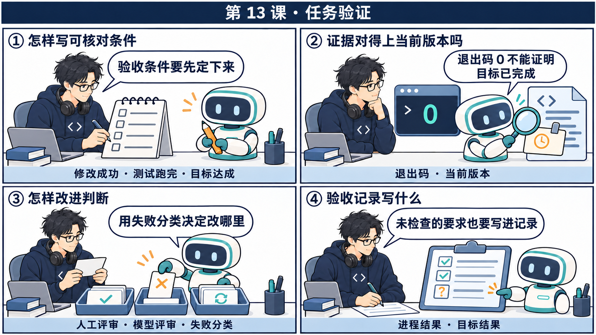

## 一、怎样把“修好了”写成可核对的条件？

**“修好了”要先展开成一组输入和预期结果，并在检查之前定下来。**

### “修好了”可以指四件不同的事

**原因解释清楚、修改成功、测试跑完、目标达成，是四件要分别确认的事。**

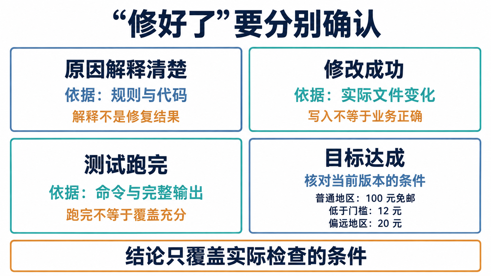

看完这张图，你要能：区分能运行、局部通过、目标满足及可交付等不同结论。

模型说出了原因，文件里的条件也改了，测试进程也正常退出了。这样就能说运费问题修好了吗？还要看业务要求是否真的满足。

运费修复至少要检查三点：

- 普通地区刚好 100 元，免邮；
- 低于门槛，仍收 12 元；
- 偏远地区，继续收 20 元。

一个只检查文件里有没有 `>=` 的脚本，证明不了地区分支没被改坏。模型的一句“已经修好”，同样不能代替检查。

第 4 课讲过：停止原因只说明这一轮为什么停下。这一课接着看：已有的结果能支持什么结论——测试针对哪个版本？覆盖了哪些要求？还有哪些没检查？

### 验收条件应该先定下来

**条件要和目标一起先定下来；否则测试失败时，可能连条件一起被改掉。**

如果测试失败后，允许模型删掉失败的条件再宣布成功，验证就没有意义了。所以要先定下：哪些条件必须满足，用什么方法检查，检查的是哪个版本。

在 MyBuddy 中，可以用 `/goal <完整条件>` 设置目标并开始一轮。正常结束的一轮之后，会有一次轮末评估：

- 评估为 `not_met`，带着目标继续下一轮；
- 评估为 `met` 或 `impossible`，清除活动目标；
- 连续三轮正常结束、都没有登记工具调用时，停止自动继续，目标仍保留。

下面三种情况不续轮，目标保留：这一轮在等你审批或回答；后台工作还没停稳；评估调用失败或超时。

看到“所有测试通过”，还要接着问：这些测试具体检查了什么？如果没有一项覆盖偏远地区，全部通过也回答不了“偏远地区是否仍收 20 元”。读测试内容，是为了知道这次通过能支持多大范围的结论。

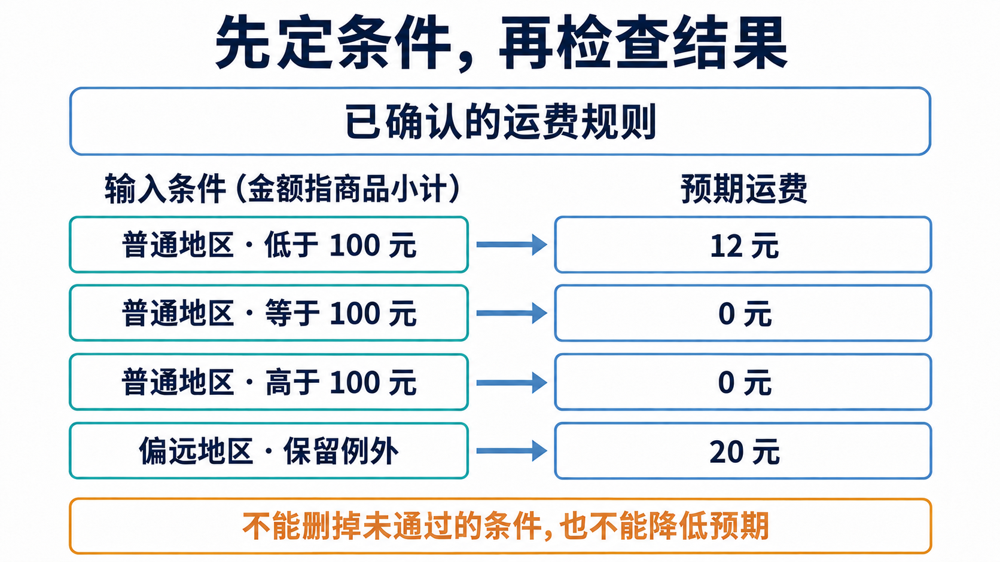

看完这张图，你要能：根据已接受规则定义输入、预期和需要保持的行为。

| 输入条件 | 预期运费 |
| --- | --- |
| 普通地区，低于 100 元 | 12 元 |
| 普通地区，等于 100 元 | 0 元 |
| 普通地区，高于 100 元 | 0 元 |
| 偏远地区 | 20 元 |

容易误会的地方：

- Goal 的轮末评估是模型的判断，要和真实的检查证据分开看。
- 自然语言写的条件，不会自动变成完整的测试。

## 二、检查怎样执行，证据怎样对应当前版本？

**一次检查的结果，要对上条件、对上版本、输出完整，才能当作证据。**

### 先看最简版：退出码 0 就算修好

**最简版把“命令成功”直接当成“目标达成”。**

```python
# 最简版（教学示意，不是 MyBuddy 的代码）
result = run("python -m unittest")
if result.exit_code == 0:
    print("修好了")
```

这几行能告诉你命令有没有报错。可它说明不了测了什么、测的是哪一版代码。

### 从最简版到 MyBuddy：一次加一个约束

**每加一个约束，都是在问：这次“成功”到底证明了什么？**

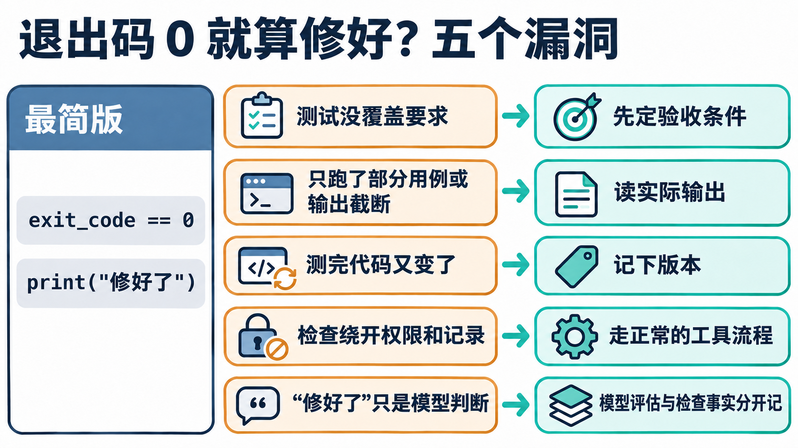

看完这张图，你要能：对照“退出码 0 就算修好”的最简版，说出五条约束。

1. **测试可能没覆盖要求 → 先定验收条件，再对照。** 第一节讲过。退出码 0 不知道偏远地区有没有被测到。
2. **可能只跑了一部分用例，或输出被截断 → 读实际输出。** pytest 和 Python 3.12 以后的 unittest，一个用例都没跑时会返回 5，不是 0。但筛选条件写错、只跑了几条，或者用的是自己写的测试脚本，仍可能退出 0。要看通过的用例数，以及输出是否完整。
3. **测完之后代码可能又变了 → 记下版本。** 旧版本的通过，不能直接证明新版本。
4. **检查可能绕开权限和记录 → 检查也走正常的工具流程。** 否则没人审批，也查不到记录。
5. **“修好了”可能只是模型的判断 → 模型评估和检查事实分开记。** MyBuddy 的 Goal 评估只看对话末尾的一段文字，不读文件。

下面几小节依次展开 2–5。

### 检查也要走正常的工具流程

**项目检查由模型提出 Bash 调用，和其他命令一样经过权限、审批和记录。**

检查需要的事实，可能来自测试命令，也可能来自读文件。在 MyBuddy 中，测试命令就是一次普通的 Bash 调用。它和其他命令一样，经过权限模式判定、必要的审批、取消和记录（第 6 课）。如果检查程序绕开这条路自己启动进程，就跳过了权限和记录。

“检查的结果”和“目标评估”是分开的：

- **检查**提供事实：命令、退出码、输出。
- **Goal 评估**由 low 档模型给出 `met`、`not_met` 或 `impossible`。它只看对话末尾的一段文字，不调用工具，也不读磁盘上的文件。较早的信息，或没进入对话的信息，它可能看不到。

研究任务也一样。模型应该主动用 `ReadFile` 读取所需文件，并说明结论与限制。没有实际读过的来源，要写成“未核实”。如果用了子任务，也要检查它返回的依据够不够。

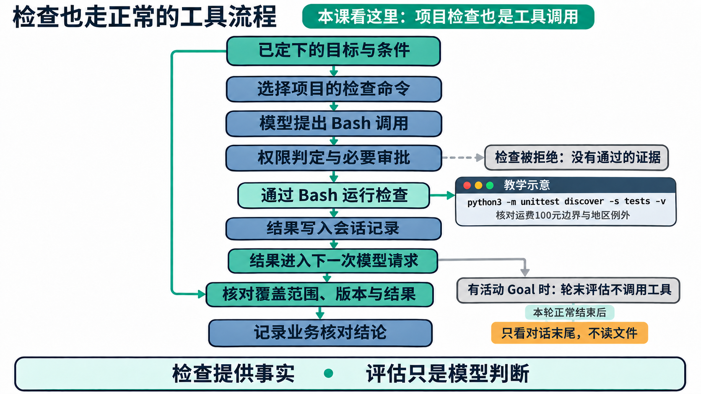

看完这张图，你要能：说明项目检查怎样经过权限、审批和记录，再与 Goal 评估分开核对。

结果从哪来，要如实记录。只有模型提出的调用，才算模型做的检查。你在终端里手工跑的检查，不会变成 MyBuddy 内部的记录。模型停止输出后，MyBuddy 也不会自动替你补跑一套测试。

MyBuddy 不会判断测试覆盖了哪些条件。记录里能看到命令、退出码和输出；输出达到上限时，会提示“输出已截断”。跑了多少用例、有没有失败，要从实际输出里读出来，再拿来对照模型的报告。

### 退出码 0 为什么还不够

**退出码 0 只说明进程正常结束；只跑了一部分用例、输出截断、代码已变，都可能藏在 0 后面。**

判断一次检查是否通过，要同时确认：

- 命令确实执行完了，而且已经停稳（第 12 课）。
- 实际通过的用例数大于零，且没有失败。
- 输出是完整的。
- 结果对应当前的代码版本。

退出码 0 像烤箱“叮”的一声，只说明计时到了、命令跑完了；蛋糕熟没熟，还得拿牙签戳一戳——也就是看实际输出，逐项对照上面四条。

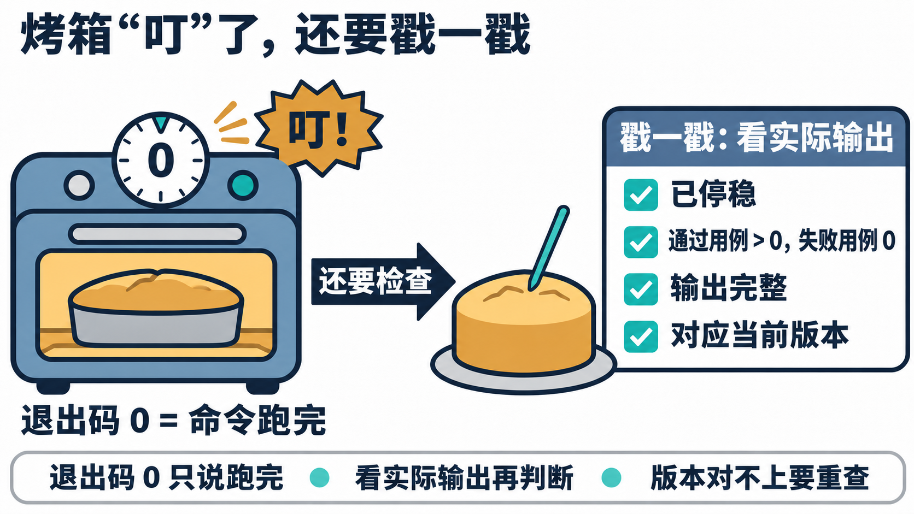

看完这张图，你要能：用“烤箱叮一声”和“牙签戳蛋糕”说明：退出码 0 只说明命令跑完了，还要看实际输出——进程已停稳、通过的用例数大于零且没有失败、输出完整、对应当前的代码版本。

| 事实 | 合适的结论 |
| --- | --- |
| 当前版本有明确的失败断言 | 对应条件没有满足 |
| 没有运行任何测试 | 不能证明通过，保持未知 |
| 你拒绝了运行测试 | 没有通过的证据，不能显示已验收 |
| 输出不完整，判断不了 | 保持未知 |
| 旧版本测试通过，但文件已经改了 | 旧结果留档，新版本重新检查 |
| 当前条件、代码和有效证据都对得上 | 可以判定这一组条件通过 |

MyBuddy 不会在测试前后对比代码版本，也不会锁住文件系统。报告结论时，要说明这是哪个版本、哪一次检查的结论。


看完这张图，你要能：解释退出码为零为何仍需核对有效用例、代码版本与验收条件。

### 条件和证据为什么需要版本

**要求变了或代码变了，旧的检查结果仍是真实历史，但不能自动支持新版本。**

你把免邮门槛从 100 元改成 120 元，或者改了要保留的地区规则，目标就变成了新版本。

代码也一样。先跑了测试，之后格式化工具或别人又改了文件，后面的判断就要把这些变化考虑进去。证据要能说明：来自哪里，针对哪一版要求、哪一版代码，在多长时间内有效。

有效期要按任务来定。检查静态文件和查询实时价格，有效期显然不同。

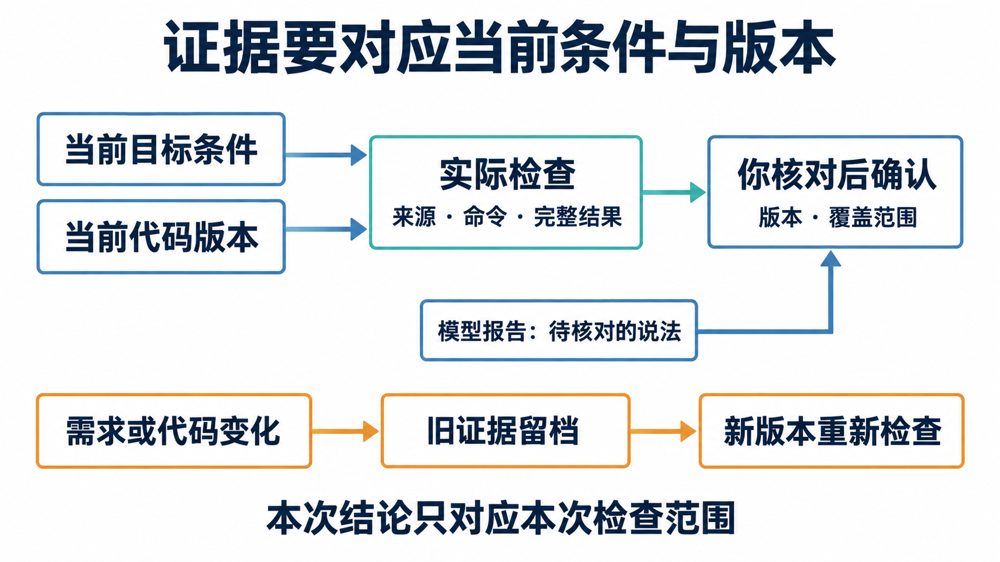

看完这张图，你要能：把你对业务结果的确认，对应到目标条件、代码版本和完整的检查结果。图里的“确认”是你自己看结果，不是 Goal 命令或运行状态。

容易误会的地方：

- 工具调用“成功”，只说明这次调用按工具约定完成了；对 Bash 而言，还要求进程正常退出且退出码为 0。这些都不说明用户的目标已经完成。
- 较长的工具结果可以分页读取，但补不回进程输出上限截掉的内容。
- Goal 判定为 `met`，不能代替你对实际检查结果的核对。

## 三、怎样用测试、评审和失败反馈改进判断？

**想知道一整类任务是否变好，要从单项测试走向任务评测：固定样本、约定判断方法、看失败集中在哪里。**

运费这一个问题，可以用边界用例检查。但换了模型或改了 Harness 之后，想知道一整类任务是不是变好了，就要做**任务评测**。

### 从单项测试走向任务评测

**先固定少量代表任务，每项记下预期、实际证据、是否满足和失败类别。**

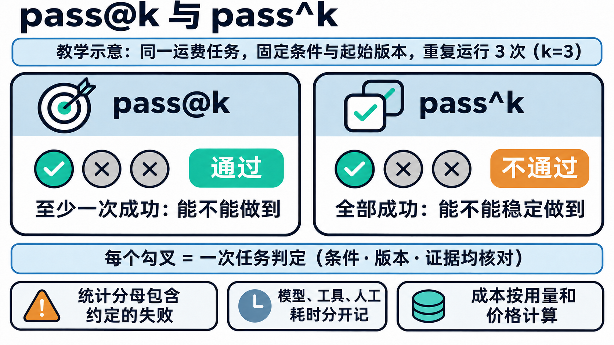

看完这张图，你要能：区分 pass@k 与 pass^k，并记住统计分母、耗时和成本的记法。

代表任务可以包括：只读排查、批准后修复、拒绝修改、缺少条件、代码变化、测试失败和中途中断。

准备任务、运行 Agent、收集证据、判分，这一套设施本身也是一种 Harness：运行 Harness 让 Agent 干活，评测 Harness 判断它干得怎样。MyBuddy 只提供前者，没有内置评测设施；本课的代表任务和判分规则要你自己准备。

判分时，最终答案和执行过程要分开看。运费最后算对了，但中途改了没获批准的文件，或者执行了被拒绝的命令，这一项也不能算通过。过程要单独对照记录检查：每个修改是否获准，有没有越出约定范围。

统计时注意三点：

- **成功率的分母**要包含事先约定要统计的失败，不能只算最后重跑成功的那次。
- **耗时**要分开记：模型等待、工具执行、人工等待。你离开电脑的时间，不能算进模型延迟。
- **成本**按服务返回的用量（usage）和价格计算，不知道的部分标为未知。

同一项任务重复跑 k 次，常见两种统计。**pass@k**：k 次里至少一次成功就算通过，衡量“能不能做到”。**pass^k**：k 次全部成功才算通过，衡量“能不能稳定做到”。k 越大，前者越容易高，后者越容易低，所以同一组结果可能给出相反的印象。要交给别人反复使用的流程，更该看 pass^k。

Trace 帮你找到失败发生在哪个阶段，任务评测判断结果是否符合预期。测试总数只反映覆盖规模的一部分，不能代替任务质量。

### 怎样选择验证方法

**能算出来的用程序检查，要理解的用人工评审，模型评审要有标准和反例。**

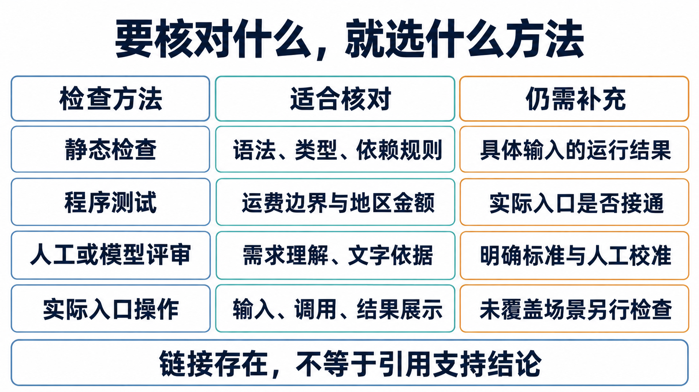

看完这张图，你要能：根据要检查的内容选择验证方法，并说明它覆盖不到什么。

- **程序检查**：适合能明确计算的条件。比如文件能否解析、边界输入的返回值、引用的编号是否存在。
- **人工评审**：适合判断需求有没有被正确理解、解释是否清楚。
- **模型评审**：可以帮忙审查开放的文字，但要有明确标准、已知的反例，并和人工判断对照过。不能让它凭整体印象给一个说不清来由的分数。

以研究助手为例：“链接存在”是格式条件，用程序查；“引用支持结论”是内容条件，要逐条看原文。

评测样本最好包括：任务输入、固定的环境或材料、允许的操作、预期条件和判断方法。拒绝修改的样本，正确结果可能是“说明原因且没有写入”。资料缺失的样本，正确结果可能是“明确说材料不够”。不能用“调用了更多工具”或“回答了更多内容”统一打分。

### 用失败分类决定下一步改哪里

**按失败类别找原因：先记下最早能确认的那一层。**

假设一组十项的教学任务中，七项满足全部条件，两项读错了材料，一项在调用模型之前就被环境配置挡住了。可以报告“七项通过”，并把“读错材料”和“环境挡住”这两类失败单独列出。如果要分析模型的决策质量，要事先说明排除环境故障后的分母，并保留原始记录。（数字仅作示例。）

然后对照 Trace 找原因：

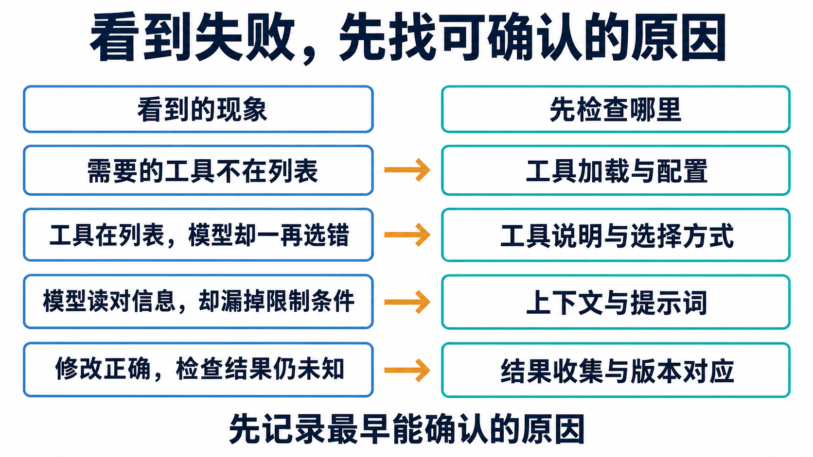

看完这张图，你要能：区分缺上下文、错误策略、工具失败与业务实现缺陷。

| 看到的现象 | 先检查哪里 |
| --- | --- |
| 工具列表里根本没有需要的工具 | 工具有没有加载、配置有没有打开 |
| 工具在，但模型一再选错 | 工具说明和选择方式 |
| 读到了正确信息，却丢了限制条件 | 上下文和提示词 |
| 修改是对的，但验收结果未知 | 检查结果的收集和版本对应 |

一次失败可能涉及好几层，先记下最早能确认的原因。

同一任务每次运行的过程可能不同。比较两个版本时，要固定样本和运行条件，并记录每一次尝试。重复运行能暴露波动。少量案例上的提高，只能说明这批案例。最后把有代表性的失败写成以后反复运行的测试用例（回归样本），再看改动有没有让别的类别变差。

### 让验证结果足以支持下一步判断

**从执行到下结论，每一步都不能把“没拿到结果”改成“通过”。**

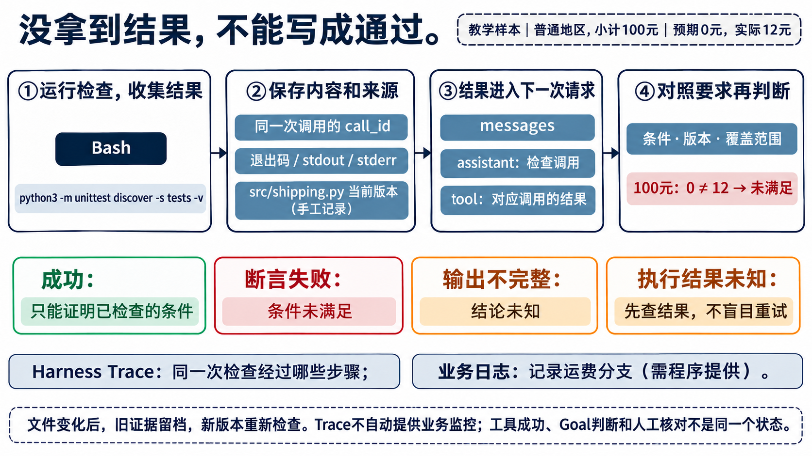

看完这张图，你要能：说出检查结果经过的四步：收集、保存、交给模型、对照判断，并确认四类结果都不会被误当成通过。

一次执行的结果，要变成能对应、能读取、不会被误读的证据：

1. 执行时收集结果；
2. 保存时留下必要内容和来源；
3. 下一次请求把相关结果交给模型；
4. 判断是否完成时，对照要求、文件版本和检查范围。

检查这条链路时，要覆盖：成功、断言失败、输出不完整、执行结果未知。还要确认旧版本的结果不会被误用到新文件上。“使用小妙招”里的“给 Agent 一份能区分原因的失败反馈”小节，可以用来练习怎样提供这些信息。

还要分清两种 Trace：

- **Harness 的 Trace**：说明模型和工具经过了哪些步骤。它记下“运行了检查”。
- **被测程序自己的运行日志**：说明程序内部发生了什么，比如业务分支、页面状态或耗时。

要验证界面，可能需要实际操作。要验证性能，要说清在哪里计时、在什么条件下计时。MyBuddy 的 Trace 不提供浏览器或完整的程序监控。

一份能支持下一步调查的失败报告，至少写清四项：

- **复现条件**：例如普通地区，小计 100.00。
- **预期与实际**：预期 0.00，实际 12.00。
- **版本与来源**：文件版本、检查命令、原始结果。
- **尚未确认**：失败原因、对其他地区的影响。

### 让“怎样证明”形成可改进的反馈

**Trace 解释过程，检查回答条件是否成立；两者都判断不了时，就补一次观察。**

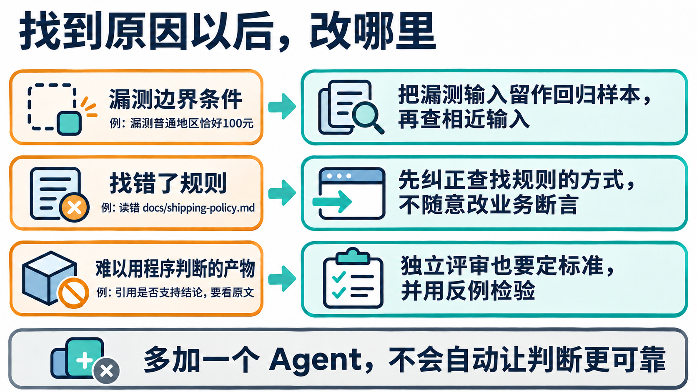

看完这张图，你要能：按边界遗漏、找错规则、程序查不了三种情况选择改进方式。

对照第 1 课“从七个问题看 Harness 的工作”小节，你现在应能把证据连成一条线：定下的条件、当前代码版本、实际运行的检查、检查覆盖的范围，以及最后的结论。

确认是边界遗漏，就把这个输入留作回归样本，再检查相近的输入，避免只对一个例子有效。如果错误来自找错了规则，先改材料入口，而不是随意改业务断言。

难以用程序检查的产物，可以考虑独立评审。但评审也需要标准和校准，多加一个 Agent 不会自动得到可靠的判断。像“刚好门槛是否免邮”这种条件明确的问题，直接写对应规则的检查就能回答。只有发现现有检查覆盖不了的真实缺口，才需要增加评审。

### 结构合规与业务正确要分别检查

**代码结构符合规定，不说明用户需要的功能是对的。**

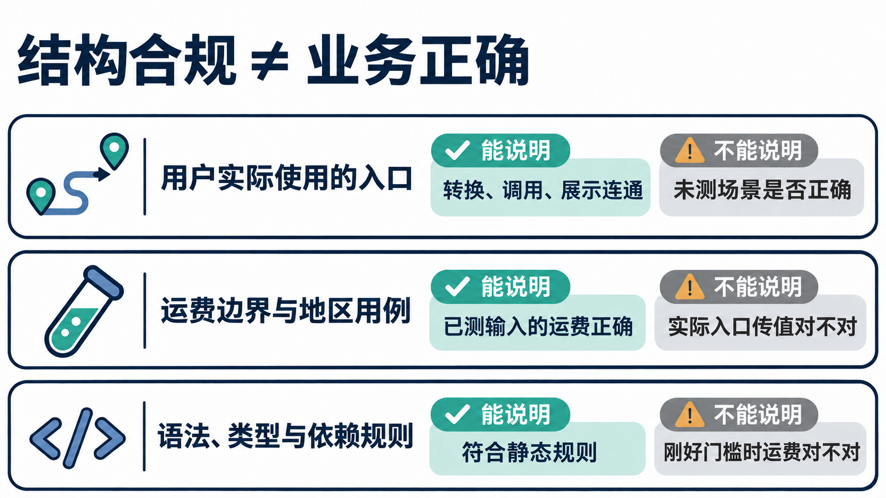

看完这张图，你要能：分清静态规则、运费用例和用户入口三类证据各能说明什么。

以运费任务为例，可以分三类证据：

| 检查对象 | 能说明什么 | 仍不能说明什么 |
| --- | --- | --- |
| 语法、类型与依赖规则 | 代码能解析，符合约定的静态规则 | 刚好门槛时金额对不对 |
| 运费函数的边界与地区用例 | 这些输入得到预期金额 | 实际入口传进来的金额和地区对不对 |
| 用户实际使用的入口 | 数据转换、调用和结果展示是连通的 | 没覆盖到的场景都正确 |

最后一项按交付对象选择：命令行工具看参数和终端输出，代码库看调用方式，网页才需要用户操作。这里要求的是覆盖真实的交付路径。报告里要把“规则检查”“工具执行成功”和“任务验收结果”分开写。

容易误会的地方：

- 测试总数多，不说明任务质量高。
- 换一个模型来认可同一句话，代替不了去看原文。
- 少量案例上的提高，只能说明这批案例。

## 四、沿运费与报表任务形成一份验收记录

**把每项目标条件，对应到你真正取得的观察结果；没覆盖到的部分，也要写进记录。**

### 实践：同时记录进程结果与目标结果

**同一次任务，分三栏记：进程结果、Goal 判定、你的业务核对。**

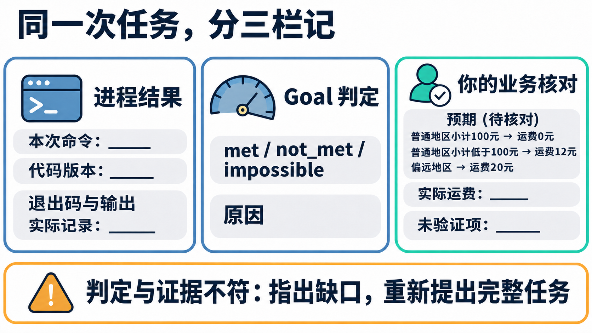

看完这张图，你要能：把进程结果、Goal 判定和你的业务确认分三栏记录。

本课练习使用项目检查、结果审阅和 Goal 轮末评估。通用的评测集、模型评审和自动迭代，可以先按本课方法写样本和判定表。MyBuddy 并不提供完整的评测平台。

使用独立的运费副本，先看规则和测试覆盖了什么，再输入：

```latex
/goal 修复普通地区恰好 100 元仍收费的问题，保留低于门槛与偏远地区规则。运行业务副本的相关检查，报告命令、实际结果及未验证项。
```

接受目标后，审阅实际的修改和模型提出的测试命令。命令有没有执行、结果是什么，要看审批记录和会话记录。

- 模型解释完了却没有修改：记下“本轮结束，但目标没完成”。
- 轮末评估为 `met`：目标会清除。你仍要确认实际检查覆盖了三个金额条件。
- 判定与证据不符：明确指出缺口，重新提出完整任务。

分别做三次判断：有明确失败、检查被拒绝、当前版本所有条件都通过。表格里同时记下：进程结果、Goal 判定及原因、你的业务核对结论。零个测试、输出不完整和外部修改这几种情况，用前面的表格分析为什么不能作为有效证据。

想看实现，可以读源码解析：Bash 结果怎样整理、Goal 怎样评估和显示。显示目标的函数只负责显示，不执行测试。

### 收银台练习：金额正确，界面也要接通

**计算规则和界面接通要分别验收：函数测试通过，不说明操作台已显示新结果。**

完成《综合实践-麦当当收银台》中的“5. 课后任务 A：按支付方式汇总营业情况”小节后，先按给定的三笔业务分别算出现金和扫码，再对一下总额，最后通过中文操作台实际查看结果。保留固定的预期值、当前版本、命令和真实输出。

亲手操作时，按作业约定（`demo-project/exercises/shop-tasks/README.md`）完成三笔业务，再打开营业汇总：

| 操作后的观察点 | 应核对的业务事实 |
| --- | --- |
| 现金订单付款后，在制作前撤单 | 现金实收 31、退款 31、净额 0 |
| 扫码套餐支付失败后重试成功，并完成取餐 | 本笔实收 29、退款 0、净额 29，失败的那次不算收入 |
| 扫码汉堡加可乐开始制作后登记售后 | 本笔实收 25、退款 0、净额 25，登记售后不会自动退款 |
| 打开按支付方式汇总 | 扫码净额 54；总实收 85、退款 31、净额 54；再查一次结果不变 |

这些是待核对的预期值。练习记录里还要填上你实际读到的金额；界面还没接通时，如实写“未完成”。从实际入口操作，能检查输入、业务调用和展示是否连通，也能检查使用说明是否清楚。

失败后重试、制作前退款、制作后售后，各要有对应的用例。补测原来漏掉的条件时，说明为什么需要它，不能改弱原来的要求来通过验收。

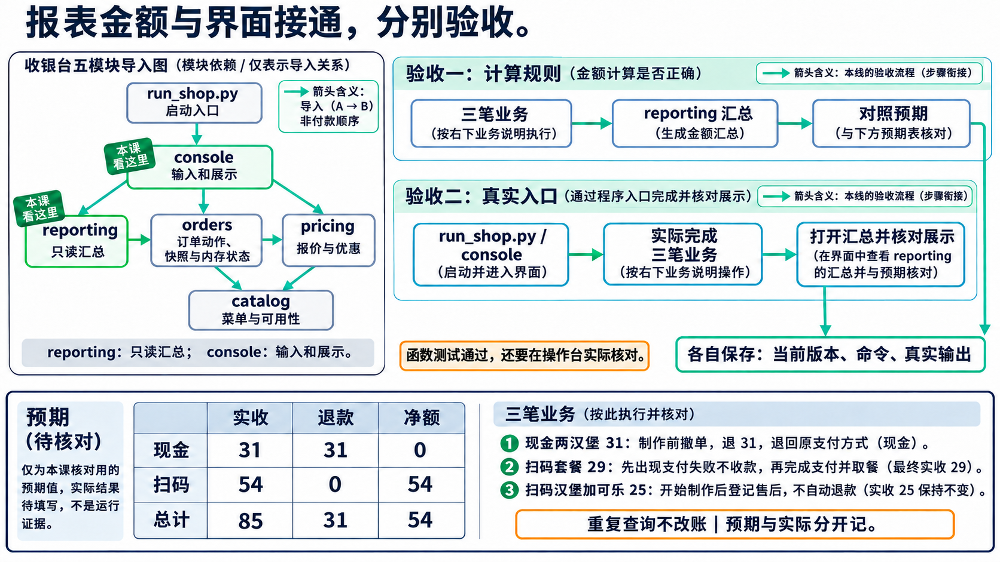

看完这张图，你要能：分别检查三件事：计算规则对不对、入口能不能用、真实用户操作走不走得通。

容易误会的地方：

- 界面上出现了分组标题，不说明金额算对了。
- 函数测试通过，不说明操作台已经显示新结果。

**能力卡**：想在收银台副本里亲手试一遍，就照着能力卡《用 /trace 核对回答的出处》（`demo-project/cards/trace.md`）、《Goal 目标与验收》（`demo-project/cards/goal.md`）做。

## 使用小妙招

### 把真正相关的测试接进修改循环

可以直接说明：“修改后运行约定的测试；失败时先判断原因，再修复并复测，最后报告实际结果。”刚好门槛的用例看缺陷修没修好，低于门槛和偏远地区的用例看原有行为是否保留。

**为什么这样做：** 不写这句，Agent 常常改完就停，最多说一句“应该可以了”。把“运行测试、失败就修、修完再测”写进要求，检查就成了它每次修改后的固定一步，你拿到的是测试结果，而不是它的判断（见“‘修好了’可以指四件不同的事”）。

### 修复之前，先证明检查能够暴露问题

采用 red/green TDD 时，先运行能暴露问题的测试，确认它失败，再修改代码，确认它通过。可以这样要求 Claude Code、Codex 或其他有相应工具的 Harness：

先确认“普通地区恰好 100 元仍收费”能够复现。已有用例能覆盖时直接运行；没有时补一个依据业务规则的最小用例。确认失败原因后再修改实现，重跑同一用例及受影响的相邻规则，保留两次结果。

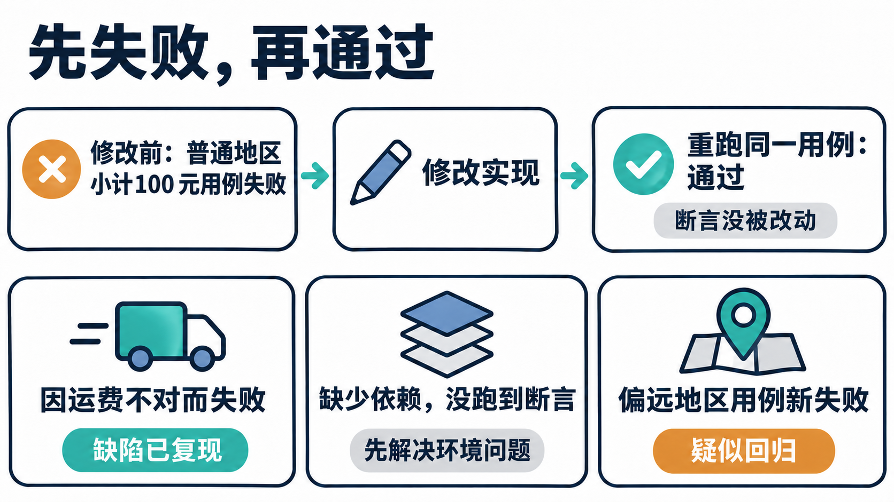

看完这张图，你要能：用先失败再通过的顺序证明检查能暴露问题，并分清三种失败。

**为什么这样做：** 先失败的意义，是证明这项检查能区分“现在的错误行为”和“要求的行为”。如果第一次失败只是缺依赖或导入路径不对，要先解决环境问题，直到用例真正跑到业务断言。修好后，再确认原来的断言没有被改动，防止代码和测试一起偏离要求。

把修改前后的结果放在一起，还能分清三种失败：

| 观察到的情况 | 现在能作出的判断 |
| --- | --- |
| 修改前，刚好 100 元的用例因运费不对而失败 | 目标缺陷已经复现 |
| 修改前，测试因缺少依赖而没跑到断言 | 先解决检查环境，还不能判断业务结果 |
| 修改后，原来通过的偏远地区用例失败了 | 出现了新的失败，疑似回归，还要查明原因 |

还要看一眼测试到底断言了什么（示意，不是项目中的函数）：

```latex
结果 = 计算运费(普通地区, 商品小计100元)
只检查：结果不是空值
业务检查：结果等于0元
```

第一项即使返回 12 元也会通过，第二项才检查了免邮规则。

### 实际走一次用户路径，并保存观察结果

函数检查完后，再从用户使用的入口操作一次，记下命令和实际结果（收银台练习见第四节）。Agent 操作、人工操作和自动用例的结果分别注明来源。正常操作之外的情况也要先约定，比如扩展收银台界面时：

| 场景 | 需要先约定、再实际核对的行为 |
| --- | --- |
| 购物车为空 | 能不能提交，怎样提示 |
| 保存还没结束 | 怎样显示等待，再点一次会怎样 |
| 保存失败 | 怎样提示，是否留下记录，怎样继续 |

这些是界面扩展时要考虑的问题，不表示现有作业已经全部实现。截图能确认显示了什么；有没有写错记录、有没有重复保存，还要看实际操作结果和数据。

**为什么这样做：** 函数测试通过，只说明这一个函数算得对；用户点按钮时，中间还要经过界面、接口和保存，任何一处没接上，用户还是用不了（见“收银台练习：金额正确，界面也要接通”）。

### 把审查范围和检查重点一起交给评审者

如果另外安装了 Codex，可以用它的 `/review` 选择检查范围（基准分支、未提交修改或某次提交）。MyBuddy 没有专门的 `/review` 命令，可以在任务里写明比较范围、规则和“只审查”的要求。选好范围后，还要说明重点查什么。例如：

审查本次支付方式报表的改动。依据任务说明，检查退款归属、重复查询是否改账、原有总报表接口是否保留，以及中文操作台是否接通。每项发现给出文件位置、触发条件和依据；把待核实的猜测单列。本次只审查，不修改文件。

收到报告后逐项核实，不要把“没发现问题”扩大成“整个项目已验收”。

改动也要便于审查：修运费边界时别同时搬目录、改命名。“小”指的是目的单一，不是只能改几行。

**为什么这样做：** 只说“帮我看看”，评审者不知道标准是什么，往往挑一些代码风格的问题，真正的业务风险反而没查。给出范围和重点，它才会按你的规则逐项检查。改动目的单一，评审者才能看清每一处改动为了什么。

### 要求报告“命令、版本、结果、剩余范围”

可以这样要求：

列出修改后的相关文件、实际运行的检查和结果。说明普通地区门槛与偏远地区分别由哪项测试覆盖；未验证的输入单独列出。

转交报告前，先对一遍：报告说改了的文件 diff 里都有吗？diff 改了的报告都提到了吗？也看看测试有没有被改弱。

**为什么这样做：** Agent 的总结可能漏说改动，也可能把“打算运行”写成“已通过”（见“退出码 0 为什么还不够”）。要求它把命令、结果和没覆盖的范围分开列出来，你才能逐项去对 diff 和测试输出，而不是只能相信一句“已修复”。

### 回答里的事实，要能在记录里找到出处

第 3 课 K3 练习的一次实际运行里，MyBuddy 没读运营通知就说它不存在。检查方法：把回答里关于文件、命令和结果的说法挑出来，查看对应的读取或执行记录（`/trace` 只是限长摘要，没显示不等于没发生）。找不到依据的，直接追问：“你读过这个文件吗？请先读取再回答。”

**为什么这样做：** 模型没读到某样东西时，也可能写出一个听起来很确定的说法。能证明它真的看过、真的跑过的，只有工具调用记录。

### 把最终结论和推理过程分开读

回答里可能夹着推理过程，比如先写“期望应该是 82 元”，最后才问“应以哪个规则为准”。以最后明确写出的结论和留给你决定的问题为准，中间的推理只当线索。

**为什么这样做：** 模型是边想边写的，前面的推理可能在后面被它自己推翻。把中间某句话当成结论，就可能按一个它已经放弃的想法去做。

### 给 Agent 一份能区分原因的失败反馈

一次测试结束后，如果只告诉 Agent “失败了”，它还是不知道该查哪里。有用的反馈要保留：输入条件、预期和实际的差别、对应的文件版本，以及能找到的原始结果。下面是自编的运费样本，不是实际运行输出：

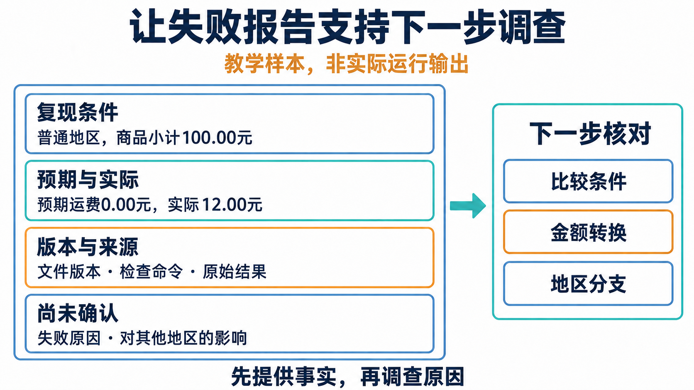

看完这张图，你要能：组织足以定位原因的版本、命令、预期、实际和未覆盖项。

| 观察 | 样本内容 | 可以支持什么判断 |
| --- | --- | --- |
| 条件 | 普通地区，小计 100.00 | 明确要复现的输入 |
| 预期与实际 | 规则要求 0.00，实际得到 12.00 | 当前行为不符合要求 |
| 版本与位置 | 被测文件的版本、测试用例及结果位置 | 确认检查的是哪份代码 |
| 尚不能确认 | 失败原因、其他地区是否受影响 | 下一步要查的地方 |

**为什么这样做：** 拿到这样的反馈，Agent 可以去检查比较条件、金额转换或地区分支。反馈要提供能区分原因的事实，而不是直接让它改某一行、跳过调查。

你可以把同一次失败写成“只有失败结论”和“上面四类信息”两份材料，分别列出接手的人还要补查什么。比较的是能不能据此选出有效的下一步，不是谁写得更长。

### 先检验评审者能否发现错误，再信任评分

可以用下面这个练习理解评审标准的“校准”，不必先搭多 Agent 平台：

1. 准备两份运费改动：一份保留了地区例外；另一份让偏远地区达到门槛也免邮。
2. 给评审者同样的规则、改动和检查材料，先不告诉它作者说“已经修好”。
3. 要求它逐条指出满足的条件、违反的条件、对应证据，以及材料不够的地方。
4. 人工检查它有没有抓住已知的缺陷；改进评审说明后，再用其他样本复查。

**为什么这样做：** 这里测的是评审能不能区分好坏。两份都得了高分，就要检查标准和它看到的材料。也不能一直增加评审次数，直到偶然得到一个“通过”。

## 自测：这一课的概念分清了吗

**先自己作答，再看后面的答案。** 每题都能在本课正文里找到依据；带“动手验证”的题，可以照着做一遍，亲眼看到结果。

**1.** 你检查当前版本的运费修复，命令退出码为 0，完整输出显示用例都通过了，但只覆盖普通地区。现在能得出什么结论？

- A. 运费问题已经全部修好，偏远地区也不用再查。
- B. 已覆盖的普通地区用例通过了，偏远地区是否仍按规则收费还要检查。
- C. 只要再做一次代码评审，就能把偏远地区也记为测试通过。

**2.** 你跑完测试，全部通过，随后又修改了运费函数，却没有重新检查。该怎样使用刚才的结果？

- A. 测试文件没变，刚才的通过仍能证明新代码正确。
- B. 旧结果已经没有任何保留价值。
- C. 保留旧结果，但它不能直接证明修改后的版本通过。

**3.** 同一项任务重复运行 k 次，其中有一次成功，也有失败。按本课介绍的统计方法，这组 k 次运行的结果该怎样记？

- A. pass@k 算通过，pass^k 不算通过。
- B. 两种都算通过，因为已经证明至少能成功一次。
- C. 两种都不算通过，因为出现过失败。

**4.** 判断：查看 Goal 目标时，MyBuddy 会顺便运行项目测试，再显示目标。（对 / 错）

### 答案与依据

**1. 选 B。** 通过只支持已经检查的条件。A 把普通地区的结果扩大到了没有覆盖的偏远地区；评审也不能把未执行的测试变成已通过。  
依据：本课“退出码 0 为什么还不够”和“结构合规与业务正确要分别检查”。

**2. 选 C。** 检查结果要对应被检查的代码版本。A 忽略了业务代码已经改变；旧结果可以留档，但新版本需要重新检查。  
依据：本课“条件和证据为什么需要版本”。

**3. 选 A。** pass@k 看多次尝试里是否至少成功一次，pass^k 要求每次都成功。B 把“能做到一次”当成了“能稳定做到”。  
依据：本课“从单项测试走向任务评测”。

**4. 错。** 显示目标只负责显示，不执行测试。查看目标和取得检查证据是两件事。  
依据：本课“实践：同时记录进程结果与目标结果”。  
动手验证：按能力卡《Goal 目标与验收》（`demo-project/cards/goal.md`）的“准备”部分，运行 `uv run python demo-project/prepare_shop_demo.py --case K8`，再用副本里的 `start-mybuddy.command` 启动新会话。这次不发送卡中的修复任务，直接输入 `/goal`，在终端看到“未设置目标”，没有执行项目测试。这一步不调用模型。

## Q&A：常见追问

### Q1：测试全绿了，为什么还不能直接说修好了？

测试结果有自己的适用范围：跑了哪些用例、针对哪份代码、覆盖了什么条件，都会影响“全绿”能说明什么。测试文件没被测试工具找到、跑的是旧副本、漏掉了地区例外，都可能造成误导。把命令、版本、实际检查范围和没覆盖的部分写在结果旁边，每项结论就能对应到支持它的检查。

### Q2：Agent 自己写代码、自己写测试，会不会一起写错？

有可能。测试要依据独立的需求和业务规则，而不是照抄代码的假设；加入门槛前后和地区例外这类能区分对错的样本。关键结论还可以请人独立复查，但复查者也需要准确的需求和当前的改动。

### Q3：Trace 已记录工具成功，为什么还要单独保存验证结果？

工具成功只说明这次调用按工具的约定完成了，不代表业务条件满足。一次修改成功和当前版本测试通过，各自需要证据。Trace 用来串起过程，验证结果要对应验收条件和版本，两者结合才能解释任务为什么被判为完成。

### Q4：换一个会话评审，就算独立验证了吗？

它能减少对原会话结论的依赖，但可能仍然有同一个模型的偏差、同样错误的需求或同样不完整的材料。先让评审者对照原始要求和当前产物，用已知的反例检验它的判断，再决定能信任到什么程度。独立上下文是一种组织方法，可靠性还要靠验证证据支持。

### Q5：测试先失败再通过，是否已经足以证明修复正确？

它能证明这个用例能区分修改前后的行为，前提是：失败来自目标问题，预期依据业务规则，修复时没有改弱断言。还要检查相邻的输入和受影响的调用方，并从实际入口确认功能连通。一个用例变绿，只支持它覆盖的那部分结论。

### Q6：评审没有发现问题，可以省略运行检查吗？

不能。评审可能没覆盖某个分支，也可能误解同一份规则。静态审查帮你发现风险，运行检查提供具体输入下的行为证据。两者的范围和结果分开记录；材料不足或检查没执行，就把这些缺口写出来。

## 本课术语速查

| 本课说法 | 源码或命令中的名字 | 含义 |
| --- | --- | --- |
| 验收条件 | — | 事先定下的、能检查的完成标准 |
| 证据 | — | 检查留下的、能对应到版本和条件的结果 |
| 目标评估 | `met` / `not_met` / `impossible` | low 档模型根据有界对话尾部给出的轮末判定 |
| 评估原因 | `reason` | 模型给出的判定简短依据；下一轮的目标提示也会带上它 |
| 回归 | — | 原来正常的行为因为这次改动变坏了 |
| 回归样本 | — | 把遇到过的失败留作以后反复检查的用例 |
| 任务评测 | — | 用一组代表任务比较不同版本的表现 |
| 校准 | — | 用已知好坏的样本检验评审者能否分辨 |
| red/green TDD | — | 先让测试失败（红），再改代码让它通过（绿） |
| 停稳 | — | 确认命令已经停下、结束状态已记录（第 12 课） |

## 继续阅读源码解析

源码解析沿“Bash 结果 → 轮末评估 → 保存判定 → 显示目标”读真实代码。
