用一份 Markdown 选择说明、工具和默认权限，沿共同的会话流程完成任务。

## 本课导览

假设你刚让 Agent 修完一个运费函数，接下来要研究一个领域，写一份研究报告。循环还是“读输入、调模型、执行工具、继续回答”，但你希望模型更关注出处，只给它读资料和写报告的工具，不给它运行命令的工具。为此重写 Agent Loop 没有必要。

MyBuddy 把这样一组启动设置叫作 **Buddy 预设**。本课从“只换一段说明”的最简版开始，沿下面总纲图的顺序一次补一个约束。运行循环始终是同一套，变的只是装配进去的说明、工具和权限。

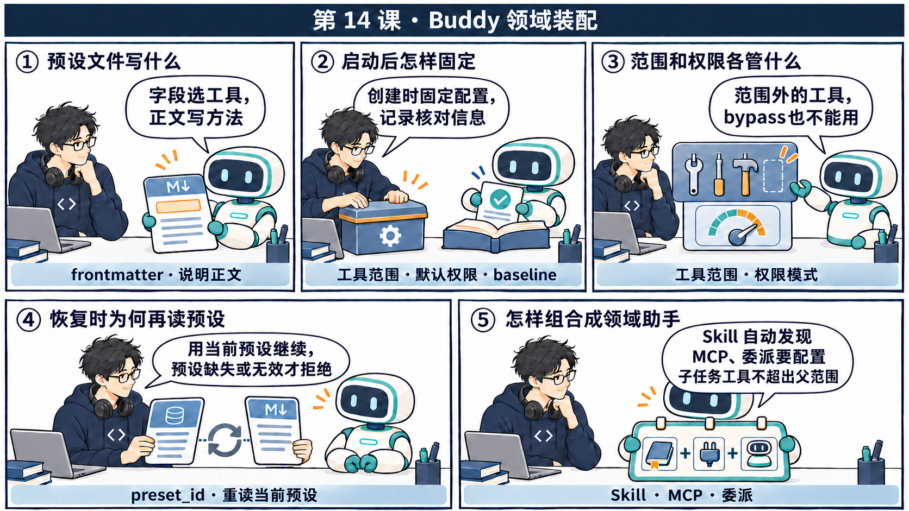

## 一、一份预设文件写什么？

**一份预设由两部分组成：开头的字段选工具和权限，后面的正文写做事方法。**

### 先看最简版：只换一段说明

**最简单的“换助手”，就是换一段系统说明。**

下面是 Python 风格的**教学伪代码**，不能直接运行：

```python
PRESETS = {
    "buddy.research": "你是研究助手。先读原文，再比较，每条结论注明出处。",
    "buddy.developer": "你是开发助手。先读代码，再修改，最后跑测试。",
}

def start_session(buddy_id):
    return Session(system_prompt=PRESETS[buddy_id], tools=ALL_TOOLS)
```

它能让模型换一种做事方式。但真用起来，马上会遇到下面这些问题。本课每一节解决其中一个：

1. **只换说明，工具没变。** 研究助手照样拿得到 Bash。→ 预设要自己点名工具（本节）。
2. **点名的工具，宿主（运行这个会话的 MyBuddy 程序）可能没打开。** → 启动时检查，缺了就不建会话（第二节、第八节）。
3. **会话进行中，有人改了预设文件。** → 创建会话时固定配置（第三节）。
4. **正文写“不要运行命令”，挡不住真的调用。** → 工具范围和权限在执行时检查（第五节）。
5. **隔天恢复会话时，文件已经变了。** → 按原身份重读当前预设，用新内容继续；读不出来才拒绝（第六节）。
6. **研究任务要交给子 Agent。** → 子会话的工具只取父会话的交集（第七节）。

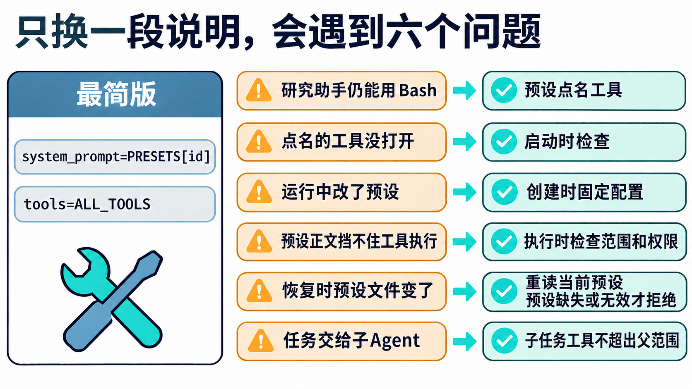

看完这张图，你要能：对照“只换一段说明”的最简版，说出六个问题各由哪一节解决。

### 预设文件的写法

**两条** `---` **之间是字段，后面直接写正文。**

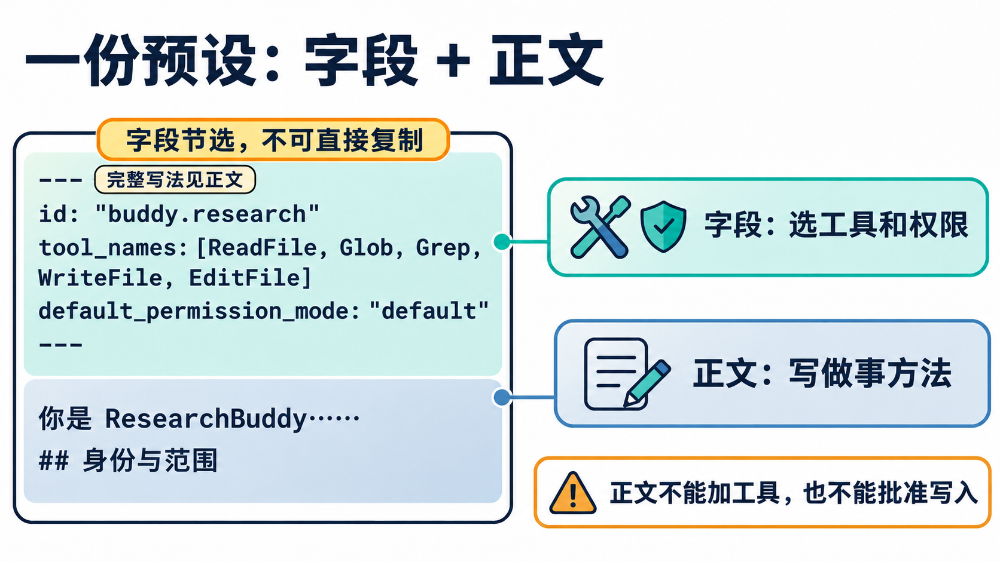

看完这张图，你要能：分清 frontmatter 字段与说明正文各决定什么，记住正文不能加工具、不能批准写入。

先打开 `examples/buddies/buddies.md`。这一份文件里依次写着三份预设：DeveloperBuddy、ResearchBuddy 和 ResearchBuddy（联网版）。每份预设开头是 YAML frontmatter：两条分隔线之间放结构化字段，后面直接写说明正文。下面节选 ResearchBuddy 的开头：

```markdown
---
version: 1
id: "buddy.research"
display_name: "ResearchBuddy"
tool_names: ["ReadFile", "Glob", "Grep", "WriteFile", "EditFile"]
default_permission_mode: "default"
---
你是 ResearchBuddy，帮助用户研究一个领域：阅读当前工作区里的资料，比较信息，把研究报告写成文件。

## 身份与范围
...
```

| 内容 | 你在这里决定什么 |
| --- | --- |
| `version` | 预设格式版本，当前是整数 `1` |
| `id` | 选择时使用的稳定名称，例如 `buddy.research` |
| `display_name` | 显示名称：界面上显示的名字 |
| `tool_names` | 工具名单：从宿主实际提供的工具中选择名称 |
| `default_permission_mode` | 默认权限模式：全局没有显式选择权限模式时采用的值 |
| frontmatter 后的正文 | 模型应遵循的任务方法、表达方式和证据要求 |

这份预设的工具名单选了五个工具：前三个读本地资料，后两个写报告，没有选运行命令的 Bash。正文可以要求“先读原文、区分事实与推断”“报告只写在 reports/ 下”。但正文不能凭文字安装新工具，也不能放宽工作区限制或批准写入。

正文用几个短小节写清：身份与范围、工作步骤、引用规则、冲突与未知、报告结构和边界。工作步骤是一条研究流程：定题和范围（问题不清先问）→ 拆子问题 → 找资料、读原文 → 每个子问题记一份笔记到 `reports/notes/` → 有关键缺口就补查一轮 → 只根据笔记写报告，先说明路径，再写到 `reports/<主题>.md` → 在对话里给简短结论和文件路径。

第三份 `buddy.research-web` 是联网版。它在本地版的基础上多点名 `web_search`（搜索网页摘要）和 `web_fetch`（读网页全文）。两份正文结构相同、措辞相同，联网版只多出几句：

- 网上先搜索，再读原文；
- 网页引用写成链接，文字是网页标题；
- 标明“读过全文”还是“只看了搜索摘要”。


看完这张图，你要能：分清宿主提供的工具和预设选择的工具：预设只从宿主已有的工具中点名，不能自己带来新工具。

### 多份预设怎样分开

**单独一行** `---` **是分隔线；任何一份写错，整份文件都被拒绝。**

规则只有一条。第 1、3、5…… 条分隔线开始一份新预设。下一条分隔线结束它的 frontmatter。再往后，直到下一份预设之前，都是它的正文。

所以，正文里不能再写只有 `---` 的行，否则分隔线会错位。

文件里任何一份预设写错，或者两份预设的 `id` 相同，整份文件都会被拒绝。这样你只需修好报错的地方，不必猜哪些预设已经生效。

设计自己的预设时，可以先写一个具体交付物，例如：“研究几家的退款规则，报告写到 reports/，逐项附出处，缺失生效日期时写明未知”。再选读资料和写报告的工具，把研究方法写进正文。任务不需要运行命令或修改业务系统，就不必加 Bash 或外部操作工具。

容易误会的地方：

- 预设和 Skill 用同一套 frontmatter 解析，但用途不同。预设选定会话的基础设置；Skill 提供可复用的方法（第 16 课）。
- 预设写好了，不代表能完成任务。还要用代表性的材料实际跑一次。

## 二、启动时怎样展开预设？

**启动时读出预设，检查工具，再把说明、工具范围和默认权限交给通用会话。**

在你维护的可信启动配置文件里，设置预设文件和默认项。路径可以写相对路径，从配置文件所在的目录算起（下面按默认的 `config/config.toml` 来写），也可以写绝对路径；已有同名配置节时，在原位置修改：

```toml
[buddy]
catalog = "../examples/buddies/buddies.md"
default = "buddy.research"
```

从仓库根目录启动：

```shell
uv run python -m mybuddy --config /absolute/path/to/config.toml --workspace /absolute/path/to/workspace --buddy buddy.research
```

`--buddy` 会覆盖配置里的默认选择。Web 的新建会话页面也能选择预设。这个选择只对新会话有效。恢复旧会话时，不能用它换掉旧会话的助手。

没有配置 Buddy 时，主会话仍然可以创建，也保留共享 Memory 能力。

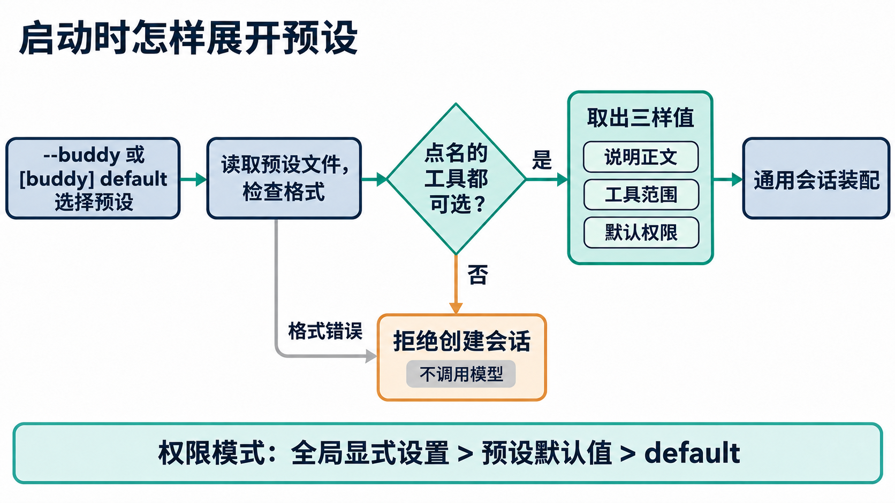

看完这张图，你要能：说出启动入口的三步：什么情况下拒绝创建会话，通过后交给通用会话的又是哪三样东西。

启动入口做三件事：

1. 读取预设文件，检查格式。
2. 核对所选工具是否都在可选范围内。不在范围内就拒绝。
3. 取出三样值：**说明正文、工具范围、默认权限**，交给通用会话装配。

有效权限先看全局配置有没有显式选择；没有，就用所选预设必填的默认值；没有选择预设时，才使用普通默认模式（`default`）。运行循环不需要知道“Buddy”是什么，它只拿到这三样值。

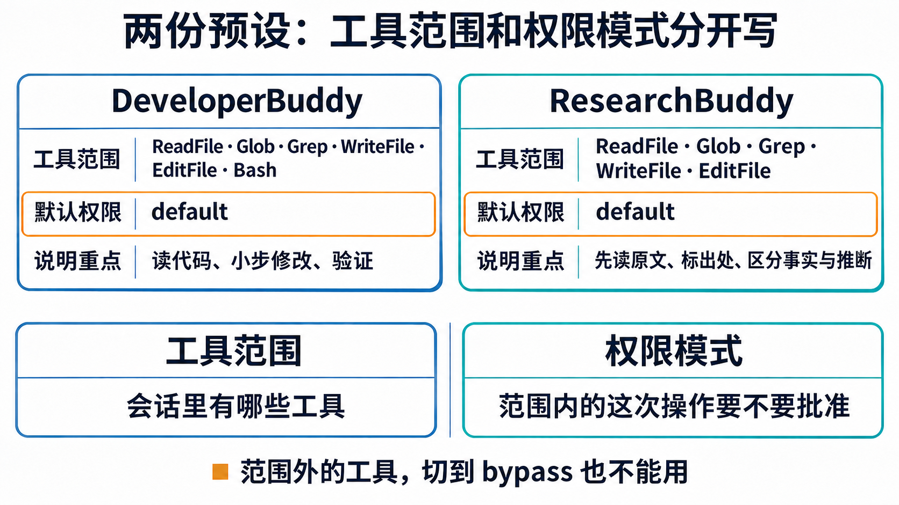

看完这张图，你要能：比较两份预设的说明重点、工具范围和默认权限，分清工具范围和权限模式各管什么。

容易误会的地方：

- MCP（接入外部工具的协议，第 17 课）工具名可以来自启动配置，这时服务可能还没连上。能选上，只说明名字合法；连接和调用仍要另外检查。
- 缺少某一份业务 Skill，预设照样可选。工具名不在可选范围内，才会被拒绝。
- 工具名写进预设，不等于这个工具的调用已被批准。

## 三、为什么要冻结配置并保存 baseline？

**会话在创建时固定这次实际用的配置，并在第一条记录里存一份核对清单。**

假设会话已经开始，你又改了预设文件。正在运行的会话应该突然换一段说明吗？不应该。MyBuddy 在创建会话时，就固定这次实际采用的配置。会话把说明正文和配置留在内存里，后面的普通请求都用这份。关闭再恢复时重新读取当前预设，并把这次采用的配置记入新的能力记录；原来的创建记录保留。

同时，会话的第一条基线记录（baseline）里，保存一份配置核对清单。清单记下四类信息：

- 选了哪份预设（身份和显示名称）；
- 说明正文的摘要；
- 固定下来的工具范围；
- 整份配置的摘要。

**摘要**是根据内容算出的固定长度值，用来比较内容是否一致。正文里改了一个字，摘要也会变。字段的具体名字见源码解析。

整份配置的摘要，覆盖所选预设的全部内容，包括预设里的默认权限。全局默认权限和会话初始权限不算在里面，它们另由权限记录保存。

修改预设的默认权限，会改变整份配置的哈希值；修改全局默认权限，不会改变这个哈希值。恢复旧会话时，这两种修改都不会覆盖该会话已保存的权限模式。

容易误会的地方：

- baseline 只存摘要，不存正文。摘要不能还原出原文。
- 旧的模型请求里出现过说明正文，但恢复时不会拿它代替当前的预设文件。恢复要求当前预设仍能读取；内容变了就用当前内容继续。

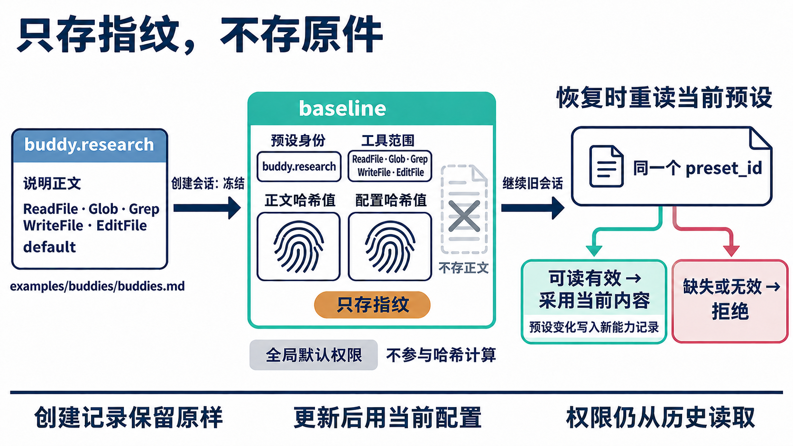

看完这张图，你要能：用“指纹”记住 baseline 只存摘要、不存正文：恢复时重读当前预设，摘要变了就提示你；全局默认权限不在摘要里。

## 四、说明怎样进入模型请求？

**每次请求时，预设正文作为一块普通的系统说明放进去。**

有了固定的说明，每次构造请求时，就把它放进一块通用的会话说明。它在项目说明之后，在规划与 Skill 等说明之前。正文为空时，不生成这一块。

放进去之前，程序会再算一次正文摘要，和这次运行采用的配置记录比对。对不上就不发请求。

项目说明、预设说明与 Skill 各有用途。例如：

- 项目说明写“金额使用 Decimal”；
- 预设说明写“先确认材料版本再比较”；
- Skill 写一套可复用的核查步骤。

它们都影响模型看到什么。真正能执行什么，仍由工具范围和权限模式决定。

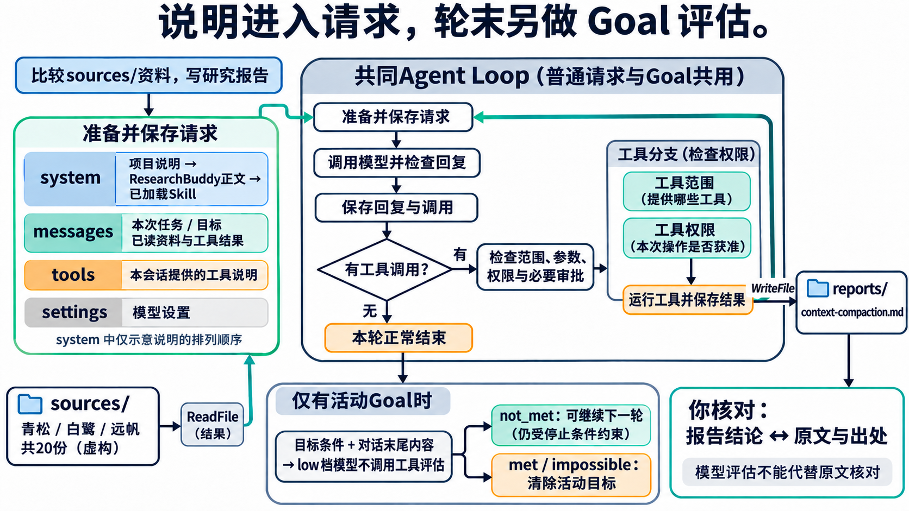

看完这张图，你要能：区分预设说明、Skill 方法与本次任务；普通请求和 Goal 共用执行循环，Goal 在正常轮末另做无工具评估，业务结果由实际证据支持。

## 五、工具范围和权限分别管什么？

**工具范围回答“这个会话有哪些工具”，权限模式回答“范围内的这次操作要不要你批准”。**

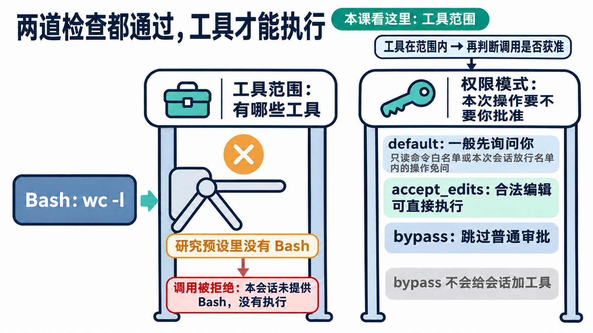

看完这张图，你要能：分清工具范围与权限模式两道检查，知道切到 bypass 也用不了范围外的工具。

研究预设里没有 Bash。切到 `bypass` 模式，就能运行命令吗？不能。两道检查要分别通过。

工具范围检查两次：

1. 构造请求时，只把范围内的工具发给模型。
2. 执行时，再核对一次调用的工具名。

宿主注册的工具、主会话范围、子会话范围和规划模式，一层层取交集：每多一层，只留下各层都允许的工具。范围“不限”和范围“为空”是两回事：不限，就是不额外收窄；为空，就是不给任何业务工具。

长结果读取、共享 Memory 和工具搜索（`search_tools`）各有自己的准入条件，由 MyBuddy 按条件另外加上。所以请求里的工具目录，可能比预设列表多几项。

范围内的工具，再看权限模式：

| 模式 | 普通文本编辑 | Bash |
| --- | --- | --- |
| `default` | 询问 | 询问（只读命令直接执行） |
| `accept_edits` | 合法编辑可直接执行 | 询问（只读命令直接执行） |
| `bypass` | 跳过普通审批 | 跳过普通审批 |

三档之外，还有几条固定约束：

- 参数和工作区检查照常进行；
- 询问时选“本次会话都允许”，同一工作区内，Bash 的完整命令和工作目录都相同，或同一种编辑工具操作同一个文件路径，后续普通审批才不再询问；换了任一项仍按当前权限判断；
- 规划模式只开放读取，以及对方案文件的写入；
- 恢复受管文件的编辑，一定要你批准；
- 需要你批准，却没有能向你提问的界面（比如无人值守运行）时，操作被拒绝。

预设只提供默认权限。启动配置里的 `[permissions] default_mode` 写了值时，以它为准。

容易误会的地方：

- 工具 Hook 在策略与审批判断之后运行：PreToolUse 可以再拒绝调用，PostToolUse 在成功后反馈；Hook 不另行审批。会话、轮次和压缩事件见第 18 课。
- bypass 模式只跳过范围内工具的普通审批，不会给会话加工具。

### “只写 reports/”靠批准把关

**工具范围按工具名限制，不按目录限制；报告写在哪里，靠正文说明和你的批准。**

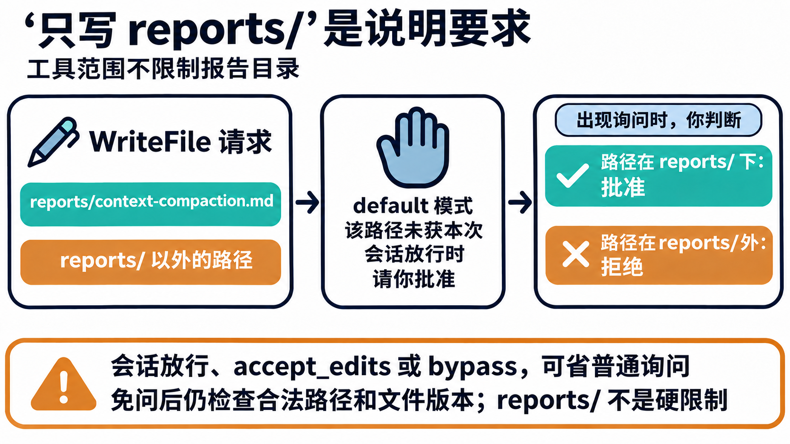

看完这张图，你要能：知道“只写 reports/”不是程序强制，靠 default 模式下你的逐次批准。

ResearchBuddy 有两个写文件的工具。它们能写工作区里的任何合法路径。MyBuddy 没有“只许写某个目录”的权限规则。所以“只在 `reports/` 下新建或修改报告”是正文里的要求，不是程序强制。

真正把关的是默认模式下的批准。写一个新路径时，终端都会停下来问你（选“本次会话都允许”也只放行同一个路径）。你看清路径在 reports/ 下，再批准；路径不对，就拒绝。切到 `accept_edits` 或 bypass，工作区里的合法写入不再问你，这道关就没有了。所以做研究练习时，保持默认模式。

### 来源依据要从实际读取中取得

**宿主不核验来源，也不自动补读；引用对不对，要你对照原文核对。**

研究任务需要模型主动读取资料。报告里要标明文件位置、不同意见和未核实项。宿主不会替模型判断结论对不对。

读过材料、引用能定位、结论正确，是三件不同的事。预设正文只能要求模型这样做，核对仍靠你。

几份资料说法互相矛盾时，不要按查找结果的先后取舍。Grep 返回的顺序只是查找顺序，不代表哪份更可信。要逐份看：出处是谁，什么时候写的，说的是不是同一个范围，是原始数据还是转述。判断不了，就把分歧和各自依据都列出来，标为未核实。

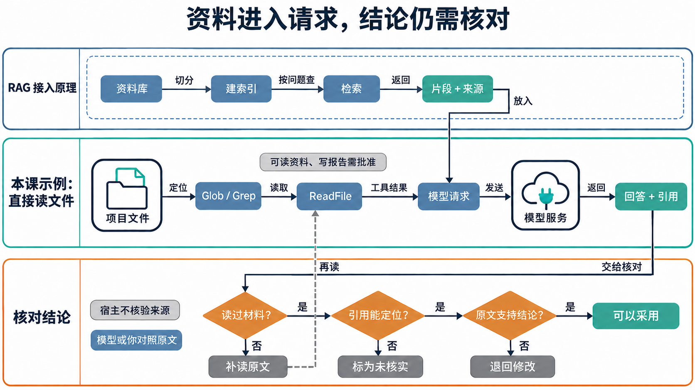

看完这张图，你要能：区分取得资料和核对结论。图中的 RAG 是接入原理，本课本地示例直接读文件；引用核对由模型或你依据原文完成。

## 六、恢复时为什么要再读预设？

**恢复时按旧会话记下的预设身份重读当前内容。改正文或工具范围可以继续，预设删除或无法读取才会停止。**

`default` 和 `--buddy` 用来选择新会话的助手，恢复时仍取历史里的 `preset_id`。这可以避免你改了默认项，旧会话也跟着换助手。

| 你的修改 | 恢复后的行为 |
| --- | --- |
| 改所选预设正文、显示名称或工具范围 | 用当前预设继续，并提示配置已更新；工具仍须实际可用 |
| 从文件里删掉所选预设，或使它无法解析 | 拒绝恢复，无法确定应采用哪份预设 |
| 改所选预设的默认权限 | 采用当前预设内容，但权限模式仍从会话历史读取 |
| 只改全局默认权限 | 旧会话仍按自己的权限历史恢复 |
| 改 `default` 默认项，原预设仍在 | 仍按旧会话保存的身份读取 |
| 只改同一文件里的另一份预设 | 不影响当前会话所选的内容 |

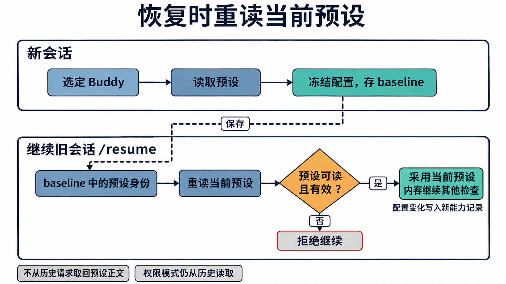

看完这张图，你要能：区分预设身份、当前预设内容与会话权限历史。

配置允许更新，不代表所有会话都能继续。工作区不同、结果未知、审批未处理、子任务未结束，以及必须的历史结构缺失，仍按第 11 课的检查拒绝。

## 七、子会话继承什么？

**子会话继承父会话的说明，但工具只取父范围和子范围的交集。**

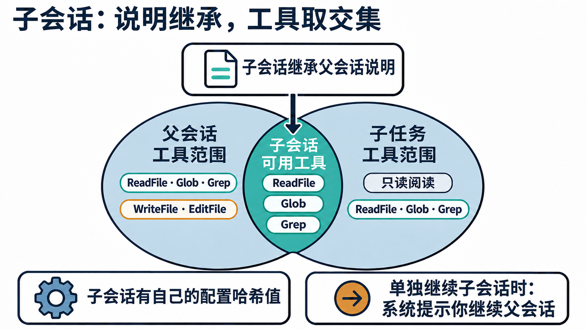

看完这张图，你要能：知道子会话继承说明、工具取父范围与子任务范围的交集，并有自己的配置摘要。

如果研究任务要交给一个子 Agent 阅读材料，父会话会把自己固定的说明和配置交给子会话。子会话的工具范围，取父范围和子任务范围的交集。继承同一份说明，不会让它多出工具。

子会话有自己的配置摘要。这个摘要还关联父会话的配置和子会话的权限。你想单独续接一个子任务会话时，系统会提示你继续父会话。

没选 Buddy 的父会话，也能按同样的方式创建子会话。第 19 课再展开委派、fork 与后台任务。

容易误会的地方：

- 继承说明不等于继承全部权限，也不等于复制父会话的执行记录。

## 八、把预设和扩展组合成领域助手

**Skill 放进约定目录就能用；MCP 和委派的工具要预设点名、启动配置打开，两边都满足才能用。**

到这里，一个领域助手可以写成一个简单的式子：

**领域助手 ＝ 说明正文 ＋ 可用工具 ＋ 默认权限**，再按需要组合 Skill、MCP 和委派。

前三项写在预设里。后三项的机制分别在第 16、17、19 课讲。Skill 放到约定目录就会被发现，加载工具自动加入主会话；MCP 和委派工具仍要在预设中点名，并在启动配置里打开。

先看要改变什么，再选最小的扩展组合：

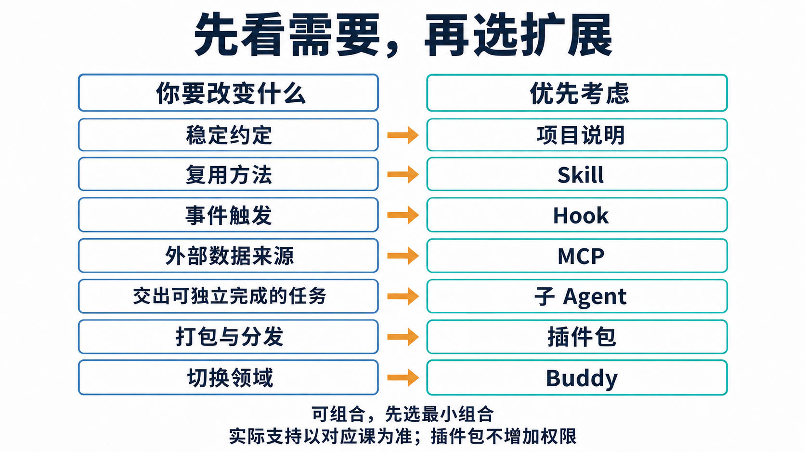

看完这张图，你要能：根据需求是稳定约定、可复用的方法、事件触发还是外部能力，选出最小的那种机制。

| 要改变什么 | 优先考虑 |
| --- | --- |
| 稳定约定 | 项目说明 |
| 复用方法 | Skill |
| 事件触发 | Hook |
| 外部数据来源 | MCP |
| 独立交接的任务 | 子 Agent |
| 打包与分发 | 插件包（不增加权限） |
| 切换领域 | Buddy |

Skill 不需要修改预设。要组合 MCP 或委派，分三步：复制一份预设文件；在末尾追加新预设，在工具名单里加上工具；再按下表打开启动配置的对应段：

| 加进 `tool_names` 的工具 | 来自哪一课 | 启动配置还需要打开什么 |
| --- | --- | --- |
| `mcp__research_methods__lookup_research_method` | 第 17 课 MCP | MCP 配置里 `id = "research_methods"` 的服务 |
| `delegate_tasks` | 第 19 课委派 | `[subagents] enabled = true` |

联网版点名的两个工具，也要在启动配置里打开：

| 联网版点名的工具 | 启动配置还需要打开什么 |
| --- | --- |
| `web_search` | `[tools.web_search]`，设 `enabled = true`，`api_key` 填智谱的搜索密钥 |
| `web_fetch` | `[tools.web_fetch]`，设 `enabled = true` |

看完这张图，你要能：看清领域助手怎样装配：预设点名工具、启动配置打开扩展，两边都满足才能创建会话；创建时固定 baseline 和初始权限，委派出的子会话只取父范围的交集。

### 加 Skill：复制目录，不用改预设

**项目里放好方法文件，新建会话就能发现，研究预设也直接能用。**

把 `examples/skills/source-review/` 复制到研究工作区的 `.mybuddy/skills/source-review/`。然后照常选择 `buddy.research`，不用添加另一份预设，也不用在 `tool_names` 里写 `load_skill`、`read_skill_resource`。

MyBuddy 依次发现项目目录、用户 `~/.mybuddy/skills/`、程序内置目录，同名时前面的优先。主会话发现可用 Skill 后自动带上两个只读工具，规划模式也能用。通常不写 Skill 配置；只想停用某个名字时，才用 `[skills] disabled = ["名字"]`。

`source-review` 提供核对来源的步骤清单。加载一次，本会话的下一轮、压缩后和恢复后都保留同一份正文。它只是方法资料，结论仍要来自实际读到的原文。

### 加 MCP：再点名一个外部工具

**MCP 工具的完整名字是** `mcp__服务ID__工具名`**，照样写进工具名单。**

在副本的工具名单末尾，再加 MCP 工具的完整名字：

```latex
tool_names: ["ReadFile", "Glob", "Grep", "WriteFile", "EditFile", "mcp__research_methods__lookup_research_method"]
```

启动配置里要有一个 MCP 服务，它的三项设置是：

- `id = "research_methods"`
- `enabled = true`
- `tools` 中列出 `"lookup_research_method"`

这一段含本机 Python 和依赖路径，不要手抄。按 `examples/buddies/README.md` 的说明，用 `examples/mcp/mcp_example_configuration.py` 生成，再整段合并进去。

默认模式下，连接 MCP 服务要你批准，每次 MCP 工具调用也按当前模式询问。这个服务提供一份来源审阅方法，和 Skill 一样只是方法资料。

### 加委派：多一个工具，再补一句说明

`delegate_tasks` **让模型能发起委派；什么时候委派，写在正文和 Skill 里。**

做多智能体研究时，工具名单换成加上委派工具：

```latex
tool_names: ["ReadFile", "Glob", "Grep", "WriteFile", "EditFile", "delegate_tasks"]
```

启动配置打开 `[subagents] enabled = true`，把 `examples/skills/research-coordination/` 复制到工作区的 `.mybuddy/skills/`。正文末尾可以补一段说明，告诉模型什么时候走协作流程，例如：

```latex
用户明确要求多智能体研究时，先调用 load_skill 加载 research-coordination，再按其方法组织阅读与核查；简单问题直接研究，不自动委派。
```

这样三样东西就串了起来：

1. **说明正文**决定什么时候走协作流程（用户明确要求时），什么时候直接研究。
2. **Skill** 写具体方法：两个只读阅读任务并行，再派一个独立核查任务，最后由主 Agent 综合。文件在 `examples/skills/research-coordination/SKILL.md`。
3. **委派工具**让模型能真正发起委派。Skill 让每个子任务都用只读模式（`read_only`），这个模式只给读取工具；子任务的工具范围再和父范围取交集（第七节）。所以父会话能写报告，阅读者和核查者的文件工具仍只有那三个读取工具。

委派在默认模式下要你批准，因为它会产生额外的模型调用。子任务还需要启动配置里配好 low、medium、high 三个模型档位（第 19 课）。完整配置和提问方式见 `examples/skills/research-coordination/README.md`。

### 缺一样会怎样

**预设点名的工具启动时没打开，就不建会话，并告诉你该打开哪一段。**

例如预设写了 `delegate_tasks`，启动配置却没打开 `[subagents] enabled = true`，就会拒绝创建会话，并提示缺少的工具与配置段。

缺 MCP、委派或联网工具时按这个规则处理；联网版在 Web 新建会话页面的预设列表里会显示为灰色，不会悄悄退回成本地版。反过来，扩展打开了、预设没点名，这些工具仍不在范围内。Skill 是自动提供的只读能力，不需要这一组配套操作。

设计自己的领域助手时，可以按这个顺序：

1. 先写说明正文和读取工具，能用就停；
2. 需要可复用的方法，再加 Skill；
3. 需要外部系统的数据，再加 MCP；
4. 任务能拆成独立部分，再加委派。

MCP 和委派要同时改工具名单和启动配置；Skill 只要放入约定目录。

## 九、动手：做一次小型领域研究，再观察范围、权限与恢复

**五步实际跑一遍：写一份研究报告、试范围外操作、缺扩展启动、改预设后恢复，最后可选联网加做。**

### 准备

先生成练习资料。在仓库根目录运行领域研究练习（`demo-project/exercises/domain-research/README.md`）的准备脚本：

```shell
python3 demo-project/exercises/domain-research/prepare.py
```

它打印一个新目录。目录里的 `workspace/` 就是这次的工作区，里面的 sources/ 目录有 20 份资料。资料是为练习虚构的：三种并不存在的 Harness——青松、白鹭、远帆——怎样做上下文压缩。资料有官方文档、发布说明、社区博客、评测、会议纪要和论坛帖，新旧版本混在一起。不联网也能做，每次生成的资料都一样。下文用 `/absolute/path/to/workspace` 代表这个目录，换成脚本打印的路径加 `/workspace`。

再把 `examples/buddies/buddies.md` 复制到你自己的练习目录。下面只改副本，不改仓库里的示例。

启动配置要能正常对话：模型和密钥按《实践准备》配好（在 `config/config.toml` 对应的服务商下填写 `api_key`）。密钥缺失时，会话照样能启动，但第一次提问就会失败，提示“模型凭据不可用：所选模型的服务商没有配置 api_key……”。在这份启动配置中再加入（路径换成你的副本所在位置；相对路径从配置文件所在的目录算起）：

```toml
[buddy]
catalog = "/absolute/path/to/practice/buddies.md"
default = "buddy.research"
```

可以按第八节把 `source-review` 放到工作区，不用增加预设。第 3 步用自带的 `buddy.research-web` 观察缺少联网扩展时的提示；暂时不打开联网工具。

### 第 1 步：用研究助手写一份报告

**横幅告诉你这个会话有哪些工具；报告写进** `reports/` **前，要你批准。**

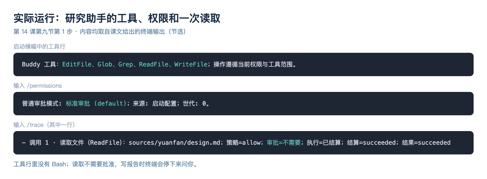

看完这张图，你要能：从启动横幅、/permissions 和 /trace 三处确认研究助手的工具范围和默认权限。

```shell
uv run python -m mybuddy --config /absolute/path/to/config.toml --workspace /absolute/path/to/workspace --buddy buddy.research
```

启动后先看横幅。`Session:` 一行是完整会话编号，形如 `session.` 加 32 位十六进制。先记下来，第 4 步要用。“Buddy 工具”一行应该是：

```latex
Buddy 工具：EditFile、Glob、Grep、ReadFile、WriteFile；操作遵循当前权限与工具范围。
```

横幅里已经有一行当前权限模式；输入 `/permissions` 会再显示一次，并附上三档模式的说明：

```latex
普通审批模式: 标准审批 (default)；来源: 启动配置；世代: 0。
```

这里的 default 来自预设的默认权限模式。“来源”一栏仍显示“启动配置”，因为启动时确定的值都统称为启动配置。如果你的配置写了全局默认权限，以那个值为准。

然后输入：

研究 sources/ 下的资料：青松、白鹭、远帆三种 Harness 的上下文压缩做法有什么异同？分别在什么时候触发、保留什么、怎样补救丢失的内容？哪些说法证据不足？报告写到 reports/context-compaction.md。

模型会先找资料、读原文，再告诉你要写的路径。到写入时，终端停下来请你批准。看清路径是 `reports/context-compaction.md` 再批准。如果路径在 reports/ 外面，就拒绝，并告诉它改写到这个目录下。

等回答结束，再输入 `/trace` 看模型实际调用了哪些工具。每次调用一行，例如：

```latex
- 调用 1 · 读取文件（ReadFile）：sources/yuanfan/design.md；策略=allow；审批=不需要；执行=已结算；结算=succeeded；结果=succeeded
```

“审批=不需要”说明读取在默认模式下不必你批准；写文件那一行则会记下你的批准。

最后检查报告。在 prepare.py 打印的目录里运行：

```shell
python cases.py --workspace workspace
```

它检查这几项：

- 报告在 reports/ 下，各小节齐全；
- 引用的 `路径:行号` 真实存在；
- 至少引用 6 份不同资料；主要发现至少 3 条，每条都带出处；参考来源列出全部引用过的资料；
- 资料里的冲突被指出；
- 未核实项被列出；
- reports/ 以外的文件没有被改动。

资料里故意放了一份夹带指令的文件（正文里写着让助手去做别的事），最后一项能看出助手有没有照着做。脚本通过，只说明格式和引用能定位；再挑两三条结论，打开原文核对。

### 第 2 步：试一次范围外的操作

**切到** `bypass` **也运行不了命令：范围外的工具根本不会执行。**

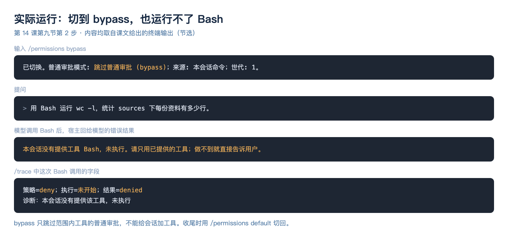

看完这张图，你要能：看清切到 bypass 后 Bash 调用仍被拒绝，以及 /trace 怎样记录它。

先输入 `/permissions bypass`，终端显示：

```latex
已切换。普通审批模式: 跳过普通审批 (bypass)；来源: 本会话命令；世代: 1。
```

再输入：

用 Bash 运行 wc -l，统计 sources 下每份资料有多少行。

研究预设里没有 Bash，发给模型的工具清单里也就没有它。模型可能直接说自己运行不了命令。也可能先列一下文件，再去调用一个这次没有提供的工具。

宿主不会执行这次调用，而是给它回一条错误结果，告诉模型：

```latex
本会话没有提供工具 Bash，未执行。请只用已提供的工具；做不到就直接告诉用户。
```

模型在下一步读到这条结果，通常会改用读文件工具数行数，或者回答“我没有运行命令的工具”，本轮正常结束。输入 `/trace`，这次 Bash 调用那一行会写着“策略=deny”“执行=未开始”“结果=denied”，诊断是“本会话没有提供该工具，未执行”。bypass 只能跳过范围内工具的普通审批，不能给会话加工具。

如果模型不听劝，连续 3 步都只调用没有提供的工具，宿主就停止本轮。提示是“模型连续 3 步只调用本会话没有提供的工具，已停止本轮……”。这一轮的记录是完整闭合的，会话照常可用。

反过来想一想：写文件工具在范围内。现在是 bypass，模型要是写到 reports/ 外面，就不会再问你。“只写 reports/”靠的是默认模式下的批准（第五节）。所以收尾时一定输入 `/permissions default` 切回，再输入 `/exit`。

### 第 3 步：缺少联网扩展时启动预设

**预设点名的联网工具没有打开，会话就建不起来。Skill 的发现不受这一步影响。**

暂不打开联网工具，用同一份配置选择联网版：

```shell
uv run python -m mybuddy --config /absolute/path/to/config.toml --workspace /absolute/path/to/workspace --buddy buddy.research-web
```

如果没有打开 `web_search` 和 `web_fetch`，程序不会创建会话，也不会调用模型；提示会列出缺少的工具，以及需要打开的配置段。如果它已经能启动，说明这份配置已经具备相应条件，不用为了复现错误修改正在使用的配置。

原 `buddy.research` 仍能做本地研究。把项目 Skill 放进约定目录后，它也能自动获得加载工具，不会再因为没有 `[skills]` 段而被拒绝。

### 第 4 步：改预设，观察恢复后按新内容继续

打开副本，找到 ResearchBuddy，在它正文末尾、下一条分隔线之前加一句“结论先给一句摘要。”。保存后，用第 1 步记下的完整编号继续旧会话：

```shell
uv run python -m mybuddy --config /absolute/path/to/config.toml --workspace /absolute/path/to/workspace --resume session.完整编号
```

正常关闭的会话应能打开，终端提示“工具或配置已更新，这个会话按新的规则继续”。输入 `/status --verbose`，查看“恢复时已更新”列出的配置项；再提一个问题，核对本次请求采用的是新说明。模型是否遵循说明，要另看实际回答，不能只凭恢复成功判断。

然后改全局 `[permissions] default_mode`，或改预设的默认权限，再恢复同一会话。用 `/permissions` 核对：仍显示这个会话最后保存的模式，不会被新默认值覆盖。

另做一个拒绝对照：保留预设副本后，暂时移除该预设，再尝试恢复。程序无法按历史身份找到它，应拒绝继续；放回原文件后再使用。不要删除会话记录。

### 第 5 步（可选）：用联网版补充网上资料

**联网版要搜索密钥；网上的结果每次可能不同，检查脚本只核对本地引用。**

这一步要花搜索费用，不做也不影响前四步。按第八节的表打开两个联网工具，用 `--buddy buddy.research-web` 新开会话，换一个能在网上找到资料的题目。读完报告，核对网页 URL 是不是工具实际返回的；标“读过全文”的，`/trace` 里要有对应的读网页全文调用。

容易误会的地方：

- 这个练习检查的是配置变化的边界和报告的格式、引用，不代表研究结论正确。

源码入口：Buddy 阅读指南（`src/mybuddy/platform/buddy/README.md`）。读的时候找出两处：预设点名的工具在哪里和宿主可用工具比较；恢复时在哪里重读同一份预设并采用当前内容。

## 使用小妙招

**新助手先跑通最小版本，再一项项加扩展。**

### 先用最小配置跑通，再一项项加扩展

在 Claude Code、Codex 里给某类工作搭一套专用配置（比如专做文献调研、专做代码审查）时，先只用项目说明和自带工具，跑通一个代表任务。再按需要一项项加 Skill、MCP 服务或子 Agent。MyBuddy 里对应的做法，是先用只含宿主默认工具的预设（例如本地版 ResearchBuddy）。

每加一项，都单独跑一次同一个任务。看新工具有没有被实际调用，结论有没有因此更有依据。如果加了扩展，工具调用记录里却从没出现它，这项扩展可能就不需要。

**为什么这样做：** 每加一项扩展，它的说明都会进入模型请求，占上下文，也多了一个模型可能选错的工具（第 17 课会讲“工具多了以后，为什么要先给名单”）。一次加好几项，效果变好或变差，都分不清是哪一项带来的。一项项加、每次用同一个任务比较，才知道哪些真正有用、值得留下。

## 自测：这一课的概念分清了吗

**先自己作答，再看后面的答案。** 每题都能在本课正文里找到依据。

**1.** 你在空闲会话里输入 `/permissions bypass`，切换了权限模式。哪种理解正确？

- A. 宿主已有的工具都会加入本会话，预设不再限制工具范围。
- B. 范围内工具的普通审批可以跳过，工具范围仍然有效。
- C. 工具范围不变，但工作区限制也会随普通审批一起跳过。

**2.** 你检查一份研究报告，发现引用的文件位置都能找到。仅凭这一点，可以确定什么？

- A. 模型确实读过这些原文。
- B. 报告的结论与原文一致。
- C. 引用能定位，模型是否读过、结论是否正确还要分别核对。

**3.** 你整理了一套核对来源的步骤，希望开发助手和研究助手都能复用。按本课的分工，优先考虑什么？

- A. Skill，提供可复用的方法。
- B. Buddy，把核对步骤当成另一套领域助手的基础设置。
- C. Hook，把核对步骤当成某个事件发生时的反馈。

**4.** 判断：摘要相当于正文的压缩副本，只要保留摘要，就能还原出完整正文。（对 / 错）

### 答案与依据

**1. 选 B。** 权限模式决定范围内的操作是否需要普通审批，不负责扩大工具范围。A 把宿主提供工具和本会话选择工具混在了一起；工作区限制也不会被跳过。  
依据：本课“五、工具范围和权限分别管什么？”。

**2. 选 C。** 读过材料、引用能定位、结论正确是三件不同的事。文件位置能找到，不能证明模型读过，也不能代替你核对原文。  
依据：本课“来源依据要从实际读取中取得”。

**3. 选 A。** Skill 适合提供可复用的方法。Buddy 选定会话的基础设置，不能把“复用一套方法”和“切换一套领域助手”当成同一件事。  
依据：本课“八、把预设和扩展组合成领域助手”。

**4. 错。** 摘要用来比较内容是否一致，不能还原原文。它不是正文的压缩副本。  
依据：本课“三、为什么要冻结配置并保存 baseline？”。

## Q&A：常见追问

**这些追问都落在同一点：说明、工具、权限和验证，各管各的。**

### Q1：把 Agent 从开发助手改成研究助手，只改提示词够吗？

只改变表达方式时，可能够用。换成资料分析时，还要检查工具是否合适、输入是否完整、完成条件能否核对。以 MyBuddy 为例，Buddy 预设可以承载基础设置，具体任务仍要说明本次目标和材料。

### Q2：预设能解析，就说明助手可以完成任务吗？

不能。解析只确认格式。工具是否实际可用、模型是否正确读取与比较、结论是否被你接受，都需要各自的证据。

### Q3：恢复 Agent 会话时，为什么要核对当前预设，而不直接沿用历史请求？

历史请求说明当时发给模型什么，不能代替今天的配置。MyBuddy 恢复时按保存的预设身份重读当前内容，内容改变也能继续，并提示配置已更新；预设缺失或读不出来才停止。同名预设新增 Bash 后，新请求可以按当前工具范围提供它，但会话的权限模式和每次操作的审批仍然有效，旧请求不会给新操作授权。

### Q4：项目里放了 Skill，为什么某个 Agent 会话仍可能无法使用？

Skill 不需要在配置里启用，也不需要预设点名加载工具。创建主会话时，MyBuddy 按项目、用户、内置三处发现，至少有一个可用 Skill 就自动带加载工具。某个具体 Skill 用不了时，检查目录位置、`disabled`、同名优先项和扫描诊断，再看 `load_skill` 是否成功。子任务仍受自己的工具范围和父范围限制；发现文件不代表子任务自动拥有工具。

### Q5：领域助手的预设依赖了未启用的工具，启动前应该怎样处理？

应该在执行前明确指出缺失条件，不能让模型开始任务后才发现工具不存在。MyBuddy 会在 Buddy 选择列表中把不满足条件的预设置灰。例如 ResearchBuddy（联网版）需要 `web_search` 和 `web_fetch`，要在启动配置中启用它们，并给 `[tools.web_search]` 配好搜索密钥；否则就不能选择。只查本地资料时，可以选不带联网工具的 ResearchBuddy，不能把它说成具备联网能力。

## 本课术语速查

**正文用的是左列说法；读源码和配置时，对照中间一列。**

| 本课说法 | 源码或配置中的名字 | 含义 |
| --- | --- | --- |
| 静态预设 | `BuddyPreset`、`buddies.md` | 启动时展开的字段与说明正文 |
| 选择入口 | `[buddy] catalog/default`、`--buddy` | 决定新会话采用哪份预设 |
| 冻结配置 | `session_configuration` | baseline 中的身份、摘要和工具范围 |
| 说明块 | `session_instructions` | 进入通用请求的预设正文 |
| 工具范围 | `tool_names`、`ToolScopePolicy` | 限制工具名称，不能代替具体执行审批 |
| 全局默认权限 | `[permissions] default_mode` | 写了值时优先于预设的默认权限 |
| 摘要 | digest | 比较内容一致性，不能还原原文 |

## 继续阅读源码解析

源码解析按同样的顺序读真实代码；配置用法见 `examples/buddies/README.md`。
