新任务开始时，怎样让 Agent 用上以前确认过、现在仍然适用的约定，又不把过时或临时的信息带进来？

## 本课导览

上一课的 Buddy 预设在会话开始时就固定了，可有些信息跟着你和项目走：昨天修运费，今天写报表，都要遵守“这个项目的金额使用 Decimal”。能跨会话保留、以后还能用的信息，就是 **Memory（长期记忆）**。本课从一个最简版开始，按下图的四个问题展开。

学完后，你应能判断一条记忆该不该保存、适不适用于当前任务，并说出它来自哪里、怎样修改。


## 一、什么信息值得跨会话保存？

**值得记的信息要有来源、能修改，而且以后还有用。**

### 先看最简版：一个文件，全文塞进请求

**最简单的长期记忆，就是一个文本文件：说“记住”就追加一行，每次请求都整份带上。**

下面是 Python 风格的**教学伪代码**，不能直接运行：

```python
MEMORY = "memory.md"

def remember(text):
    with open(MEMORY, "a") as f:
        f.write(f"- {text}\n")

def build_request(user_input):
    return system_prompt + open(MEMORY).read() + user_input
```

它能跑通“下次还记得 Decimal”。但用久了，问题一个个冒出来。本课每一节解决其中一部分：

1. **什么都往里记。** 一次性的决定、模型的猜测也进去了。→ 只记有来源、能修改、以后有用的信息（本节）。
2. **所有项目共用一个文件。** 别的项目的规矩混进来。→ 分全局和项目两层（第二节）。
3. **两个会话同时改。** 后写的覆盖先写的。→ 改之前先读版本，版本对不上就拒绝（第三节）。
4. **写到一半出错。** 不知道写没写成，模型却说“记住了”。→ 确认写入后才生效（第三节）。
5. **文件越来越大，全文塞满请求。** → 每次只带一份目录，细节按需查（第四节）。
6. **一轮做到一半，文件被别的会话改了。** → 一轮里用同一份记忆，下一句话时再换（第四节）。

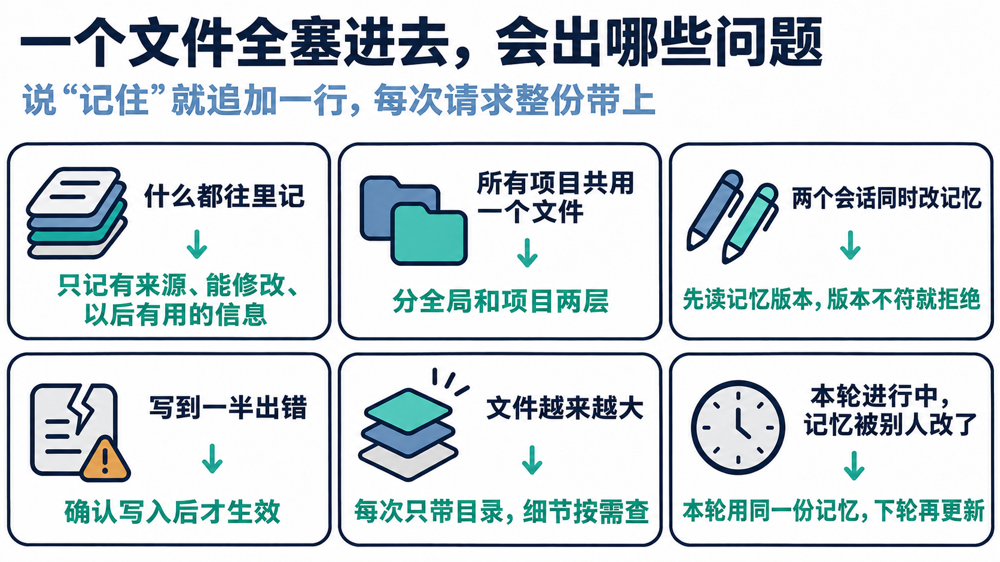

看完这张图，你要能：说出最简版记忆的六个问题，以及本课分别在哪一节用什么办法解决。

### 记得越多，不一定越好

**没有来源和适用范围的记忆，记得越多，越容易用错。**

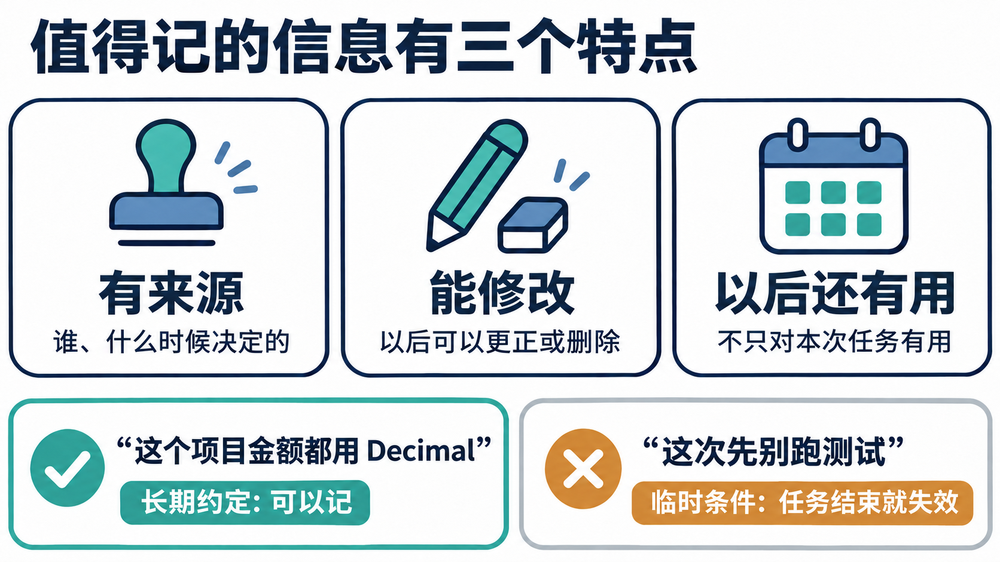

看完这张图，你要能：用有来源、能修改、以后还有用三个特点，分清长期约定和临时条件。

把每次对话都完整存下来，看起来最省事。可是没有来源和适用范围时，一次性的决定、过时的结论、另一个项目的规矩，都会被带进新任务。

适合进入 Memory 的信息有三个特点：

- **有来源**：知道是谁、在什么时候决定的；
- **能修改**：以后可以更正或删除；
- **以后还有用**：不止对这一次任务有意义。

### 一张表判断信息该放哪里

**先问一句：这条信息过了这次任务，还成立吗？**

| 信息 | 更合适的归属 |
| --- | --- |
| 用户明确说“以后都优先用中文回答” | Memory 中的偏好 |
| “本次研究只比较这两份材料” | 当前任务的要求，任务结束就失效 |
| 刚读到的一段官方说明 | 带来源和版本的证据，留在本次会话 |
| 某次工具调用的完整输出 | 会话记录或长结果（第 9 课） |
| 模型猜测“用户好像不喜欢表格” | 最多是一条猜测；不能当成用户的明确要求保存 |

最容易混淆的是“临时条件”和“长期约定”。

- 用户说“这个项目金额都用 Decimal，以后改金额逻辑也按这个约定”。它有明确来源、适用于整个项目、以后还会用到，可以记。
- 用户说“这次先别跑测试”。它只约束这一次任务，不能变成“这个项目不需要测试”。

### Memory 和其他几种机制有什么不同

**Memory 管“跨任务还要用的信息”，和方法、资料、缓存各管各的。**

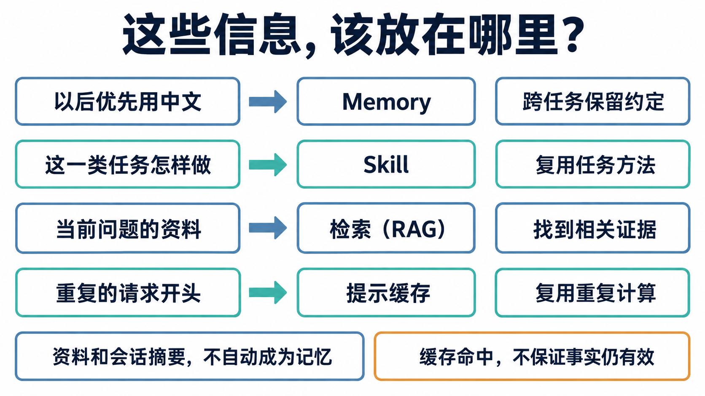

看完这张图，你要能：按长期约定、任务方法、当前资料与计算复用区分四种机制。

| 机制 | 回答的问题 | 什么时候更新 |
| --- | --- | --- |
| Memory | 哪些信息值得跨任务保留？ | 有新决定、需要更正或删除时 |
| Skill（第 16 课） | 这一类任务应该怎样做？ | 方法改进时 |
| 检索（RAG） | 当前问题的相关资料在哪里？ | 原始资料变化时 |
| 提示缓存（第 8 课） | 哪些重复计算可以复用？ | 由模型服务的规则决定 |

容易误会的地方：

- 检索到的一篇文章，不会自动成为记忆。
- 第 9 课的压缩摘要，也不会自动成为记忆。
- 缓存命中，不代表上次的事实现在仍然成立。

## 二、记忆保存在哪里？

**记忆分全局和项目两层，按主题存成 Markdown 文件，放在 MyBuddy 自己的目录里。**

### 全局记忆和项目记忆

**一条记忆放哪一层，看它的适用范围。**

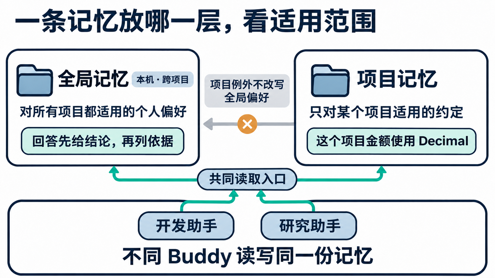

看完这张图，你要能：按适用范围把一条记忆放进全局或项目层，并知道不同 Buddy 共用同一份记忆。

MyBuddy 把记忆分成两层：

- **全局记忆**：对所有项目都适用的个人偏好，例如“回答先给结论，再列依据”。
- **项目记忆**：只对某个项目适用的约定，例如“这个项目金额使用 Decimal”。

项目里的特殊规定只影响这个项目，不改写全局偏好。不同的 Buddy（例如开发助手和研究助手）读写的是同一份全局和项目记忆，不会按角色各存一份。

记忆功能在普通命令行会话中默认启用，不需要额外配置。

规划模式（`/plan`）下：

- 可以查询记忆；
- 可以按你本轮的明确要求新增、恢复或修订记忆；
- 不能删除，要先退出规划模式；
- 不会在本轮结束后自动从对话中挑选值得长期保存的信息。

### 记忆以主题文件的形式保存

**每个主题是一个 Markdown 文件；模型看到的“索引”是程序现场生成的目录。**

记忆按**主题**组织，每个主题是一个 Markdown 文件，例如 `preferences.md`。一个主题里可以有多条记忆。每条都带着管理信息：身份编号、修订版本、来源、适用条件和更新时间。

文件放在 **MyBuddy 源码项目根目录**下的 `.mybuddy/` 里，而不是你正在修改的业务项目里。MyBuddy 是从自己代码所在的位置往上找到这个根目录的，和你在哪个目录启动无关。所以要像课程这样，从源码仓库运行；把它装到别处、找不到源码根目录时，会报错并提示这一点。

```latex
.mybuddy/
├── memory/                          # 全局记忆
│   └── preferences.md 等主题文件
└── projects/<项目标识>/memory/       # 项目记忆
    └── 主题文件
```

这样，记忆不会随业务项目一起被提交。`ReadFile`、`EditFile` 这类普通文件工具不允许写 `.mybuddy` 目录。要让会话真正用上修改后的记忆，应通过专门的记忆工具操作。

**项目标识**由程序根据项目位置计算：

- 项目是 Git 仓库，就按仓库来认。同一仓库的不同工作树（第 20 课）共享项目记忆。
- 普通目录按目录路径来认。把目录移到别处，可能被当成一个新项目。

全局记忆也只在你本机有效，不是云端同步。

另外还有一个**索引**，每条记忆占一行，写着条目编号、标题、所在主题和适用条件。它不是磁盘上的文件，而是程序根据当前主题现场生成的。模型通过 `memory://global/MEMORY.md` 或 `memory://project/MEMORY.md` 读取它。

你可以在会话里输入 `/memory`，查看全局和项目记忆的入口。第一次保存之前，主题文件可能还不存在。

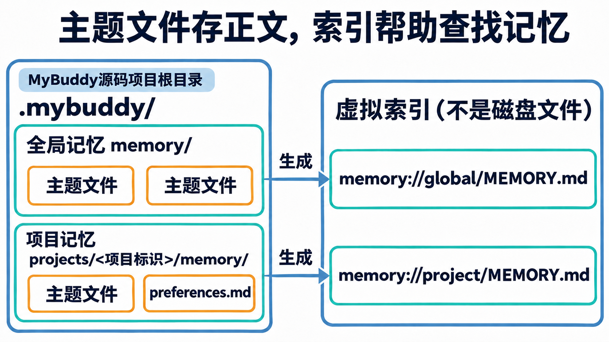

看完这张图，你要能：指出主题文件保存正文，索引帮助找到需要的记忆。


看完这张图，你要能：说明长期信息需要时才查取，并要判断它是否适用于当前任务。

## 三、说“请记住”以后，程序做了什么？

**先读当前版本，只提交这一次的改动；写入确认以后，会话才开始用新内容。**

### 先查，再改

**记忆只能通过专门的记忆工具读写，和普通文件一样要过工具检查。**

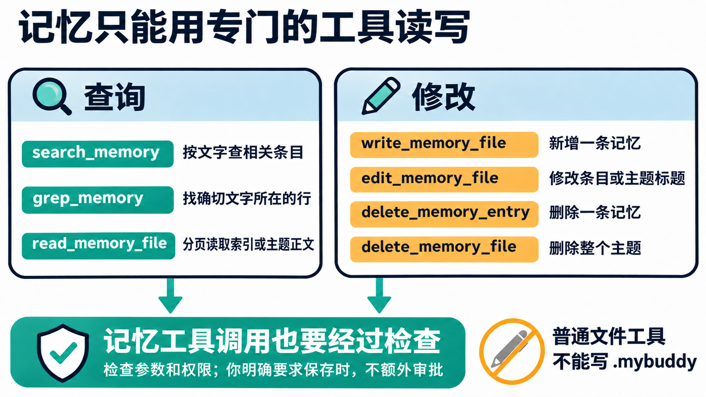

看完这张图，你要能：认出三个查询工具和四个修改工具，并记住它们和普通文件一样要过工具检查。

记忆工具和读写普通文件一样，要经过第 6 课讲的工具检查。查询用三个工具：

| 工具 | 用途 |
| --- | --- |
| `search_memory` | 按标题、适用条件和正文里的文字查找相关条目（文字匹配，不是语义搜索） |
| `grep_memory` | 查找包含某段确切文字的行 |
| `read_memory_file` | 分页读取索引或某个主题 |

修改用四个工具：

- `write_memory_file`：新增一条；
- `edit_memory_file`：修改条目或主题标题；
- `delete_memory_entry`：删除一条；
- `delete_memory_file`：删除整个主题。

### 一次保存的五个步骤

**从听懂意图到真正生效，中间要过读取、提交、检查、确认四关。**

你说：“请在本项目的记忆中保存：研究结论先给摘要，再列来源和未知项。”接下来：

1. **模型判断你的意图。** 要保存什么、放在全局还是项目、放进哪个主题。说得不清楚时，它应该先问你。说得清楚时，不需要再机械地问一遍“确定要保存吗”。
2. **读取目标主题和版本。** 模型读取相关条目和这一层记忆的修订号（版本编号，每次通过记忆工具修改都会变），或者确认主题还不存在。按需要分页，不要求读完全部页。写入要带上读到的版本，避免覆盖别人刚做的修改。
3. **只提出这一次的改动。** 模型提交主题路径、读到的修订号，以及新增内容，或目标条目编号和要改的字段。它不需要重写整个主题。
4. **程序检查后写入。** 程序核对工具调用、参数和版本，把这次改动合并进完整主题，没涉及的条目原样保留。你明确要求的保存，通过检查后直接执行，不额外弹出审批。保存时再核对一次版本和内容摘要（按内容算出的校验值），冲突就拒绝，要求重读。
5. **确认后才生效。** 写入完成并记下确认以后，当前会话才换用新的记忆内容。下一次模型请求才能用上它。

如果写入结果说不准，比如中途出错，不知道写没写成，程序就不会说“已记住”，也不会马上再写一次。这和第 11 课“结果未知”的处理一样。

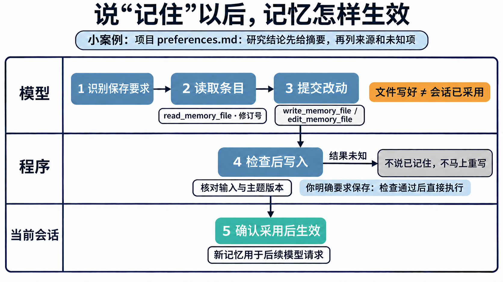

看完这张图，你要能：区分识别意图、读取条目与版本、受检查的修改和确认后生效四个环节。

容易误会的地方：

- 文件写好了，不等于这次会话已经开始用新记忆。第 4 步和第 5 步是两回事。
- 模型说“好的，我记住了”，不能算保存的证据。反过来，模型偶尔没按偏好回答，也不能说明文件没存上。两件事要分别核对。

### 修改和删除也是同样的过程

**改和删也是先读版本，再只动目标那一条。**

你说“把这条偏好改成先列来源，再给摘要”。模型先读取相关条目和修订号，再提交条目编号与要修改的字段。

你说“忘掉刚才那条，其他的保留”，模型就只删这一条。删除整个主题，需要你明确要求。

删除会影响以后的查询，而不只是在界面上把标题藏起来。

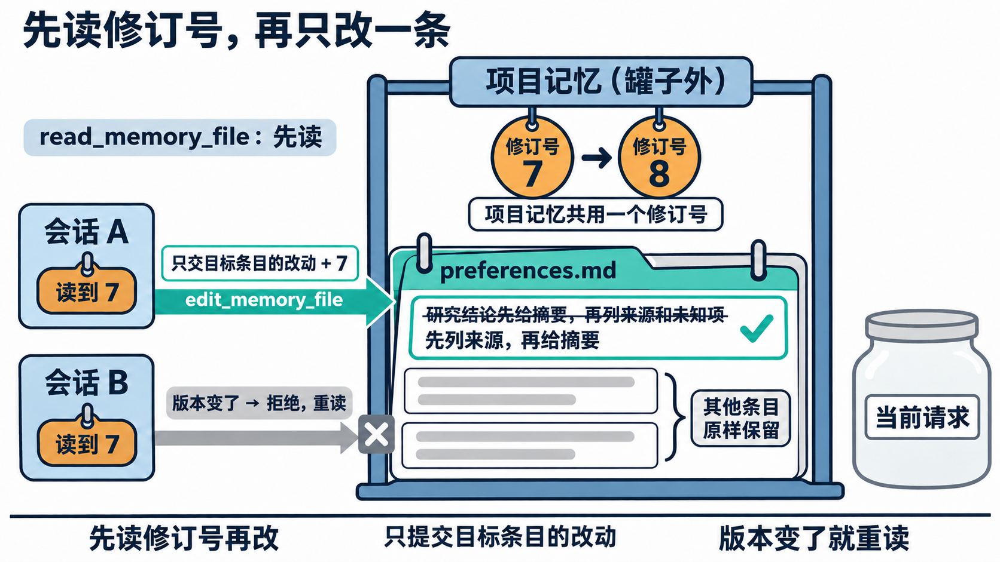

看完这张图，你要能：记住改记忆的规矩：先读这一层的修订号，只提交这一条改动；版本变了就被拒绝，要重读。

## 四、新任务怎样用上记忆，又怎样避免用错？

**每次请求只带记忆目录，细节按需查；用之前先看范围，再看相关，最后看冲突。**

### 不是每次都把所有记忆塞进去

**请求里默认只带索引；要看正文，模型再调用查询工具。**

如果每次请求都带上全部记忆，记忆一多就会占满空间，还会混进大量无关内容。MyBuddy 的做法是：

- **每次请求默认带上索引**：全局和项目各一份，每条记忆一行。索引有大小上限，超出时省略后面的条目，并提示模型用搜索查找其余条目。具体上限见源码解析。
- **需要细节时再查**：模型发现需要某个主题的具体内容，就用查询工具去读。读到的内容作为工具结果，进入后续请求。

索引只告诉模型“有哪些记忆、各管什么”，不能代替主题原文。要修改记忆时，模型先读取相关条目和修订号，只提交目标条目的改动；其他条目由程序合并保留。

### 什么时候载入新的记忆

**一轮开始时定下用哪份记忆，不随其他会话的修改而变化；本轮通过记忆工具完成修改并确认后，后续请求会使用新内容。**

| 时机 | 发生什么 |
| --- | --- |
| 新建会话 | 读取当前的全局和项目记忆，开始使用 |
| 你发出新的一句话 | 检查记忆文件；其他会话的受管修改经确认后采用，未登记的手工编辑则停止并说明 |
| 同一轮里的后续请求 | 沿用这一轮开始时的记忆；需要细节就查询 |
| 本轮修改了记忆 | 修改确认后，后续请求使用新内容 |
| 历史被压缩（第 9 课） | 之前查到的记忆正文可能不在了，但记忆文件没变，需要时可以重新查 |

为什么同一轮里不随时更新？因为一轮工作需要一个稳定的依据。另一个会话可能正好在改同一份记忆。这一轮做到一半，用的规矩突然变了，结果就很难解释。

如果你直接手改了记忆文件，下一轮检查发现外部修改时，程序会停止，不会自动登记或采用。处理办法：

1. 先备份手改的内容；
2. 恢复可信的原件，恢复后才能继续；
3. 需要保留的新内容，明确让模型通过记忆工具保存。

不要靠改索引或修订号绕过检查。

可以用一段教学伪代码概括：

```latex
新建会话或收到新的用户输入时：
    核对待决状态和文件完整性；发现外部修改就停止并说明
    检查通过后，保存采用记录并确认，再使用当前记忆
准备每次模型请求时：
    带上会话已采用的索引
模型需要某个主题的细节时：
    调用查询工具，结果进入下一次请求
历史被压缩后：
    查询入口还在，需要时重新查
```

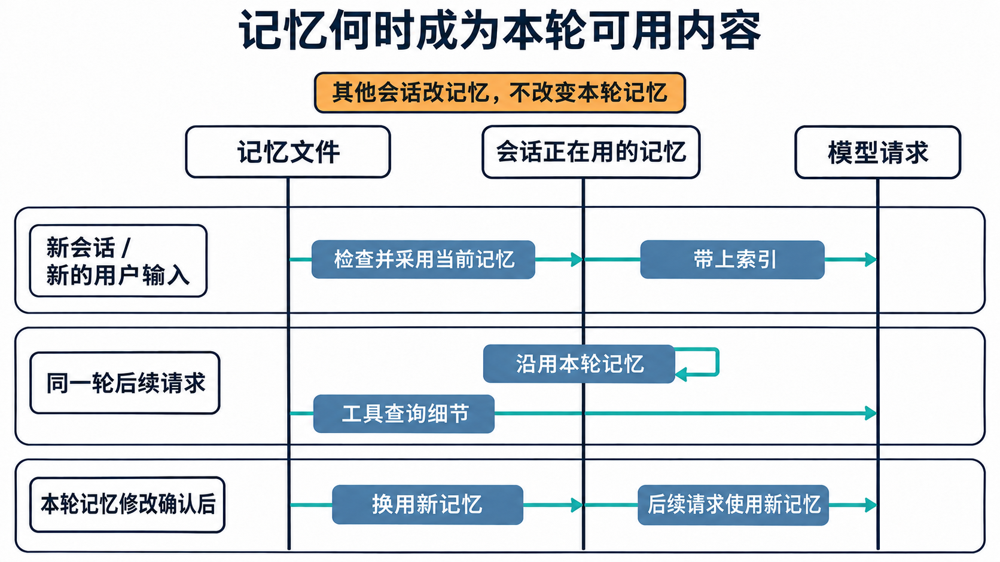

看完这张图，你要能：区分磁盘上的记忆文件、会话正在使用的记忆和本次模型请求，并说明换用新内容的时机。

### 先看范围，再看相关不相关

**查找记忆时，先按项目和适用范围筛，再看内容相关，最后查过时或冲突。**

另一个项目里有一条“金额保存为整数分”。内容和你的问题很像，但它不属于当前项目，就不该用。已经删除或被替代的记录，也不能因为“看起来很相关”重新出现。

把记忆放进请求时，最好带上来源，例如：“本项目已接受的约定：金额计算使用 Decimal；来源是某次用户的明确决定。”这样模型能分清哪些是项目约定、哪些是个人偏好、哪些是本次刚读到的事实。

### 新旧信息冲突时怎么办

**先弄清新信息改变了什么；很多“冲突”其实管的是不同的事。**

新信息和已有记忆碰到一起时：

| 情况 | 处理 |
| --- | --- |
| 意思相同，只是换了说法 | 不必新增一条 |
| 增加了适用条件 | 把条件写进去，避免变成更宽泛的规则 |
| 真的冲突 | 比较来源和时间，必要时问用户 |
| 看起来冲突，其实管的是不同的事 | 分别保留 |

最后一种最容易误判。已有记忆写着“金额用 Decimal”，新要求是“导出报表按整数分输出”。两者都在说金额，但一个管内部计算，一个管对外格式，不冲突。先弄清各自管哪一部分，就不会为了保存新要求而误删旧约定。

另外两条规矩：

- 模型推断出的偏好，不能覆盖用户明确说过的决定；
- 项目里的例外只影响这个项目，不改写全局偏好。

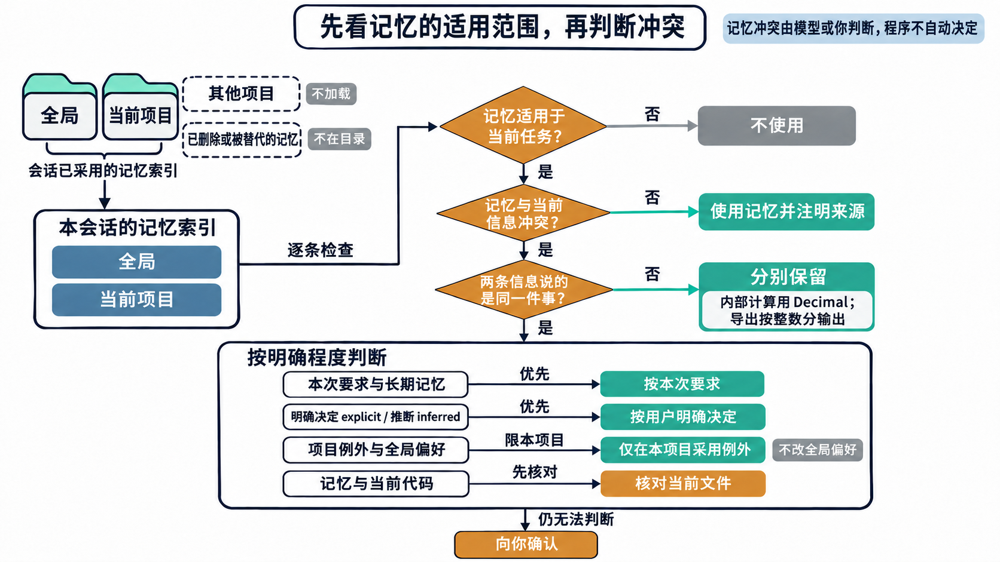

看完这张图，你要能：按来源、适用范围和明确程度判断冲突的记忆是否使用。

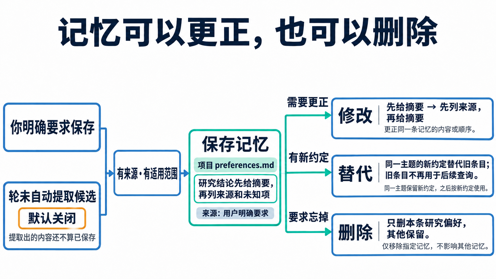

看完这张图，你要能：解释长期信息怎样保持来源并可以更正。

容易误会的地方：

- 记忆和刚读到的代码不一致时，不能直接按记忆解释代码。记忆可能是期望的约定，代码是当前的实现。要核对哪个过时了，必要时问用户。

### 自动记忆：默认关闭的另一条路

**开启后，程序会在一轮结束时最多提一条候选，但仍走同一套受管写入和审批。**

除了你明确说“请记住”，还可以启用**自动记忆**：符合条件的一轮正常结束后，程序回顾对话，挑出可能值得长期保留的信息，提出保存或修订候选。

MyBuddy 已经实现了这条路，但**默认关闭**。自动记忆开关取当前启动配置，修改后重新启动并恢复旧会话也会生效；这不会补做过去轮次的提取。主会话在启动 TOML 配置里启用：

```toml
[memory]
automatic = true
```

不写这一项，就等于 `false`。主会话即使没有 Buddy，也固定提供共享 Memory 的读写，供你明确要求时使用。子会话不继承主 Memory。

开启后，它这样工作：

- **一轮最多一条候选。** 本轮有你的新输入并且正常结束时，程序用 `low` 档模型回顾本轮对话，对照现有索引，给出新增、修订或跳过。索引已截断、调用次数用完、规划模式或有活动 Goal 时不提取。
- **走同一套受管写入。** 候选经过权限判断、修订号核对和确认采用。在 `default`、`accept_edits` 下要你批准；没有交互渠道就拒绝；`bypass` 下直接执行。
- **看得见，也有边界。** 保存后 CLI 和 Web 显示“已自动记住：&lt;条目标题>”，不想要就让 Agent 删掉那一条。自动条目标为“推断”来源，不能改写你明确保存的记忆。出错时本轮回答照样保留。

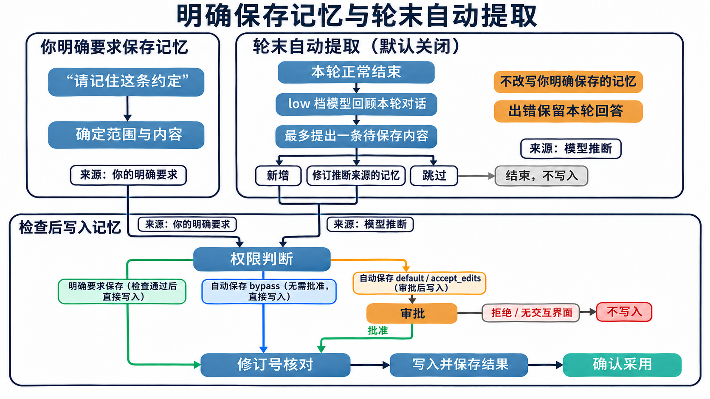

看完这张图，你要能：判断哪些信息可以按明确要求保存，哪些可以在启用后由轮末提取自动保存。

容易误会的地方：

- 打开自动记忆，不等于跳过审批。
- “这次先不跑测试”这类临时条件，不应成为长期规则；自动候选也可能判断错，以后可以查询、更正或删除。

## 五、动手：保存、修改、删除一条偏好

**亲手走一遍“记住、改、换会话查、删掉”，每一步都对照实际文件。**

### 实践

在普通命令行的新会话中，先输入 `/memory` 查看入口，再输入：

请在本项目的记忆中保存：研究结论先给摘要，再列来源和未知项。

观察三件事：

1. 有没有读取和写入记忆的工具调用；
2. 工具结果说了什么；
3. 主题文件里是否真的多了这一条。

接着说：“把本项目这条研究偏好改成先列来源，再给摘要。”再问一个小问题，看回答是否用上了新偏好。

然后用 `/new` 新建一个同一项目的会话，看新会话能否查到这条偏好。最后说：

忘掉本项目刚才保存的研究输出顺序偏好，保留其他记忆。

核对三点：这一条是否真的删除，其他记忆是否还在，之后的查询是否还能找到它。

容易误会的地方：

- `/memory` 只用来查看入口，不能写成 `/memory set` 或 `/memory delete`，也不会列出全部记忆正文。要核实某条内容，就让模型查询对应的范围和主题，再对照实际文件。

源码入口：Memory 阅读指南（`src/mybuddy/platform/memory/README.md`）。读的时候沿“请记住”这条主线，找出三处：模型的修改请求在哪里被检查，文件在哪里写入，会话在哪里换用新内容。

**能力卡**：想在收银台副本里亲手试一遍，就照着能力卡《Memory 跨会话记忆》（`demo-project/cards/memory.md`）做。

## 使用小妙招

**先查清实际加载了什么，再动手修正；值得记的是下次难以重新查清的事。**

### 先看实际加载了什么，再修正长期材料

如果 Agent 反复使用一个过时的测试入口，先查它实际加载了哪份约定，找到来源再修正，不要追加一条同义提醒。修正后在新会话里重提原任务，分别看“读到了”“用上了”“做对了”。

**为什么这样做：** 旧约定还在，再追加一条新提醒，模型就会同时看到两条互相矛盾的说法，不一定选对（见“新旧信息冲突时怎么办”）。找到来源改掉旧的，才只剩一个答案。改完要在新会话里试，因为这类材料通常在会话开始时才载入。

### 项目指令和记忆分开维护

Claude Code 把人写的项目指令（`CLAUDE.md`）和自动积累的记忆分开，都可以用 `/memory` 查看和编辑。两者都会影响回答，但检查重点不同：

- 项目指令：看是否清楚、一致、适用于当前项目；
- 自动积累的记忆：还要看它从哪里来，是否把一次临时选择推广成了长期规则。

例如“某次使用了测试替身”，不代表所有支付路径都应该用替身。

**为什么这样做：** 项目指令是你写的，你知道它为什么这样写；自动记忆是 Agent 根据某次对话自己总结的，可能把一次临时的做法当成了长期规则（见“自动记忆：默认关闭的另一条路”）。两者混在一起，出了问题就分不清该改哪一份。

### 值得记的，是下次很难重新查清的事

“项目金额使用 Decimal”适合长期保存；“这次测试通过了”要绑定版本，放进任务交接。拿不准时问一句：下次重新查清要花多少功夫？

**为什么这样做：** 记下的每一条，以后都可能被载入、占上下文，过期了还会误导模型（见“记得越多，不一定越好”）。从代码里随手就能查到的事，不值得记；只有很难重新查清的，记下来才划算。

## 自测：这一课的概念分清了吗

**先自己作答，再看后面的答案。** 每题都能在本课正文里找到依据；带“动手验证”的题，可以照着做一遍，亲眼看到结果。

**1.** 你要求“本次研究只比较这两份材料”，没有说以后的研究也这样做。这句话更适合放在哪里？

- A. 项目记忆，作为以后研究的固定范围
- B. 当前任务的要求，任务结束就失效
- C. 全局记忆，因为它是用户明确说过的要求

**2.** 已有记忆是“金额计算使用 Decimal”，你又提出“导出报表按整数分输出”。该怎样判断这两条信息？

- A. 新要求更晚，应删掉旧约定
- B. 都在说金额，保留一条就够了
- C. 一条管内部计算，一条管对外格式，可以分别保留

**3.** 你在普通命令行会话中输入 `/memory set 回答先给结论`。会发生什么？

- A. 直接把这条偏好存进记忆
- B. 提示 `/memory` 只查看记忆入口，不会写入这条偏好
- C. 弹出写入审批，批准后保存这条偏好

**4.** 判断：某个项目有一条例外规定，就应该用它改写全局偏好，让其他项目也采用这条例外。（对 / 错）

### 答案与依据

**1. 选 B。** 这句话只约束本次研究。用户明确说过，不代表它就适用于以后的任务，不能因此选 C。  
依据：本课“一张表判断信息该放哪里”。

**2. 选 C。** 两条信息管的是不同的事，并不冲突。不能只因为新要求更晚，就像 A 那样删掉旧约定。  
依据：本课“新旧信息冲突时怎么办”。

**3. 选 B。** `/memory` 只查看全局和项目记忆入口，不接受写入参数。这条输入会被当作无效命令参数拒绝，不会进入 C 所说的写入审批。  
依据：本课“实践”。  
动手验证：按能力卡《Memory 跨会话记忆》（`demo-project/cards/memory.md`）的“准备”运行 `uv run python demo-project/prepare_shop_demo.py`，用副本里的 `start-mybuddy.command` 启动，完成“操作”第 1 步，输入 `/memory` 查看入口。接着只做“失败变体”中的命令验证：输入 `/memory set 回答先给结论`，在终端查看“/memory 仅查看全局和项目记忆入口。直接告诉我需要记住、修改或删除什么。”的提示。

**4. 错。** 项目里的特殊规定只影响这个项目，不改写全局偏好。一个项目的例外不能变成所有项目的规则。  
依据：本课“全局记忆和项目记忆”。

## Q&A：常见追问

**这些追问的共同点：保存、采用、用对，是三件要分别核对的事。**

### Q1：会话摘要可不可以直接当成长期 Memory？

不可以整体照搬。摘要里常有临时目标、没核实的判断和已经过期的观察。应该挑出有来源、以后还有用、允许保存的信息，写明范围和修改方式。比如“本次不跑测试”不能变成“所有任务永久不测试”。

### Q2：检索到的记忆与刚读到的代码冲突，应该信哪个？

先看各自说的是什么。记忆可能是期望的约定，代码是当前的实现，两者可能在回答不同的问题。再核对来源、时间和适用范围，必要时问用户并更新记忆。内容看起来相似，不能决定哪一条说了算。

### Q3：改了记忆文件，为什么不能马上说所有会话都已更新？

每个正在运行的会话，都在用它这一轮采用的记忆。其他会话通过记忆工具完成的修改，要等这个会话收到你的下一句话时，才会检查并尝试换用。已经发出的请求不会改变。手工修改文件则会让检查停止，不能直接采用。

### Q4：查看长期记忆与保存长期记忆，为什么要区分？

查看只取得已有信息，保存会改变以后会话可能采用的长期信息，必须分开判断。MyBuddy 的 `/memory` 只展示全局和项目记忆入口；用户说“帮我记住”后，模型仍需调用记忆写入工具，程序检查参数和版本并确认写入结果，不能只凭一句“记住了”认定保存成功。显式工具调用通过检查后不另弹审批；默认关闭的自动提取则在 `default`、`accept_edits` 下需要批准，`bypass` 下跳过这次人工批准。

### Q5：压缩后忘了刚查到的记忆，需要自动全部补回来吗？

不需要。默认带上的索引，压缩后照样有。之前查到的主题正文如果被压缩掉了，模型可以按当前需要重新查。这样既保留了查询能力，又不用每次压缩后把全部主题再塞回去。

## 本课术语速查

**正文用的是左列说法；读源码和配置时，对照中间一列。**

| 本课说法 | 源码或命令中的名字 | 含义 |
| --- | --- | --- |
| 全局记忆 / 项目记忆 | 作用域 `global` / `project` | 对所有项目适用 / 只对当前项目适用 |
| 主题 | `.mybuddy/…/memory/` 下的 Markdown 文件 | 一组相关记忆；每条带身份、修订、来源和适用条件 |
| 索引 | `memory://global/MEMORY.md` 等 | 根据当前主题即时生成的目录，不是磁盘文件 |
| 项目标识 | 项目身份（Git 仓库或目录路径） | 判断哪些会话共享同一份项目记忆 |
| 记忆工具 | `search_memory`、`grep_memory`、`read_memory_file` 等 | 查询和修改记忆的专用工具 |
| 生效（采用） | 会话采用的记忆视图 | 修改确认后，会话开始在后续请求中使用新内容 |
| 自动记忆 | `[memory] automatic` | 符合条件的轮次结束后用 low 模型提取候选，并通过记忆工具写入；默认关闭 |

## 继续阅读源码解析

**源码解析沿“读进来、写下去、自动提取”三条线读真实代码，适合学完本课后接着读。**
