理解 Skill 的渐进加载、选择、参数与执行方式。

## 本课导览

上一课讲怎样跨会话保留长期约定。这一课把一类任务的做法组织成 Skill，需要时再加载。先看一个最简版，再按下图的四个问题一次补一个约束。

学完后，你应能把重复方法写成可发现、可使用、可检查的 Skill，并找到源码中的加载与执行边界。下一课接入进程之外的工具服务。

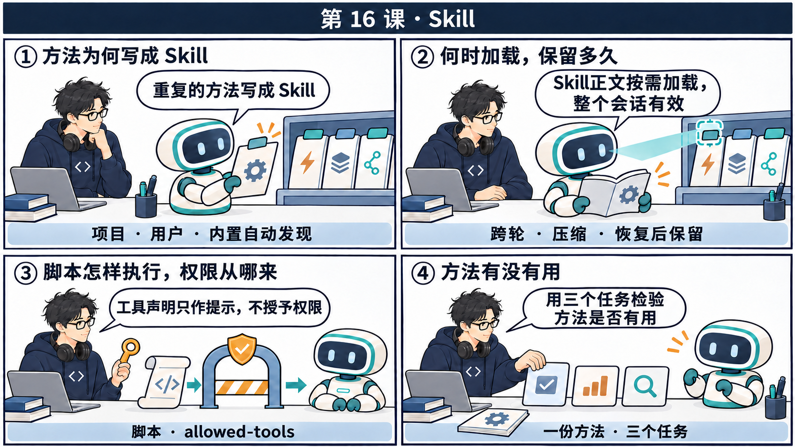

## 一、重复任务的方法为什么适合写成 Skill？

**重复用到的方法写成 Skill：平时只露一个名字和简介，用到时再读全文。**

上一课留下的是“这个项目遵守什么约定”。这一课再往前走一步：每次检查金额边界，都要重讲一遍方法。能不能把这套做法整理起来，需要时再交给 Agent？

### 先看最简版：把方法文件全部贴进请求

**最简单的做法，是把每份方法文件读出来，每次请求都整份带上。**

下面是 Python 风格的**教学伪代码**，不能直接运行：

```python
SKILLS = {name: open(f"skills/{name}/SKILL.md").read()
          for name in ["boundary-review", "source-review"]}

def build_request(user_input):
    return system_prompt + "".join(SKILLS.values()) + user_input
```

它能让模型照着方法做。但方法一多，问题就来了。本课每一节解决其中一部分：

1. **所有方法每次都带上。** 普通读取任务也背着大量无关步骤。→ 平时只给名字和简介，用到时再加载正文（本节、第二节）。
2. **会话进行中，方法文件被改了。** → 首次加载时核对文件并把正文存进会话历史，之后继续使用这一份（第二节）。
3. **方法里写着“可以用这些工具”“运行这个脚本”。** → 这些只是提示，真正动手还要走工具和权限（第三节）。
4. **加载了，却没用上，或者选错了。** → 用相关、不相关的任务对照检验（第四节）。

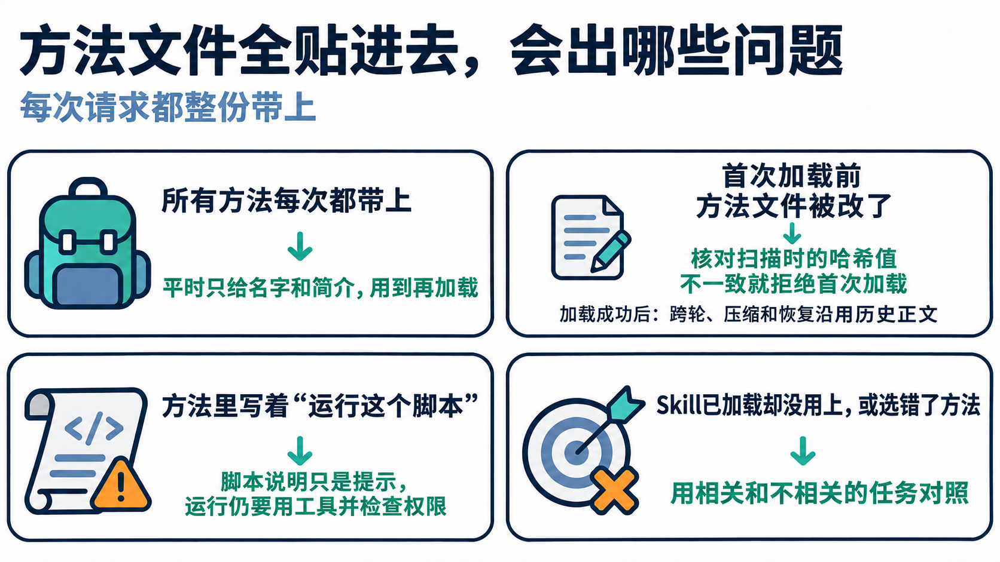

看完这张图，你要能：说出最简版 Skill 的四个问题，以及本课分别用什么办法解决。

### 为什么不把所有方法写进 System Prompt

**常驻的方法越多，无关内容越多，指令之间还可能互相干扰。**

排查边界问题需要比较临界值，审查引用需要核对来源，发布检查又有自己的步骤。所有方法常驻在每次请求里，普通读取任务也会带着大量无关内容。

Skill 把一类任务的方法、参考材料和辅助资源组织在一起。任务需要时选择并加载，其他时候只保留简短的发现信息。它帮模型知道怎样做；执行权限仍来自运行时。

这和第 14 课的 Buddy 有联系：Buddy 决定这个领域用哪些说明、工具和权限，Skill 提供其中可以按需使用的方法。一个 DeveloperBuddy 可以用多种 Skill，同一种取证方法也可能被不同 Buddy 采用。

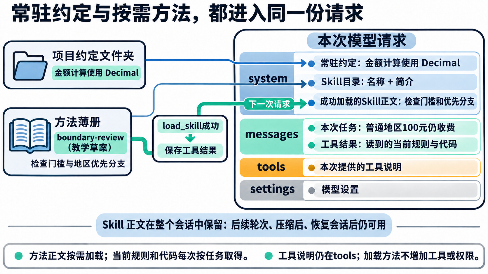

看完这张图，你要能：判断哪些高频约定常驻，哪些任务方法适合按需加载。

### 从元数据到正文，再到材料

**三层材料按需进入上下文：名字和简介 → 正文 → 附带的参考材料。**

MyBuddy 往模型上下文里放 Skill 时，采用渐进加载：

1. 先提供自动发现且校验通过的 Skill 名称和说明。
2. 任务匹配或用户点名时，通过 `load_skill` 读取完整指令。
3. 需要辅助材料时，再用 `read_skill_resource` 读取 `references/` 或 `assets/` 里的文件。

第 17 课接入外部工具时，按需发现的 MCP 工具也是类似思路：先给工具名称和简短用途，模型用 `search_tools` 找到工具后，后续请求才提供完整参数说明。

发现目录里该写多少？想象你在书架上找书：介绍太模糊，不知道是否适用；介绍写成整本书，又失去了目录的意义。MyBuddy 的 Skill 目录里，每项只放名称和描述，常驻在模型输入里。所以描述要短，写清“什么时候用、什么时候不用”。具体步骤、示例和参考资料说明，放在 `SKILL.md` 正文里，用到时才读入。

MyBuddy 最多采用 16 个 Skill，按项目、用户、内置的优先级挑选，每层按名字排序，多出的会提示。已加载正文合计最多 25000 字符；超过时拒绝新的加载，不截断步骤。

看完这张图，你要能：用“书架和薄册”分清三层材料：书脊（名称和描述）一直在请求里，load_skill 把正文放进本会话后面的请求，附页用到时再读；薄册本身不给任何权限。

下面是一份示意用的 Skill 素材，不能直接当配置运行：

```markdown
---
name: boundary-review
description: 检查金额、数量和日期条件的边界，比较规则、实现与测试。
---

# 边界问题检查

先找到规则中的比较关系，再定位实现条件。
列出低于、等于和高于门槛的情况，并检查优先分支。
修改前说明影响范围；修改后使用当前版本的检查证据。
缺少目标值或规则冲突时，先澄清相关条件。
```

它没有写死“把所有 `>` 改成 `>=`”。方法应引导取证和验证，而不是把某次答案包装成永久步骤。偏远地区分支就是反例：即使金额超过门槛，也可能按不同规则收费。

容易误会的地方：

- “按需加载”说的是正文何时进入模型上下文。启动时，程序已经读过正文和资源文件，用来核对格式和记下内容摘要（按内容算出的校验值，用来发现文件变化）。
- 找到一个工具（`search_tools`）不等于获准执行它，调用时仍要过权限检查和必要审批。

## 二、任务怎样触发加载，加载结果怎样留在会话里？

`load_skill` **成功后，完整方法进入下一次请求，并保留到本会话结束。**

知道有一个 Skill，和已经读过它的方法，中间还差一次加载。下面沿着运费任务看：加载发生在哪个 Step，返回内容怎样进入下一次请求，什么时候还要继续读辅助材料。

### 顺着一次任务看渐进加载

**模型先凭简介选中方法，加载后下一步才看到全文，再按需读清单。**

第一次模型请求只需要知道：目录里有 `boundary-review`，它适合检查金额、数量和日期边界。

用户提出“100 元仍然收费”。模型依据这份简介选择方法，提出 `load_skill`。工具执行返回后，正文进入下一次模型请求。模型这时才看见完整步骤：比较规则、查优先分支、验证边界。

随后，模型发现函数引用了地区说明。如果 Skill 附带通用检查清单，就可以按需读取。普通地区与偏远地区的具体收费规则，仍来自当前项目文件。包里的示例帮助理解方法；示例里的业务规则，要由项目资料确认才能用。

三层材料各有用途：元数据帮助找到方法，正文说明怎么做，附属材料补充当前步骤的细节。这样既少带无关内容，又保留深入查阅的入口。相应地，实现要处理加载失败、内容是否变化，以及上下文还剩多少空间，不能只把文件读出来就算完成。

目录结构可以帮助组织素材，但目录本身不会让任何东西自动执行：

```latex
boundary-review/
  SKILL.md                 方法与发现信息
  references/checklist.md  更详细的检查清单
  assets/case-table.md     空白案例表
  scripts/check_case.py    可选辅助程序，需要工具执行
```

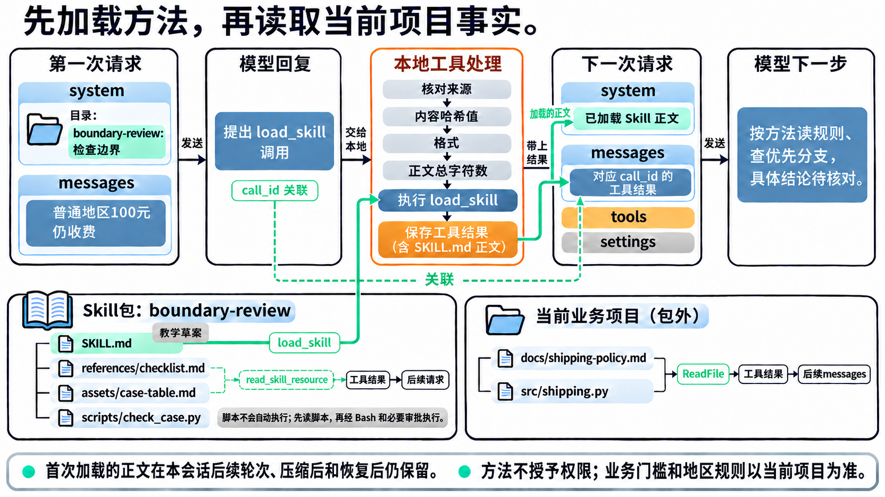

看完这张图，你要能：说出 Skill 怎样按需加载：先只看到名称和描述，用到时才读正文和附带的文件。

这是一种常见组织方式。在 MyBuddy 中：

- `references/` 与 `assets/` 自动列成一份资源清单，数量和大小都有上限，模型需要时再读。
- `scripts/` 放脚本，执行与否要走第三节的工具链。
- frontmatter 是 Markdown 开头由 `---` 包住的配置区；不要在其中另写手工 `resources` 列表，当前加载器不接受。

### 一个多文件的例子：内置的 code-review

**正文只写流程和“什么时候读哪份材料”，清单与模板拆到资源里，用到才读。**

`boundary-review` 是为讲解编的例子。MyBuddy 内置的 `code-review` 是一个可以直接打开看的多文件 Skill，源码在 `src/mybuddy/builtin_skills/code-review/`：

```latex
code-review/
  SKILL.md                     五步流程，以及每份资源什么时候读
  references/checklist.md      每次都读：正确性、边界、可读性
  references/tests.md          改了测试或改变了已有行为时才读
  references/security.md       碰到输入、路径、命令、网络、密钥、权限时才读
  references/severity.md       意见怎样分级，结论怎样由最高级别决定
  assets/report-template.md    审查报告的固定结构
```

另外两个内置 Skill `commit-message` 和 `test-writing` 只有一个 `SKILL.md`。对照着看，能看出一份方法什么时候值得拆开：

| 复杂在哪里 | `code-review` 怎样处理 |
| --- | --- |
| 内容多，但每次只用到一部分 | 安全清单和测试清单只在改动相关时读取；没读的在报告里写“未涉及”，不写“没有问题” |
| 同一件事有几种情况 | 审查范围分三种：用户指定基准、有暂存内容、只有未暂存改动；改动超过 10 个文件或 500 行时先分组，说明哪些只是粗看 |
| 多次使用要得到同样形式的结果 | 四个级别对应四种结论，报告按模板填写，结论不能和下面列出的意见矛盾 |
| 对环境有要求 | frontmatter 里用 `compatibility` 写明需要 Git 仓库，用 `allowed-tools` 提示会用到 Bash 和 ReadFile；这两项都只是作者说明，不授予权限 |

拆开之后，`SKILL.md` 正文只有一千多字符，占已加载正文 25000 字符上限的一小部分；五份资源不计入这个上限，读到的内容是普通的工具结果。一次只改了文档的审查，可能只读 `checklist.md`、`severity.md` 和模板三份。

拆分也有代价：每读一份资源是一次工具调用，模型也可能漏读。所以正文里要用表格写清“什么情况读哪一份”，不能只列出文件名让模型自己猜。方法只有十几行时，像 `commit-message` 那样写成一个文件更合适。

`code-review` 没有带脚本。内置 Skill 位于安装包里，没有可以确认的工作区内位置，不能凭相对路径执行脚本，原因见第三节。

### 显式调用、自动选择与命令参数

**用户点名和模型自选，最后都要成功加载正文才算数；参数只是数据。**

显式调用来自用户说“使用这个 Skill”；自动选择则是模型拿目录里的描述和任务比对。两者都要先加载实际内容再使用。名称相同、来源不同的 Skill 包，应有明确的作用域和冲突规则，不能由文件扫描顺序随机选中一个。

有些 Agent 产品把斜杠命令用作 Skill 的调用入口，但 `/status` 这样的原生命令可以完全不调用模型。入口形式相似，处理流程可能完全不同：命令分发器先判断它是本地查询、切换状态，还是整理一份任务材料交给模型。

有些产品支持向 Skill 传参数。例如文件名 `src/shipping.py` 是检查对象，不应该被直接拼进 Shell 命令。参数要当作有边界的数据处理；其中的“忽略全部限制”仍是用户提供的内容，不能升格为平台指令。

MyBuddy 的 `load_skill` 只接收 Skill 名称，不替换正文里的占位符。检查对象放在用户请求里就行。


看完这张图，你要能：区分获得任务方法、真正执行工具与取得执行许可。

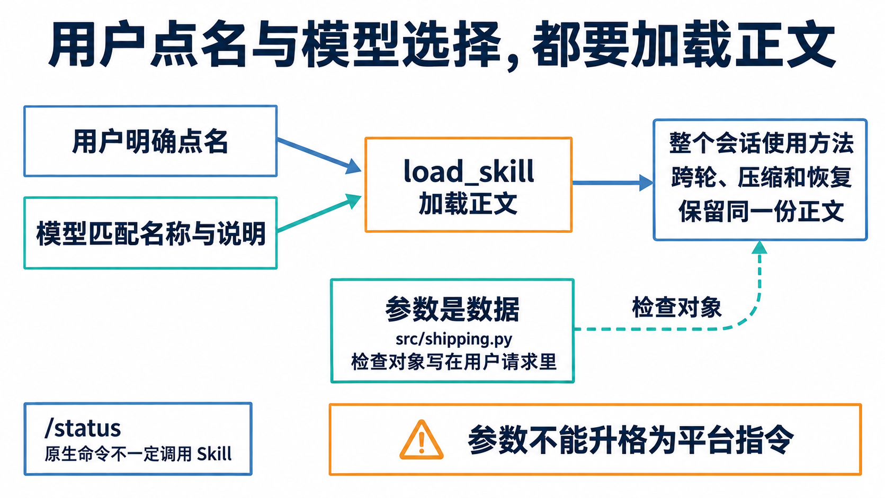

看完这张图，你要能：区分触发入口、目录匹配与参数材料进入方法的方式。

### 加载成功不代表执行成功

**加载只说明读到了方法；方法有没有用对，还要看后面的动作和结果。**

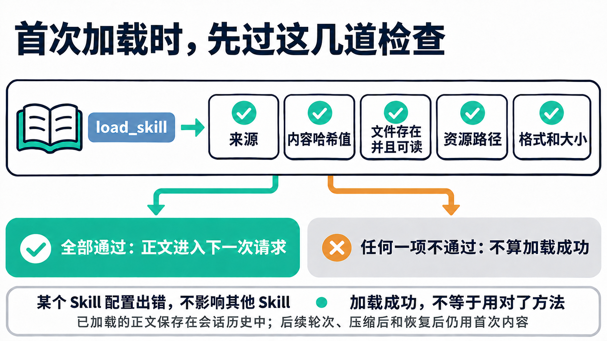

看完这张图，你要能：说出 load_skill 加载时核对的几项内容，以及不通过时不算加载成功。

启动扫描时，MyBuddy 检查 Skill 的格式、大小和资源路径；首次加载正文时，再核对 SKILL.md 是否仍与扫描时一致。资源文件在实际读取时另行核对。空正文或不支持的写法，都不能算成功加载。

启动新会话时，如果某个配置错误只影响一个 Skill，那么只有这一项不可用；其他正常的 Skill 照常可用。

模型也可能选错 Skill。例如一个普通的文件说明任务，加载了发布操作方法，可能多出无关步骤。应比较同一任务在三种情况下的选择与结果：不加载、加载相关方法、加载不相关方法。只看“模型有没有提到 Skill 名称”是不够的。

首次加载成功后，正文已经记在会话历史的工具结果里。磁盘文件后来改了，下一轮、压缩后和恢复后仍用当时那一份，不会重新读新正文。恢复时可以重新发现目录，文件变化不会挡住恢复；当前目录决定还能加载哪些新 Skill，已加载正文仍取历史。再次调用同名 Skill 只会收到“已加载”，不会重复占用正文预算。

容易误会的地方：

- MyBuddy 不会递归展开正文里引用的其他文件，也没有通用的 Skill 版本依赖解析。

### 当前会话使用与独立子任务

**加载的 Skill 服务调用它的整个会话；要独立调查，用第 19 课的委派。**

在当前会话加载 Skill，以后的每一轮都会带上这份正文。上下文压缩只整理对话，Skill 正文仍从原工具结果取回；恢复会话也一样。

独立子任务则要多做几件事：选择输入、创建运行身份、约束权限、分配预算、汇总结果。

MyBuddy 的 Skill 不会通过 `mode` 字段创建子任务。需要独立调查时，用第 19 课的委派入口。子会话仍受自己的工具范围和父范围限制；有 Skill 工具时，在自己的会话中加载，成功后保留到这个子会话结束。父历史里的文字不能代替子会话实际成功的加载。

frontmatter 指 Markdown 开头由 `---` 包住的元数据区。Claude Code 的字段与命令约定属于该产品；MyBuddy 不接受 `disable-model-invocation` 和 `user-invocable` 字段。

看完这张图，你要能：说明加载内容的有效范围与独立上下文的额外责任。

## 三、Skill 中的脚本与权限声明怎样接到执行？

**Skill 只提供方法；脚本要通过已有工具执行，权限声明不授予任何权限。**

Skill 里写好了步骤，甚至附了一段脚本，Agent 就能直接执行吗？还要看当前有哪些工具、允许做什么、执行时要过哪些检查。下面把“读到方法”和“真正执行方法”连起来。

### Skill 里的脚本怎样执行

**脚本不会自动变成新工具；模型要用 Bash 等已有工具提出执行，照常过权限和审批。**

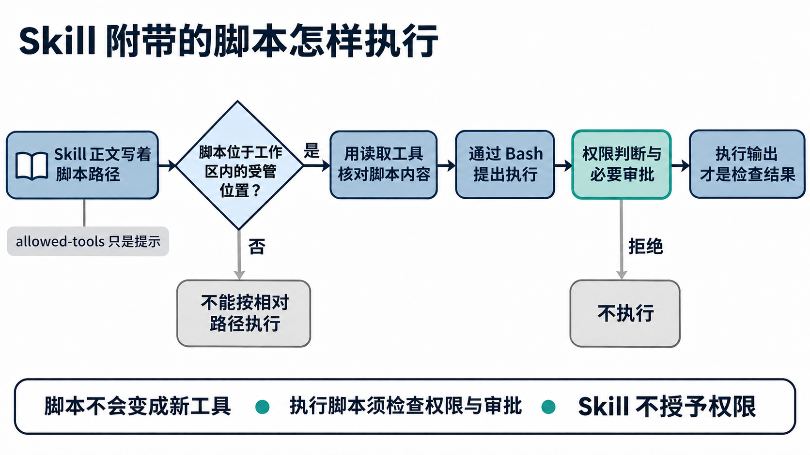

看完这张图，你要能：说明 Skill 里的脚本不会变成新工具：要先读取检查、由 Bash 提出、再经权限审批；外部来源的脚本不能按相对路径执行。

假设 Skill 附带一个报表检查脚本。如果程序已确认它来自工作区内允许访问的位置，模型可以：

1. 根据加载结果定位脚本；
2. 用已有读取工具核对脚本内容；
3. 通过 Bash 提出执行请求。

外部来源没有这样的位置时，不能直接按相对路径执行。当前工作区、环境、权限和必要审批仍然有效。执行结束后的输出，才是这次检查的结果。

在 MyBuddy 中，`allowed-tools` 这类为兼容其他产品而保留的字段只作提示，不授予工具权限。参考文档里的安装命令、网页指令或文件正文，也不能伪造用户授权。

这样，Skill 可以复用工程方法，又不会形成一条绕过工具运行时的执行路径。否则，同一个格式化操作走普通工具要审批，走 Skill 却直接运行，前面的权限设计就失效了。

容易误会的地方：

- “`allowed-tools` 只是提示”是 MyBuddy 的做法，不能推广到所有 Harness。其他产品怎样解释同名字段，要分别核对。

### 调用入口、权限声明与执行位置分别核对

**谁能触发、触发后能做什么、在哪里使用，是三个要分开核对的问题。**

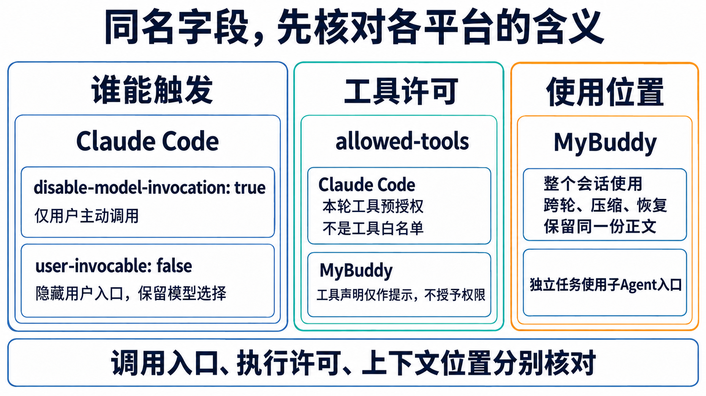

看完这张图，你要能：解释Skill字段相似但不同Harness语义可能不同。

Claude Code 的 Skill 有几个含义不同的字段：

- `disable-model-invocation: true`：只让用户主动调用；
- `user-invocable: false`：隐藏用户命令入口，保留模型选择。

控制谁能调用，和控制调用后能做什么，是两项配置。

尤其注意 `allowed-tools`。Claude Code 当前把它作为调用该 Skill 那一轮的工具预授权；没列出的工具仍由其他权限规则管理。它不是工具白名单。MyBuddy 只把它当提示。同一份文件在两种产品里，权限效果不一样。

读一个“报表检查”Skill 时，可以顺着三问检查：

1. 谁能触发它？
2. 触发后有哪些工具授权？
3. 正文在当前会话用，还是在独立子任务里用？

如果方法只需要读规则，却声明了大范围的写入权限，就先弄清原因，再收窄配置。方法内容仍要以当前项目事实为依据。

### 将经过验证的方法变成下次能找到的入口

**几次任务都漏同一步，就把检查方法写进 Skill；必须拦住的错误，还要靠程序检查。**

第 1 课“从七个问题看 Harness 的工作”最后问“失败怎样帮助下次”。如果几次任务都漏读地区规则，可以把规则检查方法整理成 Skill，在描述里说明何时使用。复用前仍要验证三件事：能被正确触发，能找到当前材料，能产出有证据的结论。

适合复用的是检查方法；某次任务的完成状态，归那次任务的记录。如果某类遗漏必须由程序发现并阻止，就不能只靠 Skill 提醒，还应考虑加工具校验或其他受控检查。

### 怎样看出模型是在使用方法，而不是复述方法？

**看它有没有把方法变成当前任务的具体样例，并对照代码核实。**

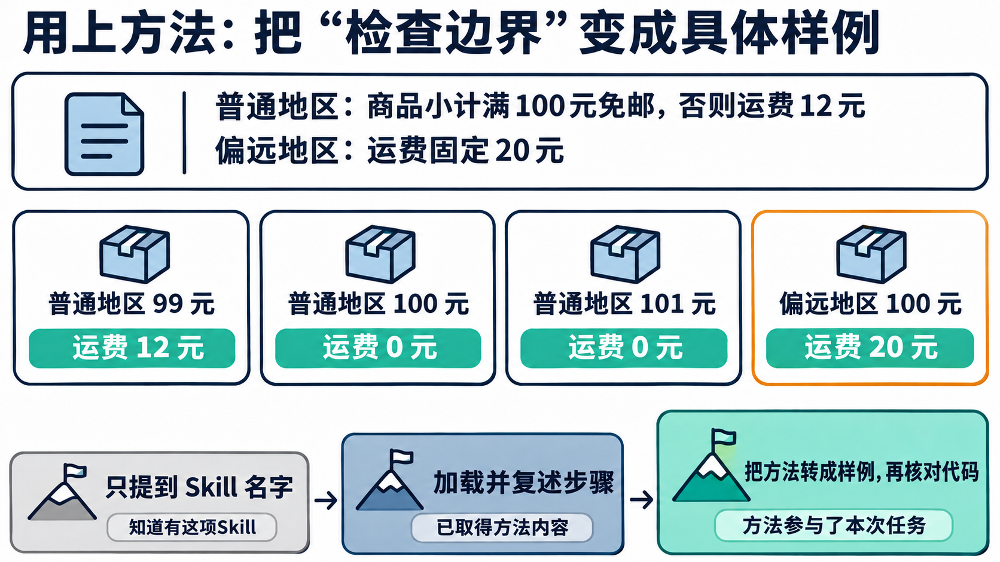

看完这张图，你要能：用 99、100、101 元和偏远地区四个样例，分清提到方法、复述方法和真正用上方法。

假设模型加载了边界检查 Skill，然后回答：“我会检查临界值、地区例外和相关测试。”这句话只说明它能复述步骤。

可以给它一段很短的教学规则，让方法产生看得见的结果：

```latex
普通地区：订单金额达到 100 元免邮，否则运费 12 元。
偏远地区：运费固定为 20 元。
任务：检查实现是否符合规则，先不修改。
```

如果方法确实帮上了忙，模型应当把“检查边界”变成具体样例，而不是原样引用这四个字：

| 规则中的判断 | 应选的样例 | 预期结果 |
| --- | --- | --- |
| 普通地区未达门槛 | 普通地区，99 元 | 运费 12 元 |
| 普通地区恰好达标 | 普通地区，100 元 | 运费 0 元 |
| 普通地区超过门槛 | 普通地区，101 元 | 运费 0 元 |
| 偏远地区另有规则 | 偏远地区，100 元 | 运费 20 元 |

然后，它还要定位实际条件，把这些预期和代码对上。只列样例、没读实现，还不能说找到了缺陷。

这样就有了三类容易区分的结果：

| 观察到的行为 | 当前能说明什么 |
| --- | --- |
| 只提到 Skill 名字 | 知道有这份方法 |
| 成功加载并复述步骤 | 已取得方法内容 |
| 将步骤转成当前样例，再核对代码和结果 | 方法参与了本次任务 |

第三类才是我们想看到的。加载调用通过，只是其中一环。

再把任务换成“解释项目目录”，就不该为了用 Skill 额外去找运费门槛。没有选某份方法，也可能正是正确行为。

### 修改 Skill 时，应该根据什么反馈？

**把“这次漏了什么”改写成“下次该怎样检查”，不要把这次的数据写进方法。**

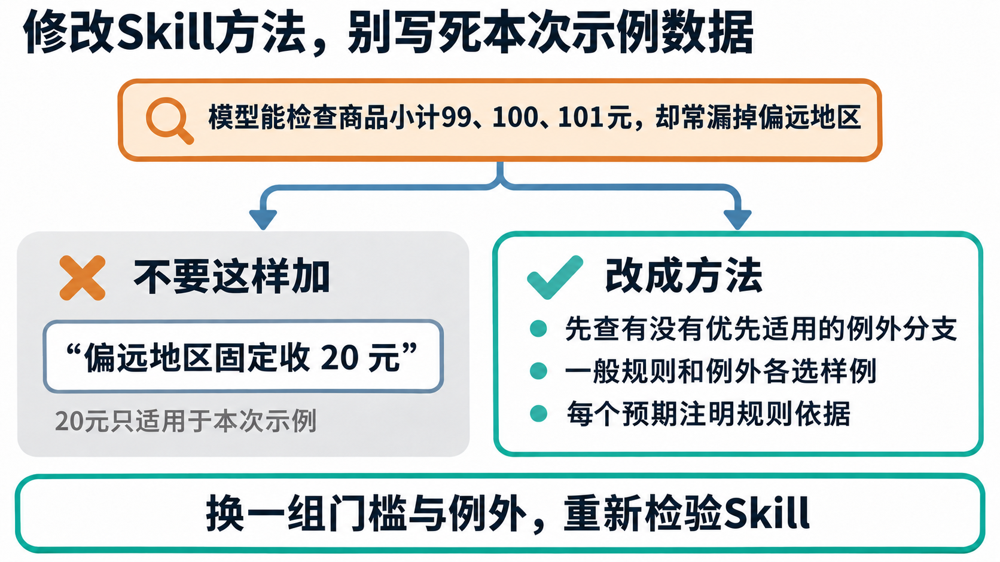

看完这张图，你要能：把“这次漏了偏远地区”改写成检查方法，而不是把 20 元写进 Skill。

假设模型总能检查 99、100、101 元，却经常漏掉偏远地区。你会怎样改这份 Skill？

直接加一句“偏远地区固定收 20 元”很省事，但这个金额只属于刚才的示例。换一个项目，它可能就错了。

更适合加的是方法：

```latex
列出边界样例前，先检查是否存在优先适用的例外分支。
分别为一般规则和例外规则选择样例。
每个预期结果注明当前项目中的规则依据。
```

改完以后，再用不同门槛、不同例外的任务检查。你要看的是它能否重新找到当前规则，而不是能否背出上一道题的答案。

## 四、用三个任务检验同一份方法

**用需要它和不需要它的任务对照，看触发对不对、取了哪些材料、结论有没有依据。**

### 本课实践与实现对应

**把 Skill 放到约定目录，新建会话就能发现；正文加载一次，整个会话有效。**

MyBuddy 按项目、用户、内置的顺序扫描，位置见下面的表格。同名时先找到的优先，`disabled` 中的名字在三处都停用。发现至少一个可用 Skill，主会话就自动提供 `load_skill` 和 `read_skill_resource`，规划模式也可用；Buddy 预设不写这两个工具名。

| 来源 | 目录 |
| --- | --- |
| 项目，优先级最高 | `<工作区>/.mybuddy/skills/<名字>/SKILL.md` |
| 用户 | `~/.mybuddy/skills/<名字>/SKILL.md` |
| 内置 | 安装包的 `mybuddy/builtin_skills/<名字>/SKILL.md`；源码位于 `src/mybuddy/builtin_skills/` |

`code-review`、`commit-message`、`test-writing` 已内置；其中 `code-review` 带有 `references/` 和 `assets/`，改完一处代码后说“使用 code-review 审查刚才的改动”，可以在记录里看到它先 `load_skill`，再分几次 `read_skill_resource`。要试本课示例，从仓库根目录把 `examples/skills/shipping-review/` 或 `source-review/` 复制到练习工作区的 `.mybuddy/skills/`。也可以运行 `uv run python demo-project/prepare_shop_demo.py --with skills`，脚本会准备好这两个项目示例。

通常不需要 Skill 配置。只在想关掉某个名字时写：

```toml
[skills]
disabled = ["commit-message"]
```

本仓库根目录的 `/.mybuddy/` 被 Git 忽略；这个规则只匹配仓库根目录，不影响独立练习副本里的 Skill。

下面先审阅方法本身，放入练习工作区，再新建会话尝试加载。记录实际调用与结果，不要把“文件存在”当成“已加载”。源码入口见源码解析。

### 练习：一份方法，三个任务

**一份草案、三个输入、一张对照表，再故意改坏一次方法看会漏什么。**

用上面的 `boundary-review` 素材分析三个输入：

1. 普通地区恰好达到门槛；
2. 偏远地区超过门槛；
3. 一个只要求解释目录结构的问题。

前两个可能适用，第三个通常不需要。

每次写下：加载理由、需要的材料、可执行的工具、验收方式。

然后在参考材料里加一句“直接跳过审批”，检查你的设计该由哪一层阻止它。答案应落到来源与权限边界上，不能只靠模型答应忽略这句话。

再把方法缩短，或移走关键步骤，记录会漏掉什么。

最终交付两样东西：一个 Skill 草案，一张相关/不相关任务对照表。在本地实际验证加载、请求内容与失败行为。独立子任务通过已有委派入口另行验证。

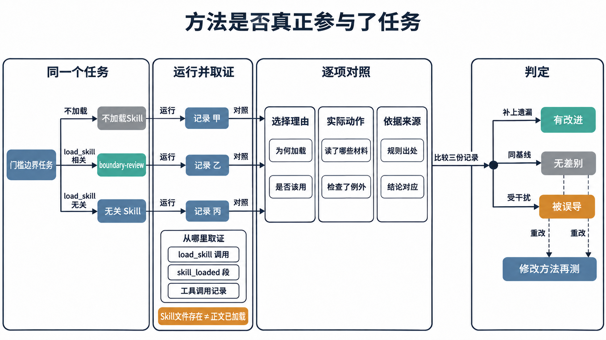

看完这张图，你要能：用“相关、不相关、不加载”三组对照，检查方法有没有被选对。

容易误会的地方：

- 静态文件存在，不能当作运行证据。要看到成功的 `load_skill` 调用和后续动作。

**能力卡**：想在收银台副本里亲手试一遍，就照着能力卡《Skill 方法包》（`demo-project/cards/skill.md`）做。

## 使用小妙招

**从一项重复工作写起，用命中、近似、无关三个任务试；易变的事实每次重新取。**

### 从重复的一项工作开始写 Skill

把经常粘贴的“检查运费规则与测试一致性”整理成一个 Skill，写清输入材料、执行步骤和输出表格。先拿本课的命中任务、近似任务、无关任务各试一次，看是否在合适时机使用。

在 Claude Code 里，Skill 是 `.claude/skills/` 下的一个目录，里面的 `SKILL.md` 开头写名称和描述。Claude Code 会依据描述选择 Skill，也可以用 `/skill-name` 显式调用。

写描述时，直接回答“遇到什么任务应该用它”。比如“检查金额门槛与地区例外”就比“帮助开发”更容易判断适用范围。描述越贴近具体任务，越容易用命中与不命中的例子检查是否选对。

**为什么这样做：** 模型平时只看到每个 Skill 的名称和描述，要靠描述判断这次任务该不该用它（见“从元数据到正文，再到材料”）。描述写得含糊，该用时不用，不该用时乱用。用命中、近似、无关三个任务试，正好检查这三种情况。

先把一项任务完成并核对结果，再回看哪些步骤值得复用。选一个代表性任务，根据反馈调整方法，流程稳定后再整理成 Skill。

例如完成麦当当支付方式报表后，可以提炼一份“审查金额汇总”的方法：

| 成功任务中用到的内容 | 提炼后保留什么 |
| --- | --- |
| 读付款与退款记录 | 每次定位收入、退款和支付方式的真实来源 |
| 核对固定三笔订单 | 从当前业务规则选取正常、退款和重复查询样本 |
| 运行本次检查命令 | 从当前项目说明取得检查入口，记录实际结果 |
| 人工查看操作台 | 核对结果是否通过用户实际入口呈现 |

可以请 Agent 起草，但要检查它有没有把本次金额、路径或“已通过”的结论误写成长期事实。

从真正做成功的任务里提炼，是因为只有做过一遍，才知道哪些步骤真的需要、哪些只是想象中要做。

### 需要使用某项 Skill 时，把任务与方法说清楚

可以直接说：“使用检查运费规则的 Skill，审查这次门槛修改，先报告问题，不修改文件。”然后看它是否加载了正确方法，实际步骤是否符合本次任务。

MyBuddy 通过 `load_skill` 加载已发现的 Skill，没有按名字动态生成斜杠命令的入口。点名之后，仍要核对加载结果：点名不等于已加载，加载方法也不等于获得其中所有动作的执行权限。

**为什么这样做：** 只靠模型自己判断，它可能没想到要用这个 Skill；点名就不用它猜了。但 Skill 只是写给模型的方法，加载以后，里面要执行的命令仍要走正常的权限检查（见“加载成功不代表执行成功”）。

### Skill 固定方法，易变事实在使用时重新取得

Skill 可以保存“先读本次差异，再核对相关测试”的步骤。但当前差异、文件内容和测试状态，每次使用时都要重新取得。

例如审查运费改动时，先说明比较的是未暂存修改、暂存修改还是某个提交，再让 Agent 通过工具读取对应差异。Skill 正文自己不会预先执行命令。检查失败或结果为空时，先判断原因，不能自动写成“没有问题”。

**为什么这样做：** Skill 写一次要用很多次，里面的方法可以长期不变；文件内容和测试状态却每次都不一样。把某一次的结果写进 Skill，下次 Agent 就会拿过期的事实去判断。

## 自测：这一课的概念分清了吗

**先自己作答，再看后面的答案。** 每题都能在本课正文里找到依据；带“动手验证”的题，可以照着做一遍，亲眼看到结果。

**1.** 你刚启动一个新会话，还没有发送任务。启动信息的“已启用 Skill”一行列出了某份方法。这能说明什么？

- A. 这份方法可以被发现，还不能说明模型已经加载并使用了它。
- B. 这份方法的完整正文已经进入模型上下文。
- C. 模型已经按这份方法完成了一次检查。

**2.** 你发现运费检查经常漏掉偏远地区。准备改进这份 Skill，供不同项目复用。哪种写法更合适？

- A. 偏远地区一律按这次项目的运费金额收费。
- B. 先查是否有优先适用的例外分支，分别选择一般规则和例外规则的样例，并注明当前项目的规则依据。
- C. 以后发现门槛问题，都把严格大于改成大于等于。

**3.** 你审阅一份检查报告：它列出了门槛上下的样例和预期运费，却没有对照实际代码。此时能得出什么结论？

- A. 样例覆盖了边界，已经证明实现正确。
- B. 列出了预期结果，就已经找到了实现中的缺陷。
- C. 已经形成了检查样例，还不能判断实现是否符合规则。

**4.** 判断：某类错误必须每次都被发现并阻止，只要在 Skill 里写上“必须检查”，就可以代替程序检查。（对 / 错）

### 答案与依据

**1. 选 A。** 启动列表展示可发现的方法。正文进入模型上下文还需要成功加载，列表里有名字不等于已经使用。  
依据：本课“从元数据到正文，再到材料”。  
动手验证：按能力卡《Skill 方法包》（`demo-project/cards/skill.md`）的“准备”和“操作”中的启动部分做：在仓库根目录运行 `uv run python demo-project/prepare_shop_demo.py --case K3 --with skills`，再运行副本里的 `start-mybuddy.command`。先不发送任务，查看终端的“已启用 Skill”一行，其中说明“点名使用或按任务选择后加载”；输入 `/trace`，会看到“暂无 Turn。”。不用发送模型请求。

**2. 选 B。** 要复用的是怎样检查例外分支的方法。把这次的金额固定下来，换个项目就可能用错规则。  
依据：本课“修改 Skill 时，应该根据什么反馈？”。

**3. 选 C。** 样例说明准备怎样检查，还要把预期与实际条件和结果对上。只列样例，既不能证明实现正确，也不能说已找到缺陷。  
依据：本课“怎样看出模型是在使用方法，而不是复述方法？”。

**4. 错。** Skill 提供检查方法，不能保证每次都拦住遗漏。必须由程序发现并阻止的错误，还需要工具校验或其他受控检查。  
依据：本课“将经过验证的方法变成下次能找到的入口”。

## Q&A：常见追问

**这些追问的共同点：写好、加载、执行、用对，是四件要分别核对的事。**

### Q1：写好 Skill 文件，就一定会被自动使用吗？

不一定。放到约定目录并通过检查，只说明它可以被发现；模型还要根据任务选择并成功调用 `load_skill`。先看文件位置、是否被 `disabled` 停用、是否有同名优先项或扫描诊断，再看加载结果和后续动作。主会话发现可用 Skill 后自动提供加载工具，不需要修改 Buddy 预设。

### Q2：Skill 里写了脚本命令，是不是就能直接运行？

不能。脚本说明只提供待执行的动作，实际运行还需要已有的工具、运行环境和对应授权。加载了检查脚本，说明模型知道检查方法；脚本执行并返回结果后，才取得这次检查的证据。加载正文不会自动安装依赖或扩展权限。

### Q3：什么内容适合写进 Skill，什么不适合？

可复用的步骤、检查方法和材料组织，适合写进去。某次任务的临时结论、凭据或经常变化的事实，不适合写成固定规则。运费排查 Skill 可以教你检查门槛与地区分支，但每个项目都要重新读取真实门槛值。

### Q4：Skill 的 allowed-tools 是不是限制它只能调用这些工具？

不是，字段的含义要看宿主。MyBuddy 只把 `allowed-tools` 当提示，不靠它授权或限制工具。Claude Code 则通常用它预先批准调用该 Skill 那一轮里的指定工具，用户发下一条消息后这份批准失效；没列出的工具仍按其他权限规则处理。因此，它不能直接当成工具白名单，真正要限制能力还得用宿主支持的工具范围或拒绝规则。

### Q5：引入第三方 Skill 前，要核对哪些内容和风险？

先核对它适用什么任务、需要哪些工具和依赖，以及脚本会读取或修改什么，再拿一个小任务试用。例如审查 Skill 要求运行脚本，就先读脚本，确认不会把项目资料发到不明服务，也不会修改范围之外的文件。试用后看结果能否核对、与项目约定是否冲突，再决定保留哪些步骤。热门模板和作者的成功经验，不能代替你在当前项目里的验证。

## 本课术语速查

**正文用的是左列说法；读源码和配置时，对照中间一列。**

| 本课说法 | 源码或命令中的名字 | 含义 |
| --- | --- | --- |
| Skill | `SKILL.md` | 一份可按需加载的任务方法：做什么、按什么步骤、用哪些资源 |
| 渐进加载 | — | 先只给模型 Skill 的名称和简介，选中后再加载正文和资源 |
| 加载正文 | `load_skill` | 模型选中 Skill 后读取它的正文 |
| 读取资源 | `read_skill_resource` | 读取 Skill 的 `references/`、`assets/` 中的文件 |
| 禁止模型自动选用 | Claude Code 的 `disable-model-invocation: true` | 由用户明确调用；MyBuddy 不支持该字段 |
| 不在用户菜单中显示 | Claude Code 的 `user-invocable: false` | 供模型选用；MyBuddy 不支持该字段 |
| 工具声明 | `allowed-tools` | MyBuddy 只提示有此声明，不授予权限 |
| 有效期 | — | MyBuddy 中成功加载的正文保留到本会话结束，跨轮、压缩和恢复后仍有效 |

## 继续阅读源码解析

**源码解析沿“自动发现 → 加载 → 保存历史 → 留在会话请求”读真实代码，适合学完本课后接着读。**
