有些事不能指望模型记得去做，可以让程序在会话、轮次、工具和压缩的固定时机自动运行命令。先分清：事前检查可以拦下调用，事后反馈只能告诉模型发生了什么。

学完这一课，你应能说出一个 Hook 在什么时候触发、能影响什么。你也能说明它出错时，主任务怎样处理。

MyBuddy 支持七种事件。先看它们分别接在主流程的哪里，再用工具前后的两种事件做练习。

| 事件（配置段） | 什么时候运行 | 能不能影响结果 |
| --- | --- | --- |
| `session_start` | 新建或恢复主会话，准备接收输入时，一次 | 只运行命令；输出显示给你，不交给模型 |
| `session_end` | 主会话正常关闭时，一次 | 只运行命令；失败不阻止关闭，等待时间较短 |
| `turn_start` | 接受用户消息后，请求模型之前 | 只运行命令；输出显示给你，不交给模型 |
| `turn_end` | 一轮完成、失败或取消之后 | 只运行命令；能读到本轮的结束状态，不能要求模型继续 |
| `pre_tool_use` | 策略、规划模式、审批和会话放行名单都判断完，工具真正执行之前 | 退出码 `2` 拦截本次调用；输出作为拒绝原因交给模型 |
| `post_tool_use` | 工具成功之后、保存结果之前 | 输出随工具结果交给模型；不能撤销已完成的操作 |
| `compact` | 自动或手动压缩成功保存之后 | 只运行命令；输出不进入模型上下文 |

同一事件有多条命令时，按配置顺序执行。`pre_tool_use` 和 `post_tool_use` 用 `matcher` 挑工具；其余五种不写 `matcher`。五种只运行命令的事件，失败、超时只在终端提示或 Web 轨迹里记录，不改变原来的会话结果。

## 本课导览

**本课需求：收银台的代码，每次被 Agent 改完都自动格式化。**

麦当当收银台（`demo-project/mini-shop`）的团队约定：`src/` 里的 Python 代码统一用 Ruff 格式化（`ruff format`），格式不对的改动在评审时会被退回。具体要求是：

1. Agent 用 `WriteFile` 或 `EditFile` 成功改了 `src/` 下的某个 `.py` 文件，就立刻对**这个文件**运行 `ruff format`。
2. 只改了文档（比如 `docs/DESIGN.md`）时，不格式化。
3. 格式化的结果要让 Agent 看到。格式化失败时，不撤销 Agent 的修改，由 Agent 看到失败再处理。
4. 不用每次都问你批准；这条规则你在启动配置里写一次就生效。

**Ruff 是什么？** 它是一个 Python 代码整理工具。`ruff format` 会自动统一缩进、空格、换行和引号写法，只改代码的样子，不改运行结果。它不随 MyBuddy 安装，做本课练习前先在终端装好。用哪种方式都行，选你平时管理 Python 工具的那一种：

```bash
uv tool install ruff      # 用 uv
pipx install ruff         # 用 pipx
python3 -m pip install --user ruff   # 只用 pip
```

装好后运行 `ruff --version`，能显示版本号就行。

在提示词里写“改完记得格式化”，模型可能照做，也可能在一次改五个文件的任务里漏掉几个。这一课回答：**怎样让程序在固定时机自动做一件事，把该给模型的反馈交给模型，把该给你的通知显示出来？** 按五步展开，最后做出一份满足上面四条要求的配置：

- **为什么要自动触发**：触发时机、工具匹配和命令怎样组成一次自动触发；先看一个几行的最简版。
- **Hook 接在工具流程的哪里**：从最简版出发，一次加一个约束；再看结果怎样进入后续请求。
- **怎样配置**：一份能用的配置，命令怎样取得工具参数和文件路径。
- **怎样避免重复触发**：格式化为什么不会无限触发，重启以后为什么不会重做工具。
- **怎样检验规则真的有用**：区分命令执行、失败反馈与业务验证。

源码解析沿同一条路径读真实代码。

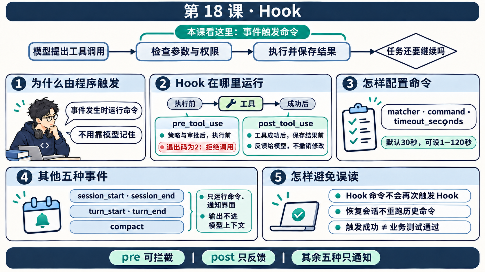

## 一、为什么要让程序自动触发？

**模型可能忘，程序不会：到了约定时机，程序自己检查要不要运行命令。**

### 写进提示词，和让程序在固定时机执行

**Hook 把“每次改完都要做”的事交给程序，不再靠模型记得。**

回到本课需求。你可以在提示词里要求“每次修改后格式化”，但这要靠模型每次都记得，每次都选择去做。

如果希望成功修改后一定执行，就把命令交给程序。程序知道“工具刚执行成功”这个时刻。到了这一刻，它就检查匹配条件。

**Hook** 就是程序在约定时机自动运行的扩展，在 MyBuddy 里就是一条你配置好的命令。先以 `post_tool_use` 为例，它由三部分组成：

| 部分 | 含义 | 例子 |
| --- | --- | --- |
| 触发时机 | 工具成功后、结果保存前 | `PostToolUse` |
| 匹配条件 | 哪些工具成功后才触发 | `WriteFile |
| 命令 | 触发后由 Shell 运行什么 | `ruff format "$MYBUDDY_FILE_PATH"` |

模型仍然决定任务怎样一步步做。Hook 由程序按启动配置触发，不需要模型再提出一次命令调用。

七种事件的时间表见本课开头。下面先从 PostToolUse 的事后反馈读起，再与 PreToolUse 的事前检查对照。

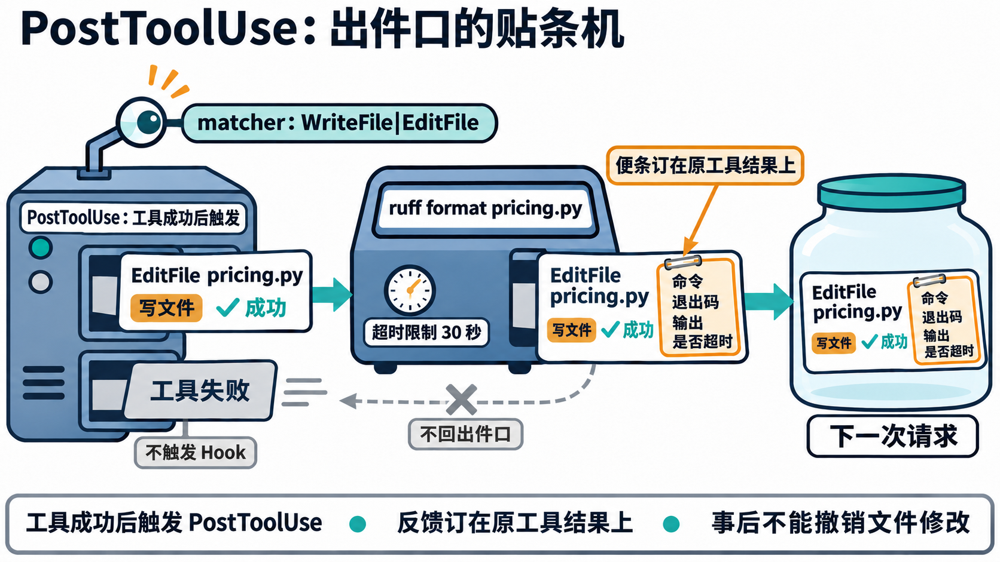

看完这张图，你要能：用“出件口贴便条”理解 PostToolUse：工具成功后按 matcher 触发命令，命令结果像便条一样订在原工具结果上，一起进入下一次请求。

### 同一种入口，可以运行不同命令

**打印、检查、格式化，都用同一种 Hook 配置来接；命令做什么，就有什么副作用。**

| 需要 | 命令可以做什么 | 要核对什么 |
| --- | --- | --- |
| 确认触发范围 | 打印工具名和文件路径 | 应触发与不应触发的操作是否分清 |
| 自动检查 | 运行项目检查脚本 | 退出码、失败位置和覆盖范围 |
| 自动格式化 | 调用已安装的格式化程序 | 实际文件差异与后续测试 |

这些都是配置的 Shell 命令。命令可能修改文件或访问外部服务。

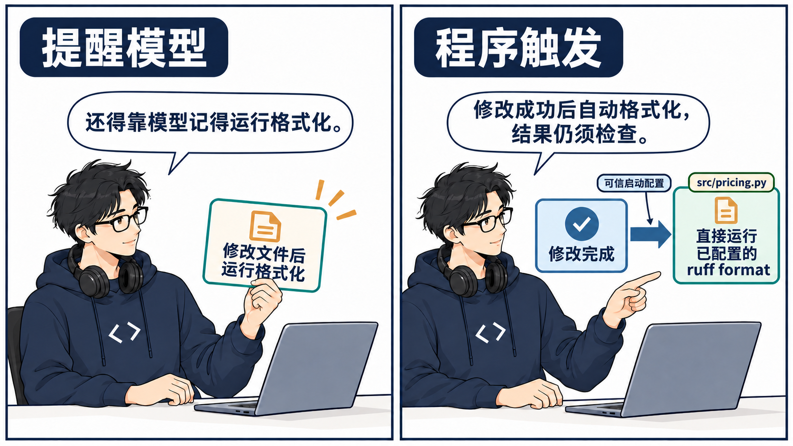

看完这张图，你要能：理解提示词要求与程序触发的差别。图右侧表示修改成功后，程序直接运行已配置的格式化命令。命令由可信配置授权，使用 Bash 的沙箱配置，并受取消和停止规则约束。

容易误会的地方：

- 命令是否只读，取决于命令本身。叫“检查”，不代表没有副作用。

### 先看最简版

**先只看 PostToolUse，最简版就是“工具成功后，挑出匹配的命令跑一遍”。**

下面是一段 Python 风格的**教学伪代码**，不能直接运行：

```python
def run_tool_with_hooks(call, hooks):
    result = run_tool(call)                       # 1. 先执行原工具
    if result.status != "succeeded":              # 2. 失败就不触发
        return result
    for hook in hooks:                            # 3. 按配置顺序逐条看
        if call.name in hook.matcher.split("|"):
            out = shell(hook.command,             # 4. 运行命令，告诉它改了哪个文件
                        env={"FILE": call.args["file_path"]})
            result.hooks.append(out)              # 5. 输出附在原结果上，交给模型
    return result
```

用收银台例子走一遍：

1. 模型用 `EditFile` 改了 `pricing.py`，编辑成功。
2. 配置的 `matcher` 是 `WriteFile|EditFile`，命中了。
3. 程序运行 `ruff format pricing.py`，把输出附在编辑结果上。
4. 下一次模型请求，模型看到“编辑成功”和格式化的结果。

这个最简版能自动格式化，但它很脆弱。命令卡住怎么办？命令改了文件，模型还拿着旧内容怎么办？第二节一次加一个约束。

## 二、Hook 接在工具流程的哪里？

**工具上有两个 Hook：PreToolUse 在审批之后、执行之前，可以拒绝这次调用；PostToolUse 在原工具成功之后、结果保存之前，只能反馈，不能撤销已经发生的修改。本节沿 PostToolUse 讲，其余五种事件只发通知（第四节）。**

### 从最简版到 MyBuddy：一次加一个约束

**最简版假设命令很快、只读、不会出错；MyBuddy 多出来的代码，都在处理这些假设不成立的时候。**

1. **命令可能卡住 → 每条命令有超时，到时停下整个进程组。** 发出停止还不够，要确认进程真的停了（第三节）。
2. **命令可能改文件 → 每条命令跑完，都清除文件读取记录。** 模型之后要编辑，得先重新读取（本节）。
3. **后置命令可能失败 → 失败也只是反馈。** 不回滚原修改，也不把原工具的成功改成失败（本节）。
4. **输出可能很长 → 只保留开头一段。** 进入模型请求时，还受工具结果的大小限制（本节）。
5. **命令什么都能做 → 授权来自可信启动配置，运行在 Bash 的沙箱里。** 不逐次请你审批（第三节）。
6. **格式化可能再触发格式化 → Hook 命令不是新的工具调用。** 所以不会递归触发（第四节）。
7. **会话恢复时可能换了配置 → 恢复后使用当前配置；已保存的结果不重做。**（第四节）

把这些约束加回最简版，一次修改的流程是：

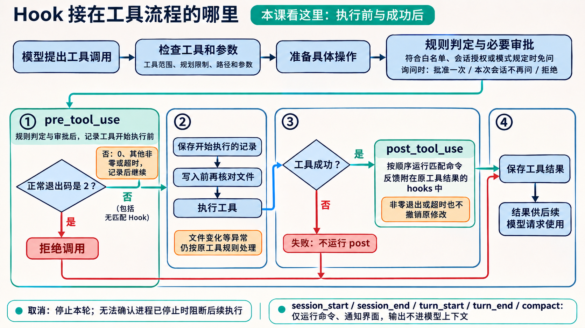

看完这张图，你要能：沿一次修改指出 PostToolUse 在工具成功后、结果保存前运行，拒绝和失败的调用不触发。

和最简版比，骨架没变：还是“执行工具 → 成功了就跑匹配的命令 → 结果附上”。多出来的每一步，都对应上面一个约束。

### 命令怎样取得输入？

**参数从标准输入的 JSON 拿，常用的工具名和文件路径也放在环境变量里。**

命令在会话工作目录中，通过 `/bin/sh -c` 执行。程序把一段 JSON 写进命令的标准输入（stdin），包含：

- 所有事件都有 `event`、`session_id`；工作区路径由环境变量提供。
- 工具事件另有 `tool_name`、`tool_input`，文件工具还提供文件路径。
- PostToolUse 的 `tool_result_status` 是 `succeeded`；TurnEnd 的 `turn_outcome` 告诉命令这一轮如何结束。

常用信息也放进环境变量：`MYBUDDY_EVENT`、`MYBUDDY_SESSION_ID`、`MYBUDDY_WORKSPACE`。工具事件有 `MYBUDDY_TOOL_NAME`，参数里有字符串 `file_path` 时还有 `MYBUDDY_FILE_PATH`。轮末事件有 `MYBUDDY_TURN_OUTCOME`。

程序不会额外传入聊天全文或完整工具输出，也不会继承宿主的密钥环境变量。工具参数会过滤名称含 key、token、secret 等字样的字段，但其他字段的值仍可能含敏感内容；脚本记录输入前要自行检查。要核对文件当前内容，脚本需要自己读文件。

### 结果怎样交给模型？

**PostToolUse 的退出码和输出，附在原工具结果上，下一次请求交给模型。**

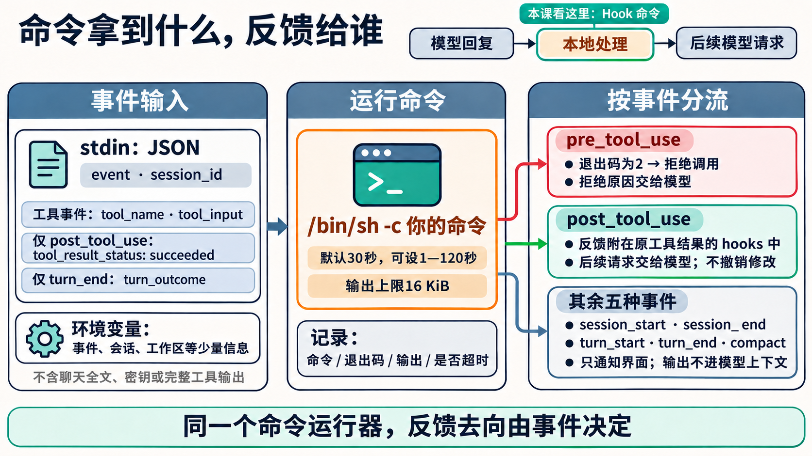

看完这张图，你要能：说出命令从 stdin 和环境变量取得的输入，以及附在原工具结果上的四项结果。

每条命令留下四项：命令、退出码、输出、是否超时。它们放进原工具结果的 `hooks` 列表。保存后，整理成后续模型能看到的反馈。

输出只保留开头一段，进入模型请求时，还受工具结果能占多少空间的限制。所以输出要短：说清检查了什么、结果如何、哪里失败。

命令退出非零或超时，会留下反馈。模型看到后，再决定补读、修正，还是向你解释。

容易误会的地方：

- 命令失败不会撤销原工具的修改，也不会把原工具的成功改成失败。
- **修改成功、命令成功、业务测试通过，是三件事。**
- 命令无法启动时也会返回失败信息。但如果无法确认进程已经停下，就不能把它当成普通的失败反馈接着往下走，而要暂停后续操作，等待确认进程已经停止。

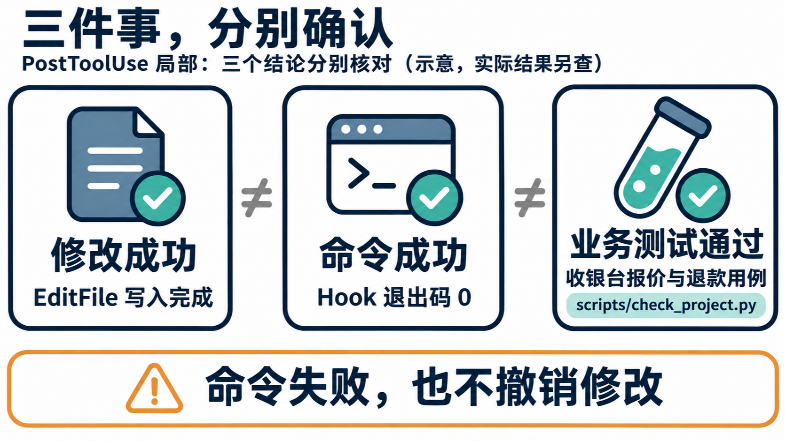

看完这张图，你要能：区分修改成功、命令成功与业务测试通过，命令失败也不撤销修改。

### 命令改过文件，为什么要重新读取？

**格式化可能改了模型刚读过的内容，所以每条命令跑完，都要让旧的读取记录作废。**

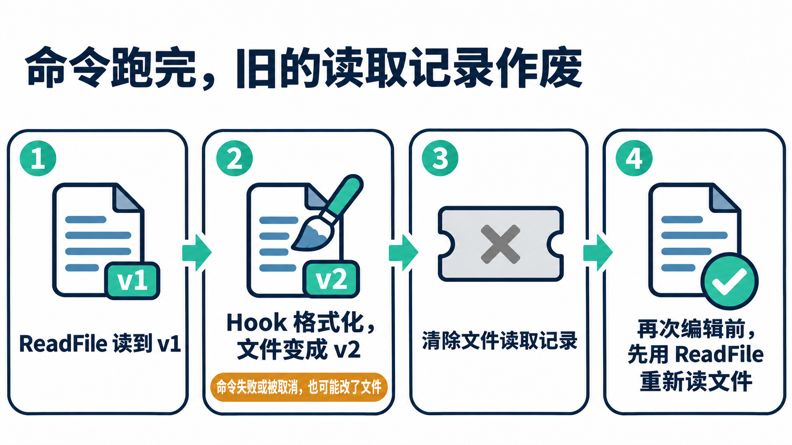

看完这张图，你要能：解释 Hook 命令可能改文件，所以执行后清除读取记录，再编辑前要重新读取。

格式化可能改变模型刚读过的内容。命令即使失败或被取消，也可能已经写了一部分。

所以每条匹配命令执行后，MyBuddy 都清除文件读取记录。下一次要依赖读取记录编辑时，必须重新读取当前文件，不能沿用执行前的内容。PreToolUse 检查时已经准备好的那次文件操作，会在真正写入前再核对原文；如果 Hook 自己改了文件，工具不能把新内容覆盖掉。

### PreToolUse 与 PostToolUse：拦下调用，还是补充反馈

`pre_tool_use` **在工具真正执行前检查，**`post_tool_use` **在工具成功后反馈。退出码相同，含义也不同。**

假设你要求“可以改业务代码，但不要改 `tests/`”。先让权限和审批判断这次调用本来能不能执行。已经被拒绝的调用，不会进入 PreToolUse；Hook 也不能替它放行。通过判断以后，再运行匹配的 PreToolUse 命令：

```toml
[[hooks.pre_tool_use]]
matcher = "WriteFile|EditFile"
command = 'case "$MYBUDDY_FILE_PATH" in tests/*|*/tests/*) printf "请保留测试，修改业务代码。\n"; exit 2 ;; esac'
timeout_seconds = 5
```

这是看懂退出码的简单例子。完整可试的路径检查脚本在 `examples/hooks/`，会把相对路径和绝对路径都转换成实际位置再判断。这个例子只检查 `WriteFile`、`EditFile`，不会检查 Bash 命令里藏着的写入；完整的文件访问边界仍由权限与沙箱负责。

- 命令正常以 `2` 退出：工具不会执行；拒绝原因随这次调用的工具反馈交给模型，轨迹中的原因码是 `runtime.hook_pre_tool_use_denied`。模型可以根据原因改用其他办法。
- 退出码 `0`、其他非零值，或超时：记录情况，继续执行原工具。不能把检查脚本本身坏了误报为它已经判断了“不允许”。
- 用户取消：停止正在运行的命令并等待它真正停下，不再执行原工具；确认不了停止状态时，会话阻断。

前置命令的运行情况另存在这次工具调用的 `pre_hooks` 记录里，轨迹可以查看。它不会把每条检查命令的输出都塞给模型。拒绝时，模型会收到拒绝状态和该命令的原因；原因最多取输出前 8192 个字符，剩余内容看 Hook 记录。每条命令本身最多保留 16 KiB 输出，所以脚本应把关键原因写在前面。

相反，PostToolUse 发生时，文件已经改了。它即使返回 `2`，也只是反馈，不能把写入变成从未发生。

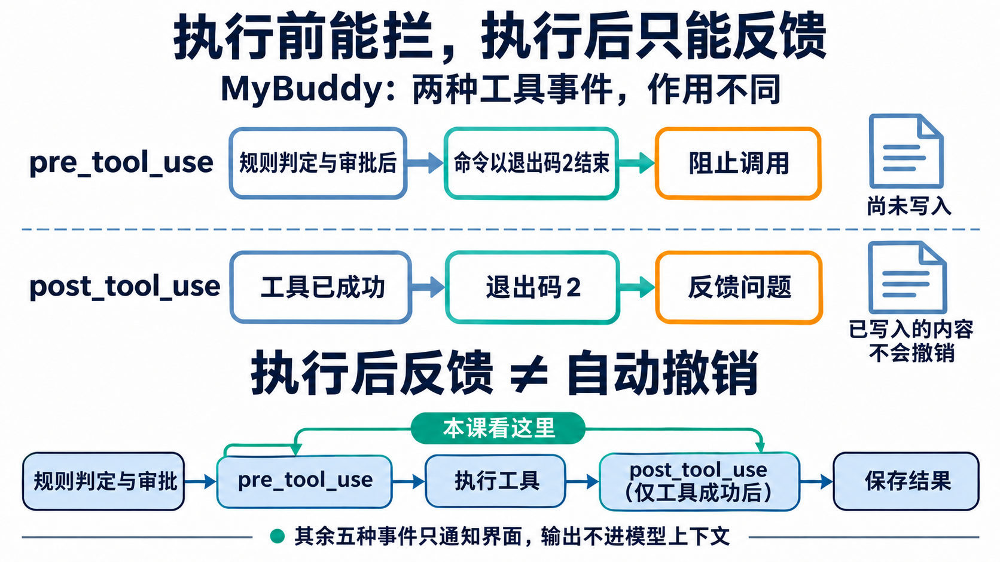

看完这张图，你要能：按时机区分阻止与反馈。MyBuddy 的 PreToolUse 退出码 2 拒绝尚未执行的调用；PostToolUse 的退出码只反馈，不能撤销修改。

## 三、怎样配置一个 Hook？

**配置段选择事件，**`command` **写命令，**`timeout_seconds` **写等待上限；只有工具事件需要** `matcher`**。**

### 一份可用的配置

**下面这条配置，在成功写入或编辑后格式化对应文件。**

Hook 写在你维护的启动配置文件（TOML）里：

```toml
[[hooks.post_tool_use]]
matcher = "WriteFile|EditFile"
command = 'ruff format "$MYBUDDY_FILE_PATH"'
timeout_seconds = 30
```

| 字段 | 管什么 |
| --- | --- |
| `matcher` | 只用于两种工具事件；按完整工具名匹配，` |
| `command` | 非空 Shell 命令，由 `/bin/sh -c` 执行 |
| `timeout_seconds` | 每条命令的超时，默认 30 秒，可设 1～120 秒 |

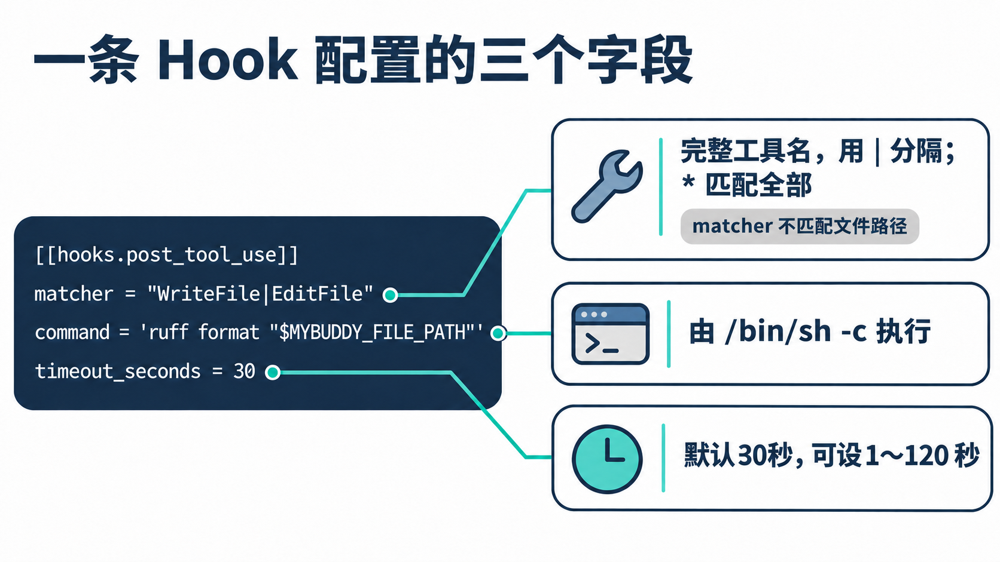

看完这张图，你要能：读懂 matcher、command 与 timeout_seconds 的含义和取值范围。

上面这条还没满足需求第 2 条：改 `docs/DESIGN.md` 也会触发。`matcher` 只认工具名，不认路径，所以要在命令里检查路径。满足四条要求的配置是：

```toml
[[hooks.post_tool_use]]
matcher = "WriteFile|EditFile"
command = 'case "$MYBUDDY_FILE_PATH" in src/*.py) ruff format "$MYBUDDY_FILE_PATH" ;; esac'
timeout_seconds = 30
```

| 需求 | 由什么保证 |
| --- | --- |
| 1. 改了 `src/` 下的 `.py` 文件就格式化这个文件 | `matcher` 选出写文件的工具；`case` 只放行 `src/*.py`；`$MYBUDDY_FILE_PATH` 是刚改的那个文件 |
| 2. 只改文档时不格式化 | Hook 照样运行，但 `case` 不匹配，什么也不做，退出码为 0 |
| 3. 结果让 Agent 看到，失败不撤销修改 | 命令的退出码和输出附在原工具结果上（第二节） |
| 4. 不逐次请你批准 | 授权来自可信启动配置（见下一小节） |

Hook 命令和 Bash 一样使用程序指定的 PATH，不读你终端的配置（第 7 课）。不同安装方式会把 `ruff` 放在不同目录。先在终端运行 `command -v ruff`，看它的实际位置，例如 `/Users/alice/.local/bin/ruff`。再把它所在的目录（去掉末尾的 `/ruff`）写进启动配置：

```toml
[sandbox]
path_prepend = ["/Users/alice/.local/bin"]
```

容易误会的地方：

- `matcher` 不是文件路径模式，也不是任意正则表达式。

### 其余五种事件怎样用

**SessionStart：进来先看工作区。** 新建或恢复主会话，准备接收输入时运行一次。例如打印 `git status --short`，让你先看到有哪些未提交改动。输出显示在界面，模型不会因此自动知道这些改动。

```toml
[[hooks.session_start]]
command = "git status --short"
timeout_seconds = 5
```

**SessionEnd：正常退出时记一笔。** 它不是崩溃通知；强制杀掉进程不能保证触发。全部关闭命令共用 3 秒等待上限，到时会请求停止并等进程真正停下，不适合放耗时的备份任务。

```toml
[[hooks.session_end]]
command = 'printf "session closed: %s\n" "$MYBUDDY_SESSION_ID" >> sessions.log'
timeout_seconds = 2
```

**TurnStart：接受消息后提醒你当前环境。** 每轮请求模型前运行，例如显示当前 Git 分支。它不会把用户消息全文放进环境变量，也不会把命令输出加进模型上下文。

```toml
[[hooks.turn_start]]
command = "git branch --show-current"
timeout_seconds = 5
```

**TurnEnd：记录这一轮怎样结束。** 确认本轮结束后，完成、失败、取消都会触发；`MYBUDDY_TURN_OUTCOME` 给出本轮状态。若异常发生时结束还没保存，或此前进程尚未确认停止，就不会再启动轮末命令。它不能修改这个状态，也不能强迫模型继续。持续推进由第 10 课的 Goal 负责。

```toml
[[hooks.turn_end]]
command = 'printf "%s %s\n" "$MYBUDDY_SESSION_ID" "$MYBUDDY_TURN_OUTCOME" >> turns.log'
timeout_seconds = 5
```

**Compact：压缩成功保存后通知你。** 自动压缩和 `/compact` 都会触发，压缩失败不会触发。下面只记录一次成功压缩，不读取压缩前后的聊天全文。

```toml
[[hooks.compact]]
command = 'printf "context compacted: %s\n" "$MYBUDDY_SESSION_ID" >> compact.log'
timeout_seconds = 5
```

这五种事件的命令失败或超时，只留下终端提示或 Web 轨迹记录，会话继续。会话、轮次和压缩这五种通知事件只在主会话触发；子任务仍沿用工具事件，避免每个子任务都重复打印开场信息、写一份父任务的轮末日志。

### 命令的授权来自哪里？

**把命令放进可信启动配置，就是授权它在匹配时自动执行。**

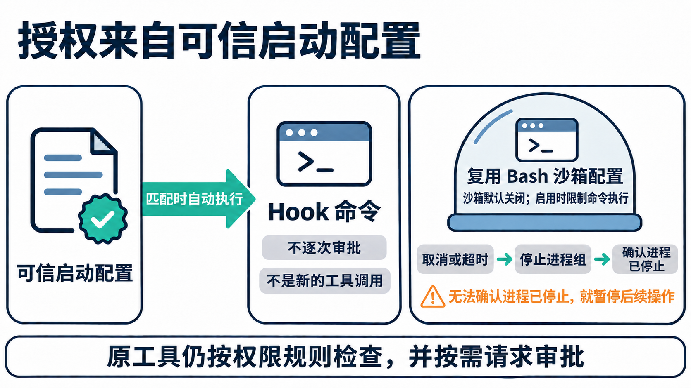

看完这张图，你要能：说明 Hook 命令的授权来源、不逐次审批，以及沙箱和停止确认怎样约束它。

Hook 不逐次请求审批；它也不算一次新的模型工具调用，所以不会再走一遍权限判断。启用前，先读懂命令做什么、会碰哪些地方。原工具自己的权限和审批照常执行。

命令复用 Bash 的沙箱配置和进程组管理。取消或超时时，程序请求停止，并确认进程组停稳。确认不了进程已经停下时，会话保持阻断，不假定一切正常。

容易误会的地方：

- 发出取消不等于已经停止。要等进程组真的停稳。

## 四、怎样避免重复触发？

**Hook 命令不是工具调用，不会自己触发自己；恢复会话不重做历史工具，但会为这次重新打开触发一次 SessionStart。**

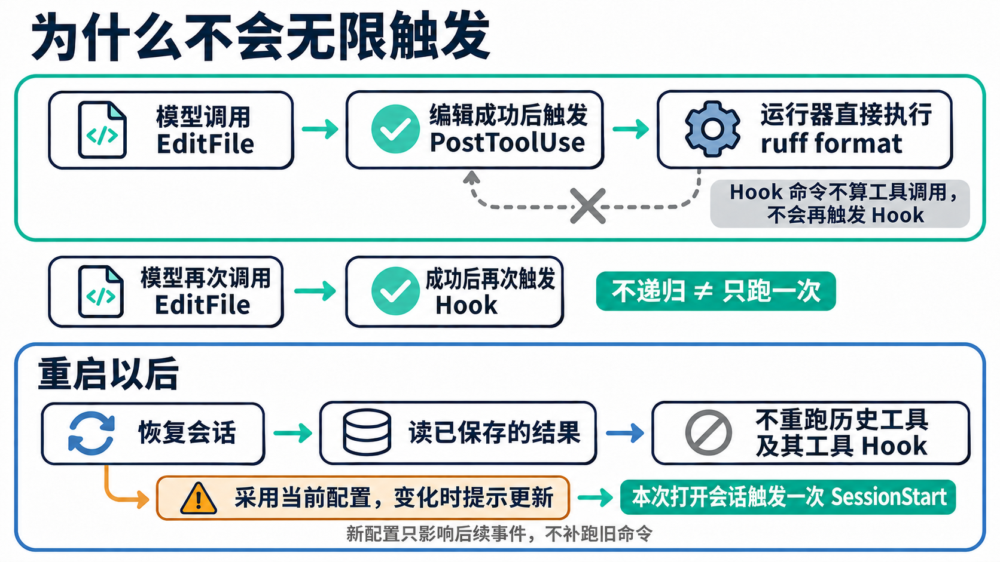

看完这张图，你要能：解释 Hook 命令不触发新的 Hook，恢复会话不重做工具，配置变化后按新规则继续。

### 格式化为什么不会无限触发

**命令由运行器直接执行，不注册成新的工具调用，所以不会递归触发。**

Hook 命令不会注册成一次新的 `Bash` 或格式化工具调用。所以命令本身不会再触发 `PostToolUse`。

先用只打印路径的命令验证匹配范围，再接真正的格式化。重复运行格式化，不应不断产生新差异。检查很贵时，让脚本缩小适用范围。

容易误会的地方：

- 不递归，不代表只跑一次。模型随后又成功编辑同一文件，仍会再次命中。配置了两条相同命令，也会按顺序执行两次。

### 重启以后不会重做工具

**恢复会话读取已保存的结果；之后发生的事件使用当前 Hook 配置。**

会话恢复读取已保存的工具结果，不重跑历史工具及其工具 Hook。原工具和 PostToolUse 的结果一起保存。恢复完成、准备接收输入时，SessionStart 会为这次重新打开运行一次；这是新的打开事件，不是重放旧命令。

Hook 配置变了，会话照样可以恢复。MyBuddy 使用当前配置，并提示“工具或配置已更新，这个会话按新的规则继续”；`/status --verbose` 会列出变化的配置项名。新配置只影响后续事件，不会补跑以前的命令。

容易误会的地方：

- 中断时记录不够、无法确认执行结果，要先核对实际文件和进程。不能靠再跑一次命令，猜上一次做了什么。

## 五、怎样检验规则真的有用？

**先手工确认检查能分清对错，再接 Hook；接上后，关闭、启用、出错三种情况各走一遍。**

### 从失败经验到执行规则，还差一次反例检查

**检查脚本要先能区分正确和错误，接到 Hook 上才有意义。**

参数是否合法，由工具检查。动作是否获准，先由权限与审批判断；PreToolUse 还可以拒绝原本获准的调用。PostToolUse 在成功后反馈，其余事件用于会话和轮次等固定时机的通知。

以本课练习的 PostToolUse Hook 为例，用三种情况检验：

1. **关闭时**：普通工具照常工作，结果里没有额外的 Hook 反馈。
2. **启用时**：匹配工具成功后出现命令结果；不匹配或失败的工具不触发。
3. **出错时**：命令返回非零或超时，反馈准确保留；原修改仍在，要核对最终文件。

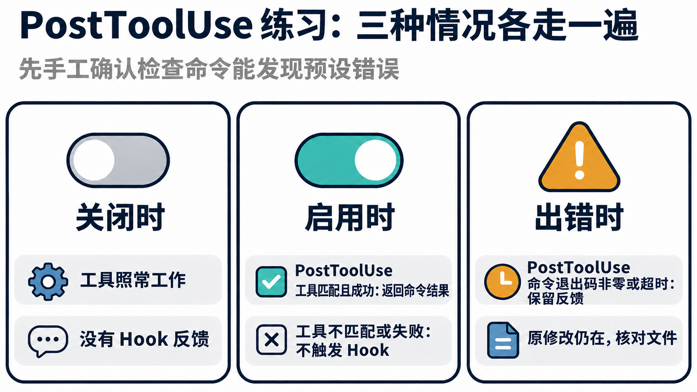

看完这张图，你要能：用关闭、启用、出错三种情况检验一条 Hook 是否按预期工作。

### 练习：关闭、启用、出错各走一遍

**用一条只打印工具名的命令起步，再换成失败命令、慢命令，最后接格式化。**

在独立副本中，先把命令设为 `printf '%s\n' "$MYBUDDY_TOOL_NAME"`，匹配 `WriteFile|EditFile`。分别做一次成功编辑、一次读取（`ReadFile` 不在匹配范围，不应触发）和一次被拒绝的编辑。再输入 `/trace`：触发过 Hook 的工具调用下面会多一行，例如 `Hook 1：退出码=0；超时=否`。`/trace` 不显示命令输出的原文，原文由模型在下一次请求里看到。

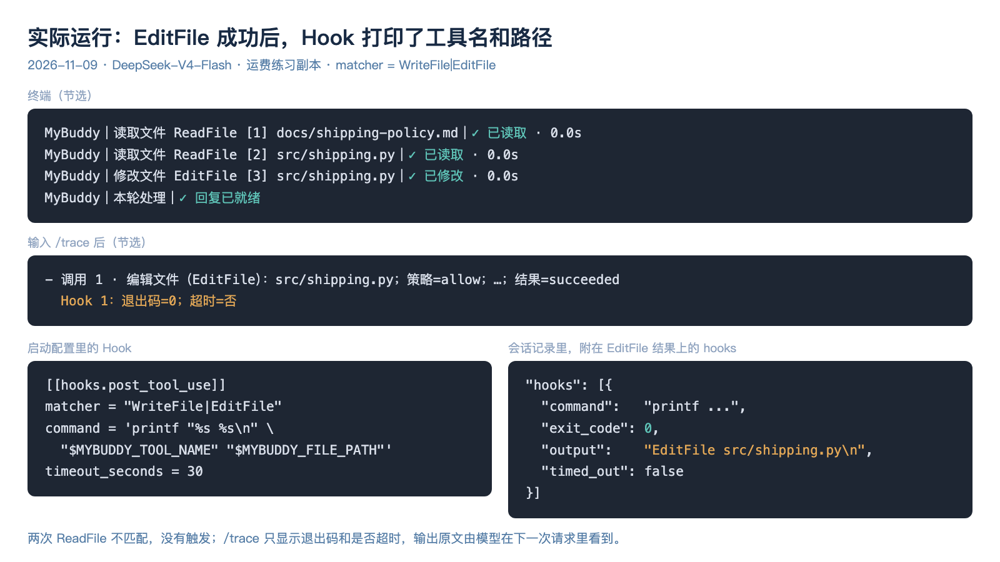

看完这张图，你要能：在一次真实运行里确认：只有匹配且成功的工具调用才触发 PostToolUse，结果附在原工具结果上。

然后换成稳定返回非零的检查命令，观察退出码和输出。再用一条受控的慢命令验证超时。

最后换成第三节那份满足本课需求的配置，在收银台副本里逐条验收：

| 需求 | 怎样操作 | 应该看到 |
| --- | --- | --- |
| 1 | 让 Agent 改 `src/pricing.py`，故意多留几个空格 | `/trace` 里这次编辑下面有 `Hook 1：退出码=0`；文件差异里空格已被整理。第一次格式化会整理**整个文件**，差异里也会出现模型没碰过的行 |
| 2 | 让 Agent 只改 `docs/DESIGN.md` | 同样有 Hook 行、退出码为 0，但文件没有被格式化 |
| 3 | 把 `ruff` 暂时从 `sandbox.path_prepend` 里去掉，再改一次 `src/pricing.py` | Hook 行的退出码不是 0（找不到命令时通常是 127）；`pricing.py` 的修改仍在。失败结果会交给 Agent，它会不会在回复里提到，要看模型 |
| 4 | 整个过程不切换权限模式 | 格式化没有弹出过审批 |

验收通过后，再让 Agent 接着编辑同一个文件，确认它先重新读取了文件（第二节）。

我们用 DeepSeek-V4-Flash 和 Ruff 0.17.4 按这张表实际跑过：第 1、2、4 条符合预期；第 3 条去掉 Ruff 后，Hook 行显示 `退出码=127`，新加的一行没有被格式化，Agent 在回复里说明了格式化失败。

实际执行和纸上推演，要分开记录。流程图不能代替运行结果。

源码入口：Hook 阅读指南（`src/mybuddy/platform/hooks/README.md`）。读的时候分别找：配置在哪里检查，命令怎样启动，结果怎样随原工具保存。

### 架构检查怎样识别越界依赖

**（选读）架构检查很适合自动运行：它能明确判断模块之间的依赖方向对不对。**

Hook 解决“什么时候运行”，检查程序解决“怎样判断对错”。

《课前-麦当当收银台介绍》中的“项目分层：UI、Runtime、Service 与 Repo 怎样配合”小节，规定了各模块的职责。收银台自带项目检查脚本（`demo-project/mini-shop/scripts/check_project.py`）。它解析代码里的导入语句，对照允许的依赖表判断方向。它也检查文档，并运行测试和固定场景。这个脚本独立于 MyBuddy 运行。

你可以在独立副本中验证一条规则：`catalog`、`pricing`、`orders`、`reporting` 不能导入 `console`。准备一份正常代码，再准备一份只多了一个反向导入的代码，看检查器能否发现后者。

一条好的诊断，要说清违反了哪条规则、在哪里、怎样改。下面是课程自编示例，不是现有脚本的输出：

```latex
ARCH_IMPORT_DIRECTION
位置：src/reporting.py 的 console 导入
规则：报表模块不能依赖交互模块
建议：检查是否把显示格式或输入处理放进了汇总逻辑；
      保持汇总返回结构化结果，由 console 展示。
```

不要靠关闭规则、扩大白名单，或把导入藏进函数里来“通过”。

检查脚本手工运行通过后，可以把同一命令配到 `PostToolUse`。例如成功写入后运行 `python3 scripts/check_project.py`，让模型看到退出码和诊断。它也可以由本地命令或 CI（持续集成）运行。

容易误会的地方：

- 检查器只能发现写出来的导入。动态导入或间接访问要另外分析。
- 依赖方向对了，金额和退款规则仍要由业务测试检查。

### 收银台练习：给组件售罄检查设计触发点

**写清三件事：什么时候触发、运行哪项检查、出错时怎样报告。**

对照《综合实践-麦当当收银台》中的“6. 课后任务 B：套餐可以换无糖可乐”小节，配置一个 `PostToolUse` 命令。匹配 `WriteFile|EditFile`，从 stdin 的 JSON 或环境变量取得文件路径，再由脚本判断是否涉及菜单或套餐。写清要运行哪项检查，以及未匹配、出错、超时或取消时怎样报告。

先手工跑通检查，再接入 Hook，核对成功编辑后是否确实触发。

容易误会的地方：

- 手工检查也能验证业务要求，但要如实记录。它不能证明 Hook 已经自动触发。

**能力卡**：想在收银台副本里亲手试一遍，就照着能力卡《Hook 在修改验收文件后提醒》（`demo-project/cards/hook.md`）做。

## 使用小妙招

### 先用简单命令看清触发范围

Claude Code 的 Hook 写在设置文件的 `hooks` 里，可以用 `/hooks` 查看当前配置。第一次接入 PostToolUse，先用只打印工具名和路径的命令。确认预期的工具成功后它确实触发了，再加入会改文件的命令。试 PreToolUse 时，再分别验证退出码 2 的拒绝和其他退出码的放行。

各准备一次应该触发、不应该触发的操作，核对工具结果里的命令反馈。先验证“什么时候触发”，再验证“触发后做什么”，两类问题就容易分开定位。

**为什么这样做：** Hook 由程序在固定时机自动运行，不经过模型，也不会每次问你（见“写进提示词，和让程序在固定时机执行”）。匹配范围写错了，一条会改文件的命令可能在你没想到的时候反复运行。先用只打印、不改东西的命令确认触发范围，出错也没有影响。

### 接入格式化前，先检查范围和重复

准备把格式化接到写文件之后时，先只记录会命中哪些文件，再换成真正的格式化。分别看三种情况：真实修改、内容没变、格式化失败。再看重复执行会不会产生额外修改。

格式化成功只说明这个动作完成了。业务测试是否通过，要另外判断。

**为什么这样做：** 格式化可能改文件，后续编辑前要重新读取。Hook 命令本身不会递归触发；只有模型再次成功编辑，或配置了重复命令时，才会再次格式化。先只记录路径，确认范围后再启用格式化。

### 给自动检查设计一份短报告

手工跑通检查后，先想好希望 Agent 收到什么：检查对象、结果、失败位置、原文在哪里。

用一次通过和一次失败检验：通过时是否简洁，失败时能否定位，旧结果会不会被当成当前证据。Hook 决定什么时候触发，报告的写法决定 Agent 能拿结果做什么。

**为什么这样做：** Hook 的输出会作为反馈交给模型（见“结果怎样交给模型？”），每次触发都占上下文。通过时输出一大段日志，白占位置；失败时只说“检查失败”，模型又不知道去哪里改。

### 把规则写成可以定位问题的检查

一条约定要变成程序检查，先问它能不能被明确判断。“模块依赖不得越过指定边界”，可以检查实际的导入。“解释应当清楚”，则要具体标准和人工评审。两类要求混成一句“质量检查通过”，会掩盖各自能证明什么。

读收银台的项目检查脚本（`demo-project/mini-shop/scripts/check_project.py`），选一条已有的依赖规则。写下适用文件、违反条件和错误输出。在独立副本里加一个反向导入，看诊断是否准确。然后撤销这个改动，再查一次。

一条好的错误信息回答四个问题：哪条规则不满足，问题在哪，要保留什么约束，去哪里看正确做法。发现跨层写入时，应引导回正确的入口，而不是建议关闭检查。

把前几课的扩展放在一起，可以判断一个反复出现的问题该放在哪里解决：

| 反复出现的需要 | 先用什么 | 怎样确认有帮助 |
| --- | --- | --- |
| 所有金额代码都要遵守同一约定 | 项目说明，指向正式规则（第 3 课） | 当前请求能否读到并正确使用 |
| 以后的任务要找回业务背景 | Memory，保留依据和适用条件（第 15 课） | 新任务能否找到并用上 |
| 同类审查总要重复同一套步骤 | Skill（第 16 课） | 同类任务有效，无关任务不误用 |
| 依赖方向可以由程序明确判断 | 检查脚本 | 正反两个样本是否给出正确诊断 |
| 希望在特定时机运行检查 | 在已有检查上接 Hook | 时机、匹配范围和执行结果是否正确 |

检查脚本已经能发现错误，只是经常忘了运行，才需要考虑接 Hook。连检查条件都说不清时，先把判断依据完善了。

**为什么这样做：** 写在项目说明里的规则，模型可能看漏、理解偏；程序检查每次结果都一样，也不会忘了运行（见“从失败经验到执行规则，还差一次反例检查”）。但只有能明确判断对错的规则，才能交给程序；错误信息写清楚，Agent 才能自己改对，而不是来回试。

## 自测：这一课的概念分清了吗

**先自己作答，再看后面的答案。** 每题都能在本课正文里找到依据。

**1.** 你在副本里把 PostToolUse 的命令改成 `exit 1`。一次匹配的 `EditFile` 已经成功修改文件，随后这条命令正常退出，没有取消。该次调用的结果是什么？

- A. Hook 失败，程序自动撤销这次文件修改。
- B. 文件修改保留，原工具仍为成功，Hook 的失败另作反馈。
- C. 文件修改保留，但原工具的结果变成失败。

**2.** 你按本课的方式配置了保护测试文件的 PreToolUse。你批准了一次修改 `tests/` 中文件的 `EditFile` 调用，检查命令只检查路径，正常返回退出码 `2`。这一次文件工具会怎样？

- A. 仍会执行，因为你已经批准了修改。
- B. 先修改文件，再由 PostToolUse 判断要不要撤销。
- C. 不执行，拒绝原因作为工具反馈交给模型。

**3.** 判断：把“每次改完记得格式化”写进提示词，就等于把格式化接成了 Hook。（对 / 错）

**4.** 你确认文件修改成功，格式化命令也成功了，但还没有运行业务测试。现在能得出什么结论？

- A. 格式化成功，说明金额和退款规则也正确。
- B. 修改和格式化成功；业务要求是否满足，仍需要业务测试检查。
- C. 只要命令是由 Hook 触发的，就可以替代业务测试。

### 答案与依据

**1. 选 B。** PostToolUse 在原工具成功后运行，非零退出只是反馈。它既不会自动回滚文件，也不会把原工具的成功改成失败。  
依据：本课“结果怎样交给模型？”。

**2. 选 C。** 审批通过后，PreToolUse 仍能拒绝这次调用。正常退出码为 `2` 时，原工具尚未执行，不是先改完再撤销。  
依据：本课“PreToolUse 与 PostToolUse：拦下调用，还是补充反馈”。

**3. 错。** 提示词要求模型记得并选择去做；Hook 由程序在约定时机触发。两者触发机制不同。  
依据：本课“写进提示词，和让程序在固定时机执行”。

**4. 选 B。** 修改成功、命令成功、业务测试通过是三件事。格式化整理代码的样子，不能证明金额或退款规则正确。  
依据：本课“结果怎样交给模型？”。

## Q&A：常见追问

### Q1：Hook 与提示词都能要求格式化，为什么还要区分？

提示词让模型做决定时考虑这项要求。Hook 在约定时机由程序触发。Hook 能不能可靠工作，还取决于匹配范围、超时、失败处理和动作是否经过检查。设计自动格式化时，要确认它实际处理了哪些文件，修改后是否重新验证。

### Q2：Hook 失败以后，主任务应该继续还是停止？

先看事件：PreToolUse 正常退出码为 2 时拒绝本次工具调用，其他退出码或超时放行并记录；PostToolUse 的非零退出或超时随原工具结果反馈，不改变工具已经成功的事实；其余五种只提示用户，不影响会话继续。取消时则要等待进程停止；如果连是否停止都无法确认，会话必须阻止后续执行，不能让新修改与旧进程同时写文件。

### Q3：每次工具结束都格式化，会不会无限触发？

Hook 命令本身不是新的工具调用，不会递归触发。模型再次编辑或配置了重复条目，仍可能多次执行。所以要检查命中范围，以及重复执行后的文件差异。

### Q4：有 Hook 以后，权限检查能省掉吗？

不能。策略、规划模式、审批和会话放行名单都先判断，PreToolUse 只能再拒绝，不能替已经被拒绝的调用放行。Hook 命令由可信启动配置授权，并复用 Bash 沙箱；PostToolUse 不能阻止已经发生的修改。

### Q5：Hook 已经运行过，它写的提醒会一直留在上下文里吗？

工具事件的反馈不一定一直保留：PostToolUse 输出和 PreToolUse 拒绝原因可以进入后续请求，但以后可能被压缩（第 9 课）。其余五种事件的输出只显示给你，本来就不进入模型上下文。固定检查应靠每次匹配执行，不能靠旧输出一直留在模型输入里。

### Q6：修改后的 Hook 返回非零，文件会自动变回去吗？

不会。退出码只是反馈。原修改和命令自己的修改都可能保留。要重新读取、核对，并按需要另行恢复和验证。

### Q7：有的工具能在 Agent 想停下时用 Hook 要求它继续，怎样避免永远不结束？

要在程序里设置明确的停止条件。MyBuddy 的 `turn_end` 在一轮结束后运行，`session_end` 在正常关闭时运行；两者只运行命令，不能用退出码要求模型继续。持续推进由 Goal 负责。符合条件的正常轮末才评估，`met` 或 `impossible` 会结束并清除活动目标；连续三轮没有登记工具调用，会停止自动继续但保留目标。AskUserQuestion 提问后则不评估、不自动续轮，必须等用户回答。

显式设置的模型调用次数上限只限制一轮。若每轮都提出工具调用却一直达不到目标，当前没有跨轮总限额，需要用户取消当前工作或用 `/goal clear` 清除目标。因此，设计自动继续时要明确成功、无法完成、缺少用户输入和预算耗尽分别怎样停止。

## 本课术语速查

| 本课说法 | 配置或源码中的名字 | 含义 |
| --- | --- | --- |
| 工具前命令 | `pre_tool_use` | 策略与审批通过后、执行前检查，退出码 2 可拒绝 |
| 工具后命令 | `post_tool_use` | 工具成功后执行，反馈不能撤销修改 |
| 配置条目 | `[[hooks.post_tool_use]]` | 一条工具匹配与命令配置 |
| 匹配条件 | `matcher` | 完整工具名、` |
| 命令 | `command` | 可信启动配置授权的 Shell 命令 |
| 超时 | `timeout_seconds` | 每条命令的等待上限 |
| 结果反馈 | `hooks` | 附在原工具结果中的命令、退出码、输出与超时标记 |

## 继续阅读源码解析

本课对应的源码解析沿“解析配置 → 主流程选择事件 → 共用命令执行与停止 → 事前拒绝或事后反馈 → 恢复后采用当前配置”读真实代码，可在理解本课概念后继续阅读。
