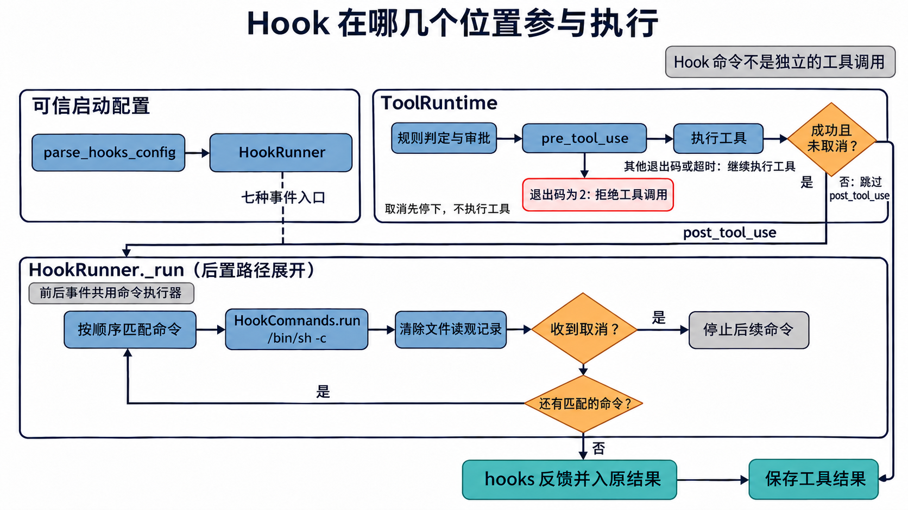
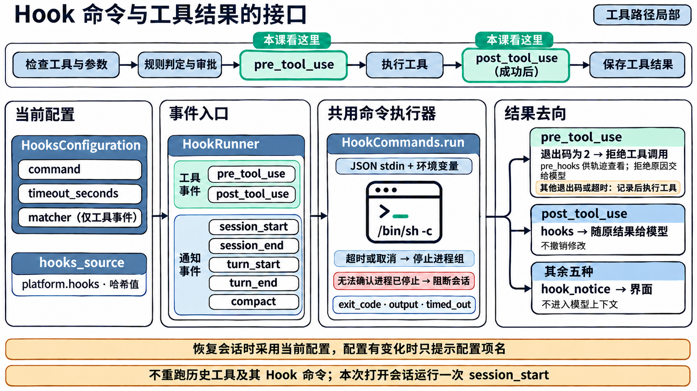

与第 18 课课程正文配套阅读。

从“什么时候调用”开始，再读配置、事件入口和命令执行。七种事件共用一份进程管理代码：工具前可以拒绝，工具后追加反馈，其他事件只通知界面。

代码摘录来自当前源码，标成 `路径:起-止`。省略部分用 `# ...` 表示。理解一条主线后，再去完整文件里读取消和异常处理。

## 先找到主流程的调用位置

| 事件 | 主流程入口 | 直接调用位置 |
| --- | --- | --- |
| `session_start` | `MyBuddySession.initialize` | `src/mybuddy/platform/application/application_session.py:705` |
| `session_end` | `MyBuddySession.start 的 owned_work` | `src/mybuddy/platform/application/application_session.py:644` |
| `turn_start` | `TurnCoordinator.run` | `src/mybuddy/platform/application/turn.py:157` |
| `turn_end` | `TurnCoordinator.run 的 finally` | `src/mybuddy/platform/application/turn.py:179` |
| `pre_tool_use` | `ToolRuntime._start_execution` | `src/mybuddy/platform/tools/tool_runtime.py:600` |
| `post_tool_use` | `ToolRuntime._settle_execution` | `src/mybuddy/platform/tools/tool_runtime.py:736` |
| `compact（自动）` | `TurnCoordinator._after_compact` | `src/mybuddy/platform/application/turn.py:344` |
| `compact（手动）` | `MyBuddySession.compact` | `src/mybuddy/platform/application/application_session.py:953` |

会话、轮次和压缩这五种通知入口只用于主会话；子任务保留两种工具 Hook。恢复历史不会重做旧工具及其 Hook，但本次打开完成后，会运行一次 SessionStart。



看完这张图，你要能：先分清工具前检查和成功后反馈，再找出它们共用的命令执行器。

## 配置：工具事件比其他事件多一个 matcher

`src/mybuddy/platform/hooks/__init__.py:23-33`

```python
class CommandHook:
    command: str
    timeout_seconds: int = 30

@dataclass(frozen=True, slots=True)
class ToolHook(CommandHook):
    matcher: str = '*'

    def matches(self, name: str) -> bool:
        return self.matcher == '*' or name in self.matcher.split('|')
```

`CommandHook` 只保存命令和超时。`ToolHook` 多一个 `matcher`：完整名字、`|` 分隔列表或 `*`。它不匹配文件路径；路径要由命令自己判断。

`src/mybuddy/platform/hooks/__init__.py:50-64`

```python
def parse_hooks_config(raw: Mapping[str, Any]) -> HooksConfiguration | None:
    if not isinstance(raw, Mapping) or set(raw) - set(EVENTS):
        raise HookConfigurationError('hooks_configuration_invalid')
    parsed: dict[str, Any] = {}
    for event in EVENTS:
        entries = raw.get(event, [])
        if not isinstance(entries, list):
            raise HookConfigurationError('hooks_configuration_invalid')
        hooks: list[CommandHook] = []
        for entry in entries:
            required = {'command', 'matcher'} if event in TOOL_EVENTS else {'command'}
            if (not isinstance(entry, Mapping) or not required <= set(entry)
                    or set(entry) - required - {'timeout_seconds'}):
                raise HookConfigurationError('hooks_configuration_invalid')
            command, timeout = entry['command'], entry.get('timeout_seconds', 30)
```

解析器逐个处理七种事件。同一事件里的列表顺序原样保留；工具事件必须有 matcher，其他事件写了 matcher 会报错。后面检查非空命令、1～120 秒整数超时和工具名格式，错误只给固定原因，不回显命令。

## 事件入口：让主流程直接说出事件名

`src/mybuddy/platform/hooks/events.py:37-55`

```python
    async def session_start(self, signal: CancellationSignal) -> tuple[list[dict[str, Any]], bool]:
        return await self._run('session_start', signal)

    async def session_end(self, signal: CancellationSignal) -> tuple[list[dict[str, Any]], bool]:
        return await self._run('session_end', signal, budget=SESSION_END_SECONDS)

    async def turn_start(self, signal: CancellationSignal, *, turn_id: str) -> tuple[list[dict[str, Any]], bool]:
        return await self._run('turn_start', signal, turn_id=turn_id)

    async def turn_end(self, signal: CancellationSignal, *, turn_id: str,
                       turn_outcome: str) -> tuple[list[dict[str, Any]], bool]:
        return await self._run('turn_end', signal, turn_id=turn_id, turn_outcome=turn_outcome)

    async def compact(self, signal: CancellationSignal) -> tuple[list[dict[str, Any]], bool]:
        return await self._run('compact', signal)

    async def pre_tool_use(self, request: ToolProviderRequest,
                           signal: CancellationSignal) -> tuple[list[dict[str, Any]], bool]:
        return await self._run('pre_tool_use', signal, request=request)
```

这些入口短，是为了让你能从上面的主流程表直接走进来。事件之间不同的是上下文和结果用法，不是怎样启动 shell。SessionEnd 给所有关闭命令共享 3 秒运行预算；预算用完仍需确认进程停止，不能留下后台写文件的命令就退出。

`_run` 加上事件和会话编号；工具事件还带工具名、经过凭据字段过滤的参数和可选文件路径。每跑完一条命令，都让旧的文件读取记录作废：失败的命令也可能已经改过文件。当前已准备好的文件操作仍会在写入前核对原文；后续新操作则需要重新读取。

## PreToolUse：在真正执行工具之前返回拒绝

`src/mybuddy/platform/tools/tool_runtime.py:596-609`

```python
        # 策略、规划模式和审批都已经通过。Hook 只能进一步拒绝，不能扩大权限。
        # 先运行 Hook，再写工具开始记录；被拦截的工具没有执行，也不存在结果未知。
        pre_hooks: tuple[Mapping[str, Any], ...] = ()
        if self._hooks is not None:
            results, cancelled = await self._hooks.pre_tool_use(
                ToolProviderRequest('', _tool_id(call), arguments, plan), signal)
            pre_hooks = tuple(results)
            if cancelled or signal.cancelled:
                return replace(self._unstarted(head), task_cancelled=cancelled, pre_hooks=pre_hooks)
            # Hook 一旦以退出码 2 结束（且不是超时）就表示拒绝，后面的 Hook 不再运行，
            # 所以只需看最后一条结果。
            if results and results[-1]['exit_code'] == 2 and not results[-1]['timed_out']:
                error = _error_info(PRE_TOOL_DENIED, 'policy')
                return _PendingResult(head, 'denied', error, pre_hooks=pre_hooks)
```

走到这里，策略、规划模式、审批和会话放行名单都已经判断完。程序先运行 PreToolUse，再生成工具执行编号和保存执行开始记录。

正常退出码 2 会返回 `denied`，原因码为 `runtime.hook_pre_tool_use_denied`，错误只保留原因码和策略分类，具体命令结果稍后单独保存。工具提供者没有被调用，不会产生该工具的副作用，也不算执行结果未知。后面仍复用原来的拒绝结果保存通路。

其他非零退出码、0 和超时都不走这段拒绝分支。取消单独判断，取消后不能把它当作“检查通过”继续工具。前置命令本身仍是可信 shell 脚本，可能改文件；所以保护脚本应当只检查并说明原因。

### 前置结果怎样保存，拒绝原因怎样交给模型

`src/mybuddy/platform/tools/tool_runtime.py:845-850`

```python
        if error is not None and error.get('code') == PRE_TOOL_DENIED:
            hook = pre_hooks[-1]
            # 完整输出另存在 pre_hooks；模型只需读到拒绝原因，不能因日志过大丢掉拒绝状态。
            reason = hook['output']
            failure_content['explanation'] = ((reason[:8192] + '（后续输出见 Hook 记录）' if len(reason) > 8192 else reason)
                                               or 'pre_tool_use Hook 拒绝了这次调用。')
```

`explanation` 只取拒绝命令输出的前 8192 个字符，空输出则给固定说明。模型看到一次被拒绝的调用和原因，可以换一种做法；不会因为前面多条检查的日志太长而丢掉拒绝状态。

`src/mybuddy/platform/tools/tool_runtime.py:884-885`

```python
        if pre_hooks:
            result["pre_hooks"] = list(pre_hooks)
```

所有已经运行的前置命令结果另存到现有 `tool.result_committed.payload.pre_hooks`，轨迹直接从这个列表读取，被拒绝时最后一项就是拦截命令，不在错误详情里再存一份。这些完整结果不进入 `model_content`（发给模型的工具反馈正文）；每条结果仍只保留执行器限制内的最多 16 KiB 输出。

## PostToolUse：只给已经成功的结果加反馈

`src/mybuddy/platform/hooks/events.py:57-67`

```python
    async def post_tool_use(self, request: ToolProviderRequest, outcome: ToolDispatchOutcome,
                            signal: CancellationSignal) -> tuple[ToolDispatchOutcome, bool]:
        if outcome.status != 'succeeded' or signal.cancelled:
            return outcome, False
        results, cancelled = await self._run('post_tool_use', signal, request=request,
                                             tool_result_status='succeeded')
        if results:
            value = plain(outcome.value)
            value = dict(value) if isinstance(value, Mapping) else {'result': value}
            outcome = replace(outcome, value={**value, 'hooks': results})
        return outcome, cancelled
```

这里没有把退出码转换成拒绝。原工具成功后，命令结果放进 `hooks` 列表；原结果不是字典，就先放进 `result`。ToolRuntime 之后沿原来的工具结果保存流程继续，`model_result_budget.model_view` 把命令、退出码、输出和超时整理给模型。

因此，后置命令返回 2 也不会撤销文件修改。模型看到失败提示后如何处理，是下一步任务；它不等于业务测试已经通过。

## 共用命令执行：输入、输出和停止各管一件事

`src/mybuddy/platform/hooks/commands.py:33-40`

```python
        # 仅加入明确列出的上下文，不继承宿主的密钥，也不把对话正文放进环境变量。
        environment = dict(_environment(self.plans.sandbox_configuration.path_prepend))
        environment['MYBUDDY_WORKSPACE'] = str(root)
        for key in ('event', 'session_id', 'turn_id', 'turn_outcome', 'tool_name', 'file_path'):
            if isinstance(context.get(key), str):
                environment['MYBUDDY_' + key.upper()] = context[key]
        data = json.dumps(context, ensure_ascii=False).encode()
        result: dict[str, Any] = {'command': hook.command, 'exit_code': None, 'output': '', 'timed_out': False}
```

环境变量只加入列出的字段，不继承宿主的密钥。JSON stdin 给脚本结构化上下文，不包含聊天全文或完整工具输出。结果先留好四个字段：命令、退出码、输出、是否超时。

`src/mybuddy/platform/hooks/commands.py:46-55`

```python
            launch = build_launch_plan(self.plans.sandbox_configuration, workspace=root,
                temporary_directory=temporary, protected_paths=self.plans.sandbox_protected_paths,
                command=('/bin/sh', '-c', hook.command), environment=environment,
                environment_allowlist=(*DEFAULT_ENVIRONMENT_ALLOWLIST, 'MYBUDDY_TOOL_NAME',
                                       'MYBUDDY_FILE_PATH', 'MYBUDDY_WORKSPACE', 'MYBUDDY_EVENT',
                                       'MYBUDDY_SESSION_ID', 'MYBUDDY_TURN_ID', 'MYBUDDY_TURN_OUTCOME'),
                requirements=self.plans.sandbox_requirements)
            starting = asyncio.create_task(asyncio.create_subprocess_exec(*launch.argv,
                cwd=root, env=dict(launch.environment), stdin=asyncio.subprocess.PIPE,
                stdout=asyncio.subprocess.PIPE, stderr=asyncio.subprocess.PIPE, start_new_session=True))
```

沙箱设置与 Bash 相同。`start_new_session=True` 让 shell 有自己的进程组；超时或取消时，连同它启动的子进程一起停止。标准输出和标准错误合计只保留前 16 KiB，超出部分仍然读取但丢弃，以免管道写满后程序卡住。

`src/mybuddy/platform/hooks/commands.py:87-111`

```python
            # 用不受系统时间调整影响的时钟检查超时；进程退出后也要等输出读完。
            cancelled = False
            deadline = asyncio.get_running_loop().time() + (hook.timeout_seconds if timeout is None else timeout)
            try:
                while process.returncode is None or not all(task.done() for task in readers):
                    if signal.cancelled:
                        cancelled = True
                        break
                    if asyncio.get_running_loop().time() >= deadline:
                        result['timed_out'] = True
                        break
                    # 每 0.02 秒检查一次取消和超时。
                    await asyncio.sleep(0.02)
            except asyncio.CancelledError:
                cancelled = True
            finally:
                # 注意：收到取消或达到超时不代表进程已经退出。
                # 必须等待进程组清理；如果无法确认退出，要向调用方报告，
                # 不能当作命令已经停止并继续正常处理。
                try:
                    await processes.ensure_process_stopped(process, readers)
                finally:
                    await finish_cleanup(close_writer())
            result.update(exit_code=process.returncode, output=bytes(output).decode('utf-8', errors='ignore'))
            return result, cancelled
```

上面这一段处理运行期间的超时和取消。启动命令途中收到取消请求时，也要先取得代表该进程的对象，再用它停止进程。发出停止请求不等于已经停止：`ensure_process_stopped` 确认整个进程组退出；无法确认就抛出 `ProviderStopUnobserved`，交给会话阻断。此时不能继续工具、启动轮末命令，或假装普通失败。



看完这张图，你要能：找到配置、七种事件入口、共用命令执行和结果去向之间的关系。

## 只通知界面的事件怎样运行

`src/mybuddy/platform/application/application_session.py:708-731`

```python
    async def _run_hook(self, event: str, **context: str) -> bool:
        # 这些通知只属于当前打开的界面，不参与恢复会话，也不会变成模型消息。
        if self._hook_runner is None:
            return False
        from mybuddy.platform.sessions.errors import ProviderStopUnobserved
        try:
            results, cancelled = await getattr(self._hook_runner, event)(CancellationController(), **context)
        except ProviderStopUnobserved:
            # 注意：手动压缩不经过 ask 的异常处理。这里立即阻止新操作，
            # 即使调用方捕获错误，关闭时仍要让会话保留运行权。
            self._hook_stop_unobserved = True
            self._turn_blocked = True
            self._stopping = True
            self._context_unavailable_reason = "Hook 命令尚未确认停止，不能继续操作"
            raise
        if self.hook_notice is not None:
            for result in results:
                try:
                    await self.hook_notice({"event": event, "session_id": self.session_id,
                        **context, **result})
                except Exception:
                    # 界面显示失败不改变已经执行的命令结果。
                    pass
        return bool(cancelled)
```

这段把对应事件的结果交给 `hook_notice`，终端显示提示，Web 放进当前轨迹。没有把通知写成模型消息，也没有为它新增需要恢复的会话事件。界面显示失败不改变已经执行的命令结果。

TurnStart 在模型请求前运行，TurnEnd 放在轮次 `finally` 中，确认本轮结束记录后，完成、失败和取消都能报告本轮状态。异常发生时尚未保存结束记录，或者之前的进程是否停止都无法确认，就不运行轮末命令。Compact 只有在压缩成功保存后才通知；自动压缩和手动压缩各有一个调用点。

## 契约：沿用事件，只增加前置命令的结果字段

没有新增 Hook 事件类型。会话创建记录删除重复的旧 `post_tool_use` 清单，配置只用来源哈希比较。原有 `tool.result_committed` 的模型调用 v1、系统调用 v4 增加可选 `pre_hooks`，两份 Schema 使用相同的 `HookCommandResult` 结构定义命令、退出码、输出、是否超时四项。

为什么要这个字段？前置命令的完整保留结果需要给轨迹看，模型只需要短拒绝原因。两份内容分开，才能避免多条命令的输出超过模型结果大小限制后，把拒绝原因一起裁掉。PostToolUse 仍用原有的 `hooks` 字段；五种通知事件不写会话事件。

## 恢复：采用当前配置，不重跑历史命令

`src/mybuddy/platform/hooks/__init__.py:80-84`

```python
def hooks_source(configuration: HooksConfiguration) -> dict[str, Any]:
    # 只保存完整配置的哈希值，命令、顺序、默认超时都参与比较。
    # 不再额外把命令全文放进会话创建记录，减少重复信息和敏感内容暴露。
    return {'kind': 'platform', 'source_id': SOURCE_ID, 'version': '2',
            'precedence': 0, 'digest': digest(configuration.manifest())}
```

七种事件、命令顺序、匹配条件和补齐的默认超时都在 `manifest()` 里，一起算哈希值。会话创建时只保存来源 `platform.hooks`、版本 2 与哈希，不再重复保存命令清单。

Hook 不再在 `prepare_initial_extensions` 中比较创建时和当前配置。会话恢复时直接使用当前启动配置，变化通过 `resume_checks.resume_changes` 列入通知；`/status --verbose` 只显示配置项名，不显示命令内容。

恢复完成时 SessionStart 是“本次重新打开”的新通知，使用当前配置；不是重放旧工具。之前已经保存的 Hook 结果保留原样，新配置只影响之后发生的事件。

## 读码练习

1. 从主流程表找出：哪一行决定工具没有执行？哪一行把后置输出附在原结果上？
2. PreToolUse 与 PostToolUse 都返回 2，各会发生什么？
3. 命令运行超过超时，为什么不能直接返回？
4. 失败的命令为什么也要清除旧文件读取记录？
5. 只改 `turn_end` 的超时后恢复旧会话，会怎样？

参考答案

1. `_start_execution` 返回 `denied` 时还没创建工具执行记录；`post_tool_use` 用 `replace(outcome, value={...})` 加入反馈。 2. PreToolUse 拒绝尚未执行的工具，原因交给模型；PostToolUse 只反馈，原工具仍已成功。 3. 超时只说明不再继续等待工作完成。还要停止进程组并确认退出，否则程序可能继续改文件；确认不了就阻断会话。 4. 命令即使失败，也可能已经写了一部分。后续编辑必须先读取当前内容。 5. 可以恢复，并提示配置已更新。之后的 TurnEnd 使用新超时，已保存的轮次和命令不补跑。
