理解任务说明、独立上下文、权限与结果交接。

学完这一课，你应能判断一项工作值不值得交出去。你能写出一份让子 Agent 独立开工的说明，也能说清它交回的报告怎样检查、取消和失败时怎么办。

## 本课导览

前面几课都在给当前 Agent 增加能力。这一课试着把一部分工作交出去：让另一个 Agent 独立完成一项调查，再把结论带回来。

这个“另一个 Agent”叫**子 Agent**（SubAgent），把工作交给它叫**委派**，发起的一方叫**主任务**或父会话。本课按下图沿一次委派从交出去到拿回来展开，最后在 MyBuddy 中做一次只读调查。

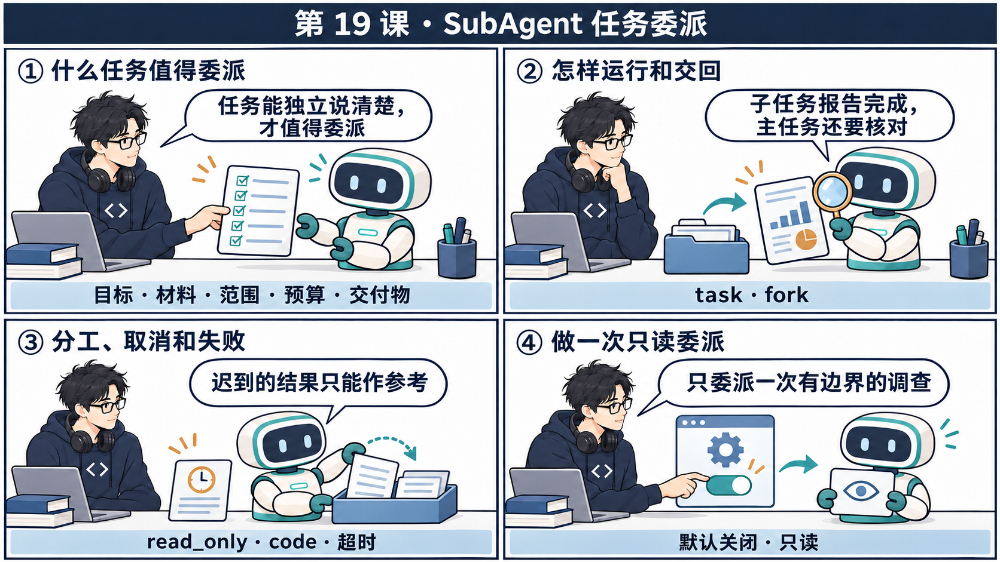

## 一、什么任务值得委派？

**能独立交代清楚、交接成本又不高的工作，才值得交出去。**

### 能独立交代清楚，才值得拆

**看依赖：不用等别人、也不和别人改同一处的工作，才能单独做。**

运费比较条件只有一处，拆给多个 Agent 只会增加沟通成本。订单取消涉及库存释放、退款重试和发货状态时，就可能有能独立调查的部分。

能不能独立，要看依赖。库存任务只用现有接口，就能单独做。退款任务要等另一项接口改完，就得先等那份结果。两边都要随时改同一个函数时，先定好接口或排好顺序，往往比马上并行更稳。

两个人同时做两件不相干的事，才可能省时间。Agent 也一样。但每个子 Agent 都要重新读背景，结果还要传回来汇总检查。任务很短时，这些协调花掉的时间和费用，可能比省下的还多。

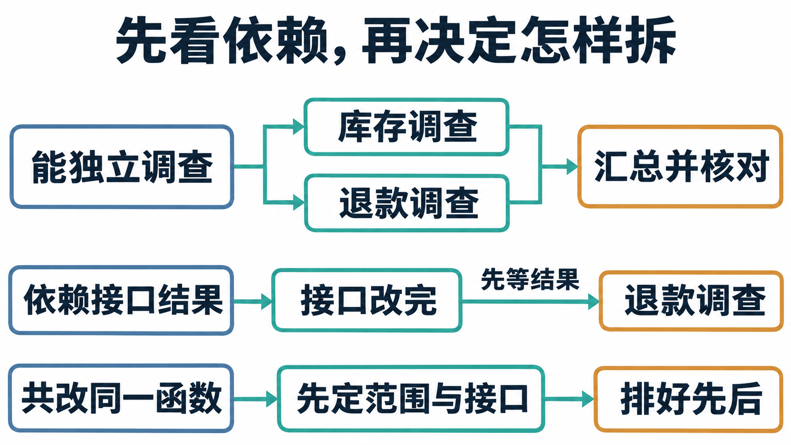

看完这张图，你要能：根据接口、共享文件与交接成本判断是否委派或先串行。

### 一次委派至少交代五件事

**目标、材料、范围、预算、交付物，缺一样，子 Agent 就得猜。**

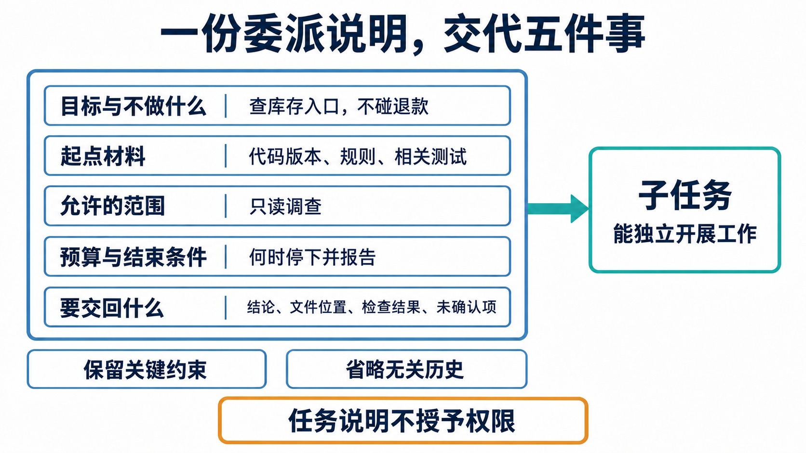

看完这张图，你要能：组织足够独立工作的目标、基线、范围、预算和返回证据。

| 内容 | 示例 |
| --- | --- |
| 目标与不做什么 | 查清库存释放的所有入口；不碰退款逻辑 |
| 起点材料 | 指定的代码版本、规则文件与相关测试 |
| 允许的范围 | 只读调查；权限不会超过主任务 |
| 预算与结束条件 | 大致步数或时间，遇到什么情况必须停下报告 |
| 要交回什么 | 结论、文件位置、检查结果、还没确认的问题 |

背景要筛选。把主任务的全部历史原样复制过去，会带上大量无关内容。只给一句目标，又可能漏掉刚澄清的约束。合适的输入，是一份**足以让子 Agent 独立开工的说明**，并注明材料来自哪里。

容易误会的地方：

- 说明里写“允许修改库存模块”，不会真的给它写权限。子 Agent 能做什么，由 Harness 根据配置和主任务的权限决定（第三节）。

### 独立上下文省下了什么，没省下什么

**子 Agent 读的大段材料留在它那边，主任务只收结论；但总的工作量并没有消失。**

子 Agent 有自己的上下文（第 8 课）。它读的大段代码留在自己那边，只把结论交回。这适合“要读很多材料、结论能说清楚”的调查。

以收银台报表为例：主任务想确认退款怎样影响按支付方式统计。子 Agent 去查付款、退款和报表之间的调用关系。报告不必附上全部文件，但要写明：字段来自哪里，退款规则是什么，相关代码在哪，还有什么没确定。主任务采用影响金额的结论前，再核对关键原文。

这里有三份开销（时间和费用都算）：主任务携带的材料、子 Agent 自己的模型和工具调用、交回后主任务的检查。如果子 Agent 反复读同一批文件，或者把全部日志都传回来，委派就可能得不偿失。

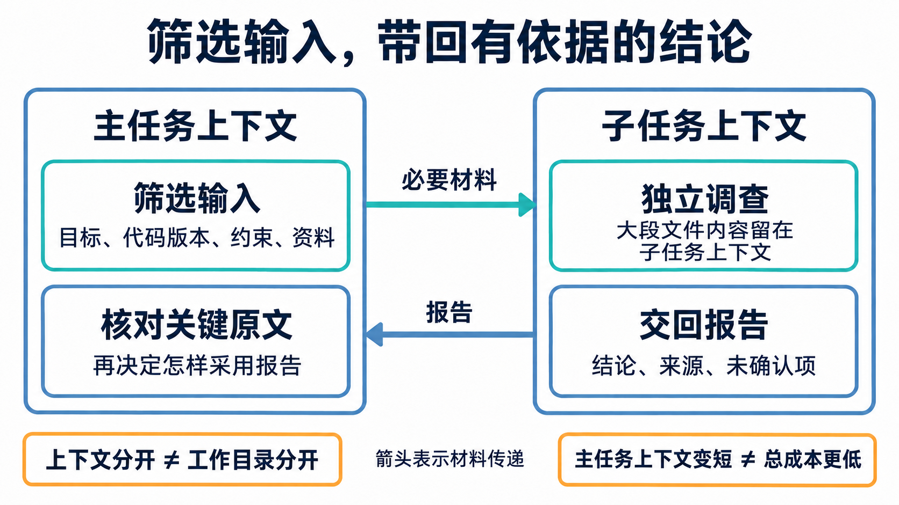

看完这张图，你要能：为子任务挑出必要的输入，检查它报告的依据，并分清上下文隔离和工作区隔离。

容易误会的地方：

- 主任务的上下文变短了，不代表总的 Token、费用或时间变少了。
- **上下文分开，不等于工作目录分开。** 两个独立的对话仍可能读写同一个目录。要并行改代码，按第 20 课的方法给每个任务单独的工作目录。

## 二、子任务怎样运行，结果怎样交回？

**委派是主 Agent 的一个工具：子 Agent 在独立会话里跑同一个循环，它的报告作为这次工具调用的结果交回主 Agent。**

### 先看最简委派

**去掉所有检查，委派只是“用一份新的消息列表，再跑一次 Agent Loop”。**

下面是一段 Python 风格的**教学伪代码**，不能直接运行。`run_turn` 就是第 4 课的最简循环：

```python
def delegate_tasks(task_text, tools):
    child_messages = [system_prompt(),            # 1. 新的消息列表：不带父对话历史
                      user(task_text)]            #    只放这次的任务说明
    report = run_turn(child_messages, tools)      # 2. 子 Agent 用同一个循环工作
    return report                                 # 3. 报告作为工具结果交回父任务
```

用退款调查走一遍：

1. 主模型调用 `delegate_tasks`，给子任务的说明是“找到退款金额和支付方式字段”。
2. 子 Agent 从一份空白的消息列表开始，搜索、读取、核对，几个 Step 后写出报告。
3. 报告回到主任务的消息列表，成为下一次主模型请求的一部分。

这个最简版能跑通一次调查，但问题很多。它不问你就花钱，子 Agent 拿着和主任务一样的工具，停不下来也没人管。下面一次加一个约束。

### 从最简委派到 MyBuddy：一次加一个约束

**最简版假设子 Agent 便宜、可信、一定会停；MyBuddy 多出来的代码，都在处理这些假设不成立的时候。**

1. **委派会产生额外的模型费用 → 默认先请你批准。** 批准前先准备好计划：交给哪个模型、做什么任务，让你看清楚。
2. **子 Agent 的权限可能比主任务大 → 工具范围取交集。** 只读子任务只拿读取工具。子 Agent 不能用 Memory、联网搜索，也不能再委派（第三节）。
3. **有时需要刚才讨论的内容 → 可以选择带上当前对话（**`fork`**）。** 默认只给任务说明（`task`）。
4. **子 Agent 可能打转 → 发现明显的重复操作就停下。** 也可以在配置里设步数和时长上限（第三节）。
5. **主任务不一定要等 → 可以后台运行。** 先拿到运行编号，需要时再查（本节）。
6. **程序可能中途崩溃 → 先把子任务记录保存好，再启动它。** 重启后才不会重复执行（第三节）。
7. **“完成了”可能不可靠 → 交回状态和报告，由主任务核对。** 停没停稳确认不了，就标为结果未知（本节、第三节）。

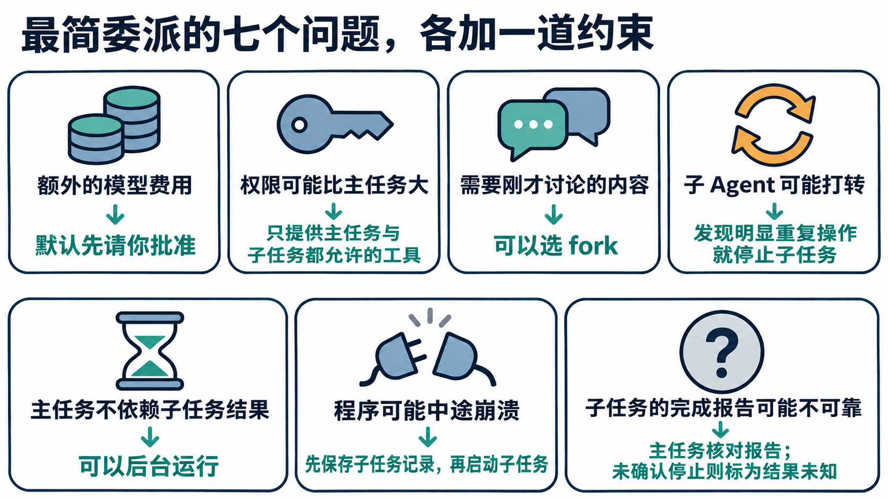

看完这张图，你要能：说出最简委派的七个问题，以及 MyBuddy 各用什么约束处理。

和最简版比，骨架没变：还是“新消息列表 → 跑循环 → 报告交回”。多出来的每一步，都对应上面一个约束。

### 委派是主 Agent 的一个工具

**MyBuddy 的委派工具叫** `delegate_tasks`**，一次最多交出两项任务。**

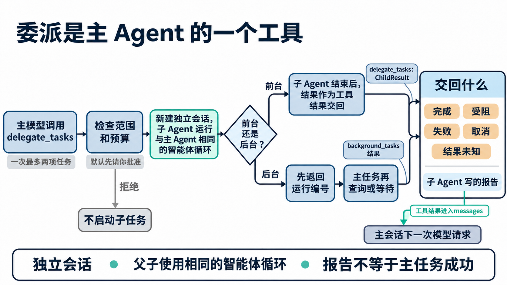

看完这张图，你要能：说出 delegate_tasks 的四步：检查、新建会话、按前台或后台交回，以及交回哪些状态。

1. 主模型调用 `delegate_tasks`，写明子任务说明。
2. Harness 检查范围和预算，默认先请你批准。
3. Harness 为子 Agent 新建一个独立会话。子 Agent 用和主 Agent 相同的“模型—工具”循环工作。
4. 前台运行时，子 Agent 结束后，结果作为 `delegate_tasks` 的工具结果交回。后台运行时，工具先返回运行编号，主任务再查询或等待。

交回的结果包括子任务的状态（完成、受阻、失败或取消），以及子 Agent 自己写的报告。无法确认结果时，会标明结果未知。

容易误会的地方：

- **子 Agent 说“完成了”，只是它的报告，不等于主任务成功。**

### 跟着一次调查走完委派

**主任务把有边界的问题交出去，等报告回来，再核对关键证据。**

主任务准备修改麦当当的支付方式报表，要先确认退款记录里的金额和支付方式字段。可以把“找到退款字段并解释含义”交给一个只读子 Agent。默认情况下，主任务等报告回来，再决定报表怎么改：

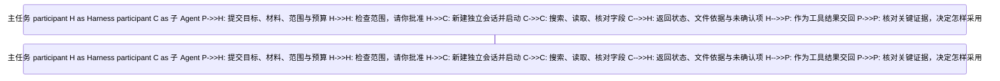

交给子 Agent 的材料包括：报表目标、当前代码版本、已经确认的退款规则。界面配色的讨论可以省掉；会改变金额含义的约定必须带上。

可以要求它按这样的格式交回（字段仅作教学示意）：

```latex
任务：refund-fields-01
起点：开始时的代码版本
状态：已完成 / 部分完成 / 失败 / 已取消
发现：字段位置、含义及支持判断的代码范围
未确认：根据现有材料还回答不了的问题
副作用：有没有改动文件或外部系统
```

收到“已完成”，主任务还不能直接宣布报表做好了。它要看报告对应的代码有没有变过，金额口径（哪些钱算进哪一栏）有没有原文依据，再决定怎么改。

子 Agent 说“没找到退款应计入哪一天报表的规则”，这就是要补查或问你的地方。不能悄悄填一个默认答案。

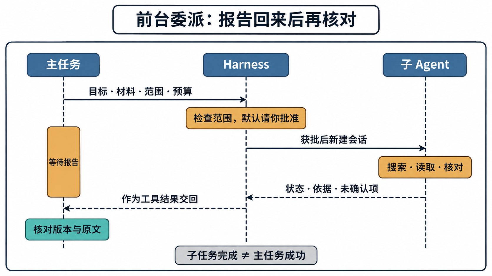

看完这张图，你要能：分清子任务报告的状态，和你自己还要检查的起点与关键来源。

### 等结果，还是先做别的？

**主任务下一步依赖子任务的结果，就在前台等；不依赖，才放到后台。**

委派有两种运行方式：

- **前台**（默认）：主任务等子任务结果回来，再继续。
- **后台**：工具接纳子任务后返回编号，主任务可以继续做别的。需要结果时，再查询或等待。

| 主任务下一步 | 选择 | 采用结果前核对什么 |
| --- | --- | --- |
| 依赖子任务要查清的事实 | 前台，等结果 | 结论、依据和代码版本 |
| 和子任务无关，可以独立推进 | 后台 | 子任务状态、结果在哪、什么时候合并 |
| 子任务需要你做决定 | 保留问题，等你回答 | 你的答复是否改变了范围 |

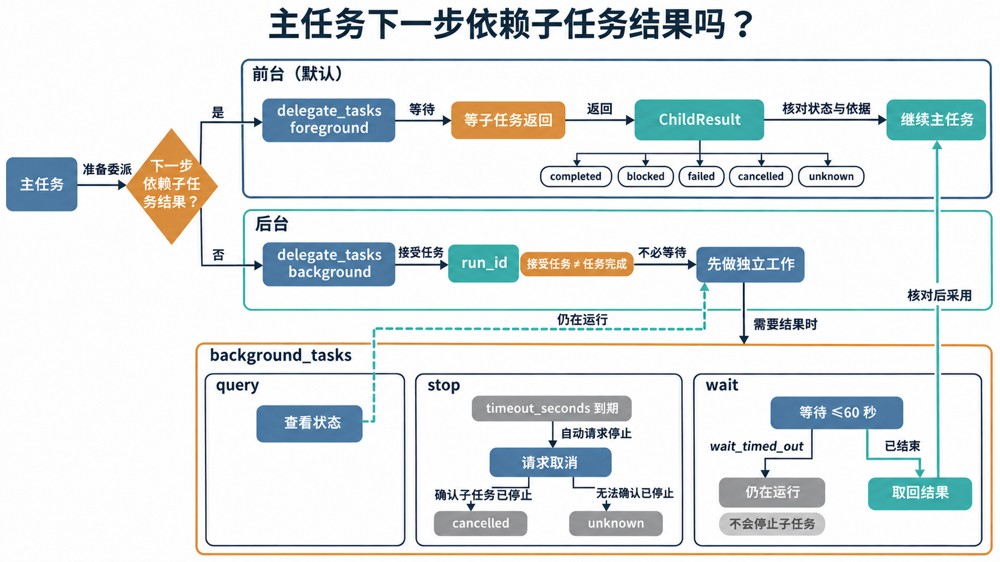

看完这张图，你要能：判断依赖步骤何时必须等待，以及后台设计需要何种管理。

容易误会的地方：

- 后台任务返回的编号，只说明任务已被接纳，不代表已经开始或完成。到了依赖它的那一步，主任务还是要等它或查它。

### 从头交代，还是带上当前对话？

**默认** `task` **只给任务说明；**`fork` **再带上触发委派时的对话。带多少，看任务依赖什么。**

MyBuddy 的委派有两种准备上下文的方式：

- `task`（默认）：子 Agent 拿到任务说明、你明确交给它的背景、项目说明，以及父会话创建时固定下来的会话说明（第 14 课）。不带父对话历史。
- `fork`：除此之外，还带上触发这次委派的模型请求里用到的对话内容。压缩过的部分，以摘要和保留消息出现。提出委派的那次模型输出、当时还没完成的工具调用，都不在里面。

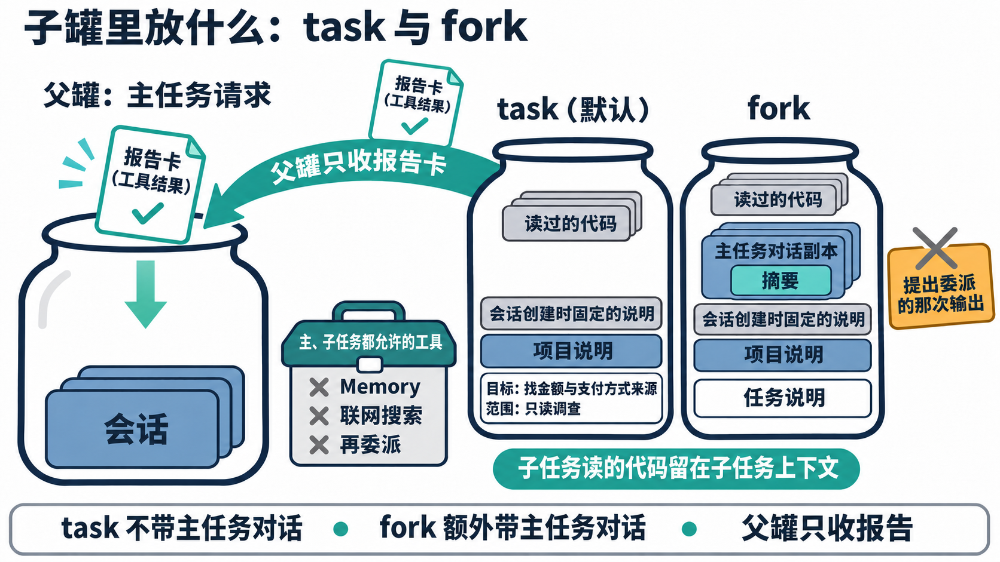

看完这张图，你要能：用“父罐和子罐”看清：task 只放任务说明，fork 还会带上对话；子罐读过的代码留在子罐，父罐只收到报告卡。

| 要交出的任务 | 它依赖什么 | 选择 |
| --- | --- | --- |
| 找到退款金额字段及调用位置 | 当前代码和一个明确的问题 | `task`，把路径、范围和输出要求写清楚 |
| 检查刚商定的报表方案有没有漏掉退款例外 | 刚才的多轮讨论和当前代码 | 可以用 `fork`，同时写明这次只查哪些条件 |

没有“带得越多越好”。第一项任务带上全部界面讨论，只会增加无关内容。第二项任务只剩一句“看看有没有问题”，就丢了要评审的对象。

用 `task` 时，说明可以这样写：

```latex
目标：找到付款、退款记录中金额与支付方式的来源。
材料：当前代码中的相关模块和项目说明。
范围：只读调查，不改报表，也不改业务规则。
返回：字段含义、调用位置、支持结论的原文和未确定项。
```

用 `fork` 时，也不能省掉具体目标：

```latex
基于刚才讨论中已经确认的报表条件，检查退款例外是否遗漏。
先区分已经接受的要求和讨论过但没采用的方案。
核对当前代码，只返回遗漏与证据，不做修改。
```

#### 带了对话，为什么还要重新读代码？

**对话里的文件内容可能已经过时；带上对话，也不会带上权限。**

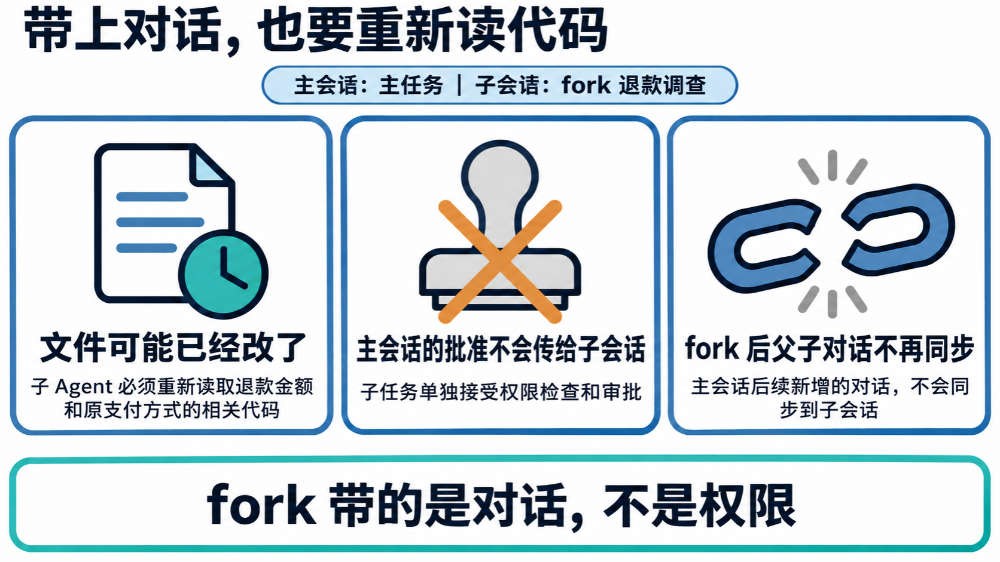

看完这张图，你要能：说出 fork 带上对话后仍要重新读代码、重新审批、之后不同步的三个原因。

主会话可能昨天读过某个函数，今天文件已经改了。带上对话，子 Agent 知道当时讨论了什么，但不能保证那次读到的还是现在的样子。影响结论的代码，子 Agent 仍要重新读。

主会话里你批准过的操作，不会自动授权给子 Agent。即使对话里带有之前读文件的内容，子 Agent 改文件前也要重新读取，并按自己的权限接受检查和审批。之后主会话新增的内容，也不会同步过去。

#### fork 能不能沿用主会话的提示缓存？

**MyBuddy 的 fork 只复制对话，不复制主请求的整个开头，所以不能指望子 Agent 第一次请求就命中主会话的缓存。**

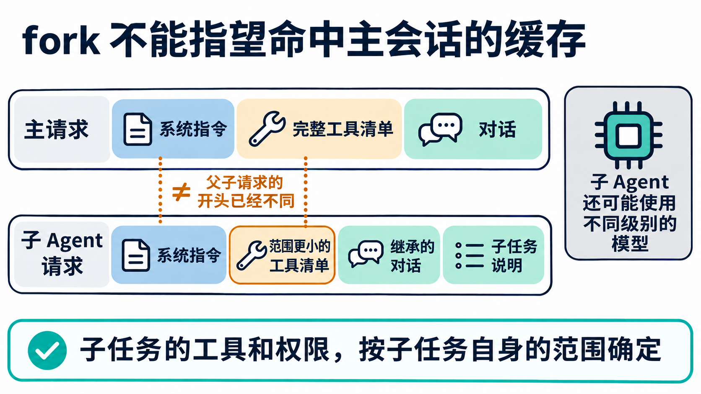

看完这张图，你要能：看出子 Agent 请求的开头和主请求不同，所以 fork 第一次请求不能指望命中主会话缓存。

第 8 课讲过：请求开头逐字相同，才可能复用缓存。MyBuddy 的子 Agent 是新建的会话，按自己的范围重新装配请求：工具清单更短，模型级别也可能不同。继承的对话虽然放在子任务说明之前，但请求开头的系统部分和工具清单已经和主请求不同（代码位置见源码解析）。

换来的是边界清楚：子 Agent 的工具和权限由它自己的范围决定。MyBuddy 目前也没有记录缓存用量，没法从 `/status` 看出子任务命中了多少。

#### 怎样判断 fork 有没有帮上忙？

**固定问题和代码版本，用** `task` **和** `fork` **各做一次，比较漏了什么、多做了什么。**

对同一个小问题做两次只读调查，一次用 `task`，一次用 `fork`。先固定问题和代码版本，不要一边改需求一边比较。不看谁回答更长，而看：

| 观察项 | 要判断的问题 |
| --- | --- |
| 已接受的退款条件 | `task` 的说明有没有漏写，`fork` 有没有保留 |
| 讨论过但放弃的方案 | 子 Agent 有没有误当成当前要求 |
| 读代码的范围 | 有没有因为无关背景多查了其他模块 |
| 追加澄清与补读 | 为了得到合格结论，还多做了哪些工作 |

`task` 漏了条件，就补充说明。`fork` 把旧方案当成新要求，就先说清当前接受的条件。

## 三、分工、取消和失败

**子 Agent 的权限只会更小；停下来要确认停稳，确认不了就按结果未知处理。**

### 按规划、实现和评审分工时，怎样交接

**分角色可以，但每个角色交接什么要写清楚，改目标或扩权限仍要你确认。**

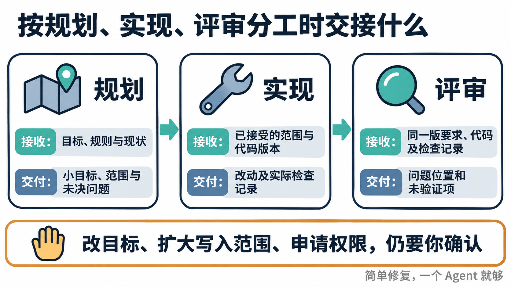

看完这张图，你要能：说出规划、实现、评审各接收和交付什么，以及哪些变化仍要你确认。

可以按规划、实现和评审拆分职责。要不要分成独立角色，看任务复杂度和交接成本。不是每个任务都要三个角色。

| 角色 | 接收什么 | 交付什么 |
| --- | --- | --- |
| 规划 | 你的目标、规则与现状 | 可检查的小目标、范围与未决问题 |
| 实现 | 已接受的范围与代码版本 | 改动及实际检查记录 |
| 评审 | 同一版要求、当前代码及检查记录 | 逐项判断、问题位置和未验证项 |

规划提出“调整免邮规则”时，实现仍要问清地区和金额边界。评审发现遗漏时，要指出对应的要求和证据。角色之间可以商量验证方法。但改变你的目标、扩大写入范围或申请权限，仍要按第 5、6 课的流程由你确认或批准。

简单的运费修复，一个 Agent 改完直接测试就够了。

容易误会的地方：

- 角色分开，不等于能同时做。评审要看实际写出来的代码，有依赖的步骤就得等。

### 子 Agent 的权限从哪里来

**子 Agent 的工具，是“子任务类型允许的”和“主任务开放的”两者的交集。**

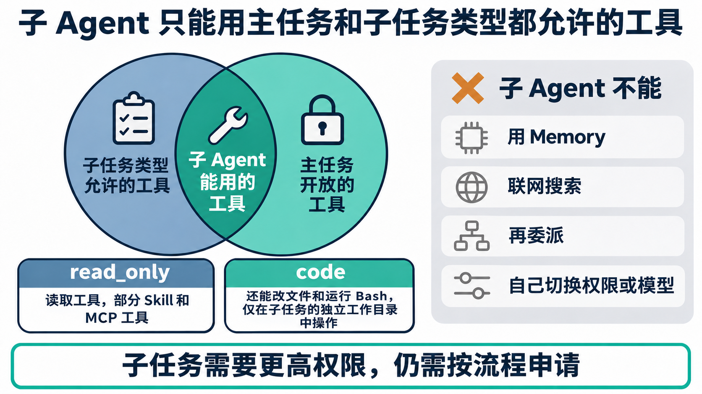

看完这张图，你要能：用交集说明子 Agent 的工具范围，并记住它不能用的四类能力。

- **只读子任务**（`read_only`）：可以用主会话允许的 ReadFile、CodeOutline、Glob、Grep 等读取工具，以及部分 Skill 和 MCP 工具。符合条件时，也能用 `team` 工具和团队成员交流（第 20 课）。
- **编码子任务**（`code`）：还能修改文件和运行 Bash，但只在自己单独的工作目录里（第 20 课）。
- 子 Agent 不能用 Memory 和联网搜索，不能再委派别的子 Agent，也不能自己切换权限或模型。
- 子 Agent 需要审批时，请求会出现在你的界面上，标明是哪个子任务。

父配置中的工具 Hook（第 18 课）也会交给子会话：`pre_tool_use` 在策略与审批通过后、执行前检查，`post_tool_use` 在成功后反馈。它们不逐次审批；会话和轮次事件只在主会话触发。只读调查前，要先确认这些可信命令会不会写文件。

子 Agent 需要更高权限时，应回到正常的授权流程。不能靠“换一个 Agent”绕过限制。

容易误会的地方：

- 你批准委派，是同意额外的模型调用；编码子任务还同意创建工作副本（第 20 课讲的独立工作目录）。这不等于批准子任务之后的具体修改或命令。
- `read_only` 限制的是模型能调用的工具。可信的 Hook 命令会做什么，要另外看。

### 取消、超时和失败

**默认不限步数和时长；“不再等待”和“让它停下”是两回事；停稳不明，就别重派。**

**默认不限步数和时长。** MyBuddy 默认不给子任务设累计步数和总时长上限。单次模型调用和 Bash 命令仍有各自的超时，父任务被取消这类停止条件也照常有效。需要限额时，可以在配置里设置（第四节）。

**打转会被停下。** 子 Agent 连续重复相同的读取、内容没变的编辑或被拒绝的调用时，会被停下并标记为受阻。执行过 Bash，就清空这段比较记录。

**超过并发上限就拒绝，不排队。** 批准前和真正启动前，MyBuddy 各数一次名额：正在运行的前台、后台子任务，加上停稳不明的任务，都算占用。加上这次的任务超过 `max_parallel`，委派就直接失败，不会存起来等空位。一轮里累计启动数还受 `max_runs_per_turn` 限制。一大批子任务只能由主任务分批委派。

**取消怎样传下去：**

- 前台子任务：你取消主任务后，停止请求会传给子任务，并等待清理。无法确认它已停下时，结果标为未知。
- 后台子任务：主任务这一轮结束或被取消，后台子任务**继续运行**。关闭整个主会话时，会请求它们停止并等待清理。把权限模式调严，或者进入规划模式时，也会先请求后台任务停下，并等它们结束。

还没开始的子任务，先留下停止标记，一启动就停下。确认停稳后，才标为“已取消并停止”；已改的文件和花掉的费用不会消失。停稳不明时按第 12 课的结果未知处理：先查清楚，不要重派一份同样的任务。

迟到的结果只能当参考材料；遗漏可以由主任务补查，或确认停稳后另派新任务。子会话不能从普通会话入口单独续接，选中它时会提示继续父会话；如果用了第 20 课的团队协作，团队待处理消息可以通过父会话的 `/team resume` 继续处理。


看完这张图，你要能：区分取消等待方、请求子停止与确认清理完成。

容易误会的地方：

- 界面上不再显示等待动画，不能证明子任务已经停了。
- `max_parallel` 不是排队长度。名额不够时，委派会被拒绝，不会排在后面等。
- 重复检测只能发现明显的重复。相同的 Bash 输出，也不能证明命令没有进展。

## 四、在 MyBuddy 中做一次只读委派

**打开配置开关，提一个有边界的只读调查，观察调用、审批、子会话和报告。**

### 打开委派功能

**委派默认关闭，在启动配置的** `[subagents]` **段打开。**

```toml
[subagents]
enabled = true
# max_parallel = 2         # 同时运行的子任务数，默认 2，最多 2
# max_runs_per_turn = 4    # 每轮最多启动几个子任务，默认 4
# max_steps_per_run = 30   # 可选：每个子任务的步数上限（1–50），默认不限
# timeout_seconds = 600    # 可选：每个子任务的总时长上限（10–1800 秒），默认不限

[worktree]
enabled = true             # 可选：允许编码子任务，见第 20 课
```

修改委派配置后，新建会话和重新打开的旧会话都会使用当前配置。配置变化会显示提示，不会单独导致恢复被拒绝；身份、记录和未完成工作仍需通过检查。

主模型每次委派时，还可以给子任务选模型档位（`low`／`medium`／`high`），对应启动配置 `[presets]` 里的三档。某一档没有配置，或者它的服务商没填密钥时，会明确拒绝。

### 常用操作

**委派靠在请求里说清楚；查看和停止后台子任务用** `/agent` **命令。**

| 想做什么 | 怎样做 |
| --- | --- |
| 委派一项只读调查 | 在请求中说明，主模型可以调用 `delegate_tasks` |
| 让它在后台运行 | 在请求中说明“后台运行”，对应参数 `execution_mode = "background"` |
| 带上当前对话 | 在请求中说明，对应参数 `context_mode = "fork"` |
| 查看后台子任务 | `/agent list` |
| 等待或停止某个子任务 | `/agent wait 运行编号`、`/agent stop 运行编号` |

主模型自己也能用 `background_tasks` 工具查询、等待或停止后台子任务。

子任务交回后发现遗漏，先让主任务读取相关文件，对照报告。要另派任务时，明确给出当前材料和未完成部分。新任务有自己的会话身份，不会自动继承已结束子任务的历史或工作树。Team 待处理消息的接续见第 20 课。

### 实践：只委派一次有边界的调查

**留下三样东西：任务说明、实际报告、主任务采纳或补查的理由。**

打开委派功能后，在练习会话中提出一项只读委派：

请委派一个只读子任务，查清收银台退款金额和支付方式分别在哪里保存、报表如何读取。保留“制作后售后不自动退款”的约定，返回文件位置、规则依据和未确定项。主任务收到结果后核对关键源码，暂不修改。

观察：

- 主模型是否实际调用了 `delegate_tasks`。
- 你是否收到了委派的批准请求。
- 子会话编号、上下文方式和报告各是什么。

默认前台方式下，主任务等报告回来再分析。暂时不打开委派，也可以手工开另一个会话练习同样的交接，但要注明这是人工分工。

最后检查委派说明：漏掉“制作后售后不自动退款”，接手的子 Agent 会缺哪项依据？这条规则已经写在指定文件里时，又该怎样要求它核对？

**能力卡**：想在收银台副本里亲手试一遍，就照着能力卡《只读委派子任务》（`demo-project/cards/subagent.md`）做。

## 使用小妙招

### 把有边界的调查任务交给子任务

可以让一个子任务只回答“哪些地方依赖免邮常量”，另一个只检查“测试缺了哪些边界”，各自返回位置、结论和未确认项，由主任务综合。很小的单点修改，不必拆开。在 Claude Code 里，可以直接说“用子 Agent 分别查这两件事”，也可以在 `.claude/agents/` 下定义固定用途的子 Agent。

**为什么这样做：** 子 Agent 读取的大量文件留在自己的上下文里。默认 task 不带主会话讨论；fork 会带上触发委派时的对话，但仍需写清本次目标和范围。很小的修改，交接成本可能比自己完成还高。

### 要求子任务返回证据与未决项

“查清退款”范围太大。换成“列出退款入口、状态限制、实收字段及仍不确定的问题，附文件位置”，子任务就知道要交什么，主任务也知道怎样检查。大量阅读留在子任务那边，只把影响判断的结论和证据带回来。

**为什么这样做：** 主任务只能看到子任务交回的报告，看不到它读过的文件（见“一次委派至少交代五件事”）。报告里没有位置和证据，主任务就没法验证，只能全盘相信，或者自己再查一遍。

### 将实现与审查分开，并明确报告怎样被采用

可以用另一个会话或模型复查实现，交代方法见第 13 课“把审查范围和检查重点一起交给评审者”。在 MyBuddy 中，可以用只读子任务审查，也可以手工开两个会话；两种方式都要先固定待审版本、说清由谁修改，再由实现者逐项核实。用 Claude Code 时，可以开一个新会话或交给子 Agent 复查。

**为什么这样做：** 写代码的会话已经相信自己的思路，复查时很容易顺着原来的理由看过去；另起一个上下文的评审者没有这些先入为主的想法，更容易发现问题（见“按规划、实现和评审分工时，怎样交接”）。说清由谁修改，是为了避免评审者顺手改代码，让两边的改动混在一起。

## 自测：这一课的概念分清了吗

**先自己作答，再看后面的答案。** 每题都能在本课正文里找到依据；带“动手验证”的题，可以照着做一遍，亲眼看到结果。

**1.** 你准备把库存接口修改和退款调查同时交给两个子 Agent。退款调查必须等库存接口改完，才能确认调用方式。怎样安排更合适？

- A. 两项立即并行，只要上下文独立，就不用等接口。
- B. 先等库存接口改完，再让退款调查依据实际接口核对。
- C. 给两个子 Agent 完整的主任务历史，就能消除接口依赖。

**2.** 子 Agent 交回“已完成”的退款字段报告。你准备据此修改支付方式报表。怎样采用这份报告更合适？

- A. 直接宣布报表任务完成，子任务已经检查过。
- B. 只看报告是否详细，越详细越能证明结论可靠。
- C. 核对当前代码、字段依据和金额口径，再决定怎么改。

**3.** 判断：把大段代码交给子 Agent 阅读后，主任务的上下文变短了，就能据此认定总的 Token、费用和时间都减少了。（对 / 错）

**4.** 你已打开委派功能，在新会话里还没发过任务，只输入 `/agent list`。这条命令会做什么？

- A. 启动一个只读子任务，返回运行编号。
- B. 查询后台子任务的运行记录；此时没有记录，也不会因此启动子任务。
- C. 先请求你批准委派，批准后才能查看记录。

### 答案与依据

**1. 选 B。** 退款调查依赖尚未完成的接口，要等实际接口可用再核对。独立上下文能分开对话，不能消除工作之间的依赖。  
依据：本课“能独立交代清楚，才值得拆”。

**2. 选 C。** 子任务的完成报告是待核对的材料，主任务还要确认依据是否符合当前代码和要求。子任务说完成，不等于报表已经做好。  
依据：本课“跟着一次调查走完委派”。

**3. 错。** 主任务少带中间材料，不代表总开销减少。子 Agent 仍要调用模型和工具，主任务还要携带说明、接收并检查报告。  
依据：本课“独立上下文省下了什么，没省下什么”。

**4. 选 B。** `/agent list` 用于查询后台子任务，不是发起委派。查询不会启动子任务，也不会请求委派审批。  
依据：本课“常用操作”。  
动手验证：按能力卡《只读委派子任务》（`demo-project/cards/subagent.md`）的“准备”一节，在仓库根目录运行 `uv run python demo-project/prepare_shop_demo.py --case C1`。进入脚本输出的本次练习目录，运行 `sh start-mybuddy.command`。在新会话里先输入两次 `/agent list`，两次都会显示“当前没有子任务运行记录。”，不会出现委派审批。这两次查询不调用模型。查完后再发送能力卡“操作”一节的调查请求。

## Q&A：常见追问

### Q1：子 Agent 越多，任务就会越快吗？

只有能独立推进的工作才适合并行。分工、传递材料、重复调查和合并都有开销。依赖强的任务，大部分时间可能花在等待上。先划清输入、产物和完成条件，再比较整体耗时与质量，不要只看同时启动了多少个。

### Q2：子任务说完成，主任务为什么还要核对？

主任务要对整体结果负责，子任务的完成报告只是需要核对的一份材料。报告可能引用旧文件、漏掉条件，或者测试与实现用了同一个错误假设。例如麦当当 C1 缺陷练习中，子任务报告测试全过，主任务也看过差异，独立检查仍发现漏了一种状态。因此，主任务应对照原始要求检查当前差异和真实输出，并补上能暴露遗漏的独立用例，不能只复述“子任务说完成了”。

### Q3：主任务结束，后台子任务会自动停止吗？

不会。后台子任务不会因为主任务这一轮结束或被取消而停止。关闭整个主会话时，会请求它们停止并等待清理。把权限模式调严，或者进入规划模式时，也会先请求后台任务停下，并等它们结束。前台子任务则会随主任务一起取消。发出停止请求不等于已经停下，要看运行状态。状态不明时，不要重新派一份同样的写任务。

### Q4：把大文件交给子 Agent，就不消耗 Token 了吗？

读取和分析仍然在子 Agent 那边发生，主任务也要携带任务说明和交回的报告。省下的是主任务反复携带中间材料。任务很小、交接要求不清，或者主任务随后又把全文重读一遍，收益就很有限。

## 本课术语速查

| 本课说法 | 源码或配置中的名字 | 含义 |
| --- | --- | --- |
| 子 Agent | SubAgent | 接受委派、在独立会话里工作的 Agent |
| 委派 | `delegate_tasks` | 主 Agent 把一项工作交给子 Agent 的工具 |
| 只读子任务 / 编码子任务 | `read_only` / `code` | 只能读取，或可在独立工作目录中修改 |
| 前台 / 后台 | `execution_mode`：`foreground` / `background` | 主任务等结果，或先继续做别的 |
| 从头交代 / 带上对话 | `context_mode`：`task` / `fork` | 使用任务说明等材料，或再带上触发委派的模型请求中的对话内容 |
| 后台控制 | `background_tasks`、`/agent list/wait/stop` | 查询、等待或停止后台子任务 |
| 委派开关 | `[subagents] enabled` | 启动配置中打开委派，默认关闭 |
| 停稳 | — | 确认子任务已经停下、结束状态已记录（第 12 课） |

## 继续阅读源码解析

源码解析沿“工具说明 → 策略与审批 → 冻结计划 → 保存记录后启动 → 创建子会话并运行 → 收集结果”读真实代码。
