理解 Worktree、资源归属、任务依赖、集成与退出。

## 本课导览

上一课把两项调查交给了各自独立的子 Agent。这一课更进一步：两项任务都要**改代码**。只把对话分开还不够。文件也要分开，最后还要把两边的修改合到一起。

本课按下图沿“分开做 → 各自交付 → 合到一起再检查”展开，最后看几个 Agent 持续配合的 Team。

学完后，你应能安排两项并行修改，并让每份检查结果都能对应到它的工作目录。下一课用一个完整的报表任务，综合观察 Harness 做了什么。

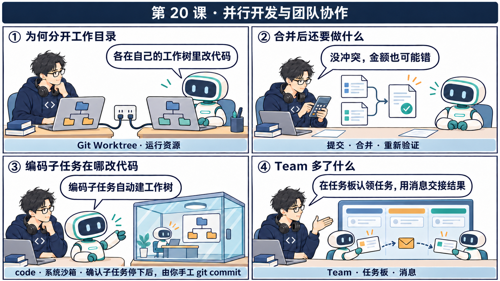

## 一、两个任务同时改代码，为什么要分开工作目录？

**对话分开了，文件没分开；两个任务要改代码，就要各有一个工作目录。**

### 两个会话为什么仍可能互相干扰

**两个 Agent 写同一个目录，就共享同一份文件。**

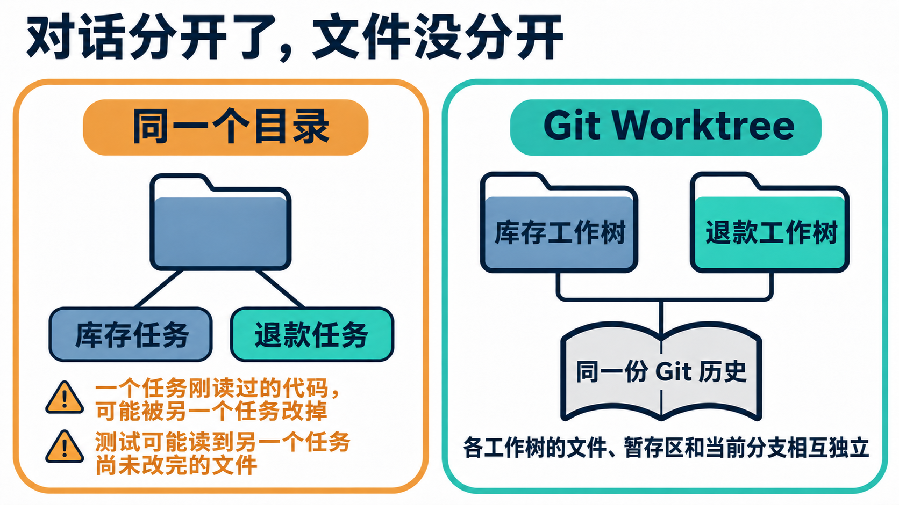

看完这张图，你要能：说出两个 Agent 写同一个目录会出的两种问题，以及工作树分开了什么、共用了什么。

上下文分开，只说明对话分开了。如果两边都在同一个目录里改文件，问题就来了：

- 一方刚读过的代码，可能马上被另一方改掉。
- 一方运行测试时，可能读到另一方改了一半的文件。

**Git Worktree（工作树）** 能为同一个仓库再建一个工作目录。通常每个目录检出一个不同的分支。几个工作树共用同一份 Git 历史。各自的文件、暂存区和当前分支互不影响。这样，库存任务和退款任务就能各改各的文件。

### 先看最简做法

**最简单的并行开发只有四步：建两个工作树，各自提交，合并，再整体检查。**

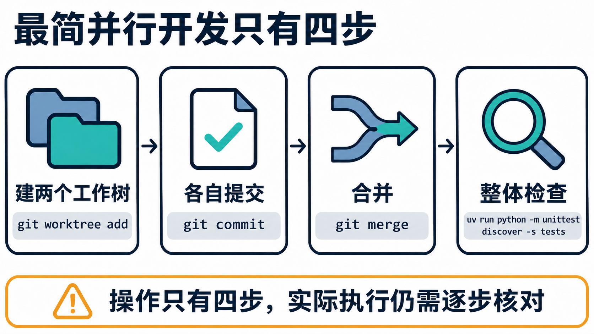

看完这张图，你要能：记住最简并行开发的四步和每步对应的命令。

下面是一段示意命令。目录名和分支名只是例子：

```shell
git worktree add -b inventory ../inventory main   # 库存任务的目录和分支
git worktree add -b refund ../refund main         # 退款任务的目录和分支
# 两个任务各在自己的目录里修改、测试、提交
git merge inventory refund                        # 回到主目录合并
uv run python -m unittest discover -s tests       # 在合并后的版本上整体检查
```

骨架就这么短。但真用起来，每一步都会碰到问题。下面一次加一个约束：

| 会出什么问题 | 怎么做 | 在本课哪里展开 |
| --- | --- | --- |
| 两边同时启动服务，抢同一个端口 | 端口、数据库、进程另外分配 | 下一小节 |
| 新目录里没有依赖和本地配置 | 把“怎样准备环境”写进交接材料 | 本节末尾 |
| 合并没冲突，金额却错了 | 合并后在集成版本上重新检查 | 第二节 |
| 任务被取消，目录里还有改动 | 先确认停稳，再保留或提交 | 第二节 |
| 让 Agent 自动开工作树 | MyBuddy 从已提交版本建目录，并限制写入 | 第三节 |

### 工作目录分开了，运行资源还没分开

**工作树只分开文件，不隔离网络、进程、数据库和端口。**

两个工作树同时启动服务，仍然可能抢同一个端口。两边的测试仍然可能写同一个数据库。这些要另外安排。

工作树和第 7 课的沙箱解决不同的问题。工作树把代码分到不同目录。沙箱限制命令能访问哪里。

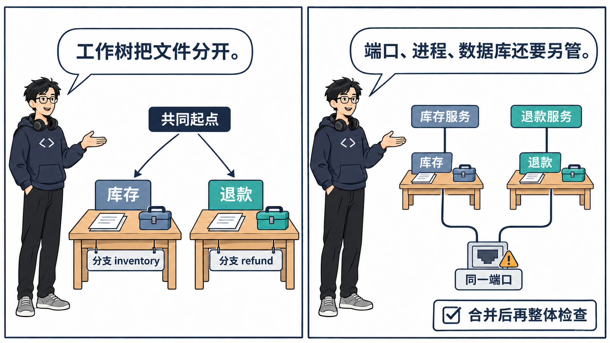

看完这张图，你要能：解释Worktree分开文件工作区，但不自动隔离端口、进程与数据库。

### 把工作目录和任务对应起来

**每个工作目录都要说得清：属于哪个任务、从哪个版本开始、由哪个会话在用。**

只是换一个当前目录，说明不了这些。

```mermaid
flowchart TD    P[主任务与共同起点] --> A[库存子任务]    P --> B[退款子任务]    A --> WA[库存分支与工作树]    B --> WB[退款分支与工作树]    WA --> RA[改动 提交 测试与剩余事项]    WB --> RB[改动 提交 测试与剩余事项]    RA --> I[主任务审阅并合并]    RB --> I    I --> V[在合并后的版本上完整检查]
```

库存分支和退款分支各自测试都通过了，合在一起就一定对吗？不一定。两个分支即使没有文字冲突，也可能改变了同一个业务假设。所以主任务要收齐两边的交付材料，在合并后的版本上再检查一次。

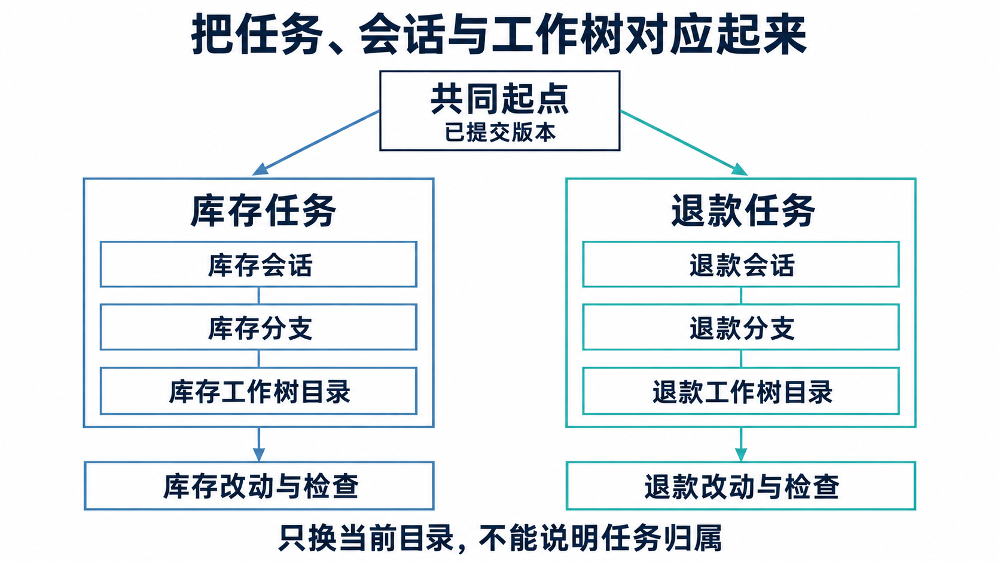

看完这张图，你要能：解释任务、基线、工作树标识与会话归属的对应关系。

新建的工作树还要准备运行环境。依赖要重新安装。被 Git 忽略的本地文件（比如本地配置）不会自动出现。所以“怎样准备环境”也是交接材料的一部分。复制本地文件时只带必要的。凭据按各自允许的方式配置。

容易误会的地方：

- 工作树不是沙箱。它不限制命令能访问哪里。
- 取消任务不会撤销已经写进目录的修改。
- 新开一个对话，不能把文件分开。

## 二、独立修改怎样提交、合并并重新验证？

**各自提交只说明局部做完了；合并以后，要在集成版本上重新检查。**

### 创建、提交、集成要理解到什么程度

**分支记录提交历史，工作树提供文件目录；删除工作树和删除分支是两个动作。**

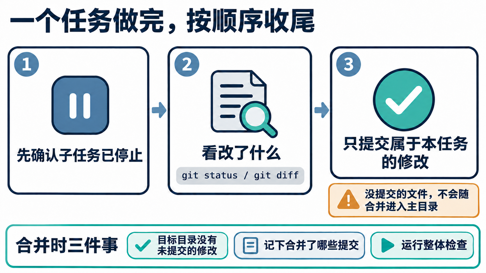

看完这张图，你要能：按顺序说出一个任务收尾的三步，以及合并时要做的三件事。

手工操作时，用 `git worktree add -b` 从共同起点创建工作树。一个任务做完后，按这个顺序收尾：

1. 先确认这个目录里的工作已经停下。
2. 用 `git status` 和 `git diff` 看改了什么。只提交确实属于这个任务的修改。
3. 没提交或没被 Git 跟踪的文件，不会因为合并分支就自动进入主工作目录。

合并有两种常见方式：用 merge 保留分支汇合的记录，或者只挑选需要的提交。无论哪种，都要做三件事：

- 确认目标目录是干净的（没有未提交的修改）。
- 记下合并了哪些提交。
- 运行整体检查。

第五节的练习样本正好用来观察这一点。订单和汇总两个分支，各自只能让练习自带的外部检查（`check-case.command`）通过一部分。合并后才可能全部通过。某个分支漏了一种情况，合并后的检查会把它找出来。两个局部任务都完成了，整体不一定完成。

可以用 `git worktree list` 看有哪些工作树。在各个工作树里用 `git status` 和 `git diff` 审阅改动。遇到冲突时，先读懂双方的意图。不要默认用一边整块覆盖另一边。

### 并行以后，每份证据都要找到自己的工作区

**每份检查结果只代表它所在的那个工作树和那个版本。**

协作时，对每个子任务分别回答第 1 课“从七个问题看 Harness 的工作”小节提出的七个问题。把每个子任务的检查结果和合并后的检查分开记录，带到第 21 课的整体核对中。

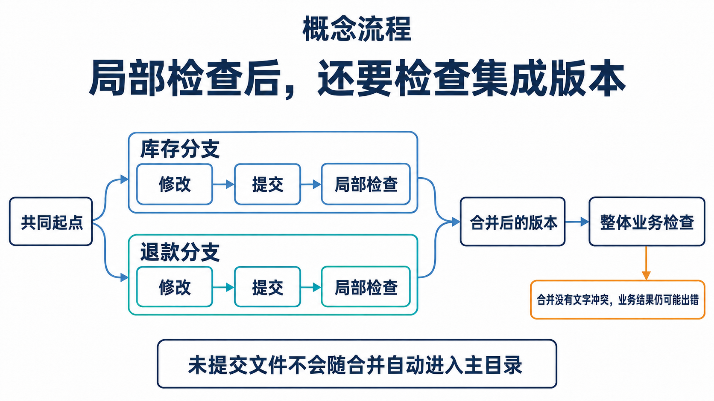

看完这张图，你要能：区分子任务提交及测试与新集成版本需要的整体核验。

### 两边都没有文本冲突，为什么金额还是错了？

**没有文字冲突，双方对同一个返回值的理解仍可能不同。**

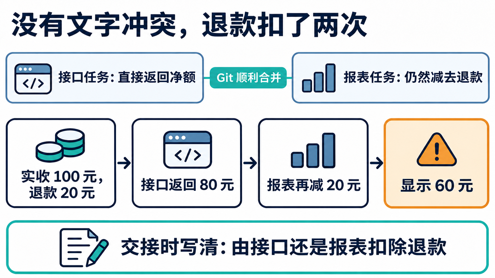

看完这张图，你要能：用 100、80、60 元三个数看出合并无冲突也可能把退款扣两次。

看一个例子：原来接口返回收款总额，报表自己扣退款。并行时，接口任务改成直接返回净额，报表任务仍保留“返回金额减退款”。两边改的是不同文件，Git 顺利合并，退款却被扣了两次：收款 100 元、退款 20 元，接口返回 80 元，报表再减 20 元，显示 60 元。

问题出在返回值的含义上。交接时要写清接口含义，合并时定好由哪一层扣退款，再查所有调用方。

### 冲突和取消时先保留工作

**遇到冲突、取消或迟到的结果，先保留已经写出的修改，再判断。**

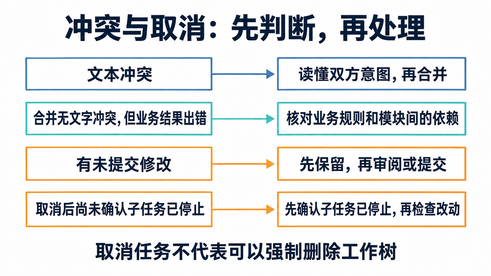

看完这张图，你要能：根据实际产物及进程状态选择审阅、保留或重新核对。

| 情况 | 怎样判断 |
| --- | --- |
| 同一段代码有文字冲突 | 读懂双方意图和业务规则，再决定合并结果 |
| 合并无冲突但测试失败 | 检查行为上的依赖和漏掉的任务 |
| 子任务被取消 | 先确认它已经停稳（第 12 课），再看实际改动和提交 |
| 工作树里有没提交的内容 | 保留或审阅后提交，不能强制删除 |
| 旧版本的结果迟到 | 对照当前版本，避免重复合并或沿用旧测试 |
| 外部服务仍占着资源 | 文件分开没解决运行资源，先处理对应进程 |

`git worktree remove` 遇到有未提交内容的工作树会拒绝删除。不要习惯性地加 `--force`。

容易误会的地方：

- 库存任务通过的检查，不能证明退款任务也通过。
- 两个工作树各自通过，不能证明合并后的版本通过。
- 取消任务后，它已经写出的修改仍要保留和审阅。

## 三、让 MyBuddy 自动给编码子任务分配工作目录

**打开工作树功能后，MyBuddy 会为每个编码子任务自动建一个工作树；提交和合并仍由你来做。**

上一课的子任务都是只读的。打开工作树功能后，主 Agent 可以委派**编码子任务**（`code`）。

### 打开编码子任务

**同时打开委派和工作树两个开关，并在新会话中生效。**

在启动配置中这样写：

```toml
[subagents]
enabled = true

[worktree]
enabled = true
```

修改后在新建或重启的会话中生效。使用前要知道几条规则：

- 当前目录必须是 Git 仓库的根目录。
- 工作树从**当前已提交的版本**创建。你还没提交的改动不会带过去。MyBuddy 也不会替你暂存或提交。
- 仓库配置了 Git filter 程序时，MyBuddy 会拒绝创建或检查工作树。这类程序会在 Git 读取或检出文件时自动运行。先检查并处理相关配置。
- 规划模式下不能委派编码子任务。
- 每个子任务有自己的分支，名字是 `mybuddy/subagent-编号`。工作树的位置由 MyBuddy 决定，模型不能指定。

### 子任务在自己的目录里能做什么

**子任务只能写自己的工作树，而且不能自己提交。**

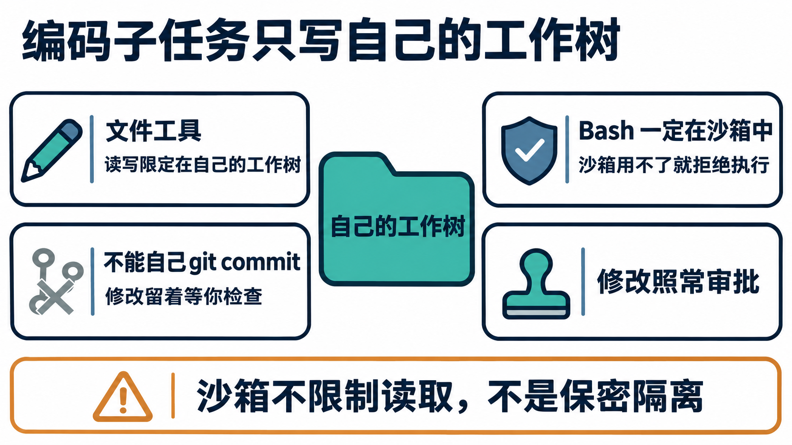

看完这张图，你要能：说出编码子任务的四条限制，并记住沙箱不限制读取。

- `ReadFile`、`WriteFile`、`EditFile` 等文件工具，读写范围限定在自己的工作树。
- 子任务的 Bash **一定在系统沙箱中运行**（第 7 课）。它只能写自己的工作树和本次执行的专用临时目录，不能写主工作目录，也不能写 Git 仓库内部受保护的文件（Git 元数据）。沙箱用不了时，直接拒绝执行，不会退回到没有沙箱的方式。
- 子任务**不能自己** `git commit`，修改留在工作树里等你检查。
- 子任务按自己的权限检查操作。默认模式自动放行读取工具、只读白名单命令和本次会话已允许的操作，其余编辑和命令需要批准；accept_edits 还会自动放行文本编辑。

容易误会的地方：

- Bash 沙箱不限制读取，主工作目录的内容仍可能被读到。它不是保密隔离。
- 你批准“委派”时，批准的是委派产生的模型调用和工作树创建，不包括后面的每次修改。

### 检查、提交和合并

**主 Agent 先检查差异，你确认停稳后手工提交，再自己合并。**

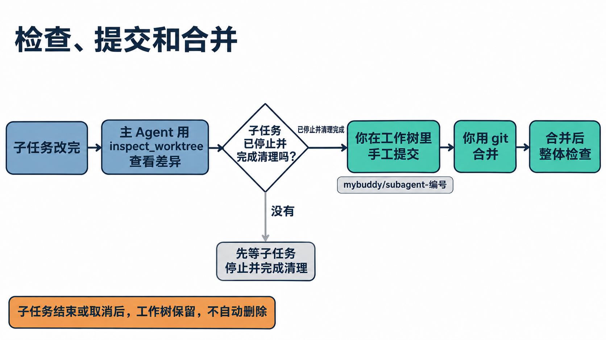

看完这张图，你要能：沿“查看差异 → 确认停稳 → 手工提交 → 合并 → 整体检查”说出谁做哪一步。

| 操作 | 做什么 | 注意 |
| --- | --- | --- |
| `inspect_worktree` | 查看工作树相对起点改了哪些文件、具体改动是什么 | 改动太大或是二进制文件时，会说明省略了什么 |
| 用户手工 Git 提交 | 你确认子任务已停稳后，在对应工作树里提交选定文件 | 不属于 Agent 工具；提交后仍由你决定是否合并或推送 |

提交以后，子分支 `mybuddy/subagent-编号` 上就有了这次修改。合并到主分支这一步，由你用 git 完成（方法见第二节）。合并后再做整体检查。

子任务结束或被取消后，工作树会**保留**。即使里面没有任何改动，也不会自动删除。你可以检查并手工完善这份工作树，或另派新任务。新编码任务以主仓库当前检出的提交（HEAD）为起点创建自己的工作树，不会自动接管这份副本。

## 四、持续协作：Team 比一次委派多了什么？

**Team 多了成员表、任务板和消息三样东西，让几个 Agent 能持续配合。**

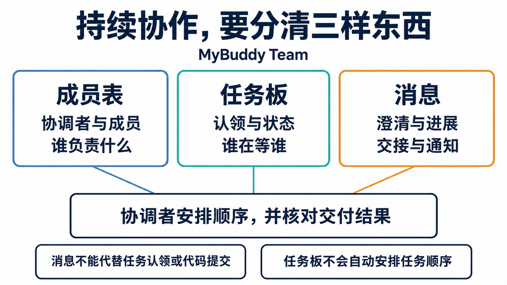

看完这张图，你要能：区分持续协调需要的状态与一次委派返回结果的机制。

### 一次委派与持续协作的区别

**一次委派做完就结束；持续协作还要知道谁认领了什么、谁在等谁。**

一次委派是：接收任务、完成、交回结果、结束。几个 Agent 要持续配合，就还要知道：谁认领了哪项任务、谁在等谁、消息有没有被处理、什么时候可以结束。

可以用三样东西来理解持续协作：

- **成员表**：谁在团队里，协调者与成员各负责什么。
- **任务板**：有哪些任务，谁认领了，现在是什么状态。
- **消息**：成员之间的澄清、进展和交接。

协调者安排顺序，并核对交付。

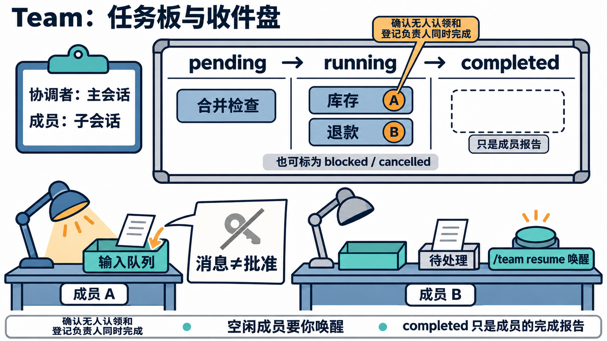

看完这张图，你要能：用“任务板和收件盘”理解 Team：认领一步完成；成员空闲时，消息要你去唤醒；completed 只是成员自己的报告。

库存和退款任务可以从共同起点并行。合并检查要等两边都交付。如果退款要用库存任务的新接口，就要先约定接口，或者等库存任务完成。只在任务描述里写“等另一位做完”，挡不住双方互相等待。

成员多了，协调成本也会上升。两种组织方式各有代价：

- 由一个协调者统一安排：容易统一目标，但它可能成为瓶颈。
- 成员之间直接沟通：适合局部商量，但决定容易散落在各条消息里。

加成员之前，先看任务能不能真正独立、共享资源能不能安排好。小任务用一次委派就够了，不必组建团队。

#### 协调者模式：主 Agent 只调度，不写代码

**有一种组织思路叫“协调者模式”：主 Agent 自己不改代码，只负责拆任务、派任务和下判断。**

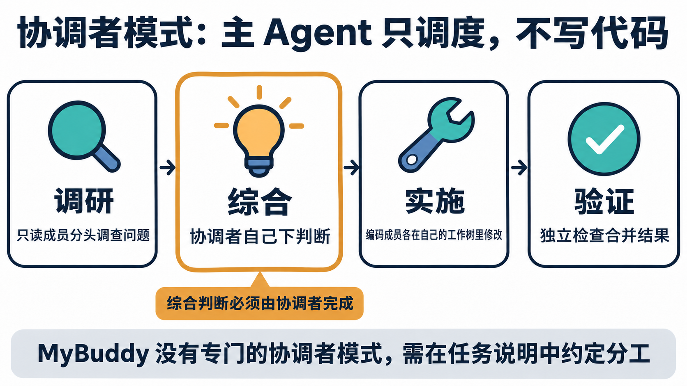

看完这张图，你要能：说出协调者模式的四个阶段，并记住“综合”只能由协调者自己做。

它通常按四步推进：

| 阶段 | 谁来做 | 产出 |
| --- | --- | --- |
| 调研 | 几个只读成员分头查 | 各自的发现和依据 |
| 综合 | 协调者自己 | 一份判断：问题是什么、按什么方案改、怎样拆 |
| 实施 | 编码成员，各在自己的工作树 | 改动和检查结果 |
| 验证 | 另一个成员或协调者 | 对合并结果的独立检查 |

关键在第二步。成员各自只看到一部分材料，报告之间可能矛盾，也可能都漏了同一个例外。**把各方结果综合成判断，不能再交给成员。** 协调者要读完所有报告，对照关键原文，自己定下方案，再把方案写成下一批任务说明。如果只是把调研报告原样转给实施成员，“综合”这一步就没人做了。

MyBuddy 没有专门的协调者模式，也不会自动按这四步排程。可以用现有能力接近它：

- 在 Buddy 正文或 Skill 里写明“先委派只读调研，汇总后再委派编码任务，自己不直接改文件”（第 14 课、第 16 课）。
- 调研用 `read_only` 委派，实施用 `code` 委派，各自一份工作树。
- 协调者在两批之间自己核对报告，验证阶段再委派一次只读检查，或由你在集成目录跑检查。

容易误会的地方：

- 不能靠从主会话的工具名单里删掉 `WriteFile`、`EditFile` 来强制“主 Agent 不写代码”。子任务的工具要和主会话开放的工具取交集，主会话没有写工具，编码子任务也拿不到（见 `src/mybuddy/platform/subagents/child_extensions.py` 的 `select_child_tool_names`）。所以“只调度”在 MyBuddy 里靠说明约束，不是工具强制。
- 也不能用 `/plan` 来做：规划模式下不能委派 `code` 任务（`src/mybuddy/platform/subagents/session_delegation.py`）。

Team 成员仍是权限受限的子会话。它们沿用同一套会话执行机制。

容易误会的地方：

- 消息里说“我准备改退款接口”，不说明任务板上已经登记了这项任务。
- 消息不能代替认领或提交。
- 任务板不会自动按依赖排程。
- 打开协作入口，不等于批准成员的编辑和命令。

### 在 MyBuddy 中使用 Team

**主会话是协调者，它委派出去的子会话是成员，双方都用** `team` **工具协作。**

Team 跟随委派功能一起提供，不需要单独打开。

| 谁 | 能做什么 |
| --- | --- |
| 协调者（主会话） | 查询、发消息、认领和更新任务；创建任务；确认原成员已经停下、结果明确后改派任务 |
| 成员（子会话） | 查询成员、消息和任务；认领任务；更新自己负责的任务；给其他成员发消息 |

几条规则：

- **认领是一步完成的**：“确认没人认领”和“登记负责人”一起完成。两个成员不会同时认领到同一项任务。
- **消息怎样送达**：成员正在运行、且满足投递条件时，消息才进入它的输入队列。否则保留为待处理。
- **空闲成员要你唤醒**：执行 `/team resume`，满足条件时会沿原来的子会话和团队剩余预算启动新运行。查询团队、主会话的普通轮次和子任务完成时的回调，都不会自动启动它。
- **任务状态**：新任务先是 `pending`（待认领）。认领后变为 `running`（进行中）。成员还可以更新为 `completed`、`blocked` 或 `cancelled`。
- **消息不是批准**：成员之间的消息只是工作材料，不能扩大任何人的权限。
- **顺序由协调者安排**：协调者根据前置结果决定先后。

你可以用 `/team` 查看成员、消息和任务。用 `/team resume` 让待处理的消息继续被处理，团队原有的剩余预算不会因此重置。

容易误会的地方：

- `completed` 是成员的报告。是否真正完成，仍由主任务核对。

### 一个团队怎样从认领任务走到停下成员

**一次协作要经过创建、认领、澄清、交付、空闲和停下六个动作，每步都要留下记录。**

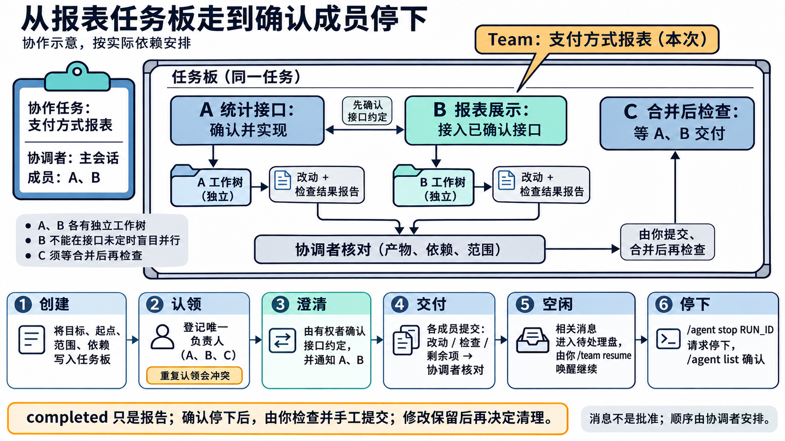

看完这张图，你要能：按顺序说出一次团队协作的六个动作。

用支付方式报表举例，安排三个任务：

- A：确认统计接口并实现。
- B：编写报表展示。B 依赖 A 的新接口，所以先让双方确认接口约定，再决定哪些部分能并行。
- C：合并后检查。等 A、B 都交付后再做。

| 一次协作中的动作 | 要记下什么 | 下一步看什么 |
| --- | --- | --- |
| 协调者创建任务 A | 目标、起点版本、范围、依赖 | 谁有能力做，前置条件是否满足 |
| 成员认领任务 | 当前负责人 | 另一位再认领同一项时会收到冲突提示 |
| 成员提出接口澄清 | 谁发给谁、关于哪项任务 | 有权决定的人确认约定，再通知受影响的成员 |
| 成员交付 | 工作树里的改动、检查结果、未完成项 | 协调者核对证据，决定接受还是退回补充；接受后由你在工作树里提交 |
| 成员空闲 | 任务是否已交回，还在等什么 | 分配下一项任务，或准备停下成员 |
| 停下成员 | 不再派新任务；后台成员用 `/agent stop RUN_ID` 停止 | 用 `/agent list` 确认都已停稳、修改已提交或保留，再清理目录 |

#### 消息送到以后，为什么还要等待处理

**消息发出、对方收到、对方据此继续工作，是三个不同的时刻。**

成员 A 发出“接口已按约定完成”时，任务板可能还停在“待验收”。分清这几个时刻，才知道该等待、催一下，还是直接去看 A 交付的代码。

收到针对旧版本任务的消息时，可以留着记录。但要重新核对，不能直接执行其中过期的要求。

团队工具只有六个动作：查询、发消息、创建、认领、更新和改派。没有“关闭团队”。`/team` 也只有查看和 `resume`。要让成员停下，用第 19 课的后台控制：

- `/agent list` 查看运行编号。
- `/agent stop RUN_ID` 请求停止。
- 前台运行的成员，随当前轮次一起用 Ctrl+C 取消。

关闭主会话会停止本次打开的团队执行。团队记录仍保存在状态目录里；重新打开父会话并通过检查后，可以用 /team resume 继续处理待处理消息，原有预算不会重置。

请求停止后，要等成员把正在做的工作停下来，并交回实际修改和还不确定的状态。成员不能自己提交。需要保留的修改，由你检查后在工作树里提交，或先确定保存在哪里。

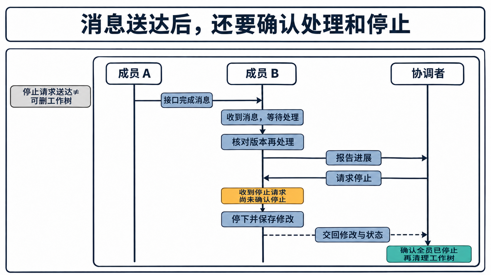

看完这张图，你要能：区分消息进入通道、接收、处理与任务状态更新的时刻。

容易误会的地方：

- 停止请求送到了，不能马上删它的工作树。先等它停稳。

## 五、动手：两个工作树分别交付，再检查合并结果

**先手工开两个工作树体会分工，再让主 Agent 自动委派，最后都以合并后的检查为准。**

### 手工实践：订单付款和营业汇总各修一部分

**两个会话各修一个缺陷，各自的检查仍会因为另一半没修而打叉。**

练习用麦当当的缺陷练习 C1“营业额对不上”。它有两个缺陷：

- 迟到的支付通知让已取消的订单又进了厨房（`src/orders.py`）。
- 营业汇总把只登记了售后的订单算成退款（`src/reporting.py`）。

在 MyBuddy 仓库根目录运行：

```shell
uv run python demo-project/prepare_worktree_demo.py
```

脚本每次新建一个练习目录。里面有：

- 注入了这两个缺陷的独立 Git 仓库和共同起点；
- `orders`、`reporting` 两个工作树；
- 各自的配置、操作说明和起点的检查结果。

它不会调用模型。打开输出目录中的 `START-HERE.md`，按说明启动两个会话。本练习不启用 Hook。需要自动检查时，按第 18 课另配 `[[hooks.post_tool_use]]` 命令。

这两个会话是你手工启动的，所以不会出现自动委派的父子关联。每项修改和测试照常审批。记下哪些步骤是你安排的。

先用 `check-case.command` 确认起点的问题。再让两个任务只改各自分配的文件。每个分支的外部检查仍会因为另一件事没修而打叉，交接时如实说明。不要为了全部通过，去改另一个任务负责的范围。两边都会改 `tests/test_shop.py`，合并时可能冲突，正好练习按意图合并。

### 自动实践：让主 Agent 委派两个编码子任务

**这次由主 Agent 委派，你负责观察工作树、手工提交和最后的检查。**

```shell
uv run python demo-project/prepare_shop_demo.py --case C1
```

这份副本已打开委派和工作树。准备脚本会复制 config/config.toml 中的模型配置。本次委派选中的模型档位必须已配置，并有可用的模型和服务商密钥；不要求三档全部配置。

把工单交给主 Agent。让它先委派两个只读子任务分别诊断，再委派两个编码子任务各修一处。观察这几件事：

- 两个工作树和分支各叫什么。
- 子任务的修改是否只出现在自己的工作树里。
- `inspect_worktree` 显示了什么。
- 子任务是否已经停稳。

确认停稳并检查差异后，由你在各自工作树中手工执行 Git 提交，再决定是否合并。Agent 没有专用提交工具。合并后，运行练习目录里的 `check-case.command` 检查主目录。再用 `git status` 看有没有没提交的修改。

### 收银台练习：把两个真实功能分别交付再合并

**两个真实功能分开开发，合并后重新走一遍完整流程。**

还可以做《综合实践-麦当当收银台》中的“7. 进阶组合：两个工作树开发，再验收集成结果”小节。一个工作树实现支付方式报表，另一个实现套餐换饮料。两边从共同起点出发，分别记录任务范围、配置和结果。

合并时重点检查订单字段、操作台和测试是否一致。合并后重新走一遍选饮料、付款、制作取餐和报表的完整流程。最后收齐没提交的内容和检查记录，再决定是否清理工作树。

本课交付一份交接记录，包括：

- 共同起点；
- 两个任务的范围；
- 各自的提交和测试；
- 合并后的结果；
- 保留的未完成事项及清理决定。

**能力卡**：想在收银台副本里亲手试一遍，就照着能力卡《编码子任务与工作树》（`demo-project/cards/worktree.md`）做。

## 使用小妙招

### 并行写入时，先确定工作树与集成方式

Claude Code 子 Agent 的 `isolation: worktree` 可以提供独立工作树。分派前核对起始版本、负责的文件和要交回什么。完成后收集改动和测试结果，再在合并后的版本上检查。

工作树分开的只是文件。接口约定仍可能冲突。端口、数据库和外部资源也要另外协调。

**为什么这样做：** 两个 Agent 在同一个目录里同时改文件，会互相覆盖，测试结果也分不清是谁的改动造成的（见“两个会话为什么仍可能互相干扰”）。各用一个工作树，改动互不干扰；但最终要合到一起，所以起点和交回什么要事先说好。

### 子任务测试全绿、你也看过 diff，合并后仍要跑独立检查

C1 的一次实际运行中，过程看起来很顺：

- 两个只读子任务诊断正确。
- 两个编码子任务各自修复、补了测试。
- 主 Agent 看过差异，两个分支提交并合并时也没有冲突。

外部检查却还有一项打叉：“已付款后撤单的订单再收到支付通知，也必须拒绝”。原因是顺序：订单子任务把“已取消就拒绝”放在了“已付款就直接返回”之后。它自己补的测试只覆盖了未付款撤单，所以通过了。主 Agent 读 diff 时也没看出顺序问题。另外，合并后有一个测试失败，主 Agent 修好了，却没有提交。

**为什么这样做：** 这次运行说明三件事：

- 子任务的测试只能证明它想到的情况。委派时把要覆盖的状态组合写进完成条件，比如“未付款撤单和已付款撤单两种回调都要有测试”。
- 看 diff 时，对照规则逐条找测试，而不是只看代码写得像不像。一个判断放在哪一行，往往决定了某个状态会不会漏掉。
- 结论以合并后的独立检查为准。练习里是 `check-case.command`，真实项目里可以使用验收脚本，或让持续集成（CI）系统自动运行这些检查。最后再看一次 `git status`，确认修正已经提交。

### 给每个并行任务留一张能找到产物的任务卡

同时用几个 CLI 时，会话可能分散在不同入口，进度和改动很容易混。开始并行前，先把任务、会话和工作目录对应起来：

| 字段 | 要回答的问题 |
| --- | --- |
| 目标与负责范围 | 谁在处理哪个问题，允许改哪些文件？ |
| 会话与工作目录 | 去哪个终端或会话、哪个工作树查看？ |
| 起点与当前改动 | 从哪次提交开始，改动在哪里？ |
| 最近的动作 | 最近一次读取、修改或检查是什么？ |
| 当前卡在哪 | 等输入、等审批、执行中，还是结果不明？ |
| 交回与合并条件 | 要交哪些文件和证据，由谁合并并复查？ |

启动了服务或用到测试数据时，再补上端口、测试数据和临时目录、日志归属，以及什么时候清理；两个任务不能因为目录不同，就共用一个可写的测试数据库。在不同入口之间切换时，也可以手工维护这张卡。同时开多少个任务，看积压和依赖：待审的改动越积越多，就先安排审阅和合并。

**为什么这样做：** 几个任务同时跑，你不可能一直盯着每一个。过一阵回来，要能很快知道每个任务在哪、做到哪、卡在哪（见“把工作目录和任务对应起来”）；记不清时，改动就可能被交错合并，或者被遗忘在某个工作树里。

## 自测：这一课的概念分清了吗

**先自己作答，再看后面的答案。** 每题都能在本课正文里找到依据；带“动手验证”的题，可以照着做一遍，亲眼看到结果。

**1.** 你给库存任务和退款任务各建了一个工作树。两边的测试仍使用同一个可写数据库。哪项判断正确？

- A. 文件目录已经分开，测试就不会互相干扰。
- B. 只有两个任务修改同一段代码时，才需要协调数据库。
- C. 工作树只分开文件，数据库等运行资源仍要另外安排。

**2.** 两个分支各自测试通过，合并也没有文字冲突。你能据此认定整体任务完成吗？

- A. 能，各自测试通过且合并无冲突，已经足够。
- B. 不能，两边可能对同一个接口含义理解不同，还要检查合并后的版本。
- C. 不能，只要在两个原工作树里各重跑一次测试，就能代替合并后的检查。

**3.** 判断：一次委派交回结果后就结束；持续协作还需要成员表、任务板和消息，记录谁负责什么、谁在等谁。（对 / 错）

**4.** 你按本课能力卡准备并启动新副本，还没有委派任何任务，就在会话里输入 `/team`。哪项理解正确？

- A. 它会自动创建成员，开始处理副本里的工单。
- B. 它只查询已有的成员、消息和任务，没有记录也不会自动委派任务。
- C. 委派功能之外，还必须单独打开 Team，才能查看协作记录。

### 答案与依据

**1. 选 C。** 工作树分开文件目录，不隔离数据库、端口和进程。A 把文件分开误当成运行资源也已分开，两边的测试仍可能修改同一份数据。  
依据：本课“工作目录分开了，运行资源还没分开”。

**2. 选 B。** 没有文字冲突，不代表双方的业务假设一致。C 重跑的仍是各自的版本，不能证明合并后的代码正确。  
依据：本课“两边都没有文本冲突，为什么金额还是错了？”。

**3. 对。** 持续协作除了交回结果，还要协调任务归属、等待关系和交接。只增加委派次数，不能代替这些记录。  
依据：本课“一次委派与持续协作的区别”。

**4. 选 B。** `/team` 是查询入口，不会自动派任务。C 把 Team 当成了另一个独立开关；它跟随委派功能一起提供。  
依据：本课“在 MyBuddy 中使用 Team”。  
动手验证：按能力卡《编码子任务与工作树》（`demo-project/cards/worktree.md`）的“准备”小节运行 `uv run python demo-project/prepare_shop_demo.py --case C1`，再按“操作”小节在真实终端启动副本里的 `start-mybuddy.command`。先不发送卡里的委派请求，只输入 `/team`，在终端看到“团队协作记录”和“当前没有协作记录。”；这个查询不调用模型。

## Q&A：常见追问

### Q1：两个 Agent 会话独立，为什么还会互相覆盖文件？

对话独立，目录不一定独立。两边都写同一个目录，就共享同一份文件，读到的代码和测试结果都可能过期。要么分清谁负责哪些文件，要么给每个任务一个工作树。只是新开一个对话，不能把文件分开。

### Q2：用了工作树，是不是就相当于用了沙箱？

不是。工作树分开了文件目录，但不会隔离进程、网络、数据库、用户权限和端口。两个目录里的测试仍可能写同一个数据库，或抢同一个端口。MyBuddy 的编码子任务不能写主目录，是因为它的 Bash 还额外运行在系统沙箱里。这不阻止它读取主目录的内容。

### Q3：两个分支都通过测试，合并没有冲突，还需要再检查吗？

需要，合并没有文字冲突，不代表业务假设一致。例如一个分支改变库存含义，另一个分支仍按旧含义处理退款，两边测试都可能通过，合在一起却出错。应保留各分支的检查结果，再针对合并后的代码运行相关业务测试，并补查跨模块的调用路径。分支上的成功只证明当时那份代码和那些用例。

### Q4：编码子任务改完了，为什么主分支上看不到修改？

子任务的修改在它自己的工作树里。先检查差异并确认子任务已停稳。再由你在对应工作树中手工提交到子分支 `mybuddy/subagent-编号`，随后用 Git 合并到主分支。MyBuddy 不会自动合并或推送。

## 本课术语速查

| 本课说法 | 源码、配置或命令中的名字 | 含义 |
| --- | --- | --- |
| 工作树 | Git Worktree | 同一仓库的另一个工作目录，通常检出不同分支 |
| 共同起点 | 基线提交 | 几个并行任务共同开始的那个版本 |
| 编码子任务 | `code` 子任务 | 在独立工作树中修改代码的子 Agent |
| 工作树开关 | `[worktree] enabled` | 打开后才能委派编码子任务，默认关闭 |
| 子分支 | `mybuddy/subagent-编号` | 每个编码子任务自己的分支 |
| 查看改动 | `inspect_worktree` | 主 Agent 查看子任务工作树的改动 |
| 提交改动 | 用户手工 Git 提交 | 确认子任务停稳并检查差异后，在对应工作树中提交选定文件 |
| 行为冲突 | — | 合并没有文字冲突，但两边对同一业务含义理解不同 |
| 协调者 / 成员 | Team 的父会话 / 子会话 | 协调者创建和改派任务，成员认领、更新和发消息 |
| 团队协作工具 | `team`、`/team`、`/team resume` | 查询和处理成员、消息与共享任务 |
| 停稳 | — | 确认任务已经停下、结束状态已记录（第 12 课） |

## 继续阅读源码解析

源码解析沿“委派 → 建工作树 → 检查 → Team 消息与任务”这条调用链读真实代码。
