用一个完整业务修改观察 Harness，并留下可复跑的产物、证据和说明。

## 本课导览

这一课把前面的机制用于一次完整的收银台报表开发：先完成修改，再看换环境要准备什么，然后保存运行证据，最后交付并讲清项目。这一课不讲新机制，直接动手。下一课换到新工程，练习迁移同一套方法。

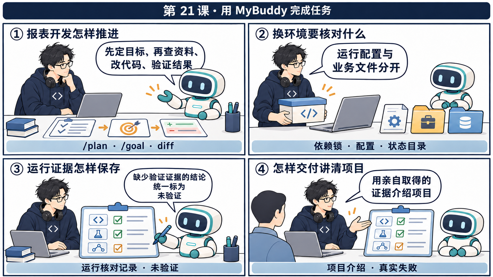

## 一、怎样用 MyBuddy 完成一次报表开发？

**一次完整开发要把目标、取证、修改和验证接起来；最后的金额由你亲自核对。**

前面我们一项项拆开了 Harness 的机制。这一课把它们放回同一次开发：用 MyBuddy 给收银台增加支付方式报表。看看目标、取证、修改和验证怎样接起来，也看看最后能交付什么。

### 实践主线：完成支付方式报表并解释运行过程

**先规划、再设目标、再审批修改，每一步都对应前面某一课的机制。**

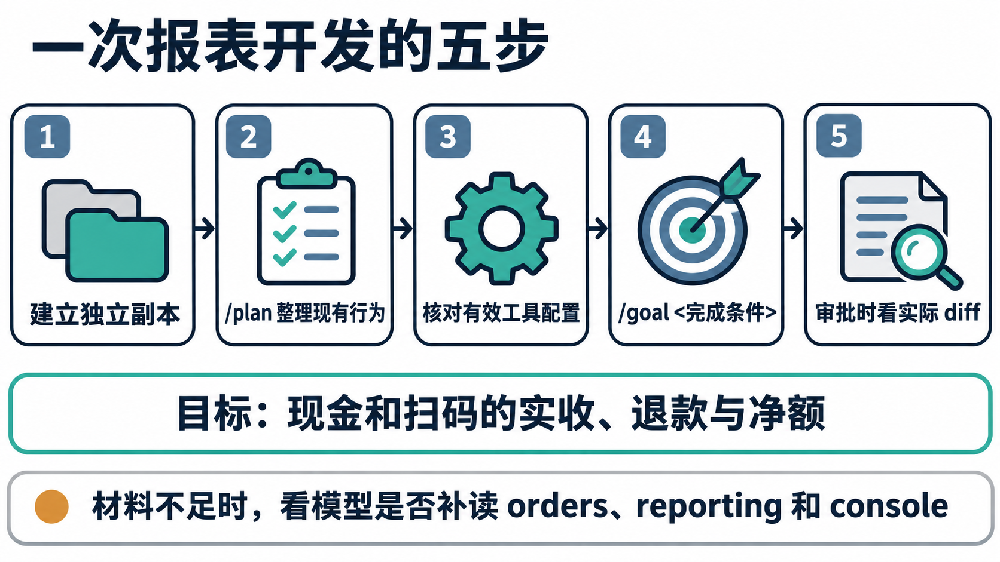

看完这张图，你要能：按顺序说出报表开发的五步，以及这次任务的目标。

课前你已经操作过收银台，也做过只读接手。本次的任务来源是《综合实践-麦当当收银台》中的“5. 课后任务 A：按支付方式汇总营业情况”小节。

1. 建立独立副本，保存改动前的检查结果。
2. 用 `/plan` 整理现有行为和需要澄清的条件。方案提交后先不要选“同意”（选了会立刻开始执行）：按 Shift+Tab 离开规划模式，方案文件会保留；Web 页面是取消勾选 Plan。
3. 确认实际生效的工具配置。
4. 输入 `/goal <完成条件>`，设置唯一活动目标并开始一轮。`/goal` 查看目标，`/goal clear` 清除。
5. 审批时查看路径、命令与实际 diff。

目标是增加现金和扫码的实收、退款与净额，并保留总计及原有业务流程。材料不足时，观察模型是否补读 orders、reporting 和 console，而不是只根据函数名称猜测。

把一次开发过程分成五个观察点：

| 观察点 | 可以看到什么 | 对应实现责任 |
| --- | --- | --- |
| 输入与目标 | 已接受的需求、当前模式、活动条件与轮末评估 | 命令处理与 Goal（第 10 课） |
| 模型材料 | 实际读了什么、上下文里有什么 | 读取工具和上下文管理（第 8 课） |
| 行动 | 提出的修改、你的批准、执行结果 | Agent Loop 与工具治理（第 4、6 课） |
| 续接 | 保存的历史、卡在哪里、下一步 | 会话记录与恢复（第 11 课） |
| 验收 | 测试用例、实际界面和最终确认 | 检查证据、业务判断与你的确认（第 13 课） |

源码导航可回查《课前-MyBuddy工程设计说明》。每个观察点只选一段关键调用解释，不要把全部源码粘贴进报告。

### 核对金额与 Goal 的推进

**报表按“实收/退款/净额”核对固定数字；Goal 的判定只是推进依据。**

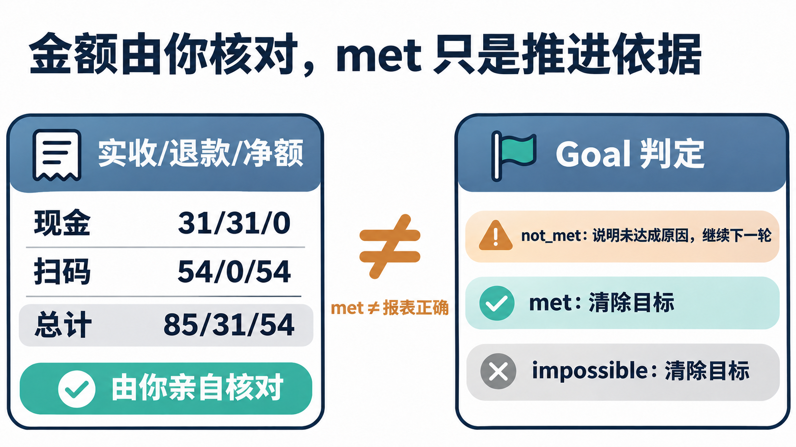

看完这张图，你要能：记住现金、扫码与总计三组固定金额，并分清 Goal 判定 met 和报表正确是两件事。

按作业说明，按“实收/退款/净额”的顺序对一下数字：

- 现金：31/31/0
- 扫码：54/0/54
- 总计：85/31/54

还要覆盖无订单、重复查询、失败支付及退款归属。基础样例原有的检查不会自动覆盖新增的报表。使用作业提供的报表用例，再补上你新增范围的检查。然后手工进入操作台，确认分组结果可见，再走一次原有的支付到取餐流程。未通过时记录差异并修正。

Goal 怎样推进，第 10 课讲过。这里只回顾要点：

- 符合条件的正常轮结束后，MyBuddy 用 low 档模型看一段有限的对话尾部，给出判定。
- `not_met` 带原因继续下一轮；`met` 或 `impossible` 清除目标。
- 取消、失败、非交互模式下等待回答，或后台子任务尚未停稳时，不会自动推进。
- 连续三个 Goal 轮没有工具调用且仍未达成时也停止，目标保留。

这次作业还要交付可复跑的修改和运行说明。下面把环境、续接、状态保存与排障接到同一项报表任务中，检查别人能否继续使用你的成果。

容易误会的地方：

- Trace 用来查看哪一步做了什么。实际金额和业务状态，仍由作业的检查用例判断。
- 模型判定 `met`，不能代替你对报表金额和操作结果的实际核对。

## 二、换环境或升级源码时，需要准备和核对什么？

**本机跑通还不够；别人拿到源码、依赖锁和说明，也要能复现。**

报表在你的电脑上跑通以后，另一位使用者拿到源码，能按说明复现吗？接下来分别检查源码、业务目录、配置和会话状态，让别人也能复现你在本机的结果。

### 换一台干净环境还能运行吗

**要验证的是对方拿到的完整源码、依赖锁和操作说明，而不是你的开发目录。**

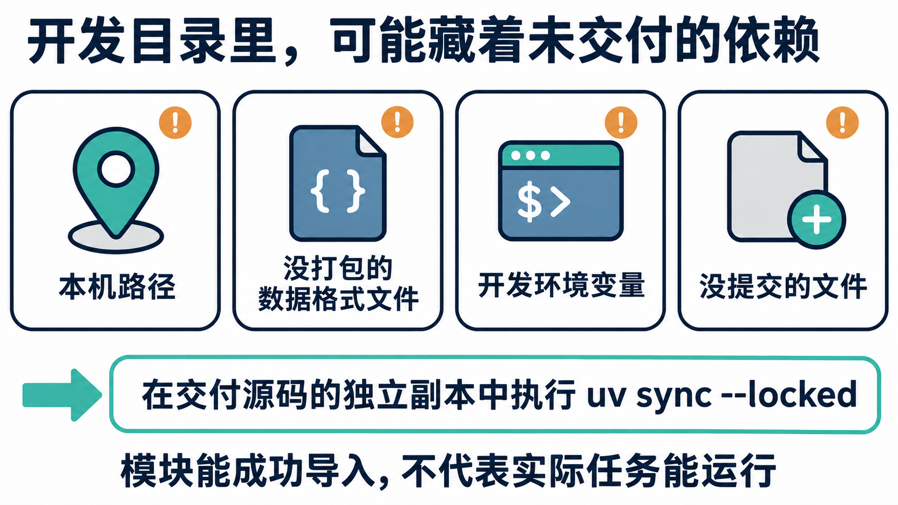

看完这张图，你要能：说出开发目录里可能藏着的四类依赖，以及为什么要在独立副本里 uv sync --locked 后再验证。

你在开发目录里运行成功，可能依赖了这些东西：

- 本机路径；
- 没打包的数据格式文件（比如 Schema 文件）；
- 开发环境变量；
- 某个没提交的文件。

MyBuddy 使用锁定的 Python/uv 工作区。`pyproject.toml` 声明 Python 范围与入口。项目里的协议格式文件（Schema）运行时也要用，必须随完整源码一起交付。

先在交付源码的独立副本中执行 `uv sync --locked`。再按随代码的说明依次试一遍：命令帮助、配置解析、只读查询与代表任务。记录实际加载位置和依赖版本，确认结果没有悄悄依赖你自己的开发目录。

这次作业交一份完整源码就够了，不用另外制作安装包。

容易误会的地方：

- 代码能 import，不说明实际任务能运行。

### 配置为什么与项目文件分开

**用命令行选业务目录，用 TOML 文件管运行配置，两者分开设置。**

`--workspace` 选择业务项目；工具开关、状态目录、凭据来源等写在 TOML 配置里，默认是 MyBuddy 项目根目录的 `config/config.toml`。启动选项与配置示例见《课前-MyBuddy使用导读》。

换环境时要记住三点：

- 用 `--config` 指定了别的配置，查询与继续也要沿用同一文件。
- 配置可能直接保存 api_key，也可以用 api_key_env 指定环境变量。共享配置前先移除实际密钥；练习脚本生成的配置也要检查。
- **状态目录**保存会话记录，不应放在模型能随意修改的业务目录里。

会话用 `sessions` 和 `history` 子命令查询，参数用 `--help` 查看：

```shell
uv run python -m mybuddy --help
uv run python -m mybuddy sessions --help
uv run python -m mybuddy history --help
```

模型切换按课前导读中的 `/model` 和配置示例操作。换环境时，先查看可选模型与不可用原因，再用一项小任务试一下真实连接。

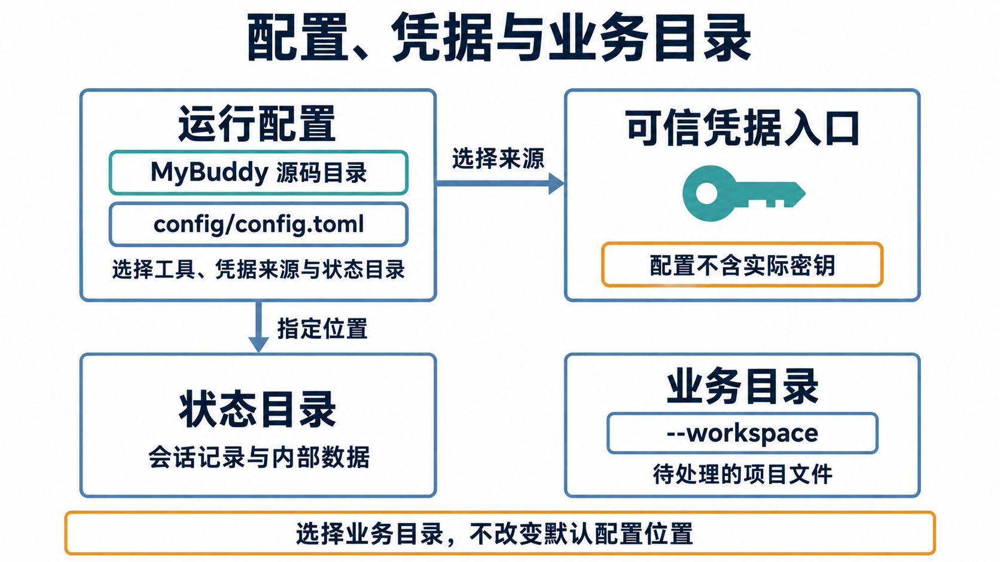

看完这张图，你要能：在交付或换环境时区分运行配置与被处理项目的文件。

容易误会的地方：

- “分开”指 MyBuddy 运行配置与待修改的业务文件分开。
- 本地配置有效，和远端服务可用，要分别确认。

### 状态记录与业务文件怎样分别保存

**状态目录不是工程备份；业务源码、依赖和说明要另外保存。**

程序可以续接符合条件的会话，但不提供状态目录的备份和恢复命令。要留副本，先正常退出会话，再保存**完整**目录；不要只复制运行中的 SQLite 文件。状态里可能有私有对话。

业务源码、未提交修改、依赖锁和运行说明要另外保存。凭据沿原配置渠道管理。

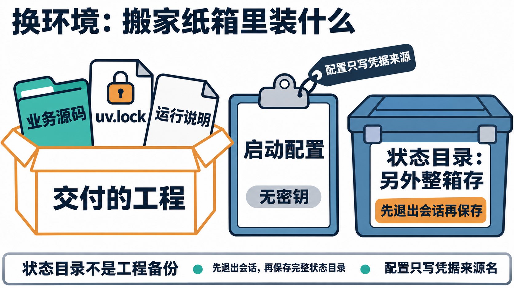

看完这张图，你要能：用“搬家纸箱”分清交付物：工程、启动配置、凭据来源和状态目录各放哪里；状态目录不是工程备份。

长会话里的上下文压缩只改变送给模型的内容（第 9 课），不改变业务文件，也不是状态备份；它怎样保存，见源码解析。

容易误会的地方：

- 诊断输出脱敏了，不说明状态副本已经脱敏或加密。
- 恢复文件副本不能复活进程，也不能把未知执行结果变成成功。
- 以后能否继续会话，还要通过恢复时的检查（第 11 课）。
- 摘要帮助继续工作，不能代替原始业务文件或备份。

### 会话不能继续时怎么办

**继续前 MyBuddy 会检查记录和运行条件；不能继续时，新建会话并整理交接。**

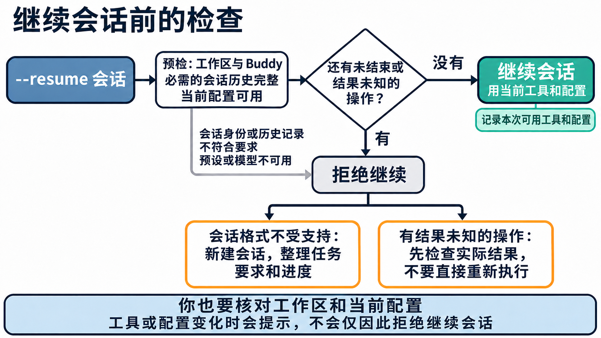

看完这张图，你要能：说出续接前的检查什么时候会拒绝继续，以及被拒绝后两种情况各怎样处理。

继续会话前，MyBuddy 会检查会话记录和当前运行条件。你也要看一眼工作区和配置，确认接下来处理的是预期的项目。

- 会话格式不受支持：新建会话，把仍有用的任务要求和工作进度整理进去。
- 有结果未知的操作：先检查实际结果，不要直接重新执行。

## 三、怎样保存运行证据并定位未完成的部分？

**把散在 diff、工具结果和 Trace 里的证据整理成一份记录，每个结论都能找到来源。**

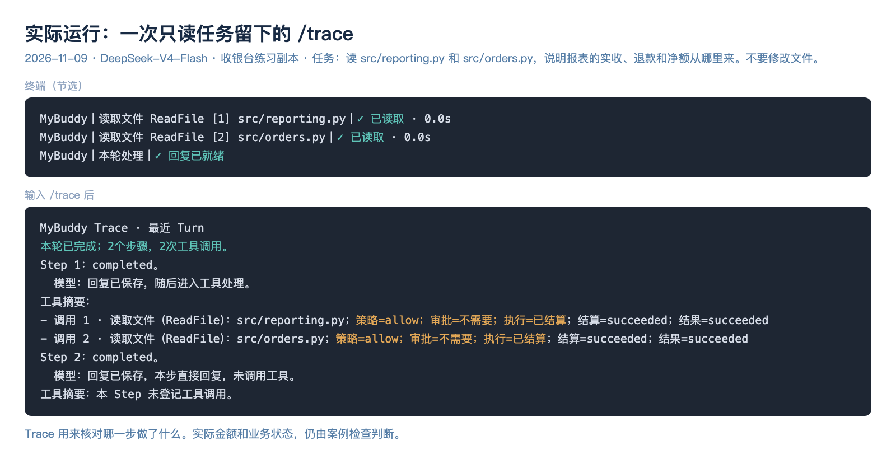

看完这张图，你要能：读懂一次真实运行的 /trace 记下了哪些调用、策略、审批和结果，并知道它不能替你判断金额对不对。

一项任务做完，证据往往散在好几个地方：diff 里有改动，工具结果里有测试输出，Trace 里有执行经过。接下来把它们整理成一份记录。别人不仅能看见“做完了”，还能找到每个结论对应的版本、配置和原始结果。

### 写一份别人能够复现的运行记录

**记录形成结果所需的条件，而不是一段成功截图。**

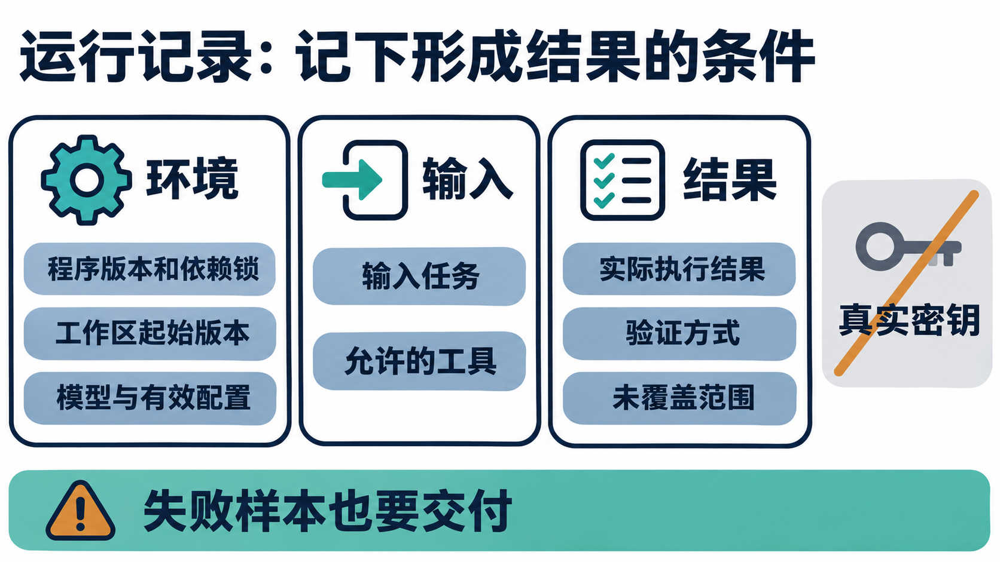

看完这张图，你要能：把运行记录的八项内容分成环境、输入、结果三组记住，并知道密钥不写进去、失败的样本也要交。

一份有用的运行记录至少包括：

- 程序版本和依赖锁；
- 输入任务；
- 工作区的起始版本；
- 模型与有效配置；
- 允许的工具；
- 实际执行结果；
- 验证方式；
- 未覆盖范围。

不要附上真实密钥和无关的私人历史。

可复现也有层次。离线确定性测试应能稳定得到相同判定。真实模型的工具选择顺序可能变化，但仍应满足同一目标、权限和输出要求。所以在线验收检查行为约束和任务结果，通常不逐字比较回答，也不要求固定调用次数。

环境差异要变成具体检查项：

- 解释器版本影响依赖与语法。
- Shell 和外部程序影响命令。
- 文件系统规则影响路径。
- 进程管理影响取消与停稳。

把这些条件列清楚，才能判断一个失败来自安装、运行时、模型选择还是任务材料。

完整交付物也应包含失败样本，例如“拒绝编辑后文件没变”“取消测试后确认进程已停止”，以及“无法确认执行结果时阻止继续”。分别记录实际状态。所有正式示例，最后都要在固定版本上重新跑一遍。

### 用一次运行的核对记录回答开篇的问题

**用一次真实任务的材料，逐格回答第 1 课的七个问题；没取得的证据写“未验证”。**

现在回到第 1 课“从七个问题看 Harness 的工作”小节。选一次你实际做过的报表开发或运费任务。把分散在任务提示、diff、会话状态和测试输出中的信息连起来。下面是待填写的记录模板，每格都应链接真实材料：

| 开篇的问题 | 本次运行填写什么 |
| --- | --- |
| 要做什么 | 原始需求、被接受的范围与验收条件；后续修订单独记录 |
| 依据是什么 | 实际读取的规则、代码位置与适用版本，未解决的材料冲突 |
| 允许做什么 | 工作目录、能力配置、具体授权对象、实际修改差异 |
| 为什么继续或停止 | 关键步骤、失败和重试、结束或等待原因，Trace 查询依据 |
| 留下了什么 | 会话与产物位置、已确认副作用、结果未知项及可继续条件 |
| 怎样判定结果 | 实际检查命令、结果、所针对版本与覆盖范围，最终目标判定 |
| 下次怎样改进 | 发现的原因、准备修改的机制、回归样本以及改进验证结果 |

这是给人看的**运行核对记录**。它不是 MyBuddy 的命令，也不是 MyBuddy 内部的记录格式。你可以手工整理，也可以让所用 Harness 根据实际记录起草，再逐项核对。凭据和无关私人信息不进入共享记录。

举个例子。一份 diff 旁边附有测试通过记录。这条记录的价值，取决于它针对哪份文件、覆盖哪些条件。只检查了无退款订单，就还没有退款归属的验证依据。之后再次修改代码，原结果是否仍适用，也要重新判断。

容易误会的地方：

- 总结不能代替原始证据。表格每格都应能指回原始材料。

### 核对会话续接与状态保存的交付条件

**报表做完后，用同一项任务检查续接、状态保存和复跑，而不是换新任务。**

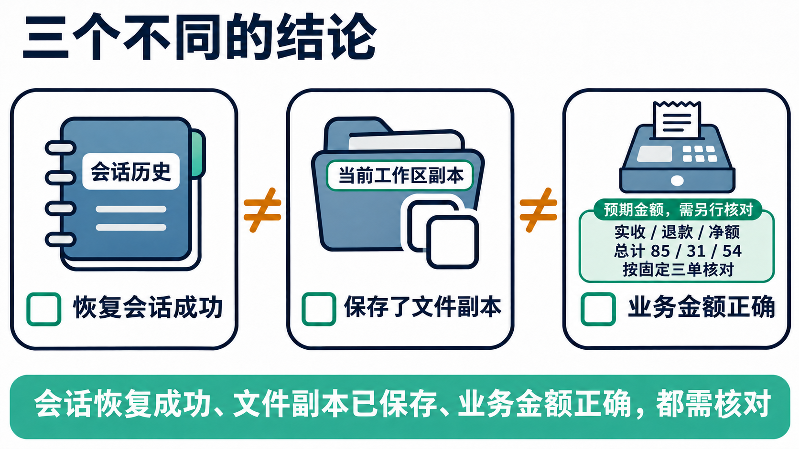

看完这张图，你要能：分清恢复会话成功、保存了文件副本、业务金额正确是三个要分别核对的结论。

1. 保存报表 diff、所针对的代码版本、已执行检查与剩余工作。
2. 正常退出 MyBuddy，用相同配置查询会话和历史。满足继续条件时恢复会话，先对照当前工作区和交接记录。
3. 需要保存状态副本时，正常退出相关会话，再另行备份完整状态目录。把业务源码、依赖和运行说明分别保存。
4. 用新的业务副本复跑任务书中的订单，确认报表仍给出同样结果。会话历史和收银台进程内存里的订单要分开看。

留下实际输入、配置和结果。

容易误会的地方：

- 恢复会话成功、保存了文件副本、业务金额正确，是三个不同的结论。
- Python 本身可跨平台，不能证明本地执行器已在 Windows 或 Linux 通过。平台支持按实际环境记录。

### 出错时如何排查

**先看** `/status` **和** `/trace`**，再按现象逐项排查。**

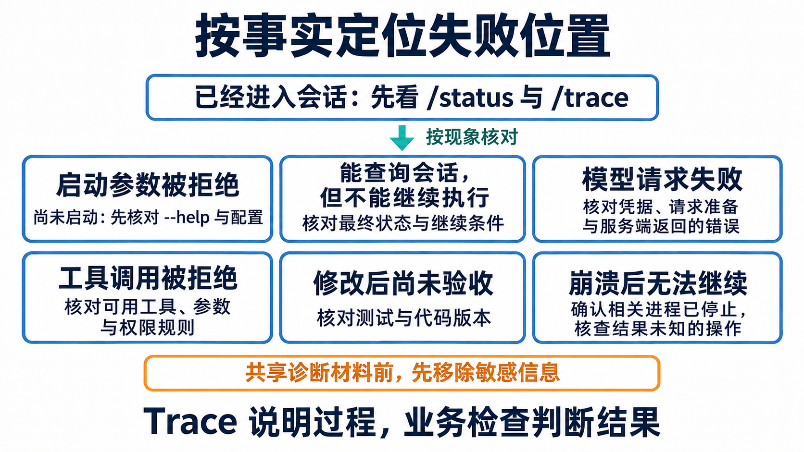

看完这张图，你要能：结合配置、模型、工具、历史与业务检查定位未完成部分。

| 现象 | 先查什么 |
| --- | --- |
| 启动参数被拒绝 | 当前帮助与配置格式，参数是否填写正确 |
| 能查询但不能继续 | 会话是否已结束并保存最终状态，会话格式是否受支持，工作区与配置是否符合继续条件 |
| 模型请求失败 | 凭据、请求准备和服务端返回的错误；请求过大也可能由服务端拒绝 |
| 工具调用被拒绝 | 当前能力、参数、工作区和具体策略 |
| 修改完成但 Goal 仍未达成 | `/goal` 中的评估原因、实际测试结果是否对应当前版本 |
| 崩溃后无法继续 | 是否有还没确认停下的进程，或结果还没确认的操作 |

出错时只盯一个现象，容易漏掉前后关联。交付前，可以用下面这张表把前面各课的故障点串起来过一遍。不必每项都现场制造故障，能说清“看哪条记录、下一步做什么、回哪一课查”就够了：

| 故障点 | 先看什么 | 不能做什么 | 回看 |
| --- | --- | --- | --- |
| MCP 工具超时或断线 | 这次调用记成失败还是结果未知 | 不确认对方状态就重连再调一次有副作用的操作 | 第 17 课“外部失败怎样进入已有的循环” |
| 工具结果未知 | 动作停在“开始执行”之后的哪一步，文件或外部状态实际有没有变 | 把“没收到结果”当成“没做” | 第 12 课“同样是“没收到结果”，下一步可能完全不同” |
| 进程被强行结束后恢复 | 历史是否完整闭合，相关进程还在不在 | 让恢复自动重跑已开始的动作 | 第 11 课“恢复不等于“再试一次”” |
| 换了默认 Buddy 或改了预设 | 仍按旧身份读取当前预设，内容变化提示后继续；缺失或无效才拒绝 | 把配置变化误当成旧操作已经获准 | 第 14 课“恢复时为什么要再读预设？” |
| 解释整次运行 | `/trace` 里哪次调用、有没有执行、结果有没有交回模型 | 把 Trace 当成模型的思考过程 | 第 4 课“Trace 到底帮你看什么” |

不要把密钥、完整私有提示词或原始堆栈直接粘进共享问题单。诊断包应包含足以复现的脱敏材料。原始状态由使用者妥善保存。

### 与本地执行隔离的关系

**回顾一次本地命令时，把授权、执行环境和业务检查三项证据分开。**

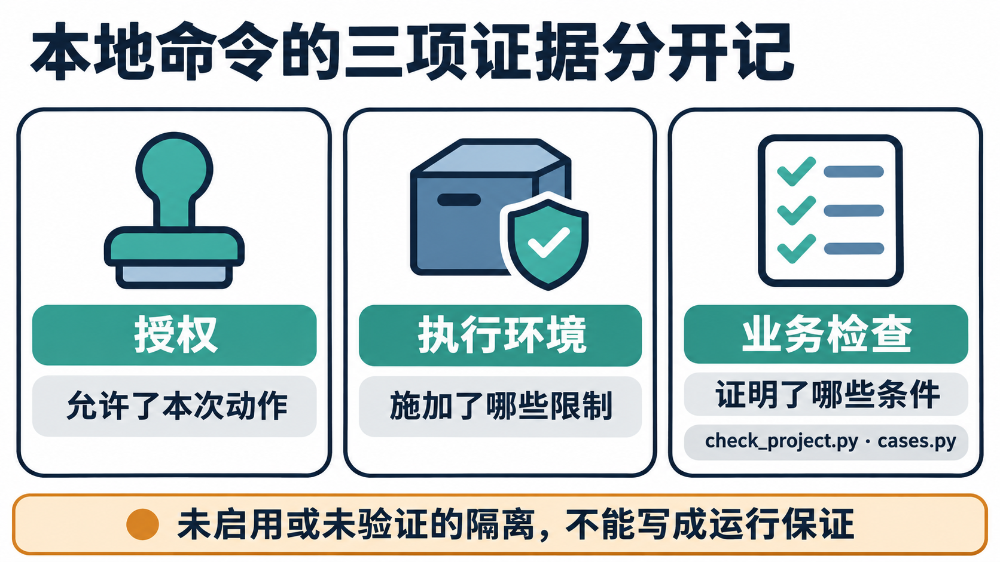

看完这张图，你要能：回顾一次本地命令时，把授权、执行环境和业务检查三项证据分开记录。

- 授权：允许了本次动作。
- 执行环境：施加了哪些限制。
- 业务检查：证明了哪些条件。

本课的业务检查用了两个脚本：收银台自带的总检查 `demo-project/mini-shop/scripts/check_project.py`，和作业检查器 `demo-project/exercises/shop-tasks/cases.py`。现实项目一般没有这样现成的判定脚本。收银台是教学项目，所以我们事先设置了一种判定方式，方便你检查结果。现实项目里，起这个作用的是项目的回归测试和测试用例：改完代码跑一遍，确认原来的功能没坏、新需求的用例通过。

第 7 课介绍的系统沙箱（macOS 用 Seatbelt，Linux 用 bubblewrap）可以用于 Bash，默认关闭。报告应记录实际配置和执行环境。

容易误会的地方：

- 未启用或未验证的隔离，不能写成运行保证。

## 四、怎样交付并讲清你的 Harness 项目？

**用代码、运行结果和过程记录讲清工作；所有结论都换成你亲自取得的证据。**

到了交付这一步，你已经有了代码、运行结果和过程记录。下面先整理项目介绍，再交付扩展后的收银台。下一课我们会换一个新项目，检验这些方法能不能迁移。

### 本课实践与实现对应

**本课覆盖源码运行、配置、状态查询和诊断；完整发布资格要另行验收。**

本课实践以当前 Python 源码运行、配置、状态查询和诊断为范围。完整发布资格仍须在固定版本与支持平台上验收。

### 怎样向别人解释这个项目

**讲问题、选择、代价、证据和局限，比罗列模块名称更能说明工程能力。**

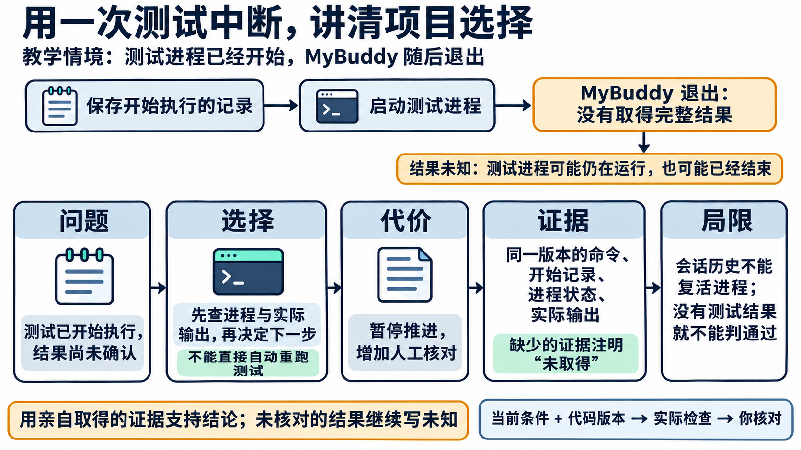

看完这张图，你要能：用问题、选择、代价、证据、局限五点组织项目介绍，而不是罗列模块。

可以用下面的结构组织项目介绍，但所有结果都要换成你亲自取得的证据：

我用 Python 实现了一个处理本地代码任务的 Agent Harness。模型决定查什么、改什么，Harness 通过统一的工具入口检查参数、权限和审批，并记录结果。会话记录先写“开始执行”再动手，执行结束和交给模型的结果分开记录，所以能区分已经执行、明确失败和结果未知。验收结果对应具体条件和代码版本。我实际验证了下面列出的这些路径和能力，其余部分还在设计中。

接着选一个实际失败讲细节，例如测试进程已经开始、MyBuddy 却退出了，为什么不能自动重跑。扩展功能要区分已有入口与设计推演；没测过的延迟、成本和用户规模不要写进去。

被问“用了现成 Agent 框架还要设计什么”时，可以答：框架省的是通用代码，审批、结果未知、上下文取舍、停止条件和恢复仍要自己定。一分钟介绍、三分钟展开和模块追问，见《附录-项目表达与面试练习》。

### 回看整条课程主线

**需要哪些机制由任务决定；带不来看得见收益的扩展，要重新评估。**

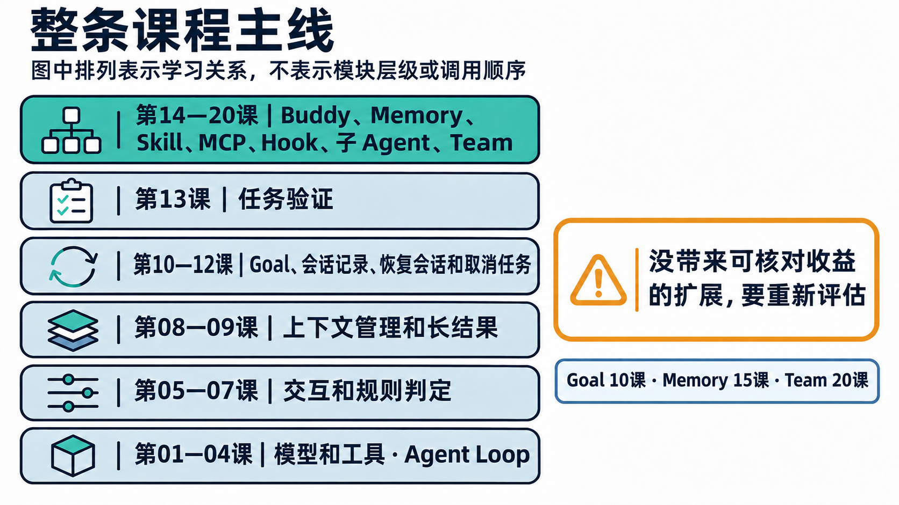

看完这张图，你要能：按层次回看整门课的主线，并记住：加扩展要用看得见的收益来证明。

整条主线可以这样串起来：

- 模型和工具是任务推进的基础，Agent Loop 组织多步决策。
- 交互和规则判定让行动范围明确。
- 上下文管理和长结果处理，帮助控制输入大小并回查材料。
- 会话记录、恢复和取消，帮助你了解执行状态，包括尚不明确的结果。
- 任务验证把结果和目标对应起来。
- Buddy、Skill、MCP、Hook 和子 Agent 在这些基础上扩展。

最后挑一个真实失败，依据运行核对记录说明：原因在哪一层、选择修改什么、怎样验证这一类问题得到改善。你也应能指出哪里只有设计、哪里已有测试、哪里仍需要真实任务验证。

源码入口有三个：

- 打包配置：`pyproject.toml`
- 会话记录与查询：`src/mybuddy/platform/sessions/session_journal.py`
- 压缩流程：`src/mybuddy/platform/context/compaction/service.py`

对照实际入口与保存内容，判断交付物包含什么、还需要准备什么。

### 综合作业：交付你扩展的麦当当收银台

**每项功能都要对应业务规则、实际修改和验证结果，复核者能按说明启动并检查。**

用《综合实践-麦当当收银台》完成一次较完整的 Harness 开发：

- 基础作业：按支付方式汇总。
- 进阶作业：增加套餐饮料选择，再用两个工作树练习集成。

交付代码副本、运行说明、需求与计划、测试和用户操作记录。再说明一次真实失败如何定位、修正。复核者应能从说明启动项目，并按任务书核对金额与状态。Trace 用于解释实际行动，业务结果由对应测试和操作支持。具体提交内容见《综合实践-麦当当收银台》中的“8. 提交什么，怎样判断完成”小节。

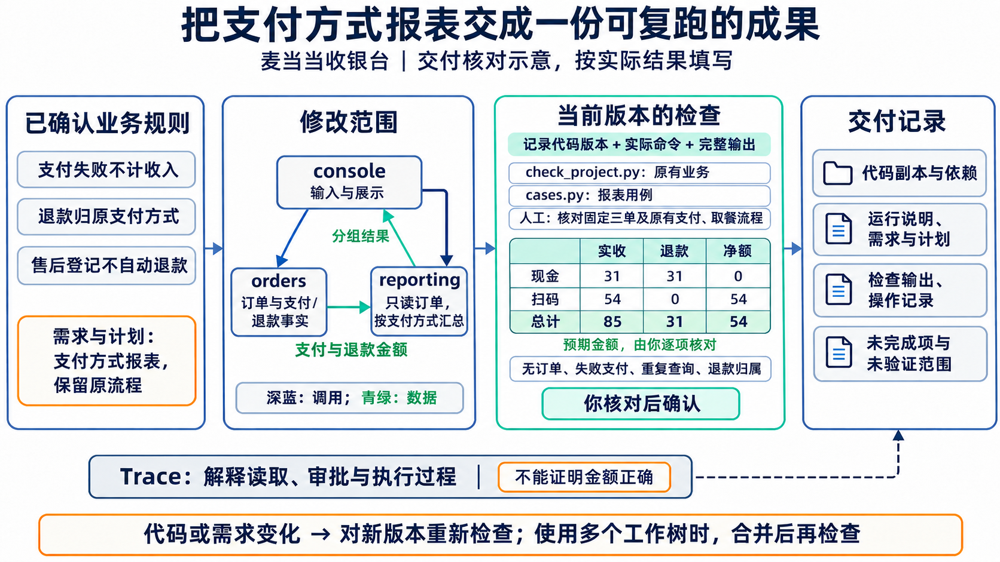

看完这张图，你要能：从一项业务要求找到实际改动、运行方法和对应验收证据。

## 使用小妙招

### 排障时，先保存一个可复现的最小问题

记录版本、配置来源、最短操作步骤、错误和预期结果，再逐个排查变量。排查方法见第三节“出错时如何排查”。

**为什么这样做：** 问题能稳定复现，才能确认改了以后真的好了。步骤越短、变量越少，越容易找出是哪一项引起的；交给 Agent 排查时，它也不用先猜你做了什么。

### 用小范围维护防止问题反复出现

做完一次任务，回看留下的资料和代码会不会误导下一次工作。一次只选一个已经观察到的缺口：

| 已观察到的问题 | 本次维护动作 | 怎样确认有效 |
| --- | --- | --- |
| 两份说明给出不同测试入口 | 看当前实现，确定哪个入口有效、旧说明怎么处理 | 在新副本复跑对应命令 |
| 多处重复金额转换逻辑 | 检查行为是否相同，再决定是否共用实现 | 保留边界与例外用例 |
| 用例偶尔失败但原因不明 | 保存失败条件与复现线索 | 定位原因后再判断修复，保留原失败记录 |

改代码时同步改直接受影响的说明。维护记录写清改了什么、依据是什么、还有哪些未验证。MyBuddy 没有定期自主维护或自动合并能力，这个回顾由你手工完成。第 22 课“交付与一次小维护”会再练一次。

**为什么这样做：** Agent 下一次工作时，会把项目里的说明和代码当作依据。过时的说明、重复的逻辑留在那里，下一次就可能被它照着用错。一次只改一处已经观察到的问题，改完容易确认有没有效果，也不会顺手引入新问题。

### 在已有项目中，从一个可复跑任务开始采用

先选一个像本课程运费问题这样的小缺陷（金额刚好等于门槛时算错），补齐规则入口、运行方式与检查条件，不必先重建整个项目。能稳定完成读取与解释，再逐步加入受控修改。

**为什么这样做：** 小任务的结果容易检查，能很快看出 Agent 在你的项目里缺什么：说明没写清、测试跑不起来，还是权限设得不对。先把这些补齐，再交给它更大的任务，出错的地方会少很多。

### 更换模型或工作流程时，一次验证一个改动

在独立练习环境中比较时，每次只改变一项：模型、一次评审或一种提示策略。权限、审批、持久化与取消等机制保持不变。用一组包含成功、拒绝、缺材料和失败修复的代表任务，先记下当前组合：

| 组合 | 本次比较只改变什么 | 主要观察 |
| --- | --- | --- |
| 当前模型与当前流程 | 不改动，作为比较的起点 | 目标结果、人工介入、耗时和成本 |
| 新模型与当前流程 | 模型 | 原有失败是否改善，是否新增回归 |
| 新模型与一个流程改动 | 例如减少一次重复评审 | 质量变化是否值得节省的成本 |

**为什么这样做：** 一次同时换模型、提示词和任务拆分，即使变好了，也难以知道原因。评测方法见第 13 课；还不能确认的效果，继续记为待验证。

## 自测：这一课的概念分清了吗

**先自己作答，再看后面的答案。** 每题都能在本课正文里找到依据；带“动手验证”的题，可以照着做一遍，亲眼看到结果。

**1.** 一轮结束后，你只想查看 Goal，不替换或清除目标，也不开始新一轮。应该输入哪一个命令？

- A. `/goal clear`
- B. `/goal`
- C. `/goal 重新核对报表金额`

**2.** 你只检查了无退款订单，结果通过，还没有核对退款归属。运行核对记录应该怎样写？

- A. 报表已通过验收，因为已有检查通过的记录。
- B. 退款归属也已验证，因为它属于同一份报表。
- C. 无退款订单已检查；退款归属未验证。

**3.** 判断：真实模型执行同一任务时，只有工具调用顺序和回答措辞都与上次相同，才能算可复现。（对 / 错）

**4.** 报表任务在你的开发目录里跑通了。要确认别人拿到交付源码也能复现，哪种证据最合适？

- A. 在交付源码的独立副本中，按说明安装锁定依赖并运行代表任务，记录加载位置和版本。
- B. 在原开发目录再运行一次，保存成功截图。
- C. 确认交付源码能 import，就认定实际任务也能运行。

### 答案与依据

**1. 选 B。** `/goal` 只查看目标。`/goal clear` 会清除活动目标；带完成条件的 `/goal` 会设置目标并开始一轮，不能用它代替查询。  
依据：本课“实践主线：完成支付方式报表并解释运行过程”。  
动手验证：在仓库根目录运行 `uv run python demo-project/prepare_shop_demo.py`，在真实终端运行生成副本里的 `start-mybuddy.command`。不发送任务，连续输入两次 `/goal`，在终端看到两次“未设置目标”，不会开始任务或调用模型。

**2. 选 C。** 检查结果只支持实际覆盖的条件。同属一份报表，不代表无退款订单的检查已经验证了退款归属。  
依据：本课“用一次运行的核对记录回答开篇的问题”。

**3. 错。** 在线验收核对同一目标、权限和输出要求，不要求固定工具调用顺序或逐字相同的回答。措辞相同也不能代替结果与行为约束的检查。  
依据：本课“写一份别人能够复现的运行记录”。

**4. 选 A。** 独立副本验证能帮助发现本机路径、配置或未提交文件等隐含依赖。在原开发目录重复成功，仍不能证明交付源码具备完整的运行条件。  
依据：本课“换一台干净环境还能运行吗”。

## Q&A：常见追问

### Q1：本机源码能跑，为什么还要在独立环境验证交付源码？

开发环境可能隐含源码路径、遗漏的资源或本机配置。拿到完整源码的人，应能按随附说明安装锁定依赖，运行入口和代表任务。用独立副本复跑，记录实际加载位置与版本，才能发现这些隐含前提。这里验证的是你交付的源码，不用额外构建安装包。

### Q2：保存状态目录以后，项目文件和运行环境也都保存了吗？

没有。MyBuddy 不提供会话备份恢复命令。自行保存的状态目录，也不包含整个业务项目与外部服务。代码、依赖、配置和合法凭据来源要分别准备，并确认会话满足继续的条件。有文件副本，中断的动作也不能因此接着执行。

### Q3：真实模型每次回答不同，Agent 任务怎样算可复现？

固定任务、规则、工作区起始版本与运行条件，检查权限、必要证据、结果和失败边界是否满足。通常不要求工具顺序或措辞逐字相同。离线确定性测试与在线任务证据分别记录。偶然一次成功，不能推出所有配置和平台都已通过。

### Q4：扩大 Agent 自主执行范围前，要先验证什么？

先验证一个范围明确的任务能否稳定完成，再扩大授权和任务规模。要看目标能否判定、材料和工具是否齐全、失败能否定位、修改能否检查，以及中断后能否安全继续。例如先让它在独立运费副本中修复并验证一个比较条件，再考虑跨模块修改。别的团队能自主跑完整任务，只能提供参考，不能证明当前项目已经具备相同条件。

### Q5：更强的模型来了，是不是应该把 Harness 简化掉？

可以重新评估规划提示、交接频率和重复评审等策略，但要用相同任务比较结果。模型进步不会自动承担文件执行、权限校验、持久化或故障恢复的责任。先区分策略和系统承诺，再逐项验证改动。“更简单”本身不是成功标准。

## 本课术语速查

| 本课说法 | 命令或配置中的名字 | 含义 |
| --- | --- | --- |
| 启动配置 | `config/config.toml`、`--config` | 你维护的 TOML 文件，选择模型、工具、凭据来源和状态目录 |
| 业务目录 | `--workspace` | 被修改的项目，和 MyBuddy 自己的配置分开 |
| 状态目录 | `[storage].state_dir` | 保存会话记录等内部数据的位置，默认 `output/mvp` |
| 查询历史 | `mybuddy sessions`、`mybuddy history` | 只读地查看已有会话和历史 |
| 状态保存 | `[storage].state_dir` | 会话状态的位置；需要备份时在正常退出后另行保存完整目录 |
| 运行核对记录 | — | 你整理的一张表，用实际材料回答开篇的七个问题 |
| 依赖锁 | `uv.lock`、`uv sync --locked` | 固定依赖版本，让别人装到同样的环境 |
| 结果未知 | `outcome_unknown` | 操作可能已经发生，但没有足够证据确认（第 11 课） |

## 继续阅读源码解析

本课源码解析沿“启动参数 → 配置与状态目录 → Goal 推进 → 续接检查 → Trace”读真实代码。
