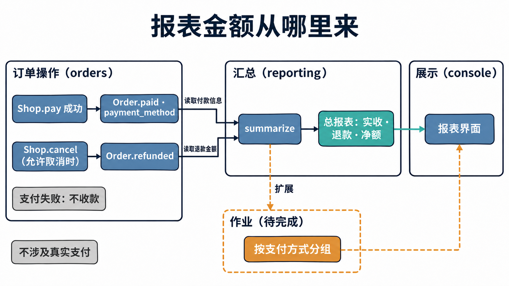
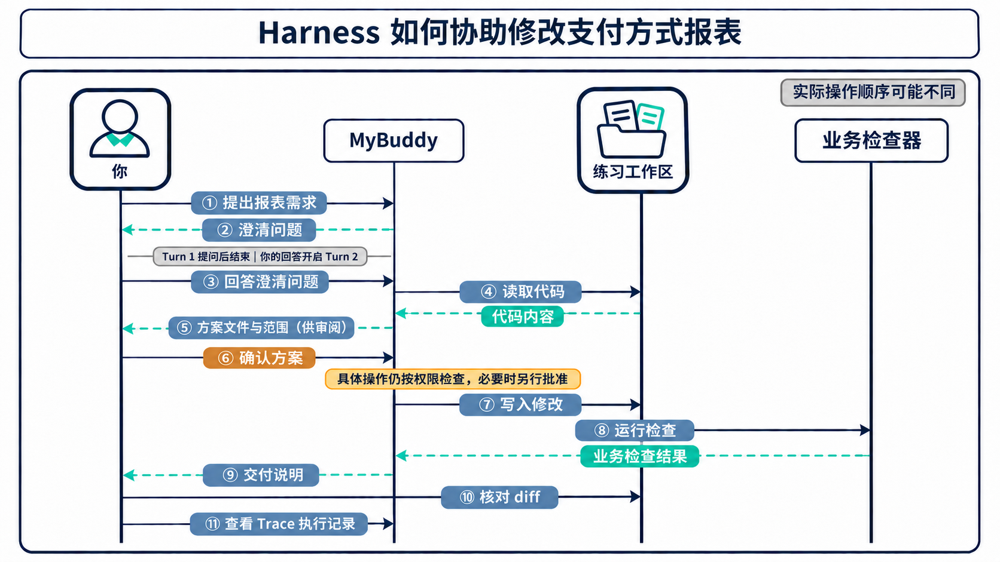

与第 21 课课程正文配套阅读。

正文是一节实践课。这一篇不再讲新机制，而是沿“交付一项任务”会碰到的几个入口读代码：启动参数、配置与状态目录、Goal 推进、会话续接、Trace 和压缩记录。读完你能说清：别人拿到你的源码和说明时，程序会从哪里读配置、把状态存到哪里、什么时候拒绝继续。

**怎么读：** 每一节先贴一段代码，再用几句话解释。代码从当前源码原样复制，上方标了文件和行号。`# ...` 表示省略了与本节无关的行。

收银台本身的报表代码在 `demo-project/` 下，不属于 MyBuddy 源码。第一节先简单看它，后面再进入 MyBuddy。

先看整条线。缩进表示“谁调用谁”或“谁在谁之后”：

```latex
python -m mybuddy …
└─ parse_startup_arguments        startup_arguments.py   拒绝冲突参数
   └─ load_startup_config         startup_config.py      默认读 config/config.toml
      └─ default_state_directory  resources.py           默认状态目录 output/mvp
--resume 之前
└─ resume_checks.preflight        resume_checks.py       工作区、配置、历史
   └─ check_continuable           continuation_checks.py 有没有不能跳过的工作
每次请求
└─ run_goal_turns                 goal.py                跑一轮，再评估目标
   └─ evaluate_after_turn         goal.py                low 档模型给出判定
回看
└─ history_trace                  cli_trace.py           /trace 的摘要
└─ context.compacted 事件         compaction/service.py  压缩只保存一条事件
```

## 一、先看报表金额从哪里来



看完这张图，你要能：说出订单里的金额怎样算出实收、退款和报表净额。

图中实线是当前代码里的数据关系，虚线是作业要完成的扩展。

下面节选自 `demo-project/mini-shop/src/reporting.py` 的 `summarize`。它不在 `src/` 下，所以没有标行号：

```python
def summarize(orders: Iterable[Order]) -> Summary:
    rows = tuple(orders)
    received = sum((row.paid for row in rows), Decimal("0.00"))
    refunded = sum((row.refunded for row in rows), Decimal("0.00"))
```

先读 `orders.py` 的 `Order`：报价、已收款、已退款和支付方式分别保存。

- `Shop.pay` 只有付款成功才记录实收，并进入待制作。失败付款保留原订单。
- `Shop.cancel` 在允许取消的阶段记录退款。制作后的售后走另一条路径。

再看节选。`summarize` 先把传入的订单固定成元组，保证几次统计面对同一批订单。实收与退款分别从 Decimal 零值累加，后面再算净额。

按支付方式分组的 `summarize_by_payment_method` 由作业实现。`demo-project/exercises/shop-tasks/cases.py` 是课程为作业准备的判定脚本，现实项目里对应的是回归测试和测试用例。它会查找这个函数，检查空报表、失败付款、固定金额和扫码退款等情况。不要根据测试名字硬编码答案，要沿支付与退款事实理解统计口径。

## 二、启动参数和配置从哪里来

### 片段 1：七个启动选项

`src/mybuddy/platform/cli/startup_arguments.py:29-37`

```python
def _parser() -> argparse.ArgumentParser:
    parser = _StartupParser(description="MyBuddy 本地 Agent", allow_abbrev=False)
    parser.add_argument("--config", type=Path, help="受信任的 TOML 配置文件路径")
    parser.add_argument("--workspace", help="项目目录；--prompt 模式须显式提供")
    parser.add_argument("--prompt", help="运行一个问题后退出")
    parser.add_argument("--name", help="设置会话名称")
    parser.add_argument("--resume", help="继续正常关闭的会话；工具或配置更新后按当前配置继续")
    parser.add_argument("--buddy", help="选择 Buddy 预设 ID，例如 buddy.developer")
    operations = parser.add_subparsers(dest="operation")
```

加上 argparse 自带的 `--help`，就是正文说的七个选项。

`--config` 指配置文件，`--workspace` 指业务目录。

第 37 行之后注册了 `sessions` 和 `history` 两个查询子命令。`sessions` 下还有 `delete`，把已关闭的会话移入回收站。

### 片段 2：拒绝互相冲突的参数

`src/mybuddy/platform/cli/startup_arguments.py:61-78`

```python
    archive_mode = arguments.operation is not None
    # 查询历史和删除会话不能使用启动会话的参数，避免用户以为这些参数对查询或删除生效。
    # --config 写在子命令前后都可以，但不能两处同时指定，以免不知道该使用哪一个。
    if archive_mode:
        if any(value is not None for value in (
            arguments.workspace, arguments.prompt, arguments.name, arguments.resume,
            arguments.buddy,
        )):
            parser.error("archive_startup_options_conflict")
        if arguments.query_config is not None:
            if arguments.config is not None:
                parser.error("duplicate_config")
            arguments.config = arguments.query_config
    # --prompt 执行一次后退出，不会进入交互界面选择目录，因此必须指定 --workspace。
    elif arguments.prompt is not None and arguments.workspace is None:
        parser.error("prompt_requires_explicit_workspace")
    if arguments.buddy is not None and arguments.resume is not None:
        parser.error("buddy_resume_conflict")
```

四种冲突，各有一句固定的中文提示：

- 查询时混用了启动参数。
- 查询子命令前后都写了 `--config`，无法确定该用哪份配置。
- `--prompt` 没带 `--workspace`。
- `--buddy` 和 `--resume` 一起用。

`_StartupParser.error` 只打印预先写好的说明，不把原始参数回显到终端。参数里可能误放了密钥。

正文排障表的第一行“启动参数被拒绝”，就对应这里。

### 片段 3：默认配置文件在哪里

`src/mybuddy/platform/application/startup_config.py:92-103`

```python
def default_config_path() -> Path:
    """源码运行时优先使用仓库配置；否则使用用户配置目录，不搜索工作区。"""
    source = _source_config_path()
    if source is not None:
        return source
    xdg = os.environ.get("XDG_CONFIG_HOME")
    base = Path(xdg) if xdg else Path.home() / ".config"
    # XDG_CONFIG_HOME 如果是相对路径，就改用用户目录下的 .config，
    # 避免配置位置随着当前工作目录变化。
    if not base.is_absolute():
        base = Path.home() / ".config"
    return base / "mybuddy" / "config.toml"
```

从源码运行时，`_source_config_path` 返回仓库根目录的 `config/config.toml`。它要求仓库根有 `pyproject.toml`。

只有当前加载的模块不符合源码仓库布局时，才使用用户配置目录。单纯切换终端当前目录，不会改变这个选择。

注意文档字符串最后一句：不搜索工作区。所以 `--workspace` 换了业务目录，配置位置不变。

### 片段 4：没写 `--config` 时，文件缺了也能启动

`src/mybuddy/platform/application/startup_config.py:353-363`

```python
def load_startup_config(path: Path | None = None, *, query_only: bool = False) -> StartupConfig:
    """读取指定的配置文件；没有指定路径时使用默认路径。
    默认文件不存在时使用默认配置，明确指定的文件不存在则报错。"""
    selected = default_config_path() if path is None else path
    try:
        with selected.open("rb") as stream:
            data = stream.read(_MAX_CONFIG_BYTES + 1)
    except FileNotFoundError:
        if path is None:
            return StartupConfig()
        raise StartupConfigError("startup_config_missing", "$") from None
```

两种情况不一样：

- 没写 `--config`，默认文件又不存在：用内置的默认配置。
- 写了 `--config`，文件却不存在：报 `startup_config_missing`。

换环境时这一点很重要。对方漏了配置文件，程序可能照样启动，只是用了默认设置。所以交付说明要写清用哪份配置。

查询命令传入 `query_only=True`，只解析查询需要的部分。模型配置有问题时，仍能查看历史。

### 片段 5：默认状态目录

`src/mybuddy/resources.py:36-48`

```python
def default_state_directory() -> Path:
    """源码运行时使用项目目录；安装环境使用当前系统约定的用户状态目录。"""
    if (_SOURCE_PROJECT / "pyproject.toml").is_file():
        return _SOURCE_PROJECT / "output" / "mvp"
    if sys.platform == "darwin":
        return Path.home() / "Library" / "Application Support" / "MyBuddy" / "state"
    if sys.platform == "linux":
        # 按 XDG 约定使用 XDG_STATE_HOME；只接受绝对路径，未设置时用 ~/.local/state。
        state_home = os.environ.get("XDG_STATE_HOME", "")
        base = Path(state_home) if os.path.isabs(state_home) else Path.home() / ".local" / "state"
        return base / "mybuddy" / "state"
    # 其他安装平台还没有默认状态目录，不能随意选一个位置保存会话。
    raise RuntimeError("mybuddy_installed_platform_unsupported")
```

包目录往上两级能找到 `pyproject.toml`，就说明是在源码仓库里直接运行。这时状态默认放在项目的 `output/mvp`。这就是术语表里的默认值。配置里写了 `[storage].state_dir`，就用配置的值。

它在 MyBuddy 项目目录下，不在业务工作区里。模型改业务文件时，碰不到会话记录。

最后一行也说明了平台边界：其他平台的安装环境还没有默认状态目录。

## 三、Goal 怎样推进一次报表开发

### 片段 6：跑一轮，评估一次

`src/mybuddy/platform/application/goal.py:180-196`

```python
async def run_goal_turns(text: str, source: Mapping[str, Any] | None, *,
                         run_one_turn: Callable[..., Awaitable[tuple[ApplicationTurnResult, RecoveryInput]]],
                         evaluate: Callable[..., Awaitable[str | None]],
                         record_result: Callable[[ApplicationTurnResult], None]) -> ApplicationTurnResult:
    """运行一轮并评估目标；评估返回继续条件时，再运行下一轮。"""
    # 自动继续时只传目标条件，不重复传入第一轮的团队消息信息。
    continuation = False
    while True:
        outcome, history = await run_one_turn(text, _team_message_source=source,
                                              _goal_continuation=continuation)
        next_condition = await evaluate(outcome, history)
        record_result(outcome)
        if next_condition is None:
            return outcome
        text, source, continuation = next_condition, None, True
        # 开始下一轮前让出一次控制权，让等待中的取消请求有机会执行。
        await asyncio.sleep(0)
```

每次请求都经过这个循环。`evaluate` 返回 `None` 就结束。没有活动目标时，它一定返回 `None`，所以普通请求只跑一轮。

需要继续时，下一轮的输入换成目标条件本身。

### 片段 7：什么时候评估，什么时候停

`src/mybuddy/platform/application/goal.py:83-89,128-135`

```python
    # 只有目标对应的这一轮正常结束后才评估，避免拿尚未结束的对话判断目标。
    goal = fold(history.events).goal
    if (goal.active is None or outcome['outcome'] != 'completed' or blocked() or goal.completed_turn != turn_id()):
        return None
    # 后台任务还没确认结束时，对话可能继续变化，现在评估可能太早。
    if any(not row['stop_observed'] for row in await agent_runs()):
        return None
# ...
    if verdict != 'not_met':
        return None
    # 连续三次正常结束的普通请求都没有登记工具调用时，停止自动继续，但不清除目标。
    # 登记过调用不代表工具一定运行了；失败或取消的请求不计入这三次。
    if goal.no_tool_turns >= 3:
        outcome['goal_notice'] += '\n连续 3 轮未调用工具，已停止自动继续；目标仍保留。'
        return None
    return condition
```

评估首先要求有活动目标、目标对应的这一轮正常完成、会话没有受阻，且后台子任务都已确认停止。后面还检查是否提出了 AskUserQuestion；只要提出了问题，就保留目标并等待用户回答，不评估、不自动续轮。非交互入口遇到需要用户处理的审批时，也会先停下。

中间省略的部分调用 low 档模型，最多等 30 秒。送去的是目标条件和一段有界的对话尾部 `conversation_tail`。

第二段是判定之后：

- 不是 `not_met`，就不再继续。`met` 和 `impossible` 会清除目标。
- 连续三轮没有工具调用，也停下，但目标保留。

模型只看到对话尾部，看不到你的操作台。所以金额要你自己核对。

## 四、会话能不能继续

### 片段 8：续接前的预检

`src/mybuddy/platform/application/resume_checks.py:81-95`

```python
def preflight(session_id: str, *, workspace_id: str, read_events: Callable[..., History],
              resolve_configuration: Callable[..., Any], make_baseline: Callable[..., Mapping[str, Any]],
              validate: Callable[..., None]) -> None:
    """切换会话前检查工作区、配置和历史；实际启动时再取得文件锁。"""
    # 不能把其他工作区的会话当作当前工作区的会话继续运行。
    events = read_events(session_id)
    if not events or events[0]["payload"]["workspace_id"] != workspace_id:
        raise ValueError("mvp_resume_incompatible")
    history_shape = validate_session_history_shape(events)
    # 子会话不能从普通会话的入口继续运行。
    if parse_child_scope_baseline(events[0]['payload']) is not None:
        raise ValueError('subagent_resume_execution_unsupported')
    configuration = resolve_configuration(events, history_shape=history_shape)
    candidate = make_baseline(events[0]['payload'], configuration)
    validate(events, baseline=candidate, configuration=configuration)
```

检查顺序是：

1. 工作区对得上。换了业务目录，报 `mvp_resume_incompatible`。
2. 历史的格式受支持（`validate_session_history_shape`）。
3. 不是子会话。
4. 合并当前配置与会话内保存的选择。
5. 把本次配置交给 `validate`；工具说明或配置值变化不拒绝，工作区不同、结果未知、审批未处理和子任务未结束仍拒绝。

这就是正文说的“继续前会检查会话记录和当前运行条件”。注释也说了：这里只预检，真正恢复时会持锁再查一次。

### 片段 9：还有没做完的工作，就不能继续

`src/mybuddy/platform/sessions/continuation_checks.py:20-39`

```python
def check_continuable(events: Sequence[Mapping[str, Any]]) -> int:
    """检查是否还有不能跳过的工作，并返回已结束的普通 Turn 数量。"""
    state = fold(events)
    # 注意：如果不知道工具有没有真的运行完，先停止继续处理。
    # 不能因为后面有取消记录，就忽略工具可能已经产生的结果。
    # 例如转账工具可能已经完成，盲目再运行一次就可能重复转账。
    if state.tools.unknown_results:
        _fail('mvp_resume_unsupported')
    # 取消的 Turn 必须在结束时就满足结束条件；后来的事件不能补救当时缺少的条件。
    if not all(state.turns.cancelled_closed.values()):
        _fail(_NOT_CLOSED)
    # 还有等待回应的交互或等待处理的输入时，不能直接开始新的 Turn 把它们跳过去。
    if state.pending_interactions or state.turns.pending_inputs:
        _fail(_NOT_CLOSED)
    # Memory 操作完成后还可能有等待采用的内容；这时仍要阻止继续。
    if state.memory.view.pending is not None:
        _fail('shared_memory_operation_blocked')
    if state.turns.open_turn is not None or state.turns.open_step is not None:
        _fail(_NOT_CLOSED)
    return state.turns.closed_count
```

`resume_checks.validate` 的最后一步就是调用它。

第一条最重要：有结果未知的工具，就报 `mvp_resume_unsupported`。正文说“先检查实际结果，不要直接重新执行”，代码在这里挡住了。

后面几条检查：取消的轮次是否当时就关好；有没有等待回答的交互；Memory 有没有待采用的内容；还有没有没结束的 Turn 或 Step。

## 五、Trace 和压缩记录

### 片段 10：`/trace` 只总结最近一轮

`src/mybuddy/platform/cli/cli_trace.py:218-236`

```python
def history_trace(events: Sequence[Mapping[str, Any]], durable_head: int) -> str:
    """汇总最近一轮的事件；显示条数有限，但计数来自完整的一轮。"""
    turns = _select(events, 'turn.started')
    lines = ['MyBuddy Trace · 最近 Turn']
    if not turns:
        return '\n'.join([*lines, '暂无 Turn。'])
    # 某些策略事件没有 turn_id，先找出本轮的工具调用 ID，才能把这些事件也找回来。
    turn_id = _identity(turns[-1], 'turn_id')
    selected = [event for event in events if _identity(event, 'turn_id') == turn_id]
    calls = _select(selected, 'tool.call_registered')
    call_ids = {_identity(call, 'tool_call_id') for call in calls}
    selected = [event for event in events if _identity(event, 'turn_id') == turn_id or (
        event['event_type'] == 'tool.policy_decision_recorded' and _identity(event, 'tool_call_id') in call_ids)]
    # 没有结束事件就显示进行中；不认识结束状态时，也不能猜成成功。
    steps, ends = _select(selected, 'step.started'), _select(selected, 'turn.ended')
    outcome = _status(ends[-1], 'outcome') if ends else 'in_progress'
    label = {'completed': '本轮已完成', 'failed': '本轮失败', 'cancelled': '本轮已取消',
             'interrupted': '本轮已中断', 'in_progress': '本轮进行中'}.get(outcome, '本轮结果未知')
    lines.append(f'{label}；{len(steps)}个步骤，{len(calls)}次工具调用。')
```

`history_trace` 只取最后一个 `turn.started` 所在的那一轮。之前的轮次要用 `mybuddy history` 查。

它只读已保存的事件，不重新执行任何东西。不认识的结束状态显示“本轮结果未知”，不会猜成成功。

步骤太多时，后面的代码只显示末尾几个，并写明省略了多少。

### 片段 11：压缩只保存一条 `context.compacted` 事件

`src/mybuddy/platform/context/compaction/service.py:161-172`

```python
        payload = {'summary_text': text, 'through_seq': through, 'focus': focus,
                   'recovery_files': plain(recovery_files),
                   'transcript_artifact_ref': plain(transcript), 'usage': plain(response.provider_usage),
                   'before_tokens': before.estimate.total_tokens, 'after_tokens': after.estimate.total_tokens,
                   'turn_id': next((event['turn_id'] for event in reversed(history.events)
                                    if event['event_type'] == 'turn.started'), None) if automatic else None}
        # 带上刚才读到的历史记录末尾序号，让提交接口检查历史有没有变化，
        # 避免根据过期的消息保存概要。
        batch_id = self._ids.next('batch')
        event = session_event(history.scope, history.observed_head_seq + 1, 'context.compacted', 1,
            self._ids.next('event'), self._clock.now(), payload,
            **({'turn_id': payload['turn_id']} if payload['turn_id'] is not None else {}))
```

正文说压缩改变的是送给模型的内容。这里能看到：一次成功的压缩只追加一条事件，原来的历史事件不删。

- `summary_text`：摘要正文。它由一次不带工具的摘要调用生成，吸收“上一份摘要 + 这次新纳入压缩的较早历史”。
- `through_seq`：摘要覆盖到哪条事件为止。压缩前完整请求估算少于 60000 token 时，保留最后两组完整消息；达到 60000 token 时，才从末尾保留到约 10000 token 且不少于 5 条消息，加入下一组会超过 40000 token 时提前停止。两档都不拆开工具调用和它的结果。
- `recovery_files`：仅在压缩前完整请求估算达到 60000 token 时，补读最多五份最近用过的工作区文件，每份最多约 5000 token。读不到或近期保留消息里已有完整内容的文件可以跳过。文件快照随概要保存，后续请求和重启使用同一份内容；小档压缩不补读文件。
- `transcript_artifact_ref`：启用 `long_tool_results` 时，被压缩的那段对话另存为长结果。当前工具里有 `read_tool_result` 时，摘要会附上回读引用。

所以压缩不是备份。有限的文件快照不能替代业务文件备份，也不替你备份状态目录。



看完这张图，你要能：说出用 Harness 完成需求时，澄清、读取、修改、检查和交付这几步怎样衔接。

这张图是实践中的协作关系。模型每次的实际顺序可能不同。一次请求在 MyBuddy 内部怎样走过 `ask`、`TurnCoordinator.run` 和 `AgentLoop.run_turn`，见第 4 课源码解析。

## 读码练习

1. 同事拿到你的源码，没有 `config/config.toml`，也没写 `--config`。程序会怎样？如果他写了 `--config my.toml`，但文件不存在呢？
2. 你用 `--workspace` 换了一个业务目录，再 `--resume` 原来的会话。会发生什么？在哪个片段能找到依据？
3. 上一轮有一个 Bash 调用结果未知。你执行 `--resume`，会怎样？为什么 MyBuddy 不直接重跑它？
4. 设了目标后，模型连续三轮只回复文字、没有调用工具，判定都是 `not_met`。目标还在吗？还会自动继续吗？
5. 压缩成功后，较早的历史事件还在状态目录里吗？

参考答案

**第 1 题** 没写 `--config` 且默认文件不存在时，片段 4 返回 `StartupConfig()`，用内置默认配置启动。写了 `--config` 但文件不存在时，报 `startup_config_missing`。所以交付说明要写清用哪份配置。 **第 2 题** 片段 8 第一项检查比较 `workspace_id`。换了业务目录就对不上，报 `mvp_resume_incompatible`，不能继续。 **第 3 题** 片段 9 的第一条检查发现 `unknown_results`，报 `mvp_resume_unsupported`。那次 Bash 可能已经产生了效果，重跑可能让同一个操作做两次。要先检查实际结果。 **第 4 题** 目标还在，但不会再自动继续。片段 7 里 `no_tool_turns >= 3` 时返回 `None`，并提示“目标仍保留”。你可以补充条件后再发请求，或用 `/goal clear` 清除。 **第 5 题** 还在。片段 11 只追加一条 `context.compacted` 事件，不删除原来的事件。之后送给模型的请求用摘要代替了较早的消息。
