把前面掌握的方法迁移到一个新的 Python 工程，用 Claude Code 推进实现、反馈与验收。

上一课，我们完成了收银台报表。这次换一个起点：手里只有本地文档检索的任务契约和用例，还没有实现代码。

**任务契约**是一份写死了“程序对外怎样表现”的说明：读哪些文件、索引存什么字段、查询怎样匹配、出错时返回什么退出码。实现可以自由安排，但这些对外行为不能随意改。用例（case）就是按它来检查的。

我们用 Claude Code 做出第一个可运行版本，再根据实际结果调整。最后你会看到，同一套任务方法怎样迁移到其他 Harness。

## 本课导览

这一课沿五步走：准备项目、做出第一个可运行版本、用反馈与上下文推进、按需引入扩展并交付、迁移到其他 Harness。第二节先做一个最小可用版本：只让一份文档走通扫描、索引和查询，再一点点补上边界情况。

学完后，你应能为一个新工程组织 Harness 的工作条件，并用反馈推动实现。

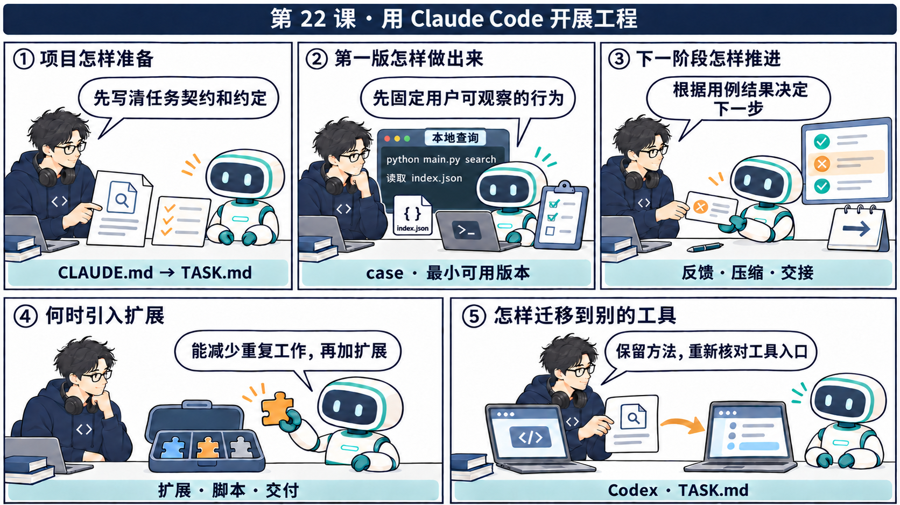

## 一、怎样为 Harness 准备一份能开发的项目？

**动手前先把契约、约定、设计和检查方式各放到固定位置，Agent 才有可靠的依据。**

课前收银台介绍已经讲过短项目入口、业务设计与验证安排。本课用这些方法回答新问题：**哪些旧约定可以沿用，哪些要根据文档检索的特点重新确定？**

### 1. 先确定每种资料放什么

**每种资料回答一类问题，彼此不混在一起。**

先读文档检索作业（`demo-project/exercises/document-search/README.md`）的任务契约，再为自己的实现准备材料：

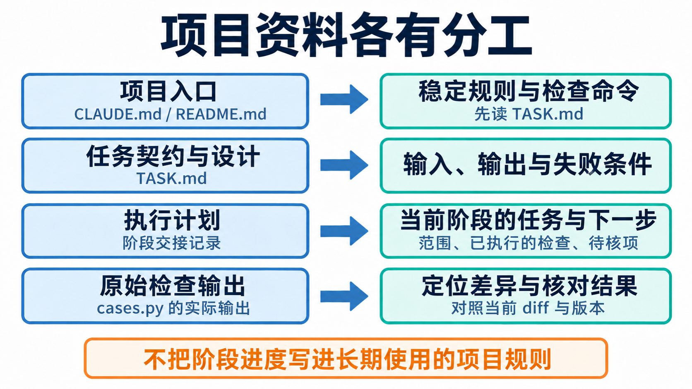

看完这张图，你要能：判断不同工程材料如何分工并让Harness按需找到。

| 材料 | 本次要确定什么 |
| --- | --- |
| README 与项目入口文件 | 怎样运行、先读哪些规则、用什么命令检查 |
| 任务契约与设计 | 扫描范围、索引字段、查询匹配与失败行为 |
| 执行计划 | 当前这一小步、已完成的检查、下一步 |
| 用例与新增测试 | 既定接口是否满足，内部逻辑是否覆盖 |
| 临时报告与草稿 | 放进单独的草稿目录，不当作规则入口 |

入口文件的写法见《课前-麦当当收银台介绍》的“AGENTS.md 为什么要这样写”，把路径和命令换成新项目的。再用 `/context` 确认规则已加载。

### 2. 先写出新项目的关键约定

**实现前先让 Agent 从契约里整理三条约定：扫描什么、索引存什么、查询怎样匹配和报错。**

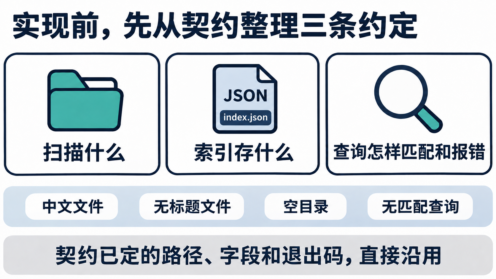

看完这张图，你要能：说出实现前要从契约整理的三条约定，以及哪些边界情况要先问清。

这次要确定的是文件与索引的处理规则。遇到未说明的产品选择再追问。契约已经确定的路径、字段和退出码，直接沿用。

例如“搜索中文笔记”还不足以指导实现。你可以要求：

阅读任务契约，列出中文文件、无标题文件、空目录和无匹配查询分别怎样处理。指出实现模块与对应用例，尚未确定的选择单独列出。先不要修改契约。

这样得到的设计能直接帮你确定模块接口：

- 索引负责数据存进文件时的格式。
- 查询负责匹配规则。
- CLI 负责参数与退出状态。

是否拆成独立文件，根据实际规模决定。

### 3. 设计要写到什么程度

**设计说清输入、输出和失败条件，并对应到模块与用例，就够用了。**

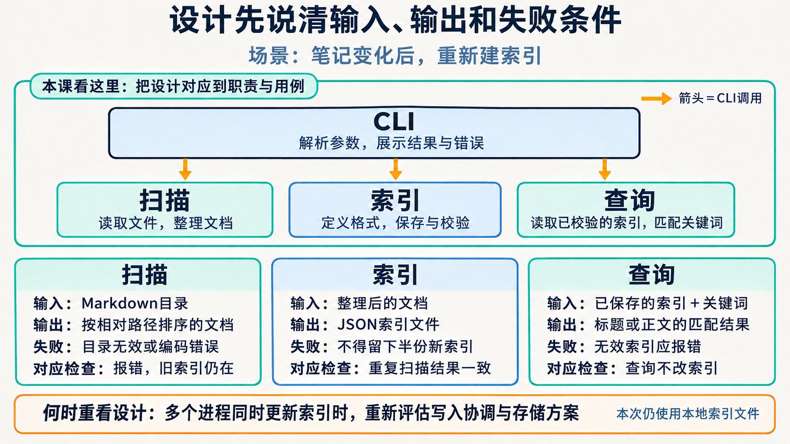

看完这张图，你要能：记住设计只需说清输入、输出、失败条件并对应模块与用例，再留一句何时重看。

这次不用为每个模块写一篇长文。选“笔记变化后重新建索引”这条场景，检查设计是否说清数据从目录进入索引，再被查询和 CLI 使用的过程。

可以用几个具体问题检查：

- 扫描遇到无效编码时，程序怎样报告？旧索引还在不在？
- 重复扫描同一目录，为什么能得到一致结果？

后面做小范围修改时，更新相关约定即可。

对会影响后续实现的选择，再留一句“什么情况下需要重看”。例如本练习约定使用本地索引文件。你可以记录当前读写方式，并写明：将来多个进程同时更新索引时，要重新评估写入协调和存储方案。那属于新的需求讨论，本次作业不自行换数据库。

让 Agent 提出替代方案时，也请它说明各自依赖的条件和代价。你最后留下的可以很短：为什么现在这样选、接受了什么限制、什么变化会触发重新判断。

### 4. 功能验证怎样安排

**验证经过真实的临时文件、索引写入和查询，不用 Mock（模拟对象）直接把结果假装成预期。**

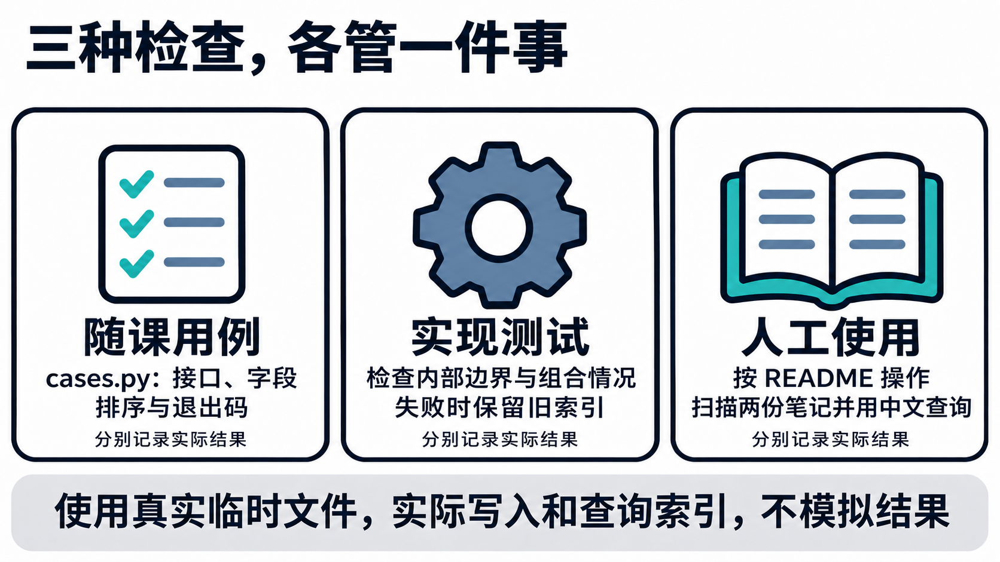

看完这张图，你要能：分清随课用例、实现测试和人工使用各自核对什么。

失败用例要检查错误和原索引，而不只看最后打印的一句话。

| 检查 | 本次新增的检查目标 |
| --- | --- |
| 随课用例 | 接口、字段、排序与退出码是否符合任务契约 |
| 实现测试 | 模块内部的边界与组合是否正确 |
| 人工使用 | 能否按 README 找到笔记，并理解无匹配或失败提示 |

让 Agent 报告实际命令、范围和结果。发现差异后，把输入、预期与实际值交回会话。用例的预期应来自契约。

#### CI 怎样接住这些要求

**CI（持续集成）在干净环境里，针对待集成的提交复跑同一组检查。**

配置写好、本地通过和 CI 实际通过，要分开记录。例如本地查到了中文标题，CI 却因编码失败，就让 Agent 读同一提交的日志，修正后重跑。本次作业可以先完成本地闭环，CI 没跑的部分写进交付记录。

### 5. 注释要求怎样写进项目规则

**注释解释意图和不直观的边界，这条要求写进项目规则。**

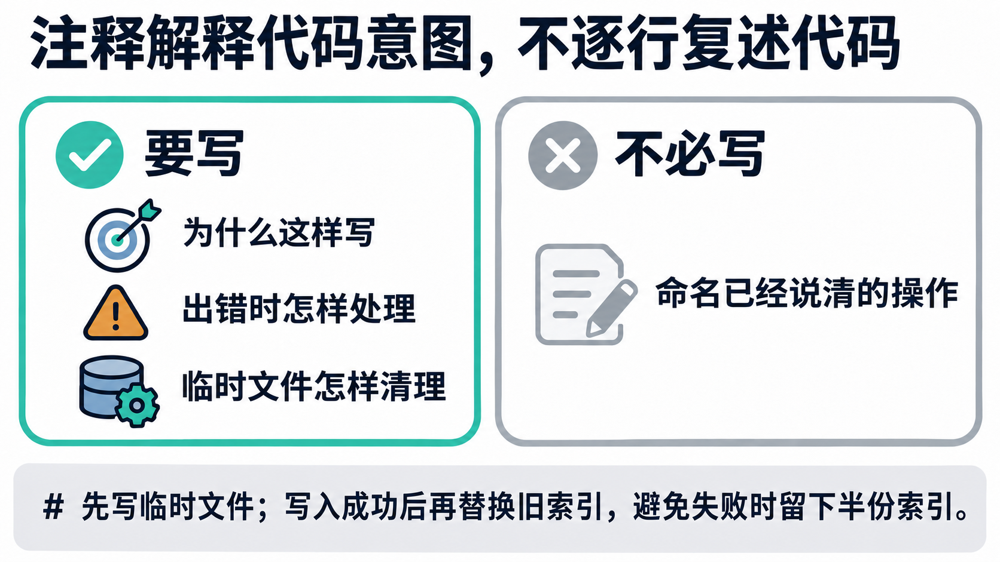

看完这张图，你要能：判断哪些内容该写进注释，哪些不必重复。

命名和结构已经表达清楚的操作，不必逐行重复。可以把“新增实质性注释使用简体中文，解释意图、失败行为与资源处理”写入新项目规则。

下面是教学伪代码，说明索引写入时的意图：

```python
# 先写临时文件；写入成功后再替换，避免失败留下半份索引。
write_temporary_index(index)
replace_index()
```

实际实现还要处理临时文件清理、替换错误和测试。行为调整后同步注释。发给模型的提示词和给用户看的提示，属于程序运行时输出的内容，不归注释规则管，要另外检查。

### 6. 把规则用在一次自然语言开发中

**带着任务契约和检查入口，开始第一小步。**

先让 Claude Code 按任务契约提出一个最小可用版本，你看过、同意后，它只在你同意的范围里动手。之后每次只做一小块能单独运行和检查的功能，做完就交出运行结果，你再决定下一步补什么材料、改什么。

配套材料各有用途：

- 环境卡（[《第 22 课配套：麦当当练习环境设置》](<209_第 22 课配套：麦当当练习环境设置.md>)）：准备麦当当练习副本、检查环境、发出第一条任务。
- 开发例题（[《第 22 课配套：用麦当当收银台做开发例题》](<210_第 22 课配套：用麦当当收银台做开发例题.md>)）：扩展题、反馈写法、协作与 Worktree、项目巡检。
- 七阶段路线（[《第 22 课配套：从空白包建设麦当当收银台》](<211_第 22 课配套：从空白包建设麦当当收银台.md>)）：从空白规格开始的可选路线。

容易误会的地方：

- 规则文件写好了，不说明 Agent 已经读到。要让它说出实际读了哪些资料。
- 本地通过、CI 配置写好、CI 实际通过，是三件事。

## 二、怎样把新需求变成第一个可运行版本？

**先固定用户能看到的行为，再在独立副本里做出只处理一份文档的最小可用版本。**

资料准备好了，接下来开始实现。先确定用户从命令行应该看到什么，再建立独立副本，把扫描、索引和查询接成第一条可运行的路径。

### 这次从什么项目开始

**一个本地文档检索 CLI：扫描目录生成 JSON 索引，再按关键词查找。**

你经常需要从一组本地 Markdown 笔记里找资料。本课开发的 CLI 不接模型 API、网页服务或向量数据库。重点是观察 Harness 怎样帮你把一份需求变成可运行工程。

这是一道新作业。随课提供任务契约与 case（`demo-project/exercises/document-search/README.md`），没有检索程序的完整答案。你要完成扫描、路径处理、标题提取、索引读写、查询和命令行错误处理。项目规模足以练习模块边界，又能在本地复跑全部已声明行为。

### 先固定用户可观察的行为

**路径、JSON 字段和退出码从契约读取，实现过程中不能随意改。**

| 功能 | 必须满足的行为 | 常见遗漏 |
| --- | --- | --- |
| 扫描 | 递归读取普通 `.md` 文件，使用相对路径并排序 | 把私有目录、符号链接或输出文件带进去 |
| 标题 | 第一行以 `# ` 开头，且后面的文字去掉首尾空白后非空时，使用该文字；否则使用去掉 .md 后缀的文件名 | 漏掉空标题回退，或丢弃中文文件 |
| 索引 | 写入版本和文档列表，重复扫描结果一致 | 改成追加，产生重复记录 |
| 查询 | 对标题和正文作大小写无关的子串匹配 | 把查询解释成正则表达式或命令 |
| 失败 | 无效目录、编码或索引给出错误并非零退出 | 失败时破坏原索引或打印“成功” |

契约还规定了空目录、无匹配、嵌套目录与中文查询。如果实现随意改了字段，程序和 case 可能各自“正确”，却不能互通。

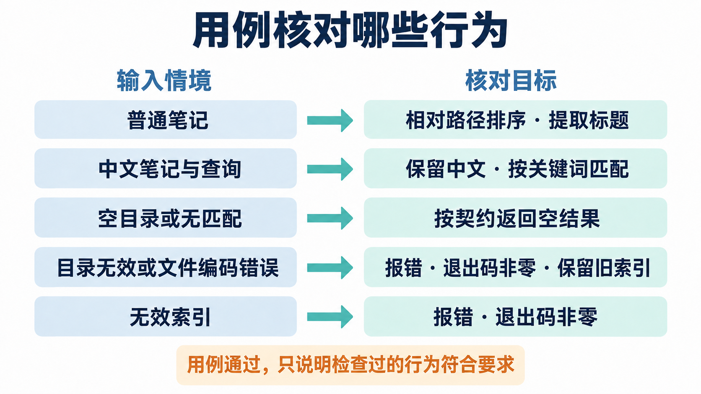

看完这张图，你要能：把扫描、排序、标题、查询和失败保护，逐项对应到能观察到的结果。

可选功能单独记录：实时监听、模糊搜索、网页界面、大文件优化。先完成当前范围。确实要加入新能力时，修订需求、补相应 case，再估计时间和成本。

| 输入情境 | 用例检查什么 |
| --- | --- |
| 普通笔记 | 相对路径排序、提取标题 |
| 中文笔记与查询 | 保留中文、按关键词匹配 |
| 空目录或无匹配 | 按契约返回空结果 |
| 无效目录或编码 | 报错、非零退出、保留旧索引 |
| 无效索引 | 报错、非零退出 |

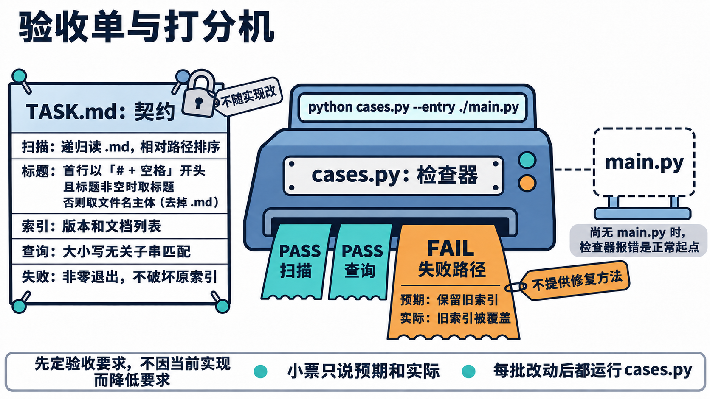

看完这张图，你要能：用“钉在墙上的验收单”和“打分机”理解：TASK.md 是不随实现修改的约定，cases.py 只报告 PASS / FAIL 以及预期和实际。

### 建立独立副本与执行环境

**准备脚本只生成作业目录，不生成答案，也不调用模型。**

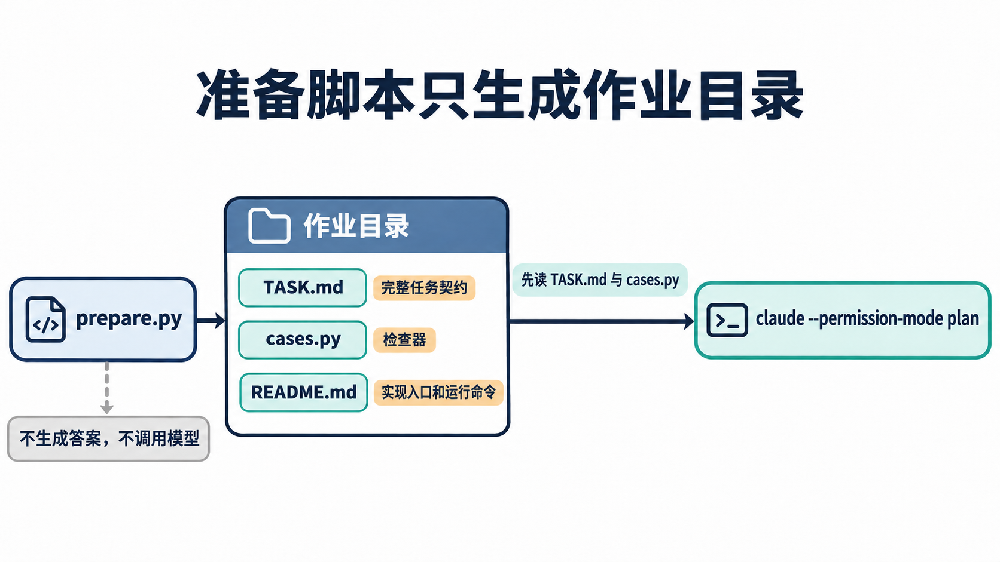

看完这张图，你要能：看清准备脚本生成哪三份文件，之后从哪条命令开始。

运行准备脚本（`demo-project/exercises/document-search/prepare.py`）：

```shell
python3 demo-project/exercises/document-search/prepare.py
```

进入输出目录：

- `TASK.md`：从原作业 `README.md` 复制的完整任务契约。
- `cases.py`：检查器。
- 新生成的 `README.md`：只提示实现入口和运行命令。

先读 `TASK.md` 与 `cases.py`。再确认 Python 版本，以及 Claude Code 的安装、账号和权限配置。按实际安装版本查看帮助：

```shell
claude --version
claude --help
```

确认安装后，在练习目录启动规划模式：

```shell
claude --permission-mode plan
```

`--permission-mode plan` 是 Claude Code 的启动参数。会话里的 `/` 命令由各个产品自己定义。各产品的目标管理命令（比如 MyBuddy 的 `/goal`），按自身帮助说明使用。

同叫“规划模式”，范围也可能不同：Claude Code 规划时仍可运行 Shell 命令调查，MyBuddy 规划时只能运行白名单内的只读命令，同时提供 `ReadFile`、`CodeOutline`、`Glob`、`Grep` 四个读工具，外加只能写方案文件的两个写入工具和提交方案的 `ExitPlanMode`。两者的方案都写在一个方案文件里，写完由 `ExitPlanMode` 提交审批。迁移时按各自的帮助确认。

### 项目指令保持短，详细需求有独立位置

**项目指令只放材料入口、不同任务应先读哪些文件、检查命令和长期约束；详细需求放在独立文件里按需读取。**

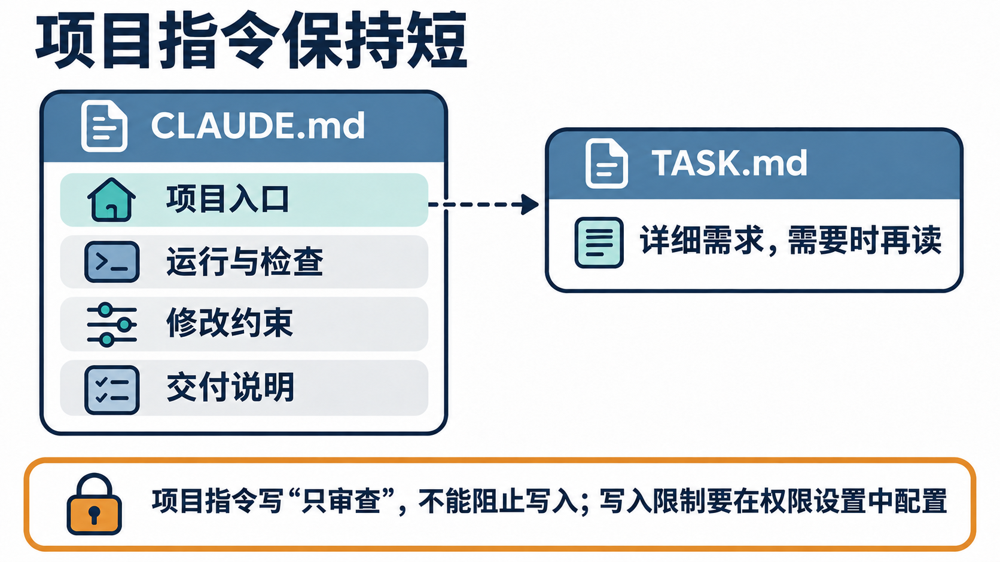

看完这张图，你要能：记住 CLAUDE.md 只放四段约定，详细需求留在 TASK.md，权限另由设置限制。

让 Claude 先读任务文件，提出模块划分与待澄清问题。项目指令可放四类信息：

- 材料入口；
- 任务路由；
- 运行检查命令；
- 需要长期遵守的约束。

例如本课项目的 `CLAUDE.md` 可以从 `/init` 生成的初稿改起，四段正好对应这四类：

```markdown
# 项目入口
开始任务时先读 TASK.md；命令行输入输出与失败行为以它为准。

# 运行与检查
在练习目录执行 python cases.py --entry ./main.py。
Python 入口按项目环境确认，交付时报告实际命令和结果。

# 修改约束
保留查询不修改索引、扫描失败保留旧索引的行为。
需要变更任务契约时先说明理由，不修改 case 来掩盖实现错误。

# 交付说明
列出改动、已执行的检查、未验证项和需要用户决定的问题。
```

每条都要对应项目里的实际需要；详细索引格式留在 TASK.md。

Claude Code 使用 `CLAUDE.md` 加载项目约定。它与前面讲的 `AGENTS.md` 目的相近。项目指令只是给模型的约定，不授予工具权限，也不替代审批：写了“只审查”，挡不住写操作，真正的限制在权限设置里。MyBuddy 把 `AGENTS.md` 放进请求时，会在前面写明“不授予工具权限或替代审批”；恢复的会话继续用创建时保存的那份，改了文件要开新会话才生效。可以用该产品的 `/context` 查看已加载内容。详细需求与索引格式放在独立文件，需要时再读，避免每次请求都带上大量低相关材料。

三类材料承担不同的阅读任务：

- 稳定约束：进入项目指令。
- 阶段结果：写进续接记录，帮助下一次接续。
- 失败输出：保留原文，作为具体问题的证据。

容易误会的地方：

- 不是所有产品都会自动读取 `CLAUDE.md` 和 `AGENTS.md` 两者。

### 先讨论边界，再做最小可用版本

**第一步只打通“读一份文档—生成索引—找到关键词”，每批改动后都跑检查。**

你可以提交：

先阅读 TASK.md 与 cases.py，说明扫描、索引、查询和 CLI 的职责、关键失败路径及待澄清问题。提出小步实现计划；先不写代码，不修改验收契约。确认范围后先完成一份 Markdown 的扫描与查询，再覆盖全部 case。

规划时关注依赖：

- CLI（命令行入口）解析输入并展示错误。
- 扫描模块读取文件。
- 索引模块定义数据格式并保存索引。
- 查询模块读取已经校验的索引。

查询不应悄悄重新扫描原目录。扫描也不应在每个业务函数里打印界面文本。无需照搬大型应用的六层目录，按实际职责选择足够简单的结构。

接受计划后，按产品正常入口进入执行。第一步只做最小可用版本。随后处理目录遍历、排除规则、失败不覆盖和查询边界。每一批改动后执行相应检查，避免最后才发现各模块对数据格式的理解不同。

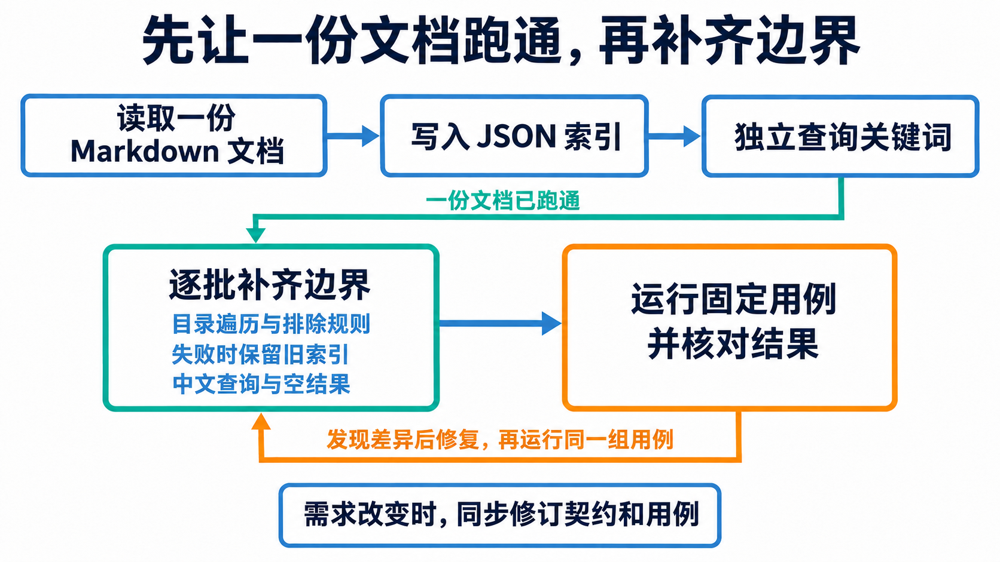

看完这张图，你要能：先让一份文档从头到尾走通，再说明怎样一批批扩展到边界情况。

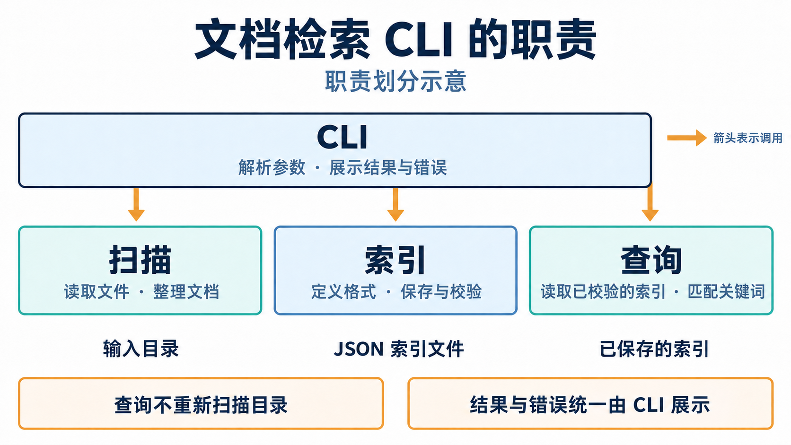

看完这张图，你要能：按输入输出和容易变化的地方，划分扫描、索引、查询和命令行各自的职责。

怎样知道最小可用版本真的走通了？

1. 从用户会使用的入口，扫描一份包含已知关键词的笔记。
2. 确认索引已经写到约定位置。
3. 再独立执行查询，从保存的索引中返回结果。

这个顺序把第 4 课的行动反馈和第 13 课的验证用在了新工程里：每完成一批工作，都有一条可以实际运行的路径检查它。

容易误会的地方：

- 分别调用了三个函数，查询却拿着内存里的临时数据，就还没有检验“保存与读取”这条连接。
- 最小可用版本只是第一个阶段成果。全部已约定的边界仍要继续完成。

## 三、怎样用反馈与上下文推动下一阶段？

**让用例的具体失败决定下一步；每换一个阶段，就重新判断会话里该留哪些材料。**

第一版能启动，只是有了可以观察的对象。接下来让用例告诉我们哪些地方符合要求、哪些还要调整。每进入一个新阶段，再看看当前会话里的材料是否仍然合适，决定继续、压缩，还是交接给新会话。

### 反馈怎样变成下一步行动

**把失败 case、命令、实际结果和预期一起交回，比只说“测试不通过”有用得多。**

在练习目录运行：

```shell
python cases.py --entry ./main.py
```

这里的 `python` 指已配置的 Python 3.11～3.13 解释器，不假定系统自带该命令。`python` 不在 PATH 中或版本不符时，可在同一目录改用 `uv run --python 3.13 python cases.py --entry ./main.py`。检查器会用所选解释器运行你的入口。

脚本用临时输入调用你的程序，逐项显示 PASS 或 FAIL，失败时给出预期与实际。它不会给出修复方法。缺少 `main.py` 时会明确报错，这是还没开始实现的正常状态。

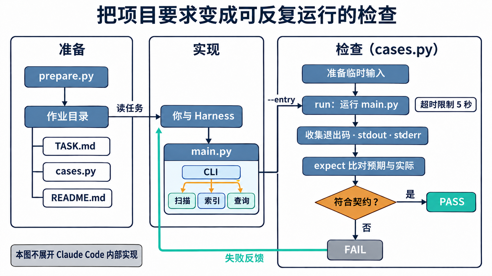

看完这张图，你要能：说出作业的测试从准备输入、真实调用命令行，到收集结果、和约定比对、反馈失败的过程。

检查器怎样调用你的程序，决定了它能证明什么。`cases.py` 里的 `run` 这样启动入口：

```python
result = subprocess.run(
    [sys.executable, str(entry), *args], cwd=base,
    capture_output=True, text=True, timeout=5, check=False,
)
```

它用运行检查器的同一个 Python、不经过 Shell、限时 5 秒；超时也记成一条结果。`expect` 只比较 stdout 里的 JSON、退出码和 stderr 是否为空，不管你的内部函数叫什么。查询用例还比较索引的字节，证明查询没写文件；失败用例还检查旧索引是否保留。细节可直接读 `cases.py`。

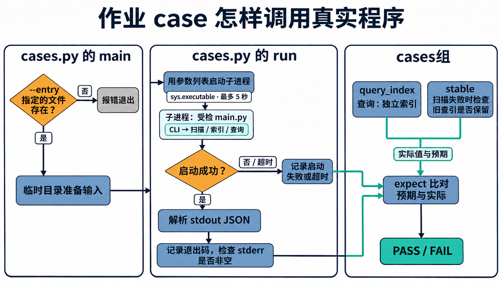

看完这张图，你要能：说出测试的四步：准备输入、执行命令行、收集结果、和约定比对。

它证明不了的也要记住：临时目录不是操作系统沙箱，检查器也没覆盖规模、性能、权限和跨平台情况。

假如用例指出“失败扫描覆盖了旧索引”：

1. 把失败 case、入口命令、实际结果和预期一起交给 Claude。
2. 让它先解释数据在哪个阶段被写入。
3. 修改后先跑相关 case，再跑完整 case，确认修复也保留了正常扫描行为。

三种失败需要不同反馈：

- 工具因权限受阻：先看具体路径与命令。
- 进程错误：看退出码和 stderr。
- 断言失败：比较契约与实现。

恢复或重试以前，先确认原索引和工作区有没有变化。


看完这张图，你要能：理解一份能复现的失败反馈，怎样帮 Agent 决定下一步查什么。

容易误会的地方：

- 检查器不会因为模型的解释，就把失败改成通过。
- 降低验收标准，没有解决原问题。

### 上下文怎样跟着阶段变化

**每个阶段只带当下需要的材料；换阶段时先记下目标、接口、检查结果和未决项。**

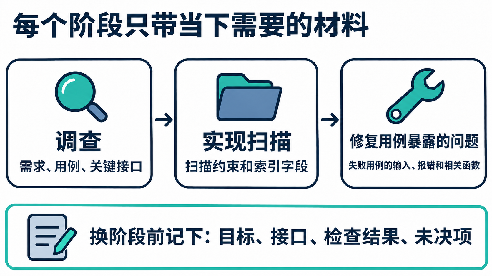

看完这张图，你要能：说出调查、实现、修复三个阶段各自带哪些材料，换阶段前记什么。

- 调查阶段：读需求、case 和关键接口。
- 实现扫描：保留扫描约束和索引字段，不必每次都带上全部查询讨论。
- 修复失败：补入对应输入、错误与函数。

完成一阶段后，记录当前目标、接口、检查结果与未决项。再决定继续原会话、压缩，还是开新会话。

新会话的第一步，是查看实际文件和结果。旧摘要说“全部通过”，如果后来改过扫描规则，就要重新运行受影响的 case。第 8、9 课的判断在这里直接影响工程质量。

容易误会的地方：

- 压缩节省输入空间，但不能让过期的结果重新有效。

### 做一次上下文观察与阶段交接

**用** `/context` **观察、按需** `/compact`**、换无关工作时** `/clear`**，每一步都记下依据。**

在文档检索作业里，用下表把第 8、9 课的方法实际走一遍。命令的适用版本以 Claude Code 当前帮助为准，这些参数不能搬到 MyBuddy。

| 时机 | 做什么 | 记录什么 |
| --- | --- | --- |
| 新项目会话启动后 | 查看 `/context`，确认项目入口 | 初始材料和占用；尚未读取的需求不能算已知 |
| 读完 TASK.md 与相关 case | 再查看占用，整理目标与待澄清项 | 哪些新材料支持扫描、索引和查询的接口决定 |
| 最小可用版本已验证，后续还要开发 | 判断是否需要压缩；需要时指定保留重点 | 当前接口、实际通过的 case、未覆盖行为和下一步 |
| 继续处理边界 case | 核对摘要，补读本次修改需要的原文 | 约束是否完整，旧通过结果是否对应当前版本 |

阶段交接时，可以在 Claude Code 中使用下面的示例。只有确实需要压缩时才执行：

```latex
/compact 保留文档检索任务的输入输出契约、已确认模块接口、实际检查结果和未完成 case。保留关键文件位置；区分通过、未执行和失败，不将计划写成完成事实。
```

压缩后先确认当前接口和下一步，不要连续压缩。同一任务继续原会话；转到无关工作，先存交接说明再新开（第 9 课）。

你在哪个界面操作，和命令实际在哪台机器、哪个目录执行，要分开确认。开始前确认真实工作目录、Python 环境和 case 所在位置。验收也应在实际产物所在的环境进行。

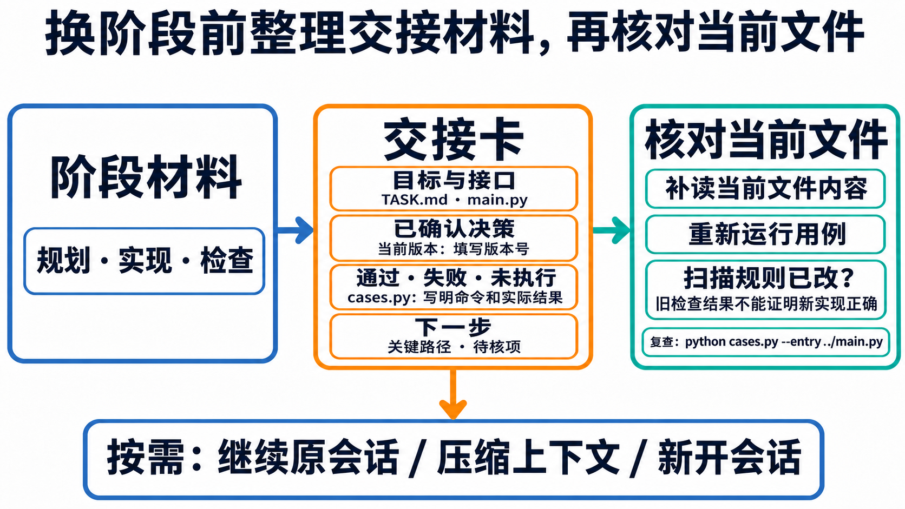

看完这张图，你要能：组织新的目标、当前版本、已确认决定与下一步所需证据。

容易误会的地方：

- 界面是从浏览器打开的，不能单独证明命令跑在云端。

## 四、什么时候引入扩展，怎样交付与维护？

**某项重复工作确实需要减少时才引入扩展；交付后用一次小维护检验项目能否继续演进。**

实现过程中，你可能发现某些步骤一直在重复，比如检查索引字段，或检查失败时是否保留旧文件。下面先选一项明确的重复工作，再看怎样交付项目，以及交付后怎样继续维护。

### 扩展能力在什么时候值得引入

**先看眼前要解决什么问题，再选扩展。**

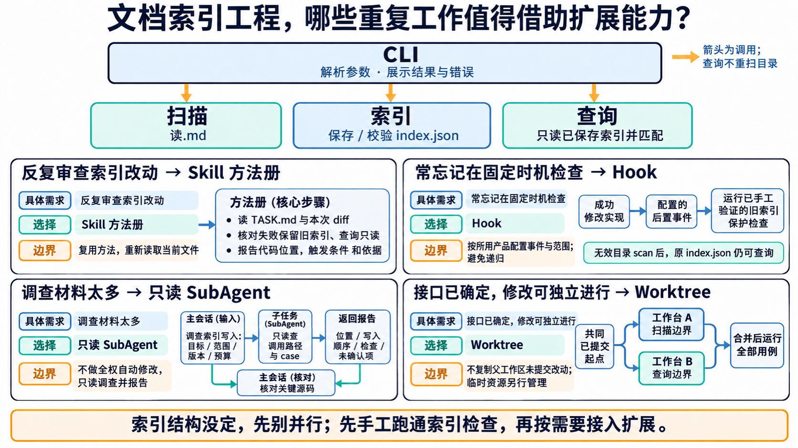

看完这张图，你要能：把四种问题和四种扩展对应起来，并记住接口没定就别并行。

| 观察到的问题 | 可以考虑的方法 | 仍需检查的边界 |
| --- | --- | --- |
| 重复开展同类修改 | 把成熟方法整理成 Skill | 输入和适用范围，不把答案固化 |
| 经常漏掉固定检查 | 给适当事件配置 Hook | 先手工跑通，限定事件和范围，避免递归 |
| 调查材料过多 | 委派只读调查 SubAgent | 输入、权限、预算、来源和返回格式 |
| 两项改动确实独立 | 分支与 Worktree 并行 | 文件、临时数据、集成负责人和最终复验 |

比如扫描和查询还没确定索引结构，两边就不适合立即并行。等接口清楚了，再拆任务才有稳定的交接依据。某项自动化确实能减少遗漏或重复劳动时，再按所用产品的当前帮助接入。

### 把一次范围明确的检查接入脚本

**非交互运行先做一项只读、输入固定的检查，并把进程、格式、结论三类结果分开处理。**

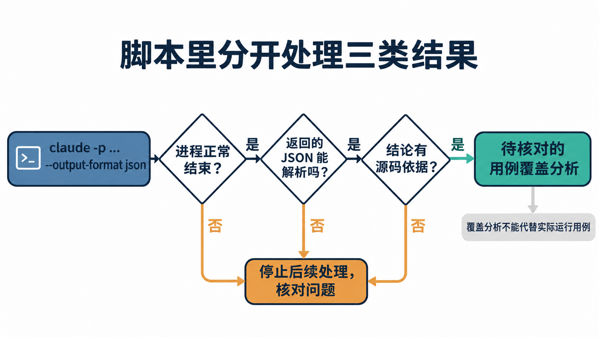

看完这张图，你要能：按进程、结构、结论三层检查非交互运行的结果，任何一层不通过就停下。

交互式任务跑通后，可以再试一个非交互入口。Claude Code 支持 `-p` 输出一次运行结果，`--output-format json` 返回带元数据的结果。需要符合特定 Schema 的业务字段时，还要用对应的结构化输出选项。

先在已准备好的文档检索练习目录中做一次只读比较：

```shell
claude -p "只阅读 TASK.md 与 cases.py，列出契约已声明但 case 可能未覆盖的行为，注明依据；不修改文件，不执行程序。" --tools "Read,Grep,Glob" --disallowedTools "mcp__*" --output-format json
```

几个参数的含义：

- `--tools` 限定内置工具。
- `--disallowedTools` 排除 MCP 工具。
- `--allowedTools` 表示预授权，不能拿它替代工具范围限制。

运行前用当前版本的 `claude --help` 查看选项，并确认练习环境已有的 Hook 等启动配置。它仍会调用模型并产生用量。该命令属于 Claude Code，不是 MyBuddy 启动参数。

接入脚本后，至少分开处理三类结果：

1. 进程是否正常结束。
2. 返回结构是否可解析。
3. 分析结论是否有源码依据。

用一份已知覆盖充分和一份有明确遗漏的样本比较，更容易发现提示或解析上的问题。

无人值守时，还要预先规定缺少输入或授权时怎样结束。不能回答的澄清与未解决的权限请求，应成为可识别的未完成结果。先把人工流程缩成目标清楚、输入固定、可验证的一项工作，再考虑批量运行。

容易误会的地方：

- 这些参数限制模型工具，不构成操作系统沙箱。
- 输出是还要检查的覆盖分析，不能替代 case 的执行。
- JSON 外壳合法，不保证判断正确。退出码成功，也不证明课程作业通过。
- 非交互模式不是自动批准模式。MyBuddy 的 `--prompt` 也一样：需要审批的操作没人批准就不执行；本轮出现审批、提问时，Goal 不做评估，保留并提示“等待交互输入”，不会被当成完成。

### 交付与一次小维护

**交付后请另一个人在新目录按说明运行一次，再用一个小需求检验能否继续修改。**

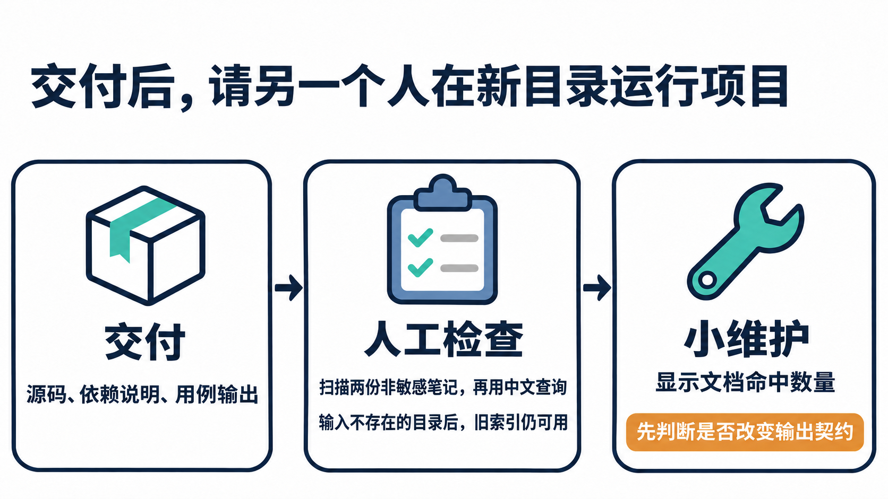

看完这张图，你要能：记住交付清单、两项人工检查和一次小维护的顺序。

交付源码、依赖说明、启动示例、case 输出和简短设计说明。说明 Python 环境、工作目录、索引格式以及已知限制。不提交账号凭据或个人笔记。

人工检查只需两项：

- 用自己的两份非敏感笔记，完成扫描和中文查询。
- 故意输入不存在的目录，确认错误信息可理解，旧索引仍可使用。

自动 case 检查已声明的逻辑，人工操作检查说明和体验是否可用。

最后提出一个小维护需求，例如“显示文档命中数量”。先判断它是否改变输出契约，再修订相应要求与 case，完成修改与回归。基础 case 当前不覆盖这个新增需求。

## 五、把使用技巧串起来，并迁移到其他 Harness

**换产品时保留任务方法，重新核对它的操作入口。**

最后选一次有明确范围的维护任务，把规划、读取、检查、交接与委派按需组合。

### 把六个使用技巧串成一次可核对的练习

**按任务需要选步骤，每一步都对应前面某一课的一个技巧。**

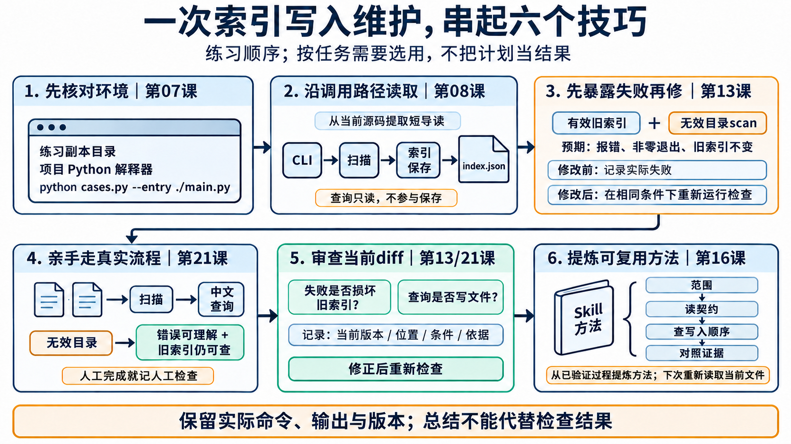

看完这张图，你要能：按顺序说出小维护里的六步，以及每步来自哪一课。

完成文档检索程序的第一版后，可以安排一次小维护，把前面各课的方法连起来。下面是课程练习顺序。简单文字修改不要求全部执行。

| 时机 | 给 Harness 的任务 | 你要核对的结果 |
| --- | --- | --- |
| 开始维护前 | 在实际执行环境确认目录、Python 入口和检查命令 | 读写的是练习副本，运行的是项目解释器，见第 7 课“跨环境时，让它先核对工具，再改写命令”小节 |
| 准备改索引写入时 | 沿 CLI、扫描、索引保存路径生成短导读，直接提取代码片段 | 调用关系和状态变化可回到源码核对，见第 8 课“不确定要读哪些文件时，先让 Agent 找，再让它解释”小节 |
| 遇到明确业务缺陷时 | 先运行能暴露问题的用例，确认原因后再修复 | 修改前因目标问题失败，修改后同一条件通过，见第 13 课“修复之前，先证明检查能够暴露问题”小节 |
| 自动 case 通过后 | 按使用说明扫描两份笔记，再执行中文查询和无效目录操作 | 命令、错误信息及旧索引保留情况符合要求 |
| 准备接受改动时 | 审查这次 diff，重点检查失败是否破坏旧索引、查询是否产生写入 | 每项发现有文件位置、触发条件和依据；修正后重新检查 |
| 同类任务再次出现时 | 从已经验证的过程提炼一份小 Skill | 保留方法，重新取得当前事实，见第 16 课“从重复的一项工作开始写 Skill”小节 |

实际操作由人完成时，记录为人工检查。由 Agent 完成时，保留执行输出。

这次练习的审核点由你来选：

- 开始前，确认扫描与查询的边界。
- 第一条真实流程跑通后，看结果。
- 接受改动前，对照差异和检查证据。

中途改了要求，同步更新任务说明与预期；收尾按第 21 课整理有效说明，不必每个阶段都写完整报告。

#### 用 Codex 迁移同一套方法

**同一份 TASK.md 和 case，换到 Codex 时重新核对它的配置和入口。**

也可以在另一份独立作业目录中使用 Codex，保留相同的 TASK.md、case 和验收范围。先确认当前客户端的工作目录与工具能力，再按该产品支持的方式配置项目约定和审查范围。使用 `AGENTS.md`、`/review`、Skill 与会话管理功能时，分别确认当前客户端的支持范围。

如果把同一任务接入脚本，`codex exec` 非交互运行默认使用只读沙箱。需要修改练习副本时，显式指定 `--sandbox workspace-write`，例如 `codex exec --sandbox workspace-write "按 TASK.md 实现并运行现有 case"`。

例如，完成第一版后，先选本次提交或未提交改动作为审查范围，再要求“检查扫描失败是否保留旧索引，附触发条件和依据”。比较两次练习时，保留实际改动、检查结果、人工介入与用量。

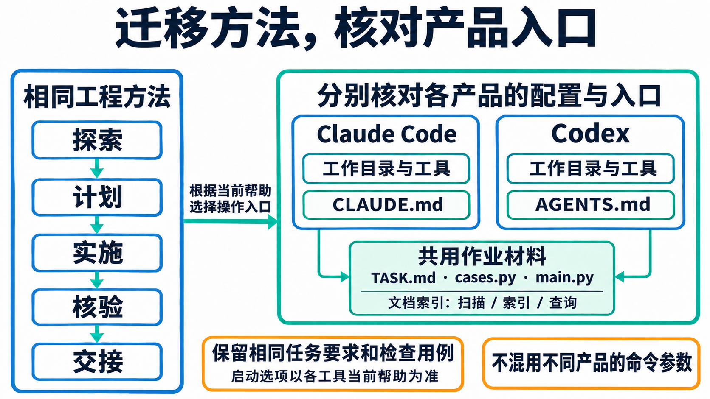

看完这张图，你要能：把探索、计划、实施、检查和交接这套方法，搬到你正在用的工具的实际入口上。

容易误会的地方：

- Claude Code 的带参数命令或配置文件，不能直接复制成 Codex 配置。
- 单次作业只能说明这次任务的表现。

## 使用小妙招

以下技巧围绕本课的文档检索项目展开。命令以当前安装版本的帮助为准；文中的提示词是课程示例，文件位置应替换成自己项目中的实际路径。

### 需求模糊时，先让 Claude 问清会改变实现的问题

在 Plan Mode 中，可以这样开始：

先阅读 TASK.md 和 cases.py。把已经明确的行为列出来，再用 AskUserQuestion 向我确认真正影响实现的未知项。优先问输入输出、数据保留和验收方式；已有材料能回答的问题请直接给出依据。

判断方法同第 5 课：材料能查清的先调查，会改变实现的再追问。看计划时留意它有没有加你没要求的功能。

**为什么这样做：** 先在 Plan Mode 中确认需求，可以在修改项目源码前发现理解偏差。规划过程可以写方案文件；需求越早说清，后面需要返工的代码越少。

### 文件已经定位时用引用，尚未定位时先给线索

已知需要完整阅读的小文件，可以输入：

```latex
阅读 @TASK.md，列出扫描失败时必须保留的状态，再定位实现这些要求的代码。
```

Claude Code 的 `@文件` 会把文件内容加入会话；引用目录主要提供文件列表。因此，面对一个很长的实现文件，可以先说明待查函数或行为，让它搜索后读取相关范围。

例如：“查找写入 index.json 的位置，沿调用关系确认在哪一步替换旧文件；缺少调用方时再补读。”检查结果是否包含真实路径、符号和相关分支，再决定扩大阅读范围。这里使用的是第 8 课的渐进取证方法，材料量要足以支持当前判断。

**为什么这样做：** 文件引用会增加当前上下文的内容。小文件可以整份提供；长文件应按任务需要读取。后续压缩可能把文件内容整理成摘要或只保留路径，所以需要准确原文时仍要补读。

### 查代码关系时，利用结构和符号线索

可以这样提问：“定位索引写入函数及其调用者，解释文件内容何时替换旧索引；先不修改。”有语言服务器时，用定义和引用查询区分同名命中；只有文本搜索时，拿到位置后读当前代码（第 3、8 课）。MyBuddy 的 CodeOutline 只看单文件结构，不是 LSP。

**为什么这样做：** 文本搜索会把同名的变量、注释、字符串都搜出来；定义和引用查询只返回真正相关的位置，模型少读很多无关代码，也不容易把同名的东西认错。

### 跨天继续任务时，先找回会话，再核对工作区

在有明确目标的会话里，用 `/rename doc-search-index` 取一个便于辨认的名字。退出后，在相应项目目录运行 `claude --continue` 继续最近的会话；需要挑选其他会话时用 `claude --resume`。

恢复以后，可以先说：

对照当前文件和上次记录，说明索引写入已经完成什么、哪些检查有实际结果、还有哪些工作。若文件在会话外发生变化，先看差异，再继续。

**为什么这样做：** 会话历史和当前磁盘可能不同（第 11 课）。离开的这段时间里文件可能被改过，先检查一遍，Agent 才不会按过时的记录继续做。会话名称只帮助查找，不限制读写目录。

### 方向偏离时，先停止，再选择纠正或回退

如果 Claude 正在给文档检索项目增加未要求的网页服务，可以按 `Esc` 停止当前工作，再说明：“当前只完成命令行扫描和查询，请先列出已改文件及与目标无关的改动。”先看实际状态，再决定保留什么。

然后用 `/rewind` 选择恢复对话、代码或两者。只被 Bash 或外部程序改过的文件不在检查点里，要用 Git 自己恢复。MyBuddy 的 `/rewind` 范围不同，见第 11 课。回退后查看 diff，重跑受影响的检查。

**为什么这样做：** 方向错了还让它继续，错的改动会越积越多。先停下看清改了什么，才知道哪些值得保留、该退回到哪一步；回退的范围又不覆盖所有改动，所以最后要用 diff 确认文件真的回去了。

### 审批频繁时，先弄清楚是哪项操作反复需要批准

用 `/permissions` 查看规则，先弄清反复要批的是哪条命令。只对已经理解的本地检查设范围明确的规则，设完观察一次，确认没有连带放宽别的命令（第 6、7 课）。

**为什么这样做：** 反复审批容易让人忽略内容。只放行已经理解的命令。Claude Code 的 Bash 规则不带星号时匹配完整命令，带星号时按模式匹配；星号也能覆盖空格，所以设置后要验证实际放行范围。

### 大量调查可以委派，主会话保留决定下一步所需的结论

可以在 Claude Code 中提出一个有边界的子任务：

使用子 Agent，只调查扫描失败保留旧索引的实现。读取相关代码和 case，返回写入顺序、关键文件与函数、已有检查和未确定项。不要修改文件，也不要把全部日志复制回来。

拿到报告后，先看关键源码再定方案。项目只有几十行时，主会话直接读更简单（第 19 课）。

**为什么这样做：** 子 Agent 读的大量代码和日志留在它自己的上下文里，主会话只收到一份报告，可以留出空间做后面的决定。

### 并行修改之前，用 Worktree 分开工作目录

先在练习目录建立 Git 仓库并提交当前实现。Claude Code 默认用 fresh 从远端默认分支创建工作树；没有可用远端时会回退到本地 HEAD。为了明确使用当前本地提交，可以在 .claude/settings.json 中设置：

```json
{ "worktree": { "baseRef": "head" } }
```

这样新 Worktree 从当前本地 `HEAD` 创建。然后在仓库目录的两个终端分别启动：

```shell
claude --worktree scan-boundary
```

```shell
claude --worktree query-boundary
```

每个会话先用 `git log -1` 确认起点；未提交的实现不会出现在新目录。合并后再跑完整 case，其余见第 20 课。

**为什么这样做：** 两个会话在同一个目录里同时改文件，会互相覆盖，测试结果也分不清是谁的改动造成的。各用一个 Worktree 互不干扰；但起点不对，后面做的事都建立在错误的版本上，所以先确认起点。

### 把成熟审查步骤写成 Skill，用 Hook 处理明确事件

完成过一次索引审查后，可以在项目的 `.claude/skills/review-search-change/SKILL.md` 中整理下面的方法草案：

```markdown
---
name: review-search-change
description: 审查本地文档检索项目的改动，核对索引写入和查询契约。
---
1. 确认本次审查的提交或 diff 范围，读取 TASK.md。
2. 核对扫描失败是否保留旧索引、查询是否只读、输出是否符合契约。
3. 补读与发现有关的调用方；将缺少证据的判断列为待确认。
4. 返回问题位置、触发条件、依据和覆盖范围。本次只审查，不修改。
```

Claude Code 的 Skill 还能先执行命令。正文里写 `` !`git diff HEAD` ``，交给模型前会先运行它，再用输出替换这一行（[官方说明](https://code.claude.com/docs/en/skills#inject-dynamic-context)）。注意：

- 只有 `!` 在行首或空格后面才会执行；替换只做一遍，命令输出按普通文本放进去。
- 输出会进入这次请求，输出里有秘密也会一起发给模型。输出太长时，只放文件路径和一小段预览。
- disableSkillShellExecution 会禁止用户、项目、插件和额外目录来源 Skill 中的这类命令，并用占位文字替换；内置和受组织管理的 Skill 不受该设置影响。claude.ai 同步来的 Skill 在本地终端或 VS Code 会话中也不会执行这些命令。
- 这是 Claude Code 的功能，不是 Skill 标准的通用能力。MyBuddy 的 Skill 正文不会预先执行命令（第 16 课），要靠 Agent 调工具读取 diff。

使用时确认它是否加载、是否读到正确 diff；“只审查”仍要靠实际工具权限。MyBuddy 要通过 `load_skill` 取得正文，不能照搬 `.claude` 目录。

需要固定事件后自动检查时，先手工跑通，再接 Hook。MyBuddy 在可信启动配置里选择事件：例如 `[[hooks.pre_tool_use]]` 做执行前检查，`[[hooks.post_tool_use]]` 做成功后反馈；也支持会话、轮次与压缩事件，没有 `/hooks` 命令（第 16、18 课）。

**为什么这样做：** Skill 适合固定“怎么做”，由模型判断什么时候用；Hook 由程序在固定时机运行，不靠模型记得。先用一次真实任务把审查步骤跑通再写成 Skill，写进去的才是确实需要的步骤；先手工跑通检查再接 Hook，出错时才分得清是检查本身的问题，还是触发时机的问题。

### 给失败一个可以重复的入口

把问题缩成输入、命令、预期与实际四项，让 Claude 先复现再修改（第 13 课）：

先在临时练习目录准备有效旧索引，再用不存在的输入目录调用 scan。按 TASK.md，应该非零退出且保留旧索引。运行并记录结果；如果确实违反这一要求，再定位修改，保留原有断言并重跑检查。

**为什么这样做：** 能重复的入口，修改前后用同一个输入一比，就知道是不是真的修好了。不先复现就改，改完测试通过，也说不清是修好了，还是那个问题本来就没被测到。

## 自测：这一课的概念分清了吗

**先自己作答，再看后面的答案。** 每题都能在本课正文里找到依据；带“动手验证”的题，可以照着做一遍，亲眼看到结果。

**1.** 实现文档检索时，你发现换一组输出字段更方便，但任务契约已经规定了字段。当前需求没有变化，应该怎样做？

- A. 改输出字段，同时改用例的预期，让两者保持一致。
- B. 保持契约规定的输出字段，在内部实现上选择合适的做法。
- C. 改输出字段，只要在交付说明中写清差异即可。

**2.** 判断：你分别调用扫描、索引和查询函数，查询能从内存里的临时数据找到关键词，即使没有读取保存的索引，也足以证明最小可用版本已经走通。（对 / 错）

**3.** 你在新会话里看到旧摘要写着“全部通过”，但扫描规则后来改过。接受当前结果前，应该怎样处理？

- A. 保留旧摘要里的通过结论，等出现新的失败再检查。
- B. 再压缩一次摘要，把通过结论保留下来，就可以沿用。
- C. 核对当前文件，重新运行受影响的用例，再判断结果。

**4.** 你把一次覆盖分析接入脚本。进程正常结束，返回的 JSON 也能解析。现在能得出什么结论？

- A. 进程和格式检查已通过，分析结论仍要核对源码依据。
- B. 分析结论已经可信，只是还不能说明作业通过。
- C. 分析结论可信，也足以说明作业通过，不必再执行用例。

### 答案与依据

**1. 选 B。** 契约固定程序对外的行为，内部实现可以自由安排。为了实现方便而改用例预期，会让检查偏离原来的要求。  
依据：本课“先固定用户可观察的行为”。

**2. 错。** 最小可用版本要检验文档进入索引、索引保存后被查询读取的完整路径。只用内存里的临时数据，漏掉了保存与读取的连接。  
依据：本课“先讨论边界，再做最小可用版本”。

**3. 选 C。** 旧结果对应当时的版本，扫描规则变化后要重新检查受影响的部分。压缩只能节省输入空间，不能让过期结果重新有效。  
依据：本课“上下文怎样跟着阶段变化”。

**4. 选 A。** 进程、格式和分析结论要分开检查。JSON 能解析不保证判断正确，覆盖分析也不能替代用例执行。  
依据：本课“把一次范围明确的检查接入脚本”。

## Q&A：常见追问

### Q1：怎样检验在一个项目中形成的 Agent 开发方法能否迁移到新项目？

选一个规模适中的新业务，检验自己能否重新理清需求、上下文、工具和证据之间的关系。项目不宜太大，让时间主要花在方法迁移上，再按新项目的要求检查结果。

### Q2：case 全部通过，就可以声明任意目录都能正确处理吗？

不能。固定用例只能说明明确检查过的输入和约定得到满足，不能推广到任意目录。以本课的文档检索 CLI 为例，超大文件、特殊文件系统、复杂 Unicode 文件名和并发写入都可能带来额外问题。交付时说明哪些情况已验证、哪些不支持；新增要求后再补相应实现和检查。

### Q3：把开发方法迁移到另一个 Coding Agent 时，是否需要复刻原来的内部实现？

不需要。要迁移的是怎样把输入给清楚、限制行动、管理上下文和核对结果。以从 MyBuddy 换到 Claude Code 为例，两者的内部状态、权限模式与扩展接口可以不同。

### Q4：新增网页 UI 或向量检索时，怎样控制 Agent 的任务范围？

先把新增功能当成一项有明确边界的任务，说明输入、用户能看到的行为和验收条件，再估计依赖、费用与维护成本。例如只要求给已有的检索结果加网页展示，就不要顺带改成向量检索系统。保留当前可运行版本和检查结果，完成最小的新功能并验证后，再决定下一步扩展。

### Q5：指定 JSON 输出后，脚本可以直接相信里面的结论吗？

不能。普通 JSON 输出可能只把自然语言结果包在字段中；需要业务字段符合约定时，要另定义结构化输出 Schema。即使结构符合 Schema，也仍须核对路径、来源、覆盖范围和业务判断。自动化先验证格式，再验证事实，最后决定是否采纳。

### Q6：每个任务都要先写完整计划，再开新会话实现吗？

规划深度取决于还有多少不确定性。涉及多个模块、业务口径不清楚或不熟悉现有代码时，先调查并确定范围；只有一处明确的小改动时，可以直接执行并检查。

是否换会话再看材料：当前讨论仍能支持实现，可以继续；若探索留下大量已淘汰方案，就先保存已确认需求、接口、未决项和检查方法，再交给新会话确认。新会话应重新读取当前代码，旧计划不能代替实际状态。

### Q7：恢复旧会话后，Claude 会自动知道其他人改了哪些文件吗？

不能仅凭恢复历史就这样判断。明确要求它检查当前文件及差异，再核对旧计划和验证结果是否仍适用。前一次会话中的成功输出证明当时的检查，不自动证明当前代码通过。

### Q8：按 Esc 或使用 rewind，能撤销刚才的一切操作吗？

不能。Esc 停止当前工作，已经发生的文件修改或外部操作不会自动撤销。Claude Code 的 rewind 只能恢复检查点覆盖的内容，也就是它的文件编辑工具改过的文件；只被 Bash 或外部程序改过的文件不在检查点里，要用 Git 自己恢复。数据库写入等外部副作用也要另查。应先检查差异和实际状态，再选择检查点、Git 或业务补救方式，不能把回退对话当成撤销一切。

### Q9：有了 Skill 和 Hook，还需要每次检查结果吗？

需要。Skill 可能缺少当前任务材料，Hook 可能没有匹配到事件或命令执行失败。检查本次是否实际运行、针对哪个版本、取得什么结果；修改方法、脚本或项目接口后，重新验证适用性。自动触发减少重复操作，但完成判断仍然需要证据。

## 本课术语速查

| 本课说法 | 命令或文件中的名字 | 含义 |
| --- | --- | --- |
| 任务契约 | `TASK.md` | 固定程序对外行为的说明：输入、索引字段、查询规则、退出码 |
| 用例 | `cases.py` | 按任务契约检查程序的固定测试，逐项显示 PASS／FAIL |
| 最小可用版本 | — | 先打通“读一份文档—生成索引—查到关键词”这一条完整路径 |
| 项目说明 | `CLAUDE.md` / `AGENTS.md` | 项目的简短约定。Claude Code 使用 `CLAUDE.md`；若约定写在 `AGENTS.md`，可在 `CLAUDE.md` 中用 `@AGENTS.md` 导入 |
| 规划模式 | `--permission-mode plan` | 先调查、出计划，计划批准前不改源码；调查用的命令仍按当前权限设置处理，不是系统级只读沙箱 |
| 非交互运行 | `claude -p`、`--output-format json` | 在脚本里运行一次 Claude Code 并取得结果 |
| 工作树 | `claude --worktree` | 为并行任务创建独立的工作目录（第 20 课） |
| 回退 | `/rewind` | 回到之前的对话或代码检查点；不撤销外部副作用 |
