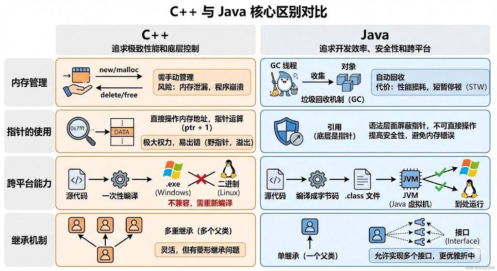

两者虽然语法长得很像（Java 本身就是基于 C++ 改造的），但设计哲学的核心完全不同：**C++ 追求的是极致的性能和对底层的完全控制；而 Java 追求的是开发效率、安全性和跨平台能力。**

具体来说，它们的区别主要体现在这 **4 个核心维度**：

1. **内存****管理**
- **C++：** 你必须自己管理内存。申请了内存（`new`/`malloc`），用完必须自己释放（`delete`/`free`）。
    - **代价：** 如果忘了释放，就是**内存泄漏**；如果释放错了，程序直接崩溃。这也是 C++ 程序员最头疼的地方。
- **Java：** 有**垃圾回收****机制（****GC****）**。你只管创建对象，用完扔在一边就行，后台会有个“清洁工”（GC 线程）自动帮你回收。
    - **代价：** 牺牲了一点性能，而且 GC 工作时可能会导致程序短暂停顿（STW）。
1. **指针的使用**
- **C++：** 指针是它的灵魂。你可以直接操作内存地址，做指针运算（比如 `ptr + 1`）。这赋予了你极大的权力，也能让你轻易写出把系统搞挂的代码（野指针、缓冲区溢出）。
- **Java：** 虽然底层全是引用（其实就是指针），但它在语法层面**屏蔽了指针**。你不能直接操作内存地址。这大大提高了安全性，避免了 90% 的内存错误。
1. **跨平台能力**
- **C++：** 是一次性编译成**机器码**（二进制文件）。在 Windows 上编出来的 `.exe`，扔到 Linux 上是跑不起来的，必须重新编译。
- **Java：** 是编译成**字节码**（`.class` 文件）。然后由 **JVM（Java 虚拟机）** 去翻译执行。只要机器上装了 JVM，这代码在哪都能跑。所谓的“一次编写，到处运行”。
1. **继承机制**
- **C++：** 支持**多重继承**。一个类可以同时有多个父类。这很灵活，但会带来著名的“菱形继承”问题，逻辑非常复杂。
- **Java：** 它是**单继承**的。一个类只能有一个“亲爹”。但为了弥补灵活性的不足，Java 引入了 **接口**，允许实现多个接口。这是一种更优雅的折中方案。

---

### 面试标准回答

Java 和 C++ 都是面向对象的语言，但它们的设计理念有本质区别：C++ 偏向于底层控制和性能，Java 偏向于开发效率和安全性。

**主要区别体现在以下四点：**

第一，内存管理机制不同（核心）：

Java 拥有自动垃圾回收机制（GC），程序员不需要手动释放内存，极大地减少了内存泄漏和悬空指针的问题。

而 C++ 需要程序员手动管理内存（new/delete），虽然控制力更强，但开发难度大，容易出错。

第二，对指针的支持不同：

C++ 支持指针，并且允许指针算术运算，这使得它可以直接操作硬件和内存，适合底层开发。

Java 为了安全性，屏蔽了指针的概念（只有引用），不允许直接操作内存地址，从源头上杜绝了非法内存访问。

第三，跨平台实现不同：

C++ 编译生成的是特定操作系统的机器码，跨平台需要重新编译。

Java 编译生成的是字节码，运行在 JVM 上，实现了‘一次编写，到处运行’（Write Once, Run Anywhere）。

第四，多重继承的支持：

C++ 支持类的多重继承，但容易引发菱形继承问题。

Java 摒弃了类的多重继承，只支持单继承，但通过**接口（Interface）**的多实现来达到类似的效果，既保持了灵活性又避免了复杂性。

### 购买了课程的同学，本八股动画视频持续更新！

### 后续视频更新也会在群里分享，一定要先进群！
