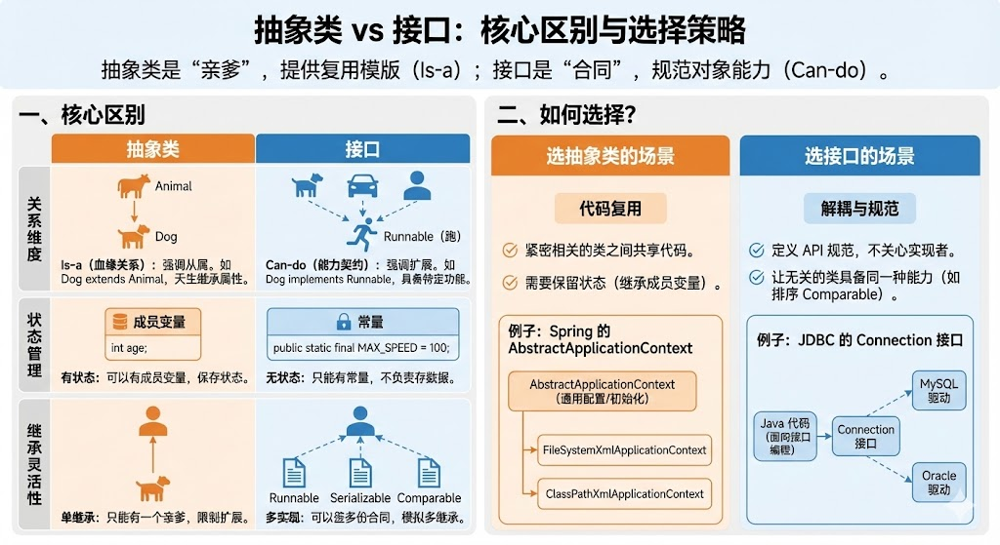

**抽象类是“亲爹”，给子类提供复用的模版（Is-a）；接口是“合同”，规范对象能干什么（Can-do）。**

我们可以从**设计理念**、**语法细节**和**使用策略**三个维度来拆解：

### 一、 核心区别

1. **关系维度的不同：**
    1. **抽象类（Is-a）：** 强调的是“血缘关系”**。比如** `**Dog**` **extends** `**Animal**`**。狗是动物，它天生就继承了动物的属性（有生命、会呼吸）。这是一种**从属关系。
    2. **接口（Can-do）：** 强调的是“能力契约”**。比如** `**Dog**` **implements** `**Runnable**`**。狗会跑，车也会跑，人也会跑。它们之间没有血缘关系，只是都具备“跑”这个功能。这是一种**扩展关系。
2. **状态管理的对立：**
    1. **抽象类：** 可以有**成员变量**（非常量）。这意味着它可以**保存状态**（State）。比如 `Animal` 类里可以存 `age`（年龄）。
    2. **接口：** 只能有 `public static final` 常量。这意味着它是**无状态**的。它只定义行为规范，不负责存数据。
3. **继承的灵活性：**
    1. **抽象类：** Java 是**单继承**的。一个类只能有一个亲爹。这限制了扩展性。
    2. **接口：** 可以**多实现**。一个类可以同时签多份合同（既是 `Runnable`，又是 `Serializable`）。这是 Java 模拟多继承的主要手段。

### 二、 如何选择？

1. **选抽象类的场景（代码复用）：**
    1. 如果你需要**在多个紧密相关的类之间共享代码**。
    2. 如果你需要**保留状态**（也就是有成员变量需要让子类继承）。
    3. **例子：** Spring 的 `AbstractApplicationContext`。因为所有的 Context 都需要保存一些通用的配置信息，且有很多通用的初始化逻辑，写在抽象类里最合适。
2. **选接口的场景（解耦与规范）：**
    1. 如果你想**定义一套 API 规范**，且不关心是谁实现的。
    2. 如果你想让**毫无关系的类具备同一种能力**（比如排序 `Comparable`）。
    3. **例子：** JDBC 的 `Connection` 接口。MySQL 去实现它，Oracle 也去实现它。Java 代码只需要面向接口编程，换数据库时不需要改代码。

---

### 面试标准回答

接口和抽象类都是 Java 实现多态的方式，但它们的设计初衷和应用场景有本质区别：

**第一，设计层面的区别（核心）**：

- **抽象类**是对**类（事物）的抽象**，强调的是 **'Is-a'** 的关系，用于代码复用和构建严格的类层级体系。
- **接口**是对**行为的抽象**，强调的是 **'Can-do'** 的关系，用于定义规范和解耦。

**第二，语法特性的区别**：

- **状态**：抽象类可以有成员变量，能保存对象状态；接口只能有常量，是无状态的。
- **继承限制**：Java 类只能继承**一个**抽象类（单继承），但可以实现**多个**接口。这使得接口在扩展性上远强于抽象类。
- **构造器**：抽象类有构造器（供子类初始化用），接口没有。

**第三，选型策略**：

- 如果我的类族有明显的层级关系，且需要**复用通用的成员变量或非 public 方法**，我会优先选择**抽象类**（比如模版方法模式）。
- 如果我需要让不同的类具备相同的功能，或者需要**定义对外的 API 契约**，我会优先选择**接口**（比如插件机制、回调函数），因为这能最大程度地解耦。
