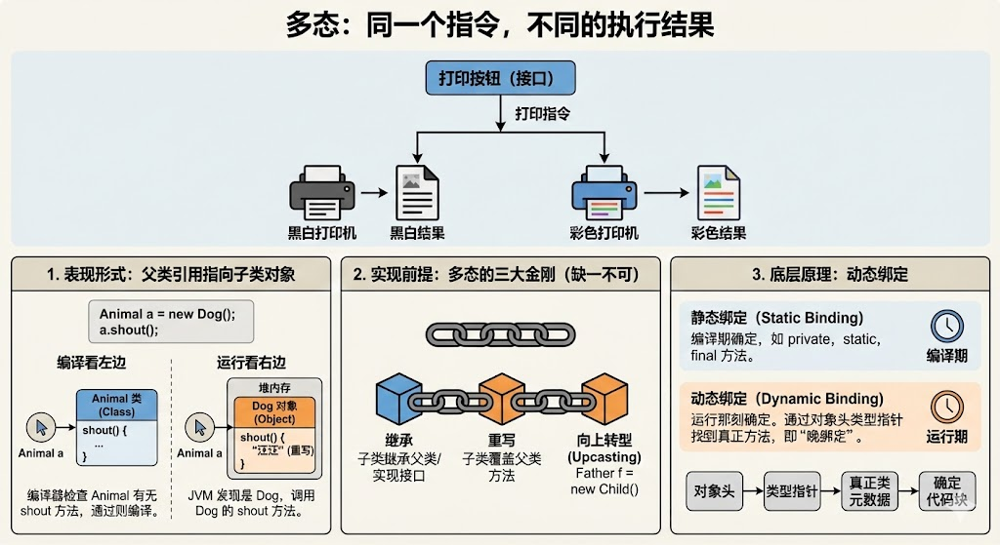

**多态就是“同一个指令，不同的执行结果”。**

比如我按下一个“打印”按钮（接口），如果连的是黑白打印机，它就打印黑白的；如果连的是彩色打印机，它就打印彩色的。我不需要专门设计两个按钮。



具体可以从以下 **3 个维度** 来深度理解：

1. **表现形式：父类的引用指向子类的对象**

这是多态最直接的代码体现：

```
Animal a = new Dog(); // 父类引用 a，指向堆内存里的 Dog 对象
a.shout();            // 执行的是 Dog 的叫声，而不是 Animal 的叫声
```

- **编译看左边：** 编译器只知道 `a` 是个 `Animal`，它会检查 `Animal` 类里有没有 `shout` 方法。如果没有，编译报错。
- **运行看右边：** 真正运行的时候，JVM 发现堆内存里坐着的其实是个 `Dog`，所以它会去调用 `Dog` 重写过的 `shout` 方法。
1. **实现前提：多态的三大金刚**

要想实现多态，缺一不可：

- **继承：** 子类得继承父类（或者实现接口）。
- **重写：** 子类得覆盖父类的方法（不然调用的还是父类的旧逻辑，那就不叫多态了）。
- **向上转型：** 也就是上面写的 `Father f = new Child()`。
1. **底层原理：动态绑定**

这是面试的高分点。

- Java 的方法调用分为**静态绑定**和**动态绑定**。
- 像 `private`、`static`、`final` 方法，在编译期间就知道该调谁了，这叫静态绑定。
- 而普通的对象方法，JVM 只有在**运行那一刻**，通过对象头里的类型指针，找到真正的类元数据，才能确定到底执行哪个代码块。这就是“晚绑定”，也是多态生效的底层机制。

*注意（坑点）：***成员变量是没有多态的**。`a.age` 取的一定是父类 Animal 的 `age`，只有方法才有多态。

---

### 面试标准回答

多态是 Java 面向对象最核心的特性，它允许我们用**统一的接口**来操作**不同的底层实现**。

从语法层面讲：

多态的表现形式是**‘父类的引用指向子类的对象’（如 List list = new ArrayList()）。

它的实现必须满足三个条件：继承、方法重写、以及向上转型**。

从底层原理讲：

多态是基于 Java 的动态绑定（Dynamic Binding）机制实现的。

虽然在编译阶段，编译器只知道引用的类型是父类（静态类型）；但在运行阶段，JVM 会根据堆内存中对象的实际类型（运行时类型）来决定调用哪个方法。这使得我们可以在不修改现有代码的情况下，通过增加子类来扩展系统行为。

从设计意义讲：

多态的核心价值在于解耦。

比如在设计模式中（如策略模式、工厂模式），我们只需要面向父类或接口编程。后续如果需要新增一种业务逻辑，只需要添加一个新的子类即可，调用方的代码完全不需要改动，极大地提高了代码的扩展性和可维护性。
