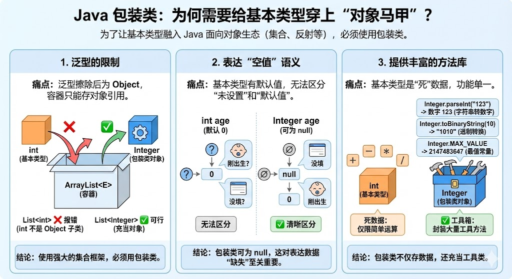

Java 设计包装类，是为了**让基本数据类型也能拥有“对象”的待遇，从而融入 Java 的面向对象生态。**

Java 虽然号称是“纯面向对象”语言，但为了性能保留了 8 种基本类型（如 `int`, `boolean`）。这些基本类型不是对象，没有继承 Object，也没有方法。这在很多高级场景下（比如集合、反射）是行不通的。包装类就是给基本类型穿了一层“对象的马甲”。

具体来说，必须使用包装类主要有以下 **3 个硬性理由**：

1. **泛型****的限制**
    1. **痛点：** Java 的泛型底层是基于**类型擦除**的，编译后都会变成 `Object`。
    2. **现实：**`ArrayList`、`HashMap` 这些容器，只能存对象引用，不能存基本类型。
        - 你写 `List<int>` 是会报错的，因为 `int` 不是 `Object` 的子类。
        - 你必须写 `List<Integer>`，让 `Integer` 充当这个对象。
    3. **结论：** 只要你想用 Java 强大的集合框架，就必须用包装类。
2. **表达“****空值****”语义**
    1. **痛点：** 基本类型有默认值。`int` 默认是 0，`boolean` 默认是 false。
    2. **场景：** 在业务开发中（特别是数据库交互），“用户没填年龄”和“用户年龄是 0 岁”是完全两码事。
        - 如果是 `int age`，默认是 0，你区分不了他是刚出生还是没填。
        - 如果是 `Integer age`，没填就是 `null`，填了 0 就是 0。
    3. **结论：** 包装类可以为 `null`，这对于表达数据的“缺失”状态至关重要。
3. **提供丰富的方法库**
    1. **痛点：** 基本类型是“死”的数据，除了加减乘除啥也干不了。
    2. **解决：** 包装类里封装了大量的工具方法。
        - 字符串转数字：`Integer.parseInt("123")`
        - 进制转换：`Integer.toBinaryString(10)`
        - 最值常量：`Integer.MAX_VALUE`
    3. **结论：** 包装类不仅仅是存储数据，还充当了该类型的**工具类**。

---

### 面试标准回答

Java 引入包装类主要有三个原因，其中最根本的原因是为了配合 Java 的**面向对象**特性：

第一，为了支持泛型和集合框架（核心）：

Java 的泛型机制要求类型参数必须是引用类型（Object）。基本数据类型不继承自 Object，因此无法直接放入 ArrayList 或 HashMap 中。包装类作为对象，解决了这个问题（比如 List&lt;Integer>）。

第二，为了表达‘Null’语义（业务痛点）：

在数据库实体映射或接口传参时，我们需要区分‘数值为 0’和‘数据不存在’这两种情况。基本类型 int 无法表达 null，而包装类 Integer 可以为 null，这能更准确地描述业务状态。

第三，为了提供工具方法：

基本类型只是纯数据，而包装类提供了如 parseInt、valueOf 类型转换、进制转换等丰富的静态方法，方便开发。

**（补充）**：虽然包装类好用，但因为它是对象，涉及堆内存分配，所以在高性能计算或大量数值运算场景下，我们依然会优先选择基本类型以节省开销。
