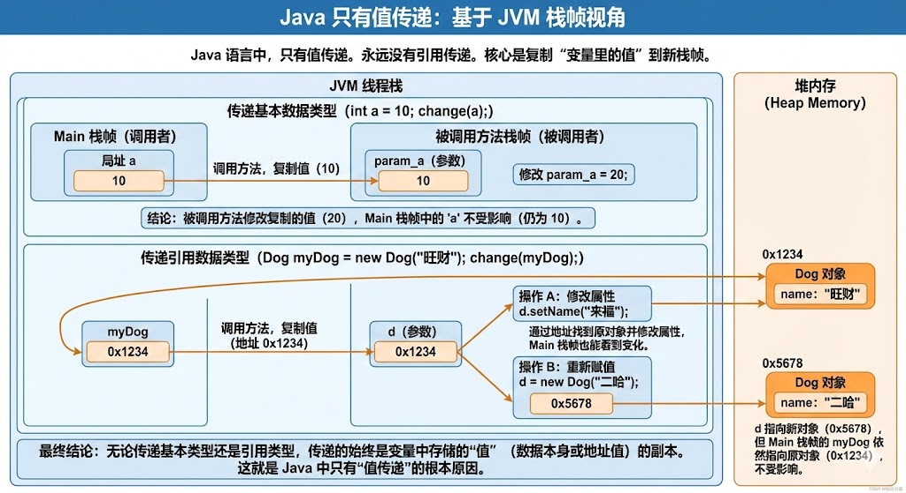

**Java 语言中，只有值传递。永远没有引用传递。**

不管你传的是基本类型（int, float）还是对象，在底层实现上，它永远是把“变量里的那个值”，**复制**一份，塞给新方法的栈帧。

为了彻底讲清楚，我们必须深入到 JVM 的**栈帧**内存结构来看。

### 一、 什么是“值传递”的本质？

在 JVM 内存模型中，每当一个方法被调用，就会在当前线程的虚拟机栈里弹出一个新的**栈帧**。栈帧里有一个**局部变量表**，用来存方法的参数和局部变量。

所谓“值传递”，就是把调用者栈帧里那个变量的**内容**，完整拷贝一份，填到被调用者栈帧的局部变量表中。

我们分两种情况来看这一过程：

#### 传递基本数据类型

    - **场景：**`int a = 10; change(a);`
    - **栈帧视角：**
        - `main` 方法的栈帧里，变量 `a` 的内存格子里存的是二进制的 `10`。
        - 调用 `change` 方法时，JVM 拿到了 `10` 这个值，把它**复制**了一份，塞进了 `change` 方法栈帧的参数变量里。
        - **结果：**`change` 方法里怎么改那个复制出来的 `10`，都跟 `main` 方法里原本的 `10` 半毛钱关系没有。这很好理解。

#### 传递引用数据类型

    - **场景：**`Dog myDog = new Dog("旺财"); change(myDog);`
    - **栈帧视角（关键）：**
        - **变量存的是什么？**`myDog` 是一个引用变量。它在栈帧的格子里，存的**不是**那个狗对象本身，而是那个狗对象在堆内存里的**地址**（比如 `0x1234`）。
        - **传递的是什么？** 调用 `change` 方法时，JVM 依然是遵循“值传递”——它把 `main` 栈帧里的这个 `0x1234`（地址值），**复制**了一份，塞进了 `change` 方法栈帧的参数变量 `d` 里。
        - **现在的情况是：** 两个栈帧，两个不同的变量，但它们格子里存的**值**是一样的，都是 `0x1234`。

**这里有两个很容易混淆的操作：**

    - **操作 A（修改属性）：**`d.setName("来福");`
        - 这是通过 `0x1234` 这个地址，找到了堆里的那只狗，把它的名字改了。
        - 因为 `main` 方法里的 `myDog` 也是指向 `0x1234`，所以回去一看，狗名字确实变了。
        - **这让人误以为是引用传递。**
    - **操作 B（重新赋值）：**`d = new Dog("二哈");`
        - 这是在 `change` 方法的栈帧里，把变量 `d` 的格子里的值，从 `0x1234` 改成了 `0x5678`（新狗的地址）。
        - **关键点：** 这个操作完全没有影响到 `main` 方法栈帧里的 `myDog` 变量。`myDog` 依然死死抱着 `0x1234` 不放。
        - **这证明了：如果是引用传递，那么** `**myDog**` **应该也会变成“二哈”，但实际上没有。所以它是值传递。**

---

### 面试标准回答

Java 语言是严格的**值传递**，不存在引用传递。

**我们可以从 JVM 的栈帧结构来证明这一点：**

1. 对于基本数据类型：
2. 传递的是实际数值的副本。在调用方法时，JVM 会将调用者栈帧中变量的数值（如 10），复制一份拷贝到被调用方法的栈帧中。因此，修改副本不会影响原变量。
3. 对于引用数据类型（对象）：
4. 传递的是对象的内存地址（即引用值）的副本。
    1. 假设我们在主方法有一个对象引用 `p` 指向地址 `0x11`。当把它传给子方法时，JVM 只是把 `0x11` 这个**地址值**复制了一份给子方法的参数。

**所以，无论是改数值还是改地址，本质上都是在操作‘值的副本’，这就是值传递。**
