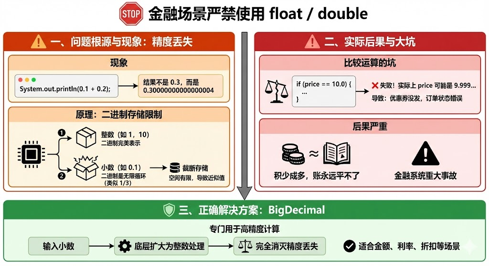

**绝对不可以。在任何跟钱有关的场景（金额、利率、折扣），严禁使用** `**float**` **或** `**double**`**。**

原因和解决方案可以拆解为以下三点：

1. **精度丢失（0.1 + 0.2 != 0.3）**
    1. **现象：** 你打开 IDE 跑一下 `System.out.println(0.1 + 0.2);`，你会惊讶地发现结果不是 `0.3`，而是 `0.30000000000000004`。
    2. **原理：** 计算机底层是用**二进制**存数的。
        - 对于整数（比如 1, 2, 10），二进制可以完美表示。
        - 但对于小数（比如 0.1），它在二进制里是一个**无限循环小数**（就像十进制里的 1/3 是 0.3333... 一样）。
        - 因为 `float`（32位）和 `double`（64位）的空间是有限的，它只能截断存储。这一截断，**近似值**就出现了。
    3. **后果：** 你的账永远平不了。积少成多，最后财务报表会差几分钱，这在金融系统里是重大事故。
2. **比较运算的坑**
    1. 由于精度问题，你不能直接用 `==` 去比较两个浮点数。
    2. 比如 `if (price == 10.0)`，可能 `price` 实际上是 `9.99999999`，导致判断失败，优惠券没发出去，或者订单状态没更新。
3. **正确做法：BigDecimal**

它是专门用来做高精度计算的类。它在底层是把小数扩大成整数来处理的，完全消灭了精度丢失。

---

### 面试标准回答

在 Java 中，**绝对不能**使用 `float` 或 `double` 来表示金额。

根本原因在于：

浮点数采用的是 IEEE 754 标准，也就是科学计数法。在计算机二进制系统中，很多十进制的小数（如 0.1）是无法精确表示的，只能存储为一个近似值。

这会导致常见的精度丢失问题，比如 0.1 + 0.2 的结果并不等于 0.3。虽然单个数值误差很小，但在大量的金融计算和累加中，误差会被放大，导致账务不平。

**在生产环境中，我们通常使用BigDecimal方案**：

这是处理货币的标准方式。它提供了精确的数值计算能力。但在使用 BigDecimal 时，必须使用 String 参数的构造函数（如 new BigDecimal("0.1")），或者使用 BigDecimal.valueOf(0.1)。千万不要直接用 double 构造（如 new BigDecimal(0.1)），否则存进去的依然是那个不精确的近似值，问题依然存在。
