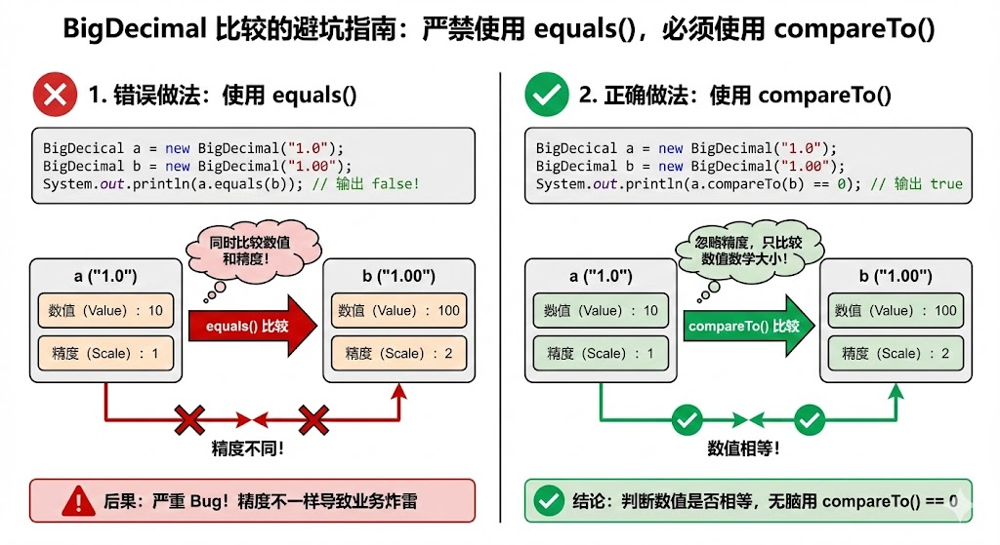

**严禁使用** `**equals()**` **做金额或数值的数学比较。必须使用** `**compareTo()**`**。**

如果你在代码里写 `if (price.equals(targetPrice))`，一旦前端传过来的精度不一样（比如一个传 "100"，一个传 "100.00"），你的比较逻辑就会直接炸雷，导致严重的业务 Bug。



具体的原因和避坑指南，从以下三个维度来拆解：

1. **1.0 不等于 1.00**

```
BigDecimal a = new BigDecimal("1.0");
BigDecimal b = new BigDecimal("1.00");
System.out.println(a.equals(b)); // 输出 false！
```

- **原因：**`equals` 方法不仅比较**数值（value）**，还会比较**精度（scale）**。
    - `a` 的精度是 1，`b` 的精度是 2。
    - 在 `equals` 眼里，它们是两个完全不同的对象，所以返回 `false`。
1. **正确姿势：**`**compareTo()**`
- **原理：**`compareTo` 方法会忽略精度的差异，只比较数值的数学大小。

```
System.out.println(a.compareTo(b) == 0); // 输出 true
```

- **结论：** 只要是想判断“数值是否相等”，无脑用 `compareTo() == 0`。

---

### 面试标准回答

在处理 `BigDecimal` 时，不可以使用 `equals` 方法进行等值比较。

核心原因在于：

BigDecimal 的 equals 方法不仅比较数值，还会严格比较精度。

举个例子，new BigDecimal("1.0") 和 new BigDecimal("1.00")，在数学上是相等的，但因为 Scale 不同（一个是 1，一个是 2），equals 会返回 false。这在实际业务中（比如金额校验）会导致严重的逻辑错误。

正确的做法是：

使用 compareTo() 方法。

compareTo 会忽略精度差异，只进行数值上的比较。只要返回值为 0，就代表两个数在数学上是相等的。
