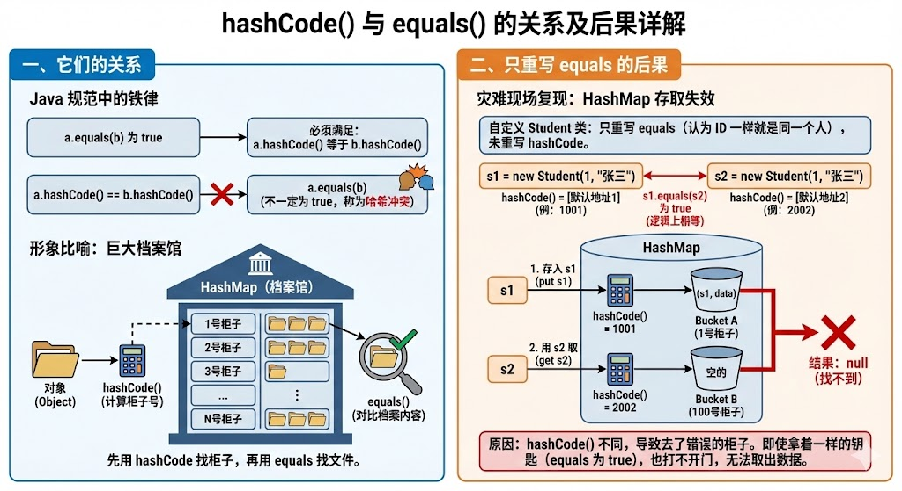

`**hashCode()**` **决定了对象在哈希表中的桶位置，**`**equals()**` **决定了对象是否和其他对象重复。只重写** `**equals**` **不重写** `**hashCode**`**，会导致基于哈希的集合（HashMap, HashSet）完全失效，出现“明明放进去了，却怎么也取不出来”的现象。**

具体的逻辑关系和后果，可以从底层原理来拆解：

### 一、 它们的关系

在 Java 的规范中，两者的关系是铁律：

1. **如果** `**a.equals(b)**` **为 true**，那么 `a.hashCode()`**必须** 等于 `b.hashCode()`。
2. **如果** `**a.hashCode() == b.hashCode()**`，`a.equals(b)`**不一定** 为 true（这种情况叫哈希冲突/碰撞）。

你可以把 `HashMap` 想象成一个巨大的**档案馆**：

- `**hashCode()**` **是柜子号：** 算出这个对象应该放在第几号柜子里。
- `**equals()**` **是档案内容：** 打开柜子后，逐个对比里面的文件夹，确认哪个是你真正要找的。

### 二、 只重写 equals 的后果

如果你自定义了一个 `Student` 类，认为 ID 一样就是同一个人（重写了 `equals`），但忘了重写 `hashCode`。

**场景复现：**

1. 你 `new Student(1, "张三")`，叫它 **s1**。
2. 你又 `new Student(1, "张三")`，叫它 **s2**。
3. 逻辑上 `s1.equals(s2)` 是 true。

**此时发生的灾难：**

- **HashMap 存取失效：**
    - 你把 `s1` 存进 `HashMap`。Map 算了一下 `s1` 的默认哈希值（基于内存地址），把它放进了 **1 号柜子**。
    - 你想用 `s2` 去取数据。Map 算了一下 `s2` 的默认哈希值（新的内存地址），结果指向了 **100 号柜子**。
    - **结果：** Map 去 100 号柜子一看，空的。于是告诉你 `null`（找不到）。明明你手里拿着一样的钥匙，却因为柜子号算错了，打不开门。

---

### 面试标准回答

hashCode() 和 equals() 是配合工作的一对方法，主要用于哈希表的高效运作。它们的约定关系是：

如果两个对象通过 equals() 判断相等，那么它们的 hashCode() 必须相同。

**如果只重写** `**equals**` **而不重写** `**hashCode**`**，会打破这个约定，**导致 HashMap/HashSet 丢失数据：

Object 类默认的 hashCode 是基于内存地址计算的。

即使两个对象在逻辑上是相等的（equals 为 true），如果它们是 new 出来的不同实例，它们的默认 hash 值就会不同。

当我们在 HashMap 中使用这种对象作为 Key 时，存入时计算的是一个位置（Bucket），而读取时计算的是另一个位置。这会导致明明 key 存在，却返回 null，甚至导致同一个逻辑 Key 存入多份数据，引发内存泄漏。
