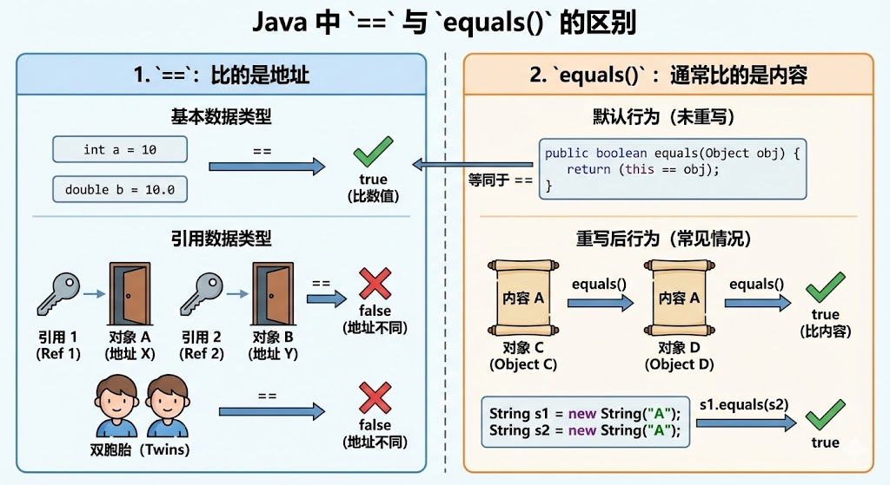

`**==**` **是在比“是不是同一个对象”（比地址），而** `**equals()**` **是在比内容。**

当然，前提是 `equals()` 被重写了。如果没有重写，它俩就是一回事。

具体来说，我们可以从这两个维度彻底把它们拆开：

**1.** `**==**`

- **对于基本数据类型（int, long 等）：** 它比的是**数值**。只要值一样（比如 `10 == 10.0`），结果就是 `true`。
- **对于引用数据类型（对象）：** 它比的是**内存地址**。
    - 它非常严格。只有当两个引用指向堆内存中**同一个物理对象**时，它才返回 `true`。
    - 就好比两把钥匙，必须开的是**同一扇门**，`==` 才认账。如果你有两个长得一模一样的双胞胎（内容一样），但在 `==` 眼里，他们是两个独立的人（地址不同），所以返回 `false`。

**2.** `**equals()**`

- 它是 `Object` 类的方法。**默认行为（不重写时）：** 在 `Object` 的源码里，`equals()` 直接就调用了 `==`。也就是说，如果你自己写个类 `Student`，没重写 `equals`，那你调 `s1.equals(s2)`，效果跟 `s1 == s2` 一模一样，还是比地址。
- **重写后的行为（常见情况）：** 像 `String`、`Integer` 这些官方类，或者我们业务中的类，通常都会**重写**它。
    - 重写后的逻辑变成了：**不比地址了，比内容**。
    - 比如 `String` 的 `equals` 逻辑是：只要两个字符串的字符序列完全一样，我就认为是相等的，不管它们是不是同一个对象。

---

### 面试标准回答

`==` 和 `equals()` 的主要区别在于比较的维度不同：

**第一，**`**==**` **是一个运算符**：

- 如果比较的是**基本数据类型**，它比较的是**数值**是否相等。
- 如果比较的是**引用数据类型**，它比较的是**内存地址**。也就是说，只有当两个引用指向堆内存中的同一个对象实例时，结果才为 true。

**第二，**`**equals()**` **是 Object 类定义的一个方法**：

- 它的默认实现（在 Object 类中）本质上就是 `==`，也就是比较内存地址。
- 但是，Java 中的许多类（如 `String`、`Integer`）都**重写**了这个方法，将其逻辑改为了**比较对象的内容**（即逻辑上的相等）。

举个经典例子：

String a = new String("hello");

String b = new String("hello");

- `a == b` 会返回 **false**，因为它们是堆内存里两个不同的对象。
- `a.equals(b)` 会返回 **true**，因为 String 重写了 equals，比较的是字符内容。
