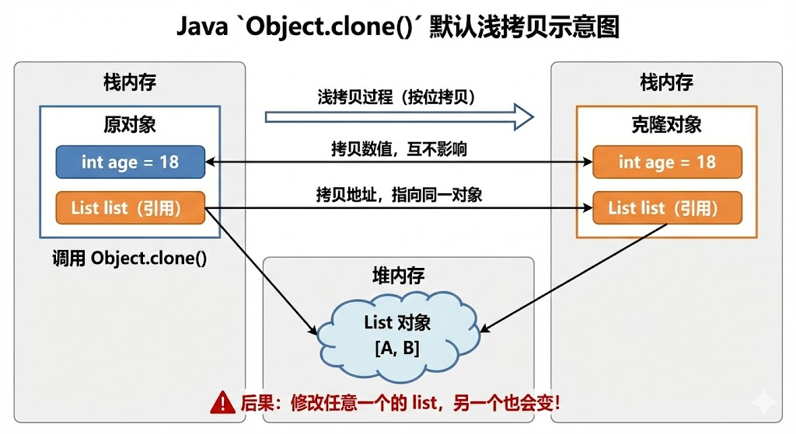
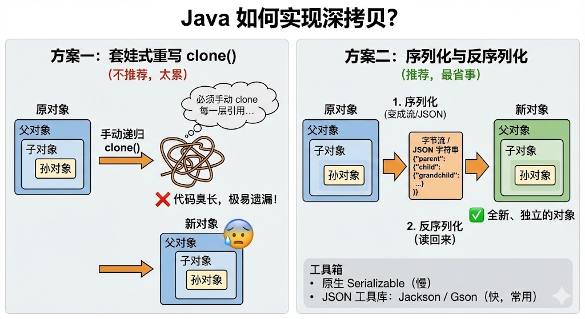

`**Object.clone()**` **默认是浅拷贝的。它只负责在内存中开辟一块新空间，然后把原对象里的所有字段的值（包括引用的地址值）原封不动地复制过去，它不关心这些引用指向的对象是不是也需要拷贝一份。**

具体的技术细节和解决方案如下：

1. **为什么是浅拷贝？**
- **JVM 的默认行为：**`Object.clone()` 是一个 `native` 方法。当你调用它时，JVM 做的事情非常简单粗暴：
    - 创建一个新对象。
    - 将原对象在内存里的所有字段，进行一次“按位拷贝”。
- **对于基本数据类型（int, long）：** 拷贝的是数值本身，所以互不影响。
- **对于引用数据类型（String, List, Object）：** 拷贝的是**内存地址**。
    - 结果就是：新对象和老对象里的 `list` 字段，指向的是堆内存里的**同一个 List**。
    - **后果：** 你往新对象的 List 里加一个元素，老对象的 List 里也会莫名其妙多出一个元素。这就是浅拷贝的坑。
1. **如何实现深拷贝？**

- **方案一：套娃式重写 clone()（不推荐，太累）**
    - 你得在 `clone()` 方法里，手动把你所有的引用类型的字段也都 `clone()` 一遍。
    - 如果引用对象里还有引用对象，你就得一层层递归下去。代码写起来又臭又长，极易遗漏。
- **方案二：序列化与反序列化（推荐，最省事）**
    - **原理：** 把对象变成二进制流（或者 JSON 字符串），然后再读回来。
    - **过程：** 对象 -> 字节流/JSON -> 新对象。
    - 因为在变成“流”的过程中，引用的关联关系被打破重组了，还原回来的就是一个全新的、独立的深拷贝对象。
    - **工具：** 可以用 Java 原生的 `Serializable`（慢），也可以用 JSON 工具库如 **Jackson** 或 **Gson**（快，生产环境常用）。

---

### 面试标准回答

`Object.clone()` 默认是**浅拷贝**，这是由 JVM 的底层实现决定的。

所谓浅拷贝，就是‘只拷第一层’：

它在拷贝对象时，对于基本数据类型，是直接复制值；但对于引用数据类型，它复制的仅仅是内存地址（引用），而不是对象本身。

这就导致新旧两个对象依然共享同一个内部成员对象，修改其中一个，另一个也会受影响。

**在实际开发中，我们通常有以下两种方式来实现深拷贝：**

1. 序列化（推荐方案）：
    1. 这是最简单有效的方法。我们可以将对象序列化为字节流（Java Serialization）或 JSON 字符串（Jackson/Gson），然后再反序列化回来。这样生成的对象就是完全独立的深拷贝对象。
2. 递归重写 clone()（笨办法）：
    1. 实现 Cloneable 接口，在 clone() 方法内部，手动去调用所有引用成员变量的 clone() 方法。如果对象层级很深，这种代码很难维护，所以现在很少用了。
