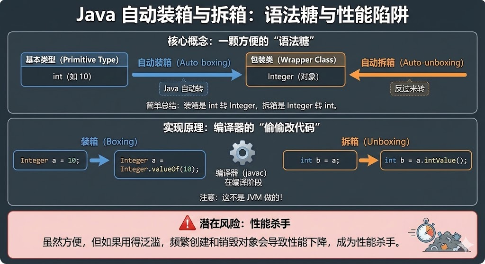
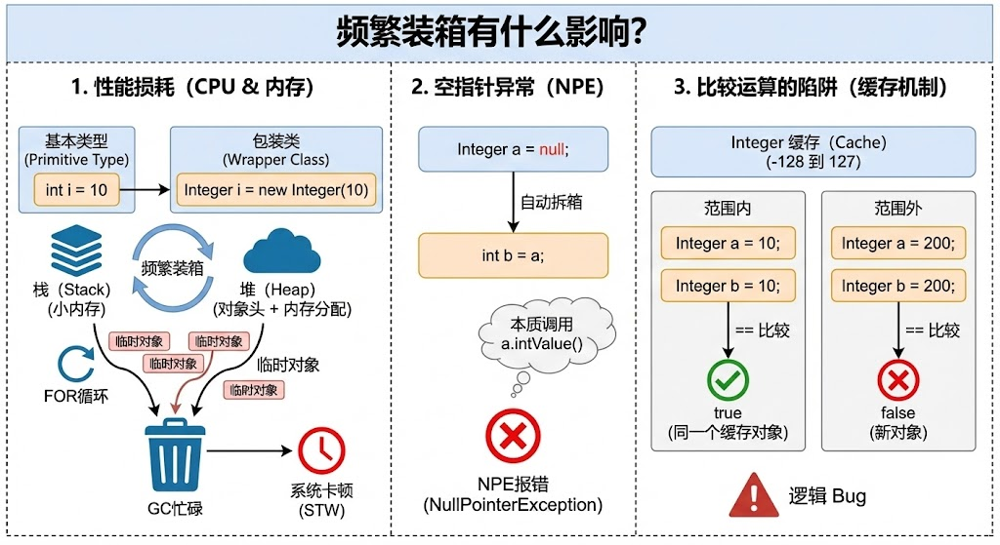

自动装箱和拆箱是 Java 编译器为了方便我们写代码而提供的一颗“语法糖”。

简单一句话总结：**自动装箱就是 Java 自动把基本类型（****int****）转成包装类（Integer）；拆箱就是反过来，把包装类转成基本类型。**

这看似方便，但如果用得泛滥，就是性能杀手。

具体的技术细节和潜在风险如下：

1. **它是怎么实现的？**

这也是面试常考的原理。这玩意儿不是 JVM 做的，而是编译器（javac）在编译阶段帮我们偷偷改了代码。

- **装箱（Boxing）：** 当你写 `Integer a = 10;` 时，编译器会把它变成 `Integer a = Integer.valueOf(10);`。
- **拆箱（****Unboxing****）：** 当你写 `int b = a;` 时，编译器会把它变成 `int b = a.intValue();`。
1. **频繁装箱有什么影响？**

虽然写起来爽，但在高频场景下（比如循环里），它有三个大坑：

- **性能损耗（CPU & 内存）：**
    - 基本类型是纯数据，占内存极小；包装类是**对象**，不仅有对象头开销，还要在堆上分配内存。
    - 如果你在 `for` 循环里疯狂装箱，会瞬间创建成千上万个临时对象。这会让 **GC（垃圾回收器）** 忙得不可开交，导致系统卡顿（STW）。
- **空指针异常（NPE）：**
    - 拆箱是调用 `xxxValue()` 方法。如果你的包装类对象是 `null`，自动拆箱时就会报 `NullPointerException`。这是新手最容易犯的错。
- **比较运算的陷阱（缓存机制）：**
    - `Integer` 有一个缓存机制（默认 -128 到 127）。
    - 在这个范围内，装箱返回的是同一个缓存对象，用 `==` 比较是 `true`。
    - **超过**这个范围，装箱会 `new` 一个新对象，用 `==` 比较就是 `false`。这会导致莫名其妙的逻辑 Bug。

---

### 面试标准回答

自动装箱与拆箱是 Java 5 引入的语法糖，目的是为了简化基本数据类型和对象之间的转换。

**其核心原理是编译器在编译阶段自动插入了转换代码：**

- **装箱**：将基本类型转换为包装类，底层调用的是 `valueOf()` 方法（如 `Integer.valueOf(int)`）。
- **拆箱**：将包装类转换为基本类型，底层调用的是 `xxxValue()` 方法（如 `intValue()`）。

**但是，频繁使用装箱拆箱会有严重的副作用：**

第一，性能开销（GC 压力）：

包装类是对象，比基本类型占用更多的内存。如果在循环或高频计算中频繁装箱，会产生大量临时的无用对象，增加 GC（垃圾回收） 的压力，导致系统吞吐量下降。

第二，NullPointerException 风险：

自动拆箱本质是调用对象的方法。如果包装类对象为 null，直接赋值给基本类型时会抛出空指针异常。

第三，‘==’ 比较的坑：

由于 Integer 等包装类存在缓存机制（如 -128 到 127），在缓存范围内自动装箱的对象地址相同，范围外则不同。因此，对象比较必须用 equals，严禁依赖 ==。
