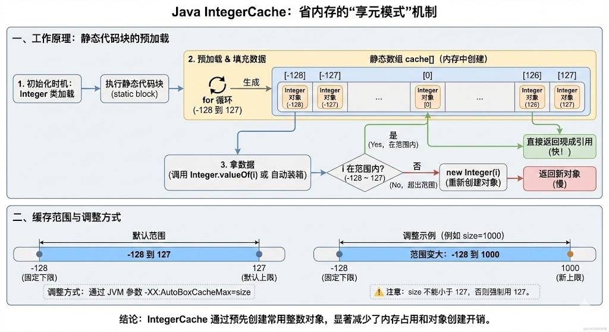
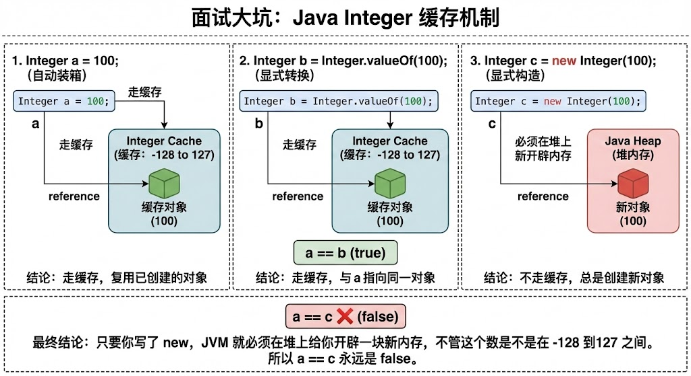

IntegerCache 是 Java 为了省内存、提效率搞出来的一个“偷懒”机制，本质上就是设计模式中的**享元模式**。

**Java 会在系统启动时，一次性把 -128 到 127 之间的所有整数都创建好，扔在一个静态数组里。当你后面要用这些数的时候，直接给你个现成的引用，而不是重新 new 一个对象。**

具体的工作细节和配置方式，可以从以下三个维度来拆解：

1. **工作原理：静态代码块的****预加载**

- **初始化时机：**`Integer` 类里有个静态内部类叫 `IntegerCache`。当 `Integer` 类第一次被加载时，里面的静态代码块（static block）就会执行。
- **干了什么：** 它会在内存里创建一个 `Integer` 类型的数组（叫 `cache[]`）。
- **填充数据：** 一个 `for` 循环，从 -128 开始，一直填到 127。把这 256 个对象一个个 new 出来放进数组里。
- **拿数据（关键）：** 当你调用 `Integer.valueOf(i)`（或者自动装箱）时：
    - 如果 `i` 在缓存范围内，直接返回数组里的那个对象引用 `cache[i + offset]`。
    - 如果 `i` 超出了范围，不好意思，老老实实 `new Integer(i)`。
1. **缓存范围与调整方式**
    1. **默认范围：****-128 到 127**。
        - 下限 **-128** 是写死在代码里的，**不能动**。
        - 上限 **127** 是默认值，但是**可以调**。
    2. **如何调整：**
        - 你可以通过 JVM 启动参数来把上限调大：`-XX:AutoBoxCacheMax=size`。
        - 比如设置 `-XX:AutoBoxCacheMax=1000`，那缓存范围就变成了 -128 到 1000。
        - *注意：你不能把它调得比 127 还小，JVM 会忽略你的设置，强制用 127。*
2. **面试大坑：new 出来的算不算？**

这是面试最爱考的陷阱。

    1. `Integer a = 100;` （自动装箱）：**走缓存**。
    2. `Integer b = Integer.valueOf(100);` （显式转换）：**走缓存**。
    3. `Integer c = new Integer(100);` （显式构造）：**不走缓存！**
        - 只要你写了 `new`，JVM 就必须在堆上给你开辟一块新内存，不管这个数是不是在 -128 到 127 之间。所以 `a == c` 永远是 `false`。

---

### 面试标准回答

Integer 的缓存机制是基于内部静态类 `IntegerCache` 实现的，本质是一种**享元模式**。

核心工作流程是：

在 Integer 类加载时，静态代码块会初始化一个 cache 数组，默认缓存了从 -128 到 127 之间的所有整数对象。

当我们需要将 int 转为 Integer（比如调用 valueOf() 或自动装箱）时，源码会先判断该数值是否在缓存区间内：

- 如果在区间内，直接返回数组中已存在的对象引用。
- 如果不在，才会创建一个新的 `Integer` 对象。

关于缓存范围：

下限 -128 是固定的，但上限默认是 127，可以通过 JVM 参数 -XX:AutoBoxCacheMax 进行调整（比如调大到 2000 以适应特定业务），这在某些高并发且数值密集的场景下能显著减少 GC 压力。
