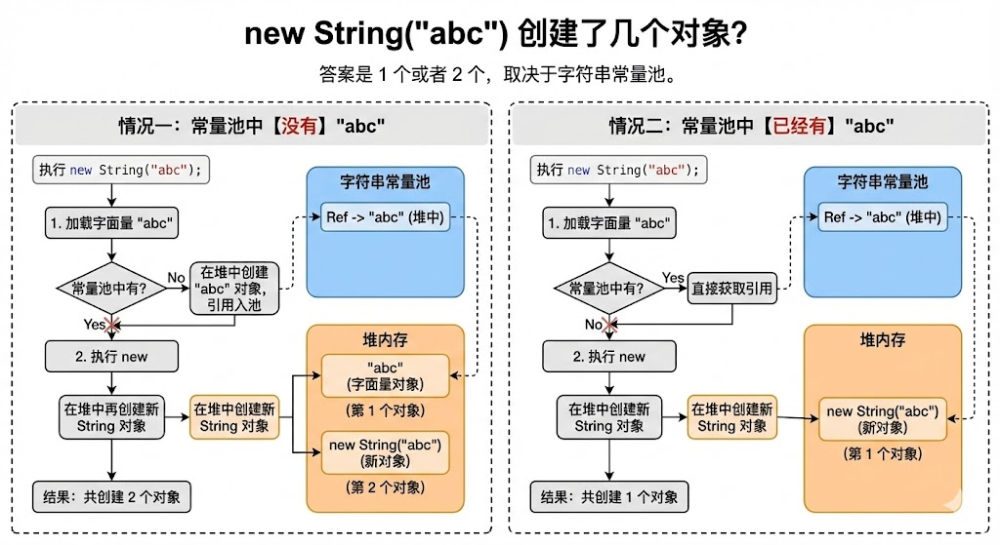

**答案是 1 个或者 2 个。**

具体取决于：**这行代码执行之前，字符串****常量池****里有没有 "abc" 这个东西。**

下面分两种情况拆解：

**情况一：常量池中【没有】"abc" —— 创建 2 个对象**

这是最原本的状态。执行 `new String("abc")` 时，JVM 会忙活两件事：

1. **加载****字面量****：** JVM 读到 `"abc"` 这个字面量，发现字符串常量池里空空如也。于是，它先在**堆内存**中创建一个 String 对象（代表 "abc"），并把它的引用维护到**字符串****常量池**中。（这是第 1 个对象）
2. **执行 new：** 接着执行 `new` 关键字。只要看到 `new`，JVM 就会在**堆内存**中再开辟一块新空间，创建一个**新**的 String 对象。这个新对象的内容，是从刚才常量池里的那个对象拷贝过来的。（这是第 2 个对象）

**结果：** 一个在池（引用）里，一个在堆（new 出来）里。一共 2 个。

**情况二：常量池中【已经有】"abc" —— 创建 1 个对象**

这通常发生在之前的代码里已经出现过 `"abc"`，或者被 `.intern()` 过。

1. **加载****字面量****：** JVM 读到 `"abc"`，去常量池一看：“哎，熟人，已经有了。” 于是它直接拿到了池中对象的引用，**不会**创建新的池对象。
2. **执行 new：** 还是老规矩，看到 `new` 必须创建新对象。JVM 在堆里创建一个新 String 对象。

**结果：** 只有 `new` 出来的这一个。一共 1 个。

---

### 面试标准回答

关于 `new String("abc")` 创建了几个对象，这需要根据**字符串常量池（String Pool）**当前的状态来分情况讨论，答案是 **1 个或者 2 个**。

第一种情况，如果常量池中原本没有 "abc"：

那么会创建 2 个对象。

第一个是因为代码中的字面量 "abc"，JVM 会先在堆中创建一个字符串对象，并将其引用放入常量池中。

第二个是因为 new 关键字，JVM 会在堆内存中再创建一个新的 String 对象，并将其初始化为常量池中那个字符串的内容。

第二种情况，如果常量池中已经存在 "abc"：

那么只会创建 1 个对象。

字面量 "abc" 会直接复用常量池中已有的引用，不会创建新对象。只有 new 关键字会在堆中显式地创建一个新的 String 对象。

**总结**：无论哪种情况，`new` 出来的这个对象都在堆内存中，且与常量池中的对象不是同一个地址。
