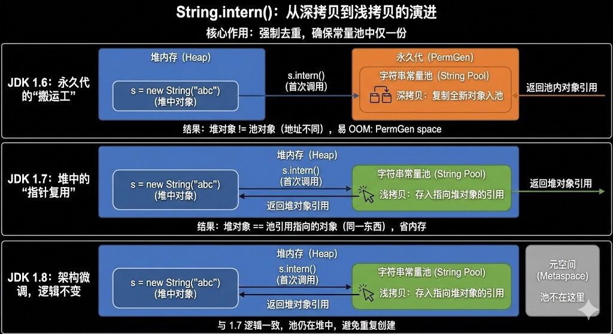

`**String.intern()**` **的核心作用是“强制去重”——确保字符串在常量池中只有一份。而在 JDK 1.7 之前和之后，最大的区别在于：是从“深拷贝”（拷贝对象）变成了“浅拷贝”（拷贝引用）。**

具体的技术演进和差异拆解如下：

1. **核心作用：手动入池**
- 当你调用 `s.intern()` 时，JVM 会拿着 `s` 这个字符串去字符串常量池里查一下：
    - 如果池子里**有**这个串，就直接返回池子里的那个引用。
    - 如果池子里**没有**这个串，就把它放进池子里，然后返回池子里的引用。
- **目的：** 极大地节省内存。如果有 100 万个 "abc" 字符串，用了 `intern()`，内存里就只存一份。
1. **JDK 1.6：永久代的“搬运工”**
    1. **位置：** 字符串常量池在 **PermGen（永久代）**。
    2. **实现逻辑（深拷贝）：**
        - 当调用 `intern()` 时，如果池里没有，JVM 会把堆里的字符串对复制一份全新的实例放入 PermGen。
        - **结果：** 堆里的对象和池里的对象是**两个完全不同的对象**，地址不一样。
    3. **弊端：** PermGen 空间很小且固定，疯狂 `intern()` 很容易导致 `OOM: PermGen space`。
2. **JDK 1.7：堆中的“指针复用”**
    1. **位置：** 字符串常量池移到了 **堆** 中。
    2. **实现逻辑（浅拷贝）：**
        - 为了省内存，JVM 变聪明了。当调用 `intern()` 时，如果池里没有，JVM **不再复制**整个对象了。
        - 它直接在池子里存一个**指向堆中那个对象的引用**。
        - **结果：** 堆里的对象和池里的引用，指向的是**同一个东西**。
    3. **优势：** 避免了对象的重复创建，大幅减少了内存占用。
3. **JDK 1.8：架构微调，逻辑不变**
    1. **位置：** 依然在 **Java 堆** 中。
    2. **变化：** 虽然 1.8 去掉了 PermGen，搞了个 元空间，但字符串常量池并没有去元空间，而是老老实实待在堆里。所以 `intern()` 的逻辑和 1.7 **完全一致**。

---

### 面试标准回答

`String.intern()` 是一个 Native 方法，它的核心作用是**保证字符串在常量池中的唯一性**。如果池中已存在该字符串，则返回池中引用；如果不存在，则将该字符串放入池中并返回。

**关于不同版本的实现差异，主要体现在存储位置和入池策略上：**

在 JDK 1.6 中：

字符串常量池位于**永久代**。

当调用 intern() 时，如果池中没有该字符串，JVM 会将堆内存中的字符串对象完全复制一份放入 **永久代**。

结论：intern() 返回的引用和堆中的原对象引用是不相等的（因为一个是副本，一个是原件）。

在 JDK 1.7 及 1.8 中：

字符串常量池移到了 Java 堆 中。

入池策略做了重大优化。当调用 intern() 时，如果池中没有该字符串，JVM 不再复制对象，而是直接在池中存储堆中该对象的引用。

结论：intern() 返回的引用和堆中的原对象引用是相等的（因为指向的是同一个对象）。

**总结**：从 1.7 开始，`intern()` 变成了‘浅拷贝’（只存引用），这极大地优化了内存使用，避免了 **永久代** OOM 的风险。
