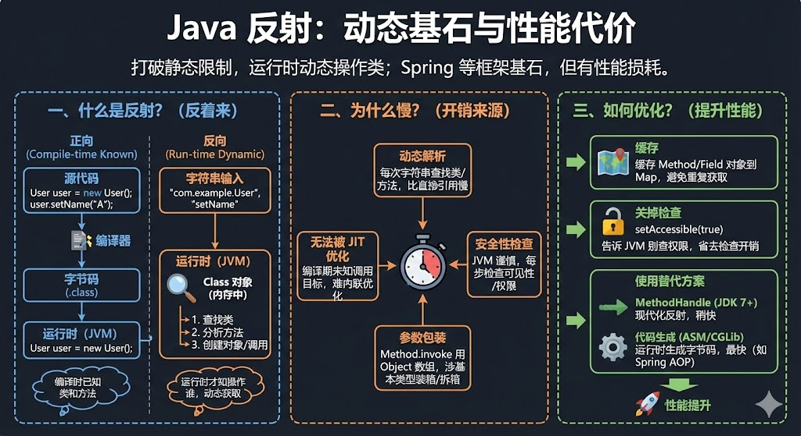

反射是 Java 被称为“动态语言”的关键，也是 Spring、MyBatis 等框架的基石。

**反射就是在运行时才知道要操作哪个类、哪个方法，并且可以动态地获取类的信息、创建对象和调用方法。**

它打破了 Java 的“静态”限制，但代价就是**性能损耗**。

具体可以从原理、开销来源和优化手段三个维度来拆解：

1. **什么是反射？（反着来）**
    1. **正向（正常代码）：** 编译时就知道 `new User()`，然后 `user.setName()`。
    2. **反向（反射）：** 编译时根本不知道有一个 `User` 类。只有代码跑起来了，根据传入的字符串 `"com.example.User"`，去内存里找到这个类的 `Class` 对象，然后反向分析出它有哪些方法，再调用。
2. **为什么慢？**

反射的慢，不是慢在执行那行代码，而是慢在“准备工作”和“安全检查”上：

    1. **动态解析：** 每次都要根据字符串名字去方法区里找类，这比直接引用指针慢得多。
    2. **安全性检查：** JVM 是很谨慎的。反射每一步（获取方法、调用方法）都要检查可见性（public/private）和权限。
    3. **参数包装：**`Method.invoke(Object obj, Object... args)` 的参数是 `Object` 数组。如果你传 `int`，必须自动装箱成 `Integer`，调用完再拆箱，这涉及到内存分配。
    4. **无法被 JIT 优化：** 编译器（JIT）很难对反射代码进行“内联”优化，因为它在编译期根本不知道你要调谁。
3. **如何优化？**
    1. **缓存：** 不要每次请求都去 `Class.forName()` 或 `getMethod()`。把获取到的 `Method` 和 `Field` 对象**缓存**到 Map 里，下次直接用。
    2. **关掉检查：** 使用 `setAccessible(true)`。这就好比告诉 JVM：“我知道我在干什么，别查我权限了。”这能省下很多安全检查的开销。
    3. **使用替代方案：**
        - **MethodHandle：** JDK 7 引入的“现代化反射”，比传统反射稍快。
        - **代码生成（最快）：** 使用 ASM、Javassist 或 CGLib，在运行时直接生成字节码。这虽然复杂，但性能几乎等同于原生代码（Spring 的 AOP 就是这么干的）。

---

### 面试标准回答

反射是 Java 提供的一种在**运行时**动态获取类信息、创建对象和调用方法的机制。它是各类主流框架（如 Spring）实现动态代理和依赖注入的核心。

**关于反射的性能开销，主要体现在三个方面：**

1. **类加载与动态解析**：需要动态查找类和方法，无法像静态代码那样直接链接。
2. **安全性检查**：JVM 在反射调用时会进行可见性检查（CheckAccess）。
3. **JIT 优化失效**：反射调用让 JIT 编译器难以进行**方法内联（Inlining）等激进优化，且参数往往需要频繁的装箱拆箱**。

**针对这些问题，通常有三种优化策略：**

1. **缓存**：这是最基础的优化。将获取到的 `Class`、`Method`、`Field` 对象缓存起来，避免重复的查找和解析。
2. **关闭检查**：调用 `setAccessible(true)` 可以关闭 JVM 的安全访问检查，能提升一定的性能。
3. **使用高性能替代方案**：在极致性能场景下，我们会使用 **MethodHandles**，或者直接使用 **ASM/CGLib** 进行字节码生成，绕过反射机制。”
