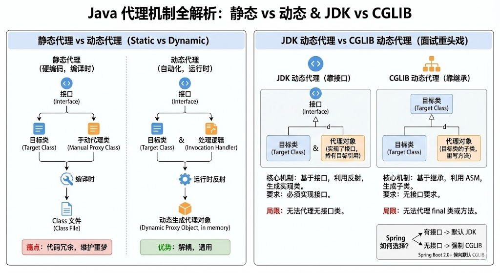

**静态代理是“硬编码”，写死在代码里，编译时就定好了；动态代理是“自动化”，在程序运行时利用反射机制动态生成，灵活性极高。**

而在动态代理的流派中，**JDK 代理靠“接口”，CGLIB 代理靠“继承”。**

具体的技术细节和选型区别，拆解如下：

### 静态代理 vs 动态代理

- **静态代理：**
    - **做法：** 程序员必须手动创建一个代理类，实现跟目标类一样的接口。
    - **痛点：****代码冗余，维护噩梦。**
        - 如果你有 100 个 Service 类需要加日志，你就得手写 100 个代理类。
        - 一旦接口改了一个方法名，所有代理类都要跟着改。
    - **编译时机：**`.class` 文件在编译期就生成了。
- **动态代理：**
    - **做法：** 程序员不需要写具体的代理类，只需要写一个“处理逻辑”。
    - **优势：****解耦，通用。**
        - 不管你有多少个类，只要想加日志，用这同一套逻辑动态生成代理对象即可。
    - **编译时机：** 代理类的字节码是在**运行时**在内存中动态生成的。

### JDK 动态代理 vs CGLIB 动态代理

这是面试的重头戏，两者的核心区别在于**实现机制**和**适用场景**：

| **维度** | **JDK 动态代理** | **CGLIB 动态代理** |
| --- | --- | --- |
| **核心机制** | 基于接口（Interface）。利用反射机制，生成一个实现代理接口的匿名类。 | 基于继承（Inheritance）。利用 ASM 字节码框架，生成目标类的一个子类。 |
| **被代理类要求** | 必须实现接口。如果一个类没接口，JDK 代理直接报错。 | 不需要接口。只要这个类不是 final 的就行。 |
| **底层依赖** | 只依赖 JDK 自身的 java.lang.reflect 包。 | 依赖第三方的 cglib 和 asm 包。 |
| **局限性** | 无法代理没有接口的类。 | 无法代理 final 类或 final 方法（因为没法继承重写）。 |
| **性能现状** | 在 JDK 1.6 之前性能较差，但 JDK 8 之后经过优化，性能已经非常强劲，甚至略优于 CGLIB。 | 生成代理对象较慢，但调用方法较快（因为它直接修改字节码，不走反射）。 |

### Spring 如何选择？

    - **默认规则：** 如果目标对象实现了接口，Spring 默认用 **JDK 动态代理**。
    - **替补规则：** 如果目标对象没有实现接口，Spring 强制切换为 **CGLIB**。
    - **强制配置：** 在 Spring Boot 2.0 之后，默认配置（`proxy-target-class=true`）倾向于直接使用 CGLIB，这是为了避免某些因接口类型转换导致的 `ClassCastException`。

---

### 面试标准回答

静态代理和动态代理的主要区别在于**字节码生成的时机**。静态代理是在编译期就生成了 `.class` 文件，维护成本高；而动态代理是在运行期利用反射机制动态生成，灵活性更高，是 Spring AOP 的核心。

**关于 JDK 动态代理和 CGLIB 的区别，主要体现在三点：**

**第一，实现原理不同**：

- **JDK 动态代理**是基于**接口**实现的。它利用 `Proxy` 类和 `InvocationHandler` 接口，在运行时生成一个实现了目标接口的匿名类。
- **CGLIB** 是基于**继承**实现的。它利用底层字节码技术（ASM），在运行时生成目标类的一个**子类**，并重写父类方法进行增强。

**第二，使用场景不同**：

- 如果被代理的类**实现了接口**，优先使用 JDK 代理（也是 Spring 的默认策略）。
- 如果被代理的类**没有实现接口**，必须使用 CGLIB。

**第三，局限性不同**：

- JDK 代理必须要接口，没接口用不了。
- CGLIB 代理是通过继承来实现的，所以**无法代理** `**final**` **修饰的类或方法**（因为不能被继承或重写）。
