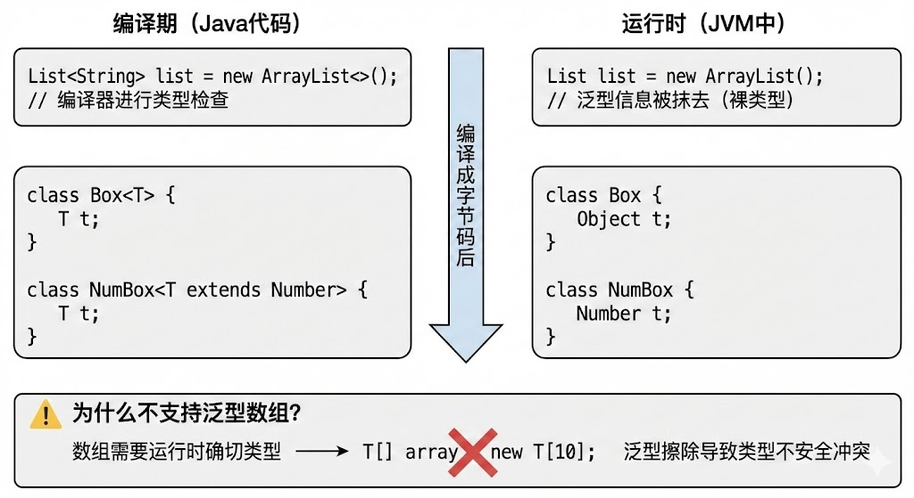

泛型擦除是 Java 泛型设计中最被人吐槽，但又不得不妥协的一个机制。

**Java 的泛型只存在于编译期，一旦代码编译成字节码进入 JVM，泛型信息就会被抹去。而 Java 不支持泛型数组，是因为数组必须在运行时知道自己的具体类型，这和“泛型擦除”机制不仅冲突，而且会导致类型不安全。**

具体可以从以下两个维度深度拆解：

1. **什么是泛型擦除？**
    1. **编译器的把戏：** 当你写 `List<String>` 时，编译器会帮你做类型检查，确保你只能往里放 String。
    2. **运行时的真相：** 一旦编译通过，编译器就会把尖括号 `<String>` 去掉，把它还原成裸类型（Raw Type），也就是 `List`。
        - 如果你没指定上限，`T` 就会被替换成 `Object`。
        - 如果你指定了 `extends Number`，`T` 就会被替换成 `Number`。
    3. **为什么要这么做？** 为了**向后兼容**。Java 5 才引入泛型，为了保证以前写的代码（比如 JDK 1.4 的老代码）在新的 JVM 上也能跑，Java 选择了这种“假泛型”的折中方案。
2. **为什么不支持泛型数组？**

这里有一个核心的冲突：数组是协变且具体化的（Reified），而泛型是不协变且被擦除的。

    1. **数组的特性：** 数组在**运行时**必须知道自己存的是什么。
        - `String[]` 知道自己只能存 String，你往里塞 Integer，它运行时会直接报 `ArrayStoreException`。
    2. **泛型的特性：** 泛型在**运行时**根本不知道自己是什么。
        - `List<String>` 在运行时就是个 `List`（存的是 Object）。

假如 Java 允许泛型数组（比如 List&lt;String>[]），会发生什么灾难？

请看下面这个“灾难推演”：

    3. 假如允许创建 `ls = new List<String>[10];`
    4. 因为数组是协变的，我可以把它赋值给 `Object[] oa = ls;` （这在 Java 中是合法的）。
    5. 然后我往 `oa` 里放一个 `List<Integer>`： `oa[0] = new ArrayList<Integer>();`
        1. **关键点：** 因为泛型擦除，`List<Integer>` 在运行时就是 `List`，`List<String>` 也是 `List`。数组认为它俩是一回事，所以**不会报错**！
    6. 最后，当你把它取出来当 `List<String>` 用的时候，代码直接炸了。
        1. **结论：** 既然泛型擦除会导致数组的“运行时类型检查”失效，Java 干脆在编译期就禁止你创建泛型数组。

---

### 面试标准回答、

首先，什么是泛型擦除？

Java 的泛型被称为**‘伪泛型’。它只在编译阶段有效，编译器会利用泛型进行类型检查和自动转换。

但是一旦编译成字节码，所有的泛型类型（如 &lt;T>）都会被擦除**，替换为 Object 或者指定的上限类型（如 Number）。这么做主要是为了保证 Java 5 引入泛型后，能够和之前的旧版本代码保持二进制兼容性。

其次，为什么不支持泛型数组？

这本质上是因为数组和泛型的设计理念冲突导致的。

- **数组是具体化的（Reified）**：它必须在**运行时**知道并检查具体的类型，且支持协变（子类数组可以赋值给父类数组引用）。
- **泛型是被擦除的**：它在**运行时**丢失了具体的类型信息。

如果允许泛型数组（如 List&lt;String>[]）存在：

我们就可以通过 Object[] 引用将一个 List&lt;Integer> 放入该数组中。由于泛型被擦除，数组底层的运行时检查无法发现这个错误（因为大家都是 List）。

这会导致在后续取数据时发生莫名其妙的 ClassCastException，破坏了泛型的类型安全性。因此，Java 在编译期就直接禁止了这种写法。
