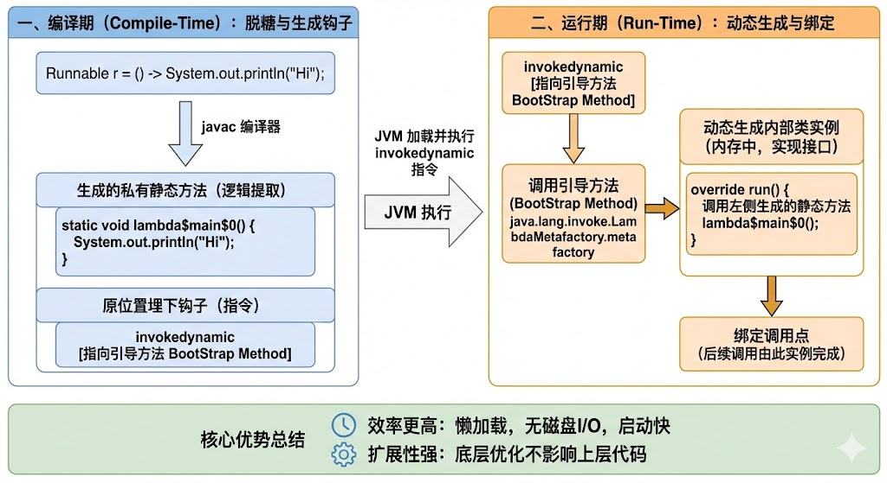

Lambda 表达式在 JVM 底层的实现原理，核心就两个关键词：`**invokedynamic**` **指令** 和 `**LambdaMetafactory**`。

**Lambda 并不是匿名内部类的语法糖（虽然看起来很像）。它是利用 Java 7 引入的** `**invokedynamic**` **字节码指令，在运行时动态生成了一个实现了函数式接口的内部类，来完成调用的。**

具体的实现过程，可以分为 **编译期** 和 **运行期** 两个阶段来拆解：

1. **编译期：脱糖与生成静态方法**

当你写下一个 Lambda 表达式时，编译器（javac）并没有把它编译成一个 EnclosingClass$1.class 这样的匿名内部类文件。

它做了两件事：

    1. **生成静态方法：** 编译器把你 Lambda 表达式里的代码逻辑，提取出来，生成了一个私有的静态方法。
    2. **埋下钩子：** 在原本 Lambda 出现的地方，生成了一条 `**invokedynamic**` 指令。这条指令指向了一个“引导方法”。
1. **运行期：动态生成类**

当 JVM 执行到这条 invokedynamic 指令时，真正的魔法开始了：

    1. **调用引导方法：** JVM 会去调用 `java.lang.invoke.LambdaMetafactory.metafactory` 这个方法。
    2. **动态生成内部类：** 这个工厂方法会在内存中，动态生成一个实现了目标函数式接口的类。这个类内部的实现逻辑，就是去调用编译期生成的那个静态方法 `lambda$main$0`。
    3. **绑定调用点：** 最后，将这个动态生成的对象绑定到调用点，后续对 Lambda 的调用，就变成了对这个动态类的调用。
2. **为什么要这么折腾？**
    1. **效率更高：** 匿名内部类在编译时会生成物理文件，加载时需要验证、解析等，拖慢启动速度。而 Lambda 是**懒加载**的，只有第一次运行时才生成，且直接在内存生成，无需磁盘 I/O。
    2. **扩展性强：** 只要 JVM 底层的 `invokedynamic` 指令支持的策略变了（比如将来优化成不用生成类了），上层的 Java 代码完全不需要重新编译就能享受优化。

---

### 面试标准回答

Java Lambda 表达式的底层实现并非简单的匿名内部类语法糖，而是依赖于 Java 7 引入的 `**invokedynamic**` **字节码指令**。

**其具体流程分为两步：**

第一，在编译阶段：

编译器会将 Lambda 表达式的方法体逻辑，转换成当前类中的一个私有静态方法（如 lambda$0）。同时，在 Lambda 表达式出现的位置，生成一条 invokedynamic 指令。

第二，在运行阶段：

当 JVM 执行到该指令时，会通过 LambdaMetafactory在内存中动态生成一个实现了目标函数式接口的内部类。

这个动态类的实现逻辑，就是去调用编译阶段生成的那个静态方法。

**总结**：这种方式相比传统的匿名内部类，避免了在编译时生成大量的 `.class` 文件，减少了类加载的开销，性能更好且更灵活。
