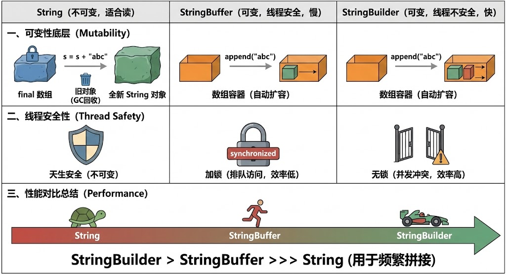

**String 是“不可变”的字符串，适合读；StringBuilder 和 StringBuffer 是“可变”的字符串，适合写。而在可变的这两位里，StringBuilder 快但“不安全”，StringBuffer 慢但“安全”。**

具体区别可以从 **可变性**、**线程安全性** 和 **性能** 这三个维度来拆解：

1. **可变性**
    1. **String（不可变）：**
        - 它的底层是被 `final` 修饰的字符数组（Java 9 以后是 byte 数组）。
        - 这意味着，**一旦创建，无法修改**。
        - 你以为的 `s = s + "abc"`，其实不是在原对象上修改，而是**创建了一个全新的 String 对象**，把旧的和新的拼起来，然后把引用指向新的。这就导致了频繁的内存分配和垃圾回收。
    2. **StringBuilder & StringBuffer（可变）：**
        - 它俩底层也是数组，但没有 `final`。
        - 它们像是“容器”**。当你** `**append("abc")**` **时，是在**同一个对象的内存里直接修改。如果容量不够，它们会自动扩容（就像 ArrayList 一样）。
2. **线程安全性**
    1. **String：** 因为不可变，所以**天生线程安全**。大家随便读，反正改不了。
    2. **StringBuffer：**
        - 它是 Java 早期的产物。
        - 它的所有方法（如 `append`）都加了 `**synchronized**` 锁。
        - **结果：** 线程安全，但在单线程环境下，因为频繁加锁解锁，**效率低**。
    3. **StringBuilder：**
        - 它是 JDK 1.5 推出的替代品。
        - 去掉了 `synchronized` 锁。
        - **结果：** 线程不安全，但**效率极高**。
3. **性能对比**
    1. **结论：** StringBuilder > StringBuffer >>> String (在频繁拼接的场景下)。

---

### 面试标准回答（建议背诵）

这三个类的主要区别体现在**可变性**和**线程安全**上：

第一，String 是不可变的。

它的底层是用 final 修饰的数组。每次对 String 进行拼接或修改，实际上都会创建新的对象。因此，在循环中拼接字符串时，严禁直接使用 + 号，否则会产生大量临时对象，给 GC 带来巨大压力。

第二，StringBuilder 和 StringBuffer 都是可变的。

它们都是继承自 AbstractStringBuilder，可以在原对象上进行修改，避免了内存浪费。

**第三，它们俩的区别在于锁机制**：

- **StringBuffer** 是线程安全的，它的方法加了 `synchronized` 锁，但性能较差。
- **StringBuilder** 是线程不安全的，它去掉了锁，性能最好。

**总结**：

- 如果是操作少量数据，或者作为常量，用 **String**。
- 单线程下的字符串拼接（绝大多数业务场景），无脑用 **StringBuilder**。
- 只有在多线程并发修改同一个字符串的极端场景下，才考虑 **StringBuffer**。
