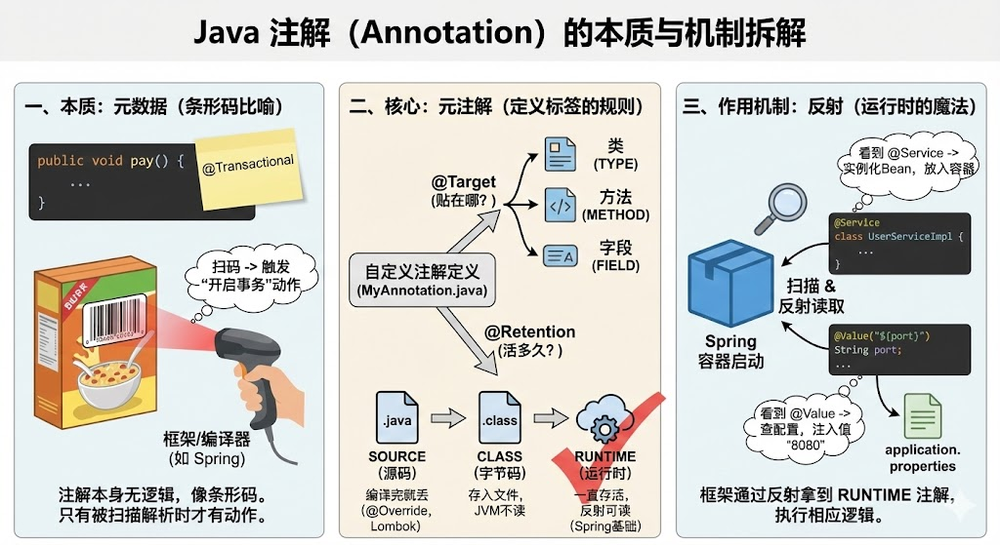

Java 的注解，用最通俗的话说，就是**给代码贴的“标签”或“便利贴”**。

**注解本身没有任何业务逻辑，它只是一种元数据。它静静地待在代码里，只有通过编译器或运行时的“反射机制”去读取它并执行相应操作时，它才会有用。**

要彻底理解它，必须打破“注解有功能”的错觉，从以下 **3 个维度** 来拆解：

1. **本质：元数据**
    1. 很多人以为写了 `@Transactional`，这个方法就自动开启事务了。其实注解本身啥也没干。
    2. **比喻：** 注解就像是超市商品上的**条形码**。
        - 条形码自己不会算账，也不会报警。
        - 只有当扫码枪（编译器或框架）扫到它时，才会触发“计费”或“报警”的动作。
    3. 如果没有 Spring 这种框架去扫描解析，`@Autowired`、`@Service` 就跟注释一样，对代码运行没有任何影响。
2. **核心：元注解**

面试经常问：“你怎么定义一个注解？” 这就得提到修饰注解的注解。最关键的是这两个：

    1. `**@Target**`**：** 决定这个标签能贴在哪？是贴在类上（TYPE）、方法上（METHOD），还是字段上（FIELD）？
    2. `**@Retention**`**（最重要）：** 决定这个标签能活多久？
        - **SOURCE：** 编译完就丢。比如 `@Override`、Lombok 的 `@Data`。编译器看完就扔了，字节码里没有。
        - **CLASS：** 存到 `.class` 文件里，但 JVM 加载时不读。这是默认值，但平时很少直接用。
        - **RUNTIME：****一直活到运行时。** 这是 Spring、MyBatis 等框架的基础。JVM 会加载它，程序可以通过**反射**拿到它。
3. **作用机制：反射**
    1. 绝大多数我们在业务开发中见到的注解（如 Spring 的注解），都是 **RUNTIME** 级别的。
    2. **原理：** Spring 容器启动时，会扫描所有的类，通过反射拿到类上的注解。
        - 看到 `@Service`，Spring 就知道：“哦，这哥们归我管，我要把它实例化放到容器里。”
        - 看到 `@Value("${port}")`，Spring 就知道：“我要去配置文件里查 port 的值，然后塞给这个字段。”

---

### 面试标准回答

Java 注解本质上是一种**元数据**，它为代码提供了一种形式化的标记，本身不包含任何业务逻辑。

**我们可以从它的生命周期和应用场景来理解：**

第一，编译期注解：

这类注解只在源码中存在，编译成字节码后就被丢弃了。

最典型的例子是 @Override（给编译器检查用的）。

第二，运行时注解：

这类注解会被保留到 JVM 中，使得我们在程序运行时可以通过反射（Reflection）机制读取到它们。

这是 Spring、MyBatis 等现代框架的基石。比如 Spring 的 IOC 和 AOP，就是在容器启动时扫描类上的 @Controller、@Transactional 等注解，根据注解的标记动态创建 Bean 或生成动态代理。
