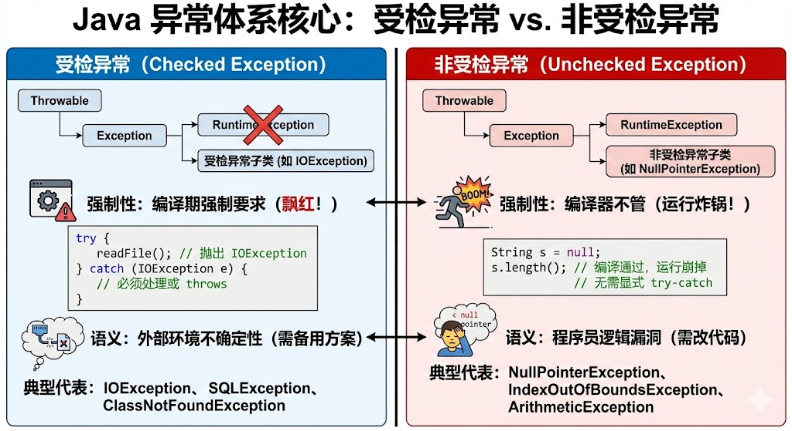

Java 中的异常体系虽然看起来庞大，但归根结底，面试中你只需要抓住“受检”**和**“非受检”这两大阵营的区别即可。**受检异常是“编译器的强制要求”，你不处理代码就飘红；非受检异常是“程序员的逻辑漏洞”，编译器不管，炸了是你自己的锅。**

具体区别可以从**强制性**、**语义**和**回滚策略**三个维度来拆解：

1. **受检异常**
    1. **定义：** 继承自 `Exception` 但**不继承**`RuntimeException` 的异常。
    2. **特点：** 如果你调用了一个抛出受检异常的方法（比如读文件），编译器会强迫你必须显式地用 `try-catch` 捕获或者 `throws` 抛出去，否则代码编译不通过。
    3. **典型代表：**`IOException`（文件读写错误）、`SQLException`（数据库错误）、`ClassNotFoundException`。
    4. **设计初衷：** 这类异常通常代表“外部环境的不确定性”（比如网断了、文件被删了），这是程序无法控制但必须预料到的情况，所以强迫你写备用方案。
2. **非受检异常**
    1. **定义：** 继承自 `RuntimeException` 的异常（包括 `Error` 也算非受检，但一般不讨论）。
    2. **特点：** 代码里没写 `try-catch` 也能编译通过，但在运行的时候可能会突然崩掉。
    3. **典型代表：**`NullPointerException`（空指针）、`IndexOutOfBoundsException`（数组越界）、`ArithmeticException`（除以零）。
    4. **设计初衷：** 这类异常通常代表“代码逻辑错误”。是你写代码不严谨导致的（比如没判空），这种问题不应该用 try-catch 去掩盖，而是应该去改代码。

---

### 面试标准回答

Java 中的异常主要分为两大类：**受检异常和非受检异常**。

第一，受检异常：

这类异常在编译阶段就会被检查。如果程序中可能出现这类异常（如 IOException、SQLException），编译器会强制要求开发者通过 try-catch 捕获或 throws 声明抛出，否则编译不通过。

它们通常代表程序无法控制的外部错误，是必须要处理的‘可恢复’异常。

第二，非受检异常：

这类异常继承自 RuntimeException。编译器不强制要求处理，代码可以编译通过。

常见的如 NullPointerException、IndexOutOfBoundsException。它们通常代表程序员的代码逻辑错误，理论上应该通过修改代码来避免，而不是依靠捕获来解决。
