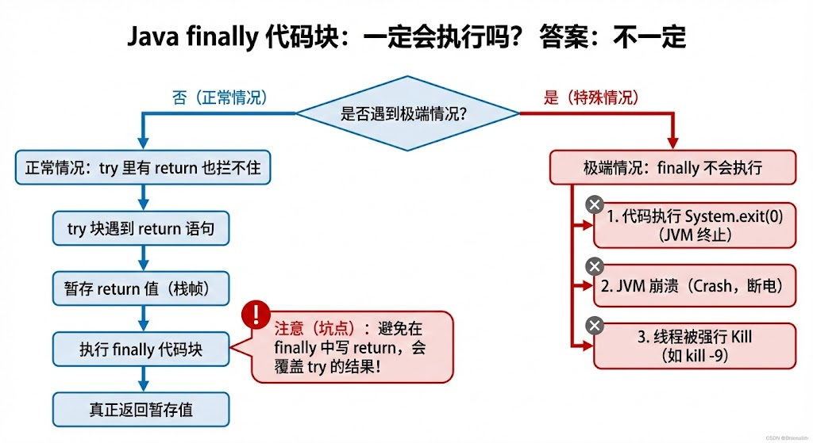

**在正常情况下，它是一定会执行的（甚至包括你在 try 里写了 return）；但在极端情况下（比如 JVM 挂了），它不会执行。**

所以，答案是：**不一定。**

具体可以分为 **“为什么会执行”** 和 **“什么时候不执行”** 两个维度来回答：

1. **正常情况：return 也拦不住它**

这是面试官最喜欢问的场景：“如果在 try 块里写了 return，finally 还会执行吗？”

    1. **答案是：会。**
    2. **执行顺序：**
        - 程序运行到 try 里的 `return` 语句。
        - 先把 `return` 后面的值（或者引用）暂存起来（放在栈帧的局部变量表中）。
        - **转而去执行** `**finally**` **代码块。**
        - `finally` 执行完了，再把刚才暂存的那个值真正返回给调用者。
    3. **注意（坑点）：** 尽量不要在 `finally` 里写 `return`。因为如果 `finally` 里也写了 `return`，它会直接覆盖掉 try 里的 `return`，导致程序逻辑诡异，且会吞掉 try 里可能抛出的异常。
1. **特殊情况**

只有以下几种情况，JVM 会直接停止，导致 finally 来不及执行：

    1. **代码里执行了** `**System.exit(0)**`**：** 这是最常见的标准答案。这行代码是通知 JVM 立刻终止，相当于直接拔电源，JVM 都要关门了，当然没空去跑 `finally`。
    2. **JVM 崩溃：** 比如内存溢出导致 JVM 进程强行退出，或者电脑断电。
    3. **线程被强行 Kill：** 如果执行这段代码的线程突然被系统杀死了（比如 `kill -9`），那自然也就断了。

---

### 面试标准回答（建议背诵）

关于 `finally` 代码块是否一定执行，我的回答是：**通常情况下会执行，但有特例。**

第一，在绝大多数正常运行中，finally 是一定会执行的。

即使我们在 try 或 catch 块中执行了 return 语句，finally 依然会执行。

此时的执行逻辑是：程序会先计算 return 语句的值并暂存起来，然后去执行 finally 块，最后再将暂存的值返回。所以，finally 甚至可以用来做一些资源释放的工作，哪怕业务逻辑已经返回了。

第二，只有一种常见情况会导致 finally 不执行，那就是 System.exit(int)或者断电、进程被杀。

这意味着 JVM 进程被立即终止，程序会直接停止运行，finally 块自然也就没有机会执行了。
